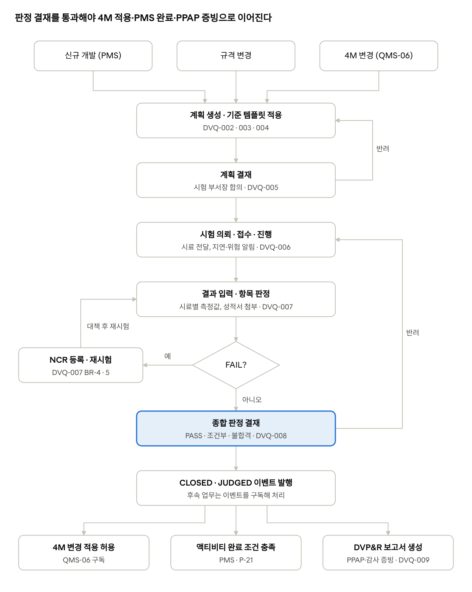

# SL QMS 워크아이템 Vol.2 — QMS-02 개발 품질

Nov 1, 2026 · @배창욱

## 1. 개요

Vol.2는 QMS RFP 개발 품질 모듈의 **Q-4 부품 인정시험, Q-5 제품 인정시험**을 10개 워크아이템(QMS-02-DVQ-001~010)으로 내린다. 부품과 제품은 같은 엔진을 쓰고 레코드타입(PART / PRODUCT)으로만 구분한다.

**도메인 정의**: 인정시험은 "설계 사양을 만족하는가, 양산에 적용해도 되는가"를 시험으로 증명하는 업무다. 자동차 업계 표준 산출물로는 **DVP&R**(Design Verification Plan & Report: 시험 항목·방법·판정 기준·시료 수·담당·일정을 계획하고 결과를 같은 표에 기록)에 해당한다. RFP의 "기획" = DVP 작성, "실행" = 시험 수행과 결과(R) 기록, "판정" = 양산 적용 가능 여부 결정이다. 헤드램프는 환경(열충격·고온고습·결로), 방수·방진, 진동, 광학(배광), 내광성, 전기·EMC 시험이 주 대상이다.

**트리거 3종**(RFP 원문 기준): 신규 개발(PMS 프로젝트), 규격 변경(도면·사양 변경), 4M 변경(QMS-06). 트리거 종류와 변경 유형에 따라 필수 시험이 달라지므로, 고객·제품군·트리거별 **시험 기준 템플릿**을 설정 데이터로 두고 계획을 자동 생성한다. 회사표준 개편(신제품개발 26.11~27.04) 결과를 개발 없이 반영하기 위한 설계다.

**선행 공통 WI**: ARC-002·003, MDM-004·005·006·007, SEC-001·002·003, APV-001·002, TDO-001, NTF-001, DOC-001, UX-003.

**다른 메뉴와의 경계**

| 연결 대상                | 이 Vol.이 하는 것                                         | 상대 메뉴가 하는 것                                  |
|--------------------------|-----------------------------------------------------------|------------------------------------------------------|
| 4M 변경 (QMS-06-4MC)     | 4M 건에서 호출할 계획 생성 서비스와 판정 결과 이벤트 제공 | 4M 화면에서 서비스 호출, 판정 PASS 전 4M 적용 차단   |
| PMS 프로젝트·액티비티    | 같은 서비스·이벤트 제공                                   | 액티비티 완료 조건에 "인정시험 판정 PASS" 연결(P-21) |
| 부적합 NCR (QMS-06-NCR)  | 시험 불합격 시 NCR 생성 요청 인터페이스 정의              | NCR 생성 구현                                        |
| 협력사 포털 (QMS-03-SPP) | 협력사 수행 시험의 제출·검토 로직                         | 포털 기반·사용자·공유                                |
| 신뢰성 시스템 (QMS-09)   | 시험 라인에 "실행 시스템" 구분 필드와 상태 수신 규칙      | 인터페이스 구현                                      |
| Re-PPAP (QMS-03/04)      | 판정 보고서를 DocClass DVPR 문서로 등록                   | PPAP 체크리스트에서 참조                             |
| AI (QMS-08)              | —                                                         | 변경 내용 기반 필요 시험 추천(W3)                    |

**Vol.0 상태**: 검토 의견이 아직 없어 "검토 대기"로 두고 이 Vol.을 진행한다. Vol.0의 결정 항목(D-1~D-10)이 바뀌면 이 Vol.의 해당 BR도 함께 수정한다.

## 2. 업무 흐름

인정시험 업무 흐름 · 트리거 3종, 결재 2회, 불합격 재시험 루프

불합격 항목은 NCR 등록과 대책 후 재시험으로 돌아가고, 판정 결과는 JUDGED 이벤트로만 4M·PMS·PPAP 쪽에 전달된다(직접 갱신 없음).

## 3. 데이터 모델 개요

객체는 **설정 데이터 3개**(무엇을 어떤 기준으로 시험하나)와 **업무 데이터 3개**(이번 건을 어떻게 시험했나)로 나뉜다. 업무 데이터는 생성 시점의 기준값을 스냅숏으로 복사해, 라이브러리가 나중에 바뀌어도 과거 판정 근거가 변하지 않게 한다(감사 재현성).

| 객체                      | 구분 | 관계                                    | 역할                                             | 정의 WI |
|---------------------------|------|-----------------------------------------|--------------------------------------------------|---------|
| QMS_TestItem__c         | 설정 | —                                       | 시험 항목 라이브러리(방법·조건·판정 기준 기본값) | DVQ-001 |
| QMS_TestStandard__c     | 설정 | —                                       | 시험 기준 세트(고객·제품군·트리거별)             | DVQ-002 |
| QMS_TestStandardLine__c | 설정 | Standard(MD), TestItem(Lookup)          | 세트에 포함되는 시험과 필수 여부                 | DVQ-002 |
| QMS_QualPlan__c         | 업무 | Item, Supplier, Customer, Plant(Lookup) | 인정시험 1건(DVP&R 1장)                          | DVQ-003 |
| QMS_QualPlanLine__c     | 업무 | Plan(MD), TestItem(Lookup)              | 시험 1항목의 계획·실행·결과                      | DVQ-003 |
| QMS_QualSampleResult__c | 업무 | PlanLine(MD)                            | 시료별 측정값·판정                               | DVQ-003 |

**상태값**

| 대상                     | 값(순서)                                                                           |
|--------------------------|------------------------------------------------------------------------------------|
| Plan.Status__c         | DRAFT → PLAN_APPROVAL → PLANNED → IN_TEST → JUDGMENT_APPROVAL → CLOSED / CANCELLED |
| Plan.FinalResult__c    | PASS 양산 적용 가능 · CONDITIONAL 조건부 · FAIL 불합격 (CLOSED 시 필수)            |
| PlanLine.LineStatus__c | PLANNED → REQUESTED → RECEIVED → IN_PROGRESS → DONE / WAIVED / CANCELLED           |
| PlanLine.Result__c     | PASS · FAIL · CONDITIONAL · NA                                                     |

**공통 기반 등록(DVQ-003에서 일괄 수행)**: 채번 규칙 QTP-{PLANT}-{YYYY}-{SEQ:5}(ARC-003), 공장 공유 설정(SEC-002), 삭제 통제 DRAFT만 삭제(SEC-003), 상태 진행바 메타데이터(UX-003), DWH 복제 대상 등록(DWH-002).

## 4. 설정: 시험 항목·시험 기준

### QMS-02-DVQ-001 시험 항목 라이브러리

추적 Q-4, Q-5 · 필수 · W1 · SF · DM, LWC · Tailoring · 선행 MDM-001, MDM-007, I18N-001, SEC-001 · 4 M/D

**목적**: "고온고습 시험은 어떤 규격·조건으로 하고 무엇으로 판정하나"를 한 번 정의해 모든 계획이 재사용한다. 시험 담당 부서(신뢰성팀·광학팀)와 기본 시료 수까지 포함해야 계획 자동 생성이 가능하다.

**데이터 모델**

| 객체 / 필드                                        | 타입                                                                                                                                                                                          | 필수                                     | 설명                                                         |
|----------------------------------------------------|-----------------------------------------------------------------------------------------------------------------------------------------------------------------------------------------------|------------------------------------------|--------------------------------------------------------------|
| QMS_TestItem__c.TestCode__c                    | Text(30), External ID, Unique                                                                                                                                                                 | Y                                        | 예: ENV-THS-001(열충격), SEA-IPX9K-001                       |
| QMS_TestItem__c.Name / NameEn__c / NameZh__c | Text(80)                                                                                                                                                                                      | Y / N / N                                | 다국어 표시명(I18N-001 패턴, DisplayName__c 포함)          |
| QMS_TestItem__c.Category__c                    | Picklist (ENVIRONMENTAL 환경, MECHANICAL 기계·진동, OPTICAL 광학·배광, ELECTRICAL 전기·EMC, SEALING 방수·방진·기밀, MATERIAL 재료·내광성, DURABILITY 내구, DIMENSIONAL 치수, APPEARANCE 외관) | Y                                        |                                                              |
| QMS_TestItem__c.MethodStandard__c              | Text(255)                                                                                                                                                                                     | Y                                        | 시험 규격·조항(OEM 규격, ISO, ECE 등)                        |
| QMS_TestItem__c.Condition__c                   | Long Text(4000)                                                                                                                                                                               | Y                                        | 시험 조건(온도 범위, 사이클 수, 시간 등)                     |
| QMS_TestItem__c.JudgmentType__c                | Picklist (VALUE_RANGE 수치 범위, PASS_FAIL 합불, VISUAL 외관 비교, REPORT 성적서 판정)                                                                                                        | Y                                        | 결과 입력 화면 형태를 결정                                   |
| QMS_TestItem__c.Unit__c / LSL__c / USL__c  | Picklist / Number(18,6)                                                                                                                                                                       | VALUE_RANGE면 Unit + LSL·USL 중 1개 필수 | 기본 판정 범위                                               |
| QMS_TestItem__c.Criteria__c                    | Long Text(4000)                                                                                                                                                                               | Y                                        | 판정 기준 서술(예: "시험 후 렌즈 내부 결로 없음, 점등 정상") |
| QMS_TestItem__c.DefaultSampleQty__c            | Number(4,0)                                                                                                                                                                                   | Y                                        | 기본 시료 수                                                 |
| QMS_TestItem__c.DefaultDurationDays__c         | Number(4,0)                                                                                                                                                                                   | Y                                        | 표준 소요 일수(시료 준비 제외)                               |
| QMS_TestItem__c.DefaultExecutor__c             | Picklist (INTERNAL_LAB 사내 시험실, SUPPLIER 협력사, EXTERNAL_LAB 외부 기관)                                                                                                                  | Y                                        |                                                              |
| QMS_TestItem__c.ResponsibleDept__c             | Lookup(CMN_Department__c)                                                                                                                                                                   | INTERNAL_LAB면 Y                         | 시험 수행 부서                                               |
| QMS_TestItem__c.Revision__c                    | Number(3,0)                                                                                                                                                                                   | Y                                        | 1부터. 규격·조건·기준 변경 시 증가                           |
| QMS_TestItem__c.Status__c                      | Picklist (ACTIVE, OBSOLETE)                                                                                                                                                                   | Y                                        |                                                              |

**비즈니스 규칙**

- BR-1: MethodStandard·Condition·JudgmentType·LSL·USL·Criteria 중 하나를 바꾸면 Revision__c를 1 올리고 Field History로 이전 값을 남긴다. 기존 계획 라인은 스냅숏을 갖고 있으므로 영향받지 않는다(DVQ-003 BR-2).

- BR-2: OBSOLETE 항목은 새 기준 세트·계획에 추가할 수 없다. 이미 쓰인 항목은 삭제 불가.

- BR-3: 편집 권한은 QMS_PS_TestLibrary_Admin(QualityAdmin·신뢰성팀장 PSG) 보유자만. 그 외 사용자는 조회.

- BR-4: 엑셀 일괄 등록 — 표준 Data Import Wizard 대신 CSV 업로드 LWC qmsTestItemImport(TestCode 기준 upsert, 행별 오류 표시)를 제공한다. SL 현행 시험 기준 이관용.

**수용 기준**

- AC-1: Given VALUE_RANGE 항목에 LSL·USL 모두 공란, When 저장, Then 차단.

- AC-2: Given Rev 1 항목의 Condition 수정, When 저장, Then Revision 2, 이전 조건은 이력에 남음.

- AC-3: Given CSV 100행 중 3행 오류, When 업로드, Then 97행 반영 + 오류 3행 사유 표시.

**오픈 이슈**: SL 현행 시험 기준 원천(신뢰성 시스템 마스터인지, 엑셀 기준서인지). 신뢰성 시스템이 원천이면 이 라이브러리는 QMS-09 연계로 동기화하고 편집을 막는다.

### QMS-02-DVQ-002 시험 기준 템플릿(필수 시험 매트릭스)

추적 Q-4, Q-5, Q-19, Q-20 · 필수 · W1 · SF · DM, APEX, LWC · Customization · 선행 DVQ-001, MDM-003, MDM-004 · 5 M/D

**목적**: "BMW 헤드램프 신규 개발이면 이 28개, 렌즈 재질 4M 변경이면 이 6개"처럼 조건별 필수 시험 세트를 정의한다. 회사표준 지침의 "변경 유형별 검증 기준표"를 시스템 데이터로 옮긴 것이다.

**데이터 모델**

| 객체 / 필드                                                              | 타입                                       | 필수            | 설명                                                         |
|--------------------------------------------------------------------------|--------------------------------------------|-----------------|--------------------------------------------------------------|
| QMS_TestStandard__c.Scope__c                                         | Picklist (PART, PRODUCT)                   | Y               |                                                              |
| QMS_TestStandard__c.Customer__c                                      | Lookup(Account, 고객 RT)                   | N               | 공란 = 모든 고객                                             |
| QMS_TestStandard__c.ProductGroup__c                                  | Lookup(CMN_ProductGroup__c)              | N               | 공란 = 모든 제품군                                           |
| QMS_TestStandard__c.PartCategory__c                                  | Picklist(MDM-004와 같은 값)                | N               | PART 전용                                                    |
| QMS_TestStandard__c.TriggerType__c                                   | Picklist (NEW_DEV, SPEC_CHANGE, CHANGE_4M) | Y               |                                                              |
| QMS_TestStandard__c.ChangeTypes__c                                   | Text(1000)                                 | CHANGE_4M이면 Y | 적용 4M 변경 유형 코드(CMN_Code 그룹 CHANGE_TYPE, 쉼표 구분) |
| QMS_TestStandard__c.Phase__c                                         | Picklist (DV, PV, CHANGE)                  | Y               | DV 설계 검증, PV 양산 공정 검증, CHANGE 변경 검증            |
| QMS_TestStandard__c.Status__c                                        | Picklist (DRAFT, ACTIVE, OBSOLETE)         | Y               |                                                              |
| QMS_TestStandard__c.Version__c                                       | Number(3,0)                                | Y               |                                                              |
| QMS_TestStandard__c.StandardDocUrl__c                                | URL                                        | N               | 근거 회사표준(지침) 링크                                     |
| QMS_TestStandardLine__c.Standard__c                                  | Master-Detail                              | Y               |                                                              |
| QMS_TestStandardLine__c.TestItem__c                                  | Lookup(QMS_TestItem__c, ACTIVE 필터)     | Y               |                                                              |
| QMS_TestStandardLine__c.IsMandatory__c                               | Checkbox                                   | Y               | 필수 시험(면제하려면 결재 필요)                              |
| QMS_TestStandardLine__c.SampleQtyOverride__c / CriteriaOverride__c | Number(4,0) / Long Text(4000)              | N               | 고객별 상향 조건                                             |
| QMS_TestStandardLine__c.Sequence__c                                  | Number(4,0)                                | Y               | 표시·시험 순서                                               |

**비즈니스 규칙**

- BR-1: 선택 알고리즘 QMS_TestStandardSelector.select(scope, customerId, productGroupId, partCategory, triggerType, changeTypes, phase) — Status ACTIVE 중 조건이 맞는(공란 = 와일드카드) 세트를 고르고 구체성 점수로 정렬한다. 점수: Customer 일치 +8, ProductGroup 일치 +4, PartCategory 일치 +2, ChangeTypes 교집합 존재 +1. 최고점 세트 1개를 기본으로 하되 같은 점수가 여러 개면 모두 반환해 사용자가 고른다.

- BR-2: CHANGE_4M 트리거에서 변경 유형이 여러 개면 유형별로 맞는 세트들의 라인을 **합집합**으로 만들고 같은 TestItem은 한 번만(시료 수는 최댓값, 필수는 OR).

- BR-3: ACTIVE 세트는 라인을 직접 수정할 수 없다. "새 버전 만들기"로 DRAFT 복사본(Version + 1)을 만들어 고치고, 활성화하면 이전 버전은 OBSOLETE.

- BR-4: 활성화는 QMS_PS_TestLibrary_Admin 보유자만. 활성화 시 같은 조건 키(Scope, Customer, ProductGroup, PartCategory, TriggerType, Phase, ChangeTypes)의 ACTIVE 세트가 이미 있으면 차단(중복 기준 방지).

- BR-5: 화면 qmsTestStandardEditor — 좌측 라이브러리 검색(카테고리 필터), 우측 세트 라인 그리드(드래그 순서, 필수 토글, 오버라이드 입력).

**수용 기준**

- AC-1: Given 전사 헤드램프 NEW_DEV 세트와 BMW 헤드램프 NEW_DEV 세트, When BMW 건 선택, Then BMW 세트(점수 12) 선택.

- AC-2: Given 4M 유형 \[금형 수정, 재질 변경\]과 각각의 세트(열충격 공통 포함), When 선택, Then 라인 합집합에서 열충격 1회, 시료 수는 두 세트 중 큰 값.

- AC-3: Given 같은 조건 키의 ACTIVE 세트 존재, When 다른 세트 활성화, Then 차단.

- AC-4: Given 맞는 세트 없음, When 선택, Then 빈 결과 + "기준 없음, 수동 구성" 표시.

**에이전트 주의**: 선택 로직을 Flow로 만들지 않는다(점수·합집합 계산과 테스트 용이성 때문에 Apex 서비스). CHANGE_TYPE 코드 그룹은 QMS-06-4MC와 공유하므로 이 WI에서 그룹만 만들고 값은 QualityAdmin이 등록한다.

**오픈 이슈**: 4M 변경 유형 분류표와 유형별 필수 시험(회사표준 개정 결과 반영 시점), 고객별 필수 시험 차이(CSR) 자료.

## 5. 계획: 인정시험 계획(DVP) 수립·결재

### QMS-02-DVQ-003 인정시험 계획 데이터 모델·상태 규칙

추적 Q-4, Q-5 · 필수 · W1 · SF · DM, APEX · Customization · 선행 DVQ-001, ARC-003, SEC-002, SEC-003, UX-003 · 6 M/D

**데이터 모델**

| 객체 / 필드                                                                                                                                                                             | 타입                                               | 필수                                    | 설명                                                         |
|-----------------------------------------------------------------------------------------------------------------------------------------------------------------------------------------|----------------------------------------------------|-----------------------------------------|--------------------------------------------------------------|
| QMS_QualPlan__c (RecordType PART, PRODUCT).RecordNo__c                                                                                                                              | Text(40), Unique                                   | Y                                       | QTP-{PLANT}-{YYYY}-{SEQ:5}                                   |
| QMS_QualPlan__c.Name                                                                                                                                                                  | Text(80)                                           | Y                                       | 제목(예: "G70 HL 렌즈 재질 변경 검증")                       |
| QMS_QualPlan__c.Item__c                                                                                                                                                             | Lookup(CMN_Item__c)                              | Y                                       | PART면 ItemType PART, PRODUCT면 FG·SFG                       |
| QMS_QualPlan__c.Supplier__c                                                                                                                                                         | Lookup(Account, 협력사 RT)                         | PART면 Y                                |                                                              |
| QMS_QualPlan__c.Customer__c / Vehicle__c                                                                                                                                          | Lookup                                             | PRODUCT면 Customer Y                    | Item에서 기본값                                              |
| QMS_QualPlan__c.Plant__c                                                                                                                                                            | Lookup(CMN_Plant__c)                             | Y                                       | 공유 기준                                                    |
| QMS_QualPlan__c.TriggerType__c / ChangeTypes__c / Phase__c                                                                                                                      | DVQ-002와 같은 값                                  | Y / 4M이면 Y / Y                        |                                                              |
| QMS_QualPlan__c.Standard__c / StandardVersion__c                                                                                                                                  | Lookup(QMS_TestStandard__c) / Number(3,0)        | N                                       | 적용한 기준 세트·버전                                        |
| QMS_QualPlan__c.SourceRecordId__c / SourceObject__c / SourceRecordNo__c                                                                                                         | Text(18) / Text(80) / Text(40)                     | N                                       | 트리거 원천(4M 건, PMS 액티비티 등)                          |
| QMS_QualPlan__c.TargetDate__c                                                                                                                                                       | Date                                               | Y                                       | 종합 판정 완료 목표일                                        |
| QMS_QualPlan__c.ResponsibleDept__c                                                                                                                                                  | Lookup(CMN_Department__c)                        | Y                                       | 주관 부서                                                    |
| QMS_QualPlan__c.Status__c / FinalResult__c                                                                                                                                        | 3절 상태값                                         | Y / CLOSED면 Y                          |                                                              |
| QMS_QualPlan__c.ResultCondition__c                                                                                                                                                  | Long Text(4000)                                    | CONDITIONAL이면 Y                       | 조건부 승인 조건(예: "양산 초기 3개월 고온고습 월 1회 추가") |
| QMS_QualPlan__c.CancelReason__c                                                                                                                                                     | Text(255)                                          | CANCELLED면 Y                           |                                                              |
| QMS_QualPlan__c.MandatoryLines__c / DoneLines__c / FailLines__c                                                                                                                 | Roll-up(COUNT)                                     | —                                       | 진척·판정 근거                                               |
| QMS_QualPlan__c.Progress__c                                                                                                                                                         | Formula(Percent)                                   | —                                       | DoneLines / 전체 유효 라인(WAIVED·CANCELLED 제외)            |
| QMS_QualPlan__c.IsOverdue__c                                                                                                                                                        | Formula(Checkbox)                                  | —                                       | CLOSED·CANCELLED 아니고 TargetDate \< TODAY()                |
| QMS_QualPlanLine__c.Plan__c                                                                                                                                                         | Master-Detail                                      | Y                                       |                                                              |
| QMS_QualPlanLine__c.TestItem__c                                                                                                                                                     | Lookup(QMS_TestItem__c)                          | Y                                       |                                                              |
| QMS_QualPlanLine__c 스냅숏: TestCode__c, TestName__c, TestItemRevision__c, MethodStandard__c, Condition__c, JudgmentType__c, Unit__c, LSL__c, USL__c, Criteria__c | 원본과 같은 타입                                   | Y(해당 시)                              | 생성 시 복사                                                 |
| QMS_QualPlanLine__c.IsMandatory__c                                                                                                                                                  | Checkbox                                           | Y                                       |                                                              |
| QMS_QualPlanLine__c.SampleQty__c                                                                                                                                                    | Number(4,0)                                        | Y                                       | 1 이상                                                       |
| QMS_QualPlanLine__c.Executor__c / ExecutorDept__c / ExternalLabName__c                                                                                                          | Picklist / Lookup(CMN_Department__c) / Text(120) | Y / INTERNAL_LAB면 Y / EXTERNAL_LAB면 Y |                                                              |
| QMS_QualPlanLine__c.ExecutionSystem__c                                                                                                                                              | Picklist (QMS, RELIABILITY_SYS)                    | Y                                       | RELIABILITY_SYS면 실행 상태·결과를 연계로만 갱신             |
| QMS_QualPlanLine__c.PlannedStart__c / PlannedEnd__c / ActualStart__c / ActualEnd__c                                                                                           | Date                                               | 계획일 Y                                |                                                              |
| QMS_QualPlanLine__c.LineStatus__c / Result__c                                                                                                                                     | 3절 상태값                                         | Y / DONE이면 Y                          |                                                              |
| QMS_QualPlanLine__c.WaiverReason__c                                                                                                                                                 | Text(500)                                          | WAIVED면 Y                              | 면제 사유(고객 승인 근거 등)                                 |
| QMS_QualPlanLine__c.RetestOf__c / RetestNo__c                                                                                                                                     | Lookup(self) / Number(2,0)                         | N                                       | 재시험 연결                                                  |
| QMS_QualPlanLine__c.NcrRecordId__c                                                                                                                                                  | Text(18)                                           | N                                       | 불합격 시 생성된 NCR                                         |
| QMS_QualPlanLine__c.ReportDocument__c                                                                                                                                               | Lookup(CMN_Document__c)                          | DONE이면 Y                              | 시험 성적서(DocClass TEST_REPORT)                            |
| QMS_QualPlanLine__c.Sequence__c                                                                                                                                                     | Number(4,0)                                        | Y                                       |                                                              |
| QMS_QualSampleResult__c.Line__c                                                                                                                                                     | Master-Detail                                      | Y                                       |                                                              |
| QMS_QualSampleResult__c.SampleNo__c                                                                                                                                                 | Text(20)                                           | Y                                       | 시료 번호(라인 내 Unique)                                    |
| QMS_QualSampleResult__c.Value__c                                                                                                                                                    | Number(18,6)                                       | VALUE_RANGE면 Y                         |                                                              |
| QMS_QualSampleResult__c.VisualResult__c                                                                                                                                             | Picklist (OK, NG)                                  | VISUAL·PASS_FAIL이면 Y                  |                                                              |
| QMS_QualSampleResult__c.IsPass__c                                                                                                                                                   | Checkbox                                           | —                                       | 저장 시 서버 계산                                            |
| QMS_QualSampleResult__c.Remark__c                                                                                                                                                   | Text(500)                                          | N                                       |                                                              |

**비즈니스 규칙**

- BR-1: 상태 전이는 서비스 메서드로만 한다(화면에서 Status 필드 직접 편집 불가, FLS Read). 허용 전이: DRAFT→PLAN_APPROVAL(상신), PLAN_APPROVAL→PLANNED(승인)/DRAFT(반려), PLANNED→IN_TEST(첫 라인 REQUESTED 시 자동), IN_TEST→JUDGMENT_APPROVAL(판정 상신), JUDGMENT_APPROVAL→CLOSED(승인)/IN_TEST(반려), CLOSED 이전 모든 상태→CANCELLED(주관 부서원 또는 품질팀장, 사유 필수).

- BR-2: 스냅숏 필드는 라인 생성 시 TestItem(+기준 세트 오버라이드)에서 복사한다. PLAN_APPROVAL 이후 스냅숏·IsMandatory·SampleQty는 수정 불가.

- BR-3: PLANNED 이후 수정 가능한 필드는 실행 필드(LineStatus, Actual 일자, Result, ReportDocument, 시료 결과)뿐이다. 계획 일자 변경은 "일정 변경" 액션으로만 하며 변경 사유를 코멘트(UX-003)에 자동 기록한다.

- BR-4: SampleResult.IsPass — VALUE_RANGE: LSL ≤ Value ≤ USL(존재하는 경계만), VISUAL·PASS_FAIL: VisualResult = OK.

- BR-5: 공통 기반 등록 — 채번 규칙, CMN_SharingConfig(Plant__c만. 협력사 공유는 하지 않으며 협력사 접근은 DVQ-010 제출 객체로만), CMN_DeleteGuard(DRAFT만), CMN_StatusFlow, 필드 이력(Status, FinalResult, TargetDate, Line.Result, Line.LineStatus), DWH 복제(15분), 번역(ko/en/zh).

- BR-6: 권한 셋 — QMS_PS_Qual_Read, QMS_PS_Qual_Edit, QMS_PS_Qual_LabExecute(라인 실행 필드만). 페르소나 매핑은 8절 검토 항목 참조.

**수용 기준**

- AC-1: Given PLANNED 계획, When 라인 SampleQty 수정, Then 차단.

- AC-2: Given VALUE_RANGE(LSL 없음, USL 0.5) 시료 값 0.6, When 저장, Then IsPass = false.

- AC-3: Given 라이브러리 항목 Rev 2로 개정, When 기존 계획 라인 조회, Then Rev 1 스냅숏 유지.

- AC-4: Given 사용자가 Status 필드를 API로 직접 변경, When 저장, Then 차단(허용 전이 서비스 외).

### QMS-02-DVQ-004 계획 생성 마법사·라인 편집 그리드

추적 Q-4, Q-5 · 필수 · W1 · SF · LWC, APEX · Customization · 선행 DVQ-002, DVQ-003, UX-001 · 7 M/D

**화면 구성**

| 컴포넌트          | 위치                   | 기능                                                                           |
|-------------------|------------------------|--------------------------------------------------------------------------------|
| qmsQualPlanWizard | 새로 만들기 오버라이드 | 1단계 기본정보 → 2단계 기준 세트 선택 → 3단계 라인 미리보기·편집 → 저장(DRAFT) |
| qmsQualPlanGrid   | 계획 레코드 페이지     | 라인 그리드(인라인 편집), 라이브러리에서 추가, 삭제/면제, 일정 막대 보기 토글  |
| qmsQualPlanCopy   | 계획 레코드 액션       | 이전 계획 복사(같은 품번 또는 같은 PartCategory 계획 검색)                     |

**비즈니스 규칙**

- BR-1: 1단계에서 품번을 고르면 Customer·Vehicle·ProductGroup·PartCategory를 품번에서 채우고, PART는 CMN_SupplierItem__c에서 해당 공장 공급 협력사를 제시한다(1개면 자동 선택).

- BR-2: 2단계는 DVQ-002 선택 결과를 점수순으로 보여주고 1개를 고르거나 "기준 없이 수동 구성"을 고른다. 기준 세트를 고르면 StandardVersion을 기록한다.

- BR-3: 자동 일정 — 라인 PlannedEnd = TargetDate − 판정 여유일(CMN 설정 QMS_QUAL_JUDGMENT_BUFFER_DAYS, 기본 5), PlannedStart = PlannedEnd − DefaultDurationDays. PlannedStart가 오늘보다 이르면 라인을 빨간색으로 표시(차단 아님).

- BR-4: 라인 제거 — 비필수는 삭제, 필수는 삭제 불가하고 "면제"(WAIVED + 사유)만 가능. 면제 라인은 계획 결재에서 결재자가 확인하도록 Summary 스냅숏에 별도 표시.

- BR-5: 상신 전 검증 — 유효 라인 1개 이상, 모든 라인에 Executor·SampleQty·계획일, INTERNAL_LAB은 ExecutorDept, EXTERNAL_LAB은 기관명. 실패 항목을 그리드에서 강조.

- BR-6: 계획 복사는 라인 구성(시험 항목·시료 수·수행 주체)만 복사하고 일정은 BR-3으로 다시 계산한다. 결과·시료 데이터는 복사하지 않는다.

- BR-7: 모바일에서는 그리드를 읽기 전용 카드 목록으로 표시한다.

**수용 기준**

- AC-1: Given BMW 헤드램프 품번, When 마법사 2단계, Then BMW NEW_DEV 세트가 1순위.

- AC-2: Given 필수 라인, When 삭제 버튼, Then 면제 사유 입력 창이 열리고 삭제되지 않는다.

- AC-3: Given TargetDate 30일 후, 소요 40일 항목, When 생성, Then 해당 라인 빨간 표시.

- AC-4: Given 라인 60개, When 그리드 로드, Then 2초 이내 표시.

### QMS-02-DVQ-005 계획 결재와 트리거 연계 서비스

추적 Q-4, Q-5, Q-19, Q-20, P-21 · 필수 · W1 · SF · APEX, CFG · Customization · 선행 DVQ-003, APV-001, APV-002, TDO-001 · 5 M/D

**서비스 API (QMS_QualPlanService)**

Id createFromSource(QMS_QualPlanRequest req)  
// req: scope, itemId, supplierId, plantId, customerId, triggerType, changeTypes,  
// phase, targetDate, sourceId, sourceObject, sourceNo, ownerId  
void submitPlan(Id planId, String comment) // APV 상신 래퍼  
void cancel(Id planId, String reason)  
QMS_QualStatusDTO getStatusBySource(Id sourceId) // 원천 화면 표시용

**비즈니스 규칙**

- BR-1: createFromSource는 DRAFT 계획을 만들고, DVQ-002 선택 결과가 정확히 1개면 라인까지 생성한다(여러 개·없음이면 라인 없이 생성). 담당자에게 To-Do(SourceType QMS_QUAL_PLAN_DRAFT, 제목 "인정시험 계획 수립: {RecordNo}")를 연다.

- BR-2: 멱등 — 같은 SourceRecordId + Item + Phase에 CANCELLED가 아닌 계획이 있으면 새로 만들지 않고 기존 Id를 반환한다.

- BR-3: 결재 유형 QMS_QUAL_PLAN(LockOnSubmit = true, KeepLockedAfterApproval = false). 콜백 onSubmitted → PLAN_APPROVAL, onApproved → PLANNED, onRejected·onRecalled → DRAFT.

- BR-4: 결재선 기여 — INTERNAL_LAB 라인의 서로 다른 ExecutorDept 부서장들을 같은 StepNo의 병렬 AGREE 단계로 자동 추가한다(시험 부서가 일정·자원을 합의). Vol.0 APV-002에 "유형별 결재선 기여 인터페이스" 확장이 필요하다(8절 검토 항목).

- BR-5: 이벤트 QMS_QualPlanEvent__e(PlanId__c, SourceRecordId__c, SourceObject__c, EventType__c: CREATED, PLAN_APPROVED, JUDGED, CANCELLED, FinalResult__c)를 상태 변화마다 발행한다. 4M·PMS는 이 이벤트를 구독해 자기 상태를 바꾼다(이 WI는 구독 측을 구현하지 않음).

- BR-6: 계획 승인 시 계획 담당자에게 "시험 의뢰" To-Do를 연다(DVQ-006에서 의뢰하면 종료).

**수용 기준**

- AC-1: Given 같은 4M 건으로 createFromSource 2회, When 호출, Then 계획 1건, 같은 Id 반환.

- AC-2: Given 시험 부서 2곳(신뢰성팀, 광학팀) 라인, When 결재선 해석, Then 두 팀장이 병렬 합의 단계로 포함.

- AC-3: Given 계획 승인, When 처리, Then Status PLANNED, CREATED·PLAN_APPROVED 이벤트 각 1회, 시험 의뢰 To-Do 1건.

**에이전트 주의**: 4M·PMS 객체를 직접 Lookup하거나 갱신하지 않는다(배포 순서 의존 방지). 원천 연결은 SourceRecordId 텍스트와 이벤트로만 한다.

## 6. 실행·판정: 시험 의뢰·결과·종합 판정

### QMS-02-DVQ-006 시험 의뢰·접수·진행 관리

추적 Q-4, Q-5 · 필수 · W1 · SF · DM, APEX, LWC · Customization · 선행 DVQ-005, APV-002(Role), NTF-001 · 6 M/D

**목적**: 계획된 시험을 시험 부서에 의뢰하고, 시료 전달·접수·착수·지연을 추적한다. 시험 일정이 목표일을 넘길 위험을 계획 담당자와 품질팀장이 미리 안다.

**추가 필드(QMS_QualPlanLine__c, 이 WI에서 생성)**

| 필드                                          | 타입                            | 필수                       | 설명                                        |
|-----------------------------------------------|---------------------------------|----------------------------|---------------------------------------------|
| SampleSentDate__c / SampleReceivedDate__c | Date                            | N / RECEIVED면 Y           | 시료 발송·접수일                            |
| Tester__c                                   | Lookup(User)                    | RECEIVED면 Y(INTERNAL_LAB) | 시험 담당자                                 |
| LabRequestNo__c                             | Text(40)                        | N                          | 시험실·신뢰성 시스템 의뢰 번호              |
| IsAtRisk__c                                 | Checkbox                        | —                          | PlannedEnd \> Plan.TargetDate − 판정 여유일 |
| QMS_QualPlan__c.AtRiskLines__c            | Roll-up(COUNT, IsAtRisk = true) | —                          | 계획 단위 위험 표시                         |

**비즈니스 규칙**

- BR-1: 계획 레코드의 "시험 의뢰" 액션 — PLANNED 라인을 다중 선택해 REQUESTED로 바꾼다. 첫 의뢰 시 계획은 IN_TEST(DVQ-003 BR-1). 모든 PLANNED 라인이 의뢰되면 DVQ-005 BR-6 To-Do 종료.

- BR-2: 의뢰 대상별 처리 — INTERNAL_LAB: ExecutorDept의 Role LAB_RECEIVER(APV-002 CMN_RoleAssignment, 부서 기준) 사용자에게 To-Do "시험 접수"; 미지정이면 부서장. EXTERNAL_LAB: 계획 담당자에게 To-Do "외부 시험 진행 관리". SUPPLIER: DVQ-010 규칙.

- BR-3: 접수(RECEIVED) — 접수자가 Tester·SampleReceivedDate를 입력. 접수자는 계획 일정을 다시 제안할 수 있으며, 일정 변경은 DVQ-003 BR-3 "일정 변경" 액션으로만 하고 계획 담당자에게 알림.

- BR-4: 착수 — ActualStart__c 입력 시 IN_PROGRESS.

- BR-5: IsAtRisk 재계산 — 라인 일정 변경 시, 그리고 매일 01:00(공장 시간) 배치에서 계산. 새로 위험 상태가 된 라인이 있으면 계획 담당자·품질팀장(Role QUALITY_MANAGER, 계획 공장)에게 알림 QMS_QUAL_AT_RISK.

- BR-6: 지연 — 라인이 DONE이 아니고 PlannedEnd \< 오늘이면 Tester(없으면 접수자)와 계획 담당자에게 매일 1회 알림.

- BR-7: ExecutionSystem = RELIABILITY_SYS 라인은 의뢰 시 이벤트 QMS_QualLineRequested__e만 발행하고(QMS-09가 신뢰성 시스템으로 전송), 이후 LineStatus·일자·결과는 연계로만 갱신된다. 화면 편집 필드는 잠근다.

- BR-8: 시험 부서용 화면 qmsLabQueue — 내 부서의 REQUESTED·RECEIVED·IN_PROGRESS 라인을 PlannedStart 순으로, 계획 번호·품번·고객·시험명·시료 수·담당·지연 여부와 함께 보여주고 접수·착수를 일괄 처리한다.

**수용 기준**

- AC-1: Given INTERNAL_LAB 라인 3개(신뢰성팀 2, 광학팀 1), When 일괄 의뢰, Then 신뢰성팀 접수자 To-Do 2건, 광학팀 1건, 계획 IN_TEST.

- AC-2: Given 접수자가 PlannedEnd를 목표일 이후로 변경, When 저장, Then IsAtRisk = true, 계획 담당자·품질팀장 알림.

- AC-3: Given RELIABILITY_SYS 라인, When 화면에서 결과 입력 시도, Then 편집 불가.

### QMS-02-DVQ-007 시험 결과 입력·항목 판정·불합격 처리

추적 Q-4, Q-5, Q-21, Q-22 · 필수 · W1 · SF · LWC, APEX · Customization · 선행 DVQ-006, DOC-001, UX-001 · 7 M/D

**화면 qmsQualResultEntry** (라인 레코드·qmsLabQueue에서 열기, 태블릿·모바일 지원)

| JudgmentType      | 입력 형태                                                                                                   |
|-------------------|-------------------------------------------------------------------------------------------------------------|
| VALUE_RANGE       | 시료 수만큼 행(SampleNo 1~n 자동). 값 입력 시 즉시 합불 색 표시. 엑셀에서 복사한 세로 값 목록 붙여넣기 지원 |
| PASS_FAIL, VISUAL | 시료별 OK/NG 토글, NG 시료 사진 첨부(DocClass TEST_PHOTO), 한도견본 참조 링크(QMS-06-LMS 이후 활성)         |
| REPORT            | 시료 입력 없음. 성적서 첨부와 결과 선택만                                                                   |

**비즈니스 규칙**

- BR-1: 제안 결과 — 시료가 모두 IsPass면 PASS, 하나라도 false면 FAIL을 제안한다. 제안이 FAIL인데 PASS를 선택할 수 없다. CONDITIONAL은 선택 가능하되 조건 코멘트 필수.

- BR-2: DONE 조건 — ActualStart·ActualEnd, (REPORT 외) 시료 결과 수 = SampleQty, ReportDocument(DocClass TEST_REPORT, RELEASED) 첨부, Result 입력. 미충족 항목을 화면에 목록으로 보여준다.

- BR-3: 입력 권한 — Tester, ExecutorDept 소속이면서 QMS_PS_Qual_LabExecute 보유자, EXTERNAL_LAB 라인은 계획 담당자. 그 외 사용자는 조회만.

- BR-4: FAIL로 DONE 처리되면 (a) 계획 담당자·품질팀장 즉시 알림 QMS_QUAL_LINE_FAIL, (b) 인터페이스 QMS_NcrGateway.requestFromQualification(lineId) 호출. QMS-06-NCR 배포 전에는 기본 구현이 계획 담당자에게 To-Do "불합격 부적합 등록"을 연다. NCR이 생성되면 NcrRecordId__c를 채운다.

- BR-5: 재시험 — FAIL 라인에서 "재시험 생성"(계획 담당자) 시 새 라인(RetestOf = 원 라인, RetestNo + 1, 같은 스냅숏·필수 여부, PLANNED)을 만든다. 재시험은 계획 재결재 없이 진행하되, 원 라인에 NCR 또는 대책 코멘트가 있어야 생성 가능. 원 FAIL 라인은 이력으로 남는다.

- BR-6: DONE 라인은 결과·시료 값 수정 불가. 오입력 정정은 품질팀장의 "재개(Reopen)" 액션(사유 필수, 코멘트 자동 기록)으로 IN_PROGRESS로 되돌린 뒤 수정.

**수용 기준**

- AC-1: Given 시료 5개 중 1개 USL 초과, When 결과 선택, Then PASS 선택 불가, FAIL 제안.

- AC-2: Given 성적서 미첨부, When DONE, Then 차단 + 미충족 목록 표시.

- AC-3: Given FAIL DONE(NCR 미배포 상태), When 저장, Then 알림 2명, 담당자 To-Do "불합격 부적합 등록" 1건.

- AC-4: Given 엑셀 세로 값 5개 붙여넣기, When 입력, Then 시료 1~5에 순서대로 채워짐.

### QMS-02-DVQ-008 종합 판정·양산 적용 결정

추적 Q-4, Q-5("양산 적용 가능 여부 판정"), Q-15, P-21 · 필수 · W1 · SF · LWC, APEX, CFG · Customization · 선행 DVQ-007, APV-001 · 5 M/D

**목적**: 모든 시험 결과를 모아 "양산 적용 가능(PASS) / 조건부 / 불합격"을 결재로 확정하고, 그 결과로 4M 적용·PMS 액티비티 완료·PPAP 증빙이 이어지게 한다.

**비즈니스 규칙**

- BR-1: 유효 결과 — 같은 시험의 재시험 체인에서 RetestNo가 가장 큰 라인의 결과.

- BR-2: 판정 상신 가능 조건 — 필수 시험의 유효 라인이 모두 DONE 또는 WAIVED, 비필수 라인은 DONE·WAIVED·CANCELLED 중 하나.

- BR-3: 제안 판정 — 유효 결과에 FAIL이 있으면 FAIL, 없고 CONDITIONAL이 있으면 CONDITIONAL, 그 외 PASS. 사용자는 제안보다 엄격한 결과만 고를 수 있다(PASS 제안 → PASS·CONDITIONAL·FAIL 선택 가능, FAIL 제안 → FAIL만).

- BR-4: 화면 qmsQualJudgment — 시험별 유효 결과·재시험 횟수·성적서 링크 요약표, 면제 라인과 사유, 제안 판정, 최종 판정 선택, 조건(CONDITIONAL 필수), 판정 의견. 상신은 결재 유형 QMS_QUAL_JUDGMENT.

- BR-5: 결재선 기여 — 최종 판정이 CONDITIONAL이면 Role QM_HEAD(품질본부장) 승인 단계를 마지막에 추가한다(DVQ-005 BR-4와 같은 확장 인터페이스).

- BR-6: 콜백 onApproved — Status CLOSED, FinalResult·ClosedAt 기록, DVQ-009 보고서 생성 큐 등록, 이벤트 JUDGED(FinalResult 포함) 발행, 계획 관련 OPEN To-Do 전부 종료. onRejected → IN_TEST(추가 시험 요구 등 의견은 결재 이력에 남음).

- BR-7: CLOSED 계획은 어떤 필드도 수정할 수 없다. 재판정이 필요하면 "계획 복사"(DVQ-004 BR-6)로 새 계획을 만들고 원 계획 번호를 코멘트로 남긴다.

**수용 기준**

- AC-1: Given 필수 라인 1개 IN_PROGRESS, When 판정 상신, Then 차단 + 미완료 라인 표시.

- AC-2: Given 열충격 1차 FAIL, 재시험 PASS, 나머지 PASS, When 제안 판정, Then PASS.

- AC-3: Given 최종 CONDITIONAL, When 결재선 해석, Then 마지막 단계에 품질본부장 승인.

- AC-4: Given 판정 승인, When 처리, Then JUDGED 이벤트 1회(FinalResult 포함), 보고서 생성 큐 1건, OPEN To-Do 0건.

**에이전트 주의**: 판정 결과로 4M·PMS 레코드를 직접 바꾸지 않는다. JUDGED 이벤트 발행까지가 이 WI의 범위다.

## 7. 산출물·협력사: DVP&R 보고서·성적서 제출

### QMS-02-DVQ-009 DVP&R 보고서 생성(PDF·Excel)

추적 Q-4, Q-5, Q-15, Q-32 · 필수 · W2 · SF · APEX, LWC, CFG · Customization · 선행 DVQ-008, DOC-001 · 5 M/D

**목적**: 고객 PPAP 제출과 VDA 6.3 감사에서 요구하는 DVP&R 문서를 판정 즉시 같은 데이터로 만든다. 엑셀로 다시 옮겨 적는 일을 없애는 것이 BMW "계획과 기준 없이 일한다" 지적에 대한 직접 대응이다.

**데이터 모델**

| 객체 / 필드             | 타입            | 필수 | 설명                                                                                                                                               |
|-------------------------|-----------------|------|----------------------------------------------------------------------------------------------------------------------------------------------------|
| QMS_ReportFormat__mdt | Custom Metadata | —    | FormatKey, CustomerGroup__c(공란 = 표준), Language__c(ko, en_US), ColumnsJson__c(열 순서·라벨 키), ShowRetestHistory__c, LogoResource__c |

**보고서 구성**

| 영역    | 내용                                                                                                                                                  |
|---------|-------------------------------------------------------------------------------------------------------------------------------------------------------|
| 머리말  | 계획 번호, 품번·품명·도면 리비전, 고객·차종, 협력사(PART), 단계(DV/PV/CHANGE), 트리거·원천 번호, 적용 기준 세트·버전                                  |
| 본문 표 | 순번, 시험 코드·명, 시험 규격, 조건, 판정 기준, 시료 수, 수행 주체, 계획 시작·종료, 실적 시작·종료, 유효 결과(재시험 이력 표시 옵션), 성적서명·리비전 |
| 면제 표 | 면제 시험과 사유                                                                                                                                      |
| 맺음말  | 최종 판정, 조건(조건부), 판정 결재자·일시(APV 이력)                                                                                                   |

**비즈니스 규칙**

- BR-1: PDF — Visualforce QMS_DvprPdf(renderAs pdf)를 Queueable에서 getContentAsPDF()로 생성해 CMN_Document(DocClass DVPR, DeliverableType ATTACHMENT)로 계획에 등록하고 즉시 RELEASED. 형식은 고객 그룹과 일치하는 QMS_ReportFormat__mdt, 없으면 표준(en_US).

- BR-2: 판정 승인 후 자동 생성(DVQ-008 BR-6) + 계획 화면 "보고서 재생성" 버튼(언어 선택). 재생성은 새 리비전으로 저장한다(DOC-001 BR-1).

- BR-3: Excel — 계획 화면 "Excel 내려받기" 버튼, LWC에서 정적 리소스 SheetJS로 같은 열 구성의 xlsx를 만들어 내려받는다(저장하지 않음, 편집용).

- BR-4: 판정 전(IN_TEST)에도 "중간 보고서(DRAFT 표시 워터마크)" PDF를 만들 수 있다. 문서 등록은 하지 않고 내려받기만.

**수용 기준**

- AC-1: Given BMW 고객 계획 판정 승인, When 큐 처리, Then BMW 형식 PDF가 DVPR 문서 Rev 1(RELEASED)로 등록.

- AC-2: Given 재시험 이력 있는 시험, When ShowRetestHistory = true 형식, Then 1차 FAIL·2차 PASS가 한 행에 표시.

- AC-3: Given 라인 60개, When PDF 생성, Then 오류 없이 페이지 나눔(표 머리 반복).

**에이전트 주의**: 비동기 PDF 생성이 Org 정책상 실패하면 CMN_Logger에 남기고 계획 담당자에게 "보고서 재생성 필요" To-Do를 연다. 판정 결재 자체를 실패시키지 않는다.

**오픈 이슈**: OEM별 DVP&R 양식(BMW, HKMC, GM 등) 원본 수령. 전자 서명 이미지 표시 필요 여부.

### QMS-02-DVQ-010 협력사 시험 성적서 제출·검토(부품)

추적 Q-4, Q-6, Q-8, NFR-4.2(협력사 격리) · 필수 · W2 · EXP, SF · DM, LWC, APEX · Customization · 선행 DVQ-007, QMS-03-SPP-001(협력사 포털 기반) · 6 M/D

**목적**: 협력사가 수행하는 부품 시험(Executor = SUPPLIER)을 포털로 제출받고 SL 협력사 품질 담당(SQE)이 검토해 확정한다.

**설계 결정**: 협력사가 계획 라인을 직접 편집하지 않는다. 라인은 계획의 Master-Detail 하위라 편집 권한이 계획 전체 편집으로 번지기 때문이다. 협력사는 별도 제출 객체에 입력하고, SQE가 승인하면 서비스가 라인으로 복사한다.

**데이터 모델**

| 객체 / 필드                                                       | 타입                                            | 필수                   | 설명                                        |
|-------------------------------------------------------------------|-------------------------------------------------|------------------------|---------------------------------------------|
| QMS_SupplierTestSubmission__c.Line__c                         | Lookup(QMS_QualPlanLine__c)                   | Y                      |                                             |
| QMS_SupplierTestSubmission__c.Supplier__c                     | Lookup(Account)                                 | Y                      | 공유 기준(SEC-002 SupplierField)            |
| QMS_SupplierTestSubmission__c.Plant__c                        | Lookup(CMN_Plant__c)                          | Y                      | 계획에서 복사                               |
| QMS_SupplierTestSubmission__c.Status__c                       | Picklist (DRAFT, SUBMITTED, ACCEPTED, RETURNED) | Y                      |                                             |
| QMS_SupplierTestSubmission__c.ActualStart__c / ActualEnd__c | Date                                            | 제출 시 Y              |                                             |
| QMS_SupplierTestSubmission__c.SampleResultsJson__c            | Long Text(131072)                               | 제출 시 Y(REPORT 제외) | \[{sampleNo, value, visualResult, remark}\] |
| QMS_SupplierTestSubmission__c.ProposedResult__c               | Picklist (PASS, FAIL, CONDITIONAL)              | 제출 시 Y              |                                             |
| QMS_SupplierTestSubmission__c.ReturnComment__c                | Long Text(4000)                                 | RETURNED면 Y           | SQE 반려 사유                               |
| QMS_SupplierTestSubmission__c.Round__c                        | Number(2,0)                                     | Y                      | 같은 라인 제출 차수                         |

**비즈니스 규칙**

- BR-1: SUPPLIER 라인이 REQUESTED가 되면 DRAFT 제출 레코드를 만들고, 해당 협력사 포털 사용자(품질 담당 Contact)에게 To-Do "시험 성적서 제출"과 알림을 보낸다. 협력사는 계획 머리말·자기 라인 정보만 읽을 수 있다.

- BR-2: 포털 화면 qmsSupplierTestSubmit — 라인의 판정 기준·시료 수 표시, 시료 결과 입력(DVQ-007과 같은 입력 규칙·자동 합불 표시), 성적서 업로드(제출 객체에 DocClass TEST_REPORT 문서), 제출.

- BR-3: 제출 시 SQE(계획 공장의 Role SUPPLIER_QUALITY 또는 계획 담당자)에게 To-Do "협력사 성적서 검토".

- BR-4: SQE 승인(ACCEPTED) → 서비스가 시료 결과를 QMS_QualSampleResult__c로 생성, 라인 Actual 일자·Result·ReportDocument를 채우고 DONE 처리(DVQ-007 BR-2 검증 동일 적용, 결과 선택은 SQE가 최종 결정). FAIL이면 DVQ-007 BR-4 불합격 처리.

- BR-5: SQE 반려(RETURNED, 사유 필수) → 같은 라인에 Round + 1 DRAFT 제출을 새로 만들고 협력사에 To-Do·알림. 이전 제출은 이력으로 보존.

- BR-6: 제출 기한 = 라인 PlannedEnd. 경과 시 협력사·SQE에 매일 알림.

**수용 기준**

- AC-1: Given 협력사 A 포털 사용자, When 협력사 B 라인의 제출 레코드 URL 접근, Then 권한 없음.

- AC-2: Given 제출 승인, When 처리, Then 라인 DONE, 시료 결과 n건 생성, 성적서 문서가 라인에 연결.

- AC-3: Given 반려, When 처리, Then Round 2 DRAFT 생성, Round 1 RETURNED 보존, 협력사 알림 1건.

- AC-4: Given 협력사 사용자, When 계획 레코드 조회, Then 타 협력사·사내 수행 라인은 보이지 않는다(포털 화면은 자기 라인만 조회하는 Apex로 구성).

## 8. 검토 요청

Vol.2는 **10개 워크아이템, 약 56 M/D**다. W1 8개(DVQ-001~008)가 인정시험 기본 사이클이고, W2 2개는 보고서 자동화와 협력사 포털 제출이다.

| WI             | 제목                                 | Wave | 공수(M/D) |
|----------------|--------------------------------------|------|-----------|
| QMS-02-DVQ-001 | 시험 항목 라이브러리                 | W1   | 4         |
| QMS-02-DVQ-002 | 시험 기준 템플릿(필수 시험 매트릭스) | W1   | 5         |
| QMS-02-DVQ-003 | 인정시험 계획 데이터 모델·상태 규칙  | W1   | 6         |
| QMS-02-DVQ-004 | 계획 생성 마법사·라인 편집 그리드    | W1   | 7         |
| QMS-02-DVQ-005 | 계획 결재와 트리거 연계 서비스       | W1   | 5         |
| QMS-02-DVQ-006 | 시험 의뢰·접수·진행 관리             | W1   | 6         |
| QMS-02-DVQ-007 | 시험 결과 입력·항목 판정·불합격 처리 | W1   | 7         |
| QMS-02-DVQ-008 | 종합 판정·양산 적용 결정             | W1   | 5         |
| QMS-02-DVQ-009 | DVP&R 보고서 생성(PDF·Excel)         | W2   | 5         |
| QMS-02-DVQ-010 | 협력사 시험 성적서 제출·검토         | W2   | 6         |

**결정이 필요한 항목**

- [ ] D2-1 시험 실행 관리 위치 — QMS에서 접수·결과까지 관리할지, 기존 신뢰성 시스템이 실행하고 QMS는 계획·판정만 할지(ExecutionSystem 기본값과 QMS-09 범위가 바뀜)

- [ ] D2-2 시험 항목·기준의 원천 — QMS 라이브러리를 마스터로 할지, 신뢰성 시스템 마스터를 동기화할지(DVQ-001 오픈 이슈)

- [ ] D2-3 계획 결재에 시험 부서장 자동 합의, 조건부 판정에 품질본부장 승인 추가 — 결재 규칙 승인

- [ ] D2-4 판정 결과와 후속 업무 연결 규칙 — CONDITIONAL 판정도 4M 적용·PMS 액티비티 완료를 허용할지(QMS-06, PMS Vol.에 반영)

- [ ] D2-5 협력사 제출을 별도 제출 객체 + SQE 승인 방식으로 하는 설계 승인

**Vol.0에 반영이 필요한 변경**(Vol.0 검토 시 함께 확인)

| 대상 WI        | 변경 내용                                                                                                     |
|----------------|---------------------------------------------------------------------------------------------------------------|
| CMN-00-APV-002 | 유형별 결재선 기여 인터페이스(CMN_ApprovalLineContributor) 추가 — DVQ-005 BR-4, DVQ-008 BR-5                  |
| CMN-00-SEC-001 | 페르소나 추가: QMS_PSG_DevEngineer(개발팀, 제품 인정시험 계획 작성), QMS_PSG_LabTester(신뢰성·광학 시험 담당) |
| CMN-00-MDM-007 | 코드 그룹 추가: CHANGE_TYPE(4M 변경 유형), DOC_CLASS 값 TEST_REPORT·TEST_PHOTO·DVPR                           |
| CMN-00-APV-002 | APPROVAL_ROLE 값 추가: LAB_RECEIVER(시험 접수자), SUPPLIER_QUALITY(협력사 품질 담당)                          |

**SL 확인이 필요한 사실 정보**: 신뢰성 시스템의 기능·연계 가능 여부, 현행 시험 기준서(시험 항목·조건) 형태, 4M 변경 유형 분류표, OEM별 DVP&R 양식, 부품 시험을 협력사가 수행하는 범위.

**다음 순서**: 검토 의견을 반영해 Vol.0·Vol.2 승인분을 마스터 워크아이템 xlsx로 정리하고, Vol.3 QMS-03 부품/협력사 품질(협력사 포털, 수입검사, 부품 보증시험, 부품 Re-PPAP, 초기안정화)을 작성한다.
