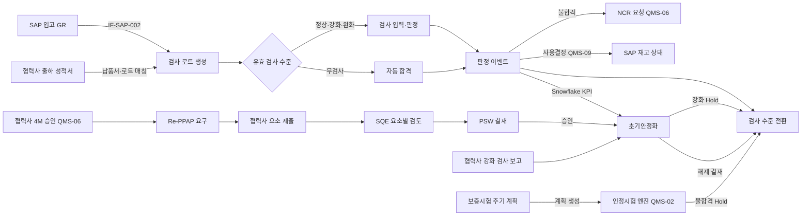

# SL QMS 워크아이템 Vol.3 — QMS-03 부품/협력사 품질

Nov 1, 2026 · @배창욱

## 1. 개요

Vol.3는 QMS RFP 부품/협력사 품질 모듈의 **Q-6 수입검사, Q-7 부품 보증시험, Q-8 부품 Re-PPAP, Q-9 부품 초기안정화**를 20개 워크아이템으로 내린다. 네 기능 모두 협력사가 데이터를 내야 성립하므로, 다른 메뉴(Vol.2 DVQ-010, Vol.6 NCR 회신·협력사 4M)도 함께 쓰는 **협력사 포털 기반(SPP)**을 이 Vol.에서 먼저 만든다.

| 기능코드 | 기능 | RFP | WI | 핵심 |
| --- | --- | --- | --- | --- |
| SPP | 협력사 포털 | Q-6, Q-8, NFR-4.2(협력사 격리) | 3 | Experience Cloud 사이트, 사용자·수신자 해석, 포털 홈·To-Do·문서 업로드 |
| IQC | 수입검사 | Q-6 | 8 | 기준서·샘플링, SAP 입고 → 검사 로트, 모바일 검사, 검사 수준 전환, 협력사 성적서, Snowflake 실적 |
| PWT | 부품 보증시험 | Q-7 | 2 | 주기 계획 → 인정시험 엔진(Vol.2)으로 계획 생성, 준수율 |
| PPA | 부품 Re-PPAP | Q-8 | 4 | 요소·레벨 매트릭스, 요소별 제출·검토, PSW 결재, 잠정 승인 |
| PIS | 부품 초기안정화 | Q-9 | 3 | 안정화 계획·강화 검사, 실적 집계, 해제 결재 |

**도메인 정의**

- **수입검사(IQC, Incoming Quality Control)**: 협력사 부품이 입고되면 사용 전에 기준서 항목을 샘플링 검사해 로트 합격·불합격을 정한다. 결과에 따라 같은 부품의 다음 검사 강도(정상·강화·완화·무검사)가 바뀐다. 협력사가 출하 전에 내는 성적서(COA, Certificate of Analysis)는 검사를 대신하지 않고 "사전 확인 + 판정 조건"으로 쓴다.
- **부품 보증시험**: 양산 중인 부품을 정해진 주기(연 1회 등)로 다시 신뢰성 시험하는 업무다. IATF 16949 8.6.2의 레이아웃 검사·기능 시험(재인정 시험)에 해당한다. 시험 자체는 인정시험과 같으므로 Vol.2 엔진을 재사용하고, 이 메뉴는 "언제 다시 하나"(주기)와 "제때 했나"(준수)를 만든다.
- **Re-PPAP**: PPAP(Production Part Approval Process)는 협력사가 양산 조건에서 규격대로 꾸준히 만들 수 있다는 증거 묶음(PSW와 최대 18요소)을 내고 승인받는 절차다. Re-PPAP는 승인 이후 4M·설계 변경, 금형 이관, 장기 미생산 등으로 다시 받는 것이다. RFP 범위는 Re-PPAP지만 신규 부품 PPAP를 SL 부품개발시스템이 관리하는지 확인 전이므로, 엔진은 최초 PPAP도 처리할 수 있게 하고 트리거 사용 여부를 설정으로 둔다(D3-6).
- **초기안정화**: 신규 부품 양산 초기나 4M 변경 적용 직후 일정 기간 강화 관리를 걸고, 목표(특별특성 불량 0, PPM 등)를 채우면 해제한다. GM GP-12(Early Production Containment), Safe Launch와 같은 개념이다.

**선행 공통 WI**: ARC-002·003, MDM-003·004·005·006·007, SEC-001·002·003, I18N-001, UX-001·003, APV-001·002, TDO-001, NTF-001, DOC-001, INT-001, DWH-002·003, AI-004.

**다른 메뉴와의 경계**

| 연결 대상 | 이 Vol.이 하는 것 | 상대 메뉴가 하는 것 |
| --- | --- | --- |
| 인정시험 (QMS-02-DVQ) | 보증시험 주기 계획이 DVQ 서비스로 계획 생성, PPAP 시험 결과 요소에 DVQ 계획·DVP&R 연결, 협력사 수신자 해석 제공 | 시험 엔진, 협력사 시험 성적서 제출(DVQ-010) |
| 4M 변경 (QMS-06-4MC) | Re-PPAP·초기안정화 생성 서비스와 이벤트, 4M 초품 로트 표시와 판정 이벤트 | 4M 승인 시 서비스 호출, PPAP 승인 전 적용 차단, 적용 시점 기록 |
| 부적합 NCR (QMS-06-NCR) | 로트 불합격 시 QMS_NcrGateway 호출, 검사 수준 Hold API 제공 | NCR 생성·처분(반품·선별·특채)·협력사 대책, 협력사 귀책 NCR 시 Hold 등록·해제 |
| 협력사 실적 (QMS-06-SQM) | 수입검사 결과 Snowflake 적재, 로트 합격률·보류 PPM KPI | 협력사 목표·평가 등급·개선 활동 |
| 측정기·교육 (QMS-06-GAU, TRN) | 검사 훅 인터페이스(측정기 유효성, 검사원 자격)와 기본 구현(통과) | 교정 기한 경과 측정기·무자격 검사원 차단 구현 |
| 한도견본 (QMS-06-LMS) | VISUAL 항목 화면에 한도견본 링크 자리 | 한도견본 데이터·조회 |
| 제품 Re-PPAP·초기유동 (QMS-04-RPP, EFC) | PPAP 엔진·안정화 엔진의 부품 레코드타입(SUPPLIER / PART) | 제품 레코드타입(CUSTOMER / PRODUCT), 고객 제출·MES 실적 |
| 연계 (QMS-09) | 입고 수신 계약(로트 External Key·필드), 판정 이벤트 QMS_IqcDecision__e, SAP 회신 상태 갱신 API | Mule IF-SAP-002 구현, SAP 사용결정·재고 이동, 부품개발시스템 연계 |
| PMS (P-28 협력사 부품개발 일정) | PPAP 상태 조회 서비스·이벤트 | 협력사 부품개발 일정, 액티비티 완료 조건 연결 |
| AI (QMS-08) | 성적서 이상 탐지 결과(AI-004 기록) | 협력사 리스크 조기경보 |

**Vol.0·Vol.2 상태**: 둘 다 검토 대기다. Vol.0 D-5(협력사 포털 라이선스)는 원래 이 Vol.에서 정하기로 했으므로 Customer Community Plus를 가정해 쓰고 D3-1로 확정을 요청한다. 다른 Vol.0·Vol.2 결정이 바뀌면 이 Vol.의 해당 BR도 함께 고친다.

## 2. 업무 흐름

판정·승인 결과는 이벤트로만 다른 메뉴(4M·NCR·PMS·SAP 연계)에 전달하고 상대 객체를 직접 갱신하지 않는다. 검사 강도는 IQC-005의 "기본 수준 + Hold" 하나로 모이므로, 초기안정화·NCR·보증시험 불합격이 각자 검사 수준 필드를 바꾸지 않는다.

## 3. 데이터 모델 개요

**객체**

| 객체 | 구분 | 관계 | 역할 | 정의 WI |
| --- | --- | --- | --- | --- |
| QMS_PortalRoute__mdt | 설정 | — | 포털 화면 경로(알림 링크 변환) | SPP-001 |
| QMS_PortalNotice__c | 설정 | Plant(Lookup) | 포털 공지 | SPP-002 |
| QMS_SupplierCertificate__c | 업무 | Supplier(Lookup) | 협력사 인증서 | SPP-003 |
| QMS_SamplingPlan__c / QMS_SamplingPlanRow__c | 설정 | Row → Plan(MD) | 샘플링 방식, 로트 크기별 시료 수·Ac·Re | IQC-001 |
| QMS_IqcStandard__c / QMS_IqcStandardLine__c | 설정 | Line → Standard(MD), Characteristic(Lookup) | 수입검사 기준서(버전)와 검사 항목 | IQC-001 |
| QMS_IqcLot__c | 업무 | SupplierItem, Item, Supplier, Plant, Standard(Lookup) | 검사 로트(입고 1건) | IQC-002 |
| QMS_IqcResult__c | 업무 | Lot(MD) | 항목별 결과(시료 값은 JSON) | IQC-002 |
| QMS_IqcLevelChange__c / QMS_IqcLevelHold__c | 업무 | SupplierItem(Lookup) | 기본 수준 변경 이력 / 강제 유지 | IQC-005 |
| QMS_SupplierCoa__c | 업무 | SupplierItem, Lot(Lookup) | 협력사 출하 성적서 | IQC-006 |
| QMS_PeriodicTestSchedule__c | 설정 | SupplierItem, TestStandard(Lookup) | 보증시험 주기 계획 | PWT-001 |
| QMS_PpapElement__c / QMS_PpapLevelRule__c | 설정 | Element.DocClass(Lookup CMN_Code__c) | PPAP 요소 마스터·레벨 결정 규칙 | PPA-001 |
| QMS_Ppap__c / QMS_PpapElementLine__c | 업무 | Line → Ppap(MD) | PPAP 1건과 요소별 검토 | PPA-002 |
| QMS_PpapSubmission__c | 업무 | Ppap(Lookup) | 협력사 제출 차수(협력사 소유) | PPA-003 |
| QMS_StabilizationPlan__c | 업무 | SupplierItem(Lookup) | 초기안정화 계획·실적 | PIS-001 |
| QMS_StabilizationReport__c | 업무 | Plan(Lookup) | 협력사 강화 검사 보고(협력사 소유) | PIS-002 |

**상태값**

| 대상 | 값(순서) |
| --- | --- |
| QMS_IqcLot__c.Status__c | WAITING → IN_INSPECTION → DECIDED / CANCELLED (무검사 로트는 생성 즉시 DECIDED) |
| QMS_IqcLot__c.Decision__c | ACCEPT 합격 · REJECT 불합격(로트 보류) |
| QMS_IqcResult__c.Judgment__c | PENDING · OK · NG · SKIPPED_FREQ(빈도상 이번 로트 생략) |
| QMS_SupplierCoa__c.Status__c | DRAFT → SUBMITTED / OOS_HOLD → MATCHED · VOID |
| QMS_Ppap__c.Status__c | DRAFT → REQUESTED → SUBMITTED → IN_REVIEW → (RETURNED → SUBMITTED) → APPROVAL → APPROVED / INTERIM / REJECTED · CANCELLED |
| QMS_PpapElementLine__c.Status__c | REQUIRED → SUBMITTED → ACCEPTED / RETURNED · RETAINED(협력사 보관) · WAIVED |
| QMS_StabilizationPlan__c.Status__c | DRAFT → ACTIVE → EXIT_REVIEW → RELEASED · CANCELLED |

**권한 셋과 페르소나 매핑**(각 WI가 PS를 만들고 SEC-001 BR-2에 따라 PSG에 추가)

| Permission Set | 내용 | PSG |
| --- | --- | --- |
| QMS_PS_Iqc_Read | 로트·결과·기준서 조회 | Viewer, QualityEngineer, QualityManager |
| QMS_PS_Iqc_Inspect | 착수·결과 입력·판정 | Inspector, SupplierQuality |
| QMS_PS_Iqc_Admin | 기준서·샘플링 편집·활성화, 판정 재개 | SupplierQuality, QualityAdmin |
| QMS_PS_Ppap_Read / QMS_PS_Ppap_Edit | PPAP 조회 / 생성·요구·검토·상신 | 조회: QualityEngineer, QualityManager, Viewer · 편집: SupplierQuality |
| QMS_PS_PpapConfig_Admin | 요소·레벨 규칙 | QualityAdmin |
| QMS_PS_Stab_Read / QMS_PS_Stab_Edit | 초기안정화 조회 / 편집 | 조회: QualityEngineer, QualityManager · 편집: SupplierQuality |
| QMS_PS_PeriodicTest_Edit | 보증시험 주기 계획 | SupplierQuality, QualityAdmin |
| QMS_PS_SupplierPortal_Admin | 포털 사용자 관리·공지 | SupplierQuality, QualityAdmin |
| QMS_PS_Portal_Base | 포털 홈·To-Do·품번 조회·문서 업로드 | SupplierPortal(신규, Vol.0 변경 요청) |
| QMS_PS_Portal_Coa / _Ppap / _Stab / _Cert | 포털 제출 객체 생성·편집(자기 소유) | SupplierPortal |

결재 권한(완화·무검사 전환, 수동 수준 변경, 판정 재개, PPAP·안정화 결재)은 PS가 아니라 APPROVAL_ROLE(SQ_MANAGER 협력사 품질팀장, QUALITY_MANAGER 품질팀장, SUPPLIER_QUALITY 담당 SQE, IQC_LEAD 수입검사 반장)로 판정한다.

**다른 WI·메뉴가 쓰는 서비스와 이벤트**

| 이름 | 종류 | 제공 WI | 사용처 |
| --- | --- | --- | --- |
| QMS_SupplierContactResolver.resolve | Apex | SPP-001 | Vol.3 전체, QMS-02-DVQ-010, QMS-06 |
| QMS_SamplingService.determine | Apex | IQC-001 | IQC-002, QMS-04-FQC |
| QMS_InspectionHook | Interface + Custom Metadata | IQC-003 | QMS-06-GAU·TRN 구현, QMS-04-FQC 재사용 |
| QMS_IqcDecision__e | Platform Event | IQC-004 | QMS-09(SAP 회신), QMS-06-4MC, PWT-001 |
| QMS_IqcLevelService.effectiveLevel / addHold / releaseHold | Apex | IQC-005 | PIS, PWT, QMS-06-NCR |
| QMS_PpapService.createFromSource / getStatusBySource | Apex | PPA-002 | QMS-06-4MC, PMS, QMS-09 |
| QMS_PpapEvent__e | Platform Event | PPA-002 | PIS-001, QMS-06-4MC, PMS |
| QMS_StabilizationService.createFromSource / getStatusBySource | Apex | PIS-001 | QMS-06-4MC |
| QMS_StabilizationEvent__e | Platform Event | PIS-003 | QMS-06-SQM·4MC |

**공통 기반 등록(각 업무 객체 WI에서 수행)**: 채번(ARC-003), CMN_SharingConfig(Plant__c, 협력사 공개 객체는 SupplierField도), CMN_DeleteGuard, CMN_StatusFlow, 필드 이력, DWH 복제(DWH-002), ko·en·zh 번역. 채번 규칙은 IQC-{PLANT}-{YYYY}-{SEQ:6}, COA-{PLANT}-{YYYY}-{SEQ:6}, PPA-{PLANT}-{YYYY}-{SEQ:5}, STB-{PLANT}-{YYYY}-{SEQ:5}, PTS-{PLANT}-{SEQ:5}.

**데이터량 가정**: SL 입고 건수는 미확인이다. 국내외 공장 합계 하루 200~400 입고 라인을 가정하면 검사 로트 연 7만~15만 건, 결과 라인 연 50만~150만 건이다. 시료 값은 레코드로 만들지 않고 결과 라인 JSON에 담아 Snowflake에서 펼치며, 판정 후 24개월이 지난 결과 라인은 Salesforce에서 지운다(D3-4).

## 4. 협력사 포털 (SPP)

### QMS-03-SPP-001 협력사 포털 사이트·사용자·수신자 해석

추적 Q-6, Q-8, NFR-4.2(협력사 격리) · 필수 · W1 · EXP, SF · CFG, APEX, LWC · Tailoring · 선행 SEC-001, SEC-002, MDM-005, I18N-001, NTF-001 · 6 M/D

**목적**: 협력사가 성적서·PPAP·시험 결과·부적합 대책을 메일과 엑셀 대신 포털로 내게 하는 기반이다. RFP의 "협력사 사용자는 해당 협력사 데이터만 접근" 요구를 실제 설정으로 만든다.

**범위** In: Experience Cloud 사이트, 라이선스·프로필·외부 공유 기본값, 포털 사용자 활성화, 협력사 수신자 해석 서비스, 알림 링크 변환. Out: 포털 홈·문서 업로드(SPP-002), 업무별 제출 화면(IQC-006, PPA-003, PIS-002, QMS-02-DVQ-010, QMS-06).

**사이트 설정**

| 항목 | 값 |
| --- | --- |
| 사이트 | Experience Cloud "SL Supplier Quality", 템플릿 Build Your Own (LWR), 경로 `/supplier` |
| 라이선스 | Customer Community Plus(D3-1). 상시 사용 협력사는 Member, 월 몇 회 쓰는 협력사는 Login 라이선스 |
| 프로필 | `SL Supplier Portal User`(SEC-001 BR-1). 객체 권한은 PSG `QMS_PSG_SupplierPortal`로만 부여 |
| 로그인 | 사이트 로그인 페이지 ID/PW + 이메일 일회용 코드(MFA). 사내 포탈 SSO 대상 아님 |
| 게스트 | 로그인·비밀번호 재설정 페이지만 공개, 게스트 사용자 객체 권한 0 |
| 포털 역할 | 협력사 Account당 2단계(Manager, User) |
| 언어 | ko, en_US, zh_CN 기본(pl, es, pt_BR 확장). 사이트 언어 선택기 포함 |

**데이터 모델**

| 객체 / 필드 | 타입 | 필수 | 설명 |
| --- | --- | --- | --- |
| Contact.SupplierRoles__c | Multi-Picklist (QUALITY 품질 담당, PPAP PPAP 담당, SHIPPING 출하·성적서, MANAGEMENT 대표·책임자) | 포털 사용자면 Y | To-Do·알림 수신 역할 |
| Contact.PortalPlants__c | Text(255) | N | 담당 납품 공장 코드(쉼표). 공란 = 전체 공장 |
| Contact.PortalUserStatus__c | Picklist (NONE, INVITED, ACTIVE, SUSPENDED, INACTIVE) | Y | 기본 NONE |
| QMS_PortalRoute__mdt | Custom Metadata | — | ObjectApiName__c, PathPattern__c(예: `/coa/{id}`), IsActive__c |

**비즈니스 규칙**

- BR-1: 사용자 활성화는 SQE가 협력사 Account 레코드의 `qmsSupplierUserAdmin`에서 한다. Contact 선택 → 역할·담당 공장·언어 지정 → User 생성(Username `{email}.slsupplier`, 프로필, 포털 역할 User 또는 Manager, PSG 할당) → 초대 메일, PortalUserStatus = INVITED(첫 로그인 시 ACTIVE). 협력사 자가 가입(Self-Registration)은 쓰지 않는다. Account.PortalEnabled__c = false인 협력사는 활성화할 수 없다.

- BR-2: 비활성 — Account.PortalEnabled__c가 false가 되면 하위 포털 User를 모두 비활성화한다(Queueable). 90일 미로그인 사용자는 SUSPENDED로 표시하고 SQE에게 월 1회 목록을 알린다(라이선스 회수 판단).

- BR-3: 수신자 해석 `QMS_SupplierContactResolver.resolve(Id supplierId, String role, Id plantIdOrNull)` → 활성 포털 User Id 목록. 조건: SupplierRoles에 role 포함, PortalPlants 공란 또는 해당 공장 코드 포함. 결과가 없으면 MANAGEMENT 역할로 다시 찾고, 그래도 없으면 빈 목록을 반환하면서 협력사 Account Owner(주관 SQE)에게 To-Do "협력사 수신자 미지정: {협력사명}/{role}"을 연다. **협력사에게 To-Do·알림을 보내는 모든 QMS 기능은 이 서비스로 수신자를 정한다**(QMS-02-DVQ-010 포함, Vol.2 변경 요청).

- BR-4: 공유 — SEC-002 BR-4의 협력사 공유 대상은 해당 Account 포털 Manager 역할의 "역할 및 하위" 그룹이다(같은 협력사 사용자 전원). 이 결정으로 Vol.0 SEC-002 BR-4를 갱신한다.

- BR-5: 외부 공유 기본값(External OWD) — 모든 QMS·CMN 업무 객체와 CMN_Item__c는 Private, CMN_Plant__c·CMN_CodeGroup__c·CMN_Code__c만 Public Read Only. 협력사는 자기 공급 품번의 규격을 봐야 하므로 CMN_SupplierItem__c 생성·활성 시 해당 CMN_Item__c를 협력사 그룹에 Read 공유하고(Apex Sharing Reason CMN_Supplier), 공급 종료 시 회수한다. CMN_Characteristic__c는 Item의 Master-Detail이라 함께 보이고, CMN_SupplierItem__c는 Account의 Master-Detail이라 자기 회사 행만 보인다(Vol.0 SEC-002 변경 요청).

- BR-6: 알림 링크 변환 — 수신자가 포털 사용자면 NTF-001이 `CMN_RecipientUrlResolver` 구현체(Custom Metadata로 등록, Vol.0 변경 요청)인 `QMS_PortalUrlResolver`를 호출한다. 레코드 객체의 QMS_PortalRoute__mdt 경로로 `https://{사이트 도메인}/supplier{PathPattern}` URL을 만들고, 매핑이 없으면 포털 홈 URL을 쓴다.

- BR-7: 포털 화면용 Apex는 `with sharing` + `WITH USER_MODE`로만 조회한다. 사내 표준 레코드 페이지·리스트뷰·글로벌 검색을 포털에 노출하지 않는다(검색 컴포넌트 미배치).

**화면/UX**: `qmsSupplierUserAdmin`(사내, 협력사 Account 레코드 페이지) — Contact 목록, 포털 상태, 역할·공장 편집, 활성화·비활성화·비밀번호 재설정 메일. 포털 로고·색은 Experience Builder 설정.

**권한**: QMS_PS_SupplierPortal_Admin(SQE, QualityAdmin) — 포털 사용자 관리. 포털 사용자는 QMS_PSG_SupplierPortal.

**수용 기준**

- AC-1: Given 협력사 A의 Contact, When SQE가 QUALITY 역할로 활성화, Then 포털 User 생성·PSG 할당·초대 메일 1건, PortalUserStatus = INVITED.

- AC-2: Given 협력사 B 포털 사용자, When 협력사 A의 CMN_SupplierItem__c·QMS_IqcLot__c URL에 직접 접근, Then 권한 없음.

- AC-3: Given A의 QUALITY 사용자 2명(1명은 PortalPlants = KR02), When resolve(A, QUALITY, KR01), Then 공장 미지정 사용자 1명만 반환.

- AC-4: Given A에 QUALITY·MANAGEMENT 사용자가 모두 없음, When resolve, Then 빈 목록 + 주관 SQE To-Do 1건.

- AC-5: Given 포털 사용자에게 보낸 알림, When 메일 링크 확인, Then 포털 사이트 URL(사내 Lightning URL 아님).

- AC-6: Given 협력사 A 포털 사용자, When 품번 조회 API 호출, Then A가 공급하는 CMN_Item__c만 반환.

**에이전트 주의**: Partner Community 전용 기능(리드·영업기회)을 쓰지 않는다. LWR 사이트에서는 Aura 전용 모듈(`force:*` 등)이 동작하지 않으므로 포털 LWC는 `lightningCommunity__Page`·`lightningCommunity__Default` 타깃을 갖는 순수 LWC로 만든다. 게스트 사용자 공유 규칙을 만들지 않는다. `without sharing` 클래스로 협력사 데이터를 조회하지 않는다.

**오픈 이슈**: 협력사 수·사용자 수(Member/Login 라이선스 수량), 협력사의 이메일 일회용 코드 수용 여부, SL 부품개발시스템에 협력사 계정이 이미 있는지(있다면 그 IdP로 포털 SSO 검토), 협력사 Account Owner를 주관 SQE로 운영하는지.

### QMS-03-SPP-002 포털 홈·To-Do·문서 업로드 공통 컴포넌트

추적 Q-6, Q-8, Q-41 · 필수 · W1 · EXP, SF · LWC, APEX, DM · Customization · 선행 SPP-001, TDO-001, DOC-001 · 5 M/D

**목적**: 협력사 사용자가 로그인하면 "해야 할 일"과 "우리 회사 품번 상태"를 한 화면에서 보고, 모든 제출 화면이 같은 업로드 방식을 쓰게 한다.

**범위** In: 포털 홈, 품번 목록, 포털 공지, 포털용 문서 업로드 컴포넌트. Out: 업무별 제출 화면(각 기능 WI).

**데이터 모델**

| 객체 / 필드 | 타입 | 필수 | 설명 |
| --- | --- | --- | --- |
| QMS_PortalNotice__c.Title__c | Text(255) | Y | |
| QMS_PortalNotice__c.Body__c | Rich Text(32768) | Y | |
| QMS_PortalNotice__c.Language__c | Picklist (ko, en_US, zh_CN, ALL) | Y | |
| QMS_PortalNotice__c.PublishFrom__c / PublishTo__c | Date | Y / N | 게시 기간 |
| QMS_PortalNotice__c.Plant__c | Lookup(CMN_Plant__c) | N | 공란 = 전 공장 협력사 |
| QMS_PortalNotice__c.TargetSupplierIds__c | Long Text(32768) | N | 대상 협력사 Account Id 목록(쉼표). 공란 = 전체 |

**화면/UX**

| 컴포넌트 | 위치 | 기능 |
| --- | --- | --- |
| qmsPortalHome | 포털 홈 | 내 To-Do(기한 경과 우선, 이후 기한 순), 최근 알림 10건, 공지 |
| qmsPortalItemList | 포털 메뉴 "품번" | 자기 회사 CMN_SupplierItem__c: 품번·품명·납품 공장·PPAP 상태·검사 수준·초기안정화 진행 여부·최근 3개월 로트 합격률 |
| qmsPortalDocUpload | 각 제출 화면에 삽입 | 속성 parentId, docClass(고정), maxFiles. 드래그·다중 업로드, 50MB 제한, 업로드 목록과 삭제(제출 전만) |

**비즈니스 규칙**

- BR-1: 포털 To-Do는 CMN_Todo__c 중 Assignee = 본인이다. 제목은 TDO-001 renderTitle로 사용자 언어로 렌더링하고, 클릭하면 SPP-001 BR-6과 같은 경로 규칙으로 이동한다.

- BR-2: 포털 사용자 To-Do는 사내 포탈 To-Do API(TDO-003) 응답과 사내 홈(TDO-004)에 포함하지 않는다(Vol.0 TDO-001 변경 요청).

- BR-3: 업로드 — 협력사가 소유한 제출 레코드(부모)가 DRAFT일 때만 허용한다. 파일 저장 후 DOC-001 서비스로 CMN_Document__c·Revision을 만들고 DocClass는 컴포넌트 속성 값으로 고정한다. 협력사가 봐야 하는 파일의 ContentDocumentLink는 Visibility = AllUsers로 만든다(InternalUsers면 포털에서 보이지 않음).

- BR-4: SL이 협력사에 공개하는 문서(PPAP 승인 통보서 등)는 CMN_Document__c.SupplierVisible__c = true, Supplier__c = 해당 협력사로 만들어 SEC-002 SupplierField 공유를 받는다(Vol.0 DOC-001 변경 요청). 그 외 SL 내부 문서는 같은 부모에 붙어 있어도 협력사에게 보이지 않는다.

- BR-5: 부모가 SUBMITTED 이후면 업로드·삭제 버튼을 숨기고 서버에서도 차단한다.

- BR-6: 품번 목록의 합격률은 CMN_KpiValue__c(KpiKey QMS_IQC_LAR, PeriodType MONTH, Supplier·Item·Plant 차원) 최근 3개월 값이다. IQC-007 배포 전에는 이 열을 숨긴다.

- BR-7: 공지 표시 조건 — 오늘이 게시 기간 안, 언어 = 사용자 언어 또는 ALL, 공장·대상 협력사 조건 일치.

**권한**: QMS_PS_Portal_Base(포털 사용자: 홈·To-Do·품번 조회·업로드), QMS_PS_SupplierPortal_Admin(공지 등록).

**수용 기준**

- AC-1: Given To-Do 3건(1건 기한 경과), When 포털 홈 표시, Then 기한 경과 건이 맨 위에 빨간색으로 표시.

- AC-2: Given 영어 사용자, When 포털 홈, Then To-Do 제목이 영어.

- AC-3: Given SUBMITTED 제출 레코드, When 업로드 API 호출, Then 차단.

- AC-4: Given 같은 부모에 내부 문서 1건·협력사 공개 문서 1건, When 협력사가 조회, Then 공개 문서 1건만 보임.

- AC-5: Given 60MB 파일, When 업로드, Then 차단 + 안내 메시지.

- AC-6: Given 포털 사용자 To-Do 존재, When 사내 포탈 API로 To-Do 조회, Then 응답에 포함되지 않음.

**에이전트 주의**: 사내 `cmnDocumentPanel`을 포털에 그대로 배치하지 않는다(문서 비교·AI 버튼과 사내 DocClass가 노출됨). 포털 컴포넌트의 Apex는 레코드 소유·상태를 서버에서 다시 검사한다(화면에서 버튼을 숨기는 것만으로 막지 않는다).

### QMS-03-SPP-003 협력사 인증서 관리

추적 Q-18, Q-31, Q-33 · 권장 · W2 · EXP, SF · DM, LWC, APEX · Tailoring · 선행 SPP-002, NTF-001 · 3 M/D

**목적**: IATF 16949는 협력사가 품질경영시스템 인증(최소 ISO 9001, 목표 IATF 16949)을 갖도록 요구한다. 인증서 만료를 협력사가 직접 갱신하고 SQE가 확인해, 협력사 평가(QMS-06-SQM)와 Audit 계획(QMS-06-SAU)이 같은 값을 쓰게 한다.

**범위** In: 인증서 등록·확인·만료 관리, Account 인증 필드 반영. Out: 협력사 평가 등급(QMS-06-SQM), 협력사 Audit(QMS-06-SAU).

**데이터 모델**

| 객체 / 필드 | 타입 | 필수 | 설명 |
| --- | --- | --- | --- |
| QMS_SupplierCertificate__c.Supplier__c | Lookup(Account, 협력사 RT) | Y | 공유 기준(SupplierField) |
| QMS_SupplierCertificate__c.CertType__c | Picklist (IATF16949, ISO9001, ISO14001, ISO45001, OTHER) | Y | |
| QMS_SupplierCertificate__c.CertNo__c / CertBody__c | Text(80) / Text(120) | Y | 인증 번호, 인증 기관 |
| QMS_SupplierCertificate__c.ValidFrom__c / ValidTo__c | Date | Y | |
| QMS_SupplierCertificate__c.SiteScope__c | Text(255) | N | 인증 대상 사업장 |
| QMS_SupplierCertificate__c.Status__c | Picklist (DRAFT, SUBMITTED, VERIFIED, REJECTED, EXPIRED) | Y | |
| QMS_SupplierCertificate__c.ReviewComment__c | Text(500) | REJECTED면 Y | 협력사에 공개 |

첨부는 CMN_Document DocClass CERT_SUPPLIER(제출 시 필수, SPP-002 업로드 컴포넌트).

**비즈니스 규칙**

- BR-1: 협력사가 포털 `qmsSupplierCertForm`에서 등록·제출(SUBMITTED)하면 협력사 Account Owner(주관 SQE)에게 To-Do "협력사 인증서 확인"을 연다. SQE는 VERIFIED 또는 REJECTED(사유 필수)로 처리한다.

- BR-2: VERIFIED IATF16949 인증서 중 ValidTo가 가장 늦은 값을 Account.IatfExpiry__c에 반영하고, 오늘이 유효 기간 안이면 Account.IatfCertified__c = true.

- BR-3: 만료 90일·30일 전에 협력사(MANAGEMENT·QUALITY 역할)와 주관 SQE에게 알림 QMS_SUPPLIER_CERT_EXPIRING. 만료일 다음 날 일 배치가 EXPIRED로 바꾸고 BR-2를 다시 계산한다.

- BR-4: 갱신은 새 레코드로 등록한다. 이전 인증서는 지우지 않는다(DeleteGuard: DRAFT만 삭제).

**수용 기준**

- AC-1: Given VERIFIED IATF 인증서 ValidTo 2028-03-31, When 반영, Then Account.IatfExpiry__c = 2028-03-31, IatfCertified__c = true.

- AC-2: Given 만료 30일 전, When 일 배치, Then 협력사 2명 + 주관 SQE 1명에게 알림.

- AC-3: Given 만료일 다음 날, 다른 유효 IATF 인증서 없음, When 일 배치, Then EXPIRED, IatfCertified__c = false.

- AC-4: Given 협력사 B 포털 사용자, When 협력사 A 인증서 조회, Then 권한 없음.

## 5. 수입검사: 기준서·로트·판정 (IQC-001~004)

수입검사는 매일 수백 건이 도는 현장 업무라 두 가지 설계 결정을 먼저 둔다. (1) 판정 주체는 QMS이고 SAP에는 판정 결과(재고 상태)만 돌려준다(D3-2). (2) 로트마다 To-Do를 만들지 않는다. 하루 수백 건이 To-Do로 쌓이면 포탈 To-Do 건수가 의미를 잃기 때문에, 검사원은 공장 검사 대기열 화면으로 일하고 기준서 없음·성적서 누락·불합격·기한 경과 같은 예외만 To-Do로 연다(D3-3, Vol.0 "사람에게 일을 시키면 To-Do" 원칙의 예외).

### QMS-03-IQC-001 샘플링 계획·수입검사 기준서

추적 Q-6, Q-23 · 필수 · W1 · SF · DM, APEX, LWC · Customization · 선행 MDM-005, MDM-006, MDM-007, SEC-001 · 6 M/D

**목적**: "이 부품은 무엇을, 몇 개, 어떤 방법으로 보는가"를 품번(·협력사) 단위 기준서로 정의한다. 회사표준 수입검사 프로세스 개정(27년) 결과를 개발 없이 반영할 수 있도록 샘플링 표와 기준서를 데이터로 둔다.

**범위** In: 샘플링 계획, 기준서·검사 항목, 편집기, 엑셀 일괄 등록, 시료 수 결정 서비스. Out: 검사 수준 결정(IQC-005), 로트 생성(IQC-002).

**데이터 모델**

| 객체 / 필드 | 타입 | 필수 | 설명 |
| --- | --- | --- | --- |
| QMS_SamplingPlan__c.PlanCode__c | Text(30), External ID, Unique | Y | 예: C0-STD, AQL-0.65-II |
| QMS_SamplingPlan__c.Method__c | Picklist (C0 c=0 샘플링, AQL ISO 2859-1, FIXED 고정 수량, FULL 전수) | Y | |
| QMS_SamplingPlan__c.Aql__c | Number(5,3) | AQL이면 Y | |
| QMS_SamplingPlan__c.Status__c | Picklist (ACTIVE, OBSOLETE) | Y | |
| QMS_SamplingPlanRow__c.Plan__c | Master-Detail | Y | |
| QMS_SamplingPlanRow__c.LotSizeFrom__c / LotSizeTo__c | Number(10,0) | Y / N | To 공란 = 이상 |
| QMS_SamplingPlanRow__c.Level__c | Picklist (NORMAL, TIGHTENED, REDUCED) | Y | |
| QMS_SamplingPlanRow__c.SampleSize__c | Number(6,0) | Y | |
| QMS_SamplingPlanRow__c.AcceptNo__c / RejectNo__c | Number(4,0) | Y | C0이면 0 / 1 |
| QMS_IqcStandard__c.Item__c | Lookup(CMN_Item__c, ItemType PART·RAW) | Y | |
| QMS_IqcStandard__c.Plant__c | Lookup(CMN_Plant__c) | Y | 공유 기준 |
| QMS_IqcStandard__c.Supplier__c | Lookup(Account, 협력사 RT) | N | 공란 = 모든 협력사 |
| QMS_IqcStandard__c.Version__c / Status__c | Number(3,0) / Picklist (DRAFT, ACTIVE, OBSOLETE) | Y | |
| QMS_IqcStandard__c.DefaultSamplingPlan__c | Lookup(QMS_SamplingPlan__c) | Y | |
| QMS_IqcStandard__c.CoaRequired__c | Checkbox | Y | 입고 시 협력사 성적서 필수(IQC-006) |
| QMS_IqcStandard__c.InspectionLeadHours__c | Number(3,0) | Y | 입고 후 판정 기한(기본 24시간) |
| QMS_IqcStandard__c.MissingSpecialCharReason__c | Text(500) | 조건부(BR-6) | 특별특성 누락 사유 |
| QMS_IqcStandard__c.StandardDocUrl__c | URL | N | 근거 회사표준(지침) |
| QMS_IqcStandardLine__c.Standard__c | Master-Detail | Y | |
| QMS_IqcStandardLine__c.Sequence__c | Number(4,0) | Y | |
| QMS_IqcStandardLine__c.Characteristic__c | Lookup(CMN_Characteristic__c, 같은 Item·ACTIVE 필터) | N | 공란이면 일반 점검 항목 |
| QMS_IqcStandardLine__c.CheckItemName__c | Text(120) | 특성 공란이면 Y | 예: 포장 상태, 라벨 표기 |
| QMS_IqcStandardLine__c.CheckType__c | Picklist (VARIABLE 계량, ATTRIBUTE 계수, VISUAL 관능) | Y | 특성이 있으면 CharType 복사 |
| QMS_IqcStandardLine__c.Method__c | Text(255) | Y | 측정 방법·측정기 종류 |
| QMS_IqcStandardLine__c.SamplingPlanOverride__c | Lookup(QMS_SamplingPlan__c) | N | 항목별 다른 샘플링(예: CC 특성 전수) |
| QMS_IqcStandardLine__c.Frequency__c | Picklist (EVERY_LOT 매 로트, EVERY_N_LOTS n로트마다, FIRST_LOT_ONLY 신규·4M 초품만) | Y | |
| QMS_IqcStandardLine__c.FrequencyN__c | Number(3,0) | EVERY_N_LOTS면 Y | 2 이상 |
| QMS_IqcStandardLine__c.CoaCheck__c / CoaSampleQty__c | Checkbox / Number(4,0) | N / CoaCheck면 Y | 협력사 성적서에 이 항목 값 요구, 시료 수(기본 5) |

**비즈니스 규칙**

- BR-1: 기준서 선택 `QMS_IqcStandardSelector.select(itemId, plantId, supplierId)` — (Item, Plant, Supplier 일치, ACTIVE) → (Item, Plant, Supplier 공란, ACTIVE) 순서. 없으면 null.

- BR-2: 버전 — ACTIVE 기준서는 수정할 수 없다. "새 버전"으로 DRAFT 복사본(Version + 1)을 만들어 고치고, 활성화하면 이전 버전은 OBSOLETE. 같은 (Item, Plant, Supplier) 조합의 ACTIVE 중복은 차단한다. 활성화는 QMS_PS_Iqc_Admin 보유자만.

- BR-3: 시료 수 결정 `QMS_SamplingService.determine(Id planId, Decimal lotQty, String level)` → {sampleSize, acceptNo, rejectNo}. FULL = 로트 수량, FIXED = 단일 행 값, C0·AQL = 로트 크기 구간·수준이 일치하는 행. sampleSize가 로트 수량 이상이면 전수(로트 수량). REDUCED 행이 없는 계획은 NORMAL 행을 쓴다. 기준서 활성화 시 사용하는 모든 계획이 로트 크기 1 이상 전 구간을 NORMAL·TIGHTENED 두 수준에서 빈틈없이 덮는지 검사하고, 빈 구간이 있으면 활성화를 차단한다.

- BR-4: 기준서 라인은 특성 Id만 갖고 규격 값(LSL·USL·Nominal·Unit)을 복사하지 않는다. 규격은 로트 생성 시 스냅숏한다(IQC-002 BR-2). 규격의 단일 원천은 MDM-006이다.

- BR-5: 특성 개정 연동 — CMN_Characteristic__c가 새 버전으로 바뀌면(구 버전 EffectiveTo 설정) ARC-002 트리거 프레임워크에 등록한 QMS 핸들러가 구 특성을 쓰는 ACTIVE 기준서를 찾아 기준서 공장의 SUPPLIER_QUALITY Role 사용자에게 To-Do "수입검사 기준서 개정 필요: {품번}"을 연다. 개정 전에 들어온 로트는 같은 Item·CharNo의 현재 ACTIVE 특성으로 스냅숏하고 라인에 "기준서 개정 필요"를 표시한다(구 규격으로 검사하지 않음).

- BR-6: 특별특성 누락 점검 — 활성화 시 품번의 ACTIVE CC·SC 특성 중 기준서 라인에 없는 것을 목록으로 보여주고, 누락이 있으면 MissingSpecialCharReason__c 입력을 필수로 한다.

- BR-7: 편집기 `qmsIqcStandardEditor` — 품번 선택 → ACTIVE 특성 목록(특별특성 기호 표시)을 체크해 라인 추가, 공통 점검 항목 템플릿(코드 그룹 IQC_COMMON_CHECK: 포장 상태, 라벨·식별, 수량, 이물·오염) 추가, 라인별 샘플링·빈도·성적서 요구 지정, 미리보기(로트 수량 입력 → 수준별 시료 수).

- BR-8: 일괄 등록 `qmsIqcStandardImport` — CSV(품번, 공장, 협력사, 특성 번호 또는 항목명, 방법, 샘플링 코드, 빈도)로 DRAFT 기준서를 만들고 행별 오류를 표시한다(QMS-02-DVQ-001 BR-4와 같은 방식). SL 현행 기준서 이관용.

- BR-9: 샘플링 표의 초기 값은 SL 현행 수입검사 기준(c=0 또는 AQL 표)을 품질경영팀이 입력한다.

**화면/UX**: `qmsIqcStandardEditor`(기준서 레코드 페이지), `qmsIqcStandardImport`(SL QMS 앱 페이지 "수입검사 설정"), 샘플링 계획은 표준 레코드 페이지 + 행 관련 목록 인라인 편집.

**권한**: QMS_PS_Iqc_Admin(편집·활성화), QMS_PS_Iqc_Read(조회).

**수용 기준**

- AC-1: Given C0 계획(로트 281~500, NORMAL 시료 32, Ac 0), When determine(300, NORMAL), Then {32, 0, 1}.

- AC-2: Given FIXED 시료 50인 계획, When determine(30, NORMAL), Then 시료 30(전수).

- AC-3: Given 협력사 A 전용 기준서와 공통 기준서가 모두 ACTIVE, When select(품번, KR01, A), Then 협력사 A 전용 기준서.

- AC-4: Given 특성 새 버전 저장, When 처리, Then 구 특성을 쓰는 ACTIVE 기준서 담당 SQE에게 To-Do 1건.

- AC-5: Given CC 특성 1개가 라인에 없음, When 사유 없이 활성화, Then 차단.

- AC-6: Given NORMAL 행이 로트 1~500만 있는 계획, When 그 계획을 쓰는 기준서 활성화, Then 빈 구간 오류로 차단.

**에이전트 주의**: ISO 2859-1 표나 c=0 표 값을 기억에 의존해 코드·초기 데이터에 넣지 않는다(SL 제공 표나 원문 표를 사람이 입력). 특성 규격을 기준서 라인 필드로 복사해 두지 않는다. 시료 수 결정을 Flow나 수식 필드로 만들지 않는다(Apex 서비스, QMS-04 출하검사 재사용).

**오픈 이슈**: SL 현행 수입검사 기준서 형태(품번별 엑셀, 시스템), 샘플링 기준(AQL 또는 c=0), 협력사별 기준서 차이 여부.

### QMS-03-IQC-002 검사 로트 데이터 모델·입고 수신·로트 초기화

추적 Q-6, Q-42 · 필수 · W1 · SF · DM, APEX · Customization · 선행 IQC-001, ARC-003, SEC-002, SEC-003, UX-003, INT-001, TDO-001 · 6 M/D

**목적**: SAP 입고(GR) 1건을 검사 로트 1건으로 받아, 무엇을 몇 개 볼지까지 정해 둔다. 검사원이 화면을 열면 바로 입력할 수 있는 상태여야 한다.

**범위** In: 로트·결과 객체, 수신 계약, 로트 초기화 서비스, 공통 기반 등록, 보존 규칙. Out: Mule 인터페이스 구현(QMS-09 IF-SAP-002), 검사 입력(IQC-003), 검사 수준 규칙(IQC-005), 성적서 매칭(IQC-006).

**데이터 모델**

| 객체 / 필드 | 타입 | 필수 | 설명 |
| --- | --- | --- | --- |
| QMS_IqcLot__c.RecordNo__c | Text(40), Unique | Y | IQC-{PLANT}-{YYYY}-{SEQ:6} |
| QMS_IqcLot__c.Name | Text(80) | Y | "{품번} {협력사 약칭} {입고일}" 자동 |
| QMS_IqcLot__c.ExternalKey__c | Text(60), External ID, Unique | Y | `{PlantCode}-{자재문서연도}-{자재문서번호}-{항목}` |
| QMS_IqcLot__c.SapInspLotNo__c | Text(20) | N | SAP QM 검사 로트 번호(사용 시) |
| QMS_IqcLot__c.Plant__c / Item__c / Supplier__c | Lookup | Y | Mule이 External ID 참조로 채움 |
| QMS_IqcLot__c.SupplierItem__c | Lookup(CMN_SupplierItem__c) | N | 초기화가 채움. 미등록이면 공란 |
| QMS_IqcLot__c.GrDate__c / GrQty__c / Uom__c | Date / Number(14,3) / Text(10) | Y | |
| QMS_IqcLot__c.SupplierLotNo__c / DeliveryNoteNo__c / PoNo__c | Text(40) / Text(40) / Text(20) | N | 협력사 로트, 납품서(ASN), 발주 번호 |
| QMS_IqcLot__c.CancelFlag__c | Checkbox | N | GR 취소 수신 |
| QMS_IqcLot__c.InspectionLevel__c | Picklist (NORMAL, TIGHTENED, REDUCED, SKIP) | Y | 초기화 시점 유효 수준 스냅숏 |
| QMS_IqcLot__c.FullInspection__c | Checkbox | Y | 전 항목 전수(Hold·4M 초품) |
| QMS_IqcLot__c.LevelReason__c | Text(255) | N | 수준 결정 근거(Hold 종류 등) |
| QMS_IqcLot__c.Standard__c / StandardVersion__c | Lookup(QMS_IqcStandard__c) / Number(3,0) | N | |
| QMS_IqcLot__c.CoaStatus__c | Picklist (NOT_REQUIRED, MISSING, MATCHED, OOS, WAIVED) | Y | 기본 NOT_REQUIRED(IQC-006이 갱신) |
| QMS_IqcLot__c.Is4mFirstLot__c / Supplier4mRecordNo__c | Checkbox / Text(40) | N | 4M 변경 적용 초품(IQC-006) |
| QMS_IqcLot__c.PpapStatusAtGr__c | Text(20) | Y | 입고 시점 SupplierItem.PpapStatus 사본 |
| QMS_IqcLot__c.LongInactive__c | Checkbox | N | 직전 입고 후 365일 초과 |
| QMS_IqcLot__c.Status__c / Decision__c | 3절 상태값 | Y / DECIDED면 Y | |
| QMS_IqcLot__c.AutoAccepted__c | Checkbox | N | 무검사 자동 합격 |
| QMS_IqcLot__c.Inspector__c | Lookup(User) | IN_INSPECTION이면 Y | 착수자 |
| QMS_IqcLot__c.DecidedBy__c / DecidedAt__c | Lookup(User) / DateTime | DECIDED면 Y | |
| QMS_IqcLot__c.DueAt__c | DateTime | Y | 입고 시각 + InspectionLeadHours(기준서 없으면 CMN 설정 QMS_IQC_DEFAULT_LEAD_HOURS, 기본 24) |
| QMS_IqcLot__c.IsOverdue__c | Formula(Checkbox) | — | DECIDED·CANCELLED 아니고 NOW() > DueAt |
| QMS_IqcLot__c.RejectQty__c | Number(14,3) | REJECT면 Y | 보류 수량(기본 GrQty) |
| QMS_IqcLot__c.NgResultCount__c / MeasuredResultCount__c | Number(4,0) | DECIDED면 Y | 판정 시 서비스가 저장(Roll-up 아님, BR-6 보존 삭제 대비) |
| QMS_IqcLot__c.NcrRecordId__c | Text(18) | N | 불합격 시 생성된 NCR |
| QMS_IqcLot__c.SapSyncStatus__c / SapSyncMessage__c | Picklist (NOT_REQUIRED, PENDING, SENT, CONFIRMED, FAILED) / Text(255) | Y / N | IQC-004 |
| QMS_IqcResult__c.Lot__c | Master-Detail | Y | |
| QMS_IqcResult__c.StandardLine__c / Characteristic__c | Lookup | N | 근거 기준서 라인·특성 |
| QMS_IqcResult__c 스냅숏: Sequence__c, CheckName__c, CheckType__c, SpecialClass__c, Nominal__c, LSL__c, USL__c, Unit__c, Method__c | 원본과 같은 타입 | Y(해당 시) | 초기화 시 복사 |
| QMS_IqcResult__c.SampleSize__c / AcceptNo__c / RejectNo__c | Number(6,0) / Number(4,0) / Number(4,0) | Y | IQC-001 BR-3 결과 |
| QMS_IqcResult__c.SampleValuesJson__c | Long Text(131072) | N | `[{no, value, ok, remark}]` VARIABLE은 value, 그 외는 ok |
| QMS_IqcResult__c.MeasuredCount__c / NgCount__c | Number(6,0) | — | 저장 시 서버 계산 |
| QMS_IqcResult__c.Min__c / Max__c / Mean__c | Number(18,6) | — | VARIABLE만, 서버 계산 |
| QMS_IqcResult__c.Judgment__c | Picklist (PENDING, OK, NG, SKIPPED_FREQ) | Y | |
| QMS_IqcResult__c.NeedsStandardRevision__c | Checkbox | N | IQC-001 BR-5 |
| QMS_IqcResult__c.GaugeNo__c / Remark__c | Text(40) / Text(500) | N | 사용 측정기 번호(QMS-06-GAU 배포 후 훅 검증) |

**비즈니스 규칙**

- BR-1: 수신 계약 — QMS-09(Mule)는 통합 사용자로 QMS_IqcLot__c를 ExternalKey 기준 upsert한다. 보내는 필드: Plant(CMN_Plant__c.PlantCode__c 참조), Item(CMN_Item__c.ItemNo__c 참조), Supplier(Account.SapVendorNo__c 참조), GrDate, GrQty, Uom, SupplierLotNo, DeliveryNoteNo, PoNo, SapInspLotNo, CancelFlag. 같은 키를 다시 받으면 Status가 WAITING일 때만 수량·로트 정보를 갱신하고, IN_INSPECTION 이후에는 무시하고 WARN 로그를 남긴다.

- BR-2: 로트 초기화 `QMS_IqcLotService.initialize(lots)`(after insert) —
  (a) SupplierItem을 `{VendorNo}-{ItemNo}-{PlantCode}`로 찾는다. 없으면 라인 없이 WAITING으로 두고 공장 SUPPLIER_QUALITY Role에게 To-Do "협력사 품번 미등록 입고".
  (b) 유효 수준 = `QMS_IqcLevelService.effectiveLevel(supplierItemId)` → {level, fullInspection, reason}. IQC-005 배포 전 기본 구현은 SupplierItem.InspectionLevel__c를 그대로 쓴다.
  (c) 성적서 4M 초품이면(IQC-006 매칭 결과) 이 로트만 TIGHTENED + 전수.
  (d) SKIP이면 결과 라인 없이 DECIDED·ACCEPT·AutoAccepted = true, 판정 이벤트 발행(IQC-004 BR-1).
  (e) 그 외에는 IQC-001 BR-1로 기준서를 고른다. 기준서가 없으면 라인 없이 WAITING + To-Do "수입검사 기준서 없음: {품번}".
  (f) 기준서 라인마다 빈도를 판단한다 — EVERY_N_LOTS는 같은 SupplierItem에서 그 라인이 마지막으로 측정(OK·NG)된 로트 이후 판정된 로트 수가 N−1 미만이면 SKIPPED_FREQ, FIRST_LOT_ONLY는 4M 초품·신규 첫 로트가 아니면 SKIPPED_FREQ.
  (g) 측정할 라인은 결과 라인을 만들고 규격 스냅숏 + 시료 수(라인 샘플링 또는 기준서 기본 샘플링, 전수 플래그면 FULL)를 채운다. Judgment = PENDING.
  (h) DueAt 계산, PpapStatusAtGr 복사, 직전 입고(같은 SupplierItem의 최근 로트 GrDate)가 365일 넘었으면 LongInactive = true + SUPPLIER_QUALITY Role에게 To-Do "장기 미생산 부품 재승인 검토"(PPA-002 BR-2).

- BR-3: 한 번에 200건을 받아도 SOQL·DML을 루프 안에서 쓰지 않는다. 직전 로트·빈도 계산은 SupplierItem 집합 단위 집계 쿼리 1회로 처리한다.

- BR-4: GR 취소(CancelFlag = true) — WAITING이면 CANCELLED. IN_INSPECTION이면 검사원에게 알림 후 CANCELLED. DECIDED면 상태를 바꾸지 않고 SUPPLIER_QUALITY Role에게 To-Do "판정 후 입고 취소 확인".

- BR-5: 공통 기반 등록 — 채번 IQC-{PLANT}-{YYYY}-{SEQ:6}, CMN_SharingConfig(PlantField Plant__c, SupplierField Supplier__c: 협력사는 자기 로트 Read, 포털 조회 범위는 IQC-004 BR-5), CMN_DeleteGuard(삭제 불가, 값 없음: 연계 생성 레코드는 CANCELLED로만 종료), CMN_StatusFlow, 필드 이력(Status, Decision, InspectionLevel, RejectQty, CoaStatus), DWH 복제 15분, 번역.

- BR-6: 보존 — DECIDED 후 24개월이 지난 로트의 결과 라인은 Snowflake CORE 적재를 확인한 뒤 DWH-002 BR-4 아카이브 배치가 지운다. 로트 헤더는 남기며, 헤더의 NgResultCount·MeasuredResultCount는 Roll-up이 아니라 판정 시 저장한 값이라 삭제 후에도 유지된다(D3-4).

- BR-7: 권한 — 통합 사용자는 PS QMS_PS_Iqc_Integration(로트 생성·수신 필드 편집·SapSyncStatus·SapSyncMessage 편집)만 갖는다. 사용자는 Status·Decision·InspectionLevel을 직접 편집할 수 없다(FLS Read, 서비스로만 변경).

**권한**: QMS_PS_Iqc_Read, QMS_PS_Iqc_Inspect, QMS_PS_Iqc_Admin(3절), QMS_PS_Iqc_Integration(통합 사용자).

**수용 기준**

- AC-1: Given 같은 ExternalKey로 2회 수신, When upsert, Then 로트 1건, 결과 라인 중복 없음.

- AC-2: Given SKIP 수준 SupplierItem 입고, When 초기화, Then DECIDED·ACCEPT·AutoAccepted, 결과 라인 0건, 판정 이벤트 1회.

- AC-3: Given N = 3 항목이 마지막으로 측정된 로트 이후 판정 로트 1건, When 다음 로트 초기화, Then 그 항목 SKIPPED_FREQ. 판정 로트가 2건이면 PENDING.

- AC-4: Given 기준서 없는 품번 입고, When 초기화, Then 라인 0건, WAITING, SQE To-Do 1건.

- AC-5: Given 200건 일괄 수신, When 초기화, Then 거버너 오류 없이 로트별 라인 생성, 10초 이내 완료.

- AC-6: Given 직전 입고가 400일 전인 SupplierItem, When 초기화, Then LongInactive = true, SQE To-Do 1건.

- AC-7: Given 사용자가 API로 Decision__c 직접 변경, When 저장, Then 차단.

**에이전트 주의**: Apex에서 SAP를 호출하지 않는다(INT-001 BR-1). 로트 초기화를 Flow로 만들지 않는다. 시료 값 하나하나를 레코드로 만들지 않는다. 직전 로트를 찾을 때 로트 전체를 조회하지 말고 SupplierItem별 최근 N건만 가져온다(로트가 연 10만 건 이상 쌓인다).

**오픈 이슈**: SAP QM(검사 로트·사용결정) 사용 여부와 공장별 차이, 수입검사 대상 자재 범위(구매부품·원재료 전부인지), GR 취소·반품 이동 유형.

### QMS-03-IQC-003 검사 결과 입력·항목 판정·로트 판정(모바일)

추적 Q-6, Q-2, NFR-4.4(모바일) · 필수 · W1 · SF · LWC, APEX · Customization · 선행 IQC-002, UX-001, DOC-001, MDM-007 · 7 M/D

**목적**: 입고장 검사원이 태블릿·휴대폰으로 바코드를 찍고 값을 넣으면 항목·로트 합불이 즉시 계산되게 한다. 판정 기준을 사람이 해석하지 않게 하는 것이 BMW "기준 없이 일한다" 지적에 대한 현장 대응이다.

**범위** In: 검사 대기열, 검사 입력 화면, 항목·로트 판정, 검사 훅 인터페이스, 판정 재개. Out: 판정 후 이벤트·NCR·협력사 통보(IQC-004).

**화면/UX**

| 컴포넌트 | 위치 | 기능 |
| --- | --- | --- |
| qmsIqcWorkbench | SL QMS 앱 페이지 "수입검사", Inspector 모바일 메뉴 | 공장 검사 대기열: WAITING·IN_INSPECTION 로트를 DueAt 순으로 50건씩. 필터(협력사·품번·검사 수준·기한 경과·성적서 상태·내 착수 건), 바코드 스캔으로 로트 찾기, 착수 |
| qmsIqcInspection | 로트 레코드 페이지, 대기열에서 열기(태블릿 우선) | 항목 카드: 스냅숏 규격·방법·시료 수·특별특성 기호. VARIABLE = 시료별 값(엑셀 세로 붙여넣기), ATTRIBUTE = NG 수 또는 시료별 OK/NG, VISUAL = 시료별 OK/NG + 사진 + 한도견본 링크(QMS-06-LMS 배포 후). 측정기 번호(스캔). 항목 판정 즉시 표시, 로트 판정 제안, 판정 버튼 |

**비즈니스 규칙**

- BR-1: 착수 — "착수"하면 IN_INSPECTION, Inspector = 본인. 다른 사람이 착수한 로트는 "인계" 액션으로만 가져온다(UX-003 코멘트 자동 기록).

- BR-2: 항목 판정 — VARIABLE은 시료마다 LSL ≤ 값 ≤ USL(있는 경계만)이면 OK, NgCount = 벗어난 시료 수. ATTRIBUTE·VISUAL은 NgCount = NG 시료 수(ATTRIBUTE는 NG 수만 입력 가능). Judgment = NgCount ≤ AcceptNo이면 OK, 아니면 NG. MeasuredCount < SampleSize면 PENDING. Min·Max·Mean은 서버가 계산한다.

- BR-3: 로트 판정 제안 — SKIPPED_FREQ를 뺀 라인 중 NG가 하나라도 있으면 REJECT, 아니면 ACCEPT. 판정 가능 조건: PENDING 라인 0건, 검사 훅 통과. ACCEPT 불가 조건: CoaStatus가 MISSING·OOS(IQC-006 배포 전에는 항상 NOT_REQUIRED), PpapStatusAtGr = REJECTED(협력사 품질팀장 SQ_MANAGER가 "예외 합격"을 사유와 함께 승인한 경우만 허용, D3-9). 사용자는 ACCEPT 제안을 REJECT로 바꿀 수 있으나(사유 필수) REJECT 제안을 ACCEPT로 바꿀 수 없다.

- BR-4: 검사 훅 — 결과 저장·판정 시 Custom Metadata `QMS_InspectionHook__mdt`(HookClass__c, Context__c: IQC·FQC, IsActive__c)에 등록된 `QMS_InspectionHook` 구현체를 모두 호출한다: `validateGauge(gaugeNo, inspectionDate)`, `validateInspector(userId, plantId, itemId)`. 오류를 반환하면 저장을 차단하고 메시지를 보여준다. 이 WI는 인터페이스와 등록 구조만 만들고 기본 구현은 없다(통과). QMS-06-GAU(교정 기한 경과 측정기)·TRN(무자격 검사원)이 구현을 등록한다.

- BR-5: REJECT 판정 시 불량 유형(코드 그룹 DEFECT_TYPE 리프, cmnCodePicker)과 불량 시료 수를 필수로 받는다. CC·SC 특성 NG 항목은 화면 맨 위에 강조한다.

- BR-6: 판정 확정 `QMS_IqcLotService.decide(lotId, decision, defectTypeId, reason)` → DECIDED, DecidedBy·At, NgResultCount·MeasuredResultCount 저장, RejectQty(REJECT면 GrQty), IQC-004 후속 처리 호출.

- BR-7: 재개 — DECIDED 로트의 오입력 정정은 QMS_PS_Iqc_Admin 보유자 또는 SQ_MANAGER Role 사용자가 "재개"(사유 필수, 코멘트 자동 기록)로 IN_INSPECTION으로 되돌린 뒤 고친다. 재개·재판정 이벤트는 IQC-004 BR-6.

- BR-8: 입력 보존 — 값 입력 5초 후 결과 라인을 자동 저장해 통신 끊김에 따른 손실을 줄인다. 오프라인 입력은 범위 밖이다(UX-001 오픈 이슈).

- BR-9: 사진 — VISUAL NG 시료 사진은 DocClass IQC_PHOTO로 결과 라인에 붙이고 장변 1920px로 줄인다(UX-001 BR-4).

- BR-10: 대기열 바코드 — 입고 라벨 바코드 값을 ExternalKey·SapInspLotNo·DeliveryNoteNo+SupplierLotNo 순으로 찾는다(라벨 체계는 오픈 이슈). 모바일 앱에서만 스캔, 웹은 수동 입력(UX-001 BR-5).

**권한**: QMS_PS_Iqc_Inspect(착수·입력·판정), QMS_PS_Iqc_Admin(재개), 예외 합격은 SQ_MANAGER Role.

**수용 기준**

- AC-1: Given USL 3.1, 시료 5개 중 3.15가 1개, Ac 0, When 입력, Then 항목 NG, 로트 REJECT 제안.

- AC-2: Given 시료 32개 중 31개 입력, When 판정 시도, Then 판정 버튼 비활성, 미완료 항목 표시.

- AC-3: Given REJECT 제안, When ACCEPT 선택 API 호출, Then 차단.

- AC-4: Given 엑셀에서 복사한 세로 값 32개, When 붙여넣기, Then 시료 1~32에 순서대로 입력.

- AC-5: Given 측정기 오류를 반환하는 테스트 훅 등록, When 결과 저장, Then 저장 차단 + 훅 메시지 표시.

- AC-6: Given PpapStatusAtGr = REJECTED 로트, 모든 항목 OK, When 검사원이 ACCEPT, Then 차단. SQ_MANAGER 예외 승인(사유) 후 ACCEPT 가능.

- AC-7: Given 대기열 로트 300건, When 화면 진입, Then 첫 50건 2초 이내 표시.

- AC-8: Given 모바일 앱에서 입고 라벨 스캔, When 일치 로트 1건, Then 검사 화면이 바로 열림.

**에이전트 주의**: 합불 계산을 LWC에서만 하지 않는다(서버가 다시 계산하고 서버 값이 기준). 판정 버튼을 숨기는 것만으로 BR-3 조건을 막지 않는다. 측정기·검사원 검증을 이 WI에서 직접 구현하지 않는다(훅 구조만).

**오픈 이슈**: 입고 라벨 바코드 체계(GR 번호, 협력사 로트, 2D 코드 내용), 현장 Wi-Fi 음영 여부, 디지털 측정기(블루투스 캘리퍼 등) 직접 입력 요구.

### QMS-03-IQC-004 판정 후속 처리·SAP 회신·NCR 연계·협력사 통보

추적 Q-6, Q-21, Q-42 · 필수 · W1 · SF, EXP · APEX, LWC · Customization · 선행 IQC-003, NTF-001, SPP-001 · 5 M/D

**목적**: 판정 결과가 SAP 재고(사용 가능 / 보류), 부적합 처리, 협력사 통보로 빠짐없이 이어지게 한다. 판정 이후 업무는 이벤트로 넘기고 이 WI가 직접 다른 메뉴 레코드를 만들지 않는다.

**범위** In: 판정 이벤트, SAP 회신 상태, REJECT 처리(NCR 게이트웨이·알림·협력사 통보), 협력사 포털 결과 조회, 재개·정정, 기한 경과 알림. Out: SAP 전송(QMS-09), NCR 생성·처분(QMS-06-NCR).

**데이터 모델**

| 객체 / 필드 | 타입 | 필수 | 설명 |
| --- | --- | --- | --- |
| QMS_IqcDecision__e | Platform Event | — | LotId__c, LotExternalKey__c, SapInspLotNo__c, PlantCode__c, ItemNo__c, VendorNo__c, EventType__c(DECIDED, REOPENED, CORRECTED), Decision__c, AcceptQty__c, RejectQty__c, AutoAccepted__c, Is4mFirstLot__c, Supplier4mRecordNo__c |

**비즈니스 규칙**

- BR-1: 판정(DECIDED) 시 이벤트 1회 발행. SAP 연계 공장(CMN 설정 QMS_IQC_SAP_SYNC_PLANTS에 포함)이면 SapSyncStatus = PENDING, 아니면 NOT_REQUIRED. QMS-09가 이벤트를 구독해 SAP에 사용결정(또는 품질검사 재고 → 가용/보류 재고 이동)을 보낸 뒤 ExternalKey로 SapSyncStatus를 SENT → CONFIRMED 또는 FAILED(+ SapSyncMessage)로 갱신한다. FAILED가 되면 CMN_PSG_SystemAdmin과 공장 IQC_LEAD Role에게 알림.

- BR-2: REJECT 처리 — (a) `QMS_NcrGateway.requestFromIncoming(lotId)` 호출(Vol.2 DVQ-007의 게이트웨이에 메서드 추가, Vol.2 변경 요청). QMS-06-NCR 배포 전 기본 구현은 공장 SUPPLIER_QUALITY Role에게 To-Do "수입검사 불합격 부적합 등록: {RecordNo}"를 연다. NCR이 생성되면 NcrRecordId__c를 채운다. (b) 알림 QMS_IQC_REJECT → SUPPLIER_QUALITY, SQ_MANAGER, 공장 PURCHASING_MANAGER Role. CC·SC 특성 NG면 제목에 긴급 표시 + QUALITY_MANAGER 추가. (c) 협력사 통보 — SupplierContactResolver(QUALITY)에게 알림 QMS_IQC_REJECT_SUPPLIER(로트·품번·입고일·불량 유형·수량, 포털 링크). 정식 부적합 통보서와 대책 요구는 QMS-06-NCR 범위다.

- BR-3: 로트 보류 범위 — 불합격은 로트 전체를 보류한다(RejectQty = GrQty). 선별·반품·특채 같은 처분과 처분 수량은 NCR에서 정한다.

- BR-4: ACCEPT이고 Is4mFirstLot = true면 이벤트에 4M 번호를 넣는다(QMS-06-4MC가 적용 시점 기록에 사용).

- BR-5: 포털 결과 조회 `qmsPortalIqcResults` — 협력사는 자기 회사 로트의 판정 결과(로트 번호, 입고일, 품번, 수량, 판정, 불량 유형, 불량 시료 수)를 최근 6개월 조회한다. 측정값 상세, 검사원 이름, SL 내부 코멘트는 반환하지 않는다(Apex가 필드를 골라 DTO로 반환).

- BR-6: 재개·정정 — IQC-003 BR-7 재개 시 REOPENED 이벤트, 재판정 시 CORRECTED 이벤트(QMS-09가 SAP 사용결정 변경 처리). REJECT → ACCEPT로 바뀌었고 NcrRecordId가 있으면 SUPPLIER_QUALITY Role에게 To-Do "NCR 취소 검토". ACCEPT → REJECT면 BR-2를 수행한다.

- BR-7: 기한 경과 — 공장 시간 09:00·15:00에 공장별로 DueAt이 지난 WAITING·IN_INSPECTION 로트 목록을 IQC_LEAD Role과 SUPPLIER_QUALITY Role에게 알림 1건으로 보낸다(로트별 To-Do 아님, D3-3).

**권한**: 이벤트 발행·후속 처리는 시스템 컨텍스트 서비스. 포털 조회는 QMS_PS_Portal_Base.

**수용 기준**

- AC-1: Given REJECT 판정(NCR 미배포), When 처리, Then 이벤트 1회, SQE To-Do "수입검사 불합격 부적합 등록" 1건, 사내 알림 3명, 협력사 알림(포털 링크) 1건.

- AC-2: Given SAP 연계 대상이 아닌 공장, When 판정, Then SapSyncStatus = NOT_REQUIRED.

- AC-3: Given ACCEPT, 4M 초품 로트, When 판정, Then 이벤트에 Supplier4mRecordNo 포함.

- AC-4: Given 협력사 A 포털 사용자, When 결과 조회, Then A 로트만, 측정값·내부 코멘트 없음.

- AC-5: Given REJECT 후 NCR 생성된 로트를 재개해 ACCEPT로 재판정, When 처리, Then CORRECTED 이벤트 1회 + SQE To-Do "NCR 취소 검토".

- AC-6: Given 기한 경과 로트 5건(KR01 3, KR02 2), When 09:00 잡, Then 공장별 알림 1건씩(로트별 To-Do 0건).

**에이전트 주의**: SAP 전송 로직을 Salesforce에 만들지 않는다(이벤트 발행과 상태 필드까지). NCR 객체를 직접 만들거나 Lookup하지 않는다(게이트웨이 경유). 협력사 통보 메일을 업무별 Email Template로 만들지 않는다(NTF-001 라벨).

**오픈 이슈**: SAP 사용결정 방식(QM 검사 로트 UD 또는 재고 이동), 공장별 SAP 연계 시점, 구매 담당 알림 필요 여부.

## 6. 수입검사: 검사 수준·성적서·실적 (IQC-005~008)

### QMS-03-IQC-005 검사 수준 자동 전환(정상·강화·완화·무검사)

추적 Q-6, Q-9, Q-18 · 필수 · W2 · SF · DM, APEX, LWC · Customization · 선행 IQC-004, APV-001, APV-002 · 5 M/D

**목적**: 품질이 나쁜 협력사 품번은 자동으로 검사를 강화하고, 좋은 품번은 검사를 줄여 검사 인력을 위험한 곳에 쓴다. 초기안정화·부적합·보증시험 불합격이 요구하는 "강제 강화"도 같은 장치로 처리해 규칙이 흩어지지 않게 한다.

**범위** In: 기본 수준 전환 규칙, 강제 유지(Hold) API, 무검사 승인 결재, 수동 변경, 수준 패널. Out: Hold를 거는 업무(PIS-001, PWT-002, QMS-06-NCR).

**데이터 모델**

| 객체 / 필드 | 타입 | 필수 | 설명 |
| --- | --- | --- | --- |
| QMS_IqcLevelChange__c.SupplierItem__c | Lookup(CMN_SupplierItem__c) | Y | |
| QMS_IqcLevelChange__c.FromLevel__c / ToLevel__c | Picklist (NORMAL, TIGHTENED, REDUCED, SKIP) | Y | |
| QMS_IqcLevelChange__c.Reason__c | Picklist (SWITCH_RULE 전환 규칙, SKIP_APPROVAL 무검사 승인, SKIP_REVOKED 무검사 취소, MANUAL 수동) | Y | |
| QMS_IqcLevelChange__c.RuleDetail__c | Text(255) | N | 예: "최근 5로트 중 2로트 불합격" |
| QMS_IqcLevelChange__c.SourceRecordId__c / ApprovalRequestId__c | Text(18) | N | 근거 로트·결재 |
| QMS_IqcLevelHold__c.SupplierItem__c | Lookup(CMN_SupplierItem__c) | Y | |
| QMS_IqcLevelHold__c.HoldType__c | Picklist (STABILIZATION 초기안정화, NCR 부적합, PERIODIC_TEST_FAIL 보증시험 불합격, MANUAL 수동) | Y | |
| QMS_IqcLevelHold__c.MinLevel__c | Picklist (NORMAL, TIGHTENED) | Y | 이 수준보다 느슨해질 수 없음 |
| QMS_IqcLevelHold__c.FullInspection__c | Checkbox | Y | 전 항목 전수 |
| QMS_IqcLevelHold__c.SourceRecordId__c / SourceRecordNo__c | Text(18) / Text(40) | Y / N | Hold를 건 업무 레코드 |
| QMS_IqcLevelHold__c.IsActive__c / ReleasedAt__c | Checkbox / DateTime | Y / N | |
| QMS_IqcSwitchRule__mdt | Custom Metadata | — | Key__c, Value__c. 기본값은 BR-2 표 |

**서비스 API (`QMS_IqcLevelService`)**

    QMS_LevelResult effectiveLevel(Id supplierItemId)  // {level, fullInspection, reason}
    Id addHold(Id supplierItemId, String holdType, String minLevel, Boolean full, Id sourceId, String sourceNo)
    void releaseHold(Id sourceId, String holdType)
    void evaluate(Set<Id> supplierItemIds)              // 로트 판정 후 호출

**비즈니스 규칙**

- BR-1: 유효 수준 = 기본 수준(SupplierItem.InspectionLevel__c)과 활성 Hold들의 MinLevel 중 더 엄격한 것(엄격도 SKIP < REDUCED < NORMAL < TIGHTENED). 활성 Hold 중 FullInspection이 하나라도 있으면 전수. reason에는 적용된 Hold 종류와 원천 번호를 넣는다.

- BR-2: 기본 수준 전환 규칙(로트 DECIDED 후 `evaluate`, 자동 합격 로트는 횟수에서 제외). 값은 QMS_IqcSwitchRule__mdt로 바꿀 수 있다.

| 전환 | 조건(기본값) | 적용 |
| --- | --- | --- |
| 정상 → 강화 | 최근 연속 5로트 중 2로트 이상 REJECT | 자동 |
| 강화 → 정상 | 강화 전환 후 연속 5로트 ACCEPT | 자동 |
| 완화 → 정상 | REJECT 1로트 | 자동 |
| 정상 → 완화 | 연속 10로트 ACCEPT + PpapStatus APPROVED + 활성 Hold 없음 + 최근 90일 협력사 귀책 NCR 0건 | SQE 확인(To-Do "완화 전환 검토", 확인 버튼으로 적용) |
| 완화 → 무검사 | 완화 상태 6개월 이상 + 연속 20로트 ACCEPT + 협력사 등급 A + 활성 Hold 없음 | 결재(BR-3) |
| 무검사 → 정상 | 협력사 귀책 NCR Hold 발생 또는 SQE 취소 | 자동(Reason SKIP_REVOKED) |

- BR-3: 무검사 승인 — 조건을 만족하면 SQE에게 To-Do "무검사 전환 검토". SQE가 결재 유형 QMS_IQC_SKIP_APPROVE로 상신(SQE → SQ_MANAGER 승인 → QUALITY_MANAGER 승인), onApproved에서 SKIP 적용 + LevelChange(SKIP_APPROVAL). 수동으로 SKIP을 지정하는 경로는 없다.

- BR-4: Hold — PIS-001(초기안정화 시작), PWT-002(보증시험 FAIL), QMS-06-NCR(협력사 귀책 NCR 등록)이 addHold를, 각 업무 종료 시 releaseHold를 호출한다. 같은 SourceRecordId·HoldType으로 다시 부르면 기존 Hold를 반환한다(멱등). 기본 수준이 SKIP인 품번에 NCR Hold가 걸리면 기본 수준도 NORMAL로 내린다(BR-2 마지막 행).

- BR-5: Hold가 활성인 동안 완화·무검사 전환 To-Do를 만들지 않는다. Hold가 해제되면 BR-2를 다시 평가한다.

- BR-6: 수동 변경 — SQ_MANAGER Role 사용자만, 사유 필수, NORMAL·TIGHTENED·REDUCED 사이에서만. 수동 Hold(MANUAL)도 같은 권한.

- BR-7: SupplierItem.InspectionLevel__c는 이 서비스만 바꾼다(사용자 FLS Read, Vol.0 MDM-005 변경 요청). 모든 변경은 QMS_IqcLevelChange__c에 남긴다.

- BR-8: 화면 `qmsIqcLevelPanel`(CMN_SupplierItem__c 레코드 페이지, 로트 검사 화면 상단) — 기본·유효 수준, 활성 Hold 목록(원천 링크), 최근 20로트 판정 띠(합격 초록, 불합격 빨강, 자동 합격 회색), 다음 전환까지 남은 로트 수, 변경 이력, 수동 변경·무검사 상신 버튼(권한자만).

**권한**: 수동 변경·수동 Hold는 SQ_MANAGER Role, 완화 확인은 SUPPLIER_QUALITY Role, 조회는 QMS_PS_Iqc_Read.

**수용 기준**

- AC-1: Given 정상 수준, 최근 5로트 중 2로트 REJECT, When 5번째 판정, Then TIGHTENED, LevelChange 1건(SWITCH_RULE).

- AC-2: Given 강화 수준, 연속 5로트 ACCEPT, When 판정, Then NORMAL.

- AC-3: Given 정상 연속 10로트 ACCEPT, PPAP APPROVED, Hold 없음, When 판정, Then 수준 변화 없음 + SQE To-Do "완화 전환 검토" 1건.

- AC-4: Given STABILIZATION Hold(TIGHTENED, 전수) 활성, When 다음 로트 초기화, Then 로트 TIGHTENED + 모든 라인 전수.

- AC-5: Given 무검사 결재 승인, When 다음 입고, Then 로트 AutoAccepted.

- AC-6: Given SKIP 품번에 NCR Hold 추가, When 처리, Then 기본 수준 NORMAL(SKIP_REVOKED), 유효 수준 TIGHTENED.

- AC-7: Given 같은 sourceId로 addHold 2회, When 호출, Then Hold 1건.

**에이전트 주의**: 업무 WI(PIS·PWT·NCR)가 SupplierItem.InspectionLevel__c를 직접 바꾸지 않게 한다(Hold API만). 전환 규칙 숫자를 코드에 박지 않는다(QMS_IqcSwitchRule__mdt). 로트 판정마다 SupplierItem 전체 로트를 읽지 않는다(최근 20건 + 마지막 전환 시점 이후만).

**오픈 이슈**: SL 현행 검사 강화·완화·무검사(Ship-to-Stock) 기준, 무검사 결재선, 협력사 등급(SupplierGrade) 운영 시점(QMS-06-SQM 배포 전에는 등급 조건을 건너뛸지).

### QMS-03-IQC-006 협력사 출하 성적서(COA) 제출·자동 점검·로트 매칭

추적 Q-6, Q-20 · 필수 · W2 · EXP, SF · DM, LWC, APEX · Customization · 선행 IQC-002, SPP-002 · 6 M/D

**목적**: Q-6 전반부 "협력사가 제공하는 품질 성적서(정보) 입수/관리"를 구현한다. 협력사가 출하 전에 자체 검사 값을 내면 SL은 입고 전에 규격 이탈을 막고, 입고 시 성적서 유무·이탈을 판정 조건으로 쓴다. 4M 변경 부품의 첫 출하 표시도 성적서로 받아 적용 시점 관리(Q-20)의 근거로 쓴다.

**범위** In: 성적서 객체, 포털 입력·CSV 업로드, 제출 시 규격 점검, 로트 매칭, 성적서 누락 처리, 4M 초품 표시. Out: 성적서 값 분석(IQC-007·008), 4M 적용 시점 기록(QMS-06-4MC).

**데이터 모델**

| 객체 / 필드 | 타입 | 필수 | 설명 |
| --- | --- | --- | --- |
| QMS_SupplierCoa__c.RecordNo__c | Text(40), Unique | Y | COA-{PLANT}-{YYYY}-{SEQ:6} |
| QMS_SupplierCoa__c.SupplierItem__c / Supplier__c / Item__c / Plant__c | Lookup | Y | 협력사가 자기 SupplierItem 선택, 나머지 복사 |
| QMS_SupplierCoa__c.DeliveryNoteNo__c / SupplierLotNo__c | Text(40) | Y | 매칭 키 |
| QMS_SupplierCoa__c.ShipDate__c / ShipQty__c | Date / Number(14,3) | Y | |
| QMS_SupplierCoa__c.Standard__c / StandardVersion__c | Lookup(QMS_IqcStandard__c) / Number(3,0) | Y | 입력 시점 ACTIVE 기준서 |
| QMS_SupplierCoa__c.ValuesJson__c | Long Text(131072) | 제출 시 Y | `[{lineId, charNo, checkType, lsl, usl, values:[...], ok:[...]}]` 규격 스냅숏 포함 |
| QMS_SupplierCoa__c.OosCount__c | Number(4,0) | — | 규격 이탈 값 수(서버 계산) |
| QMS_SupplierCoa__c.Is4mChange__c / Supplier4mRecordNo__c | Checkbox / Text(40) | N / Is4mChange면 Y | 4M 승인 후 첫 출하 |
| QMS_SupplierCoa__c.Status__c | 3절 상태값 | Y | |
| QMS_SupplierCoa__c.MatchedLot__c | Lookup(QMS_IqcLot__c) | N | |
| QMS_SupplierCoa__c.VoidReason__c | Text(255) | VOID면 Y | |

원본 성적서 파일(선택)은 DocClass SUPPLIER_COA로 SPP-002 업로드 컴포넌트를 쓴다.

**비즈니스 규칙**

- BR-1: 입력 — 포털 `qmsSupplierCoaForm`에서 품번(자기 SupplierItem)을 고르면 ACTIVE 기준서의 CoaCheck 라인과 라인별 CoaSampleQty만큼 입력 칸을 보여준다. 규격은 CMN_Characteristic__c 현재 ACTIVE 값으로 표시한다(SPP-001 BR-5 공유). 엑셀 세로 붙여넣기 지원. 여러 로트는 `qmsSupplierCoaImport` CSV(납품서, 로트, 출하일, 수량, 항목 번호, 시료 번호, 값)로 한 번에 올린다(행별 오류 표시).

- BR-2: 제출 점검 — 값을 규격과 비교해 OosCount를 계산한다. 0이면 SUBMITTED, 1 이상이면 OOS_HOLD + 협력사 화면에 "출하 보류 대상" 안내 + SQE(공장 SUPPLIER_QUALITY Role) 알림 QMS_COA_OOS. 협력사가 OOS_HOLD 로트를 출하하면 입고 로트의 CoaStatus가 OOS가 되어 합격시킬 수 없다(IQC-003 BR-3). 이탈품 사용 허가(특채)는 NCR(QMS-06)에서만 한다.

- BR-3: 매칭 — 로트 초기화(IQC-002) 시와 성적서 제출 시 양쪽에서 (Supplier, Item, Plant, DeliveryNoteNo, SupplierLotNo)가 같은 상대를 찾는다. 정확히 1건이면 Lot.Coa__c·MatchedLot을 연결하고 Lot.CoaStatus = MATCHED(성적서가 OOS_HOLD면 OOS), Coa.Status = MATCHED. 납품서만 같고 로트 번호가 다르면 검사 화면에 후보로 보여주고 검사원이 수동 연결한다.

- BR-4: 성적서 누락 — 기준서 CoaRequired = true인 로트는 초기화 시 매칭이 없으면 CoaStatus = MISSING. 검사원은 (a) "성적서 요청"(SupplierContactResolver SHIPPING·QUALITY에게 알림)을 보내고 기다리거나 (b) REJECT(사유 "성적서 미제출")할 수 있다. SQ_MANAGER Role은 "이번 로트 성적서 면제"(사유 필수)로 CoaStatus = WAIVED를 줄 수 있다.

- BR-5: 4M 초품 — Is4mChange 성적서와 매칭된 로트는 Is4mFirstLot = true, Supplier4mRecordNo 복사, 그 로트만 TIGHTENED + 전수(IQC-002 BR-2(c)). 로트가 먼저 들어와 있고 성적서가 나중에 매칭되면 WAITING 로트의 결과 라인을 다시 만든다(IN_INSPECTION 이후면 검사원에게 알림만).

- BR-6: 수정 — 제출된 성적서(SUBMITTED·OOS_HOLD)는 고칠 수 없다. 매칭 전이면 협력사가 VOID(사유) 후 다시 제출한다. MATCHED 이후 VOID는 불가.

- BR-7: 공통 기반 — 채번, SharingConfig(Plant, SupplierField), DeleteGuard(DRAFT만), 필드 이력(Status, OosCount, MatchedLot), DWH 복제 15분, 번역.

**권한**: QMS_PS_Portal_Coa(협력사: 생성·편집·제출·VOID, 자기 소유), QMS_PS_Iqc_Inspect(수동 매칭·성적서 요청), 면제는 SQ_MANAGER Role.

**수용 기준**

- AC-1: Given 규격 이탈 값 1개 포함 성적서, When 제출, Then OOS_HOLD, SQE 알림 1건, 협력사 화면에 출하 보류 안내.

- AC-2: Given 로트가 먼저 수신(WAITING), When 같은 납품서·로트 성적서 제출, Then 자동 매칭, Lot.CoaStatus = MATCHED.

- AC-3: Given CoaRequired 품번 로트에 성적서 없음, When 검사원 ACCEPT, Then 차단. REJECT 또는 SQ_MANAGER 면제만 가능.

- AC-4: Given Is4mChange 성적서와 매칭된 WAITING 로트, When 매칭, Then 로트 TIGHTENED·전수, 결과 라인 재생성.

- AC-5: Given CSV 20로트(오류 2행), When 업로드, Then 성적서 18건 생성 + 오류 2행 사유 표시.

- AC-6: Given 협력사 B, When 협력사 A 성적서 URL 접근, Then 권한 없음.

**에이전트 주의**: 성적서 값을 별도 레코드로 만들지 않는다(JSON + Snowflake). 규격 이탈 판정은 서버에서 한다. 협력사가 입력 화면에서 규격 값을 바꿀 수 없게 한다(규격은 서버가 스냅숏).

**오픈 이슈**: 현행 성적서 제출 방식·양식(메일 PDF, 부품개발시스템), 납품서(ASN) 번호가 SAP GR에 남는지, 협력사 로트 번호 체계.

### QMS-03-IQC-007 수입검사 실적 Snowflake 적재·협력사 KPI

추적 Q-6, Q-18, Q-38 · 필수 · W2 · SNOW, MULE · SQL, INT · Customization · 선행 IQC-002, IQC-006, DWH-002, DWH-003 · 4 M/D

**목적**: 수입검사·성적서 측정값을 Snowflake에서 행 단위로 펼쳐 협력사 실적(QMS-06-SQM), 초기안정화(PIS-002), Early Warning(QMS-08)이 같은 데이터를 쓰게 한다. Salesforce에는 화면에 보일 KPI 값만 돌려준다.

**범위** In: 복제 대상 등록, 시료 값 펼침, 수입검사 KPI 뷰, KPI 적재. Out: 협력사 목표·평가(QMS-06-SQM), 위젯(QMS-07).

**비즈니스 규칙**

- BR-1: CMN_DwhSyncConfig__mdt에 QMS_IqcLot__c, QMS_IqcResult__c, QMS_SupplierCoa__c, QMS_IqcLevelChange__c, QMS_IqcLevelHold__c를 15분 주기로 등록한다.

- BR-2: 펼침 — Snowflake Task가 `CORE.SF_QMS_IQCRESULT`의 SampleValuesJson을 LATERAL FLATTEN해 `CORE.INSPECTION_RESULT`에 MERGE한다. 행 = (SOURCE 'IQC', LOT_ID, RESULT_ID, PLANT_CODE, ITEM_NO, VENDOR_NO, CHAR_ID, CHAR_NO, SPECIAL_CLASS, SAMPLE_NO, VALUE, IS_OK, LSL, USL, INSPECTED_AT). 성적서는 SOURCE 'COA', LOT_ID = 매칭 로트(없으면 NULL), RESULT_ID = 성적서 Id로 같은 테이블에 넣는다. 키 = (SOURCE, RESULT_ID, SAMPLE_NO).

- BR-3: KPI 뷰 `MART.V_SF_KPI_IQC` — 일·월, 차원(Plant, Supplier, Item):

| KpiKey | 정의 |
| --- | --- |
| QMS_IQC_LOTS | 판정 로트 수(자동 합격 제외) |
| QMS_IQC_LAR | 로트 합격률 = ACCEPT / 판정 로트(자동 합격 제외), % |
| QMS_IQC_HOLD_PPM | 보류 수량 PPM = REJECT 로트 RejectQty 합 / 입고 수량 합 × 1,000,000 |
| QMS_IQC_OVERDUE | 기한 경과 판정 로트 수 |
| QMS_COA_ONTIME | 성적서 제출률 = 입고 전 매칭된 성적서 로트 / CoaRequired 로트, % |

- BR-4: 확정 불량 PPM(선별 후 실제 불량 수 기준)은 NCR 처분 수량이 필요하므로 QMS-06-SQM이 같은 MART에 추가한다. 이 WI의 HOLD_PPM은 "보류 기준"임을 KPI 라벨에 명시한다.

- BR-5: DWH-003 BR-1 경로로 매일 03:00 KST CMN_KpiValue__c에 upsert한다. Rag는 목표 값이 생기는 QMS-06-SQM 배포 전까지 비워 둔다.

- BR-6: 결과 라인 아카이브(IQC-002 BR-6) 전에 `CORE.INSPECTION_RESULT` 적재 여부를 확인하는 뷰 `MART.V_IQC_ARCHIVE_READY`(아카이브 가능 RESULT_ID 목록)를 제공한다.

**권한**: Snowflake ROLE_TRANSFORM(Task), ROLE_QMS_ANALYST(MART 조회). Salesforce 측은 DWH-002·003 통합 사용자.

**수용 기준**

- AC-1: Given 시료 5개 JSON 결과 라인 1건, When Task 실행, Then INSPECTION_RESULT 5행. 재실행해도 5행.

- AC-2: Given 같은 날 판정 로트 10건 중 1건 REJECT, 자동 합격 3건 별도, When KPI 계산, Then QMS_IQC_LAR = 90%, QMS_IQC_LOTS = 10.

- AC-3: Given 같은 날 KPI 적재 2회, When upsert, Then CMN_KpiValue__c 레코드 수 변화 없음.

- AC-4: Given 매칭 안 된 성적서, When 펼침, Then SOURCE 'COA', LOT_ID NULL로 적재.

**에이전트 주의**: KPI 계산을 Apex 배치로 만들지 않는다(Snowflake). JSON 구조를 바꾸면 이 WI의 FLATTEN 뷰도 함께 바꿔야 하므로 JSON 키는 IQC-002·006 정의를 그대로 쓴다.

### QMS-03-IQC-008 성적서 신뢰성 점검(이상 성적서 탐지)

추적 Q-6, Q-38 · 권장 · W3 · SNOW, SF · SQL, APEX · Customization · 선행 IQC-007, AI-004, DWH-003 · 4 M/D

**목적**: 협력사 성적서가 실측이 아니라 복사하거나 다듬은 값인지 데이터로 찾는다. 진위를 판정하지 않고 "이상 징후"를 SQE에게 검토 요청으로 보낸다. 실제 시스템 데이터와 대조하는 방식이 문서만 보는 방식보다 신뢰도가 높다.

**범위** In: Snowflake 탐지 규칙, 알람 → AI-004 기록 → SQE To-Do, 제외 시 재알림 억제. Out: 협력사 Audit·NCR 착수(QMS-06), 협력사 리스크 점수(QMS-08).

**탐지 규칙**(Snowflake Alert, 매일 04:00 KST, 최근 90일)

| 규칙 | 조건(기본값, 설정 테이블 `ML.COA_RULE_PARAM`) |
| --- | --- |
| R1 동일 값 반복 | 같은 SupplierItem·항목에서 서로 다른 로트 성적서의 값 배열이 완전히 같음(최근 10로트 중 2건 이상) |
| R2 산포 0 | VARIABLE 항목, 시료 3개 이상인데 성적서 값 표준편차 = 0 이 최근 5로트 중 3건 이상 |
| R3 성적서·실측 편차 | 같은 로트의 성적서 평균과 IQC 실측 평균 차이가 공차 폭의 25% 초과인 로트가 최근 5로트 중 3건 이상 |
| R4 산포 과소 | 성적서 기준 Cpk가 같은 기간 IQC 실측 Cpk의 2배 이상(각 표본 30 이상) |

**비즈니스 규칙**

- BR-1: 규칙에 걸리면 `SHARE.OUTBOUND_EVENT`에 EVENT_TYPE 'QMS_COA_ANOMALY'(payload: supplierItemId, ruleCode, 기간, 근거 성적서·로트 Id 목록, 지표 값)를 기록한다. 같은 SupplierItem·규칙은 하루 1건.

- BR-2: Salesforce 핸들러(DWH-003 BR-3 라우팅)는 `CMN_AiRecommendationService.record(UseCase QMS_COA_ANOMALY, sourceId = SupplierItem, ...)`로 기록하고(Vol.0 AI-004 UseCase 값 추가 요청), 공장 SUPPLIER_QUALITY Role에게 To-Do "성적서 이상 징후 검토: {협력사}/{품번}/{규칙}"을 연다.

- BR-3: SQE 처리 — 채택(ADOPTED: 이상 확인, 후속 조치 코멘트 필수) 또는 제외(EXCLUDED: 사유 코드 필수). 제외된 같은 SupplierItem·규칙은 30일 동안 다시 알리지 않는다(Snowflake가 Salesforce 복제된 AI 기록을 보고 억제).

- BR-4: 채택 건은 AI-004 정확도 집계에서 적중(IsHit = true)으로 본다. 탐지는 규칙 기반이므로 PromptVersion__c = 규칙 세트 버전, ModelInfo__c = "RULE".

- BR-5: 협력사 화면에는 탐지 결과를 노출하지 않는다.

**권한**: To-Do 처리는 SUPPLIER_QUALITY Role, 기록 조회는 QMS_PS_Iqc_Admin.

**수용 기준**

- AC-1: Given R1에 해당하는 성적서 2건, When 04:00 Alert, Then OUTBOUND_EVENT 1건 → AI 기록 1건 + SQE To-Do 1건.

- AC-2: Given 같은 EVENT_ID 2회 수신, When 처리, Then 기록 1건(DWH-003 멱등).

- AC-3: Given SQE가 제외 처리, When 다음 날 같은 패턴, Then 이벤트 없음.

- AC-4: Given 협력사 포털 사용자, When 자기 품번 화면 조회, Then 탐지 결과 미노출.

**에이전트 주의**: "위조" 같은 단정 표현을 화면·알림 문구에 쓰지 않는다("이상 징후", "검토 필요"). 탐지 결과로 로트 판정·검사 수준을 자동으로 바꾸지 않는다.

## 7. 부품 보증시험 (PWT)

보증시험은 Vol.2 인정시험과 같은 시험 항목·기준 세트·계획·판정 엔진을 쓴다. 차이는 트리거뿐이므로 DVQ에 TriggerType PERIODIC, Phase REQUAL 값을 추가하고(Vol.2 변경 요청), 이 메뉴는 주기 계획과 준수 관리만 만든다(D3-8). 시험 항목·필수 시험 세트는 DVQ-002 화면에서 TriggerType PERIODIC 세트로 등록한다.

### QMS-03-PWT-001 보증시험 주기 계획·자동 계획 생성

추적 Q-7 · 필수 · W2 · SF · DM, APEX, LWC · Customization · 선행 QMS-02-DVQ-002, QMS-02-DVQ-005, MDM-005, ARC-003 · 5 M/D

**목적**: "이 협력사 부품은 연 1회 이 시험 세트로 다시 검증한다"를 등록해 두면, 기한 전에 인정시험 계획이 자동으로 생기게 한다. 사람이 달력을 보고 기억해서 시험을 의뢰하는 방식을 없앤다.

**범위** In: 주기 계획 객체, 등록 화면·연간 캘린더, 일 배치 계획 생성, 판정 결과 반영, 로트 수 기준 주기. Out: 시험 실행·판정(QMS-02-DVQ-006~008), 준수 현황·불합격 연계(PWT-002).

**데이터 모델**

| 객체 / 필드 | 타입 | 필수 | 설명 |
| --- | --- | --- | --- |
| QMS_PeriodicTestSchedule__c.RecordNo__c | Text(40), Unique | Y | PTS-{PLANT}-{SEQ:5}(ResetPolicy NEVER) |
| QMS_PeriodicTestSchedule__c.SupplierItem__c | Lookup(CMN_SupplierItem__c) | Y | 같은 품번이라도 협력사별로 따로 |
| QMS_PeriodicTestSchedule__c.Supplier__c / Item__c / Plant__c | Lookup | Y | SupplierItem에서 복사(공유·조회용) |
| QMS_PeriodicTestSchedule__c.Standard__c | Lookup(QMS_TestStandard__c, TriggerType PERIODIC·ACTIVE 필터) | Y | 적용 시험 세트 |
| QMS_PeriodicTestSchedule__c.Frequency__c | Picklist (MONTHLY, QUARTERLY, SEMIANNUAL, YEARLY, LOT_COUNT) | Y | |
| QMS_PeriodicTestSchedule__c.LotInterval__c | Number(5,0) | LOT_COUNT면 Y | 합격 입고 n로트마다 |
| QMS_PeriodicTestSchedule__c.LeadDays__c | Number(3,0) | Y | 기한 며칠 전에 계획 생성(기본 30) |
| QMS_PeriodicTestSchedule__c.NextDueDate__c | Date | Y | 다음 판정 완료 기한 |
| QMS_PeriodicTestSchedule__c.CurrentPlanId__c | Text(18) | N | 진행 중 계획 |
| QMS_PeriodicTestSchedule__c.LastPlanId__c / LastResult__c / LastClosedDate__c | Text(18) / Picklist (PASS, CONDITIONAL, FAIL) / Date | N | 최근 완료 |
| QMS_PeriodicTestSchedule__c.LotsSinceLastPlan__c | Number(5,0) | N | LOT_COUNT용 카운터 |
| QMS_PeriodicTestSchedule__c.Status__c | Picklist (ACTIVE, SUSPENDED, ENDED) | Y | |
| QMS_PeriodicTestSchedule__c.SuspendReason__c | Text(255) | SUSPENDED면 Y | |

**비즈니스 규칙**

- BR-1: 일 배치(공장 시간 02:00) — ACTIVE 일정 중 NextDueDate − LeadDays ≤ 오늘이고 CurrentPlanId가 비어 있으면 `QMS_QualPlanService.createFromSource`(scope PART, itemId, supplierId, plantId, triggerType PERIODIC, phase REQUAL, targetDate = NextDueDate, sourceId = 일정 Id, sourceObject, sourceNo = RecordNo, ownerId = 일정 Owner)를 호출하고 반환 Id를 CurrentPlanId에 넣는다. 계획 담당자 To-Do는 DVQ-005 BR-1이 연다.

- BR-2: 같은 일정에서 주기마다 계획이 반복 생성되므로 DVQ-005 BR-2 멱등 키에 TargetDate를 넣어야 한다(Vol.2 변경 요청). 이 WI는 CurrentPlanId로도 중복을 막는다.

- BR-3: LOT_COUNT — QMS_IqcDecision__e(DECIDED, ACCEPT, 자동 합격 포함) 구독으로 해당 SupplierItem 일정의 LotsSinceLastPlan을 1 올린다. LotInterval에 도달하고 CurrentPlanId가 비어 있으면 NextDueDate = 오늘 + LeadDays로 두고 BR-1을 바로 실행한다. 계획 생성 시 카운터를 0으로 되돌린다.

- BR-4: 판정 반영 — QMS_QualPlanEvent__e(SourceObject = 이 객체) 구독. JUDGED면 LastPlanId·LastResult·LastClosedDate 갱신, CurrentPlanId 비움, 기간 주기는 NextDueDate = 기존 NextDueDate + 주기(실시일이 아니라 기한 기준으로 이어 붙여 달력이 밀리지 않게 함). CANCELLED면 CurrentPlanId만 비운다(다음 배치에서 다시 생성).

- BR-5: 공급 종료 — CMN_ItemPlant__c가 PHASE_OUT이 되거나 SupplierItem이 비활성이 되면(ARC-002 트리거 프레임워크에 QMS 핸들러 등록) 일정을 SUSPENDED로 바꾸고 진행 중 계획 담당자에게 알린다.

- BR-6: 등록 화면 `qmsPeriodicTestSetup` — 협력사 품번 다중 선택 → 시험 세트·주기·첫 기한·LeadDays 일괄 생성(같은 SupplierItem·Standard ACTIVE 일정 중복 차단), 연간 캘린더(월별 예정·진행·완료·지연 건수, 클릭 시 목록).

- BR-7: 공통 기반 — 채번, SharingConfig(Plant, SupplierField: 협력사는 자기 일정 Read), 필드 이력(NextDueDate, Status, LastResult), DWH 복제 일 1회, 번역.

**권한**: QMS_PS_PeriodicTest_Edit(SupplierQuality, QualityAdmin), 조회는 QMS_PS_Iqc_Read 보유자.

**수용 기준**

- AC-1: Given YEARLY, NextDueDate 2027-06-30, LeadDays 30, When 2027-05-31 배치, Then 인정시험 계획 1건(TriggerType PERIODIC, Phase REQUAL, TargetDate 2027-06-30), CurrentPlanId 채워짐.

- AC-2: Given 같은 날 배치 재실행, When 실행, Then 계획 추가 없음.

- AC-3: Given 계획이 2027-07-10에 PASS로 판정, When 이벤트 처리, Then NextDueDate = 2028-06-30, CurrentPlanId 비움.

- AC-4: Given LOT_COUNT 50, 49로트 누적, When 50번째 ACCEPT 이벤트, Then 계획 1건 생성, 카운터 0.

- AC-5: Given SupplierItem PHASE_OUT, When 동기화, Then 일정 SUSPENDED.

**에이전트 주의**: 시험 계획·라인을 이 WI에서 직접 만들지 않는다(DVQ-005 서비스만 호출). QMS_QualPlan__c를 Lookup하지 않고 Id 텍스트로만 들고 있는다(Vol.2·3 배포 순서와 무관하게 하기 위해).

**오픈 이슈**: SL 현행 정기 신뢰성(보증) 시험 기준(부품군별 주기, 시험 항목), 협력사 수행인지 SL 시험실 수행인지, 고객 CSR의 연간 재인정 요구.

### QMS-03-PWT-002 보증시험 준수 현황·불합격 연계

추적 Q-7, Q-32, Q-33 · 필수 · W2 · SF, SNOW · LWC, APEX, SQL · Customization · 선행 PWT-001, IQC-005, QMS-02-DVQ-008 · 4 M/D

**목적**: 보증시험을 "제때, 빠짐없이 했는가"를 보여주고(고객 감사의 재인정 시험 증빙), 불합격이 나면 해당 부품 입고 검사를 바로 강화한다.

**범위** In: 준수 현황 보드, 지연 알림·에스컬레이션, FAIL 시 검사 강화 Hold, 준수율 KPI, 감사 증빙 화면. Out: 시험 불합격 NCR(DVQ-007 BR-4).

**비즈니스 규칙**

- BR-1: 보드 `qmsPeriodicTestBoard` — 필터(공장, 협력사, 품번군, 기간). 일정별 상태: 예정(계획 미생성), 진행(계획 진행 중), 완료 PASS·CONDITIONAL·FAIL, 지연(NextDueDate 경과·미완료). 상단에 최근 12개월 준수율 = 기한 내 판정 완료 건 / 기한 도래 건.

- BR-2: 지연 — NextDueDate가 지났는데 CurrentPlanId 계획이 CLOSED가 아니면 계획 담당자와 공장 SUPPLIER_QUALITY Role에게 매일 알림, 7일 초과 시 SQ_MANAGER Role에게 에스컬레이션(하루 1회).

- BR-3: FAIL — 일정 원천 계획의 JUDGED(FinalResult FAIL) 이벤트 구독 → `QMS_IqcLevelService.addHold(SupplierItem, PERIODIC_TEST_FAIL, TIGHTENED, false, 계획 Id)` + 협력사 QUALITY 역할과 SQE에게 알림. Hold 해제는 같은 일정에서 다음에 생성된 계획(재시험 또는 다음 주기)이 PASS로 판정될 때 releaseHold.

- BR-4: CONDITIONAL — Hold는 걸지 않고 계획의 ResultCondition을 SQE To-Do "보증시험 조건부 판정 조치 확인"(기한 30일)으로 연다.

- BR-5: 감사 증빙 화면 `qmsPeriodicTestEvidence`(일정 레코드 페이지) — 최근 3회 계획의 번호·판정·판정일·DVP&R 보고서 링크(DVQ-009 DocClass DVPR)를 한 표로 보여준다.

- BR-6: KPI — Snowflake `MART.V_SF_KPI_PERIODIC_TEST`가 월·(Plant, Supplier) 단위로 QMS_PERIODIC_TEST_COMPLIANCE(준수율 %)와 QMS_PERIODIC_TEST_OVERDUE(지연 건수)를 계산해 DWH-003으로 보낸다.

**권한**: 보드·증빙 조회 QMS_PS_Iqc_Read, 일정 편집 QMS_PS_PeriodicTest_Edit.

**수용 기준**

- AC-1: Given NextDueDate가 3일 지났고 계획 IN_TEST, When 보드 조회, Then 지연 표시, 담당자·SQE 알림 매일 1건.

- AC-2: Given 보증시험 계획 FAIL 판정, When 이벤트 처리, Then PERIODIC_TEST_FAIL Hold 1건, 다음 입고 로트 TIGHTENED.

- AC-3: Given 같은 일정의 다음 계획 PASS, When 처리, Then Hold 해제.

- AC-4: Given 기한 도래 10건 중 기한 내 완료 8건, When KPI 계산, Then 준수율 80%.

## 8. 부품 Re-PPAP (PPA)

PPAP 엔진은 부품(SUPPLIER: 협력사 → SL)과 제품(CUSTOMER: SL → 고객, QMS-04-RPP)이 같이 쓴다(D3-6). 이 Vol.은 요소 마스터·레벨 규칙·PPAP 건·요소 검토·결재까지 만들고 SUPPLIER 레코드타입 흐름을 완성한다. 요소 세트는 AIAG PPAP 4판(18요소)과 VDA 2 PPA를 데이터로 고를 수 있게 한다. BMW 등 독일 OEM 계열 부품은 VDA 2를 요구할 수 있다.

### QMS-03-PPA-001 PPAP 요소 마스터·제출 레벨 규칙

추적 Q-8, Q-15 · 필수 · W1 · SF · DM, LWC, APEX · Tailoring · 선행 MDM-003, MDM-004, MDM-007 · 4 M/D

**목적**: "이 변경이면 레벨 3, 이 요소들을 제출"을 사람이 매번 판단하지 않게, 요소 목록과 레벨 결정 규칙을 품질경영팀이 관리하는 데이터로 둔다.

**범위** In: 요소 마스터, 레벨별 요구 매트릭스, 레벨 결정 규칙·서비스, 편집 화면. Out: PPAP 건 생성(PPA-002).

**데이터 모델**

| 객체 / 필드 | 타입 | 필수 | 설명 |
| --- | --- | --- | --- |
| QMS_PpapElement__c.ElementSet__c | Picklist (AIAG_PPAP4, VDA2_PPA) | Y | |
| QMS_PpapElement__c.ElementCode__c | Text(30), External ID, Unique | Y | `{Set}-{번호}` 예: AIAG_PPAP4-07 |
| QMS_PpapElement__c.Sequence__c | Number(3,0) | Y | |
| QMS_PpapElement__c.Name / NameEn__c / NameZh__c | Text(80) | Y / N / N | 다국어 표시명(I18N-001 패턴) |
| QMS_PpapElement__c.DocClass__c | Lookup(CMN_Code__c, DOC_CLASS) | Y | 제출 문서 클래스(PPAP 하위 코드) |
| QMS_PpapElement__c.InputType__c | Picklist (DOCUMENT 문서, CAPABILITY 공정능력 표, DIMENSION 치수 결과 표, PSW 보증서 양식, CHECKLIST 확인만) | Y | 제출 화면 형태(PPA-003) |
| QMS_PpapElement__c.Level1__c ~ Level5__c | Picklist (S 제출, R 협력사 보관, C SL 지정 시 제출, N 해당 없음) | Y | 레벨별 요구 |
| QMS_PpapElement__c.Guidance__c | Long Text(4000) | N | SQE 검토 포인트(협력사에도 표시) |
| QMS_PpapElement__c.IsActive__c | Checkbox | Y | |
| QMS_PpapLevelRule__c.Scope__c | Picklist (SUPPLIER, CUSTOMER) | Y | CUSTOMER는 QMS-04 |
| QMS_PpapLevelRule__c.Trigger__c | Picklist (PPA-002 Trigger 값) | Y | |
| QMS_PpapLevelRule__c.ChangeTypes__c | Text(1000) | N | CHANGE_TYPE 코드(쉼표). 공란 = 전체 |
| QMS_PpapLevelRule__c.PartCategory__c | Picklist(MDM-004 값) | N | 공란 = 전체 |
| QMS_PpapLevelRule__c.CustomerGroup__c | Picklist(MDM-003 값) | N | 부품이 쓰이는 완제품 고객 그룹. 공란 = 전체 |
| QMS_PpapLevelRule__c.HasSpecialChar__c | Picklist (ANY, YES, NO) | Y | 품번 CC·SC 특성 보유 조건 |
| QMS_PpapLevelRule__c.ElementSet__c / Level__c | Picklist / Picklist (1~5) | Y | |
| QMS_PpapLevelRule__c.ExtraElementCodes__c | Text(1000) | N | C 요소 중 이 규칙에서 제출할 코드 |
| QMS_PpapLevelRule__c.IsActive__c | Checkbox | Y | |

**비즈니스 규칙**

- BR-1: 초기 데이터 — AIAG PPAP 4판 18요소(설계 기록, 승인된 설계 변경 문서, 고객 엔지니어링 승인, DFMEA, 공정 흐름도, PFMEA, 관리계획서, MSA, 치수 결과, 재료·성능 시험 결과, 초기 공정 연구, 시험실 자격 문서, 외관 승인 보고서, 샘플 제품, 마스터 샘플, 검사 보조구, 고객 특정 요구 적합 기록, PSW)를 등록한다. 레벨별 S/R 값은 품질경영팀이 매뉴얼 원문으로 검수해 확정한다. VDA 2 PPA 요소는 SL 확인 후 같은 방식으로 등록한다.

- BR-2: 레벨 결정 `QMS_PpapRuleService.resolve(scope, trigger, changeTypes, itemId, customerGroup)` → {elementSet, level, extraElementCodes, ruleId}. ACTIVE 규칙 중 조건이 맞는 것(공란·ANY = 와일드카드)을 점수로 정렬한다: CustomerGroup 일치 +8, PartCategory 일치 +4, ChangeTypes 교집합 +2, HasSpecialChar 일치(YES·NO) +1. 최고점 1개, 동점이면 Level이 높은 쪽. 맞는 규칙이 없으면 CMN 설정 QMS_PPAP_DEFAULT_LEVEL(기본 3)과 AIAG_PPAP4.

- BR-3: 요소 체크리스트 = 요소 세트의 IsActive 요소 중 해당 레벨 값이 S이거나, C이면서 ExtraElementCodes에 있는 것 → REQUIRED. R → RETAINED. N이거나 C인데 지정되지 않은 것은 만들지 않는다(PPA-002 BR-1).

- BR-4: 요소·규칙 편집은 QMS_PS_PpapConfig_Admin만. PPAP 건에서 쓰인 요소는 삭제할 수 없고 비활성만 가능하다.

- BR-5: 각 요소의 DocClass는 DOC_CLASS 그룹의 PPAP 하위 코드(PPAP > DESIGN_RECORD 등)로 등록한다(Vol.0 MDM-007 변경 요청). QMS-04-RPP도 같은 코드를 쓴다.

**화면/UX**: `qmsPpapMatrixEditor`(SL QMS 앱 "PPAP 설정") — 행 = 요소, 열 = 레벨 1~5, 셀에서 S/R/C/N 선택. 규칙은 리스트뷰 + 레코드 페이지, "규칙 시뮬레이션"(트리거·변경 유형·품번 입력 → 결과 레벨·요소 목록).

**권한**: QMS_PS_PpapConfig_Admin(QualityAdmin), 조회는 QMS_PS_Ppap_Read.

**수용 기준**

- AC-1: Given BMW 그룹·LENS 규칙(레벨 3)과 전체 규칙(레벨 2), When BMW 램프용 렌즈 CHANGE_4M resolve, Then 레벨 3(점수 12).

- AC-2: Given 맞는 규칙 없음, When resolve, Then 레벨 3, AIAG_PPAP4.

- AC-3: Given 레벨 3에서 S 13개·R 4개·C 1개(지정 안 됨), When 체크리스트 계산, Then REQUIRED 13, RETAINED 4.

- AC-4: Given PPAP 건에서 쓰인 요소, When 삭제, Then 차단.

**에이전트 주의**: 18요소의 레벨별 S/R 값을 추측해 코드에 넣지 않는다(데이터로 적재, 품질경영팀 검수). 고객 PPAP(CUSTOMER) 흐름을 이 WI에서 구현하지 않는다(Scope 값만 예약).

**오픈 이슈**: SL의 협력사 PPAP 기준(변경 유형별 레벨), VDA 2 적용 대상 고객·부품, 고객별 추가 요소(CSR).

### QMS-03-PPA-002 PPAP 건 데이터 모델·트리거·요소 체크리스트 생성

추적 Q-8, Q-20, P-28 · 필수 · W1 · SF · DM, APEX · Customization · 선행 PPA-001, ARC-003, SEC-002, SEC-003, UX-003, TDO-001 · 6 M/D

**목적**: 4M 승인, 설계 변경, 금형 이관 등 어떤 원천에서든 같은 서비스로 PPAP 건을 만들고, 레벨에 맞는 요소 체크리스트와 기한을 붙여 협력사에 요구한다.

**범위** In: PPAP·요소 라인 객체, 생성 서비스(원천 연계), 협력사 요구, 시스템 링크 요소 자동 채움, 상태 규칙, 이벤트. Out: 협력사 제출·검토(PPA-003), 결재(PPA-004), 4M 쪽 호출(QMS-06-4MC).

**데이터 모델**

| 객체 / 필드 | 타입 | 필수 | 설명 |
| --- | --- | --- | --- |
| QMS_Ppap__c (RecordType SUPPLIER, CUSTOMER(QMS-04 예약)).RecordNo__c | Text(40), Unique | Y | PPA-{PLANT}-{YYYY}-{SEQ:5} |
| QMS_Ppap__c.Name | Text(80) | Y | 제목(예: "렌즈 금형 수정 Re-PPAP") |
| QMS_Ppap__c.SupplierItem__c / Supplier__c / Item__c / Plant__c | Lookup | SUPPLIER면 Y | |
| QMS_Ppap__c.Trigger__c | Picklist (NEW_PART 신규, CHANGE_4M 협력사 4M, ECO 설계 변경, TOOL_TRANSFER 금형 이관·추가, LONG_INACTIVE 12개월 이상 미생산, CORRECTIVE 시정 조치 후, OTHER) | Y | |
| QMS_Ppap__c.ChangeTypes__c | Text(1000) | CHANGE_4M이면 Y | CHANGE_TYPE 코드 |
| QMS_Ppap__c.ElementSet__c / Level__c | Picklist | Y | PPA-001 결과, SQE 변경 가능 |
| QMS_Ppap__c.LevelRuleId__c / LevelOverrideReason__c | Text(18) / Text(255) | N / 변경 시 Y | |
| QMS_Ppap__c.SourceRecordId__c / SourceObject__c / SourceRecordNo__c | Text(18) / Text(80) / Text(40) | N | 4M 건, PMS 액티비티 등 |
| QMS_Ppap__c.DueDate__c | Date | Y | 협력사 제출 기한 |
| QMS_Ppap__c.RequiredByDate__c | Date | N | SL 필요일(고객 PPAP 제출일, PMS 마일스톤) |
| QMS_Ppap__c.Status__c / Result__c | 3절 상태값 / Picklist (APPROVED, INTERIM, REJECTED) | Y / 결재 완료 시 Y | |
| QMS_Ppap__c.InterimExpiry__c / InterimConditions__c | Date / Long Text(4000) | INTERIM이면 Y | PPA-004 |
| QMS_Ppap__c.CurrentRound__c | Number(2,0) | Y | 현재 제출 차수 |
| QMS_Ppap__c.RequiredCount__c / AcceptedCount__c / ReturnedCount__c | Roll-up(COUNT) | — | 진척 |
| QMS_Ppap__c.Progress__c | Formula(Percent) | — | (ACCEPTED + WAIVED) / (RETAINED 제외 라인 수) |
| QMS_Ppap__c.Sqe__c | Lookup(User) | Y | 담당 SQE |
| QMS_Ppap__c.InternalNote__c | Long Text(4000) | N | 협력사 비공개(포털 PSG에 FLS 없음) |
| QMS_PpapElementLine__c.Ppap__c | Master-Detail | Y | |
| QMS_PpapElementLine__c.Element__c | Lookup(QMS_PpapElement__c) | Y | |
| QMS_PpapElementLine__c 스냅숏: ElementCode__c, ElementName__c, DocClassCode__c, InputType__c, Guidance__c, Sequence__c | 원본과 같은 타입 | Y | 생성 시 복사 |
| QMS_PpapElementLine__c.Requirement__c | Picklist (S, R, C) | Y | |
| QMS_PpapElementLine__c.Status__c | 3절 상태값 | Y | |
| QMS_PpapElementLine__c.ReviewComment__c | Long Text(4000) | RETURNED면 Y | 협력사 공개 |
| QMS_PpapElementLine__c.InternalNote__c | Long Text(4000) | N | 협력사 비공개 |
| QMS_PpapElementLine__c.ReviewedBy__c / ReviewedAt__c | Lookup(User) / DateTime | 검토 시 Y | |
| QMS_PpapElementLine__c.AcceptedRevisionId__c | Text(18) | ACCEPTED면 Y(문서형) | 승인 근거 CMN_DocumentRevision Id |
| QMS_PpapElementLine__c.LinkedRecordId__c / LinkedRecordNo__c | Text(18) / Text(40) | N | 시스템 링크(DVQ 계획 등) |
| QMS_PpapElementLine__c.WaiverReason__c | Text(500) | WAIVED면 Y | |

**서비스 API (`QMS_PpapService`)**

    Id createFromSource(QMS_PpapRequest req)
    // req: scope, supplierItemId, trigger, changeTypes, dueDate, requiredByDate,
    //      sourceId, sourceObject, sourceNo, sqeId
    void request(Id ppapId)              // DRAFT → REQUESTED
    void cancel(Id ppapId, String reason)
    QMS_PpapStatusDTO getStatusBySource(Id sourceId)

**비즈니스 규칙**

- BR-1: createFromSource는 PPA-001 resolve 결과로 DRAFT PPAP와 요소 라인(BR-3 규칙)을 만들고 SQE에게 To-Do "PPAP 요구 확정: {RecordNo}"를 연다. 멱등 — 같은 SourceRecordId + SupplierItem에 CANCELLED·REJECTED가 아닌 PPAP가 있으면 기존 Id를 반환한다. 호출처: QMS-06-4MC(협력사 4M 승인), PMS(P-28), QMS-09(부품개발시스템), SQE 수동 생성. 트리거별 사용 여부는 CMN 설정 QMS_PPAP_ENABLED_TRIGGERS로 끈다(NEW_PART는 부품개발시스템 범위 확인 전까지 기본 꺼짐, D3-6).

- BR-2: 수동 생성 — SQE가 CMN_SupplierItem__c 레코드에서 "PPAP 요구" 액션(트리거·기한 입력). LONG_INACTIVE는 IQC-002 BR-2(h)의 장기 미생산 To-Do에서 바로 만들 수 있다.

- BR-3: 요구(DRAFT → REQUESTED) — SQE가 요소·레벨·기한을 확인하고 `request`를 부르면, 협력사 PPAP 역할(SupplierContactResolver PPAP, 없으면 QUALITY) To-Do "PPAP 제출: {RecordNo}, 기한 {DueDate}"와 알림, Round 1 DRAFT 제출 레코드(PPA-003)를 만든다. 레벨을 바꿨다면 LevelOverrideReason 필수, 요소 라인을 다시 계산한다.

- BR-4: 시스템 링크 — 재료·성능 시험 결과 요소(DocClass PPAP > MAT_PERF_TEST)는 같은 SupplierItem의 인정시험 계획 중 같은 SourceRecordId(없으면 최근 CLOSED·PASS 계획)를 찾아 LinkedRecordId에 넣는다. 그 계획에 DVP&R 문서(DVQ-009)가 있으면 검토 화면에 "SL 보유 증빙"으로 보여준다(검토자가 채택 여부 판단).

- BR-5: 상태 전이는 서비스로만 한다(Status FLS Read). 허용 전이: DRAFT→REQUESTED, REQUESTED→SUBMITTED(협력사 제출), SUBMITTED→IN_REVIEW(SQE 착수), IN_REVIEW→RETURNED(보완 요청)/APPROVAL(상신), RETURNED→SUBMITTED, APPROVAL→APPROVED·INTERIM·REJECTED(결재 완료)/IN_REVIEW(결재 반려), APPROVED·INTERIM·REJECTED가 되기 전 모든 상태→CANCELLED(SQE·SQ_MANAGER, 사유 필수).

- BR-6: 이벤트 `QMS_PpapEvent__e`(PpapId__c, SupplierItemId__c, SourceRecordId__c, SourceObject__c, Trigger__c, EventType__c: CREATED, REQUESTED, SUBMITTED, APPROVED, INTERIM, REJECTED, CANCELLED, INTERIM_EXPIRED)를 상태 변화마다 발행한다. 이 WI는 구독 측을 구현하지 않는다.

- BR-7: 공통 기반 — 채번, SharingConfig(Plant, SupplierField: 협력사는 PPAP 머리말·요소 라인 Read. InternalNote는 포털 PSG에 FLS 없음), DeleteGuard(DRAFT만), StatusFlow, 필드 이력(Status, Level, Result, DueDate, InterimExpiry, Line.Status), DWH 복제 15분, 번역.

**권한**: QMS_PS_Ppap_Edit(생성·요구·취소), QMS_PS_Ppap_Read(조회), 포털은 QMS_PS_Portal_Ppap(Read).

**수용 기준**

- AC-1: Given 협력사 4M 승인 원천, When createFromSource 2회, Then PPAP 1건, 같은 Id 반환.

- AC-2: Given 레벨 3 규칙, When 생성, Then REQUIRED·RETAINED 라인이 PPA-001 AC-3 개수대로 생성.

- AC-3: Given SQE가 레벨을 2로 변경, When 사유 없이 request, Then 차단. 사유 입력 시 라인 재계산.

- AC-4: Given 같은 4M 원천의 인정시험 계획 CLOSED·PASS, When PPAP 생성, Then 재료·성능 시험 요소 LinkedRecordId = 그 계획.

- AC-5: Given 협력사 포털 사용자, When PPAP 조회, Then ReviewComment는 보이고 InternalNote는 보이지 않음.

- AC-6: Given 사용자가 Status를 API로 직접 변경, When 저장, Then 차단.

**에이전트 주의**: 4M·PMS 객체를 Lookup하거나 갱신하지 않는다(원천 연결은 SourceRecordId 텍스트와 이벤트). CMN_SupplierItem__c.PpapStatus는 이 WI에서 바꾸지 않는다(PPA-004만).

**오픈 이슈**: SL 부품개발시스템의 PPAP 관리 범위(신규 부품 PPAP가 그 시스템에 있으면 NEW_PART는 연계로만 받음), 협력사 PPAP 제출 기한 기준(4M 승인 후 n일 등).

### QMS-03-PPA-003 협력사 PPAP 제출·요소별 검토

추적 Q-8, NFR-4.2(협력사 격리) · 필수 · W1 · EXP, SF · DM, LWC, APEX · Customization · 선행 PPA-002, SPP-002, DOC-001, MDM-006 · 7 M/D

**목적**: 협력사가 요소별 문서와 데이터를 포털로 내고, SQE가 요소마다 승인·보완 요청을 남기게 한다. 공정능력·치수 결과는 파일만 받지 않고 표로 받아 규격과 자동 대조한다("산출물 점검" 요구).

**설계 결정**: QMS-02-DVQ-010과 같은 원칙으로, 협력사는 SL 내부 요소 라인을 편집하지 않는다. 차수별 제출 객체(협력사 소유)에 올리고, SQE 검토 결과가 요소 라인에 기록된다.

**범위** In: 제출 객체, 포털 제출 화면, 제출 전 자동 점검, SQE 검토 화면, 보완 차수. Out: 결재·승인 상태 반영(PPA-004).

**데이터 모델**

| 객체 / 필드 | 타입 | 필수 | 설명 |
| --- | --- | --- | --- |
| QMS_PpapSubmission__c.Ppap__c | Lookup(QMS_Ppap__c) | Y | |
| QMS_PpapSubmission__c.Supplier__c / Plant__c | Lookup | Y | PPAP에서 복사, 공유 기준 |
| QMS_PpapSubmission__c.Round__c | Number(2,0) | Y | |
| QMS_PpapSubmission__c.Status__c | Picklist (DRAFT, SUBMITTED, REVIEWED) | Y | |
| QMS_PpapSubmission__c.EditableElementCodes__c | Text(2000) | Y | 이번 차수에 입력 가능한 요소 코드(1차 = REQUIRED 전부, 이후 = RETURNED) |
| QMS_PpapSubmission__c.PswJson__c | Long Text(32768) | PSW 요소면 Y | 제출 사유, 부품 중량, 결과 적합 선언(치수·재료·외관·통계), 서명자·직책·일자 |
| QMS_PpapSubmission__c.CapabilityJson__c | Long Text(131072) | CAPABILITY 요소면 Y | `[{charId, charNo, specialClass, n, mean, stdev, ppk, cpk, method, remark}]` |
| QMS_PpapSubmission__c.DimensionJson__c | Long Text(131072) | DIMENSION 요소면 Y | `[{charId, charNo, sampleNo, value, ok}]` |
| QMS_PpapSubmission__c.AutoCheckJson__c | Long Text(32768) | — | 자동 점검 결과(서버 계산) |
| QMS_PpapSubmission__c.SubmittedAt__c / SubmittedBy__c | DateTime / Lookup(User) | 제출 시 Y | |

문서형 요소의 파일은 제출 레코드를 부모로 요소의 DocClass로 올린다(SPP-002 업로드 컴포넌트).

**비즈니스 규칙**

- BR-1: 포털 `qmsSupplierPpapSubmit` — 요소 목록(입력 가능 요소만 편집, ACCEPTED·이전 차수 요소는 잠금 표시, RETAINED는 "협력사 보관" 표시)과 요소별 Guidance. InputType별 입력: DOCUMENT = 파일 업로드, CAPABILITY = 표 입력 또는 CSV, DIMENSION = CSV(특성 번호, 시료 번호, 값), PSW = 양식 입력, CHECKLIST = 확인 체크.

- BR-2: 제출 전 자동 점검(서버, AutoCheckJson에 저장) —
  (a) 입력 가능 요소 전부 입력.
  (b) CAPABILITY: 품번 ACTIVE CC·SC 특성 전부 행 존재(없으면 제출 차단). Ppk ≥ 1.67이면 적합, 1.33 이상 1.67 미만이면 "조건부"(remark 필수), 1.33 미만이면 "미달"(remark와 대책 문서 필수). 기준값은 CMN 설정 QMS_PPAP_PPK_OK·QMS_PPAP_PPK_MIN, 특성 TargetCpk가 더 높으면 그 값을 쓴다.
  (c) DIMENSION: 각 값을 특성 현재 ACTIVE 규격과 비교해 ok 계산, NG 행 수 표시(제출은 가능, SQE 판단).
  (d) PSW: 필수 항목 입력, 서명 일자 ≤ 오늘, 제출 레벨 = PPAP Level.

- BR-3: 제출 — Submission SUBMITTED, 해당 요소 라인 SUBMITTED, PPAP SUBMITTED, 협력사 To-Do 종료, SQE To-Do "PPAP 검토: {RecordNo} {Round}차". SQE가 검토 화면을 처음 저장하면 IN_REVIEW.

- BR-4: SQE 검토 `qmsPpapReview`(PPAP 레코드 페이지) — 요소별로 제출 파일(리비전) 링크, 자동 점검 결과, 공정능력·치수 표(미달·NG 강조), DOC-001 BR-5 해시 경고(다른 레코드와 같은 파일, 다른 품번 PPAP에서 복사한 문서 의심), Guidance 체크 포인트를 보여준다. 판정: ACCEPTED(문서형이면 AcceptedRevisionId 기록), RETURNED(ReviewComment 필수, 협력사 공개), WAIVED(사유 필수, SQ_MANAGER Role만). InternalNote는 협력사 비공개.

- BR-5: 검토 완료 — SQE가 "검토 완료"를 누르면 Submission REVIEWED. RETURNED가 1개 이상이면 PPAP RETURNED, CurrentRound + 1, 새 DRAFT 제출(EditableElementCodes = RETURNED 요소), 협력사 To-Do "PPAP 보완: {n}개 요소"와 알림. 모두 ACCEPTED·RETAINED·WAIVED면 PPA-004 상신 가능 상태(IN_REVIEW 유지)로 두고 SQE To-Do "PPAP 판정 상신".

- BR-6: 기한 — DueDate가 지나면 협력사(PPAP·MANAGEMENT 역할)와 SQE에게 매일 알림, 14일 초과 시 SQ_MANAGER Role에게 에스컬레이션.

- BR-7: 공정능력·치수 JSON은 레코드로 펼치지 않는다. DWH 복제 후 Snowflake에서 IQC-007과 같은 방식으로 분석한다.

- BR-8: 제출 객체 공유 — 협력사 소유(Owner = 제출자) + SharingConfig(Plant: SL 사내 공유). SUBMITTED 이후 협력사 편집 불가(Validation + 서비스 검사).

**권한**: QMS_PS_Portal_Ppap(협력사: 자기 제출 편집·제출), QMS_PS_Ppap_Edit(SQE 검토), 면제는 SQ_MANAGER Role.

**수용 기준**

- AC-1: Given 2차 제출(RETURNED 요소 2개), When 협력사가 다른 요소 파일 업로드 시도, Then 차단.

- AC-2: Given CC 특성 1개의 공정능력 행 누락, When 제출, Then 차단 + 누락 특성 표시.

- AC-3: Given Ppk 1.45 행, When remark 없이 제출, Then 차단. remark 입력 시 "조건부" 표시로 제출.

- AC-4: Given 치수 CSV 50행 중 규격 밖 2행, When 업로드, Then NG 2건 표시, 제출 가능.

- AC-5: Given 다른 품번 PPAP와 같은 해시의 파일, When SQE 검토 화면, Then 경고 표시.

- AC-6: Given RETURNED 요소 1개로 검토 완료, When 처리, Then PPAP RETURNED, Round 2 DRAFT 생성, 협력사 To-Do 1건, ReviewComment 포털 표시.

- AC-7: Given 협력사 B, When 협력사 A 제출 레코드 URL 접근, Then 권한 없음.

**에이전트 주의**: Ppk 기준 숫자를 코드에 박지 않는다(CMN 설정). 협력사가 요소 라인(QMS_PpapElementLine__c)을 직접 수정하는 경로를 만들지 않는다. 제출 파일을 SQE 검토 시 다른 레코드로 복사하지 않는다(리비전 Id로 참조).

**오픈 이슈**: 협력사가 제출하는 공정능력·치수 결과 양식(현행 엑셀 형식), PSW 양식(AIAG 표준 또는 SL 양식), 전자 서명 필요 여부.

### QMS-03-PPA-004 PSW 승인 결재·승인 상태 반영·잠정 승인 관리

추적 Q-8, Q-20, Q-43 · 필수 · W1 · SF · APEX, LWC, CFG · Customization · 선행 PPA-003, APV-001, APV-002 · 5 M/D

**목적**: 요소 검토가 끝난 PPAP를 결재로 확정하고, 그 결과를 협력사 품번의 승인 상태(CMN_SupplierItem__c.PpapStatus)로 남긴다. 잠정 승인(Interim)은 만료일과 조건을 추적해 "잠정 승인 상태로 계속 납품"되는 일을 막는다.

**범위** In: 판정 화면·상신, 결재 콜백, 승인 상태 반영, 승인 통보서, 잠정 승인 만료 관리, 이벤트. Out: 4M 적용 허용 판단(QMS-06-4MC), 초기안정화 생성(PIS-001이 이벤트 구독).

**비즈니스 규칙**

- BR-1: 상신 조건 — 모든 요소 라인이 ACCEPTED·RETAINED·WAIVED. 화면 `qmsPpapDecision`: 요약(요소별 결과, 차수, 면제 사유, Ppk 조건부·미달 행, 치수 NG 행), 판정 선택 APPROVED / INTERIM(만료일·조건 필수, 만료일은 오늘 + 180일 이내) / REJECTED(사유 필수), 판정 의견. 결재 유형 QMS_PPAP_APPROVE(LockOnSubmit = true).

- BR-2: 결재선 기본 — SQE 기안 → SQ_MANAGER 승인. 품번에 CC 특성이 있거나 판정이 INTERIM이면 QUALITY_MANAGER 승인 단계를 마지막에 추가한다(Vol.2에서 요청한 APV-002 결재선 기여 인터페이스 사용).

- BR-3: onApproved — PPAP Status·Result = 판정, CMN_SupplierItem__c.PpapStatus = APPROVED·INTERIM·REJECTED, 이벤트 발행(PPA-002 BR-6), 협력사 알림, PPAP 관련 OPEN To-Do 종료. onRejected(결재 반려) → IN_REVIEW.

- BR-4: 승인 통보서 — APPROVED·INTERIM·REJECTED 모두 Visualforce `QMS_PpapNoticePdf`(renderAs pdf, Queueable)로 통보서(품번, 협력사, 트리거, 레벨, 판정, 조건·만료일, 결재자·일시)를 만들어 DocClass PPAP_APPROVAL_NOTICE, SupplierVisible = true로 PPAP에 등록한다. PDF 생성 실패는 판정을 되돌리지 않고 SQE To-Do "통보서 재생성"(QMS-02-DVQ-009 에이전트 주의와 같은 방식).

- BR-5: PpapStatus는 이 서비스만 바꾼다(사용자 FLS Read, 필드 이력, Vol.0 MDM-005 변경 요청). 운영 시작 시 현재 양산 중인 승인 부품은 이관 데이터로 APPROVED를 넣는다(NOT_SUBMITTED로 남으면 검사·4M 판단이 틀어짐).

- BR-6: 잠정 승인 관리 — INTERIM이면 SQE To-Do "잠정 승인 조건 이행 확인"(기한 = InterimExpiry − 14일). 만료 30일·7일 전 협력사(PPAP·QUALITY)와 SQE에게 알림. 만료일 다음 날 일 배치: 최종 승인이 없으면 PpapStatus = REJECTED, 이벤트 INTERIM_EXPIRED, SQ_MANAGER Role 알림. 이후 입고 로트는 합격 처리에 SQ_MANAGER 예외 승인이 필요하다(IQC-003 BR-3, D3-9).

- BR-7: 잠정 승인 연장·최종 승인 — 같은 PPAP를 다시 상신(APV Version + 1)해 INTERIM(새 만료일) 또는 APPROVED로 판정한다. 추가 자료가 필요하면 SQE가 해당 요소를 RETURNED로 되돌려 새 차수를 연다.

**권한**: 상신은 QMS_PS_Ppap_Edit, 결재는 APV Role.

**수용 기준**

- AC-1: Given 요소 1개 RETURNED, When 상신 시도, Then 버튼 비활성 + 서버 차단.

- AC-2: Given INTERIM 선택·만료일 공란, When 상신, Then 차단.

- AC-3: Given CC 특성 보유 품번, When 결재선 해석, Then 마지막 단계에 품질팀장 승인.

- AC-4: Given 결재 승인(APPROVED), When 처리, Then SupplierItem.PpapStatus = APPROVED, APPROVED 이벤트 1회, 통보서 문서 1건(협력사 공개), 협력사 알림 1건.

- AC-5: Given INTERIM 만료일 경과, 최종 승인 없음, When 일 배치, Then PpapStatus = REJECTED, INTERIM_EXPIRED 이벤트 1회.

- AC-6: Given 사용자가 SupplierItem.PpapStatus 직접 수정, When 저장, Then 차단.

**에이전트 주의**: 판정 결과로 4M·초기안정화 레코드를 직접 만들거나 바꾸지 않는다(이벤트까지). 결재 엔진 대신 표준 Approval Process를 쓰지 않는다.

**오픈 이슈**: 잠정 승인 최대 기간, 협력사 PPAP 결재선(공장별 차이), 통보서 양식.

## 9. 부품 초기안정화 (PIS)

초기안정화 엔진은 부품(PART, 이 Vol.)과 사내 제품 초기유동(PRODUCT, QMS-04-EFC)이 같이 쓴다(D3-7). 부품의 실적 원천은 수입검사 로트(IQC), 협력사 자체 강화 검사 보고, 부품 부적합(QMS-06-NCR)이고, 강화 조치는 IQC-005 Hold로 건다.

### QMS-03-PIS-001 초기안정화 계획·목표·해제 기준

추적 Q-9, Q-10 · 필수 · W2 · SF · DM, APEX, LWC · Customization · 선행 IQC-005, PPA-004, ARC-003, SEC-002 · 5 M/D

**목적**: 신규 부품 승인이나 4M 적용 직후 "언제까지, 무엇을 강화하고, 어떤 결과면 해제하는가"를 계획으로 남기고, 계획이 생기는 순간 입고 검사가 자동으로 강화되게 한다.

**범위** In: 계획 객체, 기본값 메타데이터, 자동·수동 생성 서비스, 강화 Hold 연동, 협력사 공개. Out: 실적 집계(PIS-002), 해제·연장 결재(PIS-003).

**데이터 모델**

| 객체 / 필드 | 타입 | 필수 | 설명 |
| --- | --- | --- | --- |
| QMS_StabilizationPlan__c (RecordType PART, PRODUCT(QMS-04 예약)).RecordNo__c | Text(40), Unique | Y | STB-{PLANT}-{YYYY}-{SEQ:5} |
| QMS_StabilizationPlan__c.SupplierItem__c / Supplier__c / Item__c / Plant__c | Lookup | PART면 Y | |
| QMS_StabilizationPlan__c.Trigger__c | Picklist (NEW_PART 신규 부품, CHANGE_4M 4M 적용, QUALITY_ISSUE 품질 문제 후 재안정화, OTHER) | Y | |
| QMS_StabilizationPlan__c.SourceRecordId__c / SourceObject__c / SourceRecordNo__c | Text(18) / Text(80) / Text(40) | N | PPAP, 4M 건 등 |
| QMS_StabilizationPlan__c.StartDate__c | Date | ACTIVE면 Y | 첫 입고 로트 판정일(BR-3) 또는 수동 |
| QMS_StabilizationPlan__c.MinDays__c / MinLots__c | Number(4,0) | Y | 최소 기간, 최소 판정 로트 수 |
| QMS_StabilizationPlan__c.TargetPpm__c | Number(10,0) | Y | 목표 PPM(SL 검출 불량 기준) |
| QMS_StabilizationPlan__c.ZeroSpecialDefect__c | Checkbox | Y | CC·SC 특성 불량 0 요구 |
| QMS_StabilizationPlan__c.HoldMinLevel__c / HoldFullInspection__c | Picklist (TIGHTENED, NORMAL) / Checkbox | Y | IQC 강화 조치 |
| QMS_StabilizationPlan__c.SupplierContainment__c | Checkbox | Y | 협력사 출하 전 추가 검사 요구 |
| QMS_StabilizationPlan__c.SupplierReportFrequency__c | Picklist (DAILY, WEEKLY, NONE) | Y | 협력사 보고 주기(PIS-002) |
| QMS_StabilizationPlan__c.Status__c | 3절 상태값 | Y | |
| QMS_StabilizationPlan__c.ExtensionCount__c | Number(2,0) | Y | 기본 0 |
| QMS_StabilizationPlan__c.ActualLots__c / ActualRejectLots__c / ActualReceivedQty__c / ActualDefectQty__c / ActualPpm__c / ActualSpecialDefects__c | Number | — | PIS-002가 매일 갱신 |
| QMS_StabilizationPlan__c.ElapsedDays__c | Formula(Number) | — | TODAY() − StartDate |
| QMS_StabilizationPlan__c.ReleasedAt__c / ReleaseComment__c | DateTime / Long Text(4000) | RELEASED면 Y | |
| QMS_StabilizationDefault__mdt | Custom Metadata | — | Trigger__c, PartCategory__c(공란 = 전체), MinDays__c, MinLots__c, TargetPpm__c, HoldMinLevel__c, HoldFullInspection__c, SupplierContainment__c, SupplierReportFrequency__c |

**서비스 API (`QMS_StabilizationService`)**

    Id createFromSource(QMS_StabilizationRequest req)
    // req: recordType, supplierItemId, trigger, sourceId, sourceObject, sourceNo, ownerId
    void activate(Id planId)
    void cancel(Id planId, String reason)
    QMS_StabilizationStatusDTO getStatusBySource(Id sourceId)

**비즈니스 규칙**

- BR-1: 자동 생성 — QMS_PpapEvent__e의 APPROVED·INTERIM 중 Trigger가 CMN 설정 QMS_PIS_AUTO_TRIGGERS(기본 NEW_PART, CHANGE_4M)에 있는 건을 구독해 createFromSource(PART, Owner = PPAP Sqe)를 호출한다. QMS-06-4MC는 PPAP가 필요 없는 4M에서 직접 호출한다. 기본값은 QMS_StabilizationDefault__mdt에서 (Trigger, PartCategory 일치) → (Trigger, PartCategory 공란) 순서로 고른다.

- BR-2: 생성 즉시 안전 측 — 계획을 DRAFT로 만들면서 바로 `addHold(SupplierItem, STABILIZATION, HoldMinLevel, HoldFullInspection, planId)`를 건다(SQE 확정 전에 들어오는 첫 로트도 강화 검사). SQE에게 To-Do "초기안정화 계획 확정"(기한 3일)을 연다. SQE가 값을 고친 뒤 activate하면 ACTIVE, Hold 조건을 다시 반영한다.

- BR-3: StartDate — 비어 있으면 계획 생성 후 같은 SupplierItem의 첫 로트가 DECIDED될 때(QMS_IqcDecision__e 구독) 그 판정일로 넣는다.

- BR-4: 멱등 — 같은 SupplierItem에 DRAFT·ACTIVE·EXIT_REVIEW 계획이 있으면 새로 만들지 않고 기존 Id를 반환하며, 새 원천 번호를 UX-003 코멘트로 남기고 SQE에게 알린다(최소 기간을 다시 시작할지 SQE 판단).

- BR-5: 계획 변경 — ACTIVE 이후 목표·기간·강화 조치 변경은 "계획 변경" 액션(사유 필수, 코멘트 자동 기록)으로만 하고 Hold를 다시 반영한다.

- BR-6: 협력사 공개 — ACTIVE가 되면 협력사 QUALITY 역할에게 알림(기간·목표·추가 검사 요구·보고 주기). 포털 `qmsPortalStabilization`에서 자기 계획의 목표와 진행(경과 일수, 판정 로트, SL 측정 PPM)을 조회한다.

- BR-7: 공통 기반 — 채번, SharingConfig(Plant, SupplierField), DeleteGuard(DRAFT만), StatusFlow, 필드 이력(Status, MinDays, MinLots, TargetPpm, ExtensionCount), DWH 복제 15분, 번역.

**권한**: QMS_PS_Stab_Edit(SQE), QMS_PS_Stab_Read, 포털 QMS_PS_Portal_Stab(Read).

**수용 기준**

- AC-1: Given NEW_PART PPAP APPROVED 이벤트, When 처리, Then DRAFT 계획 1건 + STABILIZATION Hold 1건 + SQE To-Do 1건.

- AC-2: Given 같은 SupplierItem에 ACTIVE 계획, When 4M 원천으로 createFromSource, Then 기존 Id 반환, 코멘트 1건, 계획 수 변화 없음.

- AC-3: Given StartDate 공란 계획, When 첫 로트 판정, Then StartDate = 판정일.

- AC-4: Given 협력사 A 포털 사용자, When 자기 계획 조회, Then 목표·진행 표시. 협력사 B 계획은 권한 없음.

**에이전트 주의**: SupplierItem.InspectionLevel__c를 직접 바꾸지 않는다(IQC-005 Hold만). 제품(PRODUCT) 흐름을 이 WI에서 구현하지 않는다(레코드타입·Trigger 값만 예약).

**오픈 이슈**: SL 현행 초기안정화(초기유동) 기준 — 기간·로트 수·목표 PPM, 부품군별 차이, 협력사 추가 검사(GP-12 방식) 요구 여부.

### QMS-03-PIS-002 안정화 실적 집계·협력사 강화 검사 보고

추적 Q-9, Q-18, Q-38 · 필수 · W2 · SF, SNOW, EXP · SQL, APEX, LWC · Customization · 선행 PIS-001, IQC-007, SPP-002, DWH-003 · 6 M/D

**목적**: 계획 기간 동안 SL에서 잰 결과(수입검사·부적합)와 협력사가 자체로 걸러낸 결과를 같은 화면에서 보며, 목표에서 벗어나는 순간 SQE가 알게 한다.

**범위** In: Snowflake 일 집계와 계획 필드 갱신, 협력사 보고 객체·포털 화면, 알람, 모니터 화면. Out: 해제 판정(PIS-003), NCR 처리(QMS-06).

**데이터 모델**

| 객체 / 필드 | 타입 | 필수 | 설명 |
| --- | --- | --- | --- |
| QMS_StabilizationReport__c.Plan__c | Lookup(QMS_StabilizationPlan__c) | Y | |
| QMS_StabilizationReport__c.Supplier__c / Plant__c | Lookup | Y | 공유 기준 |
| QMS_StabilizationReport__c.PeriodStart__c / PeriodEnd__c | Date | Y | 보고 기간 |
| QMS_StabilizationReport__c.ProducedQty__c / CheckedQty__c / DefectQty__c | Number(12,0) | Y | 협력사 생산·추가 검사·검출 불량 수 |
| QMS_StabilizationReport__c.DefectDetailsJson__c | Long Text(32768) | DefectQty > 0이면 Y | `[{defectTypeCode, qty, action}]` |
| QMS_StabilizationReport__c.Status__c | Picklist (DRAFT, SUBMITTED, CONFIRMED, RETURNED) | Y | |
| QMS_StabilizationReport__c.SqeComment__c | Text(1000) | RETURNED면 Y | 협력사 공개 |

**비즈니스 규칙**

- BR-1: 일 집계 — Snowflake Task(매일 03:30 KST)가 ACTIVE·EXIT_REVIEW 계획별로 StartDate 이후의 판정 로트 수, 불합격 로트 수, 입고 수량, 불량 수량, 특별특성(CC·SC) NG 건수를 계산해 `SHARE.OUTBOUND_EVENT`에 EVENT_TYPE 'QMS_STAB_DAILY'(payload = 계획별 값 목록)로 1건 기록한다. Salesforce 핸들러(DWH-003 라우팅)가 계획의 Actual* 필드를 갱신한다.

- BR-2: 불량 수량 정의 — NCR(QMS-06) 배포 후에는 협력사 귀책 NCR의 확정 불량 수량, 배포 전에는 불합격 로트의 NG 시료 수 합(IQC 결과 라인 기준)이다. ActualPpm = 불량 수량 / 입고 수량 × 1,000,000. 협력사 자체 보고 불량은 SL PPM에 넣지 않고 "협력사 내부 검출률"로 따로 보여준다.

- BR-3: 협력사 보고 — SupplierReportFrequency가 NONE이 아니면 기간이 끝날 때마다(일 배치) 보고 레코드를 DRAFT로 만들고 협력사 QUALITY 역할에게 To-Do "초기안정화 보고: {품번} {기간}"(기한 = 기간 종료 + 2일)을 연다. 포털 `qmsSupplierStabReport`에서 수량과 불량 유형(DEFECT_TYPE 코드, 포털용 코드 피커)을 입력해 제출하면 SQE To-Do "초기안정화 보고 확인", SQE는 CONFIRMED 또는 RETURNED(사유).

- BR-4: 알람(일 집계 후 핸들러) — (a) 특별특성 NG가 새로 생기면 SQE와 SQ_MANAGER Role에게 즉시 알림, (b) 누적 ActualPpm > TargetPpm이 처음 되면 SQE 알림, (c) 협력사 보고 기한이 3일 지나면 SQE 알림. 알람은 계획 상태를 바꾸지 않는다.

- BR-5: 모니터 `qmsStabilizationMonitor`(계획 레코드 페이지) — 경과 일수/최소 일수, 판정 로트/최소 로트, 일별 로트 합격·불합격 막대, 누적 PPM과 목표선, 협력사 내부 검출률 선, 협력사 보고 표, 관련 NCR 목록(NCR 배포 후). 목록 화면 `qmsStabilizationList`는 공장·협력사별 ACTIVE 계획을 RAG로 보여준다: RED = 특별특성 불량 또는 PPM 초과, AMBER = PPM이 목표의 80% 이상이거나 보고 지연, 그 외 GREEN. 차트 상세 데이터는 DWH-004 드릴다운 쿼리로 조회한다.

- BR-6: 공통 기반 — 보고 객체: SharingConfig(Plant, SupplierField), 협력사 소유, DeleteGuard(DRAFT만), DWH 복제, 번역.

**권한**: QMS_PS_Portal_Stab(협력사 보고 입력), QMS_PS_Stab_Edit(SQE 확인), QMS_PS_Stab_Read(조회).

**수용 기준**

- AC-1: Given 계획 기간 판정 로트 12건 중 불합격 1건, When 일 집계 처리, Then ActualLots = 12, ActualRejectLots = 1.

- AC-2: Given 특별특성 NG 신규 발생, When 일 집계 처리, Then SQE·SQ_MANAGER 알림 각 1건.

- AC-3: Given 같은 EVENT_ID 2회 수신, When 처리, Then 계획 갱신 1회.

- AC-4: Given 주간 보고 기한 3일 경과, When 일 배치, Then SQE 알림 1건.

- AC-5: Given 협력사 A, When 협력사 B 보고 조회, Then 권한 없음.

**에이전트 주의**: 계획별 실적을 Apex 배치로 로트를 세어 계산하지 않는다(Snowflake 집계 → 이벤트). 협력사 보고 불량을 SL PPM에 더하지 않는다.

**오픈 이슈**: 협력사 추가 검사 보고의 현행 양식·주기, PPM 산정 기준(SL 검출만인지, 고객 반품 포함인지).

### QMS-03-PIS-003 안정화 해제 판정·결재·연장

추적 Q-9 · 필수 · W2 · SF · APEX, LWC, CFG · Customization · 선행 PIS-002, APV-001, IQC-005 · 4 M/D

**목적**: 해제 기준을 채운 계획은 빠르게 풀어 검사 부담을 줄이고, 채우지 못한 계획은 연장 사유를 남겨 "기한이 지나 흐지부지 풀리는" 일을 막는다.

**범위** In: 해제 조건 자동 점검, 해제·조기 해제 결재, Hold 해제, 연장·취소, 이벤트. Out: 협력사 개선 과제(QMS-06-IMP), 협력사 평가 반영(QMS-06-SQM).

**비즈니스 규칙**

- BR-1: 해제 조건(일 집계 후 점검) — ElapsedDays ≥ MinDays, ActualLots ≥ MinLots, ActualPpm ≤ TargetPpm, ZeroSpecialDefect면 ActualSpecialDefects = 0, 미확인 협력사 보고(SUBMITTED) 0건, 해당 SupplierItem의 협력사 귀책 OPEN NCR 0건(NCR 배포 후). 모두 만족하면 EXIT_REVIEW + SQE To-Do "초기안정화 해제 검토".

- BR-2: 해제 상신 — 화면 `qmsStabilizationRelease`: 조건별 충족 여부, 실적 요약, 해제 의견. 결재 유형 QMS_STAB_RELEASE(SQE → SQ_MANAGER 승인). 조건을 다 채우지 못한 상태에서 "조기 해제"로 상신하면 사유 필수 + QUALITY_MANAGER 승인 단계를 추가한다(결재선 기여 인터페이스).

- BR-3: onApproved — RELEASED, ReleasedAt, `releaseHold(planId, STABILIZATION)`(다음 로트부터 기본 수준), 협력사 알림, 이벤트 `QMS_StabilizationEvent__e`(PlanId__c, SupplierItemId__c, SourceRecordId__c, EventType__c: ACTIVATED, RELEASED, EXTENDED, CANCELLED) 발행. ACTIVATED·EXTENDED·CANCELLED도 해당 시점에 발행한다. onRejected → ACTIVE.

- BR-4: 연장 — ElapsedDays ≥ MinDays인데 조건을 채우지 못하면 SQE To-Do "초기안정화 연장 또는 조치". 연장은 추가 일수·로트와 사유를 입력해 MinDays·MinLots를 늘리고 ExtensionCount + 1. 두 번째 연장부터 결재 유형 QMS_STAB_EXTEND(SQE → SQ_MANAGER 승인)를 거치고, 협력사 MANAGEMENT 역할에게 개선 요구 알림을 보낸다.

- BR-5: 취소 — 공급 중단 등으로 SQ_MANAGER Role이 사유와 함께 취소하면 CANCELLED, Hold 해제.

**권한**: 상신·연장은 QMS_PS_Stab_Edit, 결재는 APV Role, 취소는 SQ_MANAGER Role.

**수용 기준**

- AC-1: Given 최소 90일·10로트, 실적 95일·14로트·PPM 0·보고 확인 완료, When 일 점검, Then EXIT_REVIEW + SQE To-Do 1건.

- AC-2: Given 조건 미충족 상태에서 조기 해제 상신, When 결재선 해석, Then 품질팀장 승인 단계 포함.

- AC-3: Given 해제 승인, When 처리, Then STABILIZATION Hold 해제, 다음 로트 유효 수준 = 기본 수준, RELEASED 이벤트 1회.

- AC-4: Given 이미 1회 연장한 계획, When 두 번째 연장, Then 결재 상신 필요(즉시 반영 안 됨).

**에이전트 주의**: 해제 조건 숫자를 코드에 박지 않는다(계획 필드·CMN 설정). 해제 승인 시 IQC 기본 수준을 직접 바꾸지 않는다(Hold 해제 후 IQC-005가 평가).

## 10. 검토 요청

Vol.3는 **20개 워크아이템, 약 103 M/D**다. W1 10개(SPP-001·002, IQC-001~004, PPA-001~004, 57 M/D)가 협력사 포털·수입검사 기본 사이클·Re-PPAP이고, W2 9개(42 M/D)는 검사 수준 자동화·성적서·실적·보증시험·초기안정화, W3 1개는 성적서 이상 탐지다.

| WI | 제목 | Wave | 공수(M/D) |
| --- | --- | --- | --- |
| QMS-03-SPP-001 | 협력사 포털 사이트·사용자·수신자 해석 | W1 | 6 |
| QMS-03-SPP-002 | 포털 홈·To-Do·문서 업로드 공통 컴포넌트 | W1 | 5 |
| QMS-03-SPP-003 | 협력사 인증서 관리 | W2 | 3 |
| QMS-03-IQC-001 | 샘플링 계획·수입검사 기준서 | W1 | 6 |
| QMS-03-IQC-002 | 검사 로트 데이터 모델·입고 수신·로트 초기화 | W1 | 6 |
| QMS-03-IQC-003 | 검사 결과 입력·항목 판정·로트 판정(모바일) | W1 | 7 |
| QMS-03-IQC-004 | 판정 후속 처리·SAP 회신·NCR 연계·협력사 통보 | W1 | 5 |
| QMS-03-IQC-005 | 검사 수준 자동 전환 | W2 | 5 |
| QMS-03-IQC-006 | 협력사 출하 성적서 제출·자동 점검·로트 매칭 | W2 | 6 |
| QMS-03-IQC-007 | 수입검사 실적 Snowflake 적재·협력사 KPI | W2 | 4 |
| QMS-03-IQC-008 | 성적서 신뢰성 점검(이상 성적서 탐지) | W3 | 4 |
| QMS-03-PWT-001 | 보증시험 주기 계획·자동 계획 생성 | W2 | 5 |
| QMS-03-PWT-002 | 보증시험 준수 현황·불합격 연계 | W2 | 4 |
| QMS-03-PPA-001 | PPAP 요소 마스터·제출 레벨 규칙 | W1 | 4 |
| QMS-03-PPA-002 | PPAP 건 데이터 모델·트리거·요소 체크리스트 생성 | W1 | 6 |
| QMS-03-PPA-003 | 협력사 PPAP 제출·요소별 검토 | W1 | 7 |
| QMS-03-PPA-004 | PSW 승인 결재·승인 상태 반영·잠정 승인 관리 | W1 | 5 |
| QMS-03-PIS-001 | 초기안정화 계획·목표·해제 기준 | W2 | 5 |
| QMS-03-PIS-002 | 안정화 실적 집계·협력사 강화 검사 보고 | W2 | 6 |
| QMS-03-PIS-003 | 안정화 해제 판정·결재·연장 | W2 | 4 |

**결정이 필요한 항목**

- [ ] D3-1 협력사 포털 라이선스 = Customer Community Plus(Member·Login 혼용) — Vol.0 D-5를 이 항목으로 종결하고 SEC-002 BR-4 갱신

- [ ] D3-2 수입검사 판정 주체 = QMS, SAP에는 사용결정(재고 상태)만 회신 — SAP QM 사용 여부에 따라 QMS-09 범위가 달라짐

- [ ] D3-3 수입검사 일상 업무는 로트별 To-Do 대신 공장 검사 대기열 화면으로 처리하고 예외만 To-Do — Vol.0 "사람에게 일을 시키면 To-Do" 원칙의 예외 승인

- [ ] D3-4 시료 측정값은 결과 라인 JSON + Snowflake, 판정 후 24개월 지난 결과 라인은 Salesforce에서 삭제(Snowflake 보존, 로트 헤더 유지) — IATF 기록 보존 정책과 맞는지

- [ ] D3-5 검사 수준 전환 기본 규칙(정상↔강화 자동, 완화는 SQE 확인, 무검사는 결재) 승인

- [ ] D3-6 PPAP 엔진을 부품·제품 공용으로 만들고 요소 세트 AIAG PPAP 4판 / VDA 2를 선택 가능하게 — 신규 부품 PPAP(NEW_PART)를 QMS에서 다룰지는 부품개발시스템 범위 확인 후 결정(기본 꺼짐)

- [ ] D3-7 초기안정화 엔진을 부품(PIS)·제품(QMS-04-EFC) 공용으로, PPAP 승인 시 자동 생성 + 즉시 강화 검사

- [ ] D3-8 부품 보증시험은 인정시험 엔진(Vol.2) 재사용(TriggerType PERIODIC)

- [ ] D3-9 PPAP 거절(잠정 승인 만료 포함) 부품은 수입검사에서 합격 처리 불가, 협력사 품질팀장 예외 승인만 허용

**Vol.0에 반영이 필요한 변경**(Vol.0 검토 시 함께 확인)

| 대상 WI | 변경 내용 | 근거 |
| --- | --- | --- |
| CMN-00-SEC-002 | BR-4 협력사 공유 대상 = 협력사 Account 포털 Manager 역할 및 하위 그룹. BR 추가: 외부 OWD는 업무·CMN_Item__c Private, CMN_Plant__c·CMN_CodeGroup__c·CMN_Code__c만 Public Read Only, CMN_Item__c는 CMN_SupplierItem__c 기준으로 협력사 그룹에 Read 공유 | SPP-001 BR-4·5 |
| CMN-00-SEC-001 | PSG 추가: QMS_PSG_SupplierPortal(협력사 포털 사용자) | SPP-001 |
| CMN-00-NTF-001 | BR-5 링크 변환을 인터페이스 CMN_RecipientUrlResolver + Custom Metadata 등록 방식으로 명시(CMN이 QMS 클래스를 직접 참조하지 않게) | SPP-001 BR-6 |
| CMN-00-TDO-001 | 포털 사용자 Assignee 허용, 포털 사용자 To-Do는 TDO-003 포탈 API·TDO-004 사내 홈에서 제외 | SPP-002 BR-2 |
| CMN-00-DOC-001 | CMN_Document__c에 Supplier__c·SupplierVisible__c 추가, SharingConfig SupplierField 등록, 협력사 공개 파일 ContentDocumentLink Visibility = AllUsers | SPP-002 BR-3·4, PPA-004 BR-4 |
| CMN-00-MDM-005 | PpapStatus·InspectionLevel은 QMS-03 서비스만 변경(사용자 FLS Read), PpapStatus 필드 이력 추가, 운영 시작 시 현행 승인 부품 APPROVED 이관 | IQC-005 BR-7, PPA-004 BR-5 |
| CMN-00-MDM-007 | DOC_CLASS 값: SUPPLIER_COA, IQC_PHOTO, PPAP 하위 요소 코드(PPAP > DESIGN_RECORD 등), PPAP_APPROVAL_NOTICE. 코드 그룹: IQC_COMMON_CHECK | IQC-001·003·006, PPA-001·004 |
| CMN-00-APV-002 | APPROVAL_ROLE 값: SQ_MANAGER(협력사 품질팀장), IQC_LEAD(수입검사 반장). SUPPLIER_QUALITY는 Vol.2 요청과 같음 | IQC-004·005, PPA-004, PIS-003 |
| CMN-00-AI-004 | UseCase 값 QMS_COA_ANOMALY 추가 | IQC-008 |

**Vol.2에 반영이 필요한 변경**

| 대상 WI | 변경 내용 | 근거 |
| --- | --- | --- |
| QMS-02-DVQ-002, DVQ-003 | TriggerType 값 PERIODIC, Phase 값 REQUAL 추가 | PWT-001 |
| QMS-02-DVQ-005 | BR-2 멱등 키에 TargetDate 추가(같은 원천에서 주기마다 계획 생성) | PWT-001 BR-2 |
| QMS-02-DVQ-007 | QMS_NcrGateway에 requestFromIncoming(lotId) 추가 | IQC-004 BR-2 |
| QMS-02-DVQ-010 | BR-1 협력사 수신자를 QMS_SupplierContactResolver(QUALITY)로 결정, 선행에 QMS-03-SPP-002 추가(포털 문서 업로드 컴포넌트) | SPP-001 BR-3, SPP-002 |

**SL 확인이 필요한 사실 정보**: SAP QM 사용 여부(검사 로트·사용결정)와 공장별 차이, 연간 입고 건수·수입검사 대상 자재 범위, 입고 라벨 바코드 체계, 현행 수입검사 기준서·샘플링 기준(AQL 또는 c=0)·무검사 기준, 협력사 수·포털 예상 사용자 수, 현행 성적서 제출 방식·양식, 부품개발시스템의 PPAP·협력사 일정 관리 범위, 협력사 PPAP 레벨 기준과 VDA 2 적용 대상, 정기 신뢰성(보증) 시험 주기 기준, 초기안정화 기준(기간·로트·PPM)과 협력사 추가 검사 요구, 협력사 Account Owner를 주관 SQE로 운영하는지.

**다음 순서**: 검토 의견을 반영해 Vol.0·Vol.2·Vol.3 승인분을 마스터 워크아이템 xlsx로 정리하고, Vol.4 QMS-04 제품/공정 품질(초기유동, SPC, 제품/출하 검사, 수평전개, 레슨런, 제품 Re-PPAP)을 작성한다. Vol.4의 EFC·RPP는 이 Vol.의 안정화·PPAP 엔진을 재사용하고, FQC는 IQC-001 샘플링 서비스와 IQC-003 검사 훅을 재사용한다.
