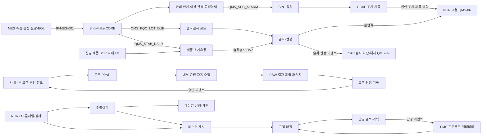

# SL QMS 워크아이템 Vol.4 — QMS-04 제품/공정 품질

Nov 1, 2026 · @배창욱

## 1. 개요

Vol.4는 QMS RFP 제품/공정 품질 모듈의 **Q-10 제품 초기유동, Q-11 SPC, Q-12 제품/출하 검사, Q-13 수평전개, Q-14 레슨런(LELE), Q-15 제품 Re-PPAP**를 26개 워크아이템으로 내린다. 이 메뉴는 두 성격이 섞여 있다. SPC·초기유동·출하검사는 **MES 대량 데이터를 Snowflake에서 계산하고 Salesforce는 조치 업무를 맡는** 구조이고, 수평전개·레슨런·제품 Re-PPAP는 **업무 흐름과 지식 자산** 중심이다. 레슨런은 QMS-08 AI와 PMS를 잇는 Q-40(PoC 시나리오 6)의 데이터 원천이므로 W1로 먼저 만든다.

| 기능코드 | 기능 | RFP | WI | 핵심 |
| --- | --- | --- | --- | --- |
| EFC | 제품 초기유동 | Q-10 | 3 | Vol.3 안정화 엔진의 PRODUCT 레코드타입, MES 실적 집계, 출하검사 강화 연동, 해제 결재 |
| SPC | SPC 관리 | Q-11 | 6 | SPC 계획, Snowflake 관리 한계·이상 판정·공정능력, 알람 → OCAP 조치 → NCR, 관리도 화면 |
| FQC | 제품/출하 검사 | Q-12 | 5 | 출하검사 기준서, 로트 자동 생성·검사·판정, 출하 보류·SAP 차단, EOL 전수 실적, 고객 성적서 |
| HZD | 수평전개 | Q-13 | 3 | 원천 연계 생성, 대상 선정 지원(유사 품번·공정·공장·협력사·BOM), 대상별 실행·확인·효과 점검 |
| LEL | 레슨런(LELE) | Q-14 | 5 | 지식 데이터 모델·게시 결재, 체크포인트, 규칙 기반 매칭, 후속 모델 반영 검토·이력(PMS 연계) |
| RPP | 제품 Re-PPAP | Q-15 | 4 | Vol.3 PPAP 엔진의 CUSTOMER 레코드타입, SL 내부 증빙 자동 수집, PSW·제출 패키지, 고객 판정 추적 |

**도메인 정의**

- **제품 초기유동**: 신규 제품 양산 직후나 사내 4M 변경 적용 직후 일정 기간 라인·품번 단위로 관리를 강화하고(초기유동 관리 검사 공정, 출하검사 강화), 공정 불량·직행률·특별특성 공정능력·고객 불량 목표를 채우면 해제한다. 부품 초기안정화(Vol.3 PIS)와 같은 엔진을 쓰고 실적 원천만 MES로 바뀐다.
- **SPC(Statistical Process Control)**: 특별특성(CTQ) 측정값을 관리도로 감시해 불량이 나기 전에 공정 변화를 잡는 활동이다. 관리 한계는 규격이 아니라 공정의 평소 산포로 정하고, 이상 판정 규칙(1점 3σ 이탈, 연속 9점 한쪽 등)에 걸리면 OCAP(Out of Control Action Plan, 이상 대응 절차)에 따라 조치하고 기록한다. 조치 기록이 감사에서 인정되는 증빙이므로 Salesforce가 맡는다.
- **제품/출하 검사**: 생산 완료품을 고객에게 보내기 전에 기준서에 따라 샘플링 또는 전수로 판정한다. 헤드램프는 EOL(End of Line) 시험기가 점등·광축·기밀 등을 전수 시험하므로(MES 데이터), 사람이 보는 출하검사는 외관·포장·라벨·샘플 치수 중심이다.
- **수평전개**: 한 곳에서 난 품질 문제의 현상·임시 조치·대책을 유사 제품·공정·공장·협력사에 퍼뜨리고, 각 대상이 실제로 점검·적용했는지 확인하는 업무다.
- **레슨런(LELE)**: 개발~양산~필드 품질 이슈에서 얻은 "다음 모델에서 반드시 할 일"을 지식 자산으로 등록하고, 후속 프로젝트의 해당 개발 단계·액티비티에서 반영 여부를 검토·기록하는 업무다. "반영했는가"의 이력이 BMW "계획과 기준 없이 일한다" 지적에 대한 증빙이 된다.
- **제품 Re-PPAP**: SL이 고객(OEM)에게 내는 PPAP. 사내 4M·고객 설계 변경·금형 이관 등으로 양산 능력을 다시 증명한다. 협력사 PPAP(Vol.3 PPA)와 같은 엔진을 쓰되 제출자가 SL이므로 증빙을 SL 내부 데이터(관리계획서·FMEA 문서, 인정시험 DVP&R, SPC Ppk, MSA, 하위 부품 PPAP)에서 자동으로 모으는 것이 핵심이다. BMW는 VDA 2(PPF/PPA) 양식을 쓴다.

**선행 공통 WI**: ARC-002·003, MDM-002·003·004·005·006·007, SEC-001·002·003, I18N-001, UX-001·003, APV-001·002, TDO-001, NTF-001, DOC-001, DWH-001·002·003·004, AI-004.

**다른 메뉴와의 경계**

| 연결 대상 | 이 Vol.이 하는 것 | 상대 메뉴가 하는 것 |
| --- | --- | --- |
| 안정화 엔진 (QMS-03-PIS) | PRODUCT 레코드타입 필드·기본값, MES 실적 집계, 제품 해제 조건·결재 유형 | 엔진 객체·서비스·이벤트·모니터·해제 화면(PART) |
| PPAP 엔진 (QMS-03-PPA) | CUSTOMER 레코드타입 상태·필드, 증빙 수집 프레임워크, PSW·제출 패키지, 고객 판정 기록 | 요소 마스터·레벨 규칙·PPAP 객체·요소 라인(SUPPLIER 흐름) |
| 수입검사 (QMS-03-IQC) | 출하검사가 샘플링 서비스·검사 훅·결과 JSON 구조를 재사용, 공용 LWC 일반화 요청 | QMS_SamplingService, QMS_InspectionHook, 검사 입력 화면 원형 |
| 4M 변경 (QMS-06-4MC) | 초기유동(PRODUCT)·고객 PPAP(CUSTOMER) 생성 서비스, 고객 PPAP 판정 이벤트, 4M 적용 시 SPC 관리 한계 재검토 | 고객 통보·승인 필요 판단(CSR), 서비스 호출, 고객 승인 전 적용 차단 |
| 부적합 NCR (QMS-06-NCR) | SPC 알람·출하검사 불합격 시 바인딩 NCR의 requestNcr(SPC_ALARM, FQC) 호출, 원천 객체를 QMS_NcrSourceConfig__mdt에 등록, 사내 NCR 이벤트(QMS_NcrEvent__e) 구독으로 출하검사 Hold, 수평전개·레슨런 게이트웨이 구현체 | NCR 생성·처분·대책, 원천 NCR 번호 회신, NCR 이벤트 발행, NCR 종결에서 게이트웨이(바인딩 키)로 수평전개·레슨런 요청 |
| 고객 품질 (Vol.5 CLM·B2B) | 수평전개·레슨런 게이트웨이 구현체(바인딩 HORIZONTAL_DEPLOY, LESSON_LEARNED), QMS_ClaimEvent__e 구독으로 출하검사 Hold | 8D D7·클레임 종결·B2B 경보에서 게이트웨이(바인딩 키)로 요청, 클레임 이벤트 발행, 고객 불량 데이터(CORE.CUSTOMER_QUALITY) |
| 측정·MSA (Vol.6b) | PPAP 증빙 수집 인터페이스(QMS_PpapEvidenceCollector, RPP-002 BR-7 계약), 검사 훅 Context FQC, SPC 화면에 복제된 MSA 결과 선택 표시(Vol.6b 이벤트·서비스 비의존) | MSA 증빙 수집기 구현·등록, 측정기·검사원 훅 구현, MSA 연구 DWH 복제 |
| 심사·개선 (Vol.6c) | 수평전개·레슨런 게이트웨이 구현체, SPC 공정능력 미달·초기유동 연장에서 바인딩 IMPROVEMENT로 개선 과제 요청 | 심사 지적·개선 과제 종결에서 게이트웨이(바인딩 키)로 수평전개·레슨런 요청, IMPROVEMENT 구현체 |
| AI (QMS-08) | LELE 데이터·체크포인트·규칙 매칭·반영 이력, SPC 알람 이력 | AI 순위 추천, PMS 자동 매핑, 조기경보 |
| 연계 (QMS-09) | Snowflake 수신 계약(MES 측정·생산·불량·EOL 컬럼), 출하검사 로트 수신 계약, 출하 판정 이벤트 | IF-MES-001 수집, SAP 납품 기준 로트, SAP 출하 차단·해제 |
| PMS | LELE 매칭·반영 API와 이벤트, 초기유동 생성 서비스(SOP), 고객 PPAP 상태 조회 | 표준 WBS 코드 정렬, 액티비티 착수·완료 시 호출, 완료 조건 연결 |
| Dashboard (QMS-07) | KPI 키(3절) | 위젯 |

**앞 Vol. 상태**: Vol.0·2·3은 검토 대기다. 이 Vol.은 결정 대기 항목의 권고안을 가정한다(특히 Vol.0 D-9 "지식 객체 전사 조회", Vol.3 D3-6 PPAP 엔진 공용, D3-7 안정화 엔진 공용). Vol.3 엔진에 필요한 확장은 11절 변경 요청에 모았다.

## 2. 업무 흐름

측정값·생산 실적·EOL 결과는 Salesforce 레코드로 만들지 않는다. Snowflake가 계산한 신호(알람·로트 생성 요청·일 실적)만 DWH-003 경로로 Salesforce에 들어오고, Salesforce는 그 신호에 대한 사람의 조치·판정·결재를 기록한다. 레슨런은 품질 이슈 원천(NCR·8D·클레임·심사·수평전개)에서 만들어지고, PMS 프로젝트 문맥(고객·제품군·개발 단계·액티비티 유형)과 매칭되어 반영 검토 기록으로 남는다.

## 3. 데이터 모델 개요

**객체**

| 객체 | 구분 | 관계 | 역할 | 정의 WI |
| --- | --- | --- | --- | --- |
| QMS_StabilizationPlan__c (RecordType PRODUCT) | 업무 | Item, Plant, Line, Customer(Lookup) | 제품 초기유동 계획·실적(Vol.3 객체 확장) | EFC-001 |
| QMS_StabilizationReport__c (RecordType INTERNAL) | 업무 | Plan(Lookup) | 초기유동 관리 검사 일 보고(Vol.3 객체 확장) | EFC-002 |
| QMS_MesDefectMap__c | 설정 | Plant, DefectType(Lookup) | MES 불량 코드 → SL 불량 유형 매핑 | EFC-002 |
| QMS_SpcPlan__c | 설정 | Characteristic, Plant, Line, Operation(Lookup) | SPC 관리 대상·관리도 설정 | SPC-001 |
| QMS_SpcLimit__c | 업무 | SpcPlan(MD) | 관리 한계 버전 | SPC-001 |
| QMS_SpcRule__mdt | 설정 | — | 이상 판정 규칙 코드·표시명 | SPC-001 |
| QMS_SpcAlarm__c | 업무 | SpcPlan(Lookup) | 이상 신호 묶음·OCAP 조치 기록 | SPC-005 |
| QMS_OcapTemplate__c / QMS_OcapStep__c | 설정 | Step → Template(MD) | OCAP 절차 | SPC-005 |
| QMS_FinalInspStandard__c / QMS_FinalInspStandardLine__c | 설정 | Line → Standard(MD), Characteristic(Lookup) | 출하검사 기준서(버전) | FQC-001 |
| QMS_FinalInspLot__c / QMS_FinalInspResult__c | 업무 | Result → Lot(MD) | 출하검사 로트·항목 결과 | FQC-002 |
| QMS_FinalInspHold__c | 업무 | Item, Plant, Customer(Lookup) | 출하검사 강도 강제 유지 | FQC-003 |
| QMS_HorizontalDeploy__c | 지식·업무 | — | 수평전개 1건 | HZD-001 |
| QMS_HorizontalDeployTarget__c | 업무 | Deploy(Lookup), TargetPlant·Item·Line·Supplier(Lookup) | 대상별 실행·확인 | HZD-001 |
| QMS_LessonLearned__c | 지식 | — | 레슨런(버전) | LEL-001 |
| QMS_LeleCheckpoint__c | 지식 | LessonLearned(MD) | 개발 단계·액티비티별 확인 항목 | LEL-003 |
| QMS_LeleApplication__c | 업무 | LessonLearned, Checkpoint(Lookup) | 후속 모델 반영 검토·이력 | LEL-005 |
| QMS_Ppap__c (RecordType CUSTOMER) | 업무 | Customer, Item, Plant(Lookup) | 고객 PPAP(Vol.3 객체 확장) | RPP-001 |
| QMS_PpapEvidence__c | 업무 | PpapElementLine(MD) | 요소별 내부 증빙 후보·채택 | RPP-002 |
| QMS_PpapCustomerSubmission__c | 업무 | Ppap(MD) | 고객 제출 차수·고객 판정 | RPP-004 |

**Snowflake 객체**(DWH-001 스키마 규칙, schemachange 관리)

| 객체 | 정의 WI | 내용 |
| --- | --- | --- |
| CORE.MES_PRODUCTION / CORE.MES_DEFECT | EFC-002 | MES 생산 실적·불량 실적(수신 컬럼 계약, 수집은 QMS-09) |
| CORE.SPC_MEASUREMENT / CORE.SPC_SUBGROUP / CORE.SPC_SIGNAL | SPC-002 | 측정값, 부분군 통계, 이상 신호 |
| CORE.SPC_CONSTANTS / CORE.SPC_RULE_DEF | SPC-002 | 관리도 상수표, 이상 판정 규칙 파라미터 |
| CORE.SPC_CAPABILITY | SPC-003 | 기간별 Cp·Cpk·Pp·Ppk |
| CORE.EOL_TEST_RESULT | FQC-004 | EOL 전수 시험 결과(시리얼 단위) |
| CORE.INSPECTION_RESULT (SOURCE 'FQC') | FQC-004 | 출하검사 시료 값(IQC-007 테이블 공유) |

**상태값**

| 대상 | 값(순서) |
| --- | --- |
| QMS_SpcPlan__c.Status__c | DRAFT → TRIAL(한계 산출 중) → ACTIVE → SUSPENDED / ENDED |
| QMS_SpcLimit__c.Status__c | TRIAL → PENDING_APPROVAL → ACTIVE → SUPERSEDED / REJECTED |
| QMS_SpcAlarm__c.Status__c | NEW → IN_PROGRESS → ACTION_DONE → CLOSED |
| QMS_SpcAlarm__c.Outcome__c | ASSIGNABLE_CAUSE_FIXED 원인 조치 · NO_CAUSE_FOUND 원인 미발견 · FALSE_SIGNAL 측정·데이터 오류 · NCR_RAISED 부적합 등록 |
| QMS_FinalInspLot__c.Status__c | WAITING → IN_INSPECTION → DECIDED / CANCELLED |
| QMS_FinalInspLot__c.ShipHoldStatus__c | NONE · HELD → RELEASED |
| QMS_HorizontalDeploy__c.Status__c | DRAFT → SCOPING → DEPLOYING → VERIFYING → CLOSED / CANCELLED |
| QMS_HorizontalDeployTarget__c.Status__c | ASSIGNED → IN_PROGRESS → SUBMITTED → CONFIRMED / RETURNED(→ IN_PROGRESS) |
| QMS_LessonLearned__c.Status__c | DRAFT → REVIEW → PUBLISHED → OBSOLETE |
| QMS_LeleApplication__c.Status__c | PROPOSED → UNDER_REVIEW → APPLIED / NOT_APPLICABLE / DEFERRED → VERIFIED(APPLIED만) |
| QMS_Ppap__c.Status__c (CUSTOMER) | DRAFT → IN_PREPARATION → IN_REVIEW → APPROVAL → CUSTOMER_REVIEW → APPROVED / INTERIM / REJECTED, CUSTOMER_REVIEW → RETURNED → IN_PREPARATION, CANCELLED |
| QMS_PpapCustomerSubmission__c.CustomerDecision__c | PENDING → APPROVED / INTERIM / REJECTED / RESUBMIT_REQUESTED |

**권한 셋과 페르소나 매핑**(각 WI가 PS를 만들고 SEC-001 BR-2에 따라 PSG에 추가)

| Permission Set | 내용 | PSG |
| --- | --- | --- |
| QMS_PS_StabProduct_Edit | 안정화 계획 PRODUCT 레코드타입 생성·편집·일 보고 | QualityEngineer, QualityManager |
| QMS_PS_Spc_Read | SPC 계획·한계·알람·관리도 조회 | Viewer, QualityEngineer, QualityManager, ProcessEngineer(신규), Executive |
| QMS_PS_Spc_Edit | SPC 계획 편집, 한계 확정·재계산 요청 | QualityEngineer |
| QMS_PS_Spc_Ocap | 알람 확인·OCAP 조치 입력 | ProcessEngineer, QualityEngineer, Inspector |
| QMS_PS_Spc_Admin | 규칙·OCAP 템플릿·기본값 | QualityAdmin |
| QMS_PS_Fqc_Read / QMS_PS_Fqc_Inspect / QMS_PS_Fqc_Admin | 출하검사 조회 / 입력·판정 / 기준서·재개·보류 해제 | Viewer·QualityManager / Inspector·QualityEngineer / QualityEngineer·QualityAdmin |
| QMS_PS_Hzd_Edit | 수평전개 발행·대상 선정·확인 | QualityEngineer, SupplierQuality |
| QMS_PS_Hzd_Execute | 배정된 대상 실행 입력 | Viewer, ProcessEngineer, QualityEngineer, DevEngineer |
| QMS_PS_Portal_Hzd | 협력사 대상 실행(포털) | SupplierPortal |
| QMS_PS_Lele_Read | 레슨런·체크포인트·반영 이력 조회 | 모든 QMS PSG + PMS_PSG_PM·CFT·PMO |
| QMS_PS_Lele_Edit | 레슨런 등록·개정, 반영 검토 결정 | QualityEngineer, DevEngineer, PMS_PSG_PM·CFT |
| QMS_PS_Lele_Admin | 게시 관리·폐기·매칭 가중치 | QualityAdmin |
| QMS_PS_PpapCustomer_Edit | 고객 PPAP 작성·증빙 채택·제출·판정 기록 | QualityEngineer |

결재 Role은 기존 APPROVAL_ROLE(QUALITY_MANAGER, PRODUCTION_MANAGER, PLANT_MANAGER, DEV_MANAGER, QM_HEAD)과 신규 LELE_OWNER(품질경영팀 레슨런 관리자, Vol.0 변경 요청)를 쓴다.

**다른 WI·메뉴가 쓰는 서비스와 이벤트**

| 이름 | 종류 | 제공 WI | 사용처 |
| --- | --- | --- | --- |
| QMS_StabilizationService.createFromSource(PRODUCT) | Apex(Vol.3 확장) | EFC-001 | QMS-06-4MC, PMS(SOP) |
| QMS_SpcService.getCapability | Apex | SPC-003 | RPP-002, QMS-03-PPA, Vol.7, Vol.8 |
| QMS_FinalInspLevelService.effectiveLevel / addHold / releaseHold | Apex | FQC-003 | 이 메뉴 안에서만: EFC-001, FQC-003(클레임·사내 NCR 이벤트 구독), SPC 알람 화면·수동 |
| QMS_FinalInspDecision__e | Platform Event | FQC-003 | QMS-09(SAP 출하 차단·해제), Vol.5 |
| QMS_HorizontalDeployService.createFromSource / getStatusBySource | Apex | HZD-001 | HORIZONTAL_DEPLOY 게이트웨이 구현체, LEL-002(같은 메뉴) |
| QMS_HorizontalDeployGatewayImpl(바인딩 HORIZONTAL_DEPLOY) | 게이트웨이 구현체 | HZD-001 | Vol.5(8D D7·클레임·B2B 경보), QMS-06-NCR, Vol.6c(심사 지적·개선 과제) |
| QMS_HorizontalDeployEvent__e | Platform Event | HZD-001 | LEL-002, Vol.5, Vol.8 |
| QMS_LessonLearnedService.createFromSource / getStatusBySource | Apex | LEL-002 | LESSON_LEARNED 게이트웨이 구현체, HZD-003(같은 메뉴) |
| QMS_LessonLearnedGatewayImpl(바인딩 LESSON_LEARNED) | 게이트웨이 구현체 | LEL-002 | Vol.5, QMS-06-NCR, Vol.6c, PMS(P-49 문제점, sourceObject OTHER) |
| QMS_LessonLearnedEvent__e | Platform Event | LEL-001 | Vol.8(검색 색인·추천 소스) |
| QMS_LeleMatchService.match | Apex + REST | LEL-004 | PMS, Vol.8 |
| QMS_LeleApplicationService.propose / decide / getByProject / hasOpenMandatory | Apex + REST | LEL-005 | PMS, Vol.8 |
| QMS_LeleApplicationEvent__e | Platform Event | LEL-005 | PMS, Vol.8(AI-004 확정) |
| QMS_PpapEvidenceCollector + QMS_PpapCollector__mdt | Interface + Custom Metadata | RPP-002 | Vol.6b(MSA 수집기 구현·등록, RPP-002 BR-7 계약) |
| QMS_NcrSourceConfig__mdt 레코드(QMS_SpcAlarm__c, QMS_FinalInspLot__c) | 설정 등록 | SPC-005, FQC-003 | QMS-06-NCR(원천 NCR 번호 회신) |
| QMS_PpapEvent__e (CUSTOMER 레코드타입) | Platform Event(Vol.3 이벤트) | RPP-004 | QMS-06-4MC, EFC-001, PMS |

Snowflake → Salesforce 알람 EVENT_TYPE: QMS_SPC_ALARM, QMS_SPC_LIMIT_READY, QMS_SPC_CAPABILITY_LOW, QMS_SPC_DATA_GAP, QMS_FQC_LOT_DUE, QMS_EOL_FPY_DROP, QMS_STAB_DAILY(Vol.3 이벤트에 PRODUCT 값 추가).

**KPI 키**(CMN_KpiValue__c, DWH-003 경로)

| KpiKey | 정의 | 주기 | 차원 | 계산 위치 |
| --- | --- | --- | --- | --- |
| QMS_EFC_PPM | 초기유동 계획 기간 공정 불량 PPM = MES 불량 수 / 투입 수 × 1,000,000 | 일 | Plant, Line, Item | Snowflake, EFC-002 |
| QMS_EFC_FPY | 초기유동 계획 기간 직행률 = 1차 양품 수 / 투입 수, % | 일 | Plant, Line, Item | Snowflake, EFC-002 |
| QMS_SPC_CPK | 특성별 Cpk(월, 최근 30일 롤링) | 일·월 | Plant, Line, Item, Characteristic | Snowflake, SPC-003 |
| QMS_SPC_PPK | 특성별 Ppk | 일·월 | Plant, Line, Item, Characteristic | Snowflake, SPC-003 |
| QMS_SPC_BELOW_TARGET | Cpk가 특성 TargetCpk 미만인 ACTIVE 계획 수 | 일 | Plant, Line | Snowflake, SPC-003 |
| QMS_SPC_SIGNALS | 이상 신호 수(OOS·OOC 구분은 KpiKey 접미 _OOS, _OOC) | 일 | Plant, Line | Snowflake, SPC-002 |
| QMS_SPC_OCAP_ONTIME | 확인 기한 내 확인된 알람 비율, % | 월 | Plant | Snowflake, SPC-005 |
| QMS_FQC_LOTS / QMS_FQC_LAR | 출하검사 판정 로트 수 / 로트 합격률 | 일·월 | Plant, Item, Customer | Snowflake, FQC-004 |
| QMS_FQC_HOLD_PPM | 출하 보류 수량 PPM = 보류 수량 / 판정 로트 수량 × 1,000,000 | 일·월 | Plant, Item, Customer | Snowflake, FQC-004 |
| QMS_EOL_FPY | EOL 1차 합격률 = 1차 PASS 시리얼 / 시험 시리얼, % | 일 | Plant, Line, Item | Snowflake, FQC-004 |
| QMS_EOL_FAIL_PPM | EOL 최종 불합격 PPM | 일 | Plant, Line, Item | Snowflake, FQC-004 |
| QMS_EOL_COVERAGE | EOL 시험 커버리지 = 시험 시리얼 / 생산 수, % | 일 | Plant, Line, Item | Snowflake, FQC-004 |
| QMS_HZD_OPEN / QMS_HZD_ONTIME | 진행 중 대상 수 / 기한 내 제출 대상 비율 | 일·월 | Plant(대상 공장) | Snowflake, HZD-003 |
| QMS_LELE_PUBLISHED | 게시 레슨런 수(누적·월 신규) | 월 | — (전사), Origin은 KpiKey 접미 | Snowflake, LEL-001 |
| QMS_LELE_REVIEW_RATE | 반영 검토 완료율 = 결정 완료 / 기한 도래 제안 | 월 | Customer | Snowflake, LEL-005 |
| QMS_LELE_APPLY_RATE | 반영률 = APPLIED·VERIFIED / 결정 완료 | 월 | Customer | Snowflake, LEL-005 |
| QMS_PPAP_CUST_ONTIME / QMS_PPAP_CUST_OPEN | 고객 PPAP 기한 내 제출률 / 고객 판정 대기 건수 | 월·일 | Plant, Customer | Snowflake, RPP-004 |

**공통 기반 등록(각 업무 객체 WI에서 수행)**: 채번(ARC-003), CMN_SharingConfig(Plant__c; 지식 객체는 제외), CMN_DeleteGuard, CMN_StatusFlow, 필드 이력, DWH 복제(DWH-002), ko·en·zh 번역. 채번 규칙: SPC-{PLANT}-{SEQ:5}(ResetPolicy NEVER), ALM-{PLANT}-{YYYY}-{SEQ:6}, FQC-{PLANT}-{YYYY}-{SEQ:6}, HZD-{PLANT}-{YYYY}-{SEQ:5}, LL-{YYYY}-{SEQ:5}(공장 토큰 없음, 전사 연번), LA-{YYYY}-{SEQ:6}(공장 토큰 없음). 안정화 계획(STB)·PPAP(PPA)는 Vol.3 규칙을 그대로 쓴다.

**데이터량 가정**(SL 미확인, 근거 자료 확보 후 수정)

| 데이터 | 가정 | 저장 위치 |
| --- | --- | --- |
| SPC 측정값 | 라인 300 × 특성 20 × 시간당 5 → 연 2~3억 건 | Snowflake만 |
| SPC 알람 | 하루 50~200건(신호는 열린 알람에 묶음) → 연 2만~7만 건 | Salesforce |
| MES 생산·불량 실적 | 라인·품번·교대 단위 일 수천 행 | Snowflake만 |
| EOL 시험 | 연 수천만 시리얼 | Snowflake만 |
| 출하검사 로트 | 기준서가 있는 품번만, 품번·공장·생산일 단위 → 연 10만~25만 건, 결과 라인은 IQC와 같이 24개월 후 아카이브 | Salesforce + Snowflake |
| 레슨런·체크포인트·반영 이력 | 레슨런 수천 건, 체크포인트 2만 건, 반영 이력 연 수만 건 | Salesforce |

## 4. 제품 초기유동 (EFC)

제품 초기유동은 Vol.3 안정화 엔진(QMS_StabilizationPlan__c, `QMS_StabilizationService`, `qmsStabilizationMonitor`, `qmsStabilizationRelease`, QMS_StabilizationEvent__e)을 RecordType **PRODUCT**로 재사용한다. 이 절은 PIS-001~003과 같은 규칙을 "PIS-00n BR-m과 같음"으로 참조하고 **차이만** 정의한다. 차이는 (1) 계획 단위가 협력사 품번이 아니라 품번·공장(·라인), (2) 실적 원천이 수입검사가 아니라 MES 생산·불량·SPC·고객 불량, (3) 강화 조치가 수입검사 Hold가 아니라 초기유동 관리 검사 공정과 출하검사 Hold, (4) 해제 결재에 생산팀장 합의가 들어간다는 점이다.

### QMS-04-EFC-001 제품 초기유동 계획(PRODUCT)·트리거·강화 조치

추적 Q-10, Q-19 · 필수 · W2 · SF · DM, APEX, LWC · Customization · 선행 QMS-03-PIS-001, MDM-002, MDM-004, ARC-003 · 5 M/D

**목적**: 신규 제품 SOP나 사내 4M 적용 직후 "어느 품번·라인을, 언제까지, 어떤 목표로, 무엇을 강화해 관리하는가"를 계획으로 남기고, 계획이 생기는 순간 출하검사가 강화되게 한다.

**범위** In: PRODUCT 레코드타입 필드·페이지 레이아웃, 기본값 메타데이터 확장, 트리거별 호출 계약(PMS SOP, 고객 PPAP 승인, 사내 4M, 수동), 출하검사 Hold 연동, 생성 마법사. Out: MES 실적 집계·일 보고(EFC-002), 해제·연장(EFC-003), 출하검사 Hold 구현(FQC-003), 4M 쪽 호출 구현(QMS-06-4MC), 엔진 공통 규칙(QMS-03-PIS-001).

**데이터 모델**(QMS_StabilizationPlan__c에 이 WI가 추가하는 필드. PART 레이아웃에는 표시하지 않음)

| 객체 / 필드 | 타입 | 필수 | 설명 |
| --- | --- | --- | --- |
| QMS_StabilizationPlan__c.Item__c | Lookup(CMN_Item__c, ItemType FG·SFG 필터) | PRODUCT면 Y | Vol.3 필드 재사용, PRODUCT는 사용자가 직접 선택 |
| QMS_StabilizationPlan__c.Line__c | Lookup(CMN_Line__c, 같은 Plant 필터) | N | 공란 = 공장 내 해당 품번 생산 라인 전체 |
| QMS_StabilizationPlan__c.Customer__c / Vehicle__c | Lookup(Account 고객 RT) / Lookup(CMN_Vehicle__c) | PRODUCT면 Customer Y | 품번에서 기본값 |
| QMS_StabilizationPlan__c.SopDate__c | Date | Trigger NEW_PRODUCT면 Y | PMS SOP 또는 수동 입력 |
| QMS_StabilizationPlan__c.MinProductionDays__c | Number(4,0) | PRODUCT면 Y | 최소 생산일 수(생산 실적이 있었던 날) |
| QMS_StabilizationPlan__c.TargetFpy__c | Percent(5,2) | PRODUCT면 Y | 직행률 목표(기본 98%) |
| QMS_StabilizationPlan__c.TargetSpecialPpk__c | Number(4,2) | PRODUCT면 Y | 특별특성 SPC 계획의 Ppk 하한(기본 1.67) |
| QMS_StabilizationPlan__c.ZeroCustomerDefect__c | Checkbox | PRODUCT면 Y | 기간 중 고객 불량 0 요구(기본 true) |
| QMS_StabilizationPlan__c.ContainmentMethod__c | Picklist (MES_OPERATION MES 공정으로 등록, MANUAL_REPORT 일 보고 입력, NONE 없음) | PRODUCT면 Y | 초기유동 관리 검사(GP-12형) 결과 수집 방식 |
| QMS_StabilizationPlan__c.ContainmentOperation__c | Lookup(CMN_Operation__c, 같은 Line 필터) | MES_OPERATION이면 Y | 관리 검사 공정 |
| QMS_StabilizationPlan__c.FqcHoldLevel__c | Picklist (TIGHTENED 강화, FULL 전수) | PRODUCT면 Y | 출하검사 강화 수준(FQC-003 Hold) |
| QMS_StabilizationPlan__c.ActualProducedQty__c / ActualFirstPassQty__c / ActualProductionDays__c | Number(14,0) / Number(14,0) / Number(4,0) | — | EFC-002가 매일 갱신 |
| QMS_StabilizationPlan__c.ActualFpy__c | Percent(5,2) | — | EFC-002 |
| QMS_StabilizationPlan__c.ActualMinPpk__c | Number(6,3) | — | 품번 특별특성 ACTIVE SPC 계획 Ppk 최솟값(데이터 없으면 공란) |
| QMS_StabilizationPlan__c.ActualCustomerDefects__c | Number(6,0) | — | 기간 중 고객 불량 건수(Vol.5 데이터, 배포 전 0) |
| QMS_StabilizationPlan__c.ActualContainmentChecked__c / ActualContainmentDefects__c | Number(14,0) | — | 관리 검사 수량·검출 불량 |
| QMS_StabilizationDefault__mdt.RecordType__c | Picklist (PART, PRODUCT) | Y | Vol.3 메타데이터 확장 |
| QMS_StabilizationDefault__mdt.ProductGroupCode__c | Text(20) | N | PRODUCT 기본값 선택 키. 공란 = 전체 |
| QMS_StabilizationDefault__mdt.MinProductionDays__c / TargetFpy__c / TargetSpecialPpk__c / ZeroCustomerDefect__c / ContainmentMethod__c / FqcHoldLevel__c | 위 필드와 같은 타입 | PRODUCT면 Y | 기본값 |

PRODUCT는 Vol.3 필드 중 MinDays__c(최소 기간), TargetPpm__c(공정 불량 PPM 목표), ZeroSpecialDefect__c(특별특성 불량 0), ActualDefectQty__c, ActualPpm__c, ActualSpecialDefects__c, ElapsedDays__c, Status__c, ExtensionCount__c, ReleasedAt__c를 그대로 쓰고 SupplierItem__c, Supplier__c, MinLots__c, HoldMinLevel__c, HoldFullInspection__c, SupplierContainment__c, SupplierReportFrequency__c, ActualLots__c, ActualRejectLots__c, ActualReceivedQty__c는 레이아웃에서 숨기고 Validation Rule로 값을 비운다.

**서비스 API**(Vol.3 `QMS_StabilizationService` 요청 DTO 확장, Vol.3 변경 요청)

    Id createFromSource(QMS_StabilizationRequest req)
    // PRODUCT 사용 필드: recordType = 'PRODUCT', itemId, plantId, lineId(선택), customerId(선택: 품번에서 기본),
    //   trigger(NEW_PRODUCT, CHANGE_4M, CUSTOMER_ECO, LINE_TRANSFER, QUALITY_ISSUE, OTHER),
    //   sopDate, sourceId, sourceObject, sourceNo, ownerId(선택)

**비즈니스 규칙**

- BR-1: 트리거와 호출 주체 —
  (a) NEW_PRODUCT: PMS가 SOP 확정(양산 이관 Gate 승인) 시 `createFromSource(PRODUCT, itemId, plantId, NEW_PRODUCT, sopDate, sourceId = PMS 프로젝트 또는 Gate Id)`를 호출한다(PMS Vol. 구현). PMS 배포 전에는 품질 엔지니어가 수동 생성한다.
  (b) CHANGE_4M: QMS-06-4MC가 사내 4M 적용 승인 시 호출한다. 4MC는 CMN 설정 **QMS_EFC_ENABLED**(Boolean, 기본 false)가 true일 때만 호출하고 false면 수작업 항목으로 대체한다. 이 WI는 이 설정 키를 CMN 설정에 등록하고, 배포 체크리스트에 "EFC-001~003 배포 후 QMS_EFC_ENABLED = true" 단계를 남긴다. 4MC 요청 필드: recordType PRODUCT, itemId, plantId, lineId(선택), trigger CHANGE_4M, sourceId = 4M Id, sourceObject QMS_FourMChange__c, sourceNo, ownerId. 결과는 Vol.3 QMS_StabilizationEvent__e(SourceRecordId = 4M Id)로 전달된다.
  (c) 고객 PPAP 승인 연계: QMS_PpapEvent__e 중 RecordType CUSTOMER, EventType APPROVED·INTERIM, Trigger가 CMN 설정 QMS_EFC_AUTO_PPAP_TRIGGERS(기본 ECO, TOOL_TRANSFER)에 있는 건을 구독해 Trigger CUSTOMER_ECO(TOOL_TRANSFER면 LINE_TRANSFER)로 호출한다. CHANGE_4M 트리거 PPAP는 4M에서 이미 만들었으므로 구독하지 않는다.
  (d) 수동: QMS_PS_StabProduct_Edit 보유자가 `qmsEfcPlanSetup`에서 생성(Trigger QUALITY_ISSUE·OTHER 포함).

- BR-2: 멱등 — 같은 Item + Plant(+ Line이 지정되면 Line)에 DRAFT·ACTIVE·EXIT_REVIEW PRODUCT 계획이 있으면 새로 만들지 않고 기존 Id를 반환하며 새 원천 번호를 코멘트로 남긴다(PIS-001 BR-4와 같음). Line이 공란인 계획이 있으면 같은 품번·공장의 라인 지정 요청도 기존 계획으로 본다.

- BR-3: 기본값 선택 — QMS_StabilizationDefault__mdt에서 (RecordType PRODUCT, Trigger, ProductGroupCode = 품번 제품군 코드) → (RecordType PRODUCT, Trigger, ProductGroupCode 공란) 순서. 초기 데이터 예(SL 기준으로 교체): NEW_PRODUCT = MinDays 90, MinProductionDays 30, TargetPpm 500, TargetFpy 98%, TargetSpecialPpk 1.67, ZeroSpecialDefect true, ZeroCustomerDefect true, ContainmentMethod MANUAL_REPORT, FqcHoldLevel FULL / CHANGE_4M = MinDays 30, MinProductionDays 10, TargetPpm 500, TargetFpy 98%, FqcHoldLevel TIGHTENED.

- BR-4: 생성 즉시 안전 측 — DRAFT 생성과 같은 트랜잭션에서 `QMS_FinalInspLevelService.addHold(itemId, plantId, customerId, 'EFC', FqcHoldLevel, planId, RecordNo)`를 호출한다. FQC-003이 배포되지 않았으면(`Type.forName('QMS_FinalInspLevelService')`가 null) WARN 로그만 남기고 계속한다. Owner는 req.ownerId, 없으면 공장 QUALITY_MANAGER Role 사용자이며 그에게 To-Do "초기유동 계획 확정: {품번}"(기한 3일, SourceType QMS_EFC_PLAN_CONFIRM)을 연다.

- BR-5: StartDate — 비어 있으면 SopDate를 쓰고, SopDate도 없으면 EFC-002 일 집계가 계획 생성 이후 첫 생산일(투입 수량 > 0)을 넣는다.

- BR-6: 관리 검사 공정 — ContainmentMethod = MES_OPERATION이면 ContainmentOperation이 필수이고 그 공정의 MES 검사·불량 실적을 EFC-002가 집계한다. MANUAL_REPORT면 EFC-002가 생산일마다 일 보고를 연다. NONE이면 관리 검사 조건을 해제 판정에서 뺀다.

- BR-7: 확정(activate) — PIS-001 BR-2와 같이 ACTIVE로 바꾸고 Hold 조건을 다시 반영한다. 추가로 공장 PRODUCTION_MANAGER Role에게 알림 QMS_EFC_ACTIVATED(품번·라인·기간·목표·관리 검사 방식)를 보낸다.

- BR-8: 검증 — PRODUCT인데 SupplierItem__c·Supplier__c에 값이 있으면 저장 차단. Item.ItemType이 FG·SFG가 아니면 차단. Line이 지정되면 Line.Plant = Plant여야 한다.

- BR-9: 공통 기반 — Vol.3 PIS-001 BR-7 등록을 그대로 쓰고 PRODUCT 레이아웃·번역만 추가한다. 협력사 공유는 Supplier__c가 비어 있으므로 발생하지 않는다.

**화면/UX**

| 컴포넌트 | 위치 | 기능 |
| --- | --- | --- |
| qmsEfcPlanSetup | SL QMS 앱 "초기유동" 페이지, 품번 레코드 액션 | 1단계 품번·공장·라인·트리거·SOP일 → 2단계 기본값 미리보기·수정 → 저장(DRAFT + Hold) |
| PRODUCT 레코드 페이지 | QMS_StabilizationPlan__c | cmnStatusPath, 계획·목표·강화 조치 섹션, qmsStabilizationMonitor(EFC-002 PRODUCT 모드), cmnCommentTimeline |

**권한**: QMS_PS_StabProduct_Edit(생성·편집·확정), QMS_PS_Stab_Read(조회, Vol.3).

**수용 기준**

- AC-1: Given 사내 4M 원천, When createFromSource(PRODUCT, 품번 X, KR01, CHANGE_4M), Then DRAFT 계획 1건, 출하검사 Hold(EFC, TIGHTENED) 1건, KR01 품질팀장 To-Do 1건.

- AC-2: Given 품번 X·KR01에 ACTIVE PRODUCT 계획, When 다른 원천으로 호출, Then 기존 Id 반환, 코멘트 1건, 계획 수 변화 없음.

- AC-3: Given LAMP_HL 전용 NEW_PRODUCT 기본값과 공통 기본값, When 헤드램프 품번으로 생성, Then 전용 기본값 적용.

- AC-4: Given PRODUCT 계획에 SupplierItem 입력, When 저장, Then 차단.

- AC-5: Given FQC-003 미배포, When 생성, Then 계획 생성 성공, WARN 로그 1건.

- AC-6: Given 고객 PPAP(CUSTOMER, ECO) APPROVED 이벤트, When 처리, Then Trigger CUSTOMER_ECO 계획 1건. 같은 PPAP가 CHANGE_4M이면 계획을 만들지 않음.

**에이전트 주의**: 제품 초기유동용 새 객체를 만들지 않는다(Vol.3 객체의 레코드타입). PIS-001의 PART 동작(수입검사 Hold, 협력사 공개)을 PRODUCT에서 실행하지 않도록 서비스 분기를 레코드타입으로 한다. 출하검사 수준 필드를 직접 바꾸지 않는다(FQC-003 Hold API).

**오픈 이슈**: SL 현행 초기유동 기준(기간·목표·관리 검사 방식), 관리 검사 공정이 MES에 공정으로 등록되는지, PMS의 SOP 확정 시점 정의.

### QMS-04-EFC-002 MES 실적 집계·초기유동 관리 검사 기록

추적 Q-10, Q-38, Q-42 · 필수 · W2 · SNOW, SF · SQL, APEX, LWC · Customization · 선행 EFC-001, QMS-03-PIS-002, DWH-003, DWH-004 · 6 M/D

**목적**: 초기유동 기간의 공정 불량·직행률·특별특성 공정능력·고객 불량을 MES와 Snowflake에서 매일 계산해 계획에 붙이고, 관리 검사 결과를 같은 화면에서 본다. 목표에서 벗어나는 즉시 품질·생산 담당이 알게 한다.

**범위** In: MES 생산·불량 수신 컬럼 계약(CORE), MES 불량 코드 매핑, 일 집계(PRODUCT), 일 보고(INTERNAL), 알람, 모니터 PRODUCT 모드, KPI. Out: MES 수집 인터페이스(QMS-09 IF-MES-001), 해제(EFC-003), SPC 공정능력 계산(SPC-003).

**데이터 모델**

| 객체 / 필드 | 타입 | 필수 | 설명 |
| --- | --- | --- | --- |
| CORE.MES_PRODUCTION | Snowflake 테이블 | — | PLANT_CODE, LINE_CODE, ITEM_NO, PROD_DATE, SHIFT, MES_LOT_NO, INPUT_QTY, GOOD_QTY, FIRST_PASS_QTY, REWORK_QTY, SCRAP_QTY, LOT_STATUS(OPEN, CLOSED), LOT_CLOSED_TS, FOURM_RECORD_NO, SPEC_VERSION, CHANGED_TS, DELETED(BOOLEAN), _SOURCE, _BATCH_ID, _LOADED_AT. 키 (PLANT_CODE, MES_LOT_NO, SHIFT). QMS-09 INT-011 RAW 표준 형식과 같은 이름 |
| CORE.MES_DEFECT | Snowflake 테이블 | — | PLANT_CODE, LINE_CODE, OP_CODE, ITEM_NO, PROD_DATE, SHIFT, MES_LOT_NO, MES_DEFECT_CODE, DEFECT_TYPE_CODE(매핑 결과), QTY, IS_SPECIAL_CHAR, CHAR_NO, DETECTED_TS, CHANGED_TS, DELETED(BOOLEAN). 키 (PLANT_CODE, MES 불량 기록 Id) |
| QMS_MesDefectMap__c.Plant__c | Lookup(CMN_Plant__c) | Y | |
| QMS_MesDefectMap__c.MesDefectCode__c / MesDefectName__c | Text(40) / Text(120) | Y / N | MES 불량 코드 |
| QMS_MesDefectMap__c.DefectType__c | Lookup(CMN_Code__c, DEFECT_TYPE 리프) | Y | SL 불량 유형 |
| QMS_MesDefectMap__c.ExternalKey__c | Text(70), External ID, Unique | Y | `{PlantCode}-{MesDefectCode}` |
| QMS_MesDefectMap__c.IsActive__c | Checkbox | Y | |
| QMS_StabilizationReport__c (RecordType INTERNAL).Line__c | Lookup(CMN_Line__c) | INTERNAL이면 Y | Vol.3 객체 확장 |
| QMS_StabilizationReport__c.ProdDate__c / Shift__c | Date / Picklist (A, B, C, DAY) | INTERNAL이면 Y | 보고 대상 생산일·교대 |

INTERNAL 보고는 Vol.3 필드 CheckedQty__c(관리 검사 수량), DefectQty__c, DefectDetailsJson__c, Status__c를 그대로 쓰고 ProducedQty__c는 MES 값으로 자동 채운다. Supplier__c는 INTERNAL에서 비운다.

**비즈니스 규칙**

- BR-1: 수신 계약 — QMS-09는 MES 생산·불량 실적을 시간 단위 마이크로배치로 RAW에 적재하고, 이 WI의 STG 뷰와 Task가 CORE.MES_PRODUCTION·MES_DEFECT에 MERGE한다. 같은 키가 다시 오면 CHANGED_TS가 최신인 값으로 덮고, DELETED = TRUE 행은 지우지 않고 표시만 하며 모든 집계(EFC 일 집계, FQC 로트 생성, SPC 데이터 누락 판단, FQC-004 EOL 요약의 생산 수)에서 뺀다. LOT_STATUS·LOT_CLOSED_TS는 출하검사 로트 마감 판단(FQC-002 BR-1(a)), FOURM_RECORD_NO·SPEC_VERSION은 4M 첫 생산 로트 감지(QMS-06-4MC, QMS-09 INT-012)에 쓴다. 불량 코드 매핑은 DWH-002로 매일 복제된 QMS_MesDefectMap__c(CORE.SF_QMS_MESDEFECTMAP)로 DEFECT_TYPE_CODE를 채우고, 매핑이 없으면 'UNMAPPED'로 둔다.

- BR-2: 일 집계 — Snowflake Task(매일 03:30 KST, PIS-002 Task와 같은 Task 그래프)가 ACTIVE·EXIT_REVIEW PRODUCT 계획마다 StartDate 이후 값을 계산한다. 라인 지정 계획은 그 라인만, 공란이면 공장 내 해당 품번 전 라인.

| 계획 필드 | 계산 |
| --- | --- |
| ActualProducedQty / ActualFirstPassQty | MES_PRODUCTION INPUT_QTY 합 / FIRST_PASS_QTY 합 |
| ActualProductionDays | INPUT_QTY > 0인 PROD_DATE 수 |
| ActualDefectQty / ActualPpm | MES_DEFECT QTY 합 / 불량 ÷ 투입 × 1,000,000 |
| ActualFpy | FIRST_PASS_QTY 합 ÷ INPUT_QTY 합 |
| ActualSpecialDefects | MES_DEFECT 중 IS_SPECIAL_CHAR = TRUE QTY 합 |
| ActualMinPpk | 품번 CC·SC 특성의 ACTIVE SPC 계획별 CORE.SPC_CAPABILITY(PERIOD_TYPE STUDY, StartDate~어제) Ppk 최솟값. SPC-003 미배포·데이터 없음이면 NULL |
| ActualCustomerDefects | Vol.5 CORE.CUSTOMER_QUALITY 중 같은 품번·고객, 발생일 ≥ StartDate 건수. 테이블 미존재 시 0 |
| ActualContainmentChecked / Defects | MES_OPERATION이면 ContainmentOperation의 MES 검사 수·불량 수, MANUAL_REPORT면 CONFIRMED 일 보고 합 |

  결과는 `SHARE.OUTBOUND_EVENT` EVENT_TYPE 'QMS_STAB_DAILY'(payload의 plans 배열 원소에 recordType 'PRODUCT' 포함)로 보내고, PIS-002 핸들러를 확장한 PRODUCT 매핑이 계획 필드를 갱신한다.

- BR-3: 일 보고(MANUAL_REPORT) — 일 배치가 전날 생산 실적이 있는 계획마다 INTERNAL 보고를 (계획, 라인, 생산일) 단위로 DRAFT 생성하고 계획 Owner에게 To-Do "초기유동 관리 검사 보고: {품번} {생산일}"(기한 = 생산일 + 1일, SourceType QMS_EFC_DAILY_REPORT)을 연다. 입력: 관리 검사 수량, 불량 수량, 불량 유형별 수량(cmnCodePicker DEFECT_TYPE), 비고. 제출하면 바로 CONFIRMED(사내 보고는 별도 확인 단계 없음). 관리 검사 수량 < MES 생산 수량이면 "전수 미검사" 경고를 표시하고 사유를 받는다.

- BR-4: 알람(일 집계 후 핸들러) — (a) ActualSpecialDefects가 새로 증가하면 Owner, 공장 QUALITY_MANAGER·PRODUCTION_MANAGER에게 즉시 알림, (b) ActualPpm > TargetPpm이 처음 되면 Owner·QUALITY_MANAGER, (c) 최근 3생산일 연속 일별 FPY < TargetFpy면 Owner·PRODUCTION_MANAGER, (d) ActualCustomerDefects가 새로 증가하면 Owner·QUALITY_MANAGER·QM_HEAD, (e) 일 보고 기한 2일 경과면 Owner. 알람은 계획 상태를 바꾸지 않는다.

- BR-5: 모니터 PRODUCT 모드 — `qmsStabilizationMonitor`에 recordType 분기를 추가한다: 경과 일수/최소 기간, 생산일 수/최소 생산일, 일별 투입 수량 막대 + 일별 PPM 선(목표선), 일별 FPY 선(목표선), 불량 유형 상위 5 파레토(DWH-004 쿼리 키 QMS_EFC_DEFECT_PARETO, 'UNMAPPED' 포함), 특별특성 Ppk 표(SPC 계획별), 관리 검사 수량·검출 불량, 고객 불량 목록. 목록 `qmsStabilizationList` RAG 규칙은 PIS-002 BR-5에 FPY < 목표(AMBER), 고객 불량(RED)을 추가한다.

- BR-6: 매핑 관리 — 'UNMAPPED' 불량 코드가 전날 집계에 나오면 QMS_PSG_QualityAdmin 사용자에게 공장별 목록 알림 1건(QMS_EFC_UNMAPPED_DEFECT). `qmsMesDefectMapEditor`(SL QMS 설정 페이지)에서 공장 선택 → 미매핑 코드 목록 → DEFECT_TYPE 지정 → 저장.

- BR-7: KPI — `MART.V_SF_KPI_EFC`가 QMS_EFC_PPM, QMS_EFC_FPY(일, Plant·Line·Item)를 계산하고 DWH-003으로 보낸다.

- BR-8: 이 WI의 Snowflake 객체는 schemachange 스크립트로만 만들며(ARC-001 BR-4), MES 불량 원천 컬럼은 VARIANT로 RAW에 그대로 보존한다.

**화면/UX**

| 컴포넌트 | 위치 | 기능 |
| --- | --- | --- |
| qmsStabilizationMonitor(PRODUCT 모드) | 계획 레코드 페이지 | BR-5 |
| qmsEfcDailyReport | To-Do에서 열기, 모바일 지원 | 일 보고 입력(관리 검사 수량, 불량 유형별 수량) |
| qmsMesDefectMapEditor | SL QMS 설정 | MES 불량 코드 매핑 |

**권한**: QMS_PS_StabProduct_Edit(일 보고 입력), QMS_PS_Stab_Read(조회), 매핑 편집은 QMS_PS_Spc_Admin.

**수용 기준**

- AC-1: Given 계획 기간 투입 10,000, 1차 양품 9,850, 불량 30, When 일 집계 처리, Then ActualFpy = 98.50%, ActualPpm = 3,000.

- AC-2: Given 라인 L3 지정 계획, 같은 품번 L5 생산 실적 존재, When 집계, Then L5 실적 제외.

- AC-3: Given 매핑 없는 MES 불량 코드 E77 발생, When 집계, Then 파레토에 UNMAPPED 표시, QualityAdmin 알림 1건.

- AC-4: Given MANUAL_REPORT 계획, 전날 생산 있음, When 일 배치, Then DRAFT 보고 1건 + Owner To-Do 1건. 관리 검사 수량 < 생산 수량으로 사유 없이 제출하면 차단.

- AC-5: Given 특별특성 불량 신규 2개, When 집계 처리, Then Owner·품질팀장·생산팀장 알림 각 1건.

- AC-6: Given 같은 EVENT_ID 2회 수신, When 처리, Then 계획 갱신 1회(DWH-003 멱등).

- AC-7: Given 생산 로트 1건이 DELETED = TRUE로 재수신, When 다음 일 집계, Then ActualProducedQty에서 그 로트 수량 제외, CORE 행은 남음.

**에이전트 주의**: MES 실적을 Salesforce 레코드로 적재하지 않는다(일 보고 외). 집계를 Apex 배치로 만들지 않는다. PIS-002 핸들러를 복사하지 말고 레코드타입 분기로 확장한다.

**오픈 이슈**: MES 생산·불량 데이터 항목과 불량 코드 체계(공장별 차이), 1차 양품(직행) 정의(재작업 후 양품 제외 여부), 고객 불량 데이터 수집 주기(Vol.5).

### QMS-04-EFC-003 초기유동 해제 판정·출하검사 강화 해제

추적 Q-10 · 필수 · W2 · SF · APEX, LWC, CFG · Customization · 선행 EFC-002, QMS-03-PIS-003, FQC-003 · 4 M/D

**목적**: 제품 초기유동은 생산 쪽 조치가 함께 걸리므로 해제 조건에 공정 지표를 넣고 생산팀장 합의를 받는다. 해제와 동시에 출하검사 강화가 풀려야 검사 부담이 정상으로 돌아온다.

**범위** In: PRODUCT 해제 조건, 결재 유형(QMS_EFC_RELEASE, QMS_EFC_EXTEND), Hold 해제, 연장 규칙 차이. Out: 해제 화면·이벤트 공통 구현(QMS-03-PIS-003).

**비즈니스 규칙**

- BR-1: 해제 조건(일 집계 후 점검, PIS-003 BR-1을 레코드타입 분기) — 모두 만족하면 EXIT_REVIEW + Owner To-Do "초기유동 해제 검토".

| 조건 | 기준 |
| --- | --- |
| 기간 | ElapsedDays ≥ MinDays |
| 생산일 | ActualProductionDays ≥ MinProductionDays |
| 공정 불량 | ActualPpm ≤ TargetPpm |
| 직행률 | ActualFpy ≥ TargetFpy |
| 특별특성 불량 | ZeroSpecialDefect면 ActualSpecialDefects = 0 |
| 고객 불량 | ZeroCustomerDefect면 ActualCustomerDefects = 0 |
| 특별특성 공정능력 | ActualMinPpk ≥ TargetSpecialPpk. ActualMinPpk가 NULL이면 "Ppk 데이터 없음"으로 표시하고 이 조건은 충족으로 보지 않는다(조기 해제 경로로만 해제) |
| 관리 검사 | ContainmentMethod가 NONE이 아니면 미입력 일 보고 0건 |
| 사내 NCR | 해당 품번·공장의 사내 귀책 미종결 NCR 0건. 이 WI가 계획 필드 ActualOpenNcr__c(Number(4,0))를 추가하고 EFC-002 일 집계 Task가 복제된 NCR 데이터(CORE.SF_QMS_NCR, 테이블이 없으면 0)로 채운다 |

- BR-2: 해제 결재 — 결재 유형 QMS_EFC_RELEASE: 기안(Owner) → PRODUCTION_MANAGER 합의(AGREE) → QUALITY_MANAGER 승인. 조건을 다 채우지 못한 상태의 조기 해제는 사유 필수 + PLANT_MANAGER 승인 단계를 마지막에 추가한다(결재선 기여 인터페이스). 콜백은 PIS-003 콜백 클래스를 레코드타입 분기로 재사용한다.

- BR-3: onApproved — RELEASED, ReleasedAt, `QMS_FinalInspLevelService.releaseHold(planId, 'EFC')`, 공장 PRODUCTION_MANAGER·QUALITY_MANAGER 알림, QMS_StabilizationEvent__e(RELEASED). onRejected → ACTIVE.

- BR-4: 연장 — PIS-003 BR-4와 같되 두 번째 연장부터 결재 유형 QMS_EFC_EXTEND(Owner → QUALITY_MANAGER 승인 → PRODUCTION_MANAGER 합의)를 쓰고, 연장 화면에서 "개선 과제 요청" 버튼을 제공한다. 버튼은 `(QMS_ImprovementGateway) QMS_GatewayFactory.get('IMPROVEMENT')`의 `request(QMS_FollowUpRequest)`를 호출한다(sourceId = 계획 Id, sourceObject QMS_StabilizationPlan__c, sourceNo, title, description = 미충족 조건 요약, plantId, itemId, customerId, requestedById, dueDate). QMS-06-IMP 배포 전 기본 구현은 To-Do다.

- BR-5: 취소 — PLANT_MANAGER 또는 QUALITY_MANAGER Role, 사유 필수, CANCELLED + releaseHold.

**화면/UX**: `qmsStabilizationRelease`(PIS-003)를 레코드타입별 조건 표(BR-1)로 확장한다. 조건별 현재 값·목표·충족 여부·근거 링크(파레토·SPC 계획)를 보여준다.

**권한**: 상신·연장은 QMS_PS_StabProduct_Edit, 결재는 APV Role, 취소는 QUALITY_MANAGER·PLANT_MANAGER Role.

**수용 기준**

- AC-1: Given 최소 90일·30생산일, 실적 95일·41생산일·PPM 320·FPY 98.6%·특별특성·고객 불량 0·MinPpk 1.82, When 일 점검, Then EXIT_REVIEW + Owner To-Do 1건.

- AC-2: Given ActualMinPpk NULL, 나머지 충족, When 일 점검, Then EXIT_REVIEW 안 됨, 화면에 "Ppk 데이터 없음".

- AC-3: Given 해제 상신, When 결재선 해석, Then 생산팀장 합의 → 품질팀장 승인. 조기 해제면 마지막에 공장장 승인.

- AC-4: Given 해제 승인, When 처리, Then 출하검사 EFC Hold 해제, RELEASED 이벤트 1회.

**에이전트 주의**: 해제 조건 숫자를 코드에 박지 않는다(계획 필드). PART 해제 로직을 바꾸지 않는다(레코드타입 분기 테스트 포함).

## 5. SPC: 계획·계산·공정능력 (SPC-001~003)

SPC는 플랫폼 분담이 가장 분명한 기능이다. **측정값 저장과 통계 계산(부분군, 관리 한계, 이상 판정, 공정능력)은 Snowflake**, **무엇을 관리할지(계획), 한계를 언제 확정할지(승인), 이상이 났을 때 누가 무엇을 했는지(OCAP), 화면은 Salesforce**다. SL MES에 SPC 기능이 이미 있다면 Snowflake 계산 대신 MES 판정 결과를 받는 대안이 있다(D4-1). 그 경우 SPC-002는 "MES 신호 수신·매핑"으로 줄고 나머지 WI는 그대로다. 대상은 MDM-006에서 SpcRequired = true인 특성(특별특성 중심)이며 설비 센서 시계열은 범위 밖이다(D4-2).

### QMS-04-SPC-001 SPC 계획·관리도 설정

추적 Q-11 · 필수 · W1 · SF, SNOW · DM, LWC, APEX · Customization · 선행 MDM-002, MDM-006, SEC-002, DWH-002 · 5 M/D

**목적**: "어느 라인·공정의 어떤 특성을, 어떤 관리도로, 몇 개씩 묶어, 어떤 규칙으로 감시하는가"를 SPC 계획으로 정의하고, Snowflake 계산이 이 계획만 보고 돌게 한다. 관리 한계는 버전으로 관리해 감사 시 "그때 어떤 한계로 판정했는가"를 재현한다.

**범위** In: SPC 계획·관리 한계 객체, 이상 판정 규칙 메타데이터, 계획 일괄 설정 화면, 한계 확정(W1 단순 확정), Snowflake 복제 등록. Out: 계산(SPC-002·003), 재계산·승인 결재(SPC-004), 알람 처리(SPC-005), 관리도 화면(SPC-006).

**데이터 모델**

| 객체 / 필드 | 타입 | 필수 | 설명 |
| --- | --- | --- | --- |
| QMS_SpcPlan__c.RecordNo__c | Text(40), Unique | Y | SPC-{PLANT}-{SEQ:5} |
| QMS_SpcPlan__c.Name | Text(80) | Y | 예: "G70 HL 렌즈 두께 L3 사출" |
| QMS_SpcPlan__c.Characteristic__c | Lookup(CMN_Characteristic__c, SpcRequired·ACTIVE 필터) | Y | 규격·특별특성의 원천 |
| QMS_SpcPlan__c.Item__c | Lookup(CMN_Item__c) | Y | 특성에서 복사 |
| QMS_SpcPlan__c.Plant__c / Line__c / Operation__c | Lookup(CMN_Plant__c / CMN_Line__c / CMN_Operation__c) | Y | 공유 기준 Plant |
| QMS_SpcPlan__c.MesMeasurePointCode__c | Text(60) | Y | MES 측정 포인트(설비·검사기 항목) 코드. Snowflake 매핑 키 |
| QMS_SpcPlan__c.DataType__c | Picklist (VARIABLE 계량, ATTRIBUTE 계수) | Y | 특성 CharType에서 결정(VISUAL은 ATTRIBUTE) |
| QMS_SpcPlan__c.ChartType__c | Picklist (XBAR_R, XBAR_S, I_MR, P, NP, C, U) | Y | |
| QMS_SpcPlan__c.SubgroupSize__c | Number(4,0) | Y | XBAR_R 2~10, XBAR_S 2~25, I_MR 1, NP·C 고정 표본 크기, P·U 기준 표본 크기 |
| QMS_SpcPlan__c.SubgroupingMethod__c | Picklist (CONSECUTIVE 연속 n개, TIME_WINDOW 측정 주기 창, MES_SUBGROUP MES 부분군 Id) | Y | |
| QMS_SpcPlan__c.SamplingIntervalMin__c | Number(5,0) | Y | 측정 주기(분). 데이터 누락 판단 기준 |
| QMS_SpcPlan__c.RuleCodes__c | Text(100) | Y | 활성 이상 판정 규칙(쉼표, 예: R1,R2,R3,R5). 기본 CMN 설정 QMS_SPC_DEFAULT_RULES |
| QMS_SpcPlan__c.InitialSubgroups__c | Number(3,0) | Y | 최초 한계 산출 부분군 수(기본 25) |
| QMS_SpcPlan__c.CurrentLimit__c | Lookup(QMS_SpcLimit__c) | N | 현재 ACTIVE 한계 |
| QMS_SpcPlan__c.LimitReviewRequired__c | Checkbox | N | 4M·연 검토로 재계산 필요(SPC-004) |
| QMS_SpcPlan__c.AlarmOwner__c | Lookup(User) | Y | 1차 조치 담당(공정 담당) |
| QMS_SpcPlan__c.Status__c | 3절 상태값 | Y | |
| QMS_SpcPlan__c.TargetCpk__c | Formula(Number) | — | Characteristic__r.TargetCpk__c |
| QMS_SpcPlan__c.ActivatedAt__c / EndedAt__c | DateTime | N | |
| QMS_SpcLimit__c.SpcPlan__c | Master-Detail | Y | |
| QMS_SpcLimit__c.Version__c | Number(3,0) | Y | 1부터 |
| QMS_SpcLimit__c.Status__c | 3절 상태값 | Y | |
| QMS_SpcLimit__c.Source__c | Picklist (CALCULATED 데이터 산출, MANUAL 수동 입력) | Y | |
| QMS_SpcLimit__c.CenterLine__c / Ucl__c / Lcl__c | Number(18,6) | Y / Y / N | 주 관리도(X̄, X, p, np, c, u). P·U는 기준 표본 크기 기준 값 |
| QMS_SpcLimit__c.DispCenterLine__c / DispUcl__c / DispLcl__c | Number(18,6) | VARIABLE이면 Y | 산포 관리도(R, S, MR) |
| QMS_SpcLimit__c.SigmaWithin__c | Number(18,8) | VARIABLE이면 Y | 군내 표준편차 추정값 |
| QMS_SpcLimit__c.BasisFrom__c / BasisTo__c / SubgroupCount__c | DateTime / DateTime / Number(5,0) | CALCULATED면 Y | 산출 데이터 범위 |
| QMS_SpcLimit__c.EffectiveFrom__c | DateTime | ACTIVE면 Y | 이 시각 이후 부분군부터 적용 |
| QMS_SpcLimit__c.Reason__c | Text(500) | Version ≥ 2면 Y | 재계산 사유 |
| QMS_SpcLimit__c.ConfirmedBy__c / ConfirmedAt__c | Lookup(User) / DateTime | ACTIVE면 Y | |
| QMS_SpcRule__mdt | Custom Metadata | — | RuleCode__c(R1~R8), LabelKey__c, AppliesTo__c(VARIABLE, ATTRIBUTE, BOTH), Sequence__c |

**이상 판정 규칙 기본 정의**(Snowflake CORE.SPC_RULE_DEF와 같은 코드, 파라미터는 SL 기준으로 조정)

| 코드 | 판정 |
| --- | --- |
| R1 | 1점이 관리 한계(±3σ) 밖 |
| R2 | 연속 9점이 중심선 한쪽 |
| R3 | 연속 6점이 계속 증가 또는 감소 |
| R4 | 연속 14점이 번갈아 증감 |
| R5 | 연속 3점 중 2점이 같은 쪽 2σ 밖 |
| R6 | 연속 5점 중 4점이 같은 쪽 1σ 밖 |
| R7 | 연속 15점이 ±1σ 안 |
| R8 | 연속 8점이 ±1σ 밖(양쪽) |

R1은 산포 관리도(R·S·MR)에도 적용한다. 계수형(P·NP·C·U)은 R1~R4만 허용한다. 규격 이탈(OOS)은 규칙이 아니라 항상 판정한다(SPC-002 BR-5).

**비즈니스 규칙**

- BR-1: 생성 검증 — 특성이 SpcRequired = true·ACTIVE여야 한다. DataType VARIABLE이면 ChartType ∈ {XBAR_R, XBAR_S, I_MR}, ATTRIBUTE면 {P, NP, C, U}. SubgroupSize는 위 표 범위. I_MR은 SubgroupSize = 1, SubgroupingMethod = CONSECUTIVE. RuleCodes는 QMS_SpcRule__mdt의 AppliesTo와 맞아야 한다.

- BR-2: 중복 금지 — 같은 (Characteristic, Line, Operation, MesMeasurePointCode)에 DRAFT·TRIAL·ACTIVE 계획이 2개 이상이면 저장 차단.

- BR-3: 상태 — "시작"하면 DRAFT → TRIAL, ActivatedAt 기록. TRIAL 동안 Snowflake는 측정값을 모으고 규격 이탈(OOS)만 판정한다. 부분군이 InitialSubgroups에 도달하면 SPC-002가 TRIAL 한계를 보내고(QMS_SPC_LIMIT_READY) 이 WI의 핸들러가 QMS_SpcLimit__c(Status TRIAL, Version = 최대 + 1)를 만들고 계획 Owner에게 To-Do "SPC 관리 한계 확정: {RecordNo}"를 연다.

- BR-4: 한계 확정(W1) — QMS_PS_Spc_Edit 보유자가 한계 레코드에서 "확정"하면 Status ACTIVE, EffectiveFrom = 확정 시각, ConfirmedBy·At, 계획 CurrentLimit 갱신, 계획 TRIAL이면 ACTIVE, 이전 ACTIVE 한계는 SUPERSEDED. CMN 설정 QMS_SPC_LIMIT_APPROVAL_REQUIRED = true(SPC-004 배포 후 기본)이면 확정 대신 결재 상신 버튼을 보여준다.

- BR-5: 수동 한계(MANUAL) — 데이터가 부족한 신규 공정에서 과거 유사 공정 값을 쓸 때만, QMS_PS_Spc_Edit 보유자가 Reason 필수로 입력한다. UCL > CL > LCL(LCL 공란 허용) 검증.

- BR-6: 중지·종료 — SUSPENDED(라인 정지·장기 미생산, 사유 필수)는 Snowflake 판정 대상에서 빠진다. 다시 시작하면 ACTIVE로 돌아가며 한계는 유지된다. ENDED는 되돌릴 수 없다(새 계획 생성).

- BR-7: 규격 원천 — 규격(LSL·USL·Nominal)은 계획에 복사하지 않고 Snowflake CORE.CHARACTERISTIC(MDM-006 BR-4)에서 측정 시각에 유효한 버전을 쓴다. 특성 새 버전이 생기면 BR-8 핸들러가 계획을 새 특성 Id로 옮기고 Owner에게 알린다(한계는 유지, 재검토는 SPC-004).

- BR-8: 특성 개정 연동 — ARC-002 트리거 프레임워크에 QMS 핸들러를 등록해 CMN_Characteristic__c 새 버전 생성 시 구 특성을 쓰는 DRAFT·TRIAL·ACTIVE 계획의 Characteristic__c를 같은 Item·CharNo의 새 ACTIVE 버전으로 바꾸고 코멘트를 남긴다.

- BR-9: 일괄 설정 — `qmsSpcPlanSetup`에서 품번 선택 → SpcRequired 특성 목록(특별특성 기호) → 라인·공정·MES 측정 포인트 입력 → 관리도 기본값(CMN 설정 QMS_SPC_DEFAULT_CHART_VARIABLE = XBAR_R, QMS_SPC_DEFAULT_SUBGROUP = 5, QMS_SPC_DEFAULT_INTERVAL_MIN = 60, 계수형 P) 적용 → DRAFT 계획 일괄 생성. CSV 가져오기(품번, 특성 번호, 공장, 라인, 공정, 측정 포인트, 관리도, 부분군, 주기, 담당 사번) 지원, 행별 오류 표시.

- BR-10: 공통 기반 — 채번 SPC-{PLANT}-{SEQ:5}, SharingConfig(Plant__c), DeleteGuard(QMS_SpcPlan__c DRAFT만, QMS_SpcLimit__c 삭제 불가), StatusFlow(계획), 필드 이력(Status, ChartType, SubgroupSize, RuleCodes, CurrentLimit, AlarmOwner / 한계 Status), DWH 복제 15분(CORE.SF_QMS_SPCPLAN, SF_QMS_SPCLIMIT), 번역.

**화면/UX**

| 컴포넌트 | 위치 | 기능 |
| --- | --- | --- |
| qmsSpcPlanSetup | SL QMS 앱 "SPC 설정", 품번 레코드 액션 | BR-9 일괄 생성·CSV |
| SPC 계획 레코드 페이지 | QMS_SpcPlan__c | cmnStatusPath, 설정 섹션, 한계 관련 목록(버전·상태), qmsSpcChart(SPC-006) |
| qmsSpcLimitConfirm | 한계 레코드 액션 | 산출 근거(기간·부분군 수)·한계 값·미리보기 관리도·확정 버튼 |

**권한**: QMS_PS_Spc_Edit(계획·확정), QMS_PS_Spc_Read(조회), QMS_PS_Spc_Admin(규칙 메타·기본 설정).

**수용 기준**

- AC-1: Given ATTRIBUTE 특성, When ChartType XBAR_R로 저장, Then 차단.

- AC-2: Given 같은 특성·라인·공정·측정 포인트 ACTIVE 계획, When 두 번째 계획 저장, Then 차단.

- AC-3: Given TRIAL 계획, When QMS_SPC_LIMIT_READY 이벤트 수신, Then QMS_SpcLimit__c(TRIAL, Version 1) 1건 + Owner To-Do 1건.

- AC-4: Given TRIAL 한계, When 확정, Then 한계 ACTIVE, 계획 ACTIVE, CurrentLimit 갱신, EffectiveFrom = 확정 시각.

- AC-5: Given 특성 새 버전 생성, When 저장, Then 해당 계획 Characteristic__c가 새 버전으로 바뀌고 코멘트 1건.

- AC-6: Given CSV 30행(오류 2행), When 가져오기, Then DRAFT 계획 28건 + 오류 사유 2행.

**에이전트 주의**: 측정값을 Salesforce 레코드로 만들지 않는다. 한계를 수식 필드나 LWC에서 계산하지 않는다(Snowflake 산출 또는 수동 입력). 규칙 파라미터를 Apex 상수로 두지 않는다(Snowflake CORE.SPC_RULE_DEF가 판정 원천, Salesforce 메타데이터는 코드·표시명). 표준 Path·Chatter를 쓰지 않는다(UX-003).

**오픈 이슈**: SL 현행 SPC 대상 특성·관리도 운영 방식(MES, 엑셀, 별도 SPC 도구), MES 측정 포인트 코드 체계, 현행 이상 판정 규칙 기준(회사표준), 관리 한계 확정 권한자.

### QMS-04-SPC-002 측정 데이터·부분군·관리 한계·이상 판정(Snowflake)

추적 Q-11, Q-38 · 필수 · W1 · SNOW, SF · SQL, SNOWPARK, APEX · Customization · 선행 SPC-001, DWH-001, DWH-003 · 7 M/D

**목적**: MES 측정값을 계획 기준으로 부분군으로 묶고, 최초 관리 한계를 산출하고, 새 부분군마다 규격 이탈과 이상 판정 규칙을 평가해 5분 안에 Salesforce로 신호를 보낸다.

**범위** In: CORE 측정·부분군·신호 테이블, 관리도 상수표, 규칙 정의 테이블, 부분군 생성, 최초 한계 산출, 규칙 평가, 규격 이탈 판정, 신호·한계 송출, 데이터 누락 감지, 미매핑 측정 포인트 점검, Salesforce 측 한계 수신 핸들러. Out: MES 수집(QMS-09 IF-MES-001), 알람 업무 처리(SPC-005), 공정능력(SPC-003), 재계산(SPC-004).

**Snowflake 데이터 모델**

| 테이블 / 컬럼 | 설명 |
| --- | --- |
| CORE.SPC_MEASUREMENT | MEAS_ID(MES 원천 키, 유일), PLANT_CODE, LINE_CODE, OP_CODE, MES_POINT_CODE, ITEM_NO, MEAS_TS(TIMESTAMP_TZ), VALUE(NUMBER(18,6), 계량), SAMPLE_N·DEFECT_COUNT(계수), MES_SUBGROUP_ID, MES_LOT_NO, OPERATOR_ID, GAUGE_NO, _SOURCE, _BATCH_ID, _LOADED_AT. 클러스터 키 (PLANT_CODE, MES_POINT_CODE, MEAS_TS) |
| CORE.SPC_SUBGROUP | PLAN_ID(Salesforce Id), SUBGROUP_NO, SUBGROUP_TS(마지막 측정 시각), N, MEAN, RANGE_VAL, STDDEV_VAL, MR_VAL(I-MR), DEFECTS, SAMPLE_N, P_VAL, U_VAL, HAS_OOS, LIMIT_VERSION(평가에 쓴 한계 버전), EXCLUDED(재계산 제외, SPC-005가 복제 필드로 설정) |
| CORE.SPC_SIGNAL | SIGNAL_ID(PLAN_ID·RULE_CODE·CHART·SUBGROUP_NO 해시), PLAN_ID, SIGNAL_TYPE(OOS, OOC), RULE_CODE(OOS는 'SPEC'), CHART(MAIN, DISP), SUBGROUP_NO, SUBGROUP_TS, VALUE, LIMIT_VERSION, DETECTED_AT, SENT_AT |
| CORE.SPC_CONSTANTS | N(2~25), A2, A3, D3, D4, B3, B4, D2(d2), C4, E2 등. 값은 AIAG SPC 매뉴얼 표를 품질경영팀이 검수해 schemachange 시드로 적재 |
| CORE.SPC_RULE_DEF | RULE_CODE, WINDOW_N(연속 점 수), HIT_M(창 안 충족 점 수), ZONE_SIGMA(1, 2, 3), PATTERN(BEYOND, SAME_SIDE, TREND, ALTERNATE, WITHIN), APPLIES_TO |
| MART.V_SPC_DATA_GAP / MART.V_SPC_UNMAPPED_POINTS | 데이터 누락 계획 / 계획 없는 측정 포인트·측정 없는 계획 |

**비즈니스 규칙**

- BR-1: 측정 수신 — QMS-09가 MES 측정값을 5분 마이크로배치로 RAW에 적재하고, 이 WI의 Task가 STG에서 형변환·중복 제거(MEAS_ID 기준, 마지막 _LOADED_AT 우선) 후 CORE.SPC_MEASUREMENT에 MERGE한다. 계획 매핑은 (PLANT_CODE, LINE_CODE, OP_CODE, MES_POINT_CODE) = CORE.SF_QMS_SPCPLAN의 (Plant, Line, Operation 코드, MesMeasurePointCode), Status TRIAL·ACTIVE.

- BR-2: 부분군 생성(Dynamic Table 또는 Task, 목표 지연 5분) — CONSECUTIVE: 계획별 MEAS_TS 순으로 n개씩 묶고, n개가 차지 않은 마지막 묶음은 2 × SamplingIntervalMin 동안 기다린 뒤 버린다(부분 부분군은 만들지 않음). TIME_WINDOW: SamplingIntervalMin 창 단위, 창 안 측정 수가 SubgroupSize의 절반 미만이면 버린다. MES_SUBGROUP: MES_SUBGROUP_ID 단위. 통계: MEAN, RANGE_VAL = 최대 − 최소, STDDEV_VAL = 표본 표준편차(n−1), MR_VAL = |현재 값 − 직전 값|. 계수형: P_VAL = DEFECTS / SAMPLE_N, U_VAL = DEFECTS / SAMPLE_N.

- BR-3: 최초 한계 산출 — TRIAL 계획의 부분군 수가 InitialSubgroups에 도달하면 한 번 계산한다.

| 관리도 | 주 관리도 CL / UCL / LCL | 산포 관리도 CL / UCL / LCL |
| --- | --- | --- |
| XBAR_R | X̿ / X̿ + A2·R̄ / X̿ − A2·R̄ | R̄ / D4·R̄ / D3·R̄ |
| XBAR_S | X̿ / X̿ + A3·S̄ / X̿ − A3·S̄ | S̄ / B4·S̄ / B3·S̄ |
| I_MR | X̄ / X̄ + E2·MR̄ / X̄ − E2·MR̄ | MR̄ / D4(n=2)·MR̄ / 0 |
| P | p̄ / p̄ + 3√(p̄(1−p̄)/n) / p̄ − 3√(p̄(1−p̄)/n) | — |
| NP | n·p̄ / n·p̄ + 3√(n·p̄(1−p̄)) / n·p̄ − 3√(n·p̄(1−p̄)) | — |
| C | c̄ / c̄ + 3√c̄ / c̄ − 3√c̄ | — |
| U | ū / ū + 3√(ū/n) / ū − 3√(ū/n) | — |

  LCL이 0보다 작으면 0(계수형)이나 공란(계량형 산포 관리도 n < 7의 D3 = 0)으로 둔다. P·U는 부분군별 n_i로 한계를 다시 계산해 판정하고, 송출 값은 기준 표본 크기(SubgroupSize) 기준이다. SigmaWithin = R̄/d2(XBAR_R), S̄/c4(XBAR_S), MR̄/d2(n=2)(I_MR). 결과는 `SHARE.OUTBOUND_EVENT` EVENT_TYPE 'QMS_SPC_LIMIT_READY'(payload: planId, cl, ucl, lcl, dispCl, dispUcl, dispLcl, sigmaWithin, basisFrom, basisTo, subgroupCount)로 보낸다.

- BR-4: 규칙 평가 — ACTIVE 계획의 새 부분군마다 SUBGROUP_TS 시점에 유효한 ACTIVE 한계 버전(EffectiveFrom 기준)으로 RuleCodes에 활성화된 규칙만 평가한다. 시그마 구역은 (UCL − CL)/3 단위. 같은 SIGNAL_ID는 한 번만 기록한다. TRIAL 계획은 규칙 평가를 하지 않는다.

- BR-5: 규격 이탈(OOS) — 계획 상태와 관계없이 개별 측정값이 측정 시각에 유효한 특성 규격(LSL·USL, 있는 경계만) 밖이면 SIGNAL_TYPE 'OOS', RULE_CODE 'SPEC'으로 기록한다. 계수형은 OOS를 판정하지 않는다.

- BR-6: 신호 송출 — 새 신호를 5분 이내에 `SHARE.OUTBOUND_EVENT` EVENT_TYPE 'QMS_SPC_ALARM'으로 보낸다. payload 계약: `{planId, signals:[{signalId, signalType, ruleCode, chart, subgroupNo, subgroupTs, value, limitVersion, cl, ucl, lcl, lsl, usl}]}`. 계획별로 한 이벤트에 묶고, 이벤트 EVENT_ID는 (planId, 첫 signalId).

- BR-7: 데이터 누락 — MES_PRODUCTION에 해당 라인·품번 생산이 있는 교대 동안 ACTIVE 계획의 마지막 측정이 3 × SamplingIntervalMin을 넘으면 교대당 1회 EVENT_TYPE 'QMS_SPC_DATA_GAP'(planId, lastMeasTs, shift)를 보낸다.

- BR-8: 매핑 점검 — `MART.V_SPC_UNMAPPED_POINTS`가 (a) 최근 7일 측정이 있는데 계획이 없는 측정 포인트, (b) ACTIVE인데 최근 7일 측정이 없는 계획을 보여준다. 매주 월요일 공장별로 QMS_PSG_QualityAdmin에게 알림(Salesforce 핸들러가 EVENT_TYPE 'QMS_SPC_MAPPING_REVIEW' 수신).

- BR-9: Salesforce 핸들러 — `QMS_SpcLimitReadyHandler`(QMS_SPC_LIMIT_READY → SPC-001 BR-3 처리), `QMS_SpcMappingReviewHandler`를 CMN_InboundRoute__mdt에 등록한다. QMS_SPC_ALARM·DATA_GAP 핸들러는 SPC-005.

- BR-10: 성능·비용 — WH_TRANSFORM(S), 계획 3,000개·측정 연 3억 건 기준 5분 주기 처리 시간 2분 이내. 측정값은 RAW 13개월·CORE 5년 보존(Time Travel 1일).

**수용 기준**

- AC-1: Given 공개 SPC 예제 데이터(25부분군, n=5)와 Minitab 산출 한계, When 최초 한계 산출, Then CL·UCL·LCL·R 관리 한계가 Minitab 값과 상대 오차 0.1% 이내.

- AC-2: Given ACTIVE 한계 UCL 3.05, When 평균 3.07인 부분군 적재, Then R1 신호 1건이 10분 이내 OUTBOUND_EVENT에 기록.

- AC-3: Given R2 비활성 계획, When 연속 9점 한쪽, Then 신호 없음. 활성 계획이면 R2 신호 1건.

- AC-4: Given TRIAL 계획, When 측정값이 USL 초과, Then OOS 신호 1건(규칙 신호 없음).

- AC-5: Given 같은 MEAS_ID 측정값 2회 적재, When 부분군 생성, Then 1회만 반영.

- AC-6: Given P 관리도, 부분군별 표본 수 200·350, When 판정, Then 부분군별 다른 한계로 평가.

- AC-7: Given 생산 중 측정 3시간 없음(주기 60분), When 점검, Then DATA_GAP 이벤트 교대당 1건.

**에이전트 주의**: 관리도 상수(A2, D3, D4 등)를 기억으로 입력하지 않는다(검수된 표를 시드로 적재하고 단위 테스트에서 표 값을 다시 대조). 측정값을 Salesforce로 보내지 않는다(신호와 한계만). 신호를 Salesforce에서 다시 판정하지 않는다.

**오픈 이슈**: MES 측정 데이터 항목·주기·부분군 개념 유무, 공장별 MES 차이, 측정값 보존 기간 요구.

### QMS-04-SPC-003 공정능력(Cp·Cpk·Pp·Ppk) 계산·KPI·조회 서비스

추적 Q-11, Q-15, Q-38 · 필수 · W1 · SNOW, SF · SQL, SNOWPARK, APEX · Customization · 선행 SPC-002, DWH-003, DWH-004 · 5 M/D

**목적**: 특성별 공정능력을 매일·매월 계산해 대시보드와 고객 PPAP(초기 공정 연구)·초기유동 해제에 같은 값을 쓴다. 공정능력 미달은 알람으로 업무를 시작시킨다(PoC: Cpk 1.33 미만 → 부적합 자동 생성).

**범위** In: CORE.SPC_CAPABILITY 계산, 정규성 검정, KPI, 공정능력 미달 알람, Salesforce 조회 서비스. Out: 알람 업무 처리(SPC-005), 화면(SPC-006).

**Snowflake 데이터 모델**

| 테이블 / 컬럼 | 설명 |
| --- | --- |
| CORE.SPC_CAPABILITY | PLAN_ID, PERIOD_TYPE(DAY, MONTH, ROLLING_30D, STUDY), PERIOD_START, PERIOD_END, N_SUBGROUPS, N_VALUES, MEAN, SIGMA_WITHIN, SIGMA_OVERALL, CP, CPK, PP, PPK, CPU, CPL, LSL, USL, TARGET_CPK, IS_STABLE(기간 내 OOC 신호 없음), NORMALITY_P, FLAGS(LOW_SAMPLE, NON_NORMAL, ONE_SIDED), CALCULATED_AT |

**비즈니스 규칙**

- BR-1: 계산식 — μ = 기간 측정값 평균, σw = SigmaWithin 추정(기간 부분군 기준 R̄/d2, S̄/c4, MR̄/d2), σo = 기간 전체 표본 표준편차. Cp = (USL − LSL)/(6σw), CPU = (USL − μ)/(3σw), CPL = (μ − LSL)/(3σw), Cpk = min(CPU, CPL). Pp·Ppk는 σo로 같은 식. 편측 규격이면 해당 쪽 값만 계산하고 Cp·Pp는 NULL(FLAGS ONE_SIDED). 계수형 계획은 계산하지 않는다.

- BR-2: 최소 데이터 — N_VALUES ≥ 30일 때만 계산, 100 미만이면 FLAGS LOW_SAMPLE. 정규성은 Snowpark Python(scipy Anderson-Darling)으로 NORMALITY_P를 계산하고 0.05 미만이면 NON_NORMAL 표시(값은 정규 가정으로 계산, 비정규 보정은 오픈 이슈).

- BR-3: 주기 — DAY(전일), ROLLING_30D(매일), MONTH(월 마감 다음 날 04:00 KST). STUDY는 요청 시 계산(BR-6). 제외 표시(EXCLUDED) 부분군은 MONTH·ROLLING_30D·STUDY 계산에서 뺀다.

- BR-4: KPI — `MART.V_SF_KPI_SPC`가 QMS_SPC_CPK, QMS_SPC_PPK(ROLLING_30D는 PeriodType DAY 값으로, MONTH는 MONTH, 차원 Plant·Line·Item·Characteristic), QMS_SPC_BELOW_TARGET(Plant·Line), QMS_SPC_SIGNALS(_OOS, _OOC 접미)를 매일 04:30 KST DWH-003으로 보낸다. Rag = Cpk ≥ TargetCpk GREEN, ≥ 1.00 AMBER, 그 외 RED.

- BR-5: 공정능력 미달 알람 — ROLLING_30D Cpk < TARGET_CPK(특성 TargetCpk, 기본 CC 1.67·그 외 1.33)이고 LOW_SAMPLE이 아니며 직전 날은 미달이 아니었으면 EVENT_TYPE 'QMS_SPC_CAPABILITY_LOW'(planId, cpk, ppk, targetCpk, periodEnd)를 보낸다. 미달이 계속되는 동안 30일에 한 번만 다시 보낸다.

- BR-6: 조회 서비스(Salesforce) —

      List<QMS_CapabilityDTO> getCapability(Id itemId, Id characteristicIdOrNull, Date fromDate, Date toDate)
      // DWH-004 쿼리 키 QMS_SPC_CAPABILITY_STUDY: 기간 STUDY 계산을 SQL 뷰 함수로 즉시 수행
      // DTO: planId, planNo, characteristicId, charNo, specialClass, lineCode, n, mean, sigmaWithin,
      //      sigmaOverall, cp, cpk, pp, ppk, isStable, flags

  사용자 공장 권한 필터는 DWH-004 BR-2를 따른다. RPP-002, QMS-03-PPA, Vol.7, Vol.8이 이 서비스를 쓴다.

- BR-7: 검증 — 저장소 `docs/spc/validation/`에 공개 예제 데이터 3세트(정상, 편측, 비정규)와 Minitab 결과를 두고, 배포 파이프라인 테스트가 Snowflake 결과와 비교한다(Cp·Cpk·Pp·Ppk 절대 오차 0.01 이내).

**수용 기준**

- AC-1: Given 검증 세트 1, When MONTH 계산, Then Cp·Cpk·Pp·Ppk가 Minitab과 0.01 이내.

- AC-2: Given USL만 있는 특성, When 계산, Then Cpk = CPU, Cp·Pp NULL, FLAGS ONE_SIDED.

- AC-3: Given 측정 20개, When 계산, Then 행 없음. 측정 60개면 LOW_SAMPLE 표시로 계산.

- AC-4: Given ROLLING_30D Cpk 1.21, TargetCpk 1.33, 전날 1.35, When 계산, Then QMS_SPC_CAPABILITY_LOW 이벤트 1건. 다음 날도 미달이면 이벤트 없음.

- AC-5: Given KR01 권한만 있는 사용자, When getCapability(CN01 품번), Then 빈 목록.

- AC-6: Given 같은 날 KPI 적재 2회, When upsert, Then CMN_KpiValue__c 수 변화 없음.

**에이전트 주의**: 공정능력을 Apex에서 계산하지 않는다. Cpk 목표를 코드에 박지 않는다(특성 TargetCpk). 비정규 데이터에 다른 계산식을 임의로 적용하지 않는다(플래그만).

**오픈 이슈**: 비정규 분포 처리 방식(변환·백분위 방법) 요구, 고객별 공정능력 기준 차이(CSR), 월 마감 기준 시간대.

## 6. SPC: 한계 관리·알람 조치·화면 (SPC-004~006)

### QMS-04-SPC-004 관리 한계 재계산·승인

추적 Q-11, Q-19 · 필수 · W2 · SF, SNOW · APEX, LWC, SQL · Customization · 선행 SPC-001, SPC-002, APV-001 · 4 M/D

**목적**: 공정이 바뀌었는데 예전 관리 한계로 판정하거나, 반대로 이상 원인이 섞인 데이터로 한계를 넓혀 버리는 일을 막는다. 재계산은 근거 데이터·제외 부분군·결재를 남겨 감사에서 설명할 수 있게 한다.

**범위** In: 재계산 요청 사유·화면, Snowflake 미리보기 계산, 결재, 적용 시점, 재검토 필요 표시(4M·정기). Out: 최초 한계(SPC-001·002).

**비즈니스 규칙**

- BR-1: 재검토 필요 표시 — (a) QMS_FourMEvent__e(EventType APPLIED)의 Line·Item이 계획과 같으면 LimitReviewRequired = true + Owner To-Do "SPC 관리 한계 재검토(4M 적용): {RecordNo}"(기한 30일), (b) 현재 한계 EffectiveFrom 이후 CMN 설정 QMS_SPC_LIMIT_REVIEW_MONTHS(기본 12)개월이 지나면 일 배치가 같은 To-Do(사유 "정기 검토"), (c) 사용자 수동 요청.

- BR-2: 재계산 화면 `qmsSpcLimitRecalc` — 기간 선택(기본: 4M 적용일 이후 또는 최근 25부분군 이상), 부분군 목록(제외 체크: SPC-005에서 ExcludeFromLimit = true인 알람의 부분군은 자동 체크, 사용자 추가 제외는 사유 필수), "미리보기"는 DWH-004 쿼리 키 QMS_SPC_LIMIT_PREVIEW(planId, from, to, excludedSubgroups)로 SPC-002 BR-3 식을 즉시 계산해 현재 한계·새 한계·차이(%)·새 한계 기준 Cpk를 나란히 보여준다. 제외 후 부분군이 20개 미만이면 상신 불가.

- BR-3: 결재 — 결재 유형 QMS_SPC_LIMIT_APPROVE: 기안(QMS_PS_Spc_Edit 보유자) → QUALITY_MANAGER 승인. 특성이 CC이거나 관리 폭(UCL − LCL)이 현재보다 20% 넘게 넓어지면 PRODUCTION_MANAGER 합의 단계를 추가하고 사유에 "관리선 확대" 근거를 필수로 받는다. 상신 시 QMS_SpcLimit__c(Status PENDING_APPROVAL, Version + 1, Reason, BasisFrom·To, 제외 부분군 목록을 ExcludedSubgroups__c Long Text(32768)에 저장)를 만든다.

- BR-4: onApproved — 새 한계 ACTIVE, EffectiveFrom = 승인 시각, 이전 ACTIVE는 SUPERSEDED, 계획 CurrentLimit 갱신·LimitReviewRequired = false, 관련 To-Do 종료. Snowflake는 복제된 EffectiveFrom 이후 부분군부터 새 한계로 판정한다(SPC-002 BR-4). onRejected → 한계 REJECTED.

- BR-5: SPC-004 배포 후 CMN 설정 QMS_SPC_LIMIT_APPROVAL_REQUIRED = true로 바꾸면 최초 TRIAL 한계 확정도 같은 결재를 거친다(SPC-001 BR-4).

- BR-6: 한계 이력 — 관리도 화면(SPC-006)은 한계 변경 시점을 세로 표시선과 버전 라벨로 보여준다.

**데이터 모델**(QMS_SpcLimit__c에 이 WI가 추가)

| 객체 / 필드 | 타입 | 필수 | 설명 |
| --- | --- | --- | --- |
| QMS_SpcLimit__c.ExcludedSubgroups__c | Long Text(32768) | N | 제외 부분군 번호 목록(JSON 배열)과 사유 |
| QMS_SpcLimit__c.ReviewTrigger__c | Picklist (FOUR_M, PERIODIC, IMPROVEMENT, MANUAL) | Version ≥ 2면 Y | 재계산 사유 구분 |
| QMS_SpcLimit__c.WidthChangePct__c | Number(6,2) | N | 관리 폭 변화율(%) |

**권한**: 요청 QMS_PS_Spc_Edit, 결재 APV Role.

**수용 기준**

- AC-1: Given 4M APPLIED 이벤트(같은 라인·품번), When 처리, Then LimitReviewRequired = true, Owner To-Do 1건.

- AC-2: Given 제외 후 부분군 18개, When 상신, Then 차단.

- AC-3: Given 관리 폭 25% 확대 요청, When 결재선 해석, Then 생산팀장 합의 포함, 사유 없으면 상신 차단.

- AC-4: Given 승인 10:00, When 10:05 부분군 판정, Then 새 한계 버전으로 평가(LIMIT_VERSION = 새 버전).

**에이전트 주의**: 재계산을 Apex에서 하지 않는다(미리보기도 Snowflake 쿼리). 승인 전 한계로 판정을 바꾸지 않는다.

### QMS-04-SPC-005 SPC 알람 수신·OCAP 조치·NCR 연계

추적 Q-11, Q-21, Q-22 · 필수 · W1 · SF · DM, APEX, LWC · Customization · 선행 SPC-001, DWH-003, TDO-001, NTF-001, QMS-02-DVQ-007, QMS-06-NCR-002 · 7 M/D

**목적**: 관리도 이상이 생기면 담당자가 정해진 절차(OCAP)대로 확인·조치하고, 원인·제품 영향·조치 결과를 남기게 한다. 조치 기록이 IATF 16949·VDA 6.3 감사에서 "이상 대응 계획대로 일한다"는 증빙이 된다. 의심 제품이 있으면 부적합(NCR)으로 넘긴다.

**범위** In: OCAP 템플릿, 알람 객체, 신호 수신·묶음, 확인 SLA·에스컬레이션, 조치 기록(모바일), NCR 요청, 공정능력 미달·데이터 누락 처리, 공장 알람 보드. Out: NCR 생성·처분(QMS-06-NCR), 신호 계산(SPC-002), AI 유사 사례(QMS-08).

**데이터 모델**

| 객체 / 필드 | 타입 | 필수 | 설명 |
| --- | --- | --- | --- |
| QMS_OcapTemplate__c.Name / NameEn__c / NameZh__c | Text(80) | Y / N / N | 다국어 표시명 |
| QMS_OcapTemplate__c.Characteristic__c | Lookup(CMN_Characteristic__c) | N | 특성 전용 템플릿 |
| QMS_OcapTemplate__c.OperationType__c | Picklist(MDM-002 OperationType 값) | N | 공정 유형 템플릿 |
| QMS_OcapTemplate__c.SignalTypes__c | Multi-Picklist (OOS, OOC, CAPABILITY) | Y | |
| QMS_OcapTemplate__c.RuleCodes__c | Text(100) | N | 공란 = 모든 규칙 |
| QMS_OcapTemplate__c.IsDefault__c / Status__c | Checkbox / Picklist (DRAFT, ACTIVE, OBSOLETE) | Y | 기본 템플릿은 공장 공통 1개 |
| QMS_OcapTemplate__c.Version__c | Number(3,0) | Y | ACTIVE 수정 불가, 새 버전 |
| QMS_OcapStep__c.Template__c | Master-Detail | Y | |
| QMS_OcapStep__c.Sequence__c | Number(3,0) | Y | |
| QMS_OcapStep__c.StepType__c | Picklist (CHECK 확인, ACTION 조치, DECISION 판단, NOTIFY 통보) | Y | |
| QMS_OcapStep__c.Instruction__c / InstructionEn__c / InstructionZh__c | Text(1000) | Y / N / N | 예: "측정기 영점 확인", "금형 온도 기록 확인" |
| QMS_OcapStep__c.IsMandatory__c / RequiresEvidence__c | Checkbox | Y | 증빙(사진·문서) 필요 |
| QMS_SpcAlarm__c.RecordNo__c | Text(40), Unique | Y | ALM-{PLANT}-{YYYY}-{SEQ:6} |
| QMS_SpcAlarm__c.SpcPlan__c | Lookup(QMS_SpcPlan__c) | Y | |
| QMS_SpcAlarm__c.Plant__c / Line__c / Operation__c / Item__c / Characteristic__c | Lookup | Y | 계획에서 복사(공유·집계) |
| QMS_SpcAlarm__c.AlarmType__c | Picklist (SIGNAL 관리도 신호, CAPABILITY 공정능력 미달) | Y | |
| QMS_SpcAlarm__c.SignalTypes__c / RuleCodes__c | Text(40) / Text(100) | Y | 묶인 신호의 구분·규칙 목록 |
| QMS_SpcAlarm__c.SignalsJson__c | Long Text(131072) | Y | `[{signalId, signalType, ruleCode, chart, subgroupNo, subgroupTs, value, limitVersion}]` |
| QMS_SpcAlarm__c.SignalCount__c | Number(5,0) | Y | |
| QMS_SpcAlarm__c.FirstSignalAt__c / LastSignalAt__c | DateTime | Y | |
| QMS_SpcAlarm__c.Severity__c | Picklist (CRITICAL, HIGH, MEDIUM, LOW) | Y | BR-2 |
| QMS_SpcAlarm__c.Status__c / Outcome__c | 3절 상태값 | Y / ACTION_DONE이면 Y | |
| QMS_SpcAlarm__c.AckDueAt__c / AckBy__c / AckAt__c | DateTime / Lookup(User) / DateTime | Y / N / N | 확인 기한(BR-3) |
| QMS_SpcAlarm__c.OcapTemplate__c / OcapTemplateVersion__c | Lookup(QMS_OcapTemplate__c) / Number(3,0) | N | 선택된 템플릿 |
| QMS_SpcAlarm__c.OcapProgressJson__c | Long Text(32768) | N | `[{seq, stepType, instruction, mandatory, done, result, by, at, evidenceRevisionId}]` 템플릿 스냅숏 + 결과 |
| QMS_SpcAlarm__c.CauseCode__c / CausePath__c | Lookup(CMN_Code__c, CAUSE_5M1E 리프) / Text(255) | Outcome ASSIGNABLE_CAUSE_FIXED·NCR_RAISED면 Y | |
| QMS_SpcAlarm__c.ActionDescription__c | Long Text(4000) | ACTION_DONE이면 Y | |
| QMS_SpcAlarm__c.ProductImpact__c | Picklist (NONE 영향 없음, SUSPECT 의심 제품 있음, CONTAINED 격리·선별 완료) | ACTION_DONE이면 Y | |
| QMS_SpcAlarm__c.SuspectFrom__c / SuspectTo__c / SuspectQty__c | DateTime / DateTime / Number(12,0) | SUSPECT·CONTAINED면 Y | 의심 생산 구간 |
| QMS_SpcAlarm__c.NcrRecordId__c | Text(18) | N | |
| QMS_SpcAlarm__c.ExcludeFromLimit__c | Checkbox | N | 재계산 시 해당 부분군 제외(SPC-004) |
| QMS_SpcAlarm__c.VerifiedBy__c / VerifiedAt__c | Lookup(User) / DateTime | CRITICAL·HIGH 종결 시 Y | 품질 검증 |
| QMS_SpcAlarm__c.ActionDueAt__c / IsOverdue__c | DateTime / Formula(Checkbox) | Y / — | 조치 기한(심각도별) |

**비즈니스 규칙**

- BR-1: 수신·묶음 — DWH-003 핸들러 `QMS_SpcAlarmInboundHandler`(EVENT_TYPE QMS_SPC_ALARM)는 계획별로 NEW·IN_PROGRESS 알람이 있으면 신호를 그 알람에 붙이고(SignalsJson 추가, SignalCount·LastSignalAt·RuleCodes·Severity 갱신), 없으면 새 알람을 만든다. 같은 signalId는 한 번만 붙인다. ACTION_DONE 이후 들어온 신호는 새 알람으로 만든다.

- BR-2: 심각도 — CRITICAL = 특별특성(CC·SC) OOS, HIGH = 일반 특성 OOS 또는 CC·SC의 R1, MEDIUM = 그 외 R1, LOW = R2~R8. 묶인 신호 중 가장 높은 값. CAPABILITY 알람은 MEDIUM.

- BR-3: 확인 SLA — AckDueAt = 생성 시각 + 심각도별 분(CMN 설정 QMS_SPC_ACK_MIN_CRITICAL 30, HIGH 60, MEDIUM 240, LOW 1440). ActionDueAt = 생성 + 시간(CRITICAL 8, HIGH 24, MEDIUM 72, LOW 168). 생성 시 계획 AlarmOwner에게 To-Do(SourceType QMS_SPC_ALARM, 기한 = ActionDueAt 날짜)와 알림 QMS_SPC_ALARM(BELL·EMAIL). CRITICAL·HIGH는 공장 QUALITY_MANAGER·PRODUCTION_MANAGER에게 즉시 BELL 알림.

- BR-4: 에스컬레이션 — 15분 주기 스케줄 잡: AckDueAt 경과·미확인이면 QUALITY_MANAGER Role에게, AckDueAt + SLA만큼 더 지나면 PRODUCTION_MANAGER Role에게 1회씩 알림. ActionDueAt 경과·ACTION_DONE 전이면 Owner·QUALITY_MANAGER에게 하루 1회.

- BR-5: 확인과 OCAP — Owner 또는 QMS_PS_Spc_Ocap 보유자가 "확인"하면 IN_PROGRESS, AckBy·At 기록. OCAP 템플릿은 (특성 + 규칙 일치) → (특성) → (공정 유형) → (기본) 순서로 ACTIVE 템플릿을 골라 단계를 OcapProgressJson에 스냅숏한다. 단계별 완료·결과·증빙(사진 DocClass OCAP_EVIDENCE, 장변 1920px)을 모바일 `qmsOcapExecution`에서 입력한다.

- BR-6: 조치 완료(ACTION_DONE) 조건 — 필수 단계 모두 done, RequiresEvidence 단계는 증빙 1개 이상, Outcome 선택, Outcome이 ASSIGNABLE_CAUSE_FIXED·NCR_RAISED면 CauseCode, ActionDescription, ProductImpact. ProductImpact가 SUSPECT·CONTAINED면 의심 구간·수량.

- BR-7: NCR 연계 — Outcome = NCR_RAISED이거나 (SignalTypes에 OOS 포함 AND ProductImpact = SUSPECT)이면 ACTION_DONE 저장 시 `(QMS_NcrGateway) QMS_GatewayFactory.get('NCR')`의 `requestNcr(req)`를 호출한다. req(QMS_NcrRequest, QMS-06-NCR-002 필드): sourceType 'SPC_ALARM', sourceId = 알람 Id, sourceObject 'QMS_SpcAlarm__c', sourceNo = RecordNo, recordType INTERNAL, plantId, lineId, operationId, itemId, characteristicId, suspectQty = SuspectQty, description = 신호·원인·조치 요약, severity(알람 CRITICAL → A, HIGH → B, 그 외 C), detectedAt = FirstSignalAt, detectedById = AckBy, documentIds = OCAP 증빙 리비전. 바인딩이 없으면 기본 구현이 To-Do(SourceType QMS_NCR_REQUEST)를 연다. 반환 Id가 있으면 NcrRecordId에 넣고, NCR이 나중에 만들어지는 경우의 번호 회신은 BR-13 등록으로 NCR 쪽이 채운다(이 WI는 NCR 이벤트를 구독하지 않는다).

- BR-8: 종결 — CRITICAL·HIGH는 ACTION_DONE 후 Owner가 아닌 QMS_PS_Spc_Edit 보유자(품질 엔지니어)가 "검증"해야 CLOSED(VerifiedBy·At). MEDIUM·LOW는 ACTION_DONE 저장 시 바로 CLOSED. Outcome ASSIGNABLE_CAUSE_FIXED면 ExcludeFromLimit 기본 true(사용자가 해제 가능), DWH 복제로 CORE.SPC_SUBGROUP.EXCLUDED에 반영된다(SPC-002 Task가 SignalsJson의 부분군 번호를 사용).

- BR-9: 공정능력 미달 — 핸들러 `QMS_SpcCapabilityLowHandler`(EVENT_TYPE QMS_SPC_CAPABILITY_LOW)는 AlarmType CAPABILITY 알람을 만들고 Owner와 계획 품질 담당에게 To-Do "공정능력 미달 개선 검토"(기한 14일). OCAP 대신 원인·개선 계획 입력, "개선 과제 요청" 버튼(바인딩 IMPROVEMENT, EFC-003 BR-4와 같은 요청 형식, sourceObject QMS_SpcAlarm__c). CMN 설정 QMS_SPC_CAPABILITY_AUTO_NCR = true(PoC 데모 기본, 운영 기본 false, D4-3)면 생성 즉시 BR-7과 같은 방식으로 requestNcr(sourceType SPC_ALARM)을 호출한다.

- BR-10: 데이터 누락 — 핸들러 `QMS_SpcDataGapHandler`(QMS_SPC_DATA_GAP)는 알람을 만들지 않고 Owner에게 알림 QMS_SPC_DATA_GAP만 보낸다(교대당 1건).

- BR-11: 과거 사례와 AI 원인 추천 자리 — 알람 레코드 페이지 오른쪽 열에 탭 "원인 검토"(FlexiPage 탭 이름 `rcaTab`)를 만든다. 위쪽은 이 WI의 `qmsSpcAlarmHistory`(같은 특성의 최근 CLOSED 알람 5건: 원인·조치·Outcome, SOQL). 아래쪽은 QMS-08-AIQ-004가 `qmsAiRecommendLauncher`(recordId = 알람 Id, useCase QMS_RCA)와 `cmnAiRecommendationList`(UseCase QMS_RCA, SourceRecordId = 알람 Id)를 넣는 자리로 비워 두고 위치·순서(런처 → 목록)를 FlexiPage에 주석으로 남긴다. 두 컴포넌트는 기능 스위치 꺼짐·PS 없음이면 스스로 숨는다. 채택된 원인 추천은 CauseCode 입력값으로 제안만 하고 자동 저장하지 않는다.

- BR-12: 공통 기반 — 채번 ALM-{PLANT}-{YYYY}-{SEQ:6}, SharingConfig(Plant__c), DeleteGuard(삭제 불가), StatusFlow, 필드 이력(Status, Severity, Outcome, CauseCode, ProductImpact, NcrRecordId), DWH 복제 15분, 번역. OCAP 템플릿은 SPC 계획 OcapTemplate 고정 지정 필드(QMS_SpcPlan__c.OcapTemplate__c, Lookup, 이 WI가 추가)가 있으면 그것을 우선한다.

- BR-13: 원천 번호 회신 등록 — QMS_NcrSourceConfig__mdt(QMS-06-NCR-002) 레코드 `QMS_SpcAlarm`(SourceObject__c = QMS_SpcAlarm__c, NcrIdField__c = NcrRecordId__c, IsActive__c = true)를 이 WI 패키지에 넣는다. 메타데이터 타입은 NCR-002가 만들므로 배포 순서는 NCR-002 다음이다.

**화면/UX**

| 컴포넌트 | 위치 | 기능 |
| --- | --- | --- |
| qmsSpcAlarmBoard | SL QMS 앱 "SPC 알람", 모바일 메뉴(ProcessEngineer) | 공장·라인 필터, 심각도·상태·확인 기한 남은 시간 색 표시, 내 알람, 일괄 확인 |
| qmsOcapExecution | 알람 레코드 페이지, 모바일 | 단계 체크·결과·사진, 원인 코드(cmnCodePicker CAUSE_5M1E), 제품 영향·의심 구간, Outcome, 조치 완료 |
| 알람 레코드 페이지 | QMS_SpcAlarm__c | cmnStatusPath, 신호 표, qmsSpcChart(신호 부분군 강조, SPC-006), "원인 검토" 탭(qmsSpcAlarmHistory + QMS-08 qmsAiRecommendLauncher·cmnAiRecommendationList 자리, BR-11), cmnCommentTimeline |
| qmsOcapTemplateEditor | SL QMS 설정 | 템플릿·단계 편집, 새 버전 |

**권한**: QMS_PS_Spc_Ocap(확인·조치), QMS_PS_Spc_Edit(검증), QMS_PS_Spc_Admin(템플릿), QMS_PS_Spc_Read(조회).

**수용 기준**

- AC-1: Given 계획 P에 열린 알람 없음, When R1 신호 이벤트, Then 알람 1건(MEDIUM), Owner To-Do·알림 각 1건.

- AC-2: Given P에 IN_PROGRESS 알람, When R2 신호 3건 추가 수신, Then 알람 수 변화 없음, SignalCount + 3, RuleCodes에 R2 추가.

- AC-3: Given CC 특성 OOS 신호, When 알람 생성, Then CRITICAL, 품질팀장·생산팀장 BELL 알림, AckDueAt = 생성 + 30분.

- AC-4: Given 확인 없이 30분 경과, When 15분 잡, Then 품질팀장 에스컬레이션 1건(재실행해도 추가 없음).

- AC-5: Given 필수 증빙 단계 사진 없음, When 조치 완료, Then 차단 + 미완료 단계 표시.

- AC-6: Given OOS 알람, ProductImpact SUSPECT, 수량 120, When 조치 완료(NCR 미배포), Then 게이트웨이 기본 구현 To-Do 1건, 알람 ACTION_DONE.

- AC-7: Given HIGH 알람 ACTION_DONE, When Owner 본인이 검증, Then 차단. 다른 품질 엔지니어 검증 시 CLOSED.

- AC-8: Given QMS_SPC_CAPABILITY_AUTO_NCR = true, When 공정능력 미달 이벤트, Then CAPABILITY 알람 + requestNcr 1회.

**에이전트 주의**: 신호마다 알람 레코드를 만들지 않는다(열린 알람에 묶음, 알람 폭주 방지). 알람 처리에서 Snowflake를 다시 조회해 판정하지 않는다. NCR 객체를 직접 만들거나 Lookup하지 않는다(게이트웨이). OCAP 절차 문구를 코드에 넣지 않는다(템플릿 데이터).

**오픈 이슈**: SL 현행 OCAP 문서 형태와 공정별 절차, 확인·조치 SLA, 현장 조치 담당(생산 vs 품질) 구분, 알람 수신 채널(현장 모니터·Teams 필요 여부).

### QMS-04-SPC-006 관리도·공정능력 화면

추적 Q-11, Q-34 · 필수 · W1 · SF · LWC, APEX, CFG · Customization · 선행 SPC-002, SPC-003, DWH-004, QMS-07-DSH-003 · 6 M/D

**목적**: 품질 엔지니어·공정 담당이 Salesforce 안에서 관리도와 공정능력을 보고, 알람·OCAP 기록과 같은 화면에서 판단한다. 측정 원본은 Snowflake에 두고 필요한 기간만 조회한다.

**범위** In: 관리도 컴포넌트, 공정능력 카드(히스토그램), SPC 현황 페이지, 등록 쿼리, CSV 내보내기. Out: 대시보드 위젯 배치(QMS-07, 이 WI 컴포넌트를 위젯으로 재사용 가능하게 설계).

**등록 쿼리**(CMN_DwQuery__mdt, DWH-004)

| QueryKey | 파라미터 | 결과 |
| --- | --- | --- |
| QMS_SPC_SUBGROUPS | planId, from, to | 부분군 번호·시각·통계·적용 한계 버전·EXCLUDED(최대 1,000행, 초과 시 최근 1,000) |
| QMS_SPC_SIGNALS | planId, from, to | 신호 목록 |
| QMS_SPC_LIMITS | planId | 한계 버전·적용 시각 |
| QMS_SPC_HISTOGRAM | planId, from, to, bins(기본 20) | 구간 경계·도수, 평균·σ |
| QMS_SPC_CAPABILITY_SERIES | planId, periodType, from, to | 기간별 Cpk·Ppk 추이 |
| QMS_SPC_PLAN_SUMMARY | plantCode(필수), lineCode(선택) | ACTIVE 계획 1행씩. 결과 열은 BR-10 계약(QMS-07-DSH-006 위젯이 사용) |
| QMS_SPC_MSA_STATUS | characteristicId, plantCode | 같은 특성의 최신 APPROVED MSA 연구(DWH-002 복제 테이블 CORE.SF_QMS_MSASTUDY): 연구 번호, 유형, 측정기, Verdict, %GRR(연구 변동·공차), ndc, 승인일. 테이블·행이 없으면 0행 |

**화면/UX**

| 컴포넌트 | 위치 | 기능 |
| --- | --- | --- |
| qmsSpcChart | SPC 계획·알람 레코드 페이지, 위젯 재사용(`@api config`: planId, days) | 주 관리도 + 산포 관리도. CL·UCL·LCL(버전 구간별), 규격선(LSL·USL 표시 토글), 신호 점 강조(규칙 코드 툴팁, 알람 링크), 제외 부분군 회색, 한계 변경 세로선, 기간 선택(7·30·90일·사용자 지정), 확대·이동 |
| qmsSpcCapabilityCard | SPC 계획 레코드 페이지 | 히스토그램 + 규격선 + 정규 곡선, n·평균·σw·σo·Cp·Cpk·Pp·Ppk, 안정성·정규성·표본 부족 표시, Cpk 추이 미니 차트 |
| qmsSpcOverview | SL QMS 앱 "SPC 현황" | 공장·라인 필터, 계획 표(특성·특별특성 기호·관리도·최근 Cpk·Rag·열린 알람·데이터 누락), 클릭 시 관리도 패널 |

**비즈니스 규칙**

- BR-1: 차트 라이브러리 — 공통 정적 리소스 `cmnChartJs`(QMS-07-DSH-003 소유, Chart.js 버전 고정)를 DSH-003 공통 로더(모듈 수준 Promise 공유, 페이지당 1회 로드)로 불러온다. 이 WI는 Chart.js 리소스를 따로 넣지 않고 외부 CDN을 쓰지 않는다. P·U 관리도는 부분군별 한계를 계단선으로 그린다.

- BR-2: 데이터는 Apex `QMS_SpcChartController`가 `CMN_DwQueryService.query`로만 가져온다(사용자 공장 권한 필터 강제). 한 화면 부분군 1,000개 초과 기간은 최근 1,000개만 그리고 "기간을 줄이세요" 안내.

- BR-3: 신호 점 클릭 → 해당 신호가 묶인 알람 레코드로 이동(SOQL로 SignalsJson 검색이 아니라 알람의 FirstSignalAt~LastSignalAt와 계획으로 찾음).

- BR-4: CSV 내보내기 — 부분군 원시 통계(번호, 시각, n, 평균, 범위/표준편차, 적용 한계)를 사용자 브라우저에서 CSV로 만든다(Minitab 대조용, 측정값 원본은 내보내지 않음).

- BR-5: 성능 — 레코드 페이지 진입 후 관리도 표시 p95 3초 이하(DWH-004 BR-4), 컴포넌트는 화면에 보일 때 로드.

- BR-6: 모바일 — 휴대폰에서는 공정능력 카드와 최근 50부분군 주 관리도만, 태블릿은 전체. `formFactors` Small·Medium·Large.

- BR-7: 다국어 — 축·범례·툴팁 문구는 Custom Label, 숫자·날짜는 사용자 Locale.

- BR-9: 위젯 계약 — `qmsSpcChart`는 `@api config`(JSON `{planId, days}`, 기본 `{"planId":null,"days":30}`)와 `@api size`(S, M, L)를 받는다. 레코드 페이지에 놓이면 recordId(계획 또는 알람의 계획)를 config.planId보다 우선한다. planId가 없으면 "특성 선택" 안내만 보인다. size S = 주 관리도·최근 50부분군, M = 주·산포 관리도, L = 주·산포 관리도 + 공정능력 요약. 위젯 등록용 ConfigSchema(QMS-07-DSH-004 규약)는 다음과 같고, config 키 이름을 바꾸면 이 스키마와 QMS-07 위젯 메타데이터를 함께 고친다.

      {"fields": [
        {"name": "planId", "type": "lookup", "object": "QMS_SpcPlan__c", "filter": "Status__c = 'ACTIVE'", "required": true, "labelKey": "QMS_Cfg_SpcPlan"},
        {"name": "days", "type": "picklist", "options": ["7", "30", "90"], "default": "30", "labelKey": "QMS_Cfg_Days"}
      ]}

- BR-10: 요약 쿼리 결과 열(QMS_SPC_PLAN_SUMMARY, 열 이름 고정) — planId(Salesforce Id), planNo, itemNo, charNo, charName(특성 Name, 복제 CORE.SF_CMN_CHARACTERISTIC), specialClass(NONE, CC, SC), lineCode, opCode, chartType, cpk(ROLLING_30D, 데이터 없으면 NULL), ppk, targetCpk, rag(GREEN, AMBER, RED, NONE = 데이터 없음, SPC-003 BR-4 규칙), openAlarms(NEW·IN_PROGRESS 알람 수, 복제 기준 최대 15분 지연), dataGap(BOOLEAN, 최근 교대 데이터 누락), lastMeasuredAt(TIMESTAMP_TZ). 정렬 rag(RED, AMBER, GREEN, NONE) → cpk 오름차순, MaxRows 500. 열을 바꾸거나 빼면 QMS-07-DSH-006 위젯 설정도 함께 고친다(추가는 자유).

- BR-8: MSA 표시(선택) — `qmsSpcCapabilityCard`는 QMS_SPC_MSA_STATUS 결과가 있으면 "측정 시스템" 배지(ACCEPTABLE 초록, CONDITIONAL 노랑, UNACCEPTABLE 빨강, 툴팁 %GRR·ndc·승인일)를 보여주고, 0행이거나 쿼리 오류면 배지 영역을 숨긴다. Vol.6b의 MSA 이벤트를 구독하거나 서비스를 호출하지 않는다(복제 데이터 조회만). UNACCEPTABLE이면 공정능력 값 옆에 "측정 시스템 미승인 상태의 값" 안내를 붙인다.

**권한**: QMS_PS_Spc_Read.

**수용 기준**

- AC-1: Given 30일 부분군 720개·신호 3건·한계 변경 1회, When 관리도 표시, Then 점 720개, 신호 3개 강조, 한계 변경 세로선 1개, 3초 이내.

- AC-2: Given KR01만 권한 있는 사용자, When CN01 계획 레코드 접근, Then 레코드 접근 불가(공유)이며 쿼리 API를 직접 호출해도 0행.

- AC-3: Given 편측 규격 특성, When 공정능력 카드, Then Cp·Pp는 "해당 없음", Cpk = CPU 표시.

- AC-4: Given 기간 1년(부분군 8,000개), When 조회, Then 최근 1,000개 표시 + 안내 문구.

- AC-5: Given CSV 내보내기, When 다운로드, Then 행 수 = 표시 부분군 수, 측정 원본 열 없음.

- AC-6: Given 위젯 config `{"planId":null,"days":30}`, When 보드에 표시, Then "특성 선택" 안내만. 같은 보드에 qmsSpcChart 위젯 3개면 cmnChartJs 로드 1회.

- AC-7: Given KR01 ACTIVE 계획 3개(1개 데이터 없음), When QMS_SPC_PLAN_SUMMARY(KR01), Then 3행, 열 이름이 BR-10과 같고 데이터 없는 계획은 rag NONE·cpk NULL로 맨 뒤.

- AC-8: Given 특성의 복제 MSA 결과 없음(또는 CORE.SF_QMS_MSASTUDY 미존재), When 공정능력 카드 표시, Then MSA 배지 영역 미표시, 오류 없음. CONDITIONAL 결과가 있으면 노란 배지.

**에이전트 주의**: 측정 원본을 Salesforce에 캐시하지 않는다. 차트 라이브러리를 CDN에서 불러오지 않는다. 관리 한계를 화면에서 다시 계산하지 않는다(Snowflake 값 표시).

## 7. 제품/출하 검사 (FQC)

출하검사는 Vol.3 수입검사의 구조를 그대로 따른다: 기준서(무엇을 몇 개) → 로트(무엇을 언제 검사하나) → 결과 입력·판정(서버 판정) → 후속(보류·NCR·SAP 이벤트) → Snowflake 실적. 서비스(`QMS_SamplingService`, `QMS_InspectionHook` Context FQC)와 결과 JSON 키는 재사용하고, 화면은 IQC 컴포넌트를 IQC/FQC 공용으로 일반화해 쓴다(Vol.3 변경 요청). 헤드램프 기능(점등·광축·기밀·전기)은 MES EOL 시험기가 전수 판정하므로 출하검사 기준서는 "EOL 결과 확인 항목"과 "사람이 보는 항목(외관·포장·라벨·샘플 치수)"을 구분한다. 로트는 기준서가 있는 품번만 만든다(D4-4). 제품 심사(IATF 16949 제품 감사)도 이 메뉴가 기준서(InspectionType PRODUCT_AUDIT)·주기 일정·로트로 직접 운영한다(수동 생성 또는 기준서 주기, FQC-002 BR-1(c)(d)). 심사 체계 전반(내부심사 프로그램·지적 관리)은 QMS-06 IAU 범위이며 다른 메뉴가 이 로트를 만들지 않는다.

### QMS-04-FQC-001 출하검사 기준서

추적 Q-12, Q-23 · 필수 · W2 · SF · DM, APEX, LWC · Customization · 선행 QMS-03-IQC-001, MDM-003, MDM-006 · 5 M/D

**목적**: 완제품·반제품별로 출하 전에 무엇을, 어떤 샘플링으로, 고객별로 무엇을 더 보는지 기준서로 정의한다. EOL 전수 시험으로 확인하는 항목과 사람이 보는 항목을 구분해 중복 검사를 없앤다.

**범위** In: 기준서·라인 객체, 선택 규칙, 버전, 로트 단위 설정, 고객 성적서 요구 표시, 공용 편집기 사용. Out: 샘플링 계획(QMS-03-IQC-001 객체 재사용), 로트(FQC-002).

**데이터 모델**

| 객체 / 필드 | 타입 | 필수 | 설명 |
| --- | --- | --- | --- |
| QMS_FinalInspStandard__c.Item__c | Lookup(CMN_Item__c, ItemType FG·SFG) | Y | |
| QMS_FinalInspStandard__c.Plant__c | Lookup(CMN_Plant__c) | Y | 공유 기준 |
| QMS_FinalInspStandard__c.Customer__c | Lookup(Account, 고객 RT) | N | 공란 = 모든 고객 |
| QMS_FinalInspStandard__c.InspectionType__c | Picklist (OUTGOING 출하검사, PRODUCT_AUDIT 제품 심사) | Y | |
| QMS_FinalInspStandard__c.AuditFrequency__c | Picklist (MONTHLY, QUARTERLY, SEMIANNUAL, YEARLY) | PRODUCT_AUDIT면 Y | 제품 심사 주기 |
| QMS_FinalInspStandard__c.AuditSampleQty__c / NextAuditDate__c | Number(4,0) / Date | PRODUCT_AUDIT면 Y | 심사 시료 수, 다음 심사 예정일 |
| QMS_FinalInspStandard__c.AuditOwner__c | Lookup(User) | PRODUCT_AUDIT면 Y | 제품 심사 담당 |
| QMS_FinalInspStandard__c.LotUnit__c | Picklist (PRODUCTION_LOT MES 생산 로트, SHIFT 교대, DAY 생산일, DELIVERY SAP 납품) | OUTGOING이면 Y | 기본 DAY |
| QMS_FinalInspStandard__c.Version__c / Status__c | Number(3,0) / Picklist (DRAFT, ACTIVE, OBSOLETE) | Y | |
| QMS_FinalInspStandard__c.DefaultSamplingPlan__c | Lookup(QMS_SamplingPlan__c) | Y | IQC-001 객체 |
| QMS_FinalInspStandard__c.InspectionLeadHours__c | Number(3,0) | Y | 로트 생성 후 판정 기한(기본 8) |
| QMS_FinalInspStandard__c.CustomerReportRequired__c | Checkbox | Y | 합격 시 고객 출하 검사 성적서 생성(FQC-005) |
| QMS_FinalInspStandard__c.ReportFormatKey__c | Text(40) | CustomerReportRequired면 Y | QMS_ReportFormat__mdt(ReportType FQC_COA) 키 |
| QMS_FinalInspStandard__c.MissingSpecialCharReason__c | Text(500) | 조건부 | IQC-001 BR-6과 같음 |
| QMS_FinalInspStandard__c.StandardDocUrl__c | URL | N | 근거 지침 |
| QMS_FinalInspStandardLine__c.Standard__c | Master-Detail | Y | |
| QMS_FinalInspStandardLine__c.Sequence__c | Number(4,0) | Y | |
| QMS_FinalInspStandardLine__c.Characteristic__c | Lookup(CMN_Characteristic__c, 같은 Item·ACTIVE) | N | 공란이면 일반 점검 항목 |
| QMS_FinalInspStandardLine__c.CheckItemName__c | Text(120) | 특성 공란이면 Y | 예: 라벨 바코드 판독, 포장 수량 |
| QMS_FinalInspStandardLine__c.CheckType__c | Picklist (VARIABLE, ATTRIBUTE, VISUAL) | Y | |
| QMS_FinalInspStandardLine__c.Source__c | Picklist (MANUAL 수동 검사, EOL EOL 결과 확인) | Y | EOL이면 시료 입력 없이 FQC-004 요약으로 판정 |
| QMS_FinalInspStandardLine__c.EolTestCodes__c | Text(255) | EOL이면 Y | 대상 EOL 시험 항목 코드(쉼표) |
| QMS_FinalInspStandardLine__c.Method__c | Text(255) | MANUAL이면 Y | |
| QMS_FinalInspStandardLine__c.SamplingPlanOverride__c | Lookup(QMS_SamplingPlan__c) | N | |
| QMS_FinalInspStandardLine__c.Frequency__c / FrequencyN__c | Picklist (EVERY_LOT, EVERY_N_LOTS, FIRST_LOT_ONLY) / Number(3,0) | Y / 조건부 | IQC-001과 같음 |
| QMS_FinalInspStandardLine__c.CustomerReportVisible__c | Checkbox | Y | 고객 성적서에 표시(기본 true) |

**비즈니스 규칙**

- BR-1: 기준서 선택 `QMS_FinalInspStandardSelector.select(itemId, plantId, customerId, inspectionType)` — (Item, Plant, Customer 일치, Type, ACTIVE) → (Item, Plant, Customer 공란, Type, ACTIVE). 없으면 null(로트를 만들지 않음, FQC-002 BR-1).

- BR-2: 버전·활성화·중복 차단·특별특성 누락 사유·샘플링 구간 검증은 QMS-03-IQC-001 BR-2·3·6과 같다. 중복 키는 (Item, Plant, Customer, InspectionType).

- BR-3: EOL 라인 — Source = EOL이면 Method·샘플링·빈도를 쓰지 않고 EolTestCodes만 받는다. 특별특성이 EOL로 전수 시험되면 그 특성은 MANUAL 라인으로 중복 등록하지 않아도 BR-2 누락 검사를 통과한다(EOL 라인이 특성을 지정한 경우).

- BR-4: 고객 요구 — Customer가 지정된 기준서는 공통 기준서 라인을 복사해 시작하고(“공통 기준서에서 복사” 버튼) 고객 요구 라인을 추가한다. 공통 기준서가 개정되면 고객 기준서 담당자에게 To-Do "고객 출하검사 기준서 검토"를 연다.

- BR-5: 편집 화면 — QMS-03-IQC-001의 편집기를 공용 컴포넌트 `qmsInspStandardEditor`(속성 mode = IQC·FQC)로 일반화해 쓴다(Vol.3 변경 요청). FQC 모드는 Source·EolTestCodes·CustomerReportVisible 열을 보여주고 Coa 관련 열을 숨긴다. CSV 가져오기도 같은 컴포넌트.

- BR-6: 공통 기반 — SharingConfig(Plant__c), DeleteGuard(DRAFT만), StatusFlow, 필드 이력(Status, Version, LotUnit, NextAuditDate), DWH 복제 일 1회(Snowflake 로트 생성 판단에 사용, FQC-002 BR-1), 번역.

- BR-7: 제품 심사 기준서 — InspectionType PRODUCT_AUDIT는 LotUnit을 쓰지 않고 AuditFrequency·AuditSampleQty·NextAuditDate·AuditOwner를 필수로 받는다. 로트는 FQC-002 BR-1(d) 일정 배치나 수동으로만 생긴다.

**권한**: QMS_PS_Fqc_Admin(편집·활성화), QMS_PS_Fqc_Read(조회).

**수용 기준**

- AC-1: Given BMW 전용 기준서와 공통 기준서 모두 ACTIVE, When select(품번, KR01, BMW, OUTGOING), Then BMW 전용.

- AC-2: Given EOL 라인이 CC 특성(광축)을 지정, MANUAL 라인 없음, When 활성화, Then 누락 사유 요구 없이 활성화.

- AC-3: Given EOL 라인에 EolTestCodes 공란, When 저장, Then 차단.

- AC-4: Given 공통 기준서 v2 활성화, When 처리, Then 해당 품번 고객 기준서 담당자 To-Do 1건.

**에이전트 주의**: 수입검사 기준서 객체에 출하검사 데이터를 섞지 않는다(객체 분리, 서비스·컴포넌트만 공유). 샘플링 계획 객체를 새로 만들지 않는다(IQC-001 재사용).

**오픈 이슈**: SL 현행 출하검사 기준(품번별 항목, 샘플링), 고객별 출하검사 요구(CSR), EOL 시험 항목 코드 체계.

### QMS-04-FQC-002 출하검사 로트 생성·결과 입력·판정

추적 Q-12, Q-2, NFR-4.4(모바일) · 필수 · W2 · SF, SNOW · DM, APEX, LWC, SQL · Customization · 선행 FQC-001, QMS-03-IQC-003, ARC-003, SEC-002, UX-003, DWH-003 · 8 M/D

**목적**: 생산 실적(또는 SAP 납품)에서 출하검사 로트가 자동으로 생기고, 검사원이 태블릿으로 입력하면 항목·로트 합불이 서버에서 계산되게 한다.

**범위** In: 로트·결과 객체, 로트 생성(Snowflake 생산 실적 기반, SAP 납품 기반 수신 계약, 수동), 로트 초기화, 검사 입력·판정(공용 컴포넌트), EOL 라인 판정, 재개, 보존. Out: 판정 후속·보류·Hold(FQC-003), EOL 실적 계산(FQC-004), 성적서(FQC-005).

**데이터 모델**

| 객체 / 필드 | 타입 | 필수 | 설명 |
| --- | --- | --- | --- |
| QMS_FinalInspLot__c.RecordNo__c | Text(40), Unique | Y | FQC-{PLANT}-{YYYY}-{SEQ:6} |
| QMS_FinalInspLot__c.Name | Text(80) | Y | "{품번} {생산일 또는 납품번호}" 자동 |
| QMS_FinalInspLot__c.ExternalKey__c | Text(80), External ID, Unique | Y | LotUnit별: DAY `{PlantCode}-{ItemNo}-{CustomerCode}-{yyyyMMdd}`, SHIFT `…-{yyyyMMdd}-{Shift}`, PRODUCTION_LOT `{PlantCode}-{MesLotNo}`, DELIVERY `{PlantCode}-{DeliveryNo}-{ItemNo}`, 수동 `{RecordNo}` |
| QMS_FinalInspLot__c.InspectionType__c / LotUnit__c | Picklist(FQC-001 값) | Y | |
| QMS_FinalInspLot__c.Plant__c / Line__c / Item__c / Customer__c | Lookup | Y / N / Y / N | Customer는 기준서·납품에서 |
| QMS_FinalInspLot__c.ProdDate__c / Shift__c | Date / Picklist (A, B, C, DAY) | DAY·SHIFT면 Y | |
| QMS_FinalInspLot__c.MesLotNos__c | Long Text(32768) | N | 포함 MES 생산 로트 목록 |
| QMS_FinalInspLot__c.DeliveryNo__c | Text(20) | DELIVERY면 Y | SAP 납품 번호 |
| QMS_FinalInspLot__c.PlannedShipDate__c | Date | DELIVERY면 Y | SAP 출고 예정일(DueAt 계산 시 출고 예정일 08:00보다 늦으면 그 시각을 DueAt으로) |
| QMS_FinalInspLot__c.CancelFlag__c | Checkbox | N | SAP 납품 삭제 수신(통합 사용자만 편집) |
| QMS_FinalInspLot__c.LotQty__c / Uom__c | Number(14,3) / Text(10) | Y | |
| QMS_FinalInspLot__c.InspectionLevel__c / FullInspection__c / LevelReason__c | Picklist (NORMAL, TIGHTENED) / Checkbox / Text(255) | Y / Y / N | FQC-003 유효 수준 스냅숏 |
| QMS_FinalInspLot__c.Standard__c / StandardVersion__c | Lookup(QMS_FinalInspStandard__c) / Number(3,0) | Y | |
| QMS_FinalInspLot__c.Status__c / Decision__c | 3절 상태값 / Picklist (ACCEPT, REJECT) | Y / DECIDED면 Y | |
| QMS_FinalInspLot__c.Inspector__c / DecidedBy__c / DecidedAt__c | Lookup(User) / Lookup(User) / DateTime | 조건부 | |
| QMS_FinalInspLot__c.DueAt__c / IsOverdue__c | DateTime / Formula(Checkbox) | Y / — | |
| QMS_FinalInspLot__c.RejectQty__c / DefectType__c | Number(14,3) / Lookup(CMN_Code__c, DEFECT_TYPE 리프) | REJECT면 Y | |
| QMS_FinalInspLot__c.NgResultCount__c / MeasuredResultCount__c | Number(4,0) | DECIDED면 Y | 판정 시 저장 |
| QMS_FinalInspLot__c.AutoCreated__c | Checkbox | Y | 연계 생성 여부 |
| QMS_FinalInspLot__c.ShipHoldStatus__c / ReleasedQty__c / NcrRecordId__c / SapSyncStatus__c / SapSyncMessage__c | FQC-003 정의 | — | |
| QMS_FinalInspLot__c.CustomerReportRevisionId__c | Text(18) | N | FQC-005 |
| QMS_FinalInspResult__c.Lot__c | Master-Detail | Y | |
| QMS_FinalInspResult__c.StandardLine__c / Characteristic__c | Lookup | N | |
| QMS_FinalInspResult__c 스냅숏: Sequence__c, CheckName__c, CheckType__c, Source__c, EolTestCodes__c, SpecialClass__c, Nominal__c, LSL__c, USL__c, Unit__c, Method__c, CustomerReportVisible__c | 원본과 같은 타입 | Y(해당 시) | |
| QMS_FinalInspResult__c.SampleSize__c / AcceptNo__c / RejectNo__c | Number | MANUAL이면 Y | |
| QMS_FinalInspResult__c.SampleValuesJson__c | Long Text(131072) | N | IQC와 같은 키 `[{no, value, ok, remark}]` |
| QMS_FinalInspResult__c.MeasuredCount__c / NgCount__c / Min__c / Max__c / Mean__c | Number | — | 서버 계산 |
| QMS_FinalInspResult__c.EolSummaryJson__c | Long Text(32768) | EOL이면 판정 시 Y | `{produced, tested, finalPass, finalFail, scrapped, untested}` |
| QMS_FinalInspResult__c.Judgment__c | Picklist (PENDING, OK, NG, SKIPPED_FREQ) | Y | |
| QMS_FinalInspResult__c.GaugeNo__c / Remark__c | Text(40) / Text(500) | N | |

**비즈니스 규칙**

- BR-1: 로트 생성 —
  (a) 생산 실적 기반(LotUnit PRODUCTION_LOT·SHIFT·DAY): Snowflake Task(매시 10분)가 CORE.MES_PRODUCTION과 복제된 ACTIVE OUTGOING 기준서(CORE.SF_QMS_FINALINSPSTANDARD)를 조인해, 마감된 단위(PRODUCTION_LOT = LOT_STATUS CLOSED인 MES 로트(LOT_CLOSED_TS 기준), SHIFT = 교대 종료 + 30분, DAY = 공장 시간 다음 날 00:30, DELETED 행 제외)의 로트 요청을 `SHARE.OUTBOUND_EVENT` EVENT_TYPE 'QMS_FQC_LOT_DUE'(payload: lots 배열 `{externalKey, plantCode, lineCode, itemNo, customerCode, lotUnit, prodDate, shift, mesLotNos, qty, uom}`)로 보낸다. 핸들러 `QMS_FqcLotDueHandler`가 ExternalKey로 upsert한다(WAITING일 때만 수량 갱신).
  (b) SAP 납품 기반(LotUnit DELIVERY): QMS-09(INT-006)가 SAP 납품 생성·변경·삭제 시 통합 사용자로 ExternalKey upsert(필드: Plant(PlantCode__c 참조), Item(ItemNo__c 참조), Customer(Account.SapCustomerNo__c 참조 — OemCode__c 참조도 허용, 요청마다 한 가지), DeliveryNo, LotQty, Uom, PlannedShipDate, CancelFlag). 기준서가 없으면 핸들러가 레코드를 CANCELLED로 두고 WARN 로그. 수량 변경은 WAITING일 때만 반영한다. CancelFlag = true(납품 삭제)면 WAITING은 CANCELLED, IN_INSPECTION은 검사원 알림 후 CANCELLED, DECIDED면 상태를 바꾸지 않고 공장 QUALITY_MANAGER Role에게 To-Do "판정 후 납품 취소 확인"을 연다(QMS-03-IQC-002 BR-4와 같은 방식).
  (c) 수동: QMS_PS_Fqc_Inspect 보유자가 `qmsFqcManualLot`에서 `QMS_FinalInspLotService.createManual(itemId, plantId, customerId, inspectionType, qty, mesLotNos)`로 만든다(OUTGOING 임시 검사, PRODUCT_AUDIT 비정기 심사).
  (d) 제품 심사 일정: 일 배치(공장 시간 01:00)가 ACTIVE PRODUCT_AUDIT 기준서 중 NextAuditDate ≤ 오늘 + 7일이고 진행 중(WAITING·IN_INSPECTION) 심사 로트가 없는 것마다 로트(InspectionType PRODUCT_AUDIT, LotQty = AuditSampleQty, ExternalKey `{기준서 Id}-{NextAuditDate yyyyMMdd}`)를 만들고 AuditOwner에게 To-Do "제품 심사: {품번} {예정일}"(기한 = NextAuditDate, SourceType QMS_FQC_PRODUCT_AUDIT)을 연다. 심사 로트가 DECIDED되면 기준서 NextAuditDate = 이전 NextAuditDate + 주기(기한 기준으로 이어 붙임).

- BR-2: 로트 초기화 `QMS_FinalInspLotService.initialize(lots)` — QMS-03-IQC-002 BR-2(e)~(h)와 같은 방식이되 차이: 유효 수준은 `QMS_FinalInspLevelService.effectiveLevel(itemId, plantId, customerId)`(FQC-003, 배포 전 NORMAL), 빈도 판단 키는 (Item, Plant, Customer, InspectionType), EOL 라인은 시료 수 없이 Judgment PENDING으로 만든다, DueAt = 생성 + InspectionLeadHours.

- BR-3: 검사 입력·판정 — QMS-03-IQC-003의 검사 화면을 공용 컴포넌트 `qmsInspectionEntry`(mode IQC·FQC)·`qmsInspectionWorkbench`로 일반화해 쓴다(Vol.3 변경 요청). 항목 판정·로트 판정 제안·판정 가능 조건·REJECT 시 불량 유형 필수·사용자는 더 엄격한 쪽으로만 변경 가능 규칙은 IQC-003 BR-2·3·5와 같다(성적서·PPAP 조건은 없음). 검사 훅은 Context FQC로 호출한다.

- BR-4: EOL 라인 판정 — 판정 화면을 열거나 "EOL 결과 불러오기"를 누르면 DWH-004 쿼리 키 QMS_FQC_EOL_SUMMARY(plantCode, itemNo, mesLotNos 또는 prodDate·shift, eolTestCodes)로 요약을 가져와 EolSummaryJson에 저장한다. OK 조건: untested = 0이고 finalFail 시리얼이 모두 scrapped 또는 재시험 PASS(= 출하 대상에 최종 FAIL 없음). 아니면 NG. 데이터가 없으면 PENDING으로 남고 판정이 막힌다(QMS_PS_Fqc_Admin이 사유와 함께 "EOL 수동 확인 OK" 처리 가능).

- BR-5: 판정 확정 `QMS_FinalInspLotService.decide(lotId, decision, defectTypeId, reason)` → DECIDED, 판정 정보 저장, FQC-003 후속 처리 호출.

- BR-6: 재개 — QMS_PS_Fqc_Admin 보유자 또는 QUALITY_MANAGER Role이 사유와 함께 재개(IQC-003 BR-7과 같음). ShipHoldStatus가 RELEASED인 로트는 재개할 수 없다(출하 후 정정은 NCR).

- BR-7: 공통 기반 — 채번, SharingConfig(Plant__c), DeleteGuard(삭제 불가, CANCELLED로만 종료), StatusFlow, 필드 이력(Status, Decision, InspectionLevel, RejectQty, ShipHoldStatus), DWH 복제 15분, 번역. 판정 후 24개월 지난 결과 라인은 Snowflake 적재 확인 후 아카이브 삭제(QMS-03-IQC-002 BR-6과 같음).

- BR-8: 대기열 — `qmsInspectionWorkbench`(mode FQC)는 공장의 WAITING·IN_INSPECTION 로트를 DueAt 순 50건씩, 필터(라인·품번·고객·수준·기한 경과), 바코드(제품 라벨의 품번·로트) 스캔으로 찾는다.

**권한**: QMS_PS_Fqc_Inspect(착수·입력·판정·수동 생성), QMS_PS_Fqc_Admin(재개·EOL 수동 확인), QMS_PS_Fqc_Read(조회), 통합 사용자 QMS_PS_Fqc_Integration(DELIVERY 로트 upsert, PlannedShipDate·CancelFlag·SapSync 필드).

**수용 기준**

- AC-1: Given DAY 단위 기준서, 품번 X 생산일 11/02 생산 1,200개, When 11/03 00:30 이후 Task, Then 로트 요청 1건 → 로트 1건(LotQty 1,200). 같은 요청 재수신 시 로트 1건 유지.

- AC-2: Given 기준서 없는 품번 생산, When Task, Then 로트 요청 없음.

- AC-3: Given EOL 라인, 요약 {produced 1,200, tested 1,200, finalFail 3, scrapped 3, untested 0}, When 불러오기, Then 항목 OK.

- AC-4: Given untested 5, When 불러오기, Then 항목 NG, 로트 REJECT 제안.

- AC-5: Given MANUAL 라인 시료 13개 중 외관 NG 1개, Ac 0, When 입력, Then 항목 NG, REJECT 제안, ACCEPT 선택 불가.

- AC-6: Given 출하 보류 해제(RELEASED) 로트, When 재개, Then 차단.

- AC-7: Given 대기열 로트 200건, When 진입, Then 첫 50건 2초 이내.

- AC-8: Given QUARTERLY 제품 심사 기준서 NextAuditDate 2027-03-31, When 2027-03-24 일 배치, Then PRODUCT_AUDIT 로트 1건 + 담당 To-Do 1건, 다음 날 재실행 시 추가 없음. 판정 후 NextAuditDate = 2027-06-30.

- AC-9: Given SapCustomerNo__c 참조로 DELIVERY 로트 upsert, When 수신, Then Customer 연결. 같은 키 CancelFlag = true 재수신 시 WAITING 로트는 CANCELLED, DECIDED 로트는 상태 유지 + 품질팀장 To-Do 1건.

**에이전트 주의**: EOL 시리얼 데이터를 Salesforce로 가져오지 않는다(요약 JSON만). IQC 컴포넌트를 복사해 FQC용을 따로 만들지 않는다(공용 컴포넌트에 mode 추가). 로트 생성을 Salesforce 스케줄 배치로 MES를 조회해 만들지 않는다(Snowflake 판단 → 이벤트).

**오픈 이슈**: 출하검사 단위(생산일, 교대, 납품)의 공장·고객별 현행, SAP 납품 생성 시점과 출하 차단 방식, 제품 라벨 바코드 내용.

### QMS-04-FQC-003 출하 보류·NCR 연계·SAP 출하 차단·출하검사 강도 Hold

추적 Q-12, Q-22, Q-42 · 필수 · W2 · SF · DM, APEX, LWC · Customization · 선행 FQC-002, NTF-001, QMS-02-DVQ-007, QMS-05-CLM-007, QMS-06-NCR-001, QMS-06-NCR-002 · 7 M/D

**목적**: 출하검사 불합격품이 고객에게 나가지 않도록 판정과 동시에 SAP 출하를 막고 부적합으로 넘긴다. 초기유동·고객 클레임·사내 부적합이 있으면 해당 품번의 출하검사를 자동으로 강화한다(수입검사 Hold와 같은 방식).

**범위** In: 판정 이벤트, 출하 보류·해제, NCR 요청(바인딩 NCR)과 원천 등록, 알림, SAP 회신 상태, 출하검사 Hold API와 패널, 클레임·사내 NCR 이벤트 구독 Hold. Out: SAP 전송(QMS-09), NCR 생성·처분(QMS-06-NCR), 클레임·NCR 이벤트 발행(QMS-05-CLM-007, QMS-06-NCR-001).

**데이터 모델**

| 객체 / 필드 | 타입 | 필수 | 설명 |
| --- | --- | --- | --- |
| QMS_FinalInspLot__c.ShipHoldStatus__c | Picklist (NONE, HELD, RELEASED) | Y | 기본 NONE |
| QMS_FinalInspLot__c.ReleasedQty__c / ReleaseReason__c / ReleasedBy__c / ReleasedAt__c | Number(14,3) / Text(500) / Lookup(User) / DateTime | RELEASED면 Y | 부분 해제 가능 |
| QMS_FinalInspLot__c.NcrRecordId__c | Text(18) | N | |
| QMS_FinalInspLot__c.SapSyncStatus__c / SapSyncMessage__c | Picklist (NOT_REQUIRED, PENDING, SENT, CONFIRMED, FAILED) / Text(255) | Y / N | |
| QMS_FinalInspDecision__e | Platform Event | — | LotId__c, LotExternalKey__c, PlantCode__c, ItemNo__c, CustomerCode__c, DeliveryNo__c, MesLotNos__c, EventType__c(DECIDED, HOLD, RELEASE, REOPENED, CORRECTED), Decision__c, LotQty__c, HoldQty__c, ReleasedQty__c |
| QMS_FinalInspHold__c.Item__c / Plant__c | Lookup | Y | |
| QMS_FinalInspHold__c.Customer__c | Lookup(Account 고객) | N | 공란 = 모든 고객 |
| QMS_FinalInspHold__c.HoldType__c | Picklist (EFC 초기유동, CLAIM 고객 클레임, NCR 사내 부적합, SPC 공정능력, MANUAL 수동) | Y | |
| QMS_FinalInspHold__c.MinLevel__c / FullInspection__c | Picklist (TIGHTENED) / Checkbox | Y | FULL = 전 항목 전수 |
| QMS_FinalInspHold__c.SourceRecordId__c / SourceRecordNo__c | Text(18) / Text(40) | Y / N | |
| QMS_FinalInspHold__c.IsActive__c / ReleasedAt__c / Reason__c | Checkbox / DateTime / Text(255) | Y / N / MANUAL이면 Y | |

**서비스 API (`QMS_FinalInspLevelService`)**

    QMS_LevelResult effectiveLevel(Id itemId, Id plantId, Id customerIdOrNull) // {level, fullInspection, reason}
    Id addHold(Id itemId, Id plantId, Id customerIdOrNull, String holdType, String level, Id sourceId, String sourceNo)
    // level: 'TIGHTENED' 또는 'FULL'(TIGHTENED + FullInspection)
    void releaseHold(Id sourceId, String holdType)

**비즈니스 규칙**

- BR-1: 판정 이벤트 — DECIDED 시 이벤트 1회. SAP 연계 공장(CMN 설정 QMS_FQC_SAP_SYNC_PLANTS)이면 SapSyncStatus = PENDING, 아니면 NOT_REQUIRED. QMS-09가 구독해 ACCEPT면 품질 보류 해제(출하 가능), REJECT면 SAP 출하 차단(납품 블록 또는 보류 재고 이동)을 수행하고 ExternalKey로 SapSyncStatus를 갱신한다. FAILED면 CMN_PSG_SystemAdmin·공장 QUALITY_MANAGER 알림.

- BR-2: REJECT — ShipHoldStatus = HELD, RejectQty 기본 = LotQty, HOLD 이벤트, `(QMS_NcrGateway) QMS_GatewayFactory.get('NCR')`의 `requestNcr(req)` 호출. req(QMS_NcrRequest): sourceType 'FQC', sourceId = 로트 Id, sourceObject 'QMS_FinalInspLot__c', sourceNo = RecordNo, recordType INTERNAL, plantId, lineId, itemId, customerId, characteristicId = 첫 NG 항목 특성, defectTypeId, suspectQty = RejectQty, uom, lotNos = MesLotNos, description = NG 항목·시료 요약, severity(특별특성 NG면 A, 그 외 B), detectedAt = DecidedAt, detectedById = DecidedBy. 바인딩이 없으면 기본 구현이 To-Do(SourceType QMS_NCR_REQUEST)를 연다. 알림 QMS_FQC_REJECT → QUALITY_MANAGER, PRODUCTION_MANAGER. 특별특성 항목 NG면 제목 긴급 + QM_HEAD 추가.

- BR-3: 보류 해제 — NCR 처분(재작업·선별 완료)이 끝나면 QUALITY_MANAGER Role이 `qmsFqcHoldRelease`에서 해제 수량·사유를 입력해 RELEASED(부분 해제 시 ReleasedQty < RejectQty, 나머지는 NCR에서 폐기·반품 처리), RELEASE 이벤트. NcrRecordId가 있으면 해제 화면에 NCR 처분 상태를 보여주고, NCR이 DISPOSITION 이전이면 경고(차단은 아님, 사유 필수).

- BR-4: 재개·정정 — FQC-002 BR-6 재개 시 REOPENED, 재판정 시 CORRECTED 이벤트. REJECT → ACCEPT 정정은 HELD를 RELEASED로(ReleasedQty = LotQty) 바꾸고 NcrRecordId가 있으면 To-Do "NCR 취소 검토".

- BR-5: Hold — 유효 수준 = NORMAL과 활성 Hold의 MinLevel 중 엄격한 것(기본 수준 자동 전환은 두지 않음). Customer가 지정된 Hold는 그 고객 기준서 로트에만, 공란 Hold는 모든 고객 로트에 적용. FullInspection Hold가 하나라도 있으면 MANUAL 라인 전수. 같은 sourceId·holdType 재호출은 기존 Hold 반환(멱등). Hold를 거는 곳은 이 메뉴 안뿐이다: EFC-001(EFC), BR-8(CLAIM), BR-9(NCR), SPC 알람 화면의 수동 버튼(SPC), QUALITY_MANAGER 수동(MANUAL). 다른 메뉴는 Hold API를 호출하지 않는다.

- BR-6: Hold 패널 `qmsFqcLevelPanel`(품번 레코드 페이지) — 공장·고객별 유효 수준, 활성 Hold(원천 링크), 최근 20로트 판정 띠, 수동 Hold 추가·해제(QUALITY_MANAGER Role).

- BR-7: Hold 해제 시 이미 생성된 WAITING 로트는 다음 초기화 때가 아니라 해제 즉시 결과 라인을 다시 계산한다(검사 착수 전이면).

- BR-8: 클레임 Hold(구독) — `QMS_ClaimEvent__e`(QMS-05-CLM-007) 트리거 핸들러 `QMS_FqcClaimHoldSubscriber`: EventType RECEIVED이고 ItemId__c·PlantId__c가 있으면 addHold(ItemId__c, PlantId__c, CustomerId__c, 'CLAIM', Severity__c가 CRITICAL이면 'FULL' 아니면 'TIGHTENED', sourceId = ClaimId__c, sourceNo = RecordNo__c). 품번·공장이 비어 있으면 Hold 없이 INFO 로그. EventType CLOSED·CANCELLED면 releaseHold(ClaimId__c, 'CLAIM'). 기준서가 없는 품번이면 Hold는 남지만 영향이 없다. CMN 설정 QMS_FQC_HOLD_ON_CLAIM(기본 true)으로 끈다.

- BR-9: 사내 NCR Hold(구독) — `QMS_NcrEvent__e`(QMS-06-NCR-001) 트리거 핸들러 `QMS_FqcNcrHoldSubscriber`: RecordType__c = INTERNAL, EventType OPENED, Severity__c가 CMN 설정 QMS_FQC_HOLD_NCR_SEVERITIES(기본 A,B)에 있으면 PlantCode__c·ItemNo__c로 CMN_Plant__c·CMN_Item__c를 찾아 addHold(item, plant, null, 'NCR', 'TIGHTENED', sourceId = NcrId__c, sourceNo = RecordNo__c). SourceType__c = FQC인 NCR(이 메뉴가 요청한 건)은 로트가 이미 보류 중이므로 Hold를 추가하지 않는다. EventType CLOSED·CANCELLED면 releaseHold(NcrId__c, 'NCR'). 품번·공장을 찾지 못하면 WARN 로그.

- BR-10: 원천 번호 회신 등록 — QMS_NcrSourceConfig__mdt(QMS-06-NCR-002) 레코드 `QMS_FinalInspLot`(SourceObject__c = QMS_FinalInspLot__c, NcrIdField__c = NcrRecordId__c, IsActive__c = true)를 이 WI 패키지에 넣는다. NCR이 생성되면 NCR 쪽이 로트의 NcrRecordId를 채운다.

**권한**: 보류 해제·수동 Hold는 QUALITY_MANAGER Role + QMS_PS_Fqc_Admin, 조회는 QMS_PS_Fqc_Read.

**수용 기준**

- AC-1: Given REJECT 판정(NCR 미배포, SAP 연계 공장), When 처리, Then HELD, HOLD 이벤트 1회, SapSyncStatus PENDING, 품질팀장 To-Do 1건, 알림 2명.

- AC-2: Given HELD 로트 RejectQty 1,200, When 해제 1,150 입력, Then RELEASED, ReleasedQty 1,150, RELEASE 이벤트 1회.

- AC-3: Given EFC Hold(FULL) 활성, When 다음 로트 초기화, Then TIGHTENED + MANUAL 라인 전수.

- AC-4: Given 고객 BMW 지정 CLAIM Hold, When HKMC 기준서 로트 초기화, Then NORMAL.

- AC-5: Given 같은 sourceId로 addHold 2회, When 호출, Then Hold 1건.

- AC-6: Given REJECT → ACCEPT 정정(NCR 생성됨), When 재판정, Then CORRECTED 이벤트, RELEASED, To-Do "NCR 취소 검토" 1건.

- AC-7: Given 클레임 RECEIVED 이벤트(품번 X, KR01, BMW, MAJOR), When 처리, Then CLAIM Hold(TIGHTENED, 고객 BMW) 1건. 같은 클레임 CLOSED 이벤트 후 Hold 해제.

- AC-8: Given 사내 NCR OPENED 이벤트(Severity C), When 처리, Then Hold 없음. Severity A면 NCR Hold 1건, CLOSED 이벤트 후 해제. SourceType FQC NCR이면 Hold 없음.

**에이전트 주의**: SAP 출하 차단을 Apex에서 호출하지 않는다(이벤트까지). 업무 WI가 로트 InspectionLevel을 직접 바꾸지 않게 한다(Hold API). NCR 객체를 직접 만들지 않는다.

**오픈 이슈**: SAP 출하 차단 방식(납품 블록, 품질 재고), 부분 해제 운영 여부, 고객별 출하 강화 요구(CSR)의 Hold 자동화 범위.

### QMS-04-FQC-004 EOL 전수 시험·출하검사 실적 Snowflake 적재·KPI

추적 Q-12, Q-38, Q-42 · 필수 · W2 · SNOW, SF · SQL, APEX · Customization · 선행 FQC-002, DWH-002, DWH-003, DWH-004 · 4 M/D

**목적**: EOL 전수 시험(연 수천만 시리얼)과 출하검사 결과를 Snowflake에서 같은 기준으로 집계해 출하 품질 KPI와 EOL 라인 판정 근거를 제공한다.

**범위** In: CORE.EOL_TEST_RESULT 수신 계약, 출하검사 시료 펼침(SOURCE 'FQC'), EOL 요약 쿼리, KPI, EOL 직행률 급락 알람. Out: MES EOL 수집(QMS-09), 위젯(QMS-07).

**Snowflake 데이터 모델**

| 테이블 / 컬럼 | 설명 |
| --- | --- |
| CORE.EOL_TEST_RESULT | SERIAL_NO, PLANT_CODE, LINE_CODE, ITEM_NO, MES_LOT_NO, TEST_STATION, TEST_TS, TEST_SEQ(1 = 최초 시험), RESULT(PASS, FAIL), FAIL_CODE, TEST_ITEMS(VARIANT: 항목 코드·측정값·판정 배열), DISPOSITION(SHIPPABLE, SCRAPPED, REWORK), _SOURCE, _BATCH_ID, _LOADED_AT. 키 (PLANT_CODE, SERIAL_NO, TEST_SEQ) |
| CORE.INSPECTION_RESULT | QMS-03-IQC-007 테이블에 SOURCE 'FQC' 행 추가(LOT_ID = 출하검사 로트, RESULT_ID = 결과 라인, 나머지 컬럼 동일) |
| MART.V_FQC_EOL_SUMMARY | (PLANT_CODE, ITEM_NO, MES_LOT_NO, TEST_CODE)별 produced, tested, firstPass, finalPass, finalFail, scrapped, untested |

**비즈니스 규칙**

- BR-1: EOL 수신 — QMS-09가 시간 단위로 RAW에 적재하고 이 WI의 Task가 CORE.EOL_TEST_RESULT에 MERGE한다. 시리얼의 최종 상태 = 가장 큰 TEST_SEQ의 RESULT와 DISPOSITION.

- BR-2: EOL 요약 쿼리 — DWH-004 쿼리 키 QMS_FQC_EOL_SUMMARY(plantCode, itemNo, mesLotNos 또는 prodDate·shift, testCodes): produced = MES_PRODUCTION INPUT_QTY 합, tested = 최초 시험 시리얼 수, untested = produced − tested(음수면 0), finalFail = 최종 FAIL 시리얼 수, scrapped = DISPOSITION SCRAPPED 수. testCodes가 있으면 TEST_ITEMS 중 해당 항목 FAIL만 finalFail로 센다.

- BR-3: 출하검사 펼침 — QMS_FinalInspResult__c.SampleValuesJson을 IQC-007 BR-2와 같은 방식으로 CORE.INSPECTION_RESULT(SOURCE 'FQC')에 MERGE한다. 키 = (SOURCE, RESULT_ID, SAMPLE_NO).

- BR-4: KPI — `MART.V_SF_KPI_FQC`가 매일 03:00 KST 계산해 DWH-003으로 보낸다: QMS_FQC_LOTS, QMS_FQC_LAR(일·월, Plant·Item·Customer), QMS_FQC_HOLD_PPM, QMS_EOL_FPY, QMS_EOL_FAIL_PPM, QMS_EOL_COVERAGE(일, Plant·Line·Item).

- BR-5: EOL 직행률 급락 — 라인·품번별 일 EOL FPY가 최근 20생산일 평균보다 3σ(일별 FPY 표준편차) 이상 낮고 표본 ≥ 200시리얼이면 EVENT_TYPE 'QMS_EOL_FPY_DROP'(plantCode, lineCode, itemNo, date, fpy, baseline, topFailCodes)를 보낸다. Salesforce 핸들러 `QMS_EolFpyDropHandler`는 공장 QUALITY_MANAGER·PRODUCTION_MANAGER에게 알림 QMS_EOL_FPY_DROP을 보낸다(업무 레코드 생성 없음, QMS-08 조기경보 입력으로도 쓰임).

- BR-6: 보존 — EOL 시험 결과는 CORE 10년(제품 추적성, IATF 기록 보존 요구 확인 필요), RAW 13개월.

**수용 기준**

- AC-1: Given 시리얼 S1 최초 FAIL·재시험 PASS(SHIPPABLE), When 요약, Then firstPass 0, finalPass 1, finalFail 0.

- AC-2: Given 생산 1,000, 최초 시험 995, When 요약, Then untested 5.

- AC-3: Given 판정 로트 20건 중 1건 REJECT, When KPI 계산, Then QMS_FQC_LAR 95%.

- AC-4: Given 평균 FPY 97.5%(σ 0.4), 당일 95.9%, 표본 600, When 계산, Then QMS_EOL_FPY_DROP 1건 → 알림 2명.

- AC-5: Given 같은 날 KPI 적재 2회, When upsert, Then 레코드 수 변화 없음.

**에이전트 주의**: EOL 시리얼을 Salesforce로 보내지 않는다. FPY 급락 판단을 Apex에서 하지 않는다.

**오픈 이슈**: MES EOL 데이터 구조(시험 항목 코드, 재시험 기록 방식), 시리얼 단위 추적성 보존 요구 기간.

### QMS-04-FQC-005 고객 출하 검사 성적서

추적 Q-12, Q-17 · 필수 · W2 · SF · APEX, LWC, CFG · Customization · 선행 FQC-002, DOC-001, QMS-02-DVQ-009 · 4 M/D

**목적**: 고객이 납품마다 요구하는 출하 검사 성적서를 판정 데이터로 바로 만든다. 엑셀로 옮겨 적는 일과 성적서·실제 검사 기록이 어긋나는 위험을 없앤다.

**범위** In: 성적서 PDF 생성(로트, 납품 묶음), 고객별 양식, 송부 기록. Out: 고객 포털 업로드(수동), 메일 자동 발송(범위 밖).

**데이터 모델**(QMS_FinalInspLot__c에 이 WI가 추가)

| 객체 / 필드 | 타입 | 필수 | 설명 |
| --- | --- | --- | --- |
| QMS_FinalInspLot__c.CustomerReportRevisionId__c | Text(18) | N | 생성된 성적서 리비전 |
| QMS_FinalInspLot__c.ReportSentAt__c / ReportSentMethod__c / ReportSentBy__c | DateTime / Picklist (OEM_PORTAL, EMAIL, PAPER, OTHER) / Lookup(User) | N | 송부 기록 |
| QMS_ReportFormat__mdt.ReportType__c | Picklist (DVPR, FQC_COA, PSW) | Y | QMS-02-DVQ-009 메타데이터 확장(Vol.2 변경 요청) |

**비즈니스 규칙**

- BR-1: 자동 생성 — 기준서 CustomerReportRequired = true인 로트가 ACCEPT로 DECIDED되면 Queueable이 Visualforce `QMS_FqcCoaPdf`(renderAs pdf)로 성적서를 만들어 CMN_Document(DocClass CUSTOMER_COA, DeliverableType ATTACHMENT, 부모 = 로트)로 등록하고 RELEASED. 양식은 기준서 ReportFormatKey의 QMS_ReportFormat__mdt(ReportType FQC_COA, CustomerGroup, Language)로 고르고 없으면 표준(en_US).

- BR-2: 내용 — 머리말(SL 사업장, 고객, 고객 품번·차종, SL 품번, 로트·생산일·납품 번호, 수량), 본문(CustomerReportVisible 항목만: 항목명, 규격, 시료 수, 최소·최대·평균, 판정; EOL 항목은 "전수 시험, 출하 대상 전 수량 합격"과 시험 수), 맺음말(판정, 검사원, 승인자 = 판정자, 일시). 측정 원시 값은 양식 설정 ShowSampleValues = true일 때만 표시.

- BR-3: 납품 묶음 — 같은 DeliveryNo의 ACCEPT 로트들을 "납품 성적서"로 한 PDF에 묶는 버튼(로트 목록 화면 다중 선택). 묶음 문서는 첫 로트를 부모로 하고 나머지 로트에도 같은 리비전 Id를 기록한다.

- BR-4: 재생성 — 판정 정정(CORRECTED) 후 ACCEPT면 새 리비전으로 재생성하고 이전 리비전은 SUPERSEDED(DOC-001 BR-2). ReportSentAt이 이미 있으면 담당자에게 To-Do "정정 성적서 고객 재송부".

- BR-5: 송부 기록 — 고객은 Salesforce 사용자가 아니므로 시스템 발송을 하지 않는다. 사용자가 다운로드 후 송부하고 방법·일시를 기록한다.

- BR-6: 생성 실패는 판정을 되돌리지 않고 CMN_Logger + 판정자 To-Do "출하 성적서 재생성"(QMS-02-DVQ-009 에이전트 주의와 같음).

**권한**: 재생성·송부 기록 QMS_PS_Fqc_Inspect, 양식 메타데이터 QMS_PS_Fqc_Admin(배포로 관리).

**수용 기준**

- AC-1: Given CustomerReportRequired 기준서 로트 ACCEPT, When 판정, Then CUSTOMER_COA 문서 Rev 1 RELEASED 1건.

- AC-2: Given CustomerReportVisible = false 항목, When 생성, Then PDF에 없음.

- AC-3: Given 같은 납품 로트 3건 선택, When 묶음 생성, Then PDF 1건, 세 로트의 CustomerReportRevisionId 동일.

- AC-4: Given 송부 기록된 로트 정정 후 재판정 ACCEPT, When 처리, Then Rev 2, Rev 1 SUPERSEDED, 재송부 To-Do 1건.

**에이전트 주의**: 고객 연락처로 Apex 메일을 보내지 않는다(일일 외부 메일 한도, 고객 송부는 사람). 성적서 값을 다시 입력받지 않는다(판정 데이터만 사용).

**오픈 이슈**: 고객별 출하 성적서 양식·제출 방식(OEM 포털 업로드 여부), 전자 서명 이미지 필요 여부.

## 8. 수평전개 (HZD)

수평전개는 공장 경계를 넘는 업무다. 발행 공장의 품질 엔지니어가 다른 공장·협력사·개발 프로젝트에 확인과 적용을 요구하므로, 수평전개 건과 대상은 **전사 조회(Vol.0 D-9 권고 가정, D4-5)**로 두고 대상 레코드에만 담당자 편집 공유를 준다. 대상이 MD 하위면 담당자가 상위 건 전체를 편집하게 되므로 대상 객체는 Lookup으로 분리한다.

### QMS-04-HZD-001 수평전개 건·대상 데이터 모델·생성 서비스

추적 Q-13, Q-17, Q-21, Q-22 · 필수 · W2 · SF · DM, APEX · Customization · 선행 ARC-003, SEC-002, UX-003, TDO-001, MDM-004, MDM-007, QMS-02-DVQ-007 · 7 M/D

**목적**: NCR·8D·클레임·심사·레슨런·외부 정보에서 출발한 수평전개를 같은 구조로 만들고, 대상마다 담당·기한·결과를 추적할 수 있게 한다.

**범위** In: 수평전개·대상 객체, 생성 서비스·이벤트, 상태 규칙, 공유 모델, 진척 집계. Out: 대상 선정 화면(HZD-002), 대상 실행·확인·효과 점검(HZD-003), 원천 메뉴의 호출 버튼(Vol.5, QMS-06).

**데이터 모델**

| 객체 / 필드 | 타입 | 필수 | 설명 |
| --- | --- | --- | --- |
| QMS_HorizontalDeploy__c.RecordNo__c | Text(40), Unique | Y | HZD-{PLANT}-{YYYY}-{SEQ:5}(발행 공장) |
| QMS_HorizontalDeploy__c.Name | Text(80) | Y | 제목 |
| QMS_HorizontalDeploy__c.SourceType__c | Picklist (NCR, EIGHT_D, CLAIM, AUDIT, IMPROVEMENT, B2B_ALERT, LELE, EXTERNAL 외부 정보, OTHER) | Y | 게이트웨이 경유면 SourceObject에서 결정(BR-7) |
| QMS_HorizontalDeploy__c.SourceRecordId__c / SourceObject__c / SourceRecordNo__c | Text(18) / Text(80) / Text(40) | EXTERNAL·OTHER 외 Y | |
| QMS_HorizontalDeploy__c.Plant__c | Lookup(CMN_Plant__c) | Y | 발행 공장 |
| QMS_HorizontalDeploy__c.Item__c / ProductGroup__c / PartCategory__c | Lookup / Lookup / Picklist(MDM-004 값) | N | 원천 품번·제품군·부품 분류(대상 선정 기준) |
| QMS_HorizontalDeploy__c.OperationType__c | Picklist(MDM-002 값) | N | 원천 공정 유형 |
| QMS_HorizontalDeploy__c.Supplier__c | Lookup(Account 협력사) | N | 원천 협력사 |
| QMS_HorizontalDeploy__c.Customer__c | Lookup(Account 고객) | N | |
| QMS_HorizontalDeploy__c.DefectType__c / CauseCode__c | Lookup(CMN_Code__c DEFECT_TYPE·CAUSE_5M1E 리프) | Y / N | |
| QMS_HorizontalDeploy__c.Phenomenon__c | Long Text(32768) | Y | 현상 |
| QMS_HorizontalDeploy__c.ContainmentSummary__c / CountermeasureSummary__c | Long Text(32768) | N / APPLY면 Y | 임시 조치 / 개선 대책 |
| QMS_HorizontalDeploy__c.ApplyGuide__c | Long Text(32768) | Y | 대상이 확인·적용할 내용과 확인 방법 |
| QMS_HorizontalDeploy__c.SummaryEn__c | Long Text(4000) | 해외 공장 대상이 있으면 Y | 영문 요약 |
| QMS_HorizontalDeploy__c.DeployType__c | Picklist (INFO_SHARE 정보 공유, CHECK 동일 문제 점검, APPLY 대책 적용) | Y | |
| QMS_HorizontalDeploy__c.Severity__c | Picklist (A 안전·법규, B 고객 영향, C 사내) | Y | |
| QMS_HorizontalDeploy__c.DueDate__c | Date | Y | 대상 기본 기한(기본 생성 + 30일, A는 14일) |
| QMS_HorizontalDeploy__c.Status__c | 3절 상태값 | Y | |
| QMS_HorizontalDeploy__c.TargetCount__c / SubmittedCount__c / ConfirmedCount__c / NotApplicableCount__c / OverdueCount__c | Number(4,0) | — | 서비스가 갱신(Lookup이라 Roll-up 불가) |
| QMS_HorizontalDeploy__c.Progress__c | Formula(Percent) | — | (Confirmed + NotApplicable 확인) / Target |
| QMS_HorizontalDeploy__c.EffectivenessCheckDate__c / EffectivenessResult__c / EffectivenessComment__c | Date / Picklist (EFFECTIVE, RECURRED, NOT_CHECKED) / Long Text(4000) | CLOSED 후 | HZD-003 |
| QMS_HorizontalDeploy__c.CancelReason__c | Text(255) | CANCELLED면 Y | |
| QMS_HorizontalDeployTarget__c.Deploy__c | Lookup(QMS_HorizontalDeploy__c) | Y | |
| QMS_HorizontalDeployTarget__c.TargetType__c | Picklist (ITEM 품번, LINE 라인, PLANT 공장, SUPPLIER 협력사, PROJECT 개발 프로젝트) | Y | |
| QMS_HorizontalDeployTarget__c.TargetPlant__c | Lookup(CMN_Plant__c) | SUPPLIER·PROJECT 외 Y | |
| QMS_HorizontalDeployTarget__c.TargetItem__c / TargetLine__c / TargetSupplier__c | Lookup | 유형별 Y | |
| QMS_HorizontalDeployTarget__c.TargetProjectId__c / TargetProjectNo__c / TargetProjectName__c | Text(18) / Text(40) / Text(255) | PROJECT면 Y | PMS 프로젝트(텍스트, PMS 객체 Lookup 금지) |
| QMS_HorizontalDeployTarget__c.SelectionReason__c / MatchScore__c | Picklist (SAME_ITEM, BOM_PARENT, SAME_PART_CATEGORY, SAME_PRODUCT_GROUP, SAME_OPERATION_TYPE, SAME_SUPPLIER_CATEGORY, MANUAL) / Number(3,0) | Y / N | HZD-002 |
| QMS_HorizontalDeployTarget__c.Assignee__c | Lookup(User) | 내부 대상이면 Y | 협력사 대상은 공란(포털 수신자 해석) |
| QMS_HorizontalDeployTarget__c.DueDate__c | Date | Y | |
| QMS_HorizontalDeployTarget__c.Status__c | 3절 상태값 | Y | |
| QMS_HorizontalDeployTarget__c.Applicability__c / NotApplicableReason__c | Picklist (APPLICABLE, NOT_APPLICABLE) / Text(500) | SUBMITTED면 Y / NOT_APPLICABLE면 Y | |
| QMS_HorizontalDeployTarget__c.ActionDescription__c | Long Text(32768) | APPLICABLE이고 SUBMITTED면 Y | 점검 결과·적용 내용 |
| QMS_HorizontalDeployTarget__c.CompletedDate__c | Date | SUBMITTED면 Y | |
| QMS_HorizontalDeployTarget__c.ReviewComment__c | Long Text(4000) | RETURNED면 Y | 발행자 의견(협력사 공개) |
| QMS_HorizontalDeployTarget__c.ConfirmedBy__c / ConfirmedAt__c | Lookup(User) / DateTime | CONFIRMED면 Y | |
| QMS_HorizontalDeployTarget__c.DueChangeCount__c / IsOverdue__c | Number(1,0) / Formula(Checkbox) | — | 기한 변경 1회 제한(HZD-003) |

**서비스 API (`QMS_HorizontalDeployService`)**

    Id createFromSource(QMS_HorizontalDeployRequest req)
    // req: sourceType, sourceId, sourceObject, sourceNo, plantId, itemId, supplierId, customerId,
    //      defectTypeId, causeCodeId, phenomenon, containment, countermeasure, deployType, severity, ownerId
    QMS_HorizontalDeployStatusDTO getStatusBySource(Id sourceId) // 상태, 대상 수, 진척, 효과 결과

이벤트 `QMS_HorizontalDeployEvent__e`(DeployId__c, SourceRecordId__c, SourceObject__c, EventType__c: CREATED, DEPLOYED, CLOSED, EFFECTIVENESS_CHECKED, CANCELLED, Result__c).

**비즈니스 규칙**

- BR-1: createFromSource — DRAFT로 만들고 원천 내용을 복사, 품번이 있으면 ProductGroup·PartCategory를 품번에서 채운다. Owner = req.ownerId(없으면 발행 공장 QUALITY_MANAGER Role)에게 To-Do "수평전개 대상 선정: {RecordNo}"(기한 5일). 멱등: 같은 SourceRecordId에 CANCELLED가 아닌 건이 있으면 기존 Id 반환. 호출처: 같은 메뉴의 LEL-002(게시 레슨런에서 "수평전개 요청")와 수동 생성(EXTERNAL·OTHER)은 이 서비스를 직접 부르고, 다른 메뉴(Vol.5 8D·클레임·B2B 경보, QMS-06 NCR·심사 지적·개선 과제)는 BR-7 게이트웨이로 요청한다.

- BR-2: 상태 전이(서비스 전용, Status FLS Read) — DRAFT→SCOPING(대상 선정 시작), SCOPING→DEPLOYING(배포, 대상 1개 이상), DEPLOYING→VERIFYING(모든 대상이 SUBMITTED·CONFIRMED이거나 NOT_APPLICABLE 제출), VERIFYING→CLOSED(모든 대상 CONFIRMED, 발행자 종결), CLOSED 이전 모든 상태→CANCELLED(Owner 또는 QUALITY_MANAGER, 사유). VERIFYING에서 대상이 RETURNED되면 DEPLOYING으로 돌아간다.

- BR-3: 공유 — QMS_HorizontalDeploy__c와 Target 모두 내부 OWD Public Read Only(전사 조회), 외부 OWD Private. SharingConfig 대상에서 뺀다(D4-5). 편집: 수평전개 건은 Owner(+ QUALITY_MANAGER Role은 View All 아닌 Apex 공유 Edit), 대상은 Assignee에게 Apex Sharing Reason QMS_HzdAssignee로 Edit 공유(담당 변경 시 재계산). 협력사 대상은 해당 협력사 그룹에 Edit 공유하되 포털 PSG의 FLS는 Applicability, NotApplicableReason, ActionDescription, CompletedDate만 편집 가능.

- BR-4: 집계 — 대상 insert·update·delete 시 핸들러가 상위 건의 Count 필드를 다시 계산한다(대상 200건 일괄 변경에도 SOQL 1회 집계).

- BR-5: 삭제 — 수평전개는 DRAFT만, 대상은 상위가 SCOPING일 때만 삭제 가능(DeleteGuard + 핸들러 검사).

- BR-6: 공통 기반 — 채번 HZD-{PLANT}-{YYYY}-{SEQ:5}, StatusFlow(건·대상), 필드 이력(건: Status, DueDate, EffectivenessResult / 대상: Status, Applicability, DueDate, Assignee), DWH 복제 15분, 번역. 이벤트는 상태 변화마다 발행.

- BR-7: 게이트웨이 구현체 — `QMS_HorizontalDeployGatewayImpl implements QMS_HorizontalDeployGateway`를 만들고 `QMS_GatewayBinding__mdt` 레코드 HORIZONTAL_DEPLOY(Interface__c = QMS_HorizontalDeployGateway, ImplClass__c = QMS_HorizontalDeployGatewayImpl, IsActive__c = true)를 이 WI 패키지에 넣는다.
  (a) `Id request(QMS_FollowUpRequest req)` — req.sourceObject를 SourceType으로 바꾼다: QMS_NCR__c → NCR, QMS_EightD__c → EIGHT_D, QMS_Claim__c → CLAIM, QMS_AuditFinding__c → AUDIT, QMS_ImprovementProject__c → IMPROVEMENT, QMS_CustomerQualityAlert__c → B2B_ALERT, OTHER → OTHER. 목록에 없으면 예외(호출 측 설정 오류). 공통 필드(sourceId, sourceNo, title → Name, description → Phenomenon, plantId, itemId, supplierId, customerId, requestedById → ownerId, dueDate → DueDate)와 payloadJson 키(defectTypeCode, causeCode, containment, countermeasure, applyGuide, deployType 기본 CHECK, severity 기본 C)를 QMS_HorizontalDeployRequest로 옮겨 createFromSource에 위임한다. 불량 유형 코드가 없거나 찾지 못하면 DRAFT로 두고 Owner가 입력한다. 멱등은 BR-1과 같다.
  (b) `QMS_FollowUpStatusDTO getStatus(Id sourceId)` — getStatusBySource 결과를 공용 DTO(레코드 Id, 번호, 상태, 종결 여부 = CLOSED·CANCELLED, 결과 = EffectivenessResult)로 바꿔 돌려준다. 없으면 null.
  (c) 게이트웨이 경유 생성도 Owner To-Do·이벤트는 BR-1·BR-6과 같다.

**권한**: QMS_PS_Hzd_Edit(생성·선정·확인), QMS_PS_Hzd_Execute(배정 대상 실행), QMS_PS_Portal_Hzd(포털), 조회는 전 QMS PSG(QMS_PS_Hzd_Execute에 Read 포함).

**수용 기준**

- AC-1: Given 8D 메뉴가 바인딩 HORIZONTAL_DEPLOY로 request 2회(sourceObject QMS_EightD__c, 같은 sourceId), When 호출, Then 수평전개 1건(SourceType EIGHT_D), 같은 Id 반환, Owner To-Do 1건.

- AC-2: Given KR01 발행 수평전개, When CN01 사용자가 조회, Then 조회 가능, 편집 불가.

- AC-3: Given 대상 담당자 U, When U가 대상 ActionDescription 수정, Then 성공. 상위 건 ApplyGuide 수정은 차단.

- AC-4: Given 대상 30건 중 28건 SUBMITTED·2건 NOT_APPLICABLE 제출, When 마지막 제출, Then 건 상태 VERIFYING.

- AC-5: Given 협력사 A 포털 사용자, When 자기 대상의 ReviewComment 조회, Then 보임. 다른 협력사 대상은 권한 없음.

- AC-6: Given 대상 200건 일괄 생성, When 저장, Then TargetCount = 200, 거버너 오류 없음.

- AC-7: Given sourceObject QMS_CustomerQualityAlert__c 요청, When request, Then SourceType B2B_ALERT로 생성, getStatus(sourceId)가 상태 DRAFT·종결 false 반환. sourceObject가 목록 밖이면 예외.

**에이전트 주의**: 다른 메뉴가 createFromSource를 직접 부르게 만들지 않는다(BR-7 게이트웨이). 대상을 Master-Detail로 만들지 않는다(BR-3 이유). 원천 객체(NCR, 8D 등)를 Lookup하지 않는다(텍스트 + 이벤트). PMS 프로젝트를 Lookup하지 않는다.

**오픈 이슈**: SL 현행 수평전개 양식·운영(회의체, 승인 여부), 해외 공장 대상 시 언어 운영(영문 요약 필수 여부).

### QMS-04-HZD-002 수평전개 대상 선정 지원

추적 Q-13 · 필수 · W2 · SF, SNOW · APEX, LWC, SQL · Customization · 선행 HZD-001, DWH-004, MDM-004, MDM-005 · 5 M/D

**목적**: "어디에 같은 위험이 있는가"를 담당자 기억에 맡기지 않고 기준정보(품번·제품군·부품 분류·공정 유형·협력사·BOM)로 후보를 찾아 제시한다.

**범위** In: 후보 검색 서비스, BOM 역전개 쿼리, 점수, 선택·배정, 배포. Out: 대상 실행(HZD-003), PMS 프로젝트 자동 탐색(PMS 배포 후 QMS-08·PMS).

**서비스 API (`QMS_HzdTargetFinder`)**

    List<QMS_HzdCandidate> find(Id deployId, QMS_HzdFindOptions opt)
    // opt: includePlants(공장 Id 목록, 공란 = 전 공장), includeSuppliers, includeBom, maxResults(기본 200)
    // QMS_HzdCandidate: targetType, plantId, itemId, lineId, supplierId, reason, score, alreadyTargeted

**비즈니스 규칙**

- BR-1: 후보 규칙과 점수(QMS_HzdScore__mdt로 조정)

| 이유 | 조건 | 기본 점수 |
| --- | --- | --- |
| SAME_ITEM | 같은 품번을 생산·사용하는 다른 공장(CMN_ItemPlant__c ACTIVE) | 10 |
| BOM_PARENT | 원천 품번을 하위 부품으로 쓰는 완제품(DWH-004 쿼리 키 QMS_HZD_BOM_WHERE_USED, Snowflake CORE.SAP_BOM 역전개 최대 3단계) | 8 |
| SAME_PART_CATEGORY | 같은 PartCategory 품번(ACTIVE, 같은 고객 그룹이면 +2) | 6 |
| SAME_PRODUCT_GROUP | 같은 제품군 완제품 | 5 |
| SAME_OPERATION_TYPE | 같은 OperationType 공정을 가진 라인(CMN_Operation__c) | 4 |
| SAME_SUPPLIER_CATEGORY | 같은 PartCategory를 공급하는 다른 협력사(CMN_SupplierItem__c) | 3 |

  같은 대상이 여러 이유에 걸리면 점수는 최댓값, 이유는 모두 표시. 이미 대상인 후보는 alreadyTargeted = true.

- BR-2: 화면 `qmsHzdTargetFinder`(수평전개 레코드, SCOPING 상태) — 옵션 선택 → 후보 표(유형·공장·품번·라인·협력사·이유·점수, 점수순), 다중 선택 → "대상 추가". 수동 추가(품번·라인·공장·협력사·PMS 프로젝트 번호 입력)도 같은 화면. 결과가 200건을 넘으면 점수 상위 200건과 "조건을 좁히세요" 안내.

- BR-3: 기본 담당자 — ITEM·LINE·PLANT 대상 = 대상 공장 QUALITY_MANAGER Role 사용자(배정 후 공장 내에서 재배정 가능), SUPPLIER = `QMS_SupplierContactResolver.resolve(supplierId, 'QUALITY', TargetPlant)`(Assignee 공란, To-Do는 해석된 포털 사용자에게), PROJECT = 사용자가 지정. DueDate = 상위 DueDate.

- BR-4: 배포 — Owner가 "배포"하면 DEPLOYING, 대상마다 To-Do "수평전개 실행: {제목}"(SourceType QMS_HZD_TARGET, 기한 = 대상 DueDate)과 알림 QMS_HZD_ASSIGNED(현상·ApplyGuide 요약, 해외 공장 수신자는 SummaryEn 사용). 배포 후 추가된 대상은 추가 즉시 To-Do.

- BR-5: 성능 — find는 후보 검색 SOQL을 이유별 1회씩(최대 6회) + Snowflake 쿼리 1회로 끝낸다. 응답 5초 이내.

**권한**: QMS_PS_Hzd_Edit.

**수용 기준**

- AC-1: Given 원천 품번이 KR01·CN01·US01에서 생산, When find, Then CN01·US01 SAME_ITEM 후보(점수 10).

- AC-2: Given 원천 부품(렌즈)을 쓰는 완제품 3개(BOM), When includeBom, Then BOM_PARENT 후보 3건.

- AC-3: Given 같은 품번이 SAME_ITEM과 SAME_PART_CATEGORY에 모두 해당, When find, Then 후보 1건, 점수 10, 이유 2개.

- AC-4: Given 협력사 대상 추가, When 배포, Then 협력사 QUALITY 포털 사용자 To-Do 1건(Assignee 공란).

- AC-5: Given 후보 350건, When find, Then 200건 + 안내.

**에이전트 주의**: BOM을 Salesforce에 복제하지 않는다(MDM-004 BR-2, Snowflake 쿼리). 후보를 자동으로 대상으로 만들지 않는다(사람이 선택).

**오픈 이슈**: SAP BOM 데이터 범위(공장별 BOM, 유효 일자), PMS 프로젝트 후보 탐색 방식(PMS 배포 후).

### QMS-04-HZD-003 대상별 실행·확인·지연 관리·효과 점검·현황

추적 Q-13, Q-34 · 필수 · W2 · SF, EXP · LWC, APEX, SQL · Customization · 선행 HZD-002, QMS-03-SPP-002, NTF-001 · 6 M/D

**목적**: 각 대상이 실제로 점검·적용했는지 증빙과 함께 받고, 늦어지면 단계적으로 올리고, 종결 후 같은 문제가 재발하지 않았는지 확인한다.

**범위** In: 사내 실행 화면, 협력사 포털 실행 화면, 발행자 확인·반려, 기한 변경 요청, 지연 에스컬레이션, 종결, 효과 점검, 현황 보드, KPI. Out: 재발 시 8D·NCR 착수(Vol.5, QMS-06).

**비즈니스 규칙**

- BR-1: 실행 — 담당자가 `qmsHzdTargetAction`(사내) 또는 포털 `qmsPortalHzdTarget`에서 착수(IN_PROGRESS), 해당 여부(APPLICABLE·NOT_APPLICABLE + 사유), 점검 결과·적용 내용, 완료일, 증빙(DocClass HZD_EVIDENCE, 포털은 qmsPortalDocUpload)을 입력하고 제출(SUBMITTED). DeployType APPLY이고 APPLICABLE이면 증빙 1개 이상 필수. 제출 시 Owner To-Do "수평전개 결과 확인: {대상}".

- BR-2: 확인 — Owner가 CONFIRMED 또는 RETURNED(ReviewComment 필수)로 처리한다. NOT_APPLICABLE 제출도 Owner가 확인해야 종결 집계에 들어간다(CONFIRMED + Applicability NOT_APPLICABLE). RETURNED는 담당자 To-Do를 다시 연다.

- BR-3: 기한 변경 — 담당자는 대상당 1회 기한 변경을 요청할 수 있다(새 기한·사유). Owner 승인 시 반영, DueChangeCount = 1. Severity A는 변경 요청 불가.

- BR-4: 지연 에스컬레이션(일 배치, 대상 공장 시간 09:00) — DueDate 경과·미제출: 경과 1일부터 담당자 매일 알림, 7일 경과 시 대상 공장 QUALITY_MANAGER Role(협력사 대상은 대상 공장 SQ_MANAGER Role)에게 1회, 14일 경과 시 QM_HEAD Role에게 1회. Owner에게는 주 1회 지연 대상 목록.

- BR-5: 종결 — VERIFYING에서 Owner가 "종결"하면 CLOSED, EffectivenessCheckDate = 종결일 + CMN 설정 QMS_HZD_EFFECT_DAYS(기본 90), CLOSED 이벤트. 원천이 LELE가 아니고 레슨런이 없으면 "레슨런 등록" 안내와 버튼(`QMS_LessonLearnedService.createFromSource`, sourceType HZD).

- BR-6: 효과 점검 — EffectivenessCheckDate에 Owner To-Do "수평전개 효과 점검". 화면에 종결 이후 같은 DefectType으로 대상 품번·공장에서 생긴 NCR 수와 고객 불량 건수를 DWH-004 쿼리 키 QMS_HZD_RECURRENCE(복제 테이블 CORE.NCR_DEFECT, CORE.CUSTOMER_QUALITY 조회, 테이블·행이 없으면 0행이고 해당 항목 숨김)로 보여준다. Owner가 EFFECTIVE·RECURRED·NOT_CHECKED와 의견을 기록하면 EFFECTIVENESS_CHECKED 이벤트. RECURRED면 "새 수평전개" 또는 원천 메뉴 착수 안내.

- BR-7: 현황 보드 `qmsHzdBoard`(SL QMS 앱 "수평전개") — 필터(발행 공장, 대상 공장, 원천 유형, 상태, 심각도, 기간), 행 = 수평전개 건, 열 = 대상 공장(·협력사 묶음), 셀 = 대상 상태 색(미착수 회색, 진행 파랑, 제출 노랑, 확인 초록, 지연 빨강, 비해당 흰색). 셀 클릭 → 대상 목록.

- BR-8: KPI — `MART.V_SF_KPI_HZD`: QMS_HZD_OPEN(일, 대상 공장), QMS_HZD_ONTIME(월, 대상 공장: 기한 내 제출 / 기한 도래).

- BR-9: 포털 화면 DTO는 상위 건 중 Name, Phenomenon, ApplyGuide, SummaryEn, DueDate, DefectType 표시명만 반환하고 원천 번호·내부 필드는 반환하지 않는다.

**화면/UX**

| 컴포넌트 | 위치 | 기능 |
| --- | --- | --- |
| qmsHzdTargetAction | 대상 레코드 페이지, To-Do에서 열기, 모바일 | 실행 입력·증빙·제출, 기한 변경 요청 |
| qmsPortalHzdTarget | 협력사 포털 | 같은 입력(포털 DTO) |
| qmsHzdReview | 수평전개 레코드 페이지 | 대상별 제출 내용·증빙 확인·반려, 종결, 효과 점검 |
| qmsHzdBoard | SL QMS 앱 페이지 | BR-7 |

**권한**: QMS_PS_Hzd_Execute(사내 실행), QMS_PS_Portal_Hzd(포털 실행), QMS_PS_Hzd_Edit(확인·종결·효과 점검).

**수용 기준**

- AC-1: Given APPLY 유형, APPLICABLE, 증빙 없음, When 제출, Then 차단.

- AC-2: Given 제출된 대상, When Owner 반려(코멘트), Then RETURNED, 담당자 To-Do 재생성, 포털에 코멘트 표시.

- AC-3: Given 대상 기한 7일 경과·미제출, When 일 배치, Then 대상 공장 품질팀장 알림 1건(다음 날 재실행 시 추가 없음).

- AC-4: Given Severity A 대상, When 기한 변경 요청, Then 차단.

- AC-5: Given 모든 대상 CONFIRMED, When 종결, Then CLOSED, EffectivenessCheckDate = +90일, 레슨런 등록 안내 표시.

- AC-6: Given 대상 10건 중 기한 내 제출 8건, When KPI 계산, Then QMS_HZD_ONTIME 80%.

- AC-7: Given 협력사 포털 사용자, When 대상 화면 조회, Then 원천 NCR 번호 미표시.

**에이전트 주의**: 지연 알림을 대상마다 매일 여러 번 보내지 않는다(대상당 하루 1회, 에스컬레이션 단계별 1회). 효과 점검 결과로 원천 레코드 상태를 바꾸지 않는다.

**오픈 이슈**: 지연 에스컬레이션 단계·기간 기준, 수평전개 결과를 정기 회의(CMN-00-MTG)에 상정하는 운영 여부.

## 9. 레슨런 (LEL)

레슨런은 QMS-PMS 디지털 스레드의 중심 데이터다(Q-14, Q-40, Q-42, PoC 시나리오 6). 이 절은 다음 네 가지를 만든다: (1) 지식 레코드와 게시 절차, (2) 후속 모델에서 확인할 "체크포인트"를 개발 단계·액티비티 유형 코드에 붙이는 구조, (3) 프로젝트 문맥으로 레슨런을 찾는 **규칙 기반 매칭**, (4) 프로젝트·액티비티별 **반영 검토·이력**. AI 순위 추천과 PMS WBS 자동 매핑은 QMS-08이 이 데이터와 서비스 위에 얹는다.

**PMS와의 매칭 키**: PMS는 아직 설계 전이므로 객체를 Lookup하지 않고 프로젝트·액티비티 Id를 텍스트로 받는다. 매칭 키는 두 시스템이 같이 쓰는 공통 코드 그룹 **DEV_PHASE**(개발 단계, SL-GDP 기준)와 **DEV_ACTIVITY_TYPE**(표준 WBS 액티비티 유형, 2레벨)이며, Vol.0 MDM-007에 추가를 요청한다(D4-7). PMS 표준 WBS 템플릿의 각 액티비티는 이 코드를 속성으로 가져야 한다(PMS Vol. 요구). DEV_ACTIVITY_TYPE 초기값(PMS 표준 WBS와 맞춰 확정): 1레벨 DESIGN(설계), VERIFICATION(검증), TOOLING(금형·설비), PROCESS(공정 설계), SUPPLIER_DEV(협력사 개발), QUALITY_PLANNING(품질 계획). 2레벨 예: OPT_DESIGN(광학 설계), MECH_DESIGN(기구 설계), ELEC_DESIGN(전장 설계), MOLD_DESIGN(금형 설계), DV_TEST, PV_TEST, PFMEA, CONTROL_PLAN, SUPPLIER_PPAP, **PAST_ISSUE_REVIEW(과거차 문제 반영 검토, QUALITY_PLANNING 하위)**. PAST_ISSUE_REVIEW는 프로젝트 전체 체크포인트를 한 액티비티에 모아 검토하는 표준 액티비티 유형이다(LEL-004 BR-8, QMS-08 AIQ-008 반영 방식 B).

**PoC 시나리오 6 데이터 흐름**: PMS 프로젝트 기준정보(고객·차종·제품군·부품 분류) + WBS 액티비티 속성(개발 단계·액티비티 유형) → `QMS_LeleMatchService.match` → 체크포인트 단위 후보 → `QMS_LeleApplicationService.propose`로 반영 검토 레코드 생성 → 액티비티 담당이 반영/미적용 결정 → 이벤트로 PMS에 반영 상태 전달. PMS 미구현 단계에서는 `qmsLelePocContext` 화면에서 프로젝트 속성을 직접 입력해 같은 흐름을 시연한다.

### QMS-04-LEL-001 레슨런 데이터 모델·태그·게시 절차

추적 Q-14, Q-40, Q-42 · 필수 · W1 · SF · DM, APEX, CFG · Customization · 선행 MDM-003, MDM-004, MDM-007, ARC-003, UX-003, I18N-001, APV-001 · 6 M/D

**목적**: 품질 이슈에서 얻은 교훈을 "검색되고, 매칭되고, 반영 여부를 물을 수 있는" 구조화된 지식으로 만든다. 게시 전 검토를 거쳐 품질이 낮은 레슨런이 후속 프로젝트에 부담만 주는 일을 막는다.

**범위** In: 레슨런 객체·태그 필드, 상태·버전, 게시 결재, 공유 모델, 이벤트, KPI. Out: 등록 화면·원천 연계(LEL-002), 체크포인트(LEL-003), 매칭(LEL-004), 반영 이력(LEL-005).

**데이터 모델**

| 객체 / 필드 | 타입 | 필수 | 설명 |
| --- | --- | --- | --- |
| QMS_LessonLearned__c.RecordNo__c | Text(40), Unique | Y | LL-{YYYY}-{SEQ:5}(전사 연번) |
| QMS_LessonLearned__c.Name | Text(80) | Y | 짧은 제목 |
| QMS_LessonLearned__c.TitleEn__c | Text(255) | PUBLISHED면 Y | 영문 제목 |
| QMS_LessonLearned__c.Origin__c | Picklist (DEVELOPMENT 개발, MASS_PRODUCTION 양산, FIELD 필드·서비스, SUPPLIER 협력사, EXTERNAL 외부) | Y | |
| QMS_LessonLearned__c.SourceType__c | Picklist (EIGHT_D, NCR, CLAIM, AUDIT, IMPROVEMENT, B2B_ALERT, HZD, DEV_ISSUE PMS 문제점, OTHER, MANUAL) | Y | 게이트웨이 경유면 SourceObject에서 결정(LEL-002 BR-7) |
| QMS_LessonLearned__c.SourceRecordId__c / SourceObject__c / SourceRecordNo__c | Text(18) / Text(80) / Text(40) | MANUAL 외 Y | |
| QMS_LessonLearned__c.Plant__c | Lookup(CMN_Plant__c) | N | 발생 공장(참고, 공유 기준 아님) |
| QMS_LessonLearned__c.Customer__c / Vehicle__c / Item__c | Lookup | N | 발생 고객·차종·품번 |
| QMS_LessonLearned__c.CustomerGroups__c | Multi-Picklist(MDM-003 CustomerGroup 값) | N | 적용 대상 고객군. 공란 = 전체 |
| QMS_LessonLearned__c.ProductGroup__c | Lookup(CMN_ProductGroup__c) | N | 적용 대상 제품군(상위 제품군이면 하위 포함) |
| QMS_LessonLearned__c.PartCategories__c | Multi-Picklist(MDM-004 PartCategory 값) | N | 적용 대상 부품 분류 |
| QMS_LessonLearned__c.OperationTypes__c | Multi-Picklist(MDM-002 OperationType 값) | N | 관련 공정 유형 |
| QMS_LessonLearned__c.DevPhaseCodes__c / ActivityTypeCodes__c | Text(255) / Text(1000) | — | 체크포인트에서 자동 집계(LEL-003 BR-2, 읽기 전용) |
| QMS_LessonLearned__c.DefectType__c / DefectTypePath__c | Lookup(CMN_Code__c, DEFECT_TYPE 리프) / Text(255) | PUBLISHED면 Y | |
| QMS_LessonLearned__c.CauseCode__c / CausePath__c | Lookup(CMN_Code__c, CAUSE_5M1E 리프) / Text(255) | N | |
| QMS_LessonLearned__c.Phenomenon__c | Long Text(32768) | Y | 현상 |
| QMS_LessonLearned__c.RootCause__c | Long Text(32768) | PUBLISHED면 Y | 원인(발생·유출) |
| QMS_LessonLearned__c.Countermeasure__c | Long Text(32768) | PUBLISHED면 Y | 대책 |
| QMS_LessonLearned__c.LearningPoint__c | Long Text(4000) | Y | 후속 모델에서 할 일(문장) |
| QMS_LessonLearned__c.SummaryEn__c | Long Text(4000) | PUBLISHED면 Y | 영문 요약(해외 공장·AI 다국어 검색) |
| QMS_LessonLearned__c.Severity__c | Picklist (A 안전·법규·리콜, B 고객 클레임·라인 정지, C 품질 비용, D 참고) | Y | |
| QMS_LessonLearned__c.StandardReflection__c | Picklist (NONE, PLANNED, DONE) | Y | 회사표준·설계 기준 반영 상태 |
| QMS_LessonLearned__c.StandardDocRefs__c | Text(1000) | PLANNED·DONE이면 Y | 표준 문서 번호·URL |
| QMS_LessonLearned__c.KeywordText__c | Text(1000) | N | 검색 키워드 |
| QMS_LessonLearned__c.Status__c | 3절 상태값 | Y | |
| QMS_LessonLearned__c.Version__c / PreviousVersion__c / LatestVersion__c | Number(3,0) / Lookup(self) / Checkbox | Y / N / Y | 개정 관리 |
| QMS_LessonLearned__c.PublishedAt__c / PublishedBy__c | DateTime / Lookup(User) | PUBLISHED면 Y | |
| QMS_LessonLearned__c.ObsoleteReason__c | Text(255) | OBSOLETE(폐기)면 Y | |
| QMS_LessonLearned__c.IsVerified__c | Checkbox | N | 대책 효과가 확인된 사례(원천 효과 검증 완료, AI 가중) |
| QMS_LessonLearned__c.ApplicationCount__c / AppliedCount__c / LastAppliedAt__c | Number(6,0) / Number(6,0) / DateTime | — | LEL-005가 갱신 |

이벤트 `QMS_LessonLearnedEvent__e`(LessonLearnedId__c, RecordNo__c, Version__c, EventType__c: PUBLISHED, REVISED, OBSOLETE).

**비즈니스 규칙**

- BR-1: 상태 전이(서비스 전용) — DRAFT→REVIEW(작성자 "검토 요청" = 게시 결재 상신), REVIEW→PUBLISHED(결재 승인)/DRAFT(반려), PUBLISHED→OBSOLETE(폐기 또는 새 버전 게시). 게시 결재 유형 QMS_LELE_PUBLISH: 작성자 → 검토(Origin DEVELOPMENT면 DEV_MANAGER, 그 외 발생 공장 QUALITY_MANAGER, 공장 없으면 작성자 부서장) → LELE_OWNER Role(품질경영팀) 승인.

- BR-2: 게시 조건(상신 시 검증) — LearningPoint, SummaryEn·TitleEn, DefectType, RootCause, Countermeasure 입력, 적용 범위 태그 중 하나 이상(ProductGroup, PartCategories, OperationTypes), 체크포인트 1개 이상(LEL-003), Severity A·B면 StandardReflection이 NONE이 아님.

- BR-3: 개정 — PUBLISHED는 수정할 수 없다. "개정"은 DRAFT 복사본(Version + 1, PreviousVersion = 원본, 체크포인트 복사)을 만들고, 새 버전이 게시되면 이전 버전은 OBSOLETE(사유 "개정"), LatestVersion은 새 버전만 true, REVISED 이벤트. 이전 버전에 연결된 반영 이력은 그대로 둔다(LEL-005 BR-8).

- BR-4: 폐기 — LELE_OWNER Role만, 사유 필수, OBSOLETE 이벤트. 폐기된 레슨런은 매칭에서 빠지고 진행 중(PROPOSED·UNDER_REVIEW) 반영 검토는 자동 취소(LEL-005).

- BR-5: 공유 — 내부 OWD Public Read Only(전사·해외 공장 포함, D4-5), 외부 OWD Private(협력사 비공개). DRAFT·REVIEW는 작성자·검토자·LELE_OWNER에게만 의미 있으므로 라이브러리·매칭은 PUBLISHED만 대상으로 한다(조회 권한과 별개). 편집은 작성자(DRAFT), LELE_OWNER(전체).

- BR-6: 공통 기반 — 채번 LL-{YYYY}-{SEQ:5}(ScopeField 없음, ResetPolicy YEARLY, 시간대는 본사), DeleteGuard(DRAFT만), StatusFlow, 필드 이력(Status, Severity, StandardReflection, LearningPoint), DWH 복제 15분(Vol.8 임베딩·분석 원천), 번역(필드·Picklist). 본문 번역은 하지 않는다(SummaryEn은 사람이 작성, AI 번역 보조는 QMS-08).

- BR-7: KPI — `MART.V_SF_KPI_LELE`가 QMS_LELE_PUBLISHED(월 신규·누적, Origin 접미 _DEV, _MP, _FIELD)를 계산한다.

**권한**: QMS_PS_Lele_Read(전 QMS·PMS PSG), QMS_PS_Lele_Edit(등록·개정 요청), QMS_PS_Lele_Admin(LELE_OWNER: 폐기·전체 편집), 게시 결재는 APV Role.

**수용 기준**

- AC-1: Given 체크포인트 0개, When 검토 요청, Then 차단 + 누락 항목 표시.

- AC-2: Given 게시 결재 승인, When 처리, Then PUBLISHED, PublishedAt, PUBLISHED 이벤트 1회.

- AC-3: Given PUBLISHED v1, When 개정 v2 게시, Then v1 OBSOLETE·LatestVersion false, v2 LatestVersion true, REVISED 이벤트.

- AC-4: Given CN01 사용자, When KR01 발생 PUBLISHED 레슨런 조회, Then 조회 가능.

- AC-5: Given 협력사 포털 사용자, When 레슨런 URL 접근, Then 권한 없음.

- AC-6: Given Origin DEVELOPMENT, When 결재선 해석, Then 개발팀장 검토 → 품질경영팀 LELE_OWNER 승인.

**에이전트 주의**: 레슨런을 지식 문서(Knowledge 객체)로 만들지 않는다(라이선스·버전·매칭 필드 제약, 커스텀 객체). 태그를 자유 텍스트로 받지 않는다(Picklist·공통 코드). 적용 범위 태그와 발생 정보(고객·품번)를 섞지 않는다.

**오픈 이슈**: SL 현행 LELE DB(엑셀 등) 이관 범위·품질, 게시 결재자(품질경영팀 담당 지정), 개정 시 기존 반영 이력 재검토 요구 여부.

### QMS-04-LEL-002 레슨런 등록 화면·원천 연계 서비스·라이브러리

추적 Q-14, Q-17, Q-21, Q-22, Q-35 · 필수 · W1 · SF · LWC, APEX · Customization · 선행 LEL-001, DOC-001, QMS-02-DVQ-007 · 6 M/D

**목적**: 8D·NCR·클레임·심사·수평전개를 닫을 때 레슨런이 자동 초안으로 생기게 해 "등록을 잊는" 일을 줄이고, 누구나 조건으로 레슨런을 찾게 한다.

**범위** In: 생성 서비스(원천 연계), 등록·편집 화면, 다중 코드 선택 컴포넌트, 라이브러리 검색 화면, 증빙 첨부. Out: 원천 메뉴의 호출 버튼·종결 훅(Vol.5, QMS-06), 문서 통합 검색 색인(CMN-00-AI-002, QMS-08).

**서비스 API (`QMS_LessonLearnedService`)**

    Id createFromSource(QMS_LessonLearnedRequest req)
    // req: sourceType, sourceId, sourceObject, sourceNo, origin, plantId, customerId, vehicleId, itemId,
    //      defectTypeId, causeCodeId, phenomenon, rootCause, countermeasure, isVerified, ownerId
    QMS_LessonLearnedStatusDTO getStatusBySource(Id sourceId) // 레슨런 Id·번호·상태

**비즈니스 규칙**

- BR-1: createFromSource — DRAFT를 만들고 원천 내용을 복사한다. 태그 기본값: 품번이 있으면 ProductGroup·PartCategories(품번 PartCategory 1개), 고객이 있으면 CustomerGroups(고객 그룹 1개), Origin은 원천에서(NCR·EIGHT_D 사내 → MASS_PRODUCTION, CLAIM → FIELD, 협력사 귀책 → SUPPLIER, DEV_ISSUE → DEVELOPMENT). Owner에게 To-Do "레슨런 작성: {sourceNo}"(기한 14일, SourceType QMS_LELE_DRAFT). 멱등: 같은 SourceRecordId에 OBSOLETE가 아닌 레슨런이 있으면 기존 Id 반환.

- BR-2: 호출처 — 같은 메뉴의 HZD-003 종결은 이 서비스를 직접 부른다. 다른 메뉴(Vol.5 8D D7 완료·클레임 종결·B2B 경보, QMS-06 NCR·심사 지적·개선 과제 종결, PMS 문제점(P-49) 종결)는 BR-7 게이트웨이(바인딩 LESSON_LEARNED)로 요청한다. 원천 효과 검증 완료 여부는 payloadJson isVerified로 넘긴다.

- BR-3: 등록 화면 `qmsLeleForm` — 섹션: 기본(제목·영문 제목·Origin·Severity), 원천(읽기 전용 링크), 내용(현상·원인·대책·학습 포인트·영문 요약), 적용 범위(고객군·제품군·부품 분류·공정 유형), 표준 반영(상태·문서), 체크포인트(LEL-003 그리드), 증빙(cmnDocumentPanel, DocClass LELE_EVIDENCE). 게시 조건 미충족 항목을 상단에 목록으로 보여준다.

- BR-4: 다중 코드 선택 — `qmsCodeMultiPicker`(속성 groupCode, maxLevel, value = 코드 목록 쉼표 문자열)를 만든다. cmnCodePicker의 계층 표시·다국어·비활성 제외 규칙을 따르고 여러 리프를 고른다. LEL-003 체크포인트와 LEL-005 프로젝트 문맥 입력에서 재사용한다.

- BR-5: 라이브러리 `qmsLeleLibrary`(SL QMS 앱 탭, PMS 앱에도 배치) — 필터(고객군, 제품군, 부품 분류, 공정 유형, 개발 단계, 액티비티 유형, 불량 유형, Severity, Origin, 표준 반영 상태, 검증 여부), 키워드 검색(SOSL: Name, TitleEn, LearningPoint, Phenomenon, SummaryEn, KeywordText), 결과 카드(제목, 학습 포인트, 태그, Severity, 반영 수, 최신 버전 표시). PUBLISHED·LatestVersion만 기본 표시("이전 버전 포함" 옵션). 사용자 언어가 ko가 아니면 TitleEn·SummaryEn을 먼저 보여준다. 페이지당 20건, 응답 2초 이내.

- BR-6: 원천 화면 연결 — 원천 메뉴는 게이트웨이 getStatus로 레슨런 상태를 보여준다(각 메뉴 WI 구현). 레슨런 레코드 페이지는 원천 링크(SourceObject·Id로 Lightning URL)를 보여준다.

- BR-7: 게이트웨이 구현체 — `QMS_LessonLearnedGatewayImpl implements QMS_LessonLearnedGateway`와 `QMS_GatewayBinding__mdt` 레코드 LESSON_LEARNED(Interface__c = QMS_LessonLearnedGateway, ImplClass__c = QMS_LessonLearnedGatewayImpl, IsActive__c = true)를 이 WI 패키지에 넣는다.
  (a) `Id request(QMS_FollowUpRequest req)` — sourceObject 매핑: QMS_NCR__c → NCR, QMS_EightD__c → EIGHT_D, QMS_Claim__c → CLAIM, QMS_AuditFinding__c → AUDIT, QMS_ImprovementProject__c → IMPROVEMENT, QMS_CustomerQualityAlert__c → B2B_ALERT, OTHER → payloadJson.sourceType이 DEV_ISSUE면 DEV_ISSUE, 아니면 OTHER. 목록 밖이면 예외. 공통 필드(sourceId, sourceNo, title → Name, description → Phenomenon, plantId, itemId, customerId, requestedById → ownerId)와 payloadJson 키(origin, vehicleId, defectTypeCode, causeCode, rootCause, countermeasure, isVerified, supplierResponsible)를 QMS_LessonLearnedRequest로 옮겨 createFromSource에 위임한다(멱등 BR-1). Origin은 payloadJson.origin이 있으면 그 값, 없으면 BR-1 규칙(supplierResponsible = true면 SUPPLIER).
  (b) `QMS_FollowUpStatusDTO getStatus(Id sourceId)` — 레코드 Id, 번호, 상태, 종결 여부(PUBLISHED 또는 OBSOLETE면 true), 결과(게시 버전)를 돌려준다. 없으면 null.

**화면/UX**

| 컴포넌트 | 위치 | 기능 |
| --- | --- | --- |
| qmsLeleForm | 레슨런 레코드 페이지(편집), 새로 만들기 오버라이드 | BR-3 |
| qmsCodeMultiPicker | 재사용 컴포넌트 | BR-4 |
| qmsLeleLibrary | SL QMS·SL PMS 앱 탭 | BR-5 |

**권한**: QMS_PS_Lele_Edit(등록), QMS_PS_Lele_Read(라이브러리).

**수용 기준**

- AC-1: Given NCR 메뉴가 바인딩 LESSON_LEARNED로 request(sourceObject QMS_NCR__c, payloadJson supplierResponsible true), When 호출, Then DRAFT 1건(SourceType NCR, Origin SUPPLIER, PartCategories = 품번 분류), Owner To-Do 1건. 재호출 시 같은 Id.

- AC-2: Given 필터 고객군 BMW + 부품 분류 LENS, When 라이브러리 검색, Then 두 조건을 모두 만족하거나 고객군 공란(전체)인 PUBLISHED 레슨런만.

- AC-3: Given 키워드 "습기", When 검색, Then 현상·학습 포인트에 "습기"가 있는 레슨런 반환.

- AC-4: Given 영어 사용자, When 라이브러리, Then 카드에 TitleEn·SummaryEn 표시.

- AC-5: Given DEV_ACTIVITY_TYPE 리프 3개 선택, When 저장, Then 코드 3개 쉼표 문자열 저장, 비활성 코드는 목록에 없음.

- AC-6: Given sourceObject OTHER, payloadJson sourceType DEV_ISSUE, When request, Then SourceType DEV_ISSUE, Origin DEVELOPMENT. getStatus(sourceId)는 상태 DRAFT·종결 false. sourceObject QMS_Foo__c면 예외.

**에이전트 주의**: 원천 내용을 원천 객체 Lookup으로 끌어오지 않는다(요청 DTO 복사). 라이브러리를 표준 리스트뷰로 대체하지 않는다(다중 Picklist·코드 필터 조합).

**오픈 이슈**: 원천별 자동 초안 생성 범위(모든 NCR 종결인지, 일정 Severity 이상인지).

### QMS-04-LEL-003 체크포인트(개발 단계·액티비티 유형별 확인 항목)

추적 Q-14, Q-40 · 필수 · W1 · SF · DM, LWC, APEX · Customization · 선행 LEL-001, LEL-002 · 4 M/D

**목적**: 레슨런 하나를 "어느 개발 단계의 어떤 액티비티에서 무엇을 확인하라"는 실행 가능한 항목으로 쪼갠다. PMS WBS 액티비티와 매칭되는 단위가 체크포인트다.

**범위** In: 체크포인트 객체, 편집 그리드, 상위 코드 집계, 액티비티 유형별 체크리스트 보기, CSV 내보내기. Out: 매칭(LEL-004), 반영 이력(LEL-005).

**데이터 모델**

| 객체 / 필드 | 타입 | 필수 | 설명 |
| --- | --- | --- | --- |
| QMS_LeleCheckpoint__c.LessonLearned__c | Master-Detail | Y | |
| QMS_LeleCheckpoint__c.Sequence__c | Number(3,0) | Y | |
| QMS_LeleCheckpoint__c.CheckText__c / CheckTextEn__c | Text(500) | Y / PUBLISHED면 Y | 확인 항목(예: "렌즈-하우징 접합부 통기 구조 설계 검토") |
| QMS_LeleCheckpoint__c.DevPhaseCode__c | Text(40) | Y | DEV_PHASE 리프 코드 1개 |
| QMS_LeleCheckpoint__c.ActivityTypeCode__c | Text(40) | Y | DEV_ACTIVITY_TYPE 리프 코드 1개 |
| QMS_LeleCheckpoint__c.VerificationMethod__c | Picklist (DOCUMENT_REVIEW 문서 검토, DESIGN_REVIEW 설계 검토 회의, TEST 시험, CHECKLIST 체크 확인, SIMULATION 해석) | Y | |
| QMS_LeleCheckpoint__c.RequiredEvidence__c | Text(255) | N | 반영 증빙 기대값(예: "DR 회의록에 통기 구조 검토 결과") |
| QMS_LeleCheckpoint__c.IsMandatory__c | Checkbox | Y | 필수 반영(미적용 시 결재, LEL-005 BR-5) |
| QMS_LeleCheckpoint__c.ExternalKey__c | Text(60), External ID, Unique | Y | `{RecordNo}-v{Version}-{Sequence}` |

**비즈니스 규칙**

- BR-1: 편집 — 상위 레슨런이 DRAFT일 때만 추가·수정·삭제(MD 편집 권한 + 상태 검사). 코드는 `qmsCodeMultiPicker` 단일 모드로 리프만 고른다.

- BR-2: 상위 집계 — 체크포인트 저장·삭제 시 상위 DevPhaseCodes__c, ActivityTypeCodes__c를 체크포인트 코드의 중복 제거 목록으로 다시 쓴다(사용자 편집 불가).

- BR-3: Severity A 레슨런의 체크포인트는 기본 IsMandatory = true(해제하려면 LELE_OWNER).

- BR-4: 액티비티 유형별 보기 `qmsLeleChecklistByActivity`(SL QMS·PMS 앱) — DEV_ACTIVITY_TYPE 코드(및 선택 시 고객군·제품군) 선택 → 그 유형의 PUBLISHED·최신 버전 체크포인트를 레슨런 Severity·게시일 순으로 표시. 설계 검토 회의 전 체크리스트로 쓴다. PDF·CSV 내보내기(브라우저 생성).

- BR-5: CSV 내보내기(QMS_PS_Lele_Admin) — PMS 표준 WBS 템플릿 정리용으로 전체 체크포인트(코드·문장·필수 여부·레슨런 번호)를 내보낸다.

- BR-6: 코드 정합성 — DEV_PHASE·DEV_ACTIVITY_TYPE 코드가 비활성화되면(MDM-007 BR-1) 그 코드를 쓰는 PUBLISHED 체크포인트 목록을 LELE_OWNER에게 To-Do "레슨런 코드 재지정"으로 알린다(ARC-002 트리거 핸들러).

**권한**: QMS_PS_Lele_Edit(편집), QMS_PS_Lele_Read(조회), QMS_PS_Lele_Admin(내보내기·필수 해제).

**수용 기준**

- AC-1: Given 체크포인트 3개(액티비티 유형 OPT_DESIGN 2, MOLD_DESIGN 1), When 저장, Then 상위 ActivityTypeCodes = "OPT_DESIGN,MOLD_DESIGN".

- AC-2: Given PUBLISHED 레슨런, When 체크포인트 수정, Then 차단.

- AC-3: Given Severity A, When 체크포인트 생성, Then IsMandatory = true. 작성자가 해제 시도하면 차단.

- AC-4: Given 액티비티 유형 OPT_DESIGN, When 체크리스트 보기, Then 해당 유형 PUBLISHED 최신 체크포인트만 표시.

- AC-5: Given DEV_ACTIVITY_TYPE 코드 비활성화, When 저장, Then LELE_OWNER To-Do 1건(영향 체크포인트 수 포함).

**에이전트 주의**: 체크포인트 하나에 액티비티 유형을 여러 개 넣지 않는다(매칭·반영 단위가 흐려짐, 필요하면 체크포인트를 나눔). 코드 값 대신 표시명을 저장하지 않는다.

### QMS-04-LEL-004 규칙 기반 매칭 서비스(QMS_LeleMatchService)

추적 Q-40, Q-14 · 필수 · W1 · SF · APEX · Customization · 선행 LEL-003, MDM-003, MDM-004 · 5 M/D

**목적**: 프로젝트·액티비티 문맥(고객·제품군·부품 분류·개발 단계·액티비티 유형)이 주어지면 관련 레슨런 체크포인트를 점수순으로 돌려준다. AI 없이도 설명 가능한 기본 추천을 제공하고, QMS-08 AI 추천의 후보 집합·비교 기준이 된다.

**범위** In: 매칭 서비스·REST, 가중치 메타데이터, 결과 설명. Out: AI 순위·자연어 근거(QMS-08), 반영 검토 레코드 생성(LEL-005).

**서비스 API**

    List<QMS_LeleMatch> match(QMS_LeleContext ctx, Integer limitN)
    // ctx: customerId, customerGroup, vehicleId, productGroupId, partCategories(List<String>),
    //      devPhaseCode, activityTypeCodes(List<String>), operationTypes(List<String>), keywords
    // QMS_LeleMatch: lessonLearnedId, recordNo, title, checkpointIds(List<Id>), score,
    //                matchedKeys(List<String>), severity, isMandatory,
    //                aiRecommendationId(Id, 규칙 매칭은 null, QMS-08이 채움), draftText(String, 규칙 매칭은 null)
    // AI 경로(QMS-08)는 체크포인트 1개당 QMS_LeleMatch 1개(checkpointIds 원소 1개)로 넘긴다.
    // REST: POST /services/apexrest/qms/v1/lele/match  (QMS_LeleMatchRest, 같은 DTO JSON)

**비즈니스 규칙**

- BR-1: 후보 — PUBLISHED·LatestVersion 레슨런의 체크포인트 중 ctx.activityTypeCodes가 있으면 ActivityTypeCode가 그 목록에 있는 것만(필수 조건), 없으면 devPhaseCode 일치만 후보로 한다. 둘 다 없으면 레슨런 단위로 태그만 평가한다(체크포인트 없음).

- BR-2: 점수(QMS_LeleMatchWeight__mdt, 기본값)

| 키 | 조건 | 점수 |
| --- | --- | --- |
| ACTIVITY | 체크포인트 ActivityTypeCode 일치 | 30 |
| PHASE | 체크포인트 DevPhaseCode = ctx.devPhaseCode | 10 |
| CUSTOMER_GROUP | 레슨런 CustomerGroups에 ctx.customerGroup 포함 / 레슨런 CustomerGroups 공란 | 15 / 5 |
| PRODUCT_GROUP | 제품군 일치 / ctx 제품군의 상위 제품군 일치 | 15 / 8 |
| PART_CATEGORY | PartCategories와 ctx.partCategories 교집합 있음 | 15 |
| OPERATION | OperationTypes 교집합 있음 | 5 |
| SEVERITY | A / B | 10 / 5 |
| VERIFIED | IsVerified | 5 |
| KEYWORD | ctx.keywords SOSL 일치 | 5 |

  레슨런 점수 = 레슨런 태그 점수 + 그 레슨런의 일치 체크포인트 중 최고 점수(ACTIVITY + PHASE). 최소 점수 QMS_LELE_MATCH_MIN_SCORE(기본 40) 미만은 제외. 정렬: 점수 내림차순 → Severity → PublishedAt 내림차순. limitN 기본 20, 최대 100.

- BR-3: 레슨런 적용 범위 배제 — 레슨런 CustomerGroups가 지정되어 있고 ctx.customerGroup이 그 안에 없으면 제외, PartCategories가 지정되어 있고 ctx.partCategories와 교집합이 없으며 ctx.partCategories가 주어졌으면 제외(범위 밖 추천 방지).

- BR-4: 설명 — matchedKeys에 일치한 키와 값의 사용자 언어 표시명(예: "액티비티 유형: 광학 설계", "고객군: BMW", "Severity A")을 담는다. 화면은 이 목록을 그대로 근거로 보여준다.

- BR-5: 성능 — 레슨런 5,000건·체크포인트 20,000건, ctx 액티비티 유형 5개에서 1초 이내. ActivityTypeCode__c에 사용자 지정 인덱스 요청(External ID 아님), 체크포인트를 ActivityTypeCode IN 조건으로 먼저 줄인 뒤 레슨런 태그를 평가한다. SOSL은 keywords가 있을 때만 1회.

- BR-6: REST 보안 — 사내 Salesforce 사용자 세션 또는 PMS 통합 사용자(QMS_PS_Lele_Read + REST 권한). 다른 Org PMS 연계는 QMS-09가 Mule 경유로 같은 리소스를 호출한다.

- BR-7: 결과는 저장하지 않는다(무상태). 반영 검토 레코드는 LEL-005 propose가 만든다.

- BR-8: 과거차 반영 검토 — ctx.activityTypeCodes에 PAST_ISSUE_REVIEW가 있으면 BR-1의 액티비티 유형 필수 조건을 풀고 devPhaseCode까지 모든 PUBLISHED 체크포인트를 후보로 한다. 점수에서 ACTIVITY를 빼고(PHASE·태그 점수만), 최소 점수는 CMN 설정 QMS_LELE_MATCH_MIN_SCORE_PAST(기본 30)를 쓴다. 결과의 checkpointIds는 원래 액티비티 유형을 그대로 가진다.

**권한**: QMS_PS_Lele_Read 보유자 호출 가능.

**수용 기준**

- AC-1: Given 레슨런 L1(BMW, LENS, 체크포인트 OPT_DESIGN·P1, Severity A), ctx(BMW, LENS, P1, [OPT_DESIGN]), When match, Then L1 점수 = 30 + 10 + 15 + 15 + 10 = 80, matchedKeys 5개.

- AC-2: Given L2 CustomerGroups = HKMC, ctx.customerGroup = BMW, When match, Then L2 제외.

- AC-3: Given ctx.activityTypeCodes = [MOLD_DESIGN], L1 체크포인트에 MOLD_DESIGN 없음, When match, Then L1 제외.

- AC-4: Given OBSOLETE 레슨런, When match, Then 제외.

- AC-5: Given 레슨런 5,000건 테스트 데이터, When match, Then 1초 이내, SOQL 4회 이하.

- AC-6: Given PMS 통합 사용자, When REST POST, Then 같은 결과 JSON.

- AC-7: Given ctx.activityTypeCodes = [PAST_ISSUE_REVIEW], L1(체크포인트 OPT_DESIGN), When match, Then L1 포함, 점수에 ACTIVITY 30 없음.

**에이전트 주의**: 매칭에 LLM을 호출하지 않는다(QMS-08 범위). 점수 가중치를 코드 상수로 두지 않는다. 결과를 캐시 테이블에 저장하지 않는다.

**오픈 이슈**: PMS 프로젝트 기준정보 항목(고객군·제품군·부품 분류를 PMS가 갖는지), 차종 후속 모델 관계(차종 계보) 데이터 존재 여부.

### QMS-04-LEL-005 후속 모델 반영 검토·이력(QMS_LeleApplication__c)

추적 Q-14, Q-40, Q-42 · 필수 · W1 · SF · DM, APEX, LWC · Customization · 선행 LEL-004, TDO-001, APV-001 · 6 M/D

**목적**: 레슨런이 실제 프로젝트에서 "검토됐는가, 반영됐는가, 왜 안 했는가"를 액티비티 단위로 남긴다. 이 이력이 Q-14의 반영 이력 관리이자 Q-40 추천 정확도 측정의 확정 결과다.

**범위** In: 반영 검토 객체, propose·decide·verify 서비스, REST, 이벤트, 필수 미적용 결재, 프로젝트 보드, PoC 문맥 입력 화면, KPI. Out: PMS 쪽 호출·완료 조건 구현(PMS Vol.), AI 추천 생성(QMS-08).

**데이터 모델**

| 객체 / 필드 | 타입 | 필수 | 설명 |
| --- | --- | --- | --- |
| QMS_LeleApplication__c.RecordNo__c | Text(40), Unique | Y | LA-{YYYY}-{SEQ:6} |
| QMS_LeleApplication__c.LessonLearned__c / LessonVersion__c | Lookup(QMS_LessonLearned__c) / Number(3,0) | Y | |
| QMS_LeleApplication__c.Checkpoint__c | Lookup(QMS_LeleCheckpoint__c) | N | 체크포인트 단위 반영(없으면 레슨런 단위) |
| QMS_LeleApplication__c.ProjectRecordId__c / ProjectNo__c / ProjectName__c | Text(18) / Text(40) / Text(255) | Y / Y / N | PMS 프로젝트(텍스트) |
| QMS_LeleApplication__c.ActivityRecordId__c / ActivityName__c | Text(18) / Text(255) | N | PMS WBS 액티비티 |
| QMS_LeleApplication__c.DevPhaseCode__c / ActivityTypeCode__c | Text(40) | N | 문맥 스냅숏 |
| QMS_LeleApplication__c.Customer__c / Vehicle__c / ProductGroup__c | Lookup | N | 문맥 스냅숏 |
| QMS_LeleApplication__c.Origin__c | Picklist (RULE_MATCH 규칙 매칭, AI_RECOMMEND AI 추천, MANUAL 수동) | Y | |
| QMS_LeleApplication__c.MatchScore__c / MatchedKeys__c | Number(4,0) / Text(1000) | N | LEL-004 결과 |
| QMS_LeleApplication__c.AiRecommendationId__c | Text(18) | AI_RECOMMEND면 Y | CMN_AiRecommendation__c Id(propose가 QMS_LeleMatch.aiRecommendationId에서 채움) |
| QMS_LeleApplication__c.DraftText__c | Long Text(4000) | N | AI 체크 문장 초안(QMS_LeleMatch.draftText, 검토 화면 표시) |
| QMS_LeleApplication__c.IsMandatory__c | Checkbox | Y | 체크포인트 스냅숏 |
| QMS_LeleApplication__c.Reviewer__c / QualityOwner__c | Lookup(User) | Y / N | 액티비티 담당 / 프로젝트 품질 담당 |
| QMS_LeleApplication__c.DueDate__c | Date | Y | 기본 = 액티비티 시작일 또는 제안 + 14일 |
| QMS_LeleApplication__c.Status__c | 3절 상태값 | Y | |
| QMS_LeleApplication__c.NotApplicableReason__c / ReasonText__c | Picklist (DIFFERENT_DESIGN 설계 상이, ALREADY_REFLECTED 표준·설계 기준에 이미 반영, NOT_RELEVANT 관련 없음, OTHER) / Text(1000) | NOT_APPLICABLE면 Y | |
| QMS_LeleApplication__c.ApplyDescription__c | Long Text(4000) | APPLIED면 Y | 반영 내용 |
| QMS_LeleApplication__c.EvidenceUrl__c | URL | APPLIED면 증빙 문서 또는 URL 중 하나 Y | PMS 산출물 링크 |
| QMS_LeleApplication__c.DeferredUntil__c / DeferCount__c | Date / Number(1,0) | DEFERRED면 Y | 보류는 1회 |
| QMS_LeleApplication__c.DecidedBy__c / DecidedAt__c / VerifiedBy__c / VerifiedAt__c | Lookup(User) / DateTime | 조건부 | |
| QMS_LeleApplication__c.WaiverApprovalId__c | Text(18) | 필수 미적용이면 Y | 결재 요청 Id |
| QMS_LeleApplication__c.ExternalKey__c | Text(120), External ID, Unique | Y | `{LessonLearnedId}-{CheckpointId 또는 0}-{ProjectRecordId}-{ActivityRecordId 또는 0}` |

**서비스 API (`QMS_LeleApplicationService`)**

    List<Id> propose(QMS_LeleContext ctx, QMS_LeleProjectRef proj, String origin, List<QMS_LeleMatch> matchesOrNull)
    // proj: projectId, projectNo, projectName, activityId, activityName, reviewerId, qualityOwnerId, activityStartDate
    // matchesOrNull가 null이면 QMS_LeleMatchService.match(ctx, 20) 결과를 사용
    void decide(Id applicationId, String status, String reasonCode, String text, String evidenceUrl)
    void verify(Id applicationId, String comment)
    List<QMS_LeleApplicationDTO> getByProject(String projectId)
    Boolean hasOpenMandatory(String activityId) // PMS 액티비티 완료 조건
    // REST: /services/apexrest/qms/v1/lele/applications (POST propose, PATCH decide, GET ?projectId=)
    // REST(PMS가 다른 Org일 때만, BR-6): GET /services/apexrest/qms/v1/lele/open-mandatory?activityId=
    //       → {activityId, hasOpenMandatory, openCount, items:[{applicationId, recordNo, status}]}

이벤트 `QMS_LeleApplicationEvent__e`(ApplicationId__c, ProjectRecordId__c, ActivityRecordId__c, LessonLearnedId__c, CheckpointId__c, Origin__c, AiRecommendationId__c, EventType__c: PROPOSED, DECIDED, VERIFIED, CANCELLED, Status__c, IsMandatory__c).

**비즈니스 규칙**

- BR-1: propose — 매칭 결과의 체크포인트마다 PROPOSED 레코드를 ExternalKey upsert로 만든다(이미 있으면 상태 유지, 점수·초안만 갱신). 항목의 aiRecommendationId·draftText가 있으면 AiRecommendationId__c·DraftText__c에 저장하고, origin이 AI_RECOMMEND인데 aiRecommendationId가 없는 항목은 예외로 거부한다. ActivityTypeCode__c 스냅숏은 체크포인트의 원래 유형이다(PAST_ISSUE_REVIEW 액티비티로 모아 검토하는 경우에도). Reviewer에게 프로젝트당 묶음 To-Do "레슨런 반영 검토 {n}건: {projectNo}"(SourceType QMS_LELE_APPLY, 기한 = 가장 이른 DueDate) 1건과 알림. 호출처: PMS(프로젝트 생성·WBS 확정 시 액티비티별, 액티비티 착수 시), QMS-08(Origin AI_RECOMMEND), QMS 수동 요청 화면.

- BR-2: 검토 착수 — Reviewer가 검토 화면을 열어 저장하면 UNDER_REVIEW.

- BR-3: 결정 — APPLIED: ApplyDescription + (증빙 문서 DocClass LELE_APPLY_EVIDENCE 또는 EvidenceUrl) 필수. NOT_APPLICABLE: 사유 코드 + 사유 텍스트 필수. DEFERRED: DeferredUntil 필수, 1회만. 결정 시 DecidedBy·At, DECIDED 이벤트, 레슨런 ApplicationCount·AppliedCount·LastAppliedAt 갱신.

- BR-4: 확인 — APPLIED 건은 QualityOwner(프로젝트 품질 담당)가 verify → VERIFIED, VERIFIED 이벤트. QualityOwner가 지정되지 않은 건은 확인 단계 없이 APPLIED로 끝난다.

- BR-5: 필수 미적용 — IsMandatory = true인데 NOT_APPLICABLE이면 결재 유형 QMS_LELE_WAIVE(Reviewer 기안 → DEV_MANAGER(Reviewer 부서) 합의 → QUALITY_MANAGER(프로젝트 공장 또는 본사 품질) 승인)를 거쳐야 결정이 확정된다. 결재 중 상태는 UNDER_REVIEW, 승인 시 NOT_APPLICABLE, 반려 시 UNDER_REVIEW.

- BR-6: 완료 조건 — `hasOpenMandatory(activityId)` = 그 액티비티의 IsMandatory 레코드 중 PROPOSED·UNDER_REVIEW·DEFERRED가 있으면 true. PMS는 액티비티 완료 처리 전에 이 값을 확인한다(P-21 연계, PMS Vol. 구현). PMS가 같은 Org면 Apex 메서드를 직접 부른다. PMS가 다른 Org일 때만 REST 리소스 `QMS_LeleOpenMandatoryRest`(위 GET)를 배포하고 QMS-09 INT-021이 중계한다. 이 리소스는 CMN 설정 QMS_PMS_SEPARATE_ORG = true일 때만 응답하고 false면 404를 돌려준다(Vol.0 D-1 단일 Org 확정 시 배포 생략 가능).

- BR-7: 기한 — DueDate 경과·미결정이면 Reviewer 주 1회 알림, 14일 초과 시 Reviewer 부서장(MDM-001 Manager) 알림 1회. DEFERRED는 DeferredUntil에 다시 To-Do.

- BR-8: 레슨런 변경 — 레슨런이 OBSOLETE(폐기)되면 PROPOSED·UNDER_REVIEW 건은 CANCELLED(CANCELLED 이벤트). 개정(REVISED)이면 진행 중 건에 "새 버전 있음" 표시만 하고 상태는 유지한다.

- BR-9: AI 확정 연계 — Origin AI_RECOMMEND 건이 결정·확인되면 DECIDED·VERIFIED 이벤트의 AiRecommendationId__c(위 이벤트 필드)와 Status__c로 QMS-08이 `CMN_AiRecommendationService.finalize`를 호출한다. 적중 규칙(APPLIED·VERIFIED = 적중)은 QMS-08이 구현한다.

- BR-10: 공유 — 내부 OWD Public Read Only(프로젝트 간 반영 사례 공유, D4-5), Reviewer·QualityOwner에게 Apex 공유 Edit. 외부 비공개.

- BR-11: KPI — `MART.V_SF_KPI_LELE`가 QMS_LELE_REVIEW_RATE(월, 기한 도래 건 중 결정 완료 비율), QMS_LELE_APPLY_RATE(월, 결정 건 중 APPLIED·VERIFIED 비율)를 Customer 차원으로 계산한다.

**화면/UX**

| 컴포넌트 | 위치 | 기능 |
| --- | --- | --- |
| qmsLeleApplicationReview | To-Do에서 열기(묶음), 반영 레코드 페이지 | 프로젝트의 검토 대상 목록 → 항목별 레슨런 요약·체크포인트·근거(matchedKeys)·AI 초안(DraftText, 있으면 "AI 초안" 표시)·결정 입력·증빙 |
| qmsLeleApplicationBoard | SL QMS·PMS 앱, 프로젝트 번호 입력 | 액티비티별 반영 상태 표(필수 미결정 빨강), 진척률, 내보내기 |
| qmsLelePocContext | SL QMS 앱 "LELE 추천 시연"(PMS 배포 전 PoC용) | 프로젝트 번호·이름, 고객·차종·제품군·부품 분류, 개발 단계·액티비티 유형(qmsCodeMultiPicker) 입력 → 매칭 결과 미리보기 → propose |

**권한**: QMS_PS_Lele_Edit(결정·확인), QMS_PS_Lele_Read(조회), PMS 통합 사용자(REST).

**수용 기준**

- AC-1: Given 매칭 체크포인트 4건, When propose(프로젝트 P1, 액티비티 A1), Then PROPOSED 4건, Reviewer 묶음 To-Do 1건, PROPOSED 이벤트 4건. 같은 호출 재실행 시 레코드 4건 유지.

- AC-2: Given APPLIED 결정·증빙 없음, When 저장, Then 차단.

- AC-3: Given 필수 체크포인트 NOT_APPLICABLE, When 결정, Then 결재 상신, 상태 UNDER_REVIEW. 승인 후 NOT_APPLICABLE.

- AC-4: Given 액티비티 A1에 필수 PROPOSED 1건, When hasOpenMandatory(A1), Then true.

- AC-5: Given 레슨런 폐기, When 처리, Then 진행 중 반영 건 CANCELLED, 이벤트 1건씩.

- AC-6: Given DEFERRED 1회 사용 건, When 다시 DEFERRED, Then 차단.

- AC-7: Given PoC 문맥 입력(BMW, LAMP_HL, LENS, P1, OPT_DESIGN), When 미리보기, Then LEL-004 결과와 같은 순서·점수 표시, propose 시 레코드 생성.

- AC-8: Given Origin AI_RECOMMEND 매치(aiRecommendationId A1, draftText 있음), When propose 후 APPLIED 결정, Then 레코드 AiRecommendationId__c = A1·DraftText__c 저장, DECIDED 이벤트의 AiRecommendationId__c = A1. aiRecommendationId 없는 AI 매치는 거부.

- AC-9: Given QMS_PMS_SEPARATE_ORG = false, When GET /qms/v1/lele/open-mandatory, Then 404. true면 hasOpenMandatory 결과 JSON.

**에이전트 주의**: PMS 프로젝트·액티비티 객체를 Lookup하지 않는다(텍스트 Id). 반영 검토를 표준 Task로 만들지 않는다. PMS 액티비티 완료 차단을 QMS 쪽에서 구현하지 않는다(hasOpenMandatory 제공까지).

**오픈 이슈**: PMS가 반영 검토를 호출할 시점(WBS 확정, 액티비티 착수), 반영 확인자(프로젝트 품질 담당) 지정 방식, 필수 미적용 결재선.

## 10. 제품 Re-PPAP (RPP)

제품 Re-PPAP는 Vol.3 PPAP 엔진(QMS_Ppap__c, 요소 마스터·레벨 규칙, 요소 라인, `QMS_PpapService`, QMS_PpapEvent__e)을 RecordType **CUSTOMER**로 재사용한다(D4-9). 협력사 PPAP와의 차이는 세 가지다. (1) 제출자가 SL이라 요소별 증빙을 협력사 업로드가 아니라 **SL 내부 데이터에서 자동 수집**한다. (2) 내부 검토·PSW 서명 결재 후 **고객에게 제출하고 고객 판정을 기록**한다(고객은 Salesforce 사용자가 아님). (3) 고객 승인이 사내 4M 적용의 전제가 된다. BMW 등 독일 OEM은 VDA 2(PPF/PPA) 요소 세트를 레벨 규칙으로 고른다. 고객 통보·승인이 필요한 변경인지 판단(CSR)은 QMS-06-4MC가 하고, RPP는 호출받아 만든다.

### QMS-04-RPP-001 고객 PPAP 레코드타입·트리거·요소 담당 배정

추적 Q-15, Q-19 · 필수 · W1 · SF · DM, APEX, CFG · Customization · 선행 QMS-03-PPA-001, QMS-03-PPA-002, MDM-003, APV-002 · 5 M/D

**목적**: 사내 4M·고객 설계 변경·금형 이관 등에서 고객 PPAP 건을 같은 서비스로 만들고, 고객별 요소 세트·레벨을 정하고, 요소마다 사내 담당 부서와 기한을 배정한다.

**범위** In: CUSTOMER 레코드타입 필드·상태 값·레이아웃, 생성 요청 DTO 확장, 레벨 규칙 CUSTOMER 범위 기본값, 요소 담당 배정 규칙, 담당 To-Do. Out: 증빙 수집(RPP-002), PSW·패키지(RPP-003), 고객 제출·판정(RPP-004), 고객 통보 필요 판단(QMS-06-4MC).

**데이터 모델**(Vol.3 객체에 이 WI가 추가)

| 객체 / 필드 | 타입 | 필수 | 설명 |
| --- | --- | --- | --- |
| QMS_Ppap__c.Customer__c | Lookup(Account, 고객 RT) | CUSTOMER면 Y | |
| QMS_Ppap__c.Vehicle__c | Lookup(CMN_Vehicle__c) | N | 품번에서 기본값 |
| QMS_Ppap__c.CustomerPartNo__c | Text(40) | CUSTOMER면 Y | Item.CustomerPartNo에서 복사 |
| QMS_Ppap__c.CustomerChangeNo__c | Text(40) | Trigger ECO면 Y | 고객 설계 변경·통보 번호 |
| QMS_Ppap__c.CustomerApprovalRequired__c | Checkbox | Y | false면 통보만(고객 판정 없이 제출 기록으로 종결) |
| QMS_Ppap__c.PswJson__c | Long Text(32768) | APPROVAL 상신 시 Y | PSW·VDA 2 표지 입력값(RPP-003) |
| QMS_Ppap__c.PswSignedAt__c / PswSignedBy__c | DateTime / Lookup(User) | 서명 결재 후 Y | |
| QMS_Ppap__c.CurrentSubmissionRound__c | Number(2,0) | N | RPP-004 |
| QMS_Ppap__c.Status__c 값 추가 | Picklist 값 IN_PREPARATION, CUSTOMER_REVIEW | — | CUSTOMER 레코드타입에만 표시(Vol.3 변경 요청) |
| QMS_PpapElementLine__c.Responsible__c | Lookup(User) | CUSTOMER면 Y | 요소 준비 담당 |
| QMS_PpapElementLine__c.ElementDueDate__c | Date | CUSTOMER면 Y | 기본 = PPAP DueDate − 7일 |
| QMS_PpapElementOwnerRule__mdt | Custom Metadata | — | DocClassCode__c, ApprovalRoleCode__c(APPROVAL_ROLE 값), DueOffsetDays__c |

CUSTOMER 레코드는 Vol.3 필드 중 SupplierItem__c·Supplier__c를 비우고 Item__c(FG·SFG), Plant__c, Customer__c를 쓴다. 담당은 표준 OwnerId(고객 품질 엔지니어)이며 Vol.3 Sqe__c 필수 조건은 SUPPLIER에만 적용한다(Vol.3 변경 요청).

**서비스 API**(Vol.3 `QMS_PpapService` 요청 DTO 확장)

    Id createFromSource(QMS_PpapRequest req)
    // CUSTOMER 사용 필드: scope = 'CUSTOMER', itemId, plantId, customerId, trigger, changeTypes,
    //   customerChangeNo, customerApprovalRequired, dueDate(고객 제출 기한), requiredByDate,
    //   sourceId, sourceObject, sourceNo, ownerId(선택)

**비즈니스 규칙**

- BR-1: 트리거와 호출 — CHANGE_4M(QMS-06-4MC가 사내 4M 중 고객 통보·승인 필요로 판정한 건), ECO(고객 설계 변경 접수, 품질 엔지니어 수동 또는 PMS 설계 변경 연계), TOOL_TRANSFER(금형 이관·추가), LONG_INACTIVE(12개월 이상 미생산 후 재생산), CORRECTIVE(고객 요구 시정 후 재승인), OTHER. NEW_PART(신규 제품 최초 PPAP)는 PMS 범위이므로 CMN 설정 QMS_PPAP_ENABLED_TRIGGERS_CUSTOMER에서 기본 꺼짐(PMS가 쓸 때 켬). QMS-06-4MC는 CMN 설정 **QMS_RPP_ENABLED**(Boolean, 기본 false)가 true일 때만 CUSTOMER PPAP를 요청하고 false면 수작업 항목으로 둔다. 이 WI는 이 설정 키를 CMN 설정에 등록하고 배포 체크리스트에 "RPP-001·002·004 배포 후 QMS_RPP_ENABLED = true" 단계를 남긴다. 4MC 요청 필드: scope CUSTOMER, itemId = 영향 완제품, plantId, customerId, trigger CHANGE_4M, changeTypes, dueDate, customerApprovalRequired, sourceId = 4M Id, sourceObject QMS_FourMChange__c, sourceNo. 고객 판정은 QMS_PpapEvent__e(Scope CUSTOMER, SourceRecordId = 4M Id)로 돌려준다(RPP-004 BR-3).

- BR-2: 멱등 — 같은 SourceRecordId + Item + Customer에 CANCELLED·REJECTED가 아닌 CUSTOMER PPAP가 있으면 기존 Id 반환.

- BR-3: 요소 세트·레벨 — Vol.3 PPA-001 `resolve(scope CUSTOMER, trigger, changeTypes, itemId, customerGroup = Customer.CustomerGroup)`. 맞는 규칙이 없으면 Account.PpapDefaultLevel(MDM-003), 그것도 없으면 CMN 설정 QMS_PPAP_DEFAULT_LEVEL(Vol.3 변경 요청). 초기 규칙 데이터: CustomerGroup BMW → VDA2_PPA, 그 외 AIAG_PPAP4(SL 확인 후 확정). R 요소는 RETAINED("SL 보관, 고객 요청 시 제출").

- BR-4: 담당 배정 — 요소 라인 생성 시 QMS_PpapElementOwnerRule__mdt(DocClassCode → ApprovalRoleCode)로 Role을 정하고 APV-002 Role 해석 규칙(Role + PPAP 공장 → Role + 공장 공란)으로 Responsible을 채운다(공개 Role 해석 메서드는 Vol.0 변경 요청). 기본 매핑 예: 설계 기록·DFMEA·설계 변경 문서 → DEV_MANAGER, 공정 흐름도·PFMEA·관리계획서 → PRODUCTION_MANAGER, MSA·치수 결과·외관 승인·초기 공정 연구 → QUALITY_MANAGER, 재료·성능 시험 → LAB_RECEIVER. Role 사용자를 못 찾으면 PPAP Owner. 담당자는 Owner가 바꿀 수 있다.

- BR-5: 상태 전이(CUSTOMER, 서비스 전용) — DRAFT→IN_PREPARATION(Owner "착수": 요소 담당 To-Do 생성, RPP-002 증빙 수집 1회 실행), IN_PREPARATION→IN_REVIEW(모든 REQUIRED 요소 SUBMITTED·WAIVED), IN_REVIEW→APPROVAL(RPP-003 PSW 서명 결재 상신)·IN_PREPARATION(요소 RETURNED), APPROVAL→IN_REVIEW(결재 반려), APPROVAL→CUSTOMER_REVIEW(RPP-004 고객 제출 기록), CUSTOMER_REVIEW→APPROVED·INTERIM·REJECTED(고객 판정)·RETURNED(고객 재제출 요구), RETURNED→IN_PREPARATION, 판정 전 모든 상태→CANCELLED(Owner·QUALITY_MANAGER, 사유). 요소 라인 의미: REQUIRED(준비 전) → SUBMITTED(담당 준비 완료) → ACCEPTED(내부 검토 확인)/RETURNED(내부 보완).

- BR-6: 담당 To-Do — IN_PREPARATION 시 요소 담당자마다 묶음 To-Do "고객 PPAP 요소 준비: {RecordNo} {n}개"(SourceType QMS_RPP_ELEMENT, 기한 = 담당 요소 중 가장 이른 ElementDueDate). 담당 요소가 모두 SUBMITTED면 종료.

- BR-7: 공유 — SharingConfig(Plant__c)만, 협력사 공유 없음(Supplier 공란). 고객은 포털 사용자가 아니다.

- BR-8: 이벤트 — Vol.3 QMS_PpapEvent__e를 그대로 쓰고 레코드타입을 구분할 수 있도록 Scope__c(SUPPLIER, CUSTOMER) 필드와 EventType 값 CUSTOMER_SUBMITTED를 추가한다(Vol.3 변경 요청).

**화면/UX**: CUSTOMER 레코드 페이지(cmnStatusPath CUSTOMER 단계, 요소 표: 담당·기한·상태·증빙 수, qmsPpapEvidencePanel(RPP-002), 고객 제출 이력(RPP-004)), 생성 액션 `qmsRppCreate`(품번 레코드: 고객·트리거·고객 변경 번호·기한 입력).

**권한**: QMS_PS_PpapCustomer_Edit(생성·착수·담당 변경·취소), 요소 담당자는 QMS_PS_Ppap_Read + 담당 요소 편집(Apex 공유 Edit, Sharing Reason QMS_RppResponsible).

**수용 기준**

- AC-1: Given 4M 원천, BMW 고객, When createFromSource(CUSTOMER), Then CUSTOMER PPAP 1건(ElementSet VDA2_PPA), 같은 호출 재실행 시 같은 Id.

- AC-2: Given 맞는 규칙 없음, 고객 PpapDefaultLevel 4, When 생성, Then Level 4.

- AC-3: Given 요소 PFMEA, KR01 생산팀장 Role 등록, When 생성, Then 해당 라인 Responsible = 생산팀장, ElementDueDate = DueDate − 7일.

- AC-4: Given DRAFT, When Owner 착수, Then IN_PREPARATION, 담당자별 To-Do 각 1건, 증빙 수집 1회.

- AC-5: Given CUSTOMER PPAP, When Supplier__c에 값 입력, Then 차단.

- AC-6: Given NEW_PART 트리거 비활성, When createFromSource(NEW_PART), Then 예외(설정 오류 메시지).

**에이전트 주의**: 고객 PPAP용 새 객체를 만들지 않는다(레코드타입). SUPPLIER 흐름(협력사 제출 객체, SupplierItem.PpapStatus 갱신)을 CUSTOMER에서 실행하지 않는다. 고객 통보 필요 여부를 이 WI에서 판단하지 않는다.

**오픈 이슈**: 고객별 PPAP 레벨·요소 세트(CSR), 요소 담당 부서 매핑의 SL 실제 조직, 고객 변경 번호 체계.

### QMS-04-RPP-002 SL 내부 증빙 자동 수집

추적 Q-15, Q-4, Q-5, Q-11, Q-26 · 필수 · W1 · SF, SNOW · DM, APEX, LWC · Customization · 선행 RPP-001, SPC-003, QMS-02-DVQ-009, DOC-001, DWH-004 · 6 M/D

**목적**: 고객 PPAP 요소마다 SL 안에 이미 있는 증빙(관리계획서·FMEA 문서, 인정시험 DVP&R, SPC Ppk, MSA, 하위 부품 PPAP 상태)을 자동으로 찾아 후보로 제시하고, 기준 미달을 미리 드러낸다. "증빙을 즉시 제시한다"는 BMW·VDA 6.3 대응의 핵심이다.

**범위** In: 증빙 객체, 수집기 인터페이스·등록 메타데이터, 수집기 구현(문서, 인정시험, 공정능력, 하위 부품 PPAP), 증빙 패널, 채택 규칙. Out: MSA 수집기(Vol.6b 구현), 증빙 원천 데이터 생성(각 메뉴).

**데이터 모델**

| 객체 / 필드 | 타입 | 필수 | 설명 |
| --- | --- | --- | --- |
| QMS_PpapEvidence__c.ElementLine__c | Master-Detail(QMS_PpapElementLine__c) | Y | |
| QMS_PpapEvidence__c.EvidenceType__c | Picklist (DOCUMENT 문서 리비전, DVQ_PLAN 인정시험, SPC_CAPABILITY 공정능력, MSA_STUDY MSA, SUB_PPAP 하위 부품 PPAP, LINK 외부 링크) | Y | |
| QMS_PpapEvidence__c.SourceRecordId__c / SourceRecordNo__c | Text(18) / Text(40) | N | 원천 레코드 |
| QMS_PpapEvidence__c.DocumentRevisionId__c | Text(18) | DOCUMENT면 Y | CMN_DocumentRevision Id |
| QMS_PpapEvidence__c.ExternalUrl__c | URL | LINK면 Y | PDM·외부 링크 |
| QMS_PpapEvidence__c.Summary__c | Text(255) | Y | 예: "Ppk 1.82 (n=125) 렌즈 두께 CC" |
| QMS_PpapEvidence__c.DataJson__c | Long Text(32768) | N | 수집기별 상세 값 |
| QMS_PpapEvidence__c.ResultStatus__c | Picklist (OK, WARNING, NG, MISSING) | Y | |
| QMS_PpapEvidence__c.IsSelected__c / SelectedBy__c / SelectedAt__c | Checkbox / Lookup(User) / DateTime | N | 채택 |
| QMS_PpapEvidence__c.Remark__c | Text(1000) | NG·WARNING 채택이면 Y | 대책·설명 |
| QMS_PpapEvidence__c.CollectedAt__c / CollectorKey__c | DateTime / Text(40) | Y | |
| QMS_PpapCollector__mdt | Custom Metadata | — | DeveloperName(규칙 BR-7), DocClassCode__c(DOC_CLASS 그룹 CMN_Code__c.Code__c 값), CollectorClass__c(Apex 클래스명), Scope__c(CUSTOMER, SUPPLIER, BOTH — 기본 CUSTOMER), Sequence__c, IsActive__c |

**서비스 API**

    public interface QMS_PpapEvidenceCollector {
        List<QMS_PpapEvidence__c> collect(QMS_Ppap__c ppap, QMS_PpapElementLine__c line);
    }
    void QMS_PpapEvidenceService.collect(Id ppapId)          // 등록된 수집기 실행, 미채택 후보 교체
    void QMS_PpapEvidenceService.select(Id evidenceId, Boolean selected, String remark)

**수집기**(이 WI 구현, 문서 위치는 SL 확인 전 가정: 관리계획서·FMEA·공정 흐름도는 품번 레코드에 DocClass로 등록)

| 수집기 | 대상 DocClass | 규칙 | 상태 판정 |
| --- | --- | --- | --- |
| QMS_DocumentCollector | PPAP > PROCESS_FLOW, PFMEA, CONTROL_PLAN, DFMEA, DESIGN_RECORD 등 문서형 | 같은 품번 부모의 해당 DocClass 최신 RELEASED 리비전. 설계 기록은 Item.DrawingNo·DrawingRev로 PDM 링크(LINK) | 있으면 OK, RELEASED 후 PPAP 트리거 원천(4M) 승인일보다 오래됐으면 WARNING("변경 반영 확인"), 없으면 MISSING |
| QMS_DvqCollector | PPAP > MAT_PERF_TEST | 같은 품번 PRODUCT 인정시험 계획 중 같은 SourceRecordId 우선, 없으면 최근 CLOSED 계획. DVP&R 문서(DVQ-009) 리비전 포함 | FinalResult PASS = OK, CONDITIONAL = WARNING, FAIL = NG, 진행 중 = WARNING("판정 전"), 없음 = MISSING |
| QMS_SpcCapabilityCollector | PPAP > INITIAL_PROCESS_STUDY | 품번 ACTIVE CC·SC 특성마다 `QMS_SpcService.getCapability`(최근 90일, 없으면 계획 시작 이후) | 특성별 증빙 1건. Ppk ≥ QMS_PPAP_PPK_OK(1.67) OK, ≥ QMS_PPAP_PPK_MIN(1.33) WARNING, 미만 NG, SPC 계획·데이터 없음 MISSING |
| QMS_SubPpapCollector | PPAP > SUB_COMPONENT(하위 부품 승인) | DWH-004 쿼리 키 QMS_RPP_BOM_CHILDREN(품번, 공장, 1단계)로 구매 부품 목록 → CMN_SupplierItem__c.PpapStatus | APPROVED OK, INTERIM WARNING, 그 외 NG |
| MSA 수집기 | PPAP > MSA | Vol.6b가 구현해 QMS_PpapCollector__mdt에 등록(QMS_MsaStudy__c 기준) | Vol.6b 정의. 미등록이면 MISSING("MSA 모듈 미배포") |

**비즈니스 규칙**

- BR-1: 실행 시점 — IN_PREPARATION 진입 시 1회, 요소 패널 "다시 수집" 버튼, IN_PREPARATION 동안 매일 02:00 배치. IN_REVIEW 이후에는 자동 수집하지 않는다(검토 중 증빙이 바뀌지 않게).

- BR-2: 갱신 — 다시 수집하면 미채택 후보는 지우고 새로 만들며, 채택된 증빙은 유지하고 같은 원천의 새 값이 있으면 "새 값 있음" 표시만 한다.

- BR-3: 요소 준비 완료(SUBMITTED) 조건 — 요소 라인에 채택 증빙 1개 이상 또는 직접 업로드 문서(cmnDocumentPanel, 요소 DocClass, 부모 = PPAP) 1개 이상. NG·WARNING 증빙을 채택하면 Remark 필수. INITIAL_PROCESS_STUDY 요소는 품번 CC·SC 특성 전부에 채택 증빙이 있어야 한다(특성 누락 시 차단, 특성별 수동 업로드로 대체 가능).

- BR-4: 패널 `qmsPpapEvidencePanel`(PPAP 레코드 페이지) — 요소별 후보 목록(유형·요약·상태 색·원천 링크·채택 체크·비고), 요소 상태, 담당, "준비 완료" 버튼(담당자), 미달 요약(NG·MISSING 수)을 상단에 표시.

- BR-5: 권한 확인 — 수집기는 사용자 권한(with sharing)으로 원천을 조회한다. 담당자가 볼 수 없는 원천은 후보로 나오지 않는다. 배치 실행은 Owner 권한으로 한다(System.runAs가 아니라 Owner Id로 공유 확인).

- BR-6: 수집기 오류는 해당 수집기만 실패로 표시하고(CollectorKey, CMN_Logger) 다른 수집기는 계속한다.

- BR-7: 수집기 구현 계약(다른 Vol.이 구현할 때 지킬 규칙, Vol.6b MSA 수집기가 첫 사용자) —
  (a) 클래스: `public with sharing class {이름} implements QMS_PpapEvidenceCollector`, 인자 없는 public 생성자(서비스가 `Type.forName(CollectorClass__c).newInstance()`로 만든다).
  (b) 입력: 서비스가 PPAP(Id, RecordTypeId, Item__c, Plant__c, Customer__c, Trigger__c, SourceRecordId__c, CreatedDate 조회됨)와 요소 라인(Id, ElementCode__c, DocClassCode__c, Requirement__c)을 넘긴다. 수집기는 다른 요소 라인을 조회하지 않는다.
  (c) 출력: DML 없이 `List<QMS_PpapEvidence__c>`를 반환한다. 수집기가 채우는 필드 = EvidenceType__c, SourceRecordId__c, SourceRecordNo__c, DocumentRevisionId__c 또는 ExternalUrl__c, Summary__c(255자 이내, 사용자 언어 Custom Label 사용), DataJson__c(선택), ResultStatus__c. 서비스가 ElementLine__c, CollectedAt__c, CollectorKey__c(= 메타데이터 DeveloperName)를 채우고 저장한다. 근거가 없으면 ResultStatus MISSING 1건과 이유(Summary)를 반환한다(빈 목록은 "수집기 해당 없음"으로 본다).
  (d) 상태 의미: OK = 그대로 제출 가능, WARNING = 담당 검토 필요(채택 시 비고 필수), NG = 기준 미달, MISSING = 근거 없음.
  (e) 한도: 요소 1개당 SOQL 5회·CPU 2초 이내. 예외를 던지면 서비스가 잡아 BR-6으로 처리한다.
  (f) 등록: QMS_PpapCollector__mdt 레코드를 수집기 소유 WI 패키지에 넣는다. DeveloperName = `{소유 기능코드}_{요소 코드}`(예: MSA_PPAP_MSA), DocClassCode__c = 요소 라인 DocClassCode__c와 같은 코드, Scope__c = CUSTOMER(SUPPLIER PPAP에도 쓰려면 BOTH), Sequence__c(같은 DocClass에 수집기가 여럿이면 오름차순 실행·결과 합침), IsActive__c = true.
  (g) 계약 테스트: 이 WI가 `QMS_PpapCollectorContractTest`를 제공한다. 활성 레코드의 모든 수집기를 인스턴스화하고 테스트 PPAP로 호출해 예외 없음·필수 출력 필드·DML 없음(Limits.getDmlStatements 변화 0)을 확인한다. 다른 Vol.의 수집기 배포도 이 테스트를 통과해야 한다.

**권한**: QMS_PS_PpapCustomer_Edit(수집·채택), 요소 담당자(담당 요소 채택·준비 완료).

**수용 기준**

- AC-1: Given 품번에 CONTROL_PLAN Rev 3 RELEASED, When 수집, Then 관리계획서 요소에 DOCUMENT 증빙 OK 1건.

- AC-2: Given CC 특성 2개(Ppk 1.82, 1.41), When 수집, Then 초기 공정 연구 요소에 OK 1건·WARNING 1건. WARNING을 비고 없이 채택하면 차단.

- AC-3: Given 같은 4M 원천의 PRODUCT 인정시험 CONDITIONAL, When 수집, Then 재료·성능 시험 요소 WARNING 1건(DVP&R 리비전 포함).

- AC-4: Given 하위 구매 부품 5개 중 1개 PpapStatus REJECTED, When 수집, Then SUB_PPAP 증빙 NG 1건·OK 4건.

- AC-5: Given MSA 수집기 미등록, When 수집, Then MSA 요소 MISSING 1건("MSA 모듈 미배포").

- AC-6: Given 채택된 증빙, When 다시 수집, Then 채택 증빙 유지, 미채택 후보만 교체.

- AC-7: Given 테스트용 수집기(MISSING 1건 반환)를 메타데이터로 등록, When 계약 테스트 실행, Then 통과. 수집기가 DML을 하면 계약 테스트 실패.

**에이전트 주의**: 수집기를 요소별 if 문으로 하드코딩하지 않는다(메타데이터 등록). 증빙 파일을 복사하지 않는다(리비전 Id 참조). 공정능력을 Apex에서 계산하지 않는다(SPC-003 서비스). MSA 객체를 이 WI에서 참조하지 않는다(Vol.6b 수집기).

**오픈 이슈**: 관리계획서·FMEA의 실제 저장 위치(별도 FMEA 도구, PMS 산출물, 문서 시스템), 하위 부품 BOM 범위(1단계만인지).

### QMS-04-RPP-003 내부 검토·PSW 서명 결재·제출 패키지 생성

추적 Q-15, Q-32 · 필수 · W2 · SF · APEX, LWC, CFG · Customization · 선행 RPP-002, APV-001, QMS-02-DVQ-009 · 5 M/D

**목적**: 고객에 내기 전 품질팀이 요소를 확인하고, PSW(또는 VDA 2 표지)를 결재로 서명하고, 고객에 보낼 파일 묶음을 한 번에 만든다.

**범위** In: 요소 내부 검토, PSW·VDA 2 표지 입력·PDF, 서명 결재, 제출 패키지(목차 PDF + ZIP). Out: 고객 제출 기록(RPP-004).

**비즈니스 규칙**

- BR-1: 내부 검토 — IN_REVIEW에서 PPAP Owner 또는 공장 QUALITY_MANAGER Role이 `qmsPpapReview`(Vol.3 PPA-003 화면을 CUSTOMER 모드로 재사용: 제출 객체 대신 채택 증빙·업로드 문서를 표시)로 요소별 ACCEPTED·RETURNED(코멘트 필수)·WAIVED(사유, QUALITY_MANAGER Role만)를 기록한다. RETURNED가 있으면 IN_PREPARATION으로 돌아가 해당 담당 To-Do를 다시 연다.

- BR-2: PSW 입력 `qmsPswForm` — ElementSet이 AIAG_PPAP4면 PSW 항목(고객 부품 정보, 도면 리비전·변경 번호, 제출 사유(Trigger 매핑), 제출 레벨, 치수·재료·외관·통계 결과 적합 선언, 중량, 서명자 직책), VDA2_PPA면 VDA 2 표지 항목(PPA 사유, 제출 단계, 요소별 결과 요약). 요소 검토 결과·Trigger·품번 정보로 기본값을 채우고 PswJson__c에 저장한다. "결과 적합 선언"은 관련 요소에 NG 채택 증빙이 있으면 기본값을 "아니오"로 두고 설명을 요구한다.

- BR-3: 서명 결재 — 모든 요소 ACCEPTED·RETAINED·WAIVED이고 PSW 입력이 끝나면 결재 유형 QMS_PPAP_CUSTOMER_SIGN(Owner 기안 → QUALITY_MANAGER 승인; Severity가 높은 변경 = 품번에 CC 특성이 있고 Trigger CHANGE_4M·TOOL_TRANSFER면 QM_HEAD 승인 추가)로 상신, 상태 APPROVAL. onApproved: PswSignedAt·By(최종 승인자), PSW PDF(Visualforce `QMS_PswPdf`, QMS_ReportFormat__mdt ReportType PSW, 고객 그룹·언어별 양식)를 DocClass PPAP_PSW 리비전으로 RELEASED 등록. onRejected → IN_REVIEW.

- BR-4: 제출 패키지 — PSW 서명 후 "패키지 생성"(Queueable): 목차 PDF(요소 번호·요소명·파일명·리비전·상태, RETAINED는 "SL 보관")를 만들고, 채택 문서·업로드 문서·PSW PDF의 총 크기가 10MB 이하이면 Apex `Compression.ZipWriter`로 ZIP을 만들어 DocClass PPAP_PACKAGE 문서로 등록한다. 10MB를 넘으면 목차 PDF만 등록하고 파일은 개별 내려받기 목록으로 제공한다(힙 한도).

- BR-5: VDA 2 고객은 패키지 목차를 VDA 2 요소 순서로 만든다. 고객 포털 업로드 양식(파일명 규칙)은 QMS_ReportFormat__mdt의 FileNamePattern__c로 정한다(예: `{CustomerPartNo}_{ElementCode}_{Rev}`).

- BR-6: 결재 반려·패키지 생성 실패는 PPAP 상태를 바꾸지 않는다(실패 시 Owner To-Do "패키지 재생성").

**화면/UX**: `qmsPpapReview`(CUSTOMER 모드), `qmsPswForm`(PPAP 레코드 액션), 패키지 섹션(생성 버튼·결과 문서·개별 파일 목록).

**권한**: 내부 검토 QMS_PS_PpapCustomer_Edit + QUALITY_MANAGER Role(면제), 서명은 APV Role.

**수용 기준**

- AC-1: Given 요소 1개 RETURNED, When 검토 완료, Then IN_PREPARATION, 담당 To-Do 재생성.

- AC-2: Given 초기 공정 연구에 NG 채택 증빙, When PSW 입력, Then 통계 결과 적합 기본값 "아니오", 설명 없으면 저장 차단.

- AC-3: Given CC 특성 품번·CHANGE_4M, When 서명 결재선 해석, Then 품질팀장 → 품질본부장.

- AC-4: Given 서명 승인, When 처리, Then PSW PDF(PPAP_PSW) RELEASED 1건, PswSignedAt 기록.

- AC-5: Given 패키지 총 6MB, When 생성, Then ZIP 문서 1건 + 목차 포함. 총 25MB면 목차 PDF만 + 개별 목록.

**에이전트 주의**: ZIP 생성을 동기 트랜잭션에서 하지 않는다(Queueable, 힙 12MB). PSW 서명 이미지를 임의로 넣지 않는다(결재자 이름·일시 텍스트, 이미지 필요 여부는 오픈 이슈).

**오픈 이슈**: 고객별 PSW·VDA 2 양식 원본, 전자 서명 필요 여부, 고객 포털 파일명 규칙.

### QMS-04-RPP-004 고객 제출·판정 추적·4M 적용 연계 이벤트

추적 Q-15, Q-19, Q-32 · 필수 · W1 · SF · DM, APEX, LWC · Customization · 선행 RPP-001, QMS-03-PPA-002 · 5 M/D

**목적**: 언제, 어떤 방법으로 고객에 냈고, 고객이 무엇을 승인했는지를 문서와 함께 남긴다. 고객 승인 결과가 이벤트로 4M 적용·초기유동 시작을 움직이고, 판정이 늦어지면 담당자가 고객을 독촉하게 한다.

**범위** In: 고객 제출 차수 객체, 제출·판정 기록, 재제출, 잠정 승인 만료 관리, 이벤트, 고객 PPAP 보드, KPI. Out: 4M 적용 차단·해제 구현(QMS-06-4MC), 초기유동 생성(EFC-001이 이벤트 구독).

**데이터 모델**

| 객체 / 필드 | 타입 | 필수 | 설명 |
| --- | --- | --- | --- |
| QMS_PpapCustomerSubmission__c.Ppap__c | Master-Detail(QMS_Ppap__c) | Y | |
| QMS_PpapCustomerSubmission__c.Round__c | Number(2,0) | Y | |
| QMS_PpapCustomerSubmission__c.SubmittedAt__c / SubmittedBy__c | Date / Lookup(User) | Y | |
| QMS_PpapCustomerSubmission__c.Method__c | Picklist (OEM_PORTAL OEM 포털, EMAIL, ONSITE 방문·실물, OTHER) | Y | |
| QMS_PpapCustomerSubmission__c.OemPortalRefNo__c | Text(80) | OEM_PORTAL이면 Y | 고객 시스템 참조 번호 |
| QMS_PpapCustomerSubmission__c.CustomerContact__c | Text(120) | N | 고객 담당자(이름·부서 텍스트) |
| QMS_PpapCustomerSubmission__c.PackageRevisionId__c | Text(18) | N | 제출 패키지·PSW 리비전 |
| QMS_PpapCustomerSubmission__c.FollowUpDate__c | Date | Y | 판정 기대일(기본 제출 + 30일) |
| QMS_PpapCustomerSubmission__c.CustomerDecision__c | 3절 상태값 | Y | 기본 PENDING |
| QMS_PpapCustomerSubmission__c.DecisionDate__c / CustomerApprovalNo__c | Date / Text(80) | 판정 시 Y / N | |
| QMS_PpapCustomerSubmission__c.InterimExpiry__c / Conditions__c | Date / Long Text(4000) | INTERIM이면 Y | |
| QMS_PpapCustomerSubmission__c.CustomerComment__c | Long Text(4000) | REJECTED·RESUBMIT_REQUESTED면 Y | |
| QMS_PpapCustomerSubmission__c.DecisionDocumentRevisionId__c | Text(18) | APPROVED·INTERIM·REJECTED면 Y | 고객 승인서(DocClass PPAP_CUSTOMER_APPROVAL) |

**비즈니스 규칙**

- BR-1: 제출 기록 — PPAP가 APPROVAL 결재 완료(PswSignedAt 있음) 또는 RPP-003 미배포 시 IN_REVIEW이면서 PPAP_PSW 문서가 업로드되어 있을 때 "고객 제출 기록"(`qmsRppSubmit`) → 제출 레코드(Round = 이전 + 1), PPAP CUSTOMER_REVIEW, CurrentSubmissionRound 갱신, 이벤트 CUSTOMER_SUBMITTED. CustomerApprovalRequired = false면 제출 기록과 함께 PPAP를 APPROVED(Result APPROVED, "통보 완료")로 끝낸다.

- BR-2: 판정 기록 — `qmsRppDecision`에서 고객 판정·판정일·승인 번호·승인서 업로드(필수)·조건을 입력. APPROVED·INTERIM·REJECTED → PPAP Status·Result 갱신(INTERIM이면 PPAP InterimExpiry·InterimConditions에 복사), 이벤트(APPROVED·INTERIM·REJECTED, Scope CUSTOMER). RESUBMIT_REQUESTED → PPAP RETURNED → Owner가 보완할 요소를 RETURNED로 표시하고 IN_PREPARATION으로 재착수.

- BR-3: 4M 연계 — QMS-06-4MC는 CUSTOMER PPAP의 APPROVED·INTERIM 이벤트(SourceRecordId = 4M Id)를 받아야 사내 4M 적용을 허용한다(구독·차단은 4MC 구현). REJECTED면 4MC가 적용 보류를 유지한다. EFC-001은 ECO·TOOL_TRANSFER 건 승인 이벤트로 초기유동을 만든다.

- BR-4: 판정 독촉 — FollowUpDate(고객별 CSR 기간이 있으면 그것) 경과·PENDING이면 Owner에게 주 1회 알림, 제출 후 60일 경과 시 공장 QUALITY_MANAGER Role 1회.

- BR-5: 잠정 승인 만료 — INTERIM이면 Owner To-Do "고객 잠정 승인 조건 이행"(기한 = InterimExpiry − 14일), 만료 30·7일 전 Owner·QUALITY_MANAGER 알림. 만료일 다음 날 최종 승인이 없으면 이벤트 INTERIM_EXPIRED와 QM_HEAD Role 알림(고객 출하 위험). 상태는 바꾸지 않고 재제출로 해결한다(Vol.3 SUPPLIER의 자동 REJECTED와 다름: 고객 판정은 고객만 바꿀 수 있음).

- BR-6: 보드 `qmsCustomerPpapBoard`(SL QMS 앱 "고객 PPAP") — 필터(공장, 고객, 상태, 트리거, 기간), 표(번호, 품번·고객 품번, 고객, 트리거, 상태, 제출 기한, 제출일, 판정 대기 일수, 잠정 만료), 기한 경과·판정 지연 강조. 품번별 PPAP 이력(감사 증빙: 승인서 링크) 탭.

- BR-7: KPI — `MART.V_SF_KPI_PPAP_CUST`: QMS_PPAP_CUST_ONTIME(월, Plant·Customer: 제출 기한 내 1차 제출 / 기한 도래), QMS_PPAP_CUST_OPEN(일, Plant·Customer: CUSTOMER_REVIEW 건수).

- BR-8: 공통 기반 — 제출 레코드는 PPAP의 MD라 공유를 상속, 삭제 불가(DeleteGuard), 필드 이력(CustomerDecision, DecisionDate, InterimExpiry), DWH 복제 15분, 번역.

**화면/UX**

| 컴포넌트 | 위치 | 기능 |
| --- | --- | --- |
| qmsRppSubmit | PPAP 레코드 액션 | 제출일·방법·참조 번호·고객 담당·패키지 선택 |
| qmsRppDecision | 제출 레코드 액션 | 고객 판정·승인서 업로드·조건 |
| qmsCustomerPpapBoard | SL QMS 앱 페이지 | BR-6 |

**권한**: QMS_PS_PpapCustomer_Edit(제출·판정 기록), QMS_PS_Ppap_Read(조회).

**수용 기준**

- AC-1: Given PSW 서명 완료 PPAP, When 제출 기록(OEM_PORTAL, 참조 번호 입력), Then 제출 Round 1, PPAP CUSTOMER_REVIEW, CUSTOMER_SUBMITTED 이벤트 1회.

- AC-2: Given CustomerApprovalRequired = false, When 제출 기록, Then PPAP APPROVED(통보 완료), APPROVED 이벤트 1회.

- AC-3: Given 고객 APPROVED·승인서 업로드, When 판정 저장, Then PPAP APPROVED, APPROVED 이벤트(SourceRecordId = 4M Id) 1회. 승인서 없으면 차단.

- AC-4: Given RESUBMIT_REQUESTED, When 판정 저장, Then PPAP RETURNED, 다음 제출 시 Round 2.

- AC-5: Given INTERIM 만료일 경과·최종 승인 없음, When 일 배치, Then INTERIM_EXPIRED 이벤트 1회, 품질본부장 알림, PPAP 상태 유지.

- AC-6: Given 제출 후 35일·판정 없음, When 주간 배치, Then Owner 알림 1건.

**에이전트 주의**: 고객 OEM 포털에 자동 업로드하지 않는다(범위 밖, 수동 제출 기록). 4M 레코드를 직접 갱신하지 않는다(이벤트까지). 고객 판정을 시스템이 추정해 바꾸지 않는다.

**오픈 이슈**: OEM별 PPAP 제출 경로(BMW 포털, HKMC 시스템 등)와 판정 소요 기간, 고객 승인서 형태.

## 11. 검토 요청

Vol.4는 **26개 워크아이템, 약 143 M/D**다. W1 13개(73 M/D)는 SPC 기본 사이클(계획·계산·공정능력·알람 조치·관리도), 레슨런 전체(PoC 시나리오 6), 고객 PPAP 생성·증빙·판정(PoC 시나리오 3의 Re-PPAP)이고, W2 13개(70 M/D)는 제품 초기유동, 출하검사, 수평전개, 한계 재계산, PSW·패키지다.

| WI | 제목 | Wave | 공수(M/D) |
| --- | --- | --- | --- |
| QMS-04-EFC-001 | 제품 초기유동 계획(PRODUCT)·트리거·강화 조치 | W2 | 5 |
| QMS-04-EFC-002 | MES 실적 집계·초기유동 관리 검사 기록 | W2 | 6 |
| QMS-04-EFC-003 | 초기유동 해제 판정·출하검사 강화 해제 | W2 | 4 |
| QMS-04-SPC-001 | SPC 계획·관리도 설정 | W1 | 5 |
| QMS-04-SPC-002 | 측정 데이터·부분군·관리 한계·이상 판정(Snowflake) | W1 | 7 |
| QMS-04-SPC-003 | 공정능력(Cp·Cpk·Pp·Ppk) 계산·KPI·조회 서비스 | W1 | 5 |
| QMS-04-SPC-004 | 관리 한계 재계산·승인 | W2 | 4 |
| QMS-04-SPC-005 | SPC 알람 수신·OCAP 조치·NCR 연계 | W1 | 7 |
| QMS-04-SPC-006 | 관리도·공정능력 화면 | W1 | 6 |
| QMS-04-FQC-001 | 출하검사 기준서 | W2 | 5 |
| QMS-04-FQC-002 | 출하검사 로트 생성·결과 입력·판정 | W2 | 8 |
| QMS-04-FQC-003 | 출하 보류·NCR 연계·SAP 출하 차단·출하검사 강도 Hold | W2 | 7 |
| QMS-04-FQC-004 | EOL 전수 시험·출하검사 실적 Snowflake 적재·KPI | W2 | 4 |
| QMS-04-FQC-005 | 고객 출하 검사 성적서 | W2 | 4 |
| QMS-04-HZD-001 | 수평전개 건·대상 데이터 모델·생성 서비스 | W2 | 7 |
| QMS-04-HZD-002 | 수평전개 대상 선정 지원 | W2 | 5 |
| QMS-04-HZD-003 | 대상별 실행·확인·지연 관리·효과 점검·현황 | W2 | 6 |
| QMS-04-LEL-001 | 레슨런 데이터 모델·태그·게시 절차 | W1 | 6 |
| QMS-04-LEL-002 | 레슨런 등록 화면·원천 연계 서비스·라이브러리 | W1 | 6 |
| QMS-04-LEL-003 | 체크포인트(개발 단계·액티비티 유형별 확인 항목) | W1 | 4 |
| QMS-04-LEL-004 | 규칙 기반 매칭 서비스(QMS_LeleMatchService) | W1 | 5 |
| QMS-04-LEL-005 | 후속 모델 반영 검토·이력(QMS_LeleApplication__c) | W1 | 6 |
| QMS-04-RPP-001 | 고객 PPAP 레코드타입·트리거·요소 담당 배정 | W1 | 5 |
| QMS-04-RPP-002 | SL 내부 증빙 자동 수집 | W1 | 6 |
| QMS-04-RPP-003 | 내부 검토·PSW 서명 결재·제출 패키지 생성 | W2 | 5 |
| QMS-04-RPP-004 | 고객 제출·판정 추적·4M 적용 연계 이벤트 | W1 | 5 |

**결정이 필요한 항목**

- [ ] D4-1 SPC 계산 위치 = Snowflake 자체 계산(권고). SL MES에 SPC가 있으면 MES 판정 결과 수신으로 바꾸고 SPC-002를 "신호 수신·매핑"으로 축소

- [ ] D4-2 SPC 대상 = SpcRequired 특성(특별특성 중심) 측정값, 설비 센서 시계열은 범위 밖

- [ ] D4-3 공정능력 미달 → NCR 자동 생성은 PoC 데모 설정으로만 켜고, 운영 기본은 개선 검토 To-Do

- [ ] D4-4 출하검사 로트는 기준서가 있는 품번만, 기본 단위 = 품번·공장·생산일(기준서별 변경 가능), EOL 전수 항목은 사람이 다시 보지 않고 EOL 결과로 판정

- [ ] D4-5 수평전개·레슨런·반영 이력은 전사 조회(Vol.0 D-9 권고와 같은 가정), 협력사는 자기 수평전개 대상만

- [ ] D4-6 레슨런 게시 결재(검토자 → 품질경영팀 LELE_OWNER), 게시 시 영문 제목·요약 필수

- [ ] D4-7 LELE ↔ PMS 매칭 키 = 공통 코드 DEV_PHASE·DEV_ACTIVITY_TYPE, PMS 표준 WBS 액티비티가 이 코드를 속성으로 가짐(PMS Vol. 설계 전제)

- [ ] D4-8 필수 체크포인트 미적용은 결재(QMS_LELE_WAIVE), 미결정 필수 반영 건이 있으면 PMS 액티비티 완료 불가(hasOpenMandatory)

- [ ] D4-9 고객 PPAP는 Vol.3 PPAP 엔진의 CUSTOMER 레코드타입, BMW는 VDA 2 요소 세트, 고객 통보·승인 필요 판단은 4M(QMS-06)에서

- [ ] D4-10 제품 초기유동은 생성 즉시 출하검사 강화(안전 측), 해제 결재에 생산팀장 합의 포함

**Vol.0에 반영이 필요한 변경**

| 대상 WI | 변경 내용 | 근거 |
| --- | --- | --- |
| CMN-00-MDM-007 | 코드 그룹 DEV_PHASE(개발 단계), DEV_ACTIVITY_TYPE(표준 WBS 액티비티 유형, 2레벨, 초기값에 PAST_ISSUE_REVIEW 포함 — 9절 머리말) 추가, 관리 주체 품질경영팀 + PMO. DOC_CLASS 값 OCAP_EVIDENCE, CUSTOMER_COA, HZD_EVIDENCE, LELE_EVIDENCE, LELE_APPLY_EVIDENCE, PPAP_PACKAGE, PPAP_CUSTOMER_APPROVAL, PPAP > SUB_COMPONENT | LEL-001·003, SPC-005, FQC-005, HZD-003, RPP-002·004 |
| CMN-00-APV-002 | APPROVAL_ROLE 값 LELE_OWNER(품질경영팀 레슨런 관리자). Role 해석을 공개 메서드(예: CMN_RoleResolver.resolveUser(roleCode, plantId, deptId))로 제공 | LEL-001, RPP-001 BR-4 |
| CMN-00-SEC-001 | PSG 추가 QMS_PSG_ProcessEngineer(생산기술·공정 담당: SPC 알람·OCAP, 수평전개 실행). PMS PSG(PM·CFT·PMO)에 QMS_PS_Lele_Read·QMS_PS_Lele_Edit 포함 | SPC-005, LEL-005 |
| CMN-00-SEC-002 | 지식 객체(QMS_LessonLearned__c, QMS_LeleCheckpoint__c, QMS_LeleApplication__c, QMS_HorizontalDeploy__c, QMS_HorizontalDeployTarget__c)는 SharingConfig 대상에서 빼고 내부 OWD Public Read Only(D-9 권고 확정 시) | HZD-001 BR-3, LEL-001 BR-5 |
| CMN-00-DWH-001 | CORE 테이블 추가: SPC_SUBGROUP, SPC_SIGNAL, SPC_CAPABILITY, SPC_CONSTANTS, SPC_RULE_DEF, MES_PRODUCTION, MES_DEFECT, EOL_TEST_RESULT(SPC_MEASUREMENT는 기존 이름 유지, 컬럼 확정) | SPC-002·003, EFC-002, FQC-004 |
| CMN-00-DWH-003 | KPI 예시 키 QMS_CPK → QMS_SPC_CPK로 변경(이름 통일) | SPC-003 |
| CMN-00-ARC-003 | 공장 토큰 없는 전사 연번 패턴(LL-, LA-) 지원 확인(ScopeField 공란) | LEL-001·005 |

**Vol.2·Vol.3에 반영이 필요한 변경**

| 대상 WI | 변경 내용 | 근거 |
| --- | --- | --- |
| QMS-03-PIS-001 | Trigger 값 NEW_PRODUCT, CUSTOMER_ECO, LINE_TRANSFER 추가(PRODUCT). QMS_StabilizationRequest에 itemId, plantId, lineId, customerId, sopDate. QMS_StabilizationDefault__mdt에 RecordType__c, ProductGroupCode__c와 PRODUCT 목표 필드. 서비스·Hold 분기를 레코드타입으로 | EFC-001 |
| QMS-03-PIS-002 | QMS_STAB_DAILY 핸들러 PRODUCT 매핑, QMS_StabilizationReport__c 레코드타입 SUPPLIER·INTERNAL과 Line__c·ProdDate__c·Shift__c, Supplier__c 필수를 SUPPLIER만으로, 모니터 PRODUCT 모드 | EFC-002 |
| QMS-03-PIS-003 | 해제 조건·결재 유형·Hold 해제 대상을 레코드타입별로 분기(PRODUCT: QMS_EFC_RELEASE·QMS_EFC_EXTEND, 출하검사 Hold) | EFC-003 |
| QMS-03-PPA-001 | CUSTOMER 범위 레벨 기본값 = Account.PpapDefaultLevel(없으면 CMN 설정) | RPP-001 BR-3 |
| QMS-03-PPA-002 | Status 값 IN_PREPARATION·CUSTOMER_REVIEW(CUSTOMER 전용), Sqe__c 필수는 SUPPLIER만, CUSTOMER 필드(Customer, Vehicle, CustomerPartNo, CustomerChangeNo, CustomerApprovalRequired, PswJson, PswSignedAt·By, CurrentSubmissionRound), 요청 DTO에 itemId·plantId·customerId·customerChangeNo·customerApprovalRequired, 요소 라인 Responsible__c·ElementDueDate__c, QMS_PpapEvent__e에 Scope__c와 EventType CUSTOMER_SUBMITTED | RPP-001·004 |
| QMS-03-PPA-003 | 검토 화면 qmsPpapReview에 CUSTOMER 모드(제출 객체 대신 채택 증빙·업로드 문서) | RPP-003 BR-1 |
| QMS-03-IQC-001·003 | 기준서 편집기·검사 입력·대기열을 공용 컴포넌트 qmsInspStandardEditor·qmsInspectionEntry·qmsInspectionWorkbench(mode IQC·FQC)로 일반화 | FQC-001·002 |
| QMS-03-IQC-007 | CORE.INSPECTION_RESULT에 SOURCE 'FQC' 행 허용(키·컬럼 동일) | FQC-004 |
| QMS-02-DVQ-009 | QMS_ReportFormat__mdt에 ReportType__c(DVPR, FQC_COA, PSW), ShowSampleValues__c, FileNamePattern__c 추가 | FQC-005, RPP-003 |

**다른 신규 Vol.에 대한 요구**

| 대상 Vol. | 요구 |
| --- | --- |
| Vol.5 CLM·B2B | 8D D7·클레임 종결·B2B 경보에서 수평전개·레슨런을 게이트웨이(바인딩 HORIZONTAL_DEPLOY, LESSON_LEARNED, QMS_FollowUpRequest)로 요청, QMS_ClaimEvent__e RECEIVED·CLOSED·CANCELLED에 ItemId·PlantId·CustomerId·Severity 포함(현재 CLM-007 정의와 같음, FQC-003 BR-8 구독), CORE.CUSTOMER_QUALITY(품번·고객·발생일)를 EFC-002·HZD-003 집계에 제공 |
| Vol.6a 4MC | 사내 4M 적용 승인 시 QMS_StabilizationService.createFromSource(PRODUCT, CHANGE_4M, CMN 설정 QMS_EFC_ENABLED = true일 때, 요청 필드 EFC-001 BR-1(b)), 고객 통보·승인 필요 4M은 QMS_PpapService.createFromSource(CUSTOMER, QMS_RPP_ENABLED = true일 때, 요청 필드 RPP-001 BR-1), CUSTOMER PPAP APPROVED·INTERIM 이벤트 구독으로 적용 허용, QMS_FourMEvent__e APPLIED에 Line·Item 포함(SPC-004 구독) |
| Vol.6a NCR | requestNcr에 sourceType FQC·SPC_ALARM 수용(NCR-002, 현재 정의와 같음), QMS_NcrSourceConfig__mdt로 원천 번호 회신(FQC-003 BR-10·SPC-005 BR-13이 레코드 등록), QMS_NcrEvent__e에 RecordType·Severity·PlantCode·ItemNo·SourceType 포함(현재 NCR-001 정의와 같음, FQC-003 BR-9 구독), NCR 종결·수평전개 요청은 이벤트 플래그(HZD_REQUESTED, LeleRequested) 대신 게이트웨이(바인딩 HORIZONTAL_DEPLOY, LESSON_LEARNED)로 요청 |
| Vol.6b MSA·GAU·TRN | MSA 증빙 수집기를 RPP-002 BR-7 계약대로 구현하고 QMS_PpapCollector__mdt에 등록, QMS_InspectionHook 구현의 Context FQC 지원, QMS_MsaStudy__c DWH 복제(Characteristic, Verdict, %GRR, Ndc, Status, 승인일 포함 — SPC-006 BR-8이 복제 데이터만 조회하며 MSA 이벤트는 구독하지 않음) |
| Vol.6c IAU·IMP | 심사 지적·개선 과제 종결에서 수평전개·레슨런을 게이트웨이(바인딩 HORIZONTAL_DEPLOY, LESSON_LEARNED)로 요청, IMPROVEMENT 바인딩 구현체 등록(SPC 공정능력 미달·초기유동 연장이 QMS_FollowUpRequest로 요청) |
| Vol.7 DSH | KPI 키: QMS_EFC_PPM, QMS_EFC_FPY, QMS_SPC_CPK, QMS_SPC_PPK, QMS_SPC_BELOW_TARGET, QMS_SPC_SIGNALS_OOS, QMS_SPC_SIGNALS_OOC, QMS_SPC_OCAP_ONTIME, QMS_FQC_LOTS, QMS_FQC_LAR, QMS_FQC_HOLD_PPM, QMS_EOL_FPY, QMS_EOL_FAIL_PPM, QMS_EOL_COVERAGE, QMS_HZD_OPEN, QMS_HZD_ONTIME, QMS_LELE_PUBLISHED(_DEV·_MP·_FIELD), QMS_LELE_REVIEW_RATE, QMS_LELE_APPLY_RATE, QMS_PPAP_CUST_ONTIME, QMS_PPAP_CUST_OPEN. 재사용 컴포넌트 qmsSpcChart(위젯 config planId·days) |
| Vol.8 AIQ | QMS_LeleMatchService 결과를 후보로 AI 순위·자연어 근거, propose(Origin AI_RECOMMEND) 호출과 QMS_LeleApplicationEvent__e DECIDED로 AI-004 finalize(APPLIED·VERIFIED = 적중), QMS_LessonLearnedEvent__e PUBLISHED로 검색 색인, SPC 알람 화면의 유사 사례 영역, EOL FPY 급락·SPC 신호를 조기경보 입력으로 사용 |
| Vol.9 INT | IF-MES-001 확장: SPC 측정(5분, CORE.SPC_MEASUREMENT 컬럼 계약), 생산·불량 실적(시간, CORE.MES_PRODUCTION·MES_DEFECT), EOL 시험(시간, CORE.EOL_TEST_RESULT). 신규 SAP 납품 → 출하검사 로트 upsert(QMS_FinalInspLot__c ExternalKey `{PlantCode}-{DeliveryNo}-{ItemNo}`, 통합 사용자 QMS_PS_Fqc_Integration). QMS_FinalInspDecision__e 구독 → SAP 출하 차단·해제 후 SapSyncStatus 갱신. PMS가 다른 Org면 LELE 매칭·반영 REST(/qms/v1/lele/match, /qms/v1/lele/applications) 중계 |
| PMS Vol. | 표준 WBS 액티비티에 DEV_PHASE·DEV_ACTIVITY_TYPE 속성, WBS 확정·액티비티 착수 시 QMS_LeleApplicationService.propose 호출, 액티비티 완료 전 hasOpenMandatory 확인, SOP 확정 시 초기유동 createFromSource(NEW_PRODUCT) 호출 |

**SL 확인이 필요한 사실 정보**: MES SPC 기능 보유 여부와 측정 데이터 구조(측정 포인트 코드, 부분군), MES 생산·불량 실적 항목과 불량 코드 체계(공장별), EOL 시험 데이터 구조·재시험 기록 방식·보존 기간, 현행 SPC 운영(대상 특성, 관리도, 이상 판정 규칙, OCAP 문서), 현행 초기유동 기준(기간·목표·관리 검사 방식), 출하검사 현행 단위·기준서·고객 성적서 요구와 양식, SAP 출하 차단 방식, 현행 수평전개 양식·운영, LELE 현행 DB와 이관 범위, SL-GDP 개발 단계·표준 WBS 액티비티 코드, 고객별 PPAP 레벨·요소 세트(VDA 2 적용 고객)·제출 경로·판정 소요 기간, 관리계획서·FMEA 저장 위치.

**다음 순서**: 검토 의견을 반영해 승인분을 마스터 워크아이템 xlsx로 옮긴다. Vol.5(고객 품질)의 8D 엔진과 Vol.6a(4M·NCR)가 이 Vol.의 수평전개·레슨런·초기유동·고객 PPAP 서비스를 호출하므로, 두 Vol. 검토 시 11절 요구 표의 계약을 함께 확인한다.
