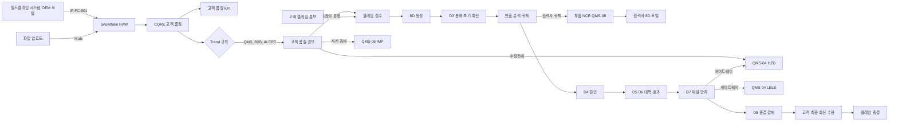

# SL QMS 워크아이템 Vol.5 — QMS-05 고객 품질

Nov 1, 2026 · @배창욱

## 1. 개요

Vol.5는 QMS RFP 고객 품질 모듈의 **Q-16 고객 데이터 관리(B2B), Q-17 고객 Claim 관리(6pi·8D 포함)**를 18개 워크아이템으로 내린다. 고객 클레임의 8D와 부품·사내 부적합의 시정 조치는 같은 문제 해결 절차이므로, **8D·CAPA 공용 엔진**을 이 Vol.에서 만들고 Vol.6a NCR이 선행으로 쓴다(interfaces.md 3절).

| 기능코드 | 기능 | RFP | WI | 핵심 |
| --- | --- | --- | --- | --- |
| B2B | 고객 B2B 데이터 | Q-16 | 7 | 고객 불량 실적 Snowflake 통합 모델, 결함 코드 매핑, 파일 업로드, 고객 PPM·필드 R/1000 KPI, Trend 규칙 → 경보 → 조치, 분석 화면, OEM 평가 추적 |
| CLM | 8D·CAPA 공용 엔진 | Q-17, Q-21, Q-22, Q-37 | 6 | D1~D8 단계 게이팅, 액션(CAPA) 추적·효과 검증, D7 재발 방지 연계, 협력사 8D 포털, 고객 양식 보고서 |
| CLM | 고객 Claim | Q-17 | 5 | 접수·기한, 의심 범위 산정·봉쇄, 반품 분석·귀책, 비용·구상, 고객 회신·종결 |

**도메인 정의**

- **고객 B2B 데이터**: 완성차 고객이 집계한 SL 제품 불량 실적이다. 고객 조립 라인에서 걸린 불량(0km 불량), 판매 후 차량에서 발생한 필드 클레임·워런티, 반품이 있다. OEM은 공급사 품질을 이 숫자(0km PPM, 필드 R/1000 = 차량 1,000대당 클레임 건수)로 평가하므로, SL이 고객과 같은 숫자를 먼저 보고 추세가 나빠지기 전에 움직이는 것이 목적이다. 차량은 판매 후 시간이 지날수록 클레임이 쌓이므로 필드 품질은 **MIS**(Months In Service, 판매 후 경과 개월) 기준 누적 곡선으로 본다.
- **고객 Claim**: 고객이 SL 제품 불량을 공식 통보한 건이다. 고객별 CSR(Customer Specific Requirements)로 정한 기한 안에 봉쇄 결과(보통 24시간), 원인(보통 10일 내외), 최종 대책(보통 30일 내외)을 고객 양식으로 회신해야 한다.
- **8D**: 문제 해결 8단계다. D1 팀 구성, D2 문제 정의(5W2H, Is/Is Not), D3 봉쇄(임시 조치), D4 근본 원인(발생 원인과 유출 원인 모두, Why-why, 재현 검증), D5 영구 대책 선정·검증, D6 실행·효과 확인, D7 재발 방지(FMEA·관리계획서·표준 개정, 수평전개, 레슨런), D8 종결이다. 고객 클레임뿐 아니라 협력사 부적합(협력사가 작성), 사내 부적합(귀책 부서가 작성), 고객이 8D 회신을 요구하는 심사 지적(Vol.6c)도 같은 틀을 쓴다. 가벼운 부적합은 D1·D7을 생략한 **간이 CAPA** 모드로 쓴다.
- **6pi**: HKMC 고객 회신 양식을 말한다. 항목 구성은 SL이 제공하는 양식으로 확정하고, 8D 필드를 양식 항목에 매핑해 출력한다(CLM-006, 오픈 이슈).

**선행 공통 WI**: ARC-001·002·003, MDM-003·004·005·007, SEC-001·002·003, UX-001·003, APV-001·002, TDO-001, NTF-001, DOC-001, INT-001, DWH-001·002·003·004, AI-004. Vol.3: SPP-001·002(협력사 8D 포털, 구상 합의). Vol.2: DVQ-007(게이트웨이 프레임워크 QMS_GatewayBinding__mdt·QMS_GatewayFactory·QMS_FollowUpRequest·QMS_FollowUpStatusDTO와 게이트웨이 인터페이스, Vol.2 변경 요청 — Vol.5는 사용자).

**다른 메뉴와의 경계**

| 연결 대상 | 이 Vol.이 하는 것 | 상대 메뉴가 하는 것 |
| --- | --- | --- |
| 부적합 NCR (QMS-06-NCR) | 8D 엔진(레코드타입 NCR_SUPPLIER·NCR_INTERNAL)과 바인딩 EIGHT_D 구현 등록, 8D 이벤트, 협력사 8D 포털, 클레임 귀책이 협력사면 바인딩 NCR(QMS_NcrGateway.requestNcr) 호출 | 바인딩 EIGHT_D로 8D 생성 요청, 8D CLOSED 이벤트로 NCR 종결, 바인딩 NCR 구현 등록 |
| 수평전개·레슨런 (QMS-04-HZD, LEL) | D7에서 바인딩 HORIZONTAL_DEPLOY(QMS_HorizontalDeployGateway)·LESSON_LEARNED(QMS_LessonLearnedGateway) 호출(기본 구현 To-Do) | 바인딩 구현 등록 |
| 개선 과제 (QMS-06-IMP) | B2B 경보·고객 평가에서 바인딩 IMPROVEMENT(QMS_ImprovementGateway) 호출 | 바인딩 구현 등록 |
| 분석실 (QMS-06-LAB) | 반품 분석 의뢰를 바인딩 LAB_REQUEST(QMS_LabGateway)로 호출, 완료 이벤트 구독 | 바인딩 구현 등록, 완료 이벤트 QMS_LabRequestEvent__e 발행 |
| 심사 지적 (QMS-06-IAU·CAU) | 8D 레코드타입 AUDIT_FINDING(고객이 8D 회신을 요구하는 지적) | 바인딩 EIGHT_D로 8D 생성 요청, 8D 이벤트 구독 |
| 출하검사 (QMS-04-FQC) | QMS_ClaimEvent__e(CREATED·RECEIVED·CLOSED 등, PlantId·ItemId·CustomerId 포함) 발행 | 구독해 출하검사 Hold |
| 협력사 실적 (QMS-06-SQM) | 클레임 귀책 협력사·특별특성 유출 여부, 8D 단계 기한·제출일, 협력사 8D 제출 차수를 DWH 복제 | Snowflake 복제본으로 협력사 실적 계산 |
| AI (QMS-08) | 8D 화면의 추천 영역(cmnAiRecommendationList), 초안 요청 게이트웨이 QMS_EightDAssist 자리, AI-004 적중 규칙(CMN_AiHitRule) 구현과 finalize 호출 | RCA·대책 추천, 8D 초안 생성, 게이트웨이 구현 |
| 대시보드 (QMS-07) | 고객 품질·클레임·8D KPI 키(3절) | 위젯 |
| 연계 (QMS-09) | B2B 원천 적재 계약(RAW 테이블), 클레임 통보 수신 계약(QMS_Claim__c upsert), 파일 업로드 이벤트 계약, 의심 범위 조회용 SAP 재고·출하 CORE 테이블 요구 | IF-FC-001 구현, 업로드 파일 처리 Mule 흐름, IF-SAP-003 재고·출하 적재, 선택: 의심 재고 SAP 보류 |
| PMS (P-49 문제점) | 클레임 이벤트 QMS_ClaimEvent__e 발행 | 프로젝트 문제점과 연결(구독) |
| 고객 Audit (QMS-06-CAU) | 고객 평가·에스컬레이션 기록(B2B-007) | 고객 감사 대응 |

**앞 Vol. 상태**: Vol.0·2·3 모두 검토 대기다. Vol.0 D-3(Multi-Currency)은 활성화, D-9(공장 격리)는 "지식 객체 전사 조회" 권고안을 가정한다(CLOSED 8D 전사 Read, D5-4). 결정이 바뀌면 해당 BR을 함께 고친다.

## 2. 업무 흐름

고객 데이터(B2B)는 Salesforce 레코드로 만들지 않는다. Snowflake가 통합·계산하고 Salesforce에는 KPI 값과 "사람이 판단해야 할 경보"만 온다. 클레임은 접수 즉시 8D가 생기고, 클레임 상태는 8D 단계 진행으로 움직인다. 8D 결과는 이벤트로만 원천(Claim, NCR)에 전달되고, D7에서 만드는 수평전개·레슨런은 아직 배포되지 않았을 수 있는 메뉴이므로 게이트웨이로 호출한다.

## 3. 데이터 모델 개요

**객체**

| 객체 | 구분 | 관계 | 역할 | 정의 WI |
| --- | --- | --- | --- | --- |
| QMS_CustomerDefectMap__c | 설정 | Customer(Lookup), DefectType(Lookup CMN_Code__c) | 고객 결함 코드 → SL 불량 유형 매핑 | B2B-001 |
| QMS_CustomerPartMap__c | 설정 | Customer, Item(Lookup) | 고객 품번 → SL 품번 예외 매핑 | B2B-001 |
| QMS_B2bFormat__mdt | 설정 | — | 업로드 파일 형식(열 매핑) | B2B-002 |
| QMS_B2bUpload__c | 업무 | Customer(Lookup) | 업로드 배치 | B2B-002 |
| QMS_B2bTrendRule__c | 설정 | Customer(Lookup) | Trend Monitoring 규칙 | B2B-004 |
| QMS_CustomerQualityAlert__c | 업무 | Customer, Vehicle, Item, Plant(Lookup) | 고객 품질 경보 | B2B-005 |
| QMS_CustomerScorecard__c | 업무 | Customer, Plant(Lookup) | OEM 고객 평가·에스컬레이션 | B2B-007 |
| QMS_EightD__c | 업무 | Plant, Item, Supplier, Customer(Lookup) | 8D 1건(공용) | CLM-001 |
| QMS_EightDStep__c | 업무 | EightD(MD) | 단계별 상태·기한·검토 | CLM-001 |
| QMS_EightDTeamMember__c | 업무 | EightD(MD), User(Lookup) | D1 팀 | CLM-001 |
| QMS_EightDAction__c | 업무 | EightD(MD) | 봉쇄·시정·예방 액션(CAPA) | CLM-001·003 |
| QMS_EightDFormat__mdt | 설정 | — | 고객 회신 양식·필드 매핑 | CLM-006 |
| QMS_EightDSubmission__c | 업무 | EightD(Lookup) | 협력사 8D 제출 차수(협력사 소유) | CLM-005 |
| QMS_CustomerQualityOwner__c | 설정 | Customer, Plant, User(Lookup) | 고객·공장별 고객 품질 담당 | B2B-001 |
| QMS_CustomerQualityTarget__c | 설정 | Customer, Plant(Lookup) | 고객 품질 KPI 연간 목표 | B2B-003 |
| QMS_Claim__c | 업무 | Customer, Vehicle, Item, Plant, EightD(Lookup) | 고객 클레임 | CLM-007 |
| QMS_ClaimCost__c | 업무 | Claim(MD) | 클레임 비용 | CLM-010 |
| QMS_SupplierChargeback__c | 업무 | Claim, Supplier(Lookup) | 협력사 구상 | CLM-010 |
| QMS_ClaimResponse__c | 업무 | Claim(MD) | 고객 회신·고객 판정 이력 | CLM-011 |

**상태값**

| 대상 | 값(순서) |
| --- | --- |
| QMS_B2bUpload__c.Status__c | UPLOADED → PROCESSING → LOADED / PARTIAL / FAILED · REPLACED |
| QMS_CustomerQualityAlert__c.Status__c | NEW → TRIAGED → ACTION_LINKED / MONITORING → CLOSED · DISMISSED |
| QMS_EightD__c.Status__c | OPEN → IN_PROGRESS → CLOSURE_APPROVAL → CLOSED · CANCELLED |
| QMS_EightD__c.CurrentStep__c | D1 → D2 → D3 → D4 → D5 → D6 → D7 → D8 (간이 CAPA는 D2 → D3 → D4 → D5 → D6 → D8) |
| QMS_EightDStep__c.Status__c | NOT_STARTED → IN_PROGRESS → SUBMITTED → APPROVED / RETURNED · SKIPPED |
| QMS_EightDAction__c.Status__c | PLANNED → IN_PROGRESS → DONE → VERIFIED · NOT_EFFECTIVE · CANCELLED |
| QMS_EightDSubmission__c.Status__c | DRAFT → SUBMITTED → REVIEWED |
| QMS_Claim__c.Status__c | DRAFT → RECEIVED → CONTAINMENT → ANALYSIS → CORRECTIVE → RESPONSE → CLOSED · CANCELLED |
| QMS_Claim__c.Result__c | SL_FAULT · SUPPLIER_FAULT · NO_FAULT · CUSTOMER_FAULT · WITHDRAWN (CLOSED 시 필수) |
| QMS_SupplierChargeback__c.Status__c | DRAFT → SENT → ACKNOWLEDGED / DISPUTED → AGREED → SETTLED · CANCELLED |
| QMS_ClaimResponse__c.CustomerDecision__c | PENDING · ACCEPTED · REJECTED · ADDITIONAL_REQUEST |

**권한 셋과 페르소나 매핑**(각 WI가 PS를 만들고 SEC-001 BR-2에 따라 PSG에 추가)

| Permission Set | 내용 | PSG |
| --- | --- | --- |
| QMS_PS_B2b_Read | 고객 품질 분석 화면·경보·스코어카드 조회 | QualityEngineer, QualityManager, Viewer, CMN_PSG_Executive |
| QMS_PS_B2b_Upload | 고객 데이터 파일 업로드 | QualityEngineer |
| QMS_PS_B2b_Admin | 결함 코드·품번 매핑, 업로드 형식 확인, Trend 규칙 | QualityAdmin |
| QMS_PS_Alert_Edit | 경보 분류·조치 연결 | QualityEngineer, QualityManager |
| QMS_PS_Scorecard_Edit | 고객 평가 입력 | QualityEngineer, QualityManager |
| QMS_PS_Claim_Read / QMS_PS_Claim_Edit | 클레임 조회 / 접수·편집 | 조회: Viewer, Executive · 편집: QualityEngineer, QualityManager |
| QMS_PS_ClaimCost_Read / QMS_PS_ClaimCost_Edit | 클레임 비용·구상·워런티 비용 조회 / 편집. 둘 다 Custom Permission QMS_ViewCost 포함 | 조회: QualityManager, Executive · 편집: QualityManager, QualityAdmin |
| QMS_PS_EightD_Read / QMS_PS_EightD_Edit | 8D 조회 / 작성·검토 | 조회: Viewer · 편집: QualityEngineer, QualityManager, SupplierQuality |
| QMS_PS_EightD_ActionUpdate | 배정받은 액션의 진행·증빙 입력 | Viewer(귀책 부서원), QualityEngineer |
| QMS_PS_EightDFormat_Admin | 양식·매핑 관리 | QualityAdmin |
| QMS_PS_Portal_EightD | 협력사 8D 제출(자기 소유), 구상 응답 | SupplierPortal |

결재·검토 권한은 PS가 아니라 APPROVAL_ROLE(CQ_MANAGER 고객품질팀장(Vol.0 변경 요청), QUALITY_MANAGER, SQ_MANAGER, QM_HEAD, PLANT_MANAGER)과 8D Champion·Reviewer 지정으로 판정한다.

**다른 WI·메뉴가 쓰는 서비스와 이벤트**

| 이름 | 종류 | 제공 WI | 사용처 |
| --- | --- | --- | --- |
| QMS_EightDService.createFromSource / getStatusBySource / cancel / reopen | Apex | CLM-001 | CLM-007(직접), 바인딩 구현 |
| 바인딩 EIGHT_D 구현 QMS_EightDGatewayImpl(QMS_EightDGateway.create / getStatus) | 게이트웨이 구현 | CLM-001 | QMS-06-NCR, QMS-06-IAU·CAU |
| QMS_EightDEvent__e | Platform Event | CLM-001 | QMS-06-NCR, CLM-007~011, QMS-08 |
| QMS_EightDAssist(바인딩 키 EIGHT_D_ASSIST, 등록부 추가 요청) | Interface | CLM-002 | QMS-08 구현 |
| 바인딩 HORIZONTAL_DEPLOY, LESSON_LEARNED, IMPROVEMENT, LAB_REQUEST, NCR | 게이트웨이 호출(사용자) | CLM-004, B2B-005·007, CLM-009 | 프레임워크·인터페이스는 Vol.2 DVQ-007 변경 요청(interfaces.md 5절), 구현은 QMS-04·06 |
| QMS_ClaimService.createFromAlert / getStatusBySource | Apex | CLM-007 | B2B-005 |
| QMS_ClaimEvent__e | Platform Event | CLM-007 | PMS(P-49), QMS-04-FQC(출하검사 Hold), QMS-06-SQM, QMS-09, QMS-08 |
| QMS_B2bUploadRequested__e | Platform Event | B2B-002 | QMS-09(Mule 파일 처리) |
| CORE.CUSTOMER_QUALITY_EVENT, CORE.CUSTOMER_VOLUME | Snowflake | B2B-001 | B2B-003·004·006, QMS-08 조기경보 |
| EVENT_TYPE QMS_B2B_ALERT, QMS_B2B_UPLOAD_RESULT | OUTBOUND_EVENT | B2B-004, B2B-002 | 이 Vol. 핸들러 |

**KPI 키**(CMN_KpiValue__c, DWH-003 경로)

| KpiKey | 정의 | 주기 | 차원 | 계산 위치 |
| --- | --- | --- | --- | --- |
| QMS_PPM_CUSTOMER | 0km 불량 PPM = 0km 불량 수량 / 고객 납품 수량 × 1,000,000 | 일·월 | Customer, Plant, Item | B2B-003 |
| QMS_CUSTOMER_LINE_DEFECTS | 0km 불량 건수 | 일·월 | Customer, Plant, Item | B2B-003 |
| QMS_FIELD_R1000 | 해당 월 필드 클레임 건수 / 운행 차량 수 × 1,000 | 월 | Customer, Vehicle(Vol.0 변경 요청), Item | B2B-003 |
| QMS_FIELD_MIS3_R1000 / QMS_FIELD_MIS12_R1000 | 생산월 코호트의 MIS 3·12개월 누적 R/1000 | 월 | Customer, Item | B2B-003 |
| QMS_CUSTOMER_RETURNS | 반품 건수 | 월 | Customer, Plant, Item | B2B-003 |
| QMS_B2B_ALERTS_OPEN | 미처리 경보 수(NEW·TRIAGED) | 일 | Customer, Plant | B2B-005 |
| QMS_CUSTOMER_SCORE | 최신 고객 평가 점수 | 월 | Customer, Plant | B2B-007 |
| QMS_CLAIM_RECEIVED | 접수 클레임 수 | 월 | Customer, Plant | CLM-011 |
| QMS_CLAIM_OPEN | 미종결 클레임 수(기준일) | 일 | Customer, Plant | CLM-011 |
| QMS_CLAIM_D3_ONTIME | 봉쇄 회신 기한 준수율 % | 월 | Customer, Plant | CLM-011 |
| QMS_CLAIM_8D_ONTIME | 최종 8D 회신 기한 준수율 % | 월 | Customer, Plant | CLM-011 |
| QMS_CLAIM_LEADTIME | 접수~종결 평균 일수 | 월 | Customer, Plant | CLM-011 |
| QMS_CLAIM_RECURRENCE | 재발 클레임 수 | 월 | Customer, Plant, Item | CLM-011 |
| QMS_8D_OPEN | 미종결 8D 수(레코드타입별 키 접미사 _CLAIM, _NCR_SUPPLIER, _NCR_INTERNAL, _AUDIT_FINDING) | 일 | Plant, Supplier | CLM-003 |
| QMS_8D_OVERDUE_ACTIONS | 기한 경과 액션 수 | 일 | Plant, Supplier | CLM-003 |
| QMS_8D_EFFECTIVE_RATE | 효과 확인 완료 대책 중 EFFECTIVE 비율 % | 월 | Plant, Supplier | CLM-003 |

모든 KPI는 Snowflake `MART.V_SF_KPI_B2B`, `MART.V_SF_KPI_CLAIM`, `MART.V_SF_KPI_8D`에서 계산한다. Salesforce Apex 배치로 집계하지 않는다.

**비용 지표(KPI 레코드에 적재하지 않음)**: 워런티 비용, 클레임 비용, 구상 합의액은 CMN_KpiValue__c에 넣지 않는다. KPI 레코드는 비용 권한과 무관하게 읽히기 때문이다(Vol.6a NCR-008 BR-4 방식, Vol.7 D7-4). 아래 DWH-004 등록 쿼리로만 조회하며, Apex가 Custom Permission QMS_ViewCost를 검사한 뒤 호출한다.

| QueryKey | 내용 | 차원·파라미터 | 정의 WI |
| --- | --- | --- | --- |
| QMS_B2B_WARRANTY_COST_TREND | 월별 워런티 비용(COST_KRW 합)과 건수 | customerCodes, plantCodes, itemNos, from, to | B2B-003 |
| QMS_CLAIM_COST_TREND | 월별 클레임 비용(CONFIRMED, 비용 유형별 기업 통화 합)과 구상 합의액 | customerCodes, plantCodes, supplierIds, from, to | CLM-010 |

**공통 기반 등록(각 업무 객체 WI에서 수행)**: 채번(ARC-003), CMN_SharingConfig(Plant__c, 협력사 공개 객체는 SupplierField), CMN_DeleteGuard, CMN_StatusFlow, 필드 이력, DWH 복제(DWH-002), ko·en·zh 번역. 채번 규칙: CLM-{PLANT}-{YYYY}-{SEQ:5}(클레임), 8D-{PLANT}-{YYYY}-{SEQ:5}(8D), CQA-{YYYY}-{SEQ:6}(경보), B2U-{YYYY}-{SEQ:6}(업로드), CBK-{PLANT}-{YYYY}-{SEQ:5}(구상).

**데이터량 가정**: 고객 클레임 연 200~600건, 8D는 클레임 + 협력사·사내 부적합 대책을 합쳐 연 1,500~3,000건, 액션은 8D당 평균 5건(연 1만 건 내외)이다. 고객 B2B 원천(워런티 건별·0km 건별)은 OEM 5개 그룹 합계 연 10만~50만 행으로 가정하며 전부 Snowflake에만 둔다.

## 4. 고객 B2B 데이터 (B2B)

고객 B2B 데이터의 원칙은 두 가지다. (1) 고객이 준 원천 데이터는 Snowflake에만 두고 Salesforce에는 KPI와 경보만 보낸다(D5-2). (2) 고객마다 결함 코드·품번 체계가 다르므로, 매핑은 현업이 Salesforce 화면에서 관리하고 Snowflake가 그 매핑으로 통합 모델을 다시 계산한다. 매핑을 고치면 과거 데이터도 한 시간 안에 새 기준으로 다시 분류된다.

### QMS-05-B2B-001 고객 품질 통합 데이터 모델·결함 코드·품번 매핑

추적 Q-16, Q-42 · 필수 · W1 · SNOW, SF · SQL, DM, LWC · Customization · 선행 DWH-001, DWH-002, DWH-004, MDM-003, MDM-004, MDM-007 · 6 M/D

**목적**: OEM마다 다른 형식의 불량 실적을 "고객·차종·SL 품번·공장·SL 불량 유형·생산월·판매월·MIS·수량·비용"이라는 하나의 모델로 만든다. 이 모델이 있어야 고객 PPM·필드 R/1000(B2B-003), Trend 규칙(B2B-004), AI 조기경보(QMS-08)가 같은 숫자를 쓴다.

**범위** In: Snowflake RAW·STG·CORE 테이블과 Dynamic Table, 표준 열 계약, 결함 코드·품번 매핑 객체와 관리 화면, 미매핑 목록, 고객 품질 담당 설정. Out: 원천 수집(QMS-09 IF-FC-001, 파일은 B2B-002), KPI 계산(B2B-003).

**Snowflake 객체**

| 객체 | 유형 | 내용 |
| --- | --- | --- |
| RAW.FC_CUSTOMER_QUALITY | 테이블 | IF-FC-001 원천(PAYLOAD VARIANT, `_SOURCE`(예: FC-HKMC), `_SOURCE_KEY`(원천 레코드 키), `_BATCH_ID`, `_LOADED_AT`). 원천 형식 → 표준 키 매핑(STG.FC_FIELD_MAP, STG.V_FC_TO_STD)은 QMS-09-INT-014 소유 |
| RAW.B2B_UPLOAD_ROW | 테이블 | 파일 업로드 행(UPLOAD_ID, ROW_NO, PAYLOAD VARIANT, `_SOURCE` = 'UPLOAD', `_SOURCE_KEY` = `{UPLOAD_ID}-{ROW_NO}`, `_BATCH_ID`, `_LOADED_AT`) |
| STG.CUSTOMER_QUALITY_STD | 테이블 | 두 원천을 표준 열로 정규화한 행(SOURCE 'FC' 또는 'UPLOAD'), 키 EVENT_KEY |
| STG.B2B_UPLOAD_ERROR | 테이블 | 업로드 행 오류(UPLOAD_ID, ROW_NO, ERROR_CODE, MESSAGE) |
| CORE.CUSTOMER_QUALITY_EVENT | Dynamic Table(TARGET_LAG 1시간) | STG + 매핑(CORE.SF_QMS_CUSTOMERDEFECTMAP, CORE.SF_QMS_CUSTOMERPARTMAP, CORE.SF_CMN_ITEM)으로 품번·불량 유형·공장·MIS를 붙인 통합 모델 |
| CORE.CUSTOMER_VOLUME | 테이블 | 고객 차량 생산·판매 대수(CUSTOMER_CODE, VEHICLE_CODE, MONTH, VOLUME_TYPE PRODUCED·SOLD, QTY, SOURCE) |
| MART.V_B2B_UNMAPPED | 뷰 | 최근 90일 미매핑 결함 코드·고객 품번과 건수 |

**CORE.CUSTOMER_QUALITY_EVENT 열**

| 열 | 타입 | 설명 |
| --- | --- | --- |
| EVENT_KEY | VARCHAR(64) | SHA-256(SOURCE, CUSTOMER_CODE, DATA_TYPE, CUSTOMER_REF_NO, LINE_NO) |
| SOURCE / UPLOAD_ID | VARCHAR | 'FC' 또는 'UPLOAD', 업로드면 QMS_B2bUpload__c Id |
| CUSTOMER_CODE / CUSTOMER_GROUP | VARCHAR | Account.OemCode__c / CustomerGroup__c |
| DATA_TYPE | VARCHAR | LINE_0KM 0km 불량, FIELD 필드·워런티, RETURN 반품 |
| CUSTOMER_REF_NO | VARCHAR | 고객 측 건 번호 |
| EVENT_DATE | DATE | 0km = 검출일, FIELD = 클레임 접수일, RETURN = 반품일 |
| VEHICLE_CODE | VARCHAR | 고객 차종 코드(CMN_Vehicle__c.VehicleCode__c) |
| VIN_HASH | VARCHAR(64) | SHA-256(VIN + 솔트). VIN 원문은 RAW에만 |
| CUSTOMER_PART_NO / ITEM_NO / ITEM_MAP_STATUS | VARCHAR | 고객 품번, 매핑된 SL 품번, MAPPED·UNMAPPED·AMBIGUOUS |
| PLANT_CODE | VARCHAR | 출하 공장(BR-3) |
| CUSTOMER_DEFECT_CODE / CUSTOMER_DEFECT_TEXT | VARCHAR | 고객 결함 코드·설명 |
| DEFECT_TYPE_CODE / DEFECT_MAP_STATUS | VARCHAR | CMN_Code__c ExternalKey(`DEFECT_TYPE/…`), MAPPED·UNMAPPED |
| QTY | NUMBER(12,0) | 수량(건별 데이터는 1) |
| PRODUCTION_MONTH / SALES_MONTH / FAILURE_MONTH | DATE(월 1일) | 차량 생산월, 판매월, 고장월 |
| MIS | NUMBER(4,0) | BR-5 |
| MILEAGE_KM | NUMBER(9,0) | 고장 시 주행거리 |
| COST_AMOUNT / COST_CURRENCY / COST_KRW | NUMBER, VARCHAR | 고객 청구 비용, 통화, 기업 통화 환산(CORE.SAP_FX_RATE RATE_TYPE 'M', FROM_CCY = 통화, TO_CCY = 'KRW', VALID_FROM = 사건 월). Masking Policy(B2B-003 BR-7) |
| COUNTRY | VARCHAR | 발생 국가(ISO 3166 alpha-2) |
| CUSTOMER_JUDGMENT | VARCHAR | 고객 판정(SUPPLIER_RESPONSIBLE, NTF, UNDER_ANALYSIS, OTHER) |
| _IS_DELETED / LOADED_AT | BOOLEAN / TIMESTAMP | 업로드 취소·교체 시 TRUE |

**Salesforce 데이터 모델**

| 객체 / 필드 | 타입 | 필수 | 설명 |
| --- | --- | --- | --- |
| QMS_CustomerDefectMap__c.CustomerGroup__c | Picklist(MDM-003 CustomerGroup 값) | Y | |
| QMS_CustomerDefectMap__c.Customer__c | Lookup(Account, 고객 RT) | N | 공란 = 그룹 전체에 적용 |
| QMS_CustomerDefectMap__c.CustomerDefectCode__c / CustomerDefectName__c | Text(40) / Text(255) | Y / N | |
| QMS_CustomerDefectMap__c.DefectType__c | Lookup(CMN_Code__c, DEFECT_TYPE 리프 필터) | Y | |
| QMS_CustomerDefectMap__c.DefaultResponsibility__c | Lookup(CMN_Code__c, RESPONSIBILITY) | N | 클레임 접수 시 기본 귀책 제안 |
| QMS_CustomerDefectMap__c.IsActive__c | Checkbox | Y | |
| QMS_CustomerDefectMap__c.ExternalKey__c | Text(120), External ID, Unique | Y | `{CustomerGroup}-{OemCode 또는 *}-{CustomerDefectCode}` 트리거가 세팅 |
| QMS_CustomerPartMap__c.Customer__c / Item__c | Lookup | Y | |
| QMS_CustomerPartMap__c.CustomerPartNo__c | Text(40) | Y | |
| QMS_CustomerPartMap__c.Plant__c | Lookup(CMN_Plant__c) | N | 출하 공장 지정 |
| QMS_CustomerPartMap__c.ValidFrom__c / ValidTo__c | Date | Y / N | 사건일 기준 적용 기간 |
| QMS_CustomerPartMap__c.ExternalKey__c | Text(120), External ID, Unique | Y | `{OemCode}-{CustomerPartNo}-{ItemNo}-{ValidFrom yyyymmdd}` |
| QMS_CustomerQualityOwner__c.Customer__c | Lookup(Account, 고객 RT) | Y | |
| QMS_CustomerQualityOwner__c.Plant__c | Lookup(CMN_Plant__c) | N | 공란 = 고객 대표 담당(본사) |
| QMS_CustomerQualityOwner__c.Owner__c / Backup__c | Lookup(User) | Y / N | 고객 품질 담당(CQE)과 대리 |
| QMS_CustomerQualityOwner__c.ExternalKey__c | Text(60), Unique | Y | `{OemCode}-{PlantCode 또는 HQ}` |

**비즈니스 규칙**

- BR-1: Snowflake 객체는 schemachange 버전 스크립트로만 만든다(ARC-001 BR-4). CORE.CUSTOMER_QUALITY_EVENT는 Dynamic Table로 정의해 매핑이 바뀌면 다음 갱신(최대 1시간)에 과거 행도 새 매핑으로 다시 분류되게 한다.

- BR-2: 표준 열 계약 — IF-FC-001(QMS-09)과 파일 업로드(B2B-002)는 STG.CUSTOMER_QUALITY_STD에 같은 키로 값을 넣는다. 필수 키: CUSTOMER_CODE, DATA_TYPE, CUSTOMER_REF_NO, EVENT_DATE, CUSTOMER_PART_NO, QTY. 선택 키: VEHICLE_CODE, VIN, CUSTOMER_DEFECT_CODE, CUSTOMER_DEFECT_TEXT, PRODUCTION_MONTH, SALES_MONTH, FAILURE_MONTH, MILEAGE_KM, COST_AMOUNT, COST_CURRENCY, COUNTRY, CUSTOMER_JUDGMENT, LINE_NO. 같은 EVENT_KEY가 다시 오면 최신 값으로 MERGE한다.

- BR-3: 품번 매핑 — (1) CMN_Item__c 중 Customer = 해당 고객이고 CustomerPartNo가 같은 품번이 1건이면 MAPPED, (2) 0건이거나 2건 이상이면 QMS_CustomerPartMap__c에서 사건일이 유효 기간 안인 행을 찾아 1건이면 MAPPED, (3) 그래도 2건 이상이면 AMBIGUOUS, 없으면 UNMAPPED. 공장은 매핑 행 Plant → 품번의 ACTIVE CMN_ItemPlant__c가 1개면 그 공장 → 그 외 NULL.

- BR-4: 결함 코드 매핑 — 고객 지정 행(Customer 일치)을 그룹 행(Customer 공란)보다 먼저 쓴다. 비활성 행은 쓰지 않는다. 매핑이 없으면 DEFECT_TYPE_CODE = NULL, DEFECT_MAP_STATUS = UNMAPPED.

- BR-5: MIS = FAILURE_MONTH와 SALES_MONTH의 개월 차(정수). 둘 중 하나가 없으면 NULL, 음수면 NULL + 데이터 오류 플래그(DQ_FLAG = 'MIS_NEGATIVE').

- BR-6: 개인 식별 가능 값 — VIN은 STG 단계에서 해시하고 원문은 RAW에만 둔다(RAW는 ROLE_INGEST만 조회, DWH-001). CORE·MART에는 VIN 원문, 차량 소유자 정보가 없어야 한다(D5-9).

- BR-7: 매핑 객체 3종(QMS_CustomerDefectMap__c, QMS_CustomerPartMap__c, QMS_CustomerQualityOwner__c)은 DWH-002 설정에 15분 주기로 등록한다.

- BR-8: 관리 화면 `qmsB2bMappingAdmin`(SL QMS 앱 "고객 데이터 설정") — 탭 3개: 결함 코드 매핑(인라인 편집, cmnCodePicker로 DEFECT_TYPE 선택), 품번 매핑, 미매핑 목록. 미매핑 목록은 DWH-004 등록 쿼리 `QMS_B2B_UNMAPPED`(MART.V_B2B_UNMAPPED)로 조회하고, 행에서 "매핑 추가"를 누르면 해당 코드가 채워진 매핑 입력 창이 열린다. 매핑 CSV 일괄 등록(ExternalKey 기준 upsert, 행별 오류 표시)을 지원한다.

- BR-9: 미매핑 알림 — 매주 월요일 06:00 KST Snowflake가 최근 7일 미매핑 행이 있으면 EVENT_TYPE 'QMS_B2B_UNMAPPED'(고객별 건수)를 기록하고, 핸들러가 CMN 설정 QMS_B2B_MAPPING_OWNER 사용자에게 To-Do "고객 데이터 미매핑 {n}건"을 연다(같은 주 1건).

- BR-10: 고객 품질 담당 해석 `QMS_CustomerQualityOwnerResolver.resolve(Id customerId, Id plantIdOrNull)` → (고객, 공장) 행 → (고객, 공장 공란) 행의 Owner. Owner가 비활성이면 Backup, 둘 다 없으면 null(호출 측이 공장 QUALITY_MANAGER Role로 대체). B2B·CLM 전체가 이 서비스를 쓴다.

- BR-11: RAW 표준 열 — 두 RAW 테이블은 `_SOURCE`, `_SOURCE_KEY`, `_BATCH_ID`, `_LOADED_AT`을 가진다(QMS-09 INT-001 표준, Vol.0 DWH-001 변경 요청). IF-FC-001의 원천 형식별 경로 매핑(STG.FC_FIELD_MAP)과 변환 뷰(STG.V_FC_TO_STD), STG.CUSTOMER_QUALITY_STD로의 MERGE Task는 QMS-09-INT-014가 만들고, 이 WI는 STG.CUSTOMER_QUALITY_STD 이후(매핑·CORE)를 만든다. 업로드 경로(SOURCE 'UPLOAD')는 B2B-002 프로시저가 넣는다.

- BR-12: 차량 대수 — STG.CUSTOMER_QUALITY_STD에서 DATA_TYPE = VOLUME인 행(원천이 IF-FC-001이든 업로드든)은 CORE.CUSTOMER_QUALITY_EVENT에 넣지 않고 Task가 CORE.CUSTOMER_VOLUME(CUSTOMER_CODE, VEHICLE_CODE, MONTH = EVENT_DATE 월, VOLUME_TYPE = PAYLOAD의 VOLUME_TYPE(PRODUCED·SOLD), QTY)으로 MERGE한다.

**화면/UX**: `qmsB2bMappingAdmin`(위). QMS_CustomerQualityOwner__c는 고객 Account 레코드 페이지 관련 목록에서 편집한다.

**권한**: QMS_PS_B2b_Admin(매핑·담당 편집), QMS_PS_B2b_Read(조회). Snowflake ROLE_TRANSFORM(Dynamic Table·Task), ROLE_QMS_ANALYST(CORE·MART 조회, RAW 불가).

**수용 기준**

- AC-1: Given 고객 A의 CustomerPartNo "92101-XX000"인 SL 품번 1건, When 해당 고객 품번 행 적재, Then ITEM_MAP_STATUS = MAPPED, ITEM_NO = 그 품번.

- AC-2: Given 같은 고객 품번에 SL 품번 2건(좌·우 공용 등), When 적재, Then AMBIGUOUS. QMS_CustomerPartMap__c 등록 후 1시간 이내 MAPPED로 바뀐다.

- AC-3: Given 고객 A 전용 결함 코드 매핑과 그룹 매핑이 모두 있음, When 고객 A 행 적재, Then 고객 전용 매핑의 DEFECT_TYPE 사용.

- AC-4: Given SALES_MONTH 2027-03, FAILURE_MONTH 2027-09, When 적재, Then MIS = 6.

- AC-5: Given ROLE_QMS_ANALYST, When CORE.CUSTOMER_QUALITY_EVENT 조회, Then VIN 원문 열이 없고 VIN_HASH만 있다.

- AC-6: Given 미매핑 결함 코드 1종 3건, When 관리 화면 미매핑 탭, Then 코드·건수 표시, "매핑 추가"로 등록하면 다음 갱신 후 목록에서 사라진다.

- AC-7: Given 고객 A·공장 KR01 담당 없음, 고객 A 대표 담당 있음, When resolve(A, KR01), Then 대표 담당 반환.

**에이전트 주의**: 고객 원천 행을 Salesforce 객체로 만들지 않는다. 매핑 결과를 STG에 굳혀 저장하지 않는다(매핑 변경 시 재분류가 안 됨, Dynamic Table로 계산). OEM 결함 코드 값을 코드에 넣지 않는다(매핑 데이터).

**오픈 이슈**: OEM별 제공 데이터 항목(건별인지 월 집계인지, VIN·판매월 포함 여부), 필드클레임 시스템이 이미 고객 결함 코드를 사내 코드로 바꾸는지, 차량 판매 대수 입수 방법.

### QMS-05-B2B-002 연계 없는 고객 데이터 파일 업로드·수집 현황

추적 Q-16 · 필수 · W1 · SF, MULE, SNOW · LWC, APEX, DM, INT · Customization · 선행 B2B-001, DOC-001, DWH-003, INT-001 · 6 M/D

**목적**: 필드클레임 시스템에 들어오지 않는 고객(OEM 포털에서 엑셀로 내려받는 경우 등)의 데이터를 사람이 파일로 올려도 연계 데이터와 같은 모델로 들어가게 하고, 고객별로 "언제 데이터까지 들어와 있는가"를 한 화면에서 보게 한다.

**범위** In: 업로드 형식 메타데이터, 업로드 배치 객체, 업로드 화면(미리보기·사전 검증), 처리 이벤트 계약, Snowflake 검증 프로시저, 결과 수신, 교체·취소, 수집 현황·지연 알림. Out: Mule 파일 처리 흐름 구현(QMS-09), 통합 모델(B2B-001).

**데이터 모델**

| 객체 / 필드 | 타입 | 필수 | 설명 |
| --- | --- | --- | --- |
| QMS_B2bFormat__mdt.FormatKey (DeveloperName) | — | Y | 예: BMW_FIELD_MONTHLY |
| QMS_B2bFormat__mdt.CustomerGroup__c / DataType__c | Text(20) | Y | DataType: LINE_0KM, FIELD, RETURN, VOLUME |
| QMS_B2bFormat__mdt.FileType__c | Text(10) | Y | XLSX, CSV |
| QMS_B2bFormat__mdt.SheetName__c / HeaderRow__c | Text(80) / Number(2,0) | N / Y | |
| QMS_B2bFormat__mdt.ColumnMapJson__c | Long Text(32768) | Y | `{"CUSTOMER_REF_NO":"Claim No","EVENT_DATE":"Date",...}` 표준 키 → 원본 열 이름 |
| QMS_B2bFormat__mdt.DateFormat__c / DecimalSeparator__c | Text(20) / Text(1) | Y | 예: yyyy-MM-dd, `.` |
| QMS_B2bFormat__mdt.ExpectedFrequency__c / DueDay__c | Text(10) / Number(2,0) | Y | MONTHLY·WEEKLY, 다음 데이터 기대일(월 n일 또는 요일 번호) |
| QMS_B2bFormat__mdt.IsActive__c | Checkbox | Y | |
| QMS_B2bUpload__c.RecordNo__c | Text(40), Unique | Y | B2U-{YYYY}-{SEQ:6} |
| QMS_B2bUpload__c.Customer__c | Lookup(Account, 고객 RT) | Y | |
| QMS_B2bUpload__c.DataType__c | Picklist (LINE_0KM, FIELD, RETURN, VOLUME) | Y | |
| QMS_B2bUpload__c.FormatKey__c | Text(80) | Y | |
| QMS_B2bUpload__c.PeriodFrom__c / PeriodTo__c | Date | Y | 파일이 담은 기간 |
| QMS_B2bUpload__c.Status__c | Picklist (UPLOADED, PROCESSING, LOADED, PARTIAL, FAILED, REPLACED, REVOKED) | Y | |
| QMS_B2bUpload__c.RowCount__c / LoadedRowCount__c / ErrorRowCount__c | Number(8,0) | N | 결과 수신 시 |
| QMS_B2bUpload__c.ErrorSummary__c | Long Text(32768) | N | 처음 100개 오류(행 번호·코드·메시지) |
| QMS_B2bUpload__c.Document__c | Lookup(CMN_Document__c) | Y | 원본 파일(DocClass B2B_SOURCE_FILE) |
| QMS_B2bUpload__c.ReplacedBy__c | Lookup(QMS_B2bUpload__c) | N | |
| QMS_B2bUpload__c.ProcessedAt__c | DateTime | N | |
| QMS_B2bUploadRequested__e | Platform Event | — | UploadId__c, Action__c(LOAD, REVOKE), ContentVersionId__c, FormatKey__c, CustomerCode__c, DataType__c, PeriodFrom__c, PeriodTo__c |

**비즈니스 규칙**

- BR-1: 업로드 화면 `qmsB2bUpload` — 고객 선택 → 고객 그룹·데이터 유형으로 ACTIVE 형식 목록 → 기간 입력 → 파일 선택(xlsx·csv, 20MB 이하). 브라우저에서 정적 리소스 SheetJS로 앞 50행을 읽어 ColumnMapJson대로 표준 열 미리보기를 보여주고, 필수 키(B2B-001 BR-2) 열이 없거나 날짜를 읽을 수 없으면 제출 버튼을 막는다.

- BR-2: 기간 중복 — 같은 고객·데이터 유형에서 LOADED·PARTIAL 업로드와 기간이 정확히 같으면 "교체" 확인 창을 띄우고, 확인하면 새 업로드가 성공했을 때 이전 업로드를 REPLACED로 바꾼다. 기간이 일부만 겹치면 제출을 막는다(겹침 데이터 이중 집계 방지).

- BR-3: 제출 — Apex가 업로드 레코드(UPLOADED)와 원본 문서(DOC-001, DocClass B2B_SOURCE_FILE)를 만들고 QMS_B2bUploadRequested__e(Action LOAD)를 발행한다.

- BR-4: 처리 계약(QMS-09 Mule 구현) — 이벤트 수신 → 업로드 상태 PROCESSING 갱신 → ContentVersion 내려받기 → 형식대로 행 변환 → RAW.B2B_UPLOAD_ROW에 UPLOAD_ID로 적재 → `CALL STG.SP_B2B_UPLOAD_LOAD(UPLOAD_ID)` 호출. Mule이 행 단위 판단(필수값·형식)을 하지 않는다(규칙은 Snowflake 한 곳에만).

- BR-5: 검증 프로시저 `STG.SP_B2B_UPLOAD_LOAD` — 행마다 필수 키, 날짜 형식, QTY > 0, EVENT_DATE가 기간 안인지 검사해 STG.B2B_UPLOAD_ERROR에 기록하고, 통과한 행만 STG.CUSTOMER_QUALITY_STD에 SOURCE 'UPLOAD'로 넣는다. 교체 대상 업로드가 있으면 그 UPLOAD_ID 행을 `_IS_DELETED = TRUE`로 바꾼다. 끝나면 `SHARE.OUTBOUND_EVENT`에 EVENT_TYPE 'QMS_B2B_UPLOAD_RESULT'(UPLOAD_ID, 총 행, 적재 행, 오류 행, 처음 100개 오류)를 기록한다. VOLUME 유형은 CORE.CUSTOMER_VOLUME에 넣는다.

- BR-6: 결과 수신 핸들러(DWH-003 라우팅) — 오류 0이면 LOADED, 적재 행 ≥ 1이고 오류 ≥ 1이면 PARTIAL, 적재 행 0이면 FAILED. 교체였다면 이전 업로드 REPLACED + ReplacedBy. 업로더에게 알림 QMS_B2B_UPLOAD_DONE(결과·오류 수).

- BR-7: 취소 — 업로더 또는 QMS_PS_B2b_Admin 보유자가 LOADED·PARTIAL 업로드를 "업로드 취소"(사유 필수)하면 QMS_B2bUploadRequested__e(Action REVOKE)를 발행하고, Mule이 `CALL STG.SP_B2B_UPLOAD_REVOKE(UPLOAD_ID)`로 행을 삭제 표시한 뒤 결과 이벤트로 REVOKED가 된다.

- BR-8: 수집 현황 `qmsB2bCollectionStatus`(SL QMS 앱 "고객 데이터 수집 현황") — 고객 × 데이터 유형 표: 원천(연계 또는 업로드), 마지막 적재 기간 끝, 마지막 적재 시각, 최근 상태, 다음 기대일, 지연 여부. 값은 DWH-004 등록 쿼리 `QMS_B2B_LAST_LOADED`(CORE에서 고객·유형별 MAX(EVENT_DATE)·MAX(LOADED_AT))와 업로드 레코드 SOQL로 만든다.

- BR-9: 지연 알림 — 매일 07:00 KST 배치가 형식별 기대일 + 3일이 지났는데 해당 기간 데이터가 없으면 B2B-001 BR-10 담당(고객 대표 담당)에게 To-Do "고객 데이터 수집 지연: {고객}/{유형}/{기간}"을 연다(같은 기간 1건).

- BR-10: 통합 계약(QMS-09-INT-016) — 통합 PS `QMS_PS_B2b_Integration`: QMS_B2bUpload__c 조회와 Status·ErrorSummary·RowCount·ProcessedAt 편집, 업로드 원본 ContentVersion 읽기(업로드 레코드에 연결된 파일만), QMS_B2bFormat__mdt 읽기. 파일 해석 실패(시트·헤더 행 없음, 형식의 필수 열 이름 없음, 50MB 또는 200,000행 초과)는 Snowflake로 보내지 않고 Mule이 직접 Status = FAILED, ErrorSummary = 사유(코드 PARSE_SHEET, PARSE_HEADER, PARSE_COLUMN, SIZE_LIMIT + 설명), ProcessedAt을 갱신한다. 이 경로의 FAILED도 BR-6과 같이 업로더 알림 QMS_B2B_UPLOAD_DONE을 보낸다(Status 변경 트리거가 발송, 결과 이벤트를 기다리지 않음). 화면의 20MB 제한은 Mule 한도보다 엄격하게 둔다.

- BR-11: 업로드 객체 공유 — 고객 단위 데이터라 공장 격리 대상이 아니다. 내부 OWD Public Read Only(조회는 QMS_PS_B2b_Read 객체 권한으로 제한), 외부 OWD Private. 편집은 소유자(업로더)와 QMS_PS_B2b_Admin 보유자만.

**화면/UX**: `qmsB2bUpload`(SL QMS 앱 "고객 데이터 업로드"), `qmsB2bCollectionStatus`. 업로드 레코드 페이지에 오류 표와 원본 파일 링크.

**권한**: QMS_PS_B2b_Upload(업로드·자기 업로드 취소), QMS_PS_B2b_Admin(전체 취소), QMS_PS_B2b_Read(현황 조회). Mule 통합 사용자는 QMS_PS_B2b_Integration(BR-10).

**수용 기준**

- AC-1: Given 형식의 필수 열 "Claim No"가 없는 파일, When 미리보기, Then 제출 버튼 비활성 + 누락 열 표시.

- AC-2: Given 1,000행 중 5행 날짜 오류, When 처리 완료, Then PARTIAL, LoadedRowCount 995, ErrorSummary에 5행.

- AC-3: Given 같은 고객·유형·기간의 LOADED 업로드, When 교체 업로드 성공, Then 이전 업로드 REPLACED, 그 행들은 CORE에서 제외.

- AC-4: Given 기존 2027-01~03 업로드, When 2027-03~04 업로드 제출, Then 기간 일부 중복으로 차단.

- AC-5: Given 월간 형식 DueDay 10, 2027-05-13까지 4월 데이터 없음, When 07:00 배치, Then 고객 대표 담당 To-Do 1건, 다음 날 재실행해도 추가 없음.

- AC-6: Given LOADED 업로드 취소, When 처리, Then REVOKED, 다음 KPI 계산에서 해당 행 제외.

- AC-7: Given 형식의 시트 이름이 없는 파일, When Mule 해석, Then Snowflake 호출 없이 Status = FAILED, ErrorSummary에 PARSE_SHEET, 업로더 알림 1건.

**에이전트 주의**: 파일 행을 Apex로 파싱해 Salesforce에 저장하거나 Apex에서 Snowflake로 직접 보내지 않는다(Mule + 프로시저). 형식별 열 이름을 코드에 넣지 않는다(QMS_B2bFormat__mdt). 오류 행 전체를 Salesforce에 저장하지 않는다(처음 100개만, 전체는 STG.B2B_UPLOAD_ERROR).

**오픈 이슈**: 고객별 현행 데이터 파일 형식(열 구성), 파일 최대 크기, 업로드 담당자.

### QMS-05-B2B-003 고객 품질 KPI 계산·목표·적재

추적 Q-16, Q-34, Q-38 · 필수 · W1 · SNOW, MULE, SF · SQL, INT, DM · Customization · 선행 B2B-001, DWH-003 · 4 M/D

**목적**: OEM이 SL을 평가하는 숫자(0km PPM, 필드 R/1000, 워런티 비용)를 SL이 같은 정의로 매일 계산해 목표 대비 상태(RAG)와 함께 화면에 올린다.

**범위** In: KPI 계산 뷰, 분모 데이터 규칙, 연간 목표 객체, RAG 판정, KPI 적재. Out: 추세 경보(B2B-004), 위젯(QMS-07), 분석 화면(B2B-006).

**데이터 모델**

| 객체 / 필드 | 타입 | 필수 | 설명 |
| --- | --- | --- | --- |
| QMS_CustomerQualityTarget__c.Customer__c | Lookup(Account, 고객 RT) | Y | |
| QMS_CustomerQualityTarget__c.Plant__c | Lookup(CMN_Plant__c) | N | 공란 = 고객 전체 |
| QMS_CustomerQualityTarget__c.KpiKey__c | Picklist (QMS_PPM_CUSTOMER, QMS_FIELD_R1000, QMS_FIELD_MIS3_R1000, QMS_FIELD_MIS12_R1000) | Y | 비용 지표는 목표 대상 아님 |
| QMS_CustomerQualityTarget__c.Year__c | Number(4,0) | Y | |
| QMS_CustomerQualityTarget__c.Target__c | Number(18,4) | Y | 이하가 목표 |
| QMS_CustomerQualityTarget__c.AmberRatio__c | Number(4,2) | Y | 기본 1.2(목표 × 1.2 이하 AMBER) |
| QMS_CustomerQualityTarget__c.Source__c | Picklist (CUSTOMER 고객 부여, INTERNAL 사내 목표) | Y | |
| QMS_CustomerQualityTarget__c.ExternalKey__c | Text(80), Unique | Y | `{OemCode}-{PlantCode 또는 ALL}-{KpiKey}-{Year}` |

**비즈니스 규칙**

- BR-1: 분모 — 0km PPM의 분모는 고객 납품 수량 CORE.SAP_SHIPMENT(QMS-09-INT-008: OEM_CODE, ITEM_NO, PLANT_CODE, PGI_DATE, QTY, 출고 전기된 납품만)이다. OEM_CODE가 NULL인 출하는 분모에서 빠지고 INT-008의 MART.V_SAP_DQ로 추적한다. 필드 R/1000의 분모는 CORE.CUSTOMER_VOLUME SOLD 누적 대수(운행 차량)이며, 품번 단위는 CMN_ItemVehicle__c(적용 차종)와 차량당 사용 수량(Vol.0 MDM-004 변경 요청 UsagePerVehicle__c, 기본 1)으로 환산한다. 분모가 없으면 KPI 값을 NULL로 두고 DQ_FLAG를 남긴다(0으로 계산하지 않음).

- BR-2: 정의 — QMS_PPM_CUSTOMER = 기간 0km 불량 수량 / 같은 기간 납품 수량 × 1,000,000(일·월). QMS_FIELD_R1000 = 해당 월 FAILURE_MONTH 필드 건수 / 해당 월말 누적 판매 대수 × 1,000. QMS_FIELD_MIS{k}_R1000 = 판매월 코호트 c에 대해 MIS ≤ k인 필드 건수 / 코호트 c 판매 대수 × 1,000. 코호트가 k개월을 아직 채우지 못했으면 계산하지 않는다. 반품·0km 건수는 단순 합. 워런티 비용은 KPI로 만들지 않는다(BR-7).

- BR-3: 뷰 `MART.V_SF_KPI_B2B`가 위 KPI를 (KpiKey, PeriodType, PeriodStart, 차원)으로 내며, Task가 매일 04:30 KST에 갱신한다. `_IS_DELETED` 행과 ITEM_MAP_STATUS가 MAPPED가 아닌 행은 품번 차원 KPI에서 빼고 고객 전체 KPI에는 넣는다.

- BR-4: RAG — QMS_CustomerQualityTarget__c를 DWH-002로 일 1회 복제하고, 값 ≤ Target이면 GREEN, ≤ Target × AmberRatio면 AMBER, 그 외 RED. 공장 목표 → 고객 전체 목표 순서로 찾고 없으면 RAG NULL.

- BR-5: 적재 — DWH-003 BR-1 경로로 매일 05:00 KST CMN_KpiValue__c에 upsert한다(13개월 보존). 차종 차원은 CMN_KpiValue__c.Vehicle__c(Vol.0 DWH-003 변경 요청)에 넣고, 배포 전에는 차종 차원 행을 보내지 않는다.

- BR-6: 데이터 품질 KPI QMS_B2B_UNMAPPED_ROWS(고객별 최근 30일 미매핑 행 수, 일)를 함께 보낸다.

- BR-7: 워런티 비용 — CMN_KpiValue__c에 적재하지 않는다(KPI 레코드는 비용 권한과 무관하게 읽힘, Vol.7 D7-4). 등록 쿼리 `QMS_B2B_WARRANTY_COST_TREND`(MART.V_B2B_WARRANTY_COST: 월·고객·공장·품번별 COST_KRW 합과 건수, MaxRows 500)로만 조회한다. Apex `QMS_CostQueryService`가 Custom Permission QMS_ViewCost를 검사하고 없으면 예외를 던진 뒤 DWH-004를 호출한다. Snowflake 쪽은 CORE.CUSTOMER_QUALITY_EVENT의 COST_AMOUNT·COST_KRW에 Masking Policy(ROLE_FINANCE_READ, ROLE_QMS_COST만 원문, SEC-004·Vol.6a NCR-008과 같은 역할)를 건다.

**화면/UX**: 목표는 고객 Account 레코드 페이지 관련 목록 + 연도별 리스트뷰(인라인 편집).

**권한**: QMS_PS_B2b_Admin(목표 편집), QMS_PS_B2b_Read(조회), 워런티 비용 쿼리는 QMS_PS_ClaimCost_Read(QMS_ViewCost).

**수용 기준**

- AC-1: Given 2027-05 고객 A 납품 200,000개, 0km 불량 3개, When 계산, Then QMS_PPM_CUSTOMER(MONTH, 2027-05-01, 고객 A) = 15.

- AC-2: Given 2027-05 말 누적 판매 50,000대, 5월 필드 건수 12, When 계산, Then QMS_FIELD_R1000 = 0.24.

- AC-3: Given 2027-01 판매 코호트 10,000대, MIS 3 이하 필드 건수 4, When 2027-04 이후 계산, Then QMS_FIELD_MIS3_R1000(코호트 2027-01) = 0.4. 2027-03 계산 시에는 행 없음.

- AC-4: Given 판매 대수 데이터가 없는 고객, When 계산, Then R/1000 값 NULL, DQ_FLAG 기록, 0 아님.

- AC-5: Given 목표 PPM 20, AmberRatio 1.2, 실적 22, When RAG, Then AMBER.

- AC-6: Given 같은 날 적재 2회, When upsert, Then CMN_KpiValue__c 레코드 수 변화 없음.

- AC-7: Given QMS_ViewCost 없는 사용자, When QMS_B2B_WARRANTY_COST_TREND 조회 Apex 호출, Then 권한 예외. CMN_KpiValue__c에 비용 KpiKey 행 0건.

**에이전트 주의**: KPI를 Apex로 계산하지 않는다. 비용 금액을 CMN_KpiValue__c에 넣지 않는다. "PPM"을 건수 기준과 수량 기준으로 섞지 않는다(수량 기준). MIS 코호트를 고장월 기준으로 계산하지 않는다(판매월 코호트).

**오픈 이슈**: OEM별 PPM·R/1000 정의 차이(고객이 쓰는 분모, NTF 제외 여부), 판매 대수 입수 가능 고객, 고객별 연간 목표 값.

### QMS-05-B2B-004 Trend Monitoring 규칙 엔진

추적 Q-16, Q-38 · 필수 · W2 · SNOW, SF · SQL, DM, LWC · Customization · 선행 B2B-003, DWH-003, DWH-004 · 5 M/D

**목적**: "이 품번의 필드 클레임이 석 달 연속 늘고 있다", "처음 보는 불량 모드가 나왔다"를 사람이 그래프를 들여다보기 전에 데이터가 먼저 알려주게 한다. 규칙과 임계값은 현업이 화면에서 바꾼다.

**범위** In: 규칙 객체·편집 화면, Snowflake 규칙 평가, 경보 이벤트 발행, 규칙 시뮬레이션. Out: 경보 처리·조치(B2B-005), AI 기반 이상 탐지(QMS-08).

**데이터 모델**

| 객체 / 필드 | 타입 | 필수 | 설명 |
| --- | --- | --- | --- |
| QMS_B2bTrendRule__c.RuleCode__c | Text(30), External ID, Unique | Y | 예: FIELD_INC3_ITEM |
| QMS_B2bTrendRule__c.Name | Text(80) | Y | |
| QMS_B2bTrendRule__c.RuleType__c | Picklist (THRESHOLD 임계 초과, CONSECUTIVE_INCREASE 연속 증가, SPIKE 급증, NEW_DEFECT_MODE 신규 불량 모드, MIS_LIMIT MIS 한계 초과) | Y | |
| QMS_B2bTrendRule__c.DataType__c | Picklist (LINE_0KM, FIELD, RETURN, ALL) | Y | |
| QMS_B2bTrendRule__c.Metric__c | Picklist (COUNT, PPM, R1000, COST) | Y | NEW_DEFECT_MODE·SPIKE는 COUNT만 |
| QMS_B2bTrendRule__c.Grain__c | Picklist (CUSTOMER, ITEM, ITEM_DEFECT, VEHICLE_ITEM) | Y | 경보 단위 |
| QMS_B2bTrendRule__c.Period__c | Picklist (WEEK, MONTH) | Y | |
| QMS_B2bTrendRule__c.CustomerGroup__c / Customer__c / ProductGroup__c | Picklist / Lookup(Account) / Lookup(CMN_ProductGroup__c) | N | 적용 범위. 공란 = 전체 |
| QMS_B2bTrendRule__c.Threshold__c | Number(18,4) | THRESHOLD면 Y | |
| QMS_B2bTrendRule__c.ConsecutiveN__c | Number(2,0) | CONSECUTIVE_INCREASE면 Y | 기본 3 |
| QMS_B2bTrendRule__c.SpikeFactor__c / BaselinePeriods__c | Number(4,2) / Number(2,0) | SPIKE면 Y | 기본 2.0 / 8 |
| QMS_B2bTrendRule__c.MinCount__c | Number(5,0) | Y | 소수 건 잡음 방지, 기본 3 |
| QMS_B2bTrendRule__c.LookbackMonths__c | Number(2,0) | NEW_DEFECT_MODE면 Y | 기본 12 |
| QMS_B2bTrendRule__c.MisPoint__c / MisLimitR1000__c | Number(2,0) / Number(10,4) | MIS_LIMIT면 Y | 예: 3 / 0.5 |
| QMS_B2bTrendRule__c.Severity__c | Picklist (HIGH, MEDIUM, LOW) | Y | 경보 처리 기한(B2B-005) |
| QMS_B2bTrendRule__c.IsActive__c | Checkbox | Y | |
| QMS_B2bTrendRule__c.Description__c | Text(500) | N | |

**비즈니스 규칙**

- BR-1: 규칙 객체는 DWH-002로 15분 주기 복제한다(CORE.SF_QMS_B2BTRENDRULE). 평가는 Snowflake Task `MART.TASK_B2B_TREND`가 매일 05:30 KST(KPI 갱신 후) 마지막 완료 기간(전주 월~일 또는 전월)을 대상으로 한다.

- BR-2: 규칙 의미 — THRESHOLD: 기간 값 > Threshold. CONSECUTIVE_INCREASE: 최근 ConsecutiveN + 1개 기간 값이 매 기간 증가하고 마지막 값 ≥ MinCount(COUNT 기준) 또는 해당 기간 건수 ≥ MinCount. SPIKE: 마지막 기간 건수 ≥ MinCount이고 ≥ SpikeFactor × 직전 BaselinePeriods 기간 평균(평균 0이면 SPIKE 아님, NEW_DEFECT_MODE가 담당). NEW_DEFECT_MODE: (품번, 불량 유형) 조합이 마지막 기간에 1건 이상이고 직전 LookbackMonths개월에 0건. MIS_LIMIT: 판매월 코호트가 MisPoint를 채웠고 MIS ≤ MisPoint 누적 R/1000 > MisLimitR1000.

- BR-3: 경보 키 AlertKey = SHA-256(RuleCode, Grain 값들: CUSTOMER_CODE, VEHICLE_CODE, ITEM_NO, DEFECT_TYPE_CODE). 규칙에 걸린 키마다 `SHARE.OUTBOUND_EVENT`에 EVENT_TYPE 'QMS_B2B_ALERT'를 기록한다. payload: alertKey, ruleCode, ruleType, severity, dataType, metric, customerCode, vehicleCode, itemNo, plantCode, defectTypeCode, periodType, periodStart, value, baseline, threshold, evidenceQueryKey('QMS_B2B_DETAIL'), evidenceParams. 같은 키가 다음 기간에도 걸리면 다시 발행한다(B2B-005가 기존 경보를 갱신).

- BR-4: 평가 이력 `MART.B2B_TREND_HIT`(RULE_CODE, ALERT_KEY, PERIOD_START, VALUE, BASELINE, EVALUATED_AT)를 남긴다(규칙 튜닝·감사용).

- BR-5: 편집 화면 `qmsB2bTrendRuleEditor`(SL QMS 앱 "고객 데이터 설정" 탭) — 규칙 목록·편집, 유형에 따라 입력 필드 표시, "시뮬레이션": 저장 전 값으로 DWH-004 등록 쿼리 `QMS_B2B_RULE_SIM`(Snowflake 테이블 함수 `MART.FN_B2B_RULE_SIM`)을 호출해 최근 12개 기간에 몇 건이 걸렸을지와 상위 20개 키를 보여준다. 시뮬레이션은 경보를 만들지 않는다.

- BR-6: 초기 규칙(비활성 상태로 제공, 품질경영팀이 값 확인 후 활성화) — FIELD 품번 3개월 연속 증가, LINE_0KM 품번 주간 급증(2배·3건), FIELD 신규 불량 모드(12개월), FIELD MIS 3 한계(값은 SL 확인).

- BR-7: 규칙 수정은 QMS_PS_B2b_Admin만. 사용 이력이 있는 규칙은 삭제하지 않고 비활성화한다.

**화면/UX**: `qmsB2bTrendRuleEditor`(위).

**권한**: QMS_PS_B2b_Admin(편집·시뮬레이션), QMS_PS_B2b_Read(조회).

**수용 기준**

- AC-1: Given CONSECUTIVE_INCREASE(N 3, MinCount 3) 규칙, 품번 X 월별 필드 건수 2, 4, 6, 9, When 평가, Then QMS_B2B_ALERT 1건(value 9).

- AC-2: Given SPIKE(2.0, 기준 8주, MinCount 3), 직전 8주 평균 2, 이번 주 5, When 평가, Then 경보 1건. 이번 주 3이면 경보 없음.

- AC-3: Given 품번 X·불량 유형 "렌즈 습기"가 지난 12개월 0건, 이번 달 1건, When NEW_DEFECT_MODE 평가, Then 경보 1건.

- AC-4: Given MIS_LIMIT(3, 0.5), 2027-01 코호트 MIS 3 누적 0.6, When 평가, Then 경보 1건. 2027-03 코호트(MIS 2까지만 경과)는 평가하지 않음.

- AC-5: Given 비활성 규칙, When 평가, Then 이벤트 없음.

- AC-6: Given 시뮬레이션 실행, When 결과 표시, Then 기간별 걸린 건수 표시, Salesforce 경보 0건 생성.

**에이전트 주의**: 규칙 평가를 Apex로 하지 않는다. 규칙 임계값을 SQL에 상수로 넣지 않는다(규칙 테이블 조인). 이 WI는 통계 모델(예측·이상 탐지)을 만들지 않는다(QMS-08).

**오픈 이슈**: SL·고객이 현재 쓰는 경보 기준, 주간 데이터가 들어오는 고객 범위.

### QMS-05-B2B-005 고객 품질 경보 처리·후속 조치 연결

추적 Q-16, Q-13, Q-28 · 필수 · W2 · SF · DM, APEX, LWC · Customization · 선행 B2B-004, CLM-007, QMS-02-DVQ-007, TDO-001, NTF-001 · 5 M/D

**목적**: 규칙이 낸 경보를 담당자가 정해진 기한 안에 판단하고, 판단 결과가 클레임·개선 과제·수평전개로 이어졌는지까지 추적한다. 경보가 쌓이기만 하고 아무도 보지 않는 상태를 막는다.

**범위** In: 경보 객체, 경보 수신 핸들러(중복·억제), 담당 배정·기한, 판단 화면, 후속 조치 연결(클레임 서비스, 개선 과제 게이트웨이, 수평전개 게이트웨이), 모니터링 만료, 연결 건 종결 반영. Out: 규칙 평가(B2B-004), 클레임 처리(CLM-007~011), 개선 과제(QMS-06-IMP), 수평전개(QMS-04-HZD).

**데이터 모델**

| 객체 / 필드 | 타입 | 필수 | 설명 |
| --- | --- | --- | --- |
| QMS_CustomerQualityAlert__c.RecordNo__c | Text(40), Unique | Y | CQA-{YYYY}-{SEQ:6} |
| QMS_CustomerQualityAlert__c.Name | Text(80) | Y | "{규칙명} {품번} {고객}" 자동 |
| QMS_CustomerQualityAlert__c.AlertKey__c | Text(64), External ID | Y | B2B-004 BR-3 키(종결 건과 공유되므로 Unique 아님) |
| QMS_CustomerQualityAlert__c.OpenKey__c | Text(64), Unique | N | 열린 경보만 AlertKey 값, 종결·기각 시 비움(키당 열린 경보 1건 보장) |
| QMS_CustomerQualityAlert__c.RuleCode__c / RuleType__c / Severity__c / DataType__c / Metric__c | Text(30) / Text(30) / Picklist (HIGH, MEDIUM, LOW) / Text(20) / Text(20) | Y | 이벤트 사본. 수동 경보는 RuleCode MANUAL |
| QMS_CustomerQualityAlert__c.Customer__c / Vehicle__c / Item__c / Plant__c / DefectType__c | Lookup | Customer Y | 코드로 찾은 레코드(없으면 공란 + 코드 사본) |
| QMS_CustomerQualityAlert__c.CodeSnapshot__c | Text(255) | Y | 원본 코드(고객·차종·품번·공장·불량 유형) |
| QMS_CustomerQualityAlert__c.PeriodType__c / FirstPeriodStart__c / LastPeriodStart__c | Text(10) / Date / Date | Y | |
| QMS_CustomerQualityAlert__c.Value__c / Baseline__c / Threshold__c | Number(18,4) | Value Y | 최신 값 |
| QMS_CustomerQualityAlert__c.OccurrenceCount__c / SuppressedCount__c | Number(4,0) | Y | 같은 키 재발 횟수, 억제 횟수 |
| QMS_CustomerQualityAlert__c.EvidenceQueryKey__c / EvidenceParams__c | Text(80) / Long Text(4000) | Y | 근거 조회(DWH-004) |
| QMS_CustomerQualityAlert__c.Status__c | 3절 상태값 | Y | |
| QMS_CustomerQualityAlert__c.Disposition__c | Picklist (CLAIM, IMPROVEMENT, HORIZONTAL_DEPLOY, MONITOR, NO_ACTION) | TRIAGED 이후 Y | |
| QMS_CustomerQualityAlert__c.DismissReason__c | Lookup(CMN_Code__c, ALERT_DISMISS_REASON) | DISMISSED면 Y | 예: 데이터 오류, 이미 대응 중, 고객 귀책 |
| QMS_CustomerQualityAlert__c.LinkedRecordId__c / LinkedObject__c / LinkedRecordNo__c | Text(18) / Text(80) / Text(40) | ACTION_LINKED면 Y | |
| QMS_CustomerQualityAlert__c.TriageDueDate__c | Date | Y | Severity HIGH 2일, MEDIUM 5일, LOW 10일(CMN 설정 QMS_B2B_TRIAGE_DAYS_*) |
| QMS_CustomerQualityAlert__c.MonitorUntil__c | Date | MONITORING이면 Y | 오늘 + 90일 이내 |
| QMS_CustomerQualityAlert__c.TriagedBy__c / TriagedAt__c / ClosedAt__c | Lookup(User) / DateTime / DateTime | N | |
| QMS_CustomerQualityAlert__c.TriageComment__c | Long Text(4000) | TRIAGED 이후 Y | 판단 근거 |

**사용하는 게이트웨이**(프레임워크·인터페이스·DTO는 Vol.2 DVQ-007 변경 요청, interfaces.md 5절. 이 WI는 호출만)

    QMS_ImprovementGateway imp = (QMS_ImprovementGateway) QMS_GatewayFactory.get('IMPROVEMENT');
    QMS_HorizontalDeployGateway hzd = (QMS_HorizontalDeployGateway) QMS_GatewayFactory.get('HORIZONTAL_DEPLOY');
    Id recId = imp.request(req);                        // null = 기본 구현(담당자 To-Do)이 처리
    QMS_FollowUpStatusDTO st = imp.getStatus(alertId);  // 원천(경보) Id 기준 상태
    // req(QMS_FollowUpRequest): sourceId = 경보 Id, sourceObject, sourceNo, title, description,
    //   plantId, itemId, customerId, requestedById = Owner, dueDate,
    //   payloadJson = {ruleCode, defectTypeCode, metric, value, baseline}

**비즈니스 규칙**

- BR-1: 수신 핸들러(EVENT_TYPE QMS_B2B_ALERT, DWH-003 라우팅) — OpenKey = alertKey인 열린 경보가 있으면 LastPeriodStart·Value·Baseline·Threshold를 갱신하고 OccurrenceCount + 1. 상태가 MONITORING이었으면 NEW로 되돌리고 담당에게 알림. 열린 경보가 없으면, 같은 AlertKey가 최근 30일(CMN 설정 QMS_B2B_SUPPRESS_DAYS) 안에 DISMISSED된 건이 있으면 새 경보를 만들지 않고 그 건의 SuppressedCount만 올린다. 그 외에는 새 경보(NEW)를 만든다.

- BR-2: 담당 — B2B-001 BR-10 고객 품질 담당(고객, 경보 공장) → 공장 QUALITY_MANAGER Role → CMN 설정 QMS_B2B_FALLBACK_OWNER 순서로 Owner를 정하고 To-Do "고객 품질 경보 판단: {RecordNo}"(기한 TriageDueDate)를 연다. HIGH는 CQ_MANAGER Role에게도 알림 QMS_B2B_ALERT_HIGH.

- BR-3: 판단 화면 `qmsCustomerQualityAlertPanel`(경보 레코드 페이지) — 근거 추세 미니 차트와 건별 목록(DWH-004, EvidenceQueryKey·Params), 같은 고객·품번의 열린 클레임·경보 목록, 조치 버튼 5개.
  (a) 클레임 등록: `QMS_ClaimService.createFromAlert(alertId)`(CLM-007) → DRAFT 클레임, Disposition CLAIM, ACTION_LINKED.
  (b) 개선 과제: 바인딩 IMPROVEMENT의 `request` → Id가 오면 ACTION_LINKED + 링크, null이면 Disposition IMPROVEMENT·TRIAGED로 두고 담당이 나중에 링크 번호를 입력해 종결.
  (c) 수평전개: 바인딩 HORIZONTAL_DEPLOY의 `request` → (b)와 같은 처리.
  (d) 모니터링: MonitorUntil 입력 → MONITORING.
  (e) 조치 불필요: DismissReason 필수 → DISMISSED, OpenKey 비움.
  모든 조치에 TriageComment 필수, 처리 시 To-Do 종료.

- BR-4: 수동 경보 — B2B-006 건별 목록에서 선택한 행으로 "경보 만들기"를 하면 RuleCode MANUAL, AlertKey = SHA-256(MANUAL, 선택 키)로 NEW 경보를 만든다.

- BR-5: 종결 반영 — QMS_ClaimEvent__e(CLOSED·CANCELLED) 구독으로 연결 경보를 CLOSED. 개선 과제·수평전개는 매일 06:00 배치가 해당 바인딩의 getStatus(경보 Id)를 호출해 QMS_FollowUpStatusDTO 상태가 CLOSED·CANCELLED면 경보를 CLOSED. MONITORING 경보는 MonitorUntil이 지나도록 재발이 없으면 CLOSED.

- BR-6: 판단 지연 — TriageDueDate가 지난 NEW 경보는 To-Do 기한 경과로 표시되고, 3일 더 지나면 CQ_MANAGER Role에게 에스컬레이션 알림(하루 1회).

- BR-7: 공통 기반 — 채번 CQA-{YYYY}-{SEQ:6}, CMN_SharingConfig(PlantField Plant__c) + Public Group QMS_GRP_CUSTOMER_QUALITY(고객 품질 담당 전원) Read 공유(Apex Sharing Reason QMS_CustomerQuality), DeleteGuard(삭제 불가), StatusFlow, 필드 이력(Status, Disposition, Owner), DWH 복제 15분, 번역. KPI QMS_B2B_ALERTS_OPEN은 Snowflake가 복제본으로 계산한다.

**화면/UX**: `qmsCustomerQualityAlertPanel`, 리스트뷰(내 경보, 기한 경과, HIGH). 모바일은 판단 버튼과 요약만.

**권한**: QMS_PS_Alert_Edit(판단·조치), QMS_PS_B2b_Read(조회).

**수용 기준**

- AC-1: Given 처음 보는 alertKey 이벤트, When 수신, Then NEW 경보 1건, Owner = 고객 품질 담당, To-Do 1건.

- AC-2: Given 같은 키의 열린 경보, When 다음 달 이벤트 수신, Then 경보 1건 유지, OccurrenceCount 2, Value 갱신.

- AC-3: Given 10일 전 DISMISSED된 같은 키, When 이벤트 수신, Then 새 경보 없음, 기존 건 SuppressedCount + 1.

- AC-4: Given 경보에서 "클레임 등록", When 처리, Then 고객·품번·불량 유형이 채워진 DRAFT 클레임 1건, 경보 ACTION_LINKED, To-Do 종료.

- AC-5: Given 개선 과제 게이트웨이 구현 미등록, When "개선 과제", Then 담당 To-Do "개선 과제 등록 필요" 1건, 경보 TRIAGED·IMPROVEMENT.

- AC-6: Given MonitorUntil 경과·재발 없음, When 06:00 배치, Then CLOSED.

- AC-7: Given 연결 클레임 CLOSED 이벤트, When 수신, Then 경보 CLOSED.

**에이전트 주의**: 경보 수신에서 OpenKey Unique 위반(동시 수신)을 잡아 기존 건 갱신으로 재시도한다. 개선 과제·수평전개 객체를 Lookup하거나 직접 만들지 않는다(게이트웨이). 경보 판단을 AI가 대신하게 만들지 않는다.

**오픈 이슈**: 경보 판단 기한(심각도별 일수), 기각 사유 코드 목록, 고객 품질 담당 조직(본사 고객품질팀인지 공장별인지).

### QMS-05-B2B-006 고객 품질 분석 화면·드릴다운

추적 Q-16, Q-34 · 필수 · W1 · SF, SNOW · LWC, APEX, SQL · Customization · 선행 B2B-003, DWH-004 · 6 M/D

**목적**: "Trend Monitoring을 통해 개선 활동을 유도"하는 화면이다. 고객·차종·품번별 추세, 불량 유형 파레토, MIS 곡선, 건별 목록을 한 화면에서 좁혀 들어가며 본다. 원천은 Snowflake이고 Salesforce에는 저장하지 않는다.

**범위** In: 분석 페이지 LWC, DWH-004 등록 쿼리 6개와 Snowflake 뷰·함수, 필터·드릴다운·내보내기, 수동 경보 진입. Out: 역할별 대시보드 위젯(QMS-07), 규칙 경보(B2B-004).

**등록 쿼리(CMN_DwQuery__mdt)**

| QueryKey | 내용 | 주요 파라미터 | MaxRows |
| --- | --- | --- | --- |
| QMS_B2B_TREND | 기간별 건수·수량·PPM·R/1000(유형별)과 목표 | customerCodes, vehicleCodes, itemNos, plantCodes, dataTypes, periodType, from, to | 500 |
| QMS_B2B_PARETO | 불량 유형 상위 10 + 기타(건수·비율·누적 비율) | 위와 같음 | 11 |
| QMS_B2B_MIS_CURVE | 판매월 코호트별 MIS 0~24 누적 R/1000 | customerCodes, vehicleCodes, itemNos, cohortFrom, cohortTo | 2000 |
| QMS_B2B_TOP_ITEMS | 품번 상위 20(이번 기간·전 기간·증감률) | 필터 + periodStart | 20 |
| QMS_B2B_DETAIL | 건별 목록(사건일, 고객 번호, 차종, 품번, 불량 유형, 고객 결함 설명, MIS, 주행거리, 국가, 비용(includeCost = true일 때만), 고객 판정, 연결 클레임 번호) | 필터 + defectTypeCodes | 5000 |
| QMS_B2B_LAST_LOADED | 고객·유형별 마지막 적재(B2B-002 수집 현황) | customerCodes | 200 |

**비즈니스 규칙**

- BR-1: 화면 `qmsCustomerQualityAnalysis`(SL QMS 앱 "고객 품질 분석") — 상단 필터(고객 그룹·고객·차종·품번·공장·데이터 유형·기간, 기본값 = 사용자 담당 고객 최근 13개월), 본문 4영역(추세 막대+선, 파레토, MIS 곡선, 상위 품번), 하단 건별 목록. 필터는 URL 파라미터로도 받아 경보·위젯에서 같은 조건으로 열 수 있게 한다(`c__customer`, `c__item`, `c__defectType`, `c__from`, `c__to`).

- BR-2: 드릴다운 — 파레토 막대를 누르면 불량 유형 필터가 걸리고 나머지 영역이 다시 조회된다. 추세 점을 누르면 그 기간으로 건별 목록을 조회한다. 상위 품번 행을 누르면 품번 필터.

- BR-3: 추세 영역에 같은 고객·품번의 경보 발생 기간(B2B-005, SOQL)을 표식으로, 목표(B2B-003)를 수평선으로 그린다.

- BR-4: 차트는 Chart.js 정적 리소스 `cmnChartJs`를 쓴다(DSH-001과 공유, 없으면 이 WI가 등록). 영역별로 비동기 조회하고 한 영역이 실패해도 나머지는 표시한다(DSH-001 BR-4와 같은 원칙).

- BR-5: 공장 권한 — DWH-004 BR-2가 사용자 공장 필터를 강제한다. 공장이 NULL인 행(출하 공장 미매핑)은 QMS_GRP_CUSTOMER_QUALITY 소속 사용자에게만 보이게 등록 쿼리에 조건을 둔다(Apex가 소속 여부를 파라미터로 넣음).

- BR-6: 건별 목록 — 5,000행 초과면 잘린 사실과 필터를 좁히라는 안내를 보여준다. CSV 내보내기는 화면에 받은 행만 브라우저에서 만든다(서버 저장 없음). 선택 행으로 "경보 만들기"(B2B-005 BR-4), 연결 클레임 번호 클릭 시 클레임 레코드로 이동.

- BR-7: 성능 — 각 쿼리 p95 3초 이하(DWH-004 BR-4). Snowflake 쪽은 `MART.B2B_MONTHLY_AGG`(고객·차종·품번·공장·불량 유형·유형·월 집계, Dynamic Table)를 추세·파레토·상위 품번에 쓰고 원천 행은 건별 목록과 MIS 곡선만 읽는다.

- BR-8: 모바일 — 추세와 파레토만 읽기 전용으로 표시한다.

- BR-9: 비용 열 — QMS_B2B_DETAIL은 파라미터 includeCost가 true일 때만 비용 열을 채운다. Apex가 QMS_ViewCost 보유자에게만 true를 넣고, 화면은 권한이 없으면 비용 열을 숨긴다(B2B-003 BR-7).

- BR-10: 위젯 설정 계약 — 아래 3개 컴포넌트는 Vol.7 위젯으로 재사용되므로(QMS-07-DSH-004 BR-4·6, DSH-008) `@api config`, `@api size`를 받고 qmsWidgetBase를 쓴다. config 키는 아래 ConfigSchema와 같으며 키 이름을 바꾸면 이 WI가 ConfigSchema·DefaultConfig를 함께 고친다. RequiredPermissionSet은 QMS_PS_B2b_Read. 고객 필드는 cmnWidgetConfigForm이 Account Id를 넣으므로, 컴포넌트는 customerCodes 값이 Account Id(18자)이면 Account.OemCode__c로 바꿔 쿼리에 넘긴다(OEM 코드도 그대로 허용). 공장 필터는 DWH-004가 사용자 권한으로 다시 강제한다. 페이지(qmsCustomerQualityAnalysis)에서 쓸 때도 같은 config로 그린다.

| 컴포넌트 | DefaultConfig | 등록 쿼리 |
| --- | --- | --- |
| qmsB2bTrendChart | `{"customerCodes":[],"plantCodes":[],"itemNos":[],"dataTypes":["LINE_0KM","FIELD"],"metric":"PPM","periodType":"MONTH","periods":13,"showTarget":true,"showAlerts":true}` | QMS_B2B_TREND |
| qmsB2bMisCurve | `{"customerCodes":[],"itemNos":[],"cohortFrom":null,"cohortTo":null,"maxMis":24}` | QMS_B2B_MIS_CURVE |
| qmsB2bTopItems | `{"customerCodes":[],"plantCodes":[],"dataTypes":["LINE_0KM","FIELD"],"periodType":"MONTH","top":10}` | QMS_B2B_TOP_ITEMS |

  qmsB2bTrendChart ConfigSchema:

    {"fields": [
      {"name": "customerCodes", "type": "customer", "multi": true},
      {"name": "plantCodes", "type": "plant", "multi": true},
      {"name": "itemNos", "type": "item", "multi": true},
      {"name": "dataTypes", "type": "picklist", "multi": true, "options": ["LINE_0KM","FIELD","RETURN"], "default": ["LINE_0KM","FIELD"], "required": true},
      {"name": "metric", "type": "picklist", "options": ["COUNT","PPM","R1000"], "default": "PPM", "required": true},
      {"name": "periodType", "type": "picklist", "options": ["WEEK","MONTH"], "default": "MONTH"},
      {"name": "periods", "type": "integer", "min": 6, "max": 24, "default": 13},
      {"name": "showTarget", "type": "boolean", "default": true},
      {"name": "showAlerts", "type": "boolean", "default": true}
    ]}

  qmsB2bMisCurve ConfigSchema(cohortFrom·cohortTo는 "YYYY-MM" 문자열, 비우면 최근 12개 판매월 코호트):

    {"fields": [
      {"name": "customerCodes", "type": "customer", "multi": true},
      {"name": "itemNos", "type": "item", "multi": true},
      {"name": "cohortFrom", "type": "text", "pattern": "^[0-9]{4}-[0-9]{2}$"},
      {"name": "cohortTo", "type": "text", "pattern": "^[0-9]{4}-[0-9]{2}$"},
      {"name": "maxMis", "type": "integer", "min": 3, "max": 36, "default": 24}
    ]}

  qmsB2bTopItems ConfigSchema:

    {"fields": [
      {"name": "customerCodes", "type": "customer", "multi": true},
      {"name": "plantCodes", "type": "plant", "multi": true},
      {"name": "dataTypes", "type": "picklist", "multi": true, "options": ["LINE_0KM","FIELD","RETURN"], "default": ["LINE_0KM","FIELD"], "required": true},
      {"name": "periodType", "type": "picklist", "options": ["WEEK","MONTH"], "default": "MONTH"},
      {"name": "top", "type": "integer", "min": 5, "max": 20, "default": 10}
    ]}

  qmsB2bPareto·qmsB2bDetailTable은 페이지 전용이다(위젯에서는 Vol.7 공용 qmsParetoChart가 QMS_B2B_PARETO를, 드릴다운 모달이 QMS_B2B_DETAIL을 쓴다).

**화면/UX**: `qmsCustomerQualityAnalysis`(위), 각 영역 하위 컴포넌트 `qmsB2bTrendChart`, `qmsB2bPareto`, `qmsB2bMisCurve`, `qmsB2bTopItems`, `qmsB2bDetailTable`(Vol.7 위젯이 재사용할 수 있게 `@api config` 입력을 받는다).

**권한**: QMS_PS_B2b_Read(화면), QMS_PS_Alert_Edit(경보 만들기), 비용 열은 QMS_ViewCost.

**수용 기준**

- AC-1: Given 고객 A, 최근 13개월, When 화면 진입, Then 추세 13개 기간, 파레토, MIS 곡선, 상위 품번이 각각 3초 이내 표시.

- AC-2: Given 파레토에서 "렌즈 습기" 클릭, When 재조회, Then 추세·상위 품번·건별 목록이 그 불량 유형으로 좁혀짐.

- AC-3: Given KR01 권한만 있는 사용자, When CN01 출하 품번 조회, Then 해당 행 없음.

- AC-4: Given 건별 결과 7,000행, When 조회, Then 5,000행 표시 + 잘림 안내.

- AC-5: Given URL `?c__customer=BMW01&c__item=XXXX`, When 열기, Then 필터가 채워진 상태로 조회.

- AC-6: Given MIS 곡선 쿼리만 실패, When 화면 표시, Then 나머지 3영역 정상, 곡선 영역에 오류 표시.

**에이전트 주의**: 화면에서 자유 SQL을 만들지 않는다(등록 쿼리 + 바인드 파라미터만). 위젯용 config 키를 페이지 전용으로 따로 만들지 않는다(BR-10 계약 하나). 고객 원천 행을 Salesforce에 캐시하지 않는다. 차트 라이브러리를 외부 CDN에서 불러오지 않는다(정적 리소스).

**오픈 이슈**: 고객별로 보고 싶은 기본 화면 구성(BMW·HKMC 담당자 인터뷰), 국가별 지도 표시 필요 여부.

### QMS-05-B2B-007 OEM 고객 평가(스코어카드)·에스컬레이션 추적

추적 Q-16, Q-32 · 권장 · W2 · SF · DM, LWC, APEX · Tailoring · 선행 MDM-003, DOC-001, B2B-005 · 3 M/D

**목적**: OEM이 매기는 공급사 평가(점수·등급)와 고객 에스컬레이션 상태(강화 출하 관리, 신규 수주 제한 등)를 기록해, 평가 하락이 개선 과제로 이어지고 에스컬레이션 해제까지 추적되게 한다.

**범위** In: 스코어카드 객체, 입력·CSV 등록, 하락·에스컬레이션 감지와 알림, 개선 과제 연결. Out: 고객 감사 대응(QMS-06-CAU), 개선 과제 관리(QMS-06-IMP).

**데이터 모델**

| 객체 / 필드 | 타입 | 필수 | 설명 |
| --- | --- | --- | --- |
| QMS_CustomerScorecard__c.Customer__c | Lookup(Account, 고객 RT) | Y | |
| QMS_CustomerScorecard__c.Plant__c | Lookup(CMN_Plant__c) | N | 공란 = 고객 전체 평가 |
| QMS_CustomerScorecard__c.PeriodType__c / PeriodStart__c | Picklist (MONTH, QUARTER, HALF, YEAR) / Date | Y | |
| QMS_CustomerScorecard__c.ScoreName__c | Text(80) | Y | 고객 평가 체계 이름 |
| QMS_CustomerScorecard__c.Score__c / ScoreMax__c | Number(7,2) | N | 점수형 평가 |
| QMS_CustomerScorecard__c.Grade__c | Text(10) | N | 등급형 평가 |
| QMS_CustomerScorecard__c.TargetScore__c / TargetGrade__c | Number(7,2) / Text(10) | N | |
| QMS_CustomerScorecard__c.PreviousScore__c / PreviousGrade__c | Number(7,2) / Text(10) | — | 저장 시 직전 기간 값 복사 |
| QMS_CustomerScorecard__c.GradeOrder__c | Number(2,0) | N | 등급 비교용 순위(1이 최상, 사용자가 입력) |
| QMS_CustomerScorecard__c.MetricsJson__c | Long Text(32768) | N | `[{name, value, target, unit}]` 고객이 준 세부 지표 |
| QMS_CustomerScorecard__c.EscalationStatus__c | Picklist (NONE, CONTROLLED_SHIPPING_1, CONTROLLED_SHIPPING_2, NEW_BUSINESS_HOLD, PROBATION, OTHER) | Y | 기본 NONE |
| QMS_CustomerScorecard__c.EscalationSince__c / ExitCriteria__c | Date / Long Text(4000) | NONE 아니면 Y | 해제 조건 |
| QMS_CustomerScorecard__c.Status__c | Picklist (DRAFT, CONFIRMED) | Y | |
| QMS_CustomerScorecard__c.ImprovementRecordId__c / ImprovementRecordNo__c | Text(18) / Text(40) | N | 연결 개선 과제 |
| QMS_CustomerScorecard__c.ExternalKey__c | Text(80), Unique | Y | `{OemCode}-{PlantCode 또는 ALL}-{PeriodType}-{PeriodStart yyyymmdd}` |

고객 평가 원본(PDF 등)은 DocClass CUSTOMER_SCORECARD로 첨부한다.

**비즈니스 규칙**

- BR-1: 입력 — 고객 품질 담당이 레코드 화면 또는 CSV(ExternalKey 기준 upsert)로 입력하고 CONFIRMED로 확정한다. 확정 시 PreviousScore·PreviousGrade를 같은 고객·공장·평가 체계의 직전 CONFIRMED 기간에서 복사한다.

- BR-2: 하락 감지(확정 시) — Score < TargetScore, Score < PreviousScore × 0.95, GradeOrder가 직전보다 커짐(나빠짐) 중 하나면 CQ_MANAGER Role에게 To-Do "고객 평가 하락 대응: {고객}/{기간}"(기한 14일)과 알림.

- BR-3: 에스컬레이션 — EscalationStatus가 NONE에서 다른 값으로 바뀌면 QM_HEAD·PLANT_MANAGER(해당 공장, 공란이면 전 공장 품질팀장) 즉시 알림 QMS_CUSTOMER_ESCALATION, NONE이 될 때까지 매주 월요일 CQ_MANAGER에게 상태 확인 알림.

- BR-4: 개선 과제 — 레코드 화면 "개선 과제 생성"이 바인딩 IMPROVEMENT의 `request`(sourceId = 스코어카드 Id)를 호출하고 반환 Id·번호를 기록한다.

- BR-5: KPI QMS_CUSTOMER_SCORE(월, Customer·Plant, 최신 CONFIRMED 점수)를 Snowflake가 복제본으로 계산해 적재한다. 등급만 있는 평가는 KPI를 만들지 않는다.

- BR-6: 공통 기반 — CMN_SharingConfig(Plant__c, 공란이면 QMS_GRP_CUSTOMER_QUALITY Read), DeleteGuard(DRAFT만), 필드 이력(Score, Grade, EscalationStatus, Status), DWH 복제 일 1회, 번역.

**화면/UX**: 고객 Account 레코드 페이지 관련 목록 + `qmsCustomerScoreTrend`(점수·등급 추이 차트, 에스컬레이션 기간 음영).

**권한**: QMS_PS_Scorecard_Edit(입력·확정), QMS_PS_B2b_Read(조회).

**수용 기준**

- AC-1: Given 직전 분기 점수 92, 이번 분기 85(목표 90), When 확정, Then PreviousScore 92 복사, CQ_MANAGER To-Do 1건.

- AC-2: Given EscalationStatus NONE → CONTROLLED_SHIPPING_1, When 저장, Then QM_HEAD·공장장 알림, ExitCriteria 없으면 저장 차단.

- AC-3: Given 에스컬레이션 진행 중, When 매주 월요일 배치, Then CQ_MANAGER 알림 1건.

- AC-4: Given 같은 ExternalKey CSV 재업로드, When upsert, Then 레코드 1건 유지.

**에이전트 주의**: OEM 평가 체계 이름·등급 값을 Picklist로 고정하지 않는다(고객마다 다름, 텍스트 + GradeOrder). 에스컬레이션 상태로 출하·수주를 시스템이 막지 않는다(기록·알림만).

**오픈 이슈**: SL이 받는 고객 평가 종류와 주기, 에스컬레이션 경험 고객과 해제 절차.

## 5. 8D·CAPA 공용 엔진 (CLM-001~006)

엔진은 레코드타입 4개(CUSTOMER_CLAIM 고객 클레임, NCR_SUPPLIER 협력사 부적합, NCR_INTERNAL 사내 부적합, AUDIT_FINDING 고객이 8D 회신을 요구하는 심사 지적)와 모드 2개(FULL_8D, SHORT_CAPA)로 같은 객체·화면·결재를 쓴다(D5-1). 클레임(같은 Vol.)은 생성 서비스를 직접, NCR·심사 지적(다른 메뉴)은 바인딩 EIGHT_D로 8D를 만들고 이벤트로 결과를 받는다. 8D가 원천 객체를 직접 바꾸지 않는다.

### QMS-05-CLM-001 8D 엔진 데이터 모델·단계 규칙·생성 서비스

추적 Q-17, Q-21, Q-22, Q-32, Q-37 · 필수 · W1 · SF · DM, APEX · Customization · 선행 ARC-002, ARC-003, MDM-007, SEC-002, SEC-003, UX-003, TDO-001, QMS-02-DVQ-007 · 8 M/D

**목적**: 고객 클레임·협력사 부적합·사내 부적합의 시정 조치를 같은 8D 구조로 기록해, 원인 코드·대책·효과가 한 데이터로 쌓이게 한다. AI 원인 추천(Q-36·37)과 레슨런(Q-14)은 이 데이터를 학습 근거(확정 사례)로 쓴다.

**범위** In: 8D·단계·팀·액션 객체, 레코드타입 4개·모드, 생성 서비스(원천 연계)와 바인딩 EIGHT_D 구현 등록, 단계 상태 기계, 승인 단계 잠금, 재개, 이벤트, 공유·공통 기반. Out: 작성 화면·단계별 필수 항목(CLM-002), 액션 진행·효과 검증(CLM-003), D7·D8(CLM-004), 협력사 제출(CLM-005), 보고서(CLM-006).

**데이터 모델**

| 객체 / 필드 | 타입 | 필수 | 설명 |
| --- | --- | --- | --- |
| QMS_EightD__c (RecordType CUSTOMER_CLAIM, NCR_SUPPLIER, NCR_INTERNAL, AUDIT_FINDING).RecordNo__c | Text(40), Unique | Y | 8D-{PLANT}-{YYYY}-{SEQ:5} |
| QMS_EightD__c.Name | Text(80) | Y | 문제 한 줄 요약 |
| QMS_EightD__c.Mode__c | Picklist (FULL_8D, SHORT_CAPA) | Y | CUSTOMER_CLAIM은 FULL_8D 고정 |
| QMS_EightD__c.SourceRecordId__c / SourceObject__c / SourceRecordNo__c | Text(18) / Text(80) / Text(40) | Y | QMS_Claim__c, QMS_NCR__c, QMS_AuditFinding__c |
| QMS_EightD__c.Plant__c | Lookup(CMN_Plant__c) | Y | 공유 기준 |
| QMS_EightD__c.Item__c | Lookup(CMN_Item__c) | N | |
| QMS_EightD__c.Customer__c | Lookup(Account, 고객 RT) | CUSTOMER_CLAIM·AUDIT_FINDING이면 Y | |
| QMS_EightD__c.Supplier__c | Lookup(Account, 협력사 RT) | NCR_SUPPLIER면 Y | 협력사 공유 기준 |
| QMS_EightD__c.ResponsibleDept__c | Lookup(CMN_Department__c) | NCR_INTERNAL·AUDIT_FINDING이면 Y | 귀책 부서 |
| QMS_EightD__c.Severity__c | Picklist (CRITICAL, MAJOR, MINOR) | Y | 원천이 준 심각도, 기본 MAJOR |
| QMS_EightD__c.Characteristic__c | Lookup(CMN_Characteristic__c) | N | 관련 특성(원천이 주면 복사) |
| QMS_EightD__c.SpecialCharEscape__c | Checkbox | — | 관련 특성 SpecialClass가 CC·SC면 저장 시 true(서비스 세팅, QMS-06-SQM·조기경보용) |
| QMS_EightD__c.Form__c | Picklist (STD_8D, BMW_8D, HKMC_6PI, GM_PRR, FORD_GSDB) | Y | 기본 STD_8D |
| QMS_EightD__c.Champion__c | Lookup(User) | Y | 책임 승인자(단계 검토, D8 결재 기안 검토) |
| QMS_EightD__c.Leader__c | Lookup(User) | Y | 작성 책임자. NCR_SUPPLIER는 담당 SQE(검토자 역할) |
| QMS_EightD__c.SupplierLeaderName__c | Text(80) | NCR_SUPPLIER 제출 시 Y | 협력사 측 리더 |
| QMS_EightD__c.Status__c / CurrentStep__c | 3절 상태값 | Y | |
| QMS_EightD__c.DueDate__c | Date | Y | D8 기한 |
| QMS_EightD__c.IsOverdue__c | Formula(Checkbox) | — | CLOSED·CANCELLED 아니고 DueDate < TODAY() |
| QMS_EightD__c.ProblemStatement__c | Long Text(4000) | D2 Y | |
| QMS_EightD__c.D2What__c / D2Where__c / D2When__c / D2Who__c / D2Why__c / D2How__c | Text(255) | D2 Y(FULL) | 5W2H. Why = 왜 문제인가, How = 어떻게 발견했나 |
| QMS_EightD__c.D2HowMany__c | Number(12,0) | D2 Y | 불량 수량 |
| QMS_EightD__c.IsIsNotJson__c | Long Text(32768) | N | `[{dimension: WHAT/WHERE/WHEN/EXTENT, is, isNot, distinction}]` |
| QMS_EightD__c.DefectType__c / DefectTypePath__c | Lookup(CMN_Code__c, DEFECT_TYPE 리프) / Text(255) | D2 Y | |
| QMS_EightD__c.D3Effective__c | Checkbox | D3 승인 시 Y | 봉쇄 유효 확인 |
| QMS_EightD__c.CleanPointDate__c / CleanPointLot__c / CertifiedMarkMethod__c | Date / Text(80) / Text(255) | CUSTOMER_CLAIM D3 Y | 확인품 첫 출하일·로트, 확인품 표시 방법 |
| QMS_EightD__c.OccurrenceCause__c / EscapeCause__c | Long Text(4000) | D4 Y(SHORT는 발생 원인만) | 발생 원인, 유출 원인 |
| QMS_EightD__c.OccurrenceCauseCode__c / EscapeCauseCode__c | Lookup(CMN_Code__c, CAUSE_5M1E 리프) | 위와 같음 | AI 적중 판정 기준 |
| QMS_EightD__c.WhyWhyJson__c | Long Text(32768) | D4 Y | `[{chain: OCCURRENCE/ESCAPE, level, question, answer}]` |
| QMS_EightD__c.RootCauseVerified__c / RootCauseVerification__c | Checkbox / Long Text(4000) | D4 Y | 재현·제거 검증 방법과 결과 |
| QMS_EightD__c.SystemicCause__c | Long Text(4000) | N | 관리 체계 원인 |
| QMS_EightD__c.PermanentActionSummary__c | Long Text(4000) | D5 Y | |
| QMS_EightD__c.EffectivenessMethod__c | Picklist (KPI, RECURRENCE, MANUAL) | D6 Y | CLM-003 |
| QMS_EightD__c.EffectivenessCriteria__c | Long Text(2000) | D6 Y | 예: "3개월간 동일 불량 0건, 공정 불량 50 ppm 이하" |
| QMS_EightD__c.EffectivenessKpiKey__c / EffectivenessKpiDims__c / EffectivenessTarget__c | Text(60) / Text(255) / Number(18,4) | KPI면 Y | Dims 예: `{"plant":"KR01","item":"…"}` |
| QMS_EightD__c.EffectivenessFrom__c / EffectivenessTo__c | Date | D6 Y | 확인 기간 |
| QMS_EightD__c.EffectivenessResult__c | Picklist (PENDING, EFFECTIVE, NOT_EFFECTIVE) | Y | 기본 PENDING |
| QMS_EightD__c.D7Pfmea__c / D7ControlPlan__c / D7WorkInstruction__c / D7Standard__c / D7DesignRule__c | Picklist (PENDING, YES, NO_NEED) | D7 Y | CLM-004 |
| QMS_EightD__c.D7NoNeedReason__c | Long Text(2000) | NO_NEED가 있으면 Y | |
| QMS_EightD__c.HorizontalDeployDecision__c / LessonLearnedDecision__c | Picklist (PENDING, REQUESTED, NOT_NEEDED) | D7 Y | |
| QMS_EightD__c.HorizontalDeployRecordId__c / HorizontalDeployRecordNo__c / LessonLearnedRecordId__c / LessonLearnedRecordNo__c | Text(18) / Text(40) | N | 게이트웨이 반환 |
| QMS_EightD__c.ClosureComment__c / ClosedAt__c | Long Text(4000) / DateTime | D8 Y | |
| QMS_EightD__c.ReopenCount__c | Number(2,0) | Y | 기본 0 |
| QMS_EightD__c.CancelReason__c | Text(255) | CANCELLED면 Y | |
| QMS_EightD__c.InternalNote__c | Long Text(4000) | N | 협력사 비공개(포털 PSG에 FLS 없음) |
| QMS_EightDStep__c.EightD__c | Master-Detail | Y | |
| QMS_EightDStep__c.StepNo__c / Sequence__c | Picklist (D1~D8) / Number(1,0) | Y | |
| QMS_EightDStep__c.Status__c | 3절 상태값 | Y | |
| QMS_EightDStep__c.DueDate__c | Date | Y | |
| QMS_EightDStep__c.StartedAt__c / SubmittedAt__c / ApprovedAt__c | DateTime | N | |
| QMS_EightDStep__c.SubmittedBy__c / ApprovedBy__c | Lookup(User) | N | |
| QMS_EightDStep__c.ReturnComment__c | Long Text(2000) | RETURNED면 Y | 협력사 공개 |
| QMS_EightDStep__c.ExternalKey__c | Text(30), Unique | Y | `{8D Id}-{StepNo}` |
| QMS_EightDTeamMember__c.EightD__c | Master-Detail | Y | |
| QMS_EightDTeamMember__c.User__c | Lookup(User) | N | 사내 사용자 |
| QMS_EightDTeamMember__c.ExternalName__c / Organization__c | Text(80) | User 공란이면 Y | 협력사·고객 등 외부 인원 |
| QMS_EightDTeamMember__c.Role__c | Picklist (CHAMPION, LEADER, MEMBER, SUPPLIER_REP, CUSTOMER_REP, EXPERT) | Y | |
| QMS_EightDTeamMember__c.Department__c / Expertise__c | Lookup(CMN_Department__c) / Text(120) | N | |
| QMS_EightDAction__c.EightD__c | Master-Detail | Y | |
| QMS_EightDAction__c.ActionNo__c | Text(10) | Y | A-01부터 8D 안에서 자동 |
| QMS_EightDAction__c.ActionType__c | Picklist (CONTAINMENT 봉쇄, CORRECTIVE 시정, PREVENTIVE 예방) | Y | |
| QMS_EightDAction__c.CauseChain__c | Picklist (OCCURRENCE, ESCAPE, SYSTEMIC) | CORRECTIVE면 Y | 어느 원인에 대한 대책인가 |
| QMS_EightDAction__c.Description__c | Long Text(2000) | Y | |
| QMS_EightDAction__c.Owner__c / SupplierOwnerName__c | Lookup(User) / Text(80) | 둘 중 하나 Y | 협력사 액션은 이름만 |
| QMS_EightDAction__c.ResponsibleDept__c | Lookup(CMN_Department__c) | N | |
| QMS_EightDAction__c.DueDate__c / ProposedDueDate__c / DueChangeReason__c / DueChangeCount__c | Date / Date / Text(255) / Number(2,0) | Y / N / 제안 시 Y / Y | CLM-003 |
| QMS_EightDAction__c.Status__c | 3절 상태값 | Y | |
| QMS_EightDAction__c.CompletedDate__c / ImplementedDate__c | Date | DONE이면 Y / CORRECTIVE DONE이면 Y | |
| QMS_EightDAction__c.Selected__c / ValidationMethod__c | Checkbox / Long Text(1000) | CORRECTIVE / Selected면 Y | D5 선정, 도입 전 검증 방법 |
| QMS_EightDAction__c.VerificationResult__c / VerifiedBy__c / VerifiedAt__c / VerificationNote__c | Picklist (EFFECTIVE, NOT_EFFECTIVE) / Lookup(User) / DateTime / Text(1000) | VERIFIED·NOT_EFFECTIVE면 Y | |
| QMS_EightDAction__c.LocationType__c | Picklist (SL_PLANT, SL_WAREHOUSE, IN_TRANSIT, CUSTOMER, SUPPLIER, SERVICE_PARTS) | CONTAINMENT면 Y(AUDIT_FINDING 제외) | 봉쇄 위치 |
| QMS_EightDAction__c.SuspectQty__c / CheckedQty__c / NgQty__c | Number(12,0) | CONTAINMENT DONE이면 Y | |
| QMS_EightDAction__c.AiRecommendationId__c | Text(18) | N | AI 추천을 "적용"해 만든 액션이면 그 추천 Id(CLM-004 적중 판정) |
| QMS_EightDAction__c.Sequence__c | Number(4,0) | Y | |

**서비스 API (`QMS_EightDService`)**

    Id createFromSource(QMS_EightDRequest req)
    // req: recordType(CUSTOMER_CLAIM, NCR_SUPPLIER, NCR_INTERNAL, AUDIT_FINDING), mode,
    //      sourceId, sourceObject, sourceNo, title, plantId, itemId, characteristicId,
    //      customerId, supplierId, responsibleDeptId, severity, form,
    //      ownerId, championId, leaderId, problemStatement, defectTypeId, defectQty,
    //      Map<String, Date> stepDueDates      // 키 D1~D8. 보통 D3·D4·D5·D8
    //      Map<String, Object> d2Draft         // D2What~D2How, D2HowMany, IsIsNotJson
    //      List<QMS_EightDActionDraft> d3Draft // description, locationType, suspectQty, ownerId, dueDate
    void cancel(Id eightDId, String reason)
    void submitStep(Id eightDId, String stepNo)
    void approveStep(Id eightDId, String stepNo, String comment)
    void returnStep(Id eightDId, String stepNo, String comment)
    void reopen(Id eightDId, String fromStepNo, String reason)
    QMS_EightDStatusDTO getStatusBySource(Id sourceId)
    // DTO: eightDId, recordNo, status, currentStep, Map<String,String> stepStatus,
    //      dueDate, isOverdue, occurrenceCauseCode, escapeCauseCode, effectivenessResult, closedAt

    // 바인딩 EIGHT_D 구현(QMS_GatewayBinding__mdt DeveloperName EIGHT_D에 등록)
    public class QMS_EightDGatewayImpl implements QMS_EightDGateway {
        public Id create(QMS_EightDRequest req)               // createFromSource 위임
        public QMS_EightDStatusDTO getStatus(Id sourceId)     // getStatusBySource 위임
        // 등록부 추가 요청(Vol.6a 요구): 원천 Id로 8D를 찾아 위임
        public void cancel(Id sourceId, String reason)                    // cancel 위임
        public void reopen(Id sourceId, String fromStepNo, String reason) // reopen 위임
    }

**비즈니스 규칙**

- BR-1: 생성 — 레코드타입별 필수 요청 값(CUSTOMER_CLAIM: customerId, NCR_SUPPLIER: supplierId, NCR_INTERNAL: responsibleDeptId, AUDIT_FINDING: customerId·responsibleDeptId)을 검사하고, 8D·단계 행(FULL_8D: D1~D8, SHORT_CAPA: D1·D7은 SKIPPED)·팀(Leader = LEADER, Champion = CHAMPION)을 만든다. D2 문제 정의·불량 유형·수량은 요청 값으로, D2 나머지 항목은 d2Draft로 미리 채운다. d3Draft 각 행은 CONTAINMENT 액션(PLANNED)으로 만든다(CLM-003 BR-1로 담당 To-Do). severity·characteristicId를 복사하고 특성 SpecialClass가 CC·SC면 SpecialCharEscape = true. Owner = ownerId(없으면 Leader). Leader에게 To-Do "8D 작성: {RecordNo}"(SourceType QMS_8D_LEAD, 기한 = D3 기한)를 연다. 멱등 — 같은 SourceRecordId에 CANCELLED가 아닌 8D가 있으면 기존 Id를 반환한다.

- BR-2: 단계 기한 — 요청 stepDueDates가 우선이고, 없는 단계는 CMN 설정 기본값(일수, 생성일 기준)으로 채운다.

| 레코드타입 | D3 | D4 | D8 |
| --- | --- | --- | --- |
| CUSTOMER_CLAIM | +1 | +10 | +30 |
| NCR_SUPPLIER | +1 | +7 | +30 |
| NCR_INTERNAL | +1 | +7 | +21 |
| AUDIT_FINDING | +7 | +30 | +90 |

  D1·D2 = D3 기한, D5 = D4 기한 + (D8 − D4) / 3, D6 = D8 − 7일, D7 = D8 − 3일(소수점 버림). 8D DueDate = D8 기한.

- BR-3: 단계 상태 기계 — NOT_STARTED → IN_PROGRESS(해당 단계 필드 첫 저장 또는 "시작") → SUBMITTED(`submitStep`, CLM-002 단계 검증 통과 필수) → APPROVED(`approveStep`) 또는 RETURNED(`returnStep`, 코멘트 필수) → RETURNED 단계를 고치면 IN_PROGRESS. 단계 n은 앞선 SKIPPED가 아닌 단계가 모두 APPROVED여야 APPROVED가 될 수 있다(작성은 순서와 무관하게 허용). D8은 승인 대신 결재로 처리한다(CLM-004).

- BR-4: 검토자 — CUSTOMER_CLAIM·NCR_INTERNAL·AUDIT_FINDING은 Champion이 D1~D7을 승인한다. NCR_SUPPLIER는 Leader(SQE)가 승인한다(협력사가 작성, CLM-005). 검토자 본인이 제출한 단계는 승인할 수 없다(CUSTOMER_CLAIM에서 Champion = Leader이면 CQ_MANAGER Role이 승인).

- BR-5: 8D 상태 — 생성 시 OPEN, 단계 하나라도 IN_PROGRESS가 되면 IN_PROGRESS, D8 결재 상신 시 CLOSURE_APPROVAL, 결재 승인 시 CLOSED, `cancel`(원천 취소, 사유 필수) 시 CANCELLED. CurrentStep = APPROVED·SKIPPED가 아닌 첫 단계.

- BR-6: 잠금 — APPROVED 단계에 속한 필드와 그 단계의 액션(CONTAINMENT는 D3, CORRECTIVE 선정·검증 방법은 D5, 실행일은 D6, PREVENTIVE는 D7)은 수정할 수 없다. 필드 → 단계 대응은 Custom Metadata `QMS_EightDFieldStep__mdt`(FieldApiName__c, StepNo__c)로 정하고 트리거가 검사한다. Status·CurrentStep·단계 Status는 서비스로만 바뀐다(FLS Read).

- BR-7: 재개 — 효과 확인 NOT_EFFECTIVE(CLM-003) 또는 검토자 판단으로 `reopen(D4 또는 D5)`을 부르면 그 단계부터 D8 직전까지 IN_PROGRESS, ReopenCount + 1, 코멘트 자동 기록, 이벤트 REOPENED. CLOSED 8D는 재개하지 않는다(재발이면 원천에서 새 8D).

- BR-8: 이벤트 `QMS_EightDEvent__e` — EightDId__c, RecordNo__c, RecordTypeName__c, SourceRecordId__c, SourceObject__c, EventType__c(CREATED, STEP_SUBMITTED, STEP_APPROVED, STEP_RETURNED, REOPENED, CLOSED, CANCELLED), StepNo__c, OccurrenceCauseCode__c, EscapeCauseCode__c(CMN_Code ExternalKey), EffectivenessResult__c. 이 WI는 원천 측 구독을 구현하지 않는다.

- BR-9: 공유 — CMN_SharingConfig(PlantField Plant__c, SupplierField Supplier__c: NCR_SUPPLIER 협력사 Read). 팀원(User)은 8D Edit(Apex Sharing Reason QMS_EightDTeam), 액션 담당자는 8D Read + 해당 액션 Edit(CLM-003). CLOSED가 되면 "모든 내부 사용자" 그룹에 Read 공유(Sharing Reason QMS_Knowledge, D5-4, Vol.0 D-9 가정). 단, 비용 정보는 8D에 두지 않는다(클레임 비용은 CLM-010).

- BR-10: 공통 기반 — 채번 8D-{PLANT}-{YYYY}-{SEQ:5}, DeleteGuard(삭제 불가: 원천 연계 생성, 취소만), CMN_StatusFlow(CurrentStep 경로), 필드 이력(Status, CurrentStep, DueDate, OccurrenceCauseCode, EscapeCauseCode, EffectivenessResult, Leader, Champion), DWH 복제(8D·단계·팀·액션 15분), 번역. 단계 행의 DueDate·SubmittedAt·ApprovedAt과 8D의 Supplier·Severity·SpecialCharEscape는 QMS-06-SQM이 협력사 8D 기한 준수율·특별특성 유출 건수를 계산하는 데 쓰므로 복제 필드에서 빼지 않는다.

- BR-11: AUDIT_FINDING 차이 — 원천은 QMS_AuditFinding__c(Vol.6c), 용도는 고객이 8D 형식 회신을 요구한 심사 지적이다. 단계 규칙·검토자·잠금은 NCR_INTERNAL과 같고 다음만 다르다. (a) Customer·ResponsibleDept 필수. (b) D3는 봉쇄 대신 즉시 시정(Correction) 액션이며 CONTAINMENT 타입을 쓰되 LocationType·수량은 받지 않고, 확인품(Clean Point) 항목도 없다. (c) 기본 기한 D3 +7, D4 +30, D8 +90(심사 지적 회신 일정, 요청 stepDueDates 우선). (d) D8 결재 유형 QMS_8D_CLOSE_AUDIT_FINDING(CLM-004). (e) 고객 회신 이력은 원천(심사 지적) 측이 관리하고, 보고서는 CLM-006을 같이 쓴다.

- BR-12: 바인딩 EIGHT_D — `QMS_EightDGatewayImpl`(QMS_EightDGateway 구현: create → createFromSource, getStatus → getStatusBySource)을 `QMS_GatewayBinding__mdt`(DeveloperName EIGHT_D, Interface__c QMS_EightDGateway, ImplClass__c QMS_EightDGatewayImpl, IsActive__c true)로 등록한다. 다른 메뉴(NCR, 심사 지적)는 이 바인딩으로만 8D를 만든다. QMS_EightDGateway 인터페이스와 DTO(QMS_EightDRequest, QMS_EightDActionDraft, QMS_EightDStatusDTO)는 Vol.5 배포 전에도 호출 측이 컴파일되도록 게이트웨이 프레임워크 패키지에 둔다(필드 정의는 이 WI가 소유, 배치는 Vol.2 DVQ-007 변경 요청). Vol.5 배포 전 기본 구현은 원천 담당자에게 To-Do "8D 작성 필요"를 열고 null을 반환한다.

**권한**: QMS_PS_EightD_Edit(작성·검토), QMS_PS_EightD_Read(조회). 서비스 생성은 원천 WI의 시스템 컨텍스트.

**수용 기준**

- AC-1: Given 같은 NCR Id로 createFromSource 2회, When 호출, Then 8D 1건, 같은 Id 반환.

- AC-2: Given SHORT_CAPA 요청, When 생성, Then 단계 8행 중 D1·D7 SKIPPED, 나머지 NOT_STARTED, CurrentStep = D2.

- AC-3: Given NCR_INTERNAL, 생성일 2027-03-01, 요청 기한 없음, When 생성, Then D3 3/2, D4 3/8, D8 3/22, D6 3/15, D7 3/19.

- AC-4: Given D3 SUBMITTED, When D4 approveStep, Then 차단(앞 단계 미승인).

- AC-5: Given D3 APPROVED, When CleanPointDate 수정, Then 차단.

- AC-6: Given D6까지 승인된 8D, When reopen(D4), Then D4~D7 IN_PROGRESS, ReopenCount 1, REOPENED 이벤트 1회.

- AC-7: Given CLOSED된 KR01 8D, When CN01 품질 엔지니어가 조회, Then 읽기 가능.

- AC-8: Given 200건 일괄 createFromSource, When 실행, Then 거버너 오류 없이 8D 200건·단계 1,600행 생성.

- AC-9: Given EIGHT_D 바인딩 등록, When `QMS_GatewayFactory.get('EIGHT_D')`로 create(NCR_SUPPLIER 요청, d3Draft 2행), Then 8D 1건 + CONTAINMENT 액션 2건, getStatus(NCR Id)가 같은 8D 상태 반환.

- AC-10: Given AUDIT_FINDING 요청(customerId 있음, responsibleDeptId 없음), When 생성, Then 차단. 둘 다 있으면 D3 기한 = 생성일 + 7일, D3 봉쇄 액션에 LocationType 없이 저장 가능.

**에이전트 주의**: 원천(Claim, NCR, 심사 지적) 객체를 Lookup하거나 갱신하지 않는다(SourceRecordId 텍스트 + 이벤트). 다른 메뉴가 QMS_EightDService를 직접 참조하게 만들지 않는다(바인딩 EIGHT_D). 단계 내용을 단계 행(QMS_EightDStep__c)에 넣지 않는다(내용은 8D 필드, 단계 행은 상태·기한만). 고객 양식별로 객체를 나누지 않는다(Form 값 + 보고서 매핑).

**오픈 이슈**: 레코드타입별 기본 단계 기한(고객 CSR과 사내 규정), 간이 CAPA 사용 기준(부적합 등급 등).

### QMS-05-CLM-002 8D 작성 화면·단계 게이팅

추적 Q-17, Q-21, Q-22, Q-37 · 필수 · W1 · SF · LWC, APEX · Customization · 선행 CLM-001, UX-001, UX-003, DOC-001, AI-004 · 7 M/D

**목적**: 작성자가 단계마다 무엇을 채워야 다음으로 갈 수 있는지 화면이 알려주고, 빈칸이 있는 8D가 승인되지 않게 한다. 5W2H, Is/Is Not, Why-why 같은 문제 해결 도구를 양식이 아니라 구조화된 입력으로 받는다.

**범위** In: 8D 작업 화면, 단계별 검증 서비스, 팀·액션 그리드, Is/Is Not·Why-why 편집기, AI 추천 영역과 초안 요청 게이트웨이 자리, 모바일 보기. Out: 액션 진행·효과(CLM-003), D7 연계·D8 결재(CLM-004), 협력사 제출 화면(CLM-005).

**화면/UX**

| 컴포넌트 | 위치 | 기능 |
| --- | --- | --- |
| qmsEightDWorkspace | 8D 레코드 페이지 본문 | 왼쪽 단계 목록(상태·기한·경과 표시), 오른쪽 단계 패널, 상단 검증 결과(미충족 항목 목록)와 제출·승인·반려 버튼 |
| qmsEightDTeamGrid | D1 패널 | 사내 사용자 검색 추가(이름·사번·부서), 외부 인원 입력, 역할 지정 |
| qmsEightDProblemForm | D2 패널 | 문제 정의, 5W2H, 불량 유형(cmnCodePicker DEFECT_TYPE), 수량, 사진(DocClass EIGHTD_EVIDENCE) |
| qmsEightDIsIsNot | D2 패널 | 4행(무엇·어디·언제·정도) × 3열(Is, Is Not, 차이) 표 편집 |
| qmsEightDActionGrid | D3·D5·D6·D7 패널 | ActionType별 액션 그리드(인라인 편집, 담당 지정, 상태, 증빙 수) |
| qmsEightDWhyWhy | D4 패널 | 발생·유출 두 사슬의 Why 단계 추가·삭제, 마지막 답을 원인으로 표시, 원인 코드(cmnCodePicker CAUSE_5M1E) |
| cmnAiRecommendationList | D2·D4·D5 패널 하단 | UseCase QMS_8D_DRAFT·QMS_RCA·QMS_CAPA 추천 목록(AI-004), 채택·수정 채택·제외 |
| cmnCommentTimeline, cmnApprovalHistory | 레코드 페이지 하단 | 의견·결재 이력 |

**단계별 제출 조건**(`QMS_EightDStepValidator.validate(eightDId, stepNo)` → 미충족 항목 라벨 목록)

| 단계 | FULL_8D | SHORT_CAPA |
| --- | --- | --- |
| D1 | 팀 3명 이상(Leader 포함), 2개 이상 부서 또는 외부 조직, Champion 지정 | SKIPPED |
| D2 | 문제 정의, 5W2H 7항목, 불량 유형, 수량, 사진 또는 근거 문서 1개 이상 | 문제 정의, 불량 유형, 수량 |
| D3 | 봉쇄 액션 1개 이상, 모든 봉쇄 액션 DONE 또는 VERIFIED(수량 입력), D3Effective, CUSTOMER_CLAIM은 확인품 첫 출하일·표시 방법 | 봉쇄 액션 1개 이상 DONE, D3Effective |
| D4 | 발생·유출 원인 문장과 코드, Why-why 각 사슬 3단계 이상, 원인 검증 완료와 방법 | 발생 원인 문장·코드, Why-why 2단계 이상, 원인 검증 완료 |
| D5 | 발생·유출 사슬별로 선정(Selected) CORRECTIVE 액션 1개 이상, 각 검증 방법, 대책 요약 | 발생 사슬 선정 액션 1개 이상, 대책 요약 |
| D6 | 선정 액션 전부 DONE(실행일·증빙), 효과 확인 방법·기준·기간 입력 | 같음 |
| D7 | D7 체크 5항목 YES 또는 NO_NEED(사유), 수평전개·레슨런 결정 | SKIPPED |
| D8 | CLM-004 BR-4 | CLM-004 BR-4 |

AUDIT_FINDING은 FULL_8D 열을 따르되 D3는 즉시 시정 액션 1개 이상 DONE(위치·수량·확인품 항목 없음)이다(CLM-001 BR-11).

**서비스 API (`QMS_EightDAssist`, 이 WI가 정의, 바인딩 키 EIGHT_D_ASSIST로 QMS-08이 구현 등록)**

    public interface QMS_EightDAssist {
        Boolean isAvailable(String recordTypeName);
        void requestDraft(Id eightDId, Set<String> stepNos);  // 비동기. 결과는 CMN_AiRecommendation__c
    }

**비즈니스 규칙**

- BR-1: 제출 버튼은 검증 결과가 비어 있을 때만 활성화되고, 서버 `submitStep`도 같은 검증을 다시 한다. 미충족 항목을 누르면 해당 입력 위치로 스크롤한다.

- BR-2: 승인·반려 버튼은 CLM-001 BR-4 검토자에게만 보인다. 반려는 코멘트 필수이며, 반려된 단계는 패널 상단에 반려 사유를 띄운다.

- BR-3: AI 영역 — 각 패널 하단에 `cmnAiRecommendationList`를 배치한다(D2 = QMS_8D_DRAFT 중 D2 항목, D4 = QMS_RCA, D5 = QMS_CAPA). "AI 초안 요청" 버튼은 `QMS_GatewayFactory.get('EIGHT_D_ASSIST')`가 기본 구현이 아닌 구현을 돌려주고 isAvailable(레코드타입)이 true일 때만 보인다(기본 구현은 isAvailable = false). 추천은 필드에 자동으로 들어가지 않는다. 사용자가 "적용"을 누르면 추천 내용(문장·원인 코드)을 입력란에 복사하고 AI-004 decide(ADOPTED)를 기록한다. QMS_CAPA 추천을 적용하면 CORRECTIVE 액션을 새로 만들고 AiRecommendationId__c에 추천 Id를 넣는다. 복사 후 사용자가 내용을 바꿔 단계를 제출하면 decide(MODIFIED)로 바꾼다.

- BR-4: Why-why 편집기는 WhyWhyJson__c에 저장하고, 각 사슬의 마지막 답을 OccurrenceCause__c·EscapeCause__c 기본값으로 제안한다(사용자가 고칠 수 있음).

- BR-5: 액션 그리드에서 담당을 지정하면 CLM-003 BR-1로 To-Do가 열린다. 승인된 단계의 액션 행은 회색 잠금 표시.

- BR-6: NCR_SUPPLIER 8D는 사내 화면에서 협력사 제출 내용을 읽기 전용으로 보여주고, 단계 승인·반려는 CLM-005의 제출 검토와 같은 동작을 한다(SQE가 이 화면 또는 제출 레코드에서 처리).

- BR-7: 모바일 — 읽기 전용 요약(단계 상태, 문제 정의, 원인, 액션 목록) + 봉쇄 액션 상태·수량 입력과 사진 촬영만 허용한다.

- BR-8: 성능 — 액션 50개·팀 15명 8D에서 화면 첫 표시 2초 이내. 단계 패널은 선택할 때 조회한다.

**권한**: QMS_PS_EightD_Edit(작성·제출), 승인·반려는 검토자 규칙(CLM-001 BR-4), QMS_PS_EightD_Read(조회).

**수용 기준**

- AC-1: Given FULL_8D D2에서 5W2H 중 "언제"(D2When__c) 공란, When 제출 시도, Then 버튼 비활성 + "5W2H: 언제" 미충족 표시. API로 submitStep 호출해도 차단.

- AC-2: Given FULL_8D D4 유출 사슬 Why 2단계, When 제출, Then 차단(3단계 필요). SHORT_CAPA에서 발생 사슬 2단계면 통과.

- AC-3: Given FULL_8D D5 발생 사슬 액션만 선정, When 제출, Then "유출 원인 대책 선정" 미충족.

- AC-4: Given QMS_EightDAssist 구현 미등록, When 화면 표시, Then "AI 초안 요청" 버튼 없음, 추천 목록 영역은 빈 상태 안내.

- AC-5: Given QMS_RCA 추천 3건 중 2위 "적용", When 처리, Then 발생 원인 문장·코드가 입력란에 채워지고 2위 추천 ADOPTED. 문장을 고쳐 제출하면 MODIFIED.

- AC-6: Given 모바일에서 봉쇄 액션 CheckedQty·NgQty 입력, When 저장, Then 데스크톱과 같은 값 반영.

**에이전트 주의**: 단계 검증 규칙을 LWC에만 두지 않는다(서버 검증이 기준). AI 추천을 필드에 자동 저장하지 않는다. 표준 Path·Chatter를 쓰지 않는다(UX-003).

**오픈 이슈**: SL 현행 8D 양식의 필수 항목 차이(팀 최소 인원 등), Is/Is Not 사용 여부.

### QMS-05-CLM-003 8D 액션(CAPA) 추적·효과 검증

추적 Q-17, Q-21, Q-22 · 필수 · W1 · SF, SNOW · DM, APEX, LWC, SQL · Customization · 선행 CLM-001, TDO-001, NTF-001, DWH-003, DWH-004 · 6 M/D

**목적**: 대책을 "등록"이 아니라 "실행 완료와 효과 확인"까지 추적한다. RFP가 지적한 "근본 원인과 시정·예방 조치의 연계 추적 불가"를 해결하는 핵심이다. 효과는 가능하면 사람이 아니라 데이터(KPI, 재발 건수)로 확인한다.

**범위** In: 액션 생애주기·To-Do·기한 변경, 지연 에스컬레이션, 증빙, 검증, 효과 확인(KPI·재발·수동), NOT_EFFECTIVE 재개, 내 액션 화면, 8D KPI. Out: 8D 단계 규칙(CLM-001), 협력사 액션 입력(CLM-005).

**비즈니스 규칙**

- BR-1: To-Do — Owner(User)가 있는 액션이 생성되거나 담당이 바뀌면 To-Do "8D 액션: {RecordNo} {ActionNo}"(SourceType QMS_8D_ACTION, 기한 DueDate)를 열고, DONE·CANCELLED가 되면 닫는다. 협력사 액션(SupplierOwnerName)은 To-Do를 만들지 않는다(CLM-005 협력사 To-Do로 대신).

- BR-2: 공유 — Owner에게 액션 Edit(Apex Sharing Reason QMS_EightDActionOwner)와 8D Read를 준다. 다른 공장 사용자도 담당이면 접근 가능.

- BR-3: 상태 — PLANNED → IN_PROGRESS → DONE(CompletedDate 필수, CORRECTIVE·PREVENTIVE는 증빙 문서 1개 이상, CORRECTIVE는 ImplementedDate 필수) → VERIFIED 또는 NOT_EFFECTIVE(검증자 = Leader 또는 Champion, 담당 본인 불가, VerificationNote 필수). CANCELLED는 사유 필수이며 D5가 승인된 선정 CORRECTIVE 액션은 재개(CLM-001 BR-7) 없이 취소할 수 없다.

- BR-4: 기한 변경 — 담당은 ProposedDueDate·DueChangeReason을 입력해 제안하고 Leader가 수락하면 DueDate가 바뀌고 DueChangeCount + 1. 2회를 넘는 변경은 Champion 수락. 수락·거절 모두 코멘트 자동 기록.

- BR-5: 지연 — 매일 08:00(공장 시간) 기한 경과 액션의 담당에게 알림, 3일 초과 시 담당 부서장(CMN_Department__c.Manager__c)과 Leader, 7일 초과 시 Champion에게 알림(각 단계 하루 1회).

- BR-6: 효과 확인 — 8D EffectivenessMethod에 따라 매일 06:00(KPI 적재 후) 배치가 판단을 "제안"한다(결과 확정은 Leader).
  KPI: CMN_KpiValue__c에서 EffectivenessKpiKey·Dims의 기간(From~To) 값을 읽어, 한 번이라도 Target 초과면 즉시 NOT_EFFECTIVE 제안 + Leader 알림, 기간이 끝났고 모두 Target 이하면 EFFECTIVE 제안.
  RECURRENCE: DWH-004 등록 쿼리 `QMS_8D_RECURRENCE`(같은 품번·불량 유형의 NCR·클레임·고객 B2B 건수, 기간 From~To, 이 8D 원천 제외)가 1건 이상이면 NOT_EFFECTIVE 제안, 기간이 끝났고 0건이면 EFFECTIVE 제안.
  MANUAL: 기간이 끝나면 Leader To-Do "효과 확인 입력".

- BR-7: Leader가 NOT_EFFECTIVE를 확정하면 EffectivenessResult = NOT_EFFECTIVE, 관련 선정 CORRECTIVE 액션을 NOT_EFFECTIVE로 바꾸고, `reopen(D4)` 실행 여부를 묻는다(D4 원인 재검토 또는 D5 대책 재선정 선택). EFFECTIVE 확정 시 선정 CORRECTIVE 액션을 VERIFIED로 일괄 처리한다.

- BR-8: 화면 `qmsEightDActionBoard` — "내 액션"(담당 액션 전체, 기한 순, 상태 변경·증빙 업로드·기한 변경 제안), "공장 지연 액션"(QualityManager용, 공장·부서·기한 경과 일수 필터). SL QMS 앱 홈 To-Do와 별개의 작업 화면이다.

- BR-9: KPI — Snowflake `MART.V_SF_KPI_8D`가 QMS_8D_OPEN_CLAIM·QMS_8D_OPEN_NCR_SUPPLIER·QMS_8D_OPEN_NCR_INTERNAL·QMS_8D_OPEN_AUDIT_FINDING(일), QMS_8D_OVERDUE_ACTIONS(일), QMS_8D_EFFECTIVE_RATE(월, 효과 확정 건 중 EFFECTIVE 비율)를 Plant·Supplier 차원으로 계산해 DWH-003으로 보낸다.

**화면/UX**: `qmsEightDActionBoard`(SL QMS 앱 "8D 액션"), 액션 레코드 페이지(증빙 cmnDocumentPanel, 기한 변경 이력).

**권한**: QMS_PS_EightD_ActionUpdate(담당: 자기 액션 진행·증빙·기한 제안), QMS_PS_EightD_Edit(Leader·Champion: 검증·수락·효과 확정).

**수용 기준**

- AC-1: Given 담당 지정 액션 생성, When 저장, Then 담당 To-Do 1건, 담당이 8D 조회 가능.

- AC-2: Given CORRECTIVE 액션 증빙 없음, When DONE 처리, Then 차단.

- AC-3: Given 담당 본인이 VERIFIED 시도, When 저장, Then 차단.

- AC-4: Given 기한 4일 경과, When 08:00 배치, Then 담당·부서장·Leader 알림 각 1건.

- AC-5: Given KPI 방식, 목표 50 ppm, 기간 3개월 값 30·40·45, When 기간 종료 다음 날 배치, Then EFFECTIVE 제안 + Leader 알림. 두 번째 달 값이 60이면 그날 NOT_EFFECTIVE 제안.

- AC-6: Given RECURRENCE 방식, 기간 중 같은 품번·불량 유형 클레임 1건, When 배치, Then NOT_EFFECTIVE 제안.

- AC-7: Given Leader가 NOT_EFFECTIVE 확정 후 D4 재개 선택, When 처리, Then 선정 액션 NOT_EFFECTIVE, 8D D4부터 IN_PROGRESS.

**에이전트 주의**: 효과 판단을 자동 확정하지 않는다(제안 + 사람 확정). 재발 건수를 Salesforce SOQL로 세지 않는다(고객 B2B 건은 Snowflake에만 있으므로 등록 쿼리). 표준 Task로 액션을 만들지 않는다.

**오픈 이슈**: SL 현행 대책 효과 확인 기준(기간·방법), 액션 기한 변경 승인 권한.

### QMS-05-CLM-004 D7 재발 방지 연계·D8 종결 결재

추적 Q-17, Q-13, Q-14, Q-36 · 필수 · W1 · SF · APEX, LWC, CFG · Customization · 선행 CLM-002, CLM-003, APV-001, APV-002, AI-004, QMS-02-DVQ-007 · 5 M/D

**목적**: 대책이 한 건의 해결로 끝나지 않고 문서(FMEA·관리계획서·표준), 다른 제품·공장(수평전개), 다음 개발(레슨런)로 이어졌는지를 D7에서 확인하고, 효과가 확인된 8D만 결재로 종결한다. 종결 시점의 확정 원인·대책을 AI 추천 정확도 측정(AI-004)에 넘긴다.

**범위** In: D7 체크 항목과 문서 연결, 수평전개·레슨런 바인딩 호출, D8 결재 유형·결재선·콜백, AI 적중 판정 규칙과 finalize, 원천 취소 시 8D 취소. Out: 수평전개·레슨런 레코드(QMS-04-HZD, LEL), 원천 종결(Claim CLM-011, NCR QMS-06).

**사용하는 게이트웨이**(프레임워크·인터페이스·QMS_FollowUpRequest·QMS_FollowUpStatusDTO는 Vol.2 DVQ-007 변경 요청, interfaces.md 5절. 이 WI는 호출만)

    QMS_HorizontalDeployGateway hzd = (QMS_HorizontalDeployGateway) QMS_GatewayFactory.get('HORIZONTAL_DEPLOY');
    QMS_LessonLearnedGateway lel = (QMS_LessonLearnedGateway) QMS_GatewayFactory.get('LESSON_LEARNED');
    Id recId = hzd.request(req);                        // null = 기본 구현(Leader To-Do)이 처리
    QMS_FollowUpStatusDTO st = hzd.getStatus(eightDId); // 원천(8D) Id 기준 상태

**비즈니스 규칙**

- BR-1: D7 체크 — D7Pfmea·D7ControlPlan·D7WorkInstruction·D7Standard·D7DesignRule 각각 YES 또는 NO_NEED. YES는 8D에 해당 DocClass(PFMEA, CONTROL_PLAN, WORK_INSTRUCTION, COMPANY_STANDARD, DESIGN_GUIDE) 리비전이 1개 이상 붙어 있거나(cmnDocumentPanel), 외부 문서 번호를 링크 문서(DeliverableType LINK)로 등록해야 한다. NO_NEED가 하나라도 있으면 D7NoNeedReason 필수.

- BR-2: 수평전개 — "수평전개 요청"은 바인딩 HORIZONTAL_DEPLOY의 `request`를 호출한다. 요청 값(QMS_FollowUpRequest): sourceId = 8D, sourceObject, sourceNo, title = 8D Name, description = 문제 정의 + 발생 원인 + 선정 대책 요약, plantId·itemId·customerId·supplierId, requestedById = Leader, dueDate = D8 기한, payloadJson = `{"defectTypeCode":…, "occurrenceCauseCode":…, "characteristicId":…, "partCategory":…, "operationType":…, "actions":[…]}`. Id가 오면 HorizontalDeployDecision = REQUESTED와 번호 기록. 구현이 없으면 기본 구현이 Leader에게 To-Do "수평전개 등록 필요: {RecordNo}"를 열고 null을 반환하며, Leader가 나중에 번호를 입력한다. NOT_NEEDED는 사유 필수.

- BR-3: 레슨런 — "레슨런 등록"은 바인딩 LESSON_LEARNED의 `request`를 같은 방식으로 호출한다(payloadJson에 문제·발생/유출 원인·원인 코드·선정 대책·D7 개정 문서 목록·고객·차종). CUSTOMER_CLAIM에서 NOT_NEEDED를 고르면 사유 필수이고 D8 결재선에 CQ_MANAGER 확인이 이미 포함된다(BR-5).

- BR-4: D8 상신 조건 — D1~D7이 APPROVED 또는 SKIPPED, 모든 액션이 DONE·VERIFIED·CANCELLED, EffectivenessResult = EFFECTIVE, D7 수평전개·레슨런 결정이 PENDING이 아님(SKIPPED인 SHORT_CAPA 제외), ClosureComment 입력.

- BR-5: D8 결재 — 결재 유형 3개(LockOnSubmit = true).

| TypeCode | 기본 결재선 |
| --- | --- |
| QMS_8D_CLOSE_CLAIM | Leader 기안 → Champion 검토 → CQ_MANAGER 승인 |
| QMS_8D_CLOSE_NCR_SUPPLIER | SQE(Leader) 기안 → SQ_MANAGER 승인 |
| QMS_8D_CLOSE_NCR_INTERNAL | Leader 기안 → 귀책 부서장(RECORD_FIELD ResponsibleDept__r.Manager__c) 합의 → 공장 QUALITY_MANAGER 승인 |
| QMS_8D_CLOSE_AUDIT_FINDING | NCR_INTERNAL과 같음(Leader 기안 → 귀책 부서장 합의 → 공장 QUALITY_MANAGER 승인) |

- BR-6: onApproved — Status CLOSED, ClosedAt, D8 APPROVED, 8D 관련 OPEN To-Do 전부 종료, CLM-001 BR-9 지식 공유, 이벤트 CLOSED. AI-004 `finalize` 호출: (a) QMS_RCA — outcome `{occurrenceCauseCode, escapeCauseCode}`, 적중 규칙 `QMS_EightDRcaHitRule`: 추천 원인 코드가 확정 발생·유출 원인 코드 중 하나와 리프까지 같으면 IsHit = true, 상위 코드만 같으면 outcome에 partialHit 기록(IsHit false). (b) QMS_CAPA — 적중 규칙 `QMS_EightDCapaHitRule`: 추천 Id가 선정(Selected) CORRECTIVE 액션의 AiRecommendationId__c에 있으면 IsHit = true. (c) QMS_8D_DRAFT — ADOPTED·MODIFIED이고 해당 단계가 APPROVED면 IsHit = true. onRejected → D8 RETURNED, Status IN_PROGRESS.

- BR-7: 원천 취소 — 원천 WI가 `QMS_EightDService.cancel`(같은 Vol.) 또는 바인딩 EIGHT_D의 cancel(sourceId, reason)(다른 메뉴)을 부르면 CANCELLED, 진행 중 액션 CANCELLED, 관련 To-Do 취소, 이벤트 CANCELLED. CLOSED 8D는 취소할 수 없다.

- BR-8: 후속 상태 표시 — D7 패널에 연결된 수평전개·레슨런의 상태를 각 바인딩의 getStatus(8D Id)가 돌려준 QMS_FollowUpStatusDTO로 보여준다(D8 조건에는 넣지 않는다: 수평전개 실행은 별도 업무로 추적).

**화면/UX**: qmsEightDWorkspace D7·D8 패널(CLM-002), cmnApprovalLine(D8 상신), cmnApprovalHistory.

**권한**: QMS_PS_EightD_Edit(상신·후속 요청), 결재는 APV Role.

**수용 기준**

- AC-1: Given D7Pfmea = YES이고 PFMEA 문서 없음, When D7 제출, Then 차단.

- AC-2: Given 수평전개 게이트웨이 구현 미등록, When "수평전개 요청", Then Leader To-Do 1건, Decision은 사용자가 번호 입력 후 REQUESTED.

- AC-3: Given 구현 등록(테스트 구현 Id 반환), When 요청, Then HorizontalDeployRecordId·번호 기록, Decision REQUESTED.

- AC-4: Given EffectivenessResult PENDING, When D8 상신, Then 차단.

- AC-5: Given NCR_INTERNAL 8D, When 결재선 해석, Then 귀책 부서장 합의 → 공장 품질팀장 승인.

- AC-6: Given QMS_RCA 추천 3건 중 2위 코드가 확정 발생 원인과 리프 일치, When D8 승인, Then 2위 IsHit = true, 1·3위 false, CLOSED 이벤트 1회.

- AC-7: Given 원천 NCR 취소로 cancel 호출, When 처리, Then 8D CANCELLED, 진행 중 액션 CANCELLED, To-Do 0건.

**에이전트 주의**: 수평전개·레슨런 객체를 Lookup하거나 직접 만들지 않는다(게이트웨이). 결재에 표준 Approval Process를 쓰지 않는다. finalize의 적중 규칙을 AI 쪽(QMS-08)에 두지 않는다(업무 WI 구현, AI-004 BR-1).

**오픈 이슈**: 8D 종결 결재선(공장별 차이), D7 체크 항목(설계 기준서 포함 여부), 효과 확인 전 고객 최종 회신 허용 여부(CLM-011과 연동).

### QMS-05-CLM-005 협력사 8D 포털 제출·SQE 단계 검토

추적 Q-21, NFR-4.2(협력사 격리) · 필수 · W2 · EXP, SF · DM, LWC, APEX · Customization · 선행 CLM-002, QMS-03-SPP-001, QMS-03-SPP-002 · 7 M/D

**목적**: 부품 부적합의 근본 대책을 협력사가 포털에서 8D로 작성하고, SQE가 단계별로 확인해 SL 8D에 확정 반영한다. 메일로 오가는 8D 파일을 없애고, 협력사 대책도 원인 코드·효과 확인이 같은 데이터로 남게 한다.

**설계 결정**: QMS-02-DVQ-010, QMS-03-PPA-003과 같은 원칙으로 협력사는 SL 8D 레코드를 직접 편집하지 않는다. 단계 묶음(스테이지)별 제출 객체(협력사 소유)에 입력하고, SQE가 수락하면 서비스가 8D 필드·액션·팀에 복사하고 해당 단계를 승인한다.

**범위** In: 제출 객체, 스테이지·차수, 포털 작성 화면, 제출 검증, SQE 검토(수락·반려), 기한·에스컬레이션. Out: 8D 단계 규칙(CLM-001), SL 측 효과 확인(CLM-003), D8 결재(CLM-004), NCR 통보(QMS-06).

**데이터 모델**

| 객체 / 필드 | 타입 | 필수 | 설명 |
| --- | --- | --- | --- |
| QMS_EightDSubmission__c.EightD__c | Lookup(QMS_EightD__c) | Y | |
| QMS_EightDSubmission__c.Supplier__c / Plant__c | Lookup | Y | 8D에서 복사, 공유 기준 |
| QMS_EightDSubmission__c.Stage__c | Picklist (CONTAINMENT D1~D3, ROOT_CAUSE D4, ACTION_PLAN D5, IMPLEMENTATION D6, PREVENTION D7) | Y | |
| QMS_EightDSubmission__c.Round__c | Number(2,0) | Y | 같은 스테이지 제출 차수 |
| QMS_EightDSubmission__c.Status__c | Picklist (DRAFT, SUBMITTED, REVIEWED) | Y | |
| QMS_EightDSubmission__c.Decision__c | Picklist (ACCEPTED, RETURNED) | REVIEWED면 Y | |
| QMS_EightDSubmission__c.DueDate__c | Date | Y | 해당 단계 기한 |
| QMS_EightDSubmission__c.ContentJson__c | Long Text(131072) | 제출 시 Y | 스테이지 허용 필드 API명 → 값(예: `{"OccurrenceCause__c":"…","WhyWhyJson__c":[…]}`) |
| QMS_EightDSubmission__c.ActionsJson__c | Long Text(131072) | 액션 스테이지면 Y | `[{actionNo, actionType, causeChain, description, ownerName, dueDate, status, completedDate, implementedDate, selected, validationMethod, locationType, suspectQty, checkedQty, ngQty}]` |
| QMS_EightDSubmission__c.TeamJson__c | Long Text(32768) | CONTAINMENT면 Y | `[{name, organization, role}]` |
| QMS_EightDSubmission__c.SubmittedAt__c / SubmittedBy__c | DateTime / Lookup(User) | 제출 시 Y | |
| QMS_EightDSubmission__c.ReviewComment__c | Long Text(4000) | RETURNED면 Y | 협력사 공개 |
| QMS_EightDSubmission__c.ReviewedBy__c / ReviewedAt__c | Lookup(User) / DateTime | REVIEWED면 Y | |
| QMS_EightDStageField__mdt | Custom Metadata | — | Stage__c, FieldApiName__c, IsRequired__c(포털 입력 허용 필드 목록) |

증빙 파일은 제출 레코드를 부모로 DocClass EIGHTD_EVIDENCE(SPP-002 업로드 컴포넌트)로 올린다. 경로 QMS_PortalRoute__mdt: QMS_EightDSubmission__c → `/8d/{id}`.

**비즈니스 규칙**

- BR-1: 시작 — QMS_EightDEvent__e(CREATED, RecordTypeName NCR_SUPPLIER)를 구독해 CONTAINMENT Round 1 DRAFT 제출을 만들고, `QMS_SupplierContactResolver.resolve(supplier, QUALITY, plant)` 사용자에게 To-Do "8D 제출(봉쇄): {8D 번호}, 기한 {D3 기한}"(SourceType QMS_8D_SUPPLIER_STAGE)과 알림을 보낸다.

- BR-2: 포털 `qmsSupplierEightD` — 머리말(8D 번호, 품번, 불량 유형·수량, 문제 정의, SL이 공개한 사진·문서), 지난 스테이지 수락 내용(읽기 전용), 현재 스테이지 입력 폼. 입력 컴포넌트는 CLM-002의 팀·Is/Is Not·Why-why·액션 그리드를 포털 모드(`@api portalMode`)로 재사용하고, 원인 코드는 포털용 코드 피커(CAUSE_5M1E, 활성 코드만, 사용자 언어 표시)를 쓴다.

- BR-3: 제출 검증 — 제출 내용으로 가상의 8D를 구성해 CLM-002 `QMS_EightDStepValidator`를 해당 스테이지 단계에 적용한다(같은 규칙). 미충족이면 제출 차단·항목 표시. QMS_EightDStageField__mdt에 없는 필드 값은 서버에서 버린다.

- BR-4: 제출 — Status SUBMITTED, 8D 해당 단계 SUBMITTED, 협력사 To-Do 종료, Leader(SQE)에게 To-Do "협력사 8D 검토: {스테이지}".

- BR-5: SQE 검토(8D 레코드 페이지 탭 "협력사 제출", `qmsEightDSupplierReview`) — 제출 내용과 증빙, 이전 차수 비교, 문서 해시 경고(DOC-001 BR-5: 다른 8D와 같은 파일) 표시. 수락(ACCEPTED): 서비스가 ContentJson을 8D 필드에, ActionsJson을 액션(ActionNo 기준 upsert, SupplierOwnerName)에, TeamJson을 팀(외부 인원)에 복사하고, 증빙 문서를 8D에도 연결(같은 ContentDocument 링크 추가)한 뒤 해당 단계를 approveStep으로 승인한다. 다음 스테이지 DRAFT(Round 1)를 만들고 협력사 To-Do를 연다. 반려(RETURNED): ReviewComment 필수, 단계 returnStep, 같은 스테이지 Round + 1 DRAFT를 이전 내용으로 미리 채워 만들고 협력사 To-Do "8D 보완: {스테이지}".

- BR-6: IMPLEMENTATION 수락 후 효과 확인은 SL이 한다(CLM-003, 기본 RECURRENCE: 같은 협력사 품번·불량 유형의 수입검사 불합격·NCR 재발 0건). PREVENTION 수락 후 D8 상신은 SQE(CLM-004 QMS_8D_CLOSE_NCR_SUPPLIER).

- BR-7: 기한 — 제출 DueDate가 지나면 협력사(QUALITY·MANAGEMENT)와 SQE에게 매일 알림, 7일 초과 시 SQ_MANAGER Role에게 에스컬레이션.

- BR-8: 공유·필드 — 제출 객체는 협력사 소유 + SharingConfig(Plant, SupplierField). 협력사는 8D 머리말을 SupplierField 공유로 읽되 InternalNote__c는 FLS가 없다. SUBMITTED 이후 협력사 편집 불가(서비스 + Validation).

- BR-9: DWH 복제 — QMS_EightDSubmission__c(Supplier, Stage, Round, DueDate, SubmittedAt, Decision, ReviewedAt)를 15분 주기로 등록한다. QMS-06-SQM이 협력사 8D 단계 기한 준수율·반려 차수를 계산한다(ContentJson 등 본문은 복제 대상에서 제외).

**화면/UX**: 포털 `qmsSupplierEightD`, 사내 `qmsEightDSupplierReview`.

**권한**: QMS_PS_Portal_EightD(협력사: 자기 제출 생성·편집·제출, 8D 조회), QMS_PS_EightD_Edit(SQE 검토).

**수용 기준**

- AC-1: Given NCR_SUPPLIER 8D 생성 이벤트, When 처리, Then CONTAINMENT Round 1 DRAFT 1건 + 협력사 QUALITY 사용자 To-Do·알림(포털 링크).

- AC-2: Given 협력사 B 포털 사용자, When 협력사 A의 제출 URL 접근, Then 권한 없음.

- AC-3: Given 봉쇄 액션 없이 CONTAINMENT 제출, When 제출, Then 차단 + "봉쇄 액션 1개 이상" 표시.

- AC-4: Given CONTAINMENT 수락, When 처리, Then 8D D1~D3 APPROVED, 팀·봉쇄 액션 복사, ROOT_CAUSE DRAFT + 협력사 To-Do 1건.

- AC-5: Given ROOT_CAUSE 반려, When 처리, Then D4 RETURNED, Round 2 DRAFT가 Round 1 내용으로 채워져 생성, 협력사 화면에 ReviewComment 표시.

- AC-6: Given 협력사 사용자, When 8D 조회 API, Then InternalNote__c 값 미반환.

- AC-7: Given 제출 기한 8일 경과, When 배치, Then SQ_MANAGER 에스컬레이션 1건.

**에이전트 주의**: 협력사에게 QMS_EightD__c 편집 권한을 주지 않는다. ContentJson을 그대로 8D에 일괄 대입하지 말고 QMS_EightDStageField__mdt 허용 필드만 복사한다. 포털 화면에서 사내 사용자 검색을 노출하지 않는다(팀은 이름 입력).

**오픈 이슈**: 협력사 8D 제출 기한(스테이지별), 협력사 사용 언어(영문 작성 허용 여부)와 AI 번역 필요성.

### QMS-05-CLM-006 고객 양식 8D·6pi 보고서 생성

추적 Q-17 · 필수 · W1 · SF · APEX, LWC, CFG · Customization · 선행 CLM-002, DOC-001 · 6 M/D

**목적**: 고객마다 다른 8D 양식(PDF·엑셀·포털 입력)을 같은 8D 데이터에서 바로 만든다. 엑셀에 다시 옮겨 적는 일과 그 과정의 내용 불일치를 없앤다.

**범위** In: 양식 메타데이터·필드 매핑, PDF 생성(단계별: 초기·중간·최종), 엑셀 양식 채우기, OEM 포털 입력 도우미, 재생성·리비전. Out: 고객 제출 이력·판정(CLM-011).

**데이터 모델**

| 객체 / 필드 | 타입 | 필수 | 설명 |
| --- | --- | --- | --- |
| QMS_EightDFormat__mdt.FormKey (DeveloperName) | — | Y | 예: STD_8D_EN, BMW_8D, HKMC_6PI_KO |
| QMS_EightDFormat__mdt.Form__c | Text(20) | Y | QMS_EightD__c.Form__c 값 |
| QMS_EightDFormat__mdt.Language__c | Text(10) | Y | en_US, ko, zh_CN, de |
| QMS_EightDFormat__mdt.SectionMapJson__c | Long Text(131072) | Y | `[{key, label, type: TEXT/TABLE/ACTIONS/TEAM/WHYWHY/ISISNOT/IMAGES, fields:[…], actionType, maxLength}]` 양식 칸 → 8D 필드 |
| QMS_EightDFormat__mdt.Stages__c | Text(40) | Y | INITIAL, INTERIM, FINAL 중 허용 |
| QMS_EightDFormat__mdt.ExcelTemplateDocClass__c / CellMapJson__c | Text(40) / Long Text(32768) | N | 엑셀 양식 DocClass(CMN_DocTemplate__c)와 칸 주소 매핑 |
| QMS_EightDFormat__mdt.LogoResource__c / RequiresSignature__c / IsActive__c | Text(80) / Checkbox / Checkbox | Y | |

**비즈니스 규칙**

- BR-1: 단계 범위 — INITIAL = D1~D3, INTERIM = D1~D5, FINAL = D1~D8(D8 전이면 D1~D7과 효과 확인 계획). 범위 안의 모든 단계가 APPROVED가 아니면 PDF 각 쪽에 "DRAFT" 워터마크를 넣고 문서 상태를 DRAFT 리비전으로 둔다(고객 제출 불가, CLM-011 BR-3).

- BR-2: PDF — 8D 화면 "고객 회신 보고서" → 양식(기본: 8D Form에 맞는 ACTIVE 양식, 사용자 언어에 맞는 것 우선)·단계 선택 → Queueable에서 Visualforce `QMS_EightDReport`(renderAs pdf, 파라미터 formKey·stage)의 getContentAsPDF()로 생성 → CMN_Document(DocClass EIGHTD_REPORT, DeliverableType ATTACHMENT)의 새 리비전으로 8D에 등록. 모든 단계가 APPROVED면 즉시 RELEASED(이전 리비전 SUPERSEDED). 파일명 `{RecordNo}_{FormKey}_{Stage}_Rev{n}.pdf`.

- BR-3: 렌더링 — SectionMapJson 순서대로 칸을 그린다. TEXT = 필드 값(maxLength 초과 시 경고 표시만, 자르지 않음), ACTIONS = 지정 ActionType 액션 표(번호·내용·담당·기한·완료일·검증), TEAM = 팀 표, WHYWHY·ISISNOT = 표 변환, IMAGES = DocClass EIGHTD_EVIDENCE 이미지(최대 6장, 장변 800px). 표가 쪽을 넘으면 머리 행을 반복한다. 라벨은 양식 언어의 Custom Label(없으면 SectionMapJson label).

- BR-4: 엑셀 — ExcelTemplateDocClass가 있는 양식은 "엑셀 내려받기"로 LWC가 CMN_DocTemplate__c 양식 파일을 받아 정적 리소스 SheetJS로 CellMapJson 칸에 값을 넣어 내려받게 한다(저장하지 않음, 사용자가 고객 포털·메일로 제출 후 CLM-011에 첨부).

- BR-5: 포털 입력 도우미 `qmsEightDPortalHelper` — 양식 칸별 텍스트와 글자 수(maxLength 대비)를 보여주고 칸마다 "복사" 버튼을 둔다(OEM 포털에 직접 입력하는 고객 대응).

- BR-6: 생성 실패(Visualforce PDF 오류 등)는 CMN_Logger에 남기고 요청자에게 To-Do "보고서 재생성 필요"를 연다. 8D 데이터는 바꾸지 않는다.

- BR-7: 고객 양식 등록 — HKMC 6pi, BMW·GM·Ford 양식은 SL이 제공한 원본 양식으로 SectionMapJson을 만든다(이 WI는 STD_8D_EN, STD_8D_KO 두 양식과 매핑 도구 화면 `qmsEightDFormatPreview`를 제공: 메타데이터 JSON을 테스트 8D로 미리보기).

**화면/UX**: 8D 레코드 페이지 버튼 "고객 회신 보고서", "엑셀 내려받기", 탭 "포털 입력 도우미". 관리자용 `qmsEightDFormatPreview`.

**권한**: QMS_PS_EightD_Edit(생성), QMS_PS_EightDFormat_Admin(양식 미리보기·관리, 메타데이터 배포는 운영 절차).

**수용 기준**

- AC-1: Given BMW_8D 양식, D1~D8 모두 APPROVED, When FINAL PDF 생성, Then EIGHTD_REPORT Rev 1 RELEASED, 파일명 규칙 준수.

- AC-2: Given 같은 조건 재생성, When 생성, Then Rev 2 RELEASED, Rev 1 SUPERSEDED.

- AC-3: Given D5 SUBMITTED 상태, When INTERIM PDF, Then DRAFT 워터마크, 리비전 DRAFT.

- AC-4: Given 액션 60개, When FINAL PDF, Then 오류 없이 쪽 나눔, 머리 행 반복.

- AC-5: Given 엑셀 양식 매핑 "C12 = ProblemStatement__c", When 엑셀 내려받기, Then C12에 문제 정의 값.

- AC-6: Given PDF 생성 실패, When Queueable 처리, Then 로그 1건 + 요청자 To-Do 1건, 8D 변경 없음.

**에이전트 주의**: 양식마다 Visualforce 페이지를 따로 만들지 않는다(한 페이지 + 매핑 메타데이터). 고객 양식 원본의 칸 구성을 추측해 매핑하지 않는다(SL 제공 양식 기준). 엑셀 파일을 서버에서 생성하지 않는다.

**오픈 이슈**: OEM별 8D·6pi 양식 원본과 제출 방식(PDF, 엑셀, 포털 입력), 서명 필요 여부, 독일어 양식 필요 여부.

## 6. 고객 Claim (CLM-007~011)

클레임은 "고객과의 약속(기한·회신·비용)"을 관리하고, 문제 해결 자체는 8D가 한다. 클레임 상태는 8D 단계 이벤트로 움직이며, 클레임 화면은 8D 진행·고객 회신·비용을 한곳에 모아 보여준다.

### QMS-05-CLM-007 고객 클레임 접수·기한 관리

추적 Q-17, Q-42 · 필수 · W1 · SF · DM, APEX, LWC · Customization · 선행 CLM-001, B2B-001, MDM-003, ARC-003, SEC-002, SEC-003, UX-003, NTF-001, DOC-001 · 7 M/D

**목적**: 고객 클레임을 어느 경로로 받든 같은 레코드로 등록하고, 고객 CSR에 따른 회신 기한 세 개(봉쇄·원인·최종)를 접수 순간에 확정해 8D와 함께 시작한다. 같은 불량의 재발 클레임을 접수 단계에서 알아본다.

**범위** In: 클레임 객체, 접수 경로 3개(수동, 연계, 경보), 연계 수신 계약, 접수 확정과 8D 생성, 기한 계산, 중복·재발 판단, 상태 동기화, 이벤트, 클레임 목록 화면. Out: 봉쇄(CLM-008), 분석·귀책(CLM-009), 비용(CLM-010), 회신·종결(CLM-011).

**데이터 모델**

| 객체 / 필드 | 타입 | 필수 | 설명 |
| --- | --- | --- | --- |
| QMS_Claim__c.RecordNo__c | Text(40), Unique | Y | CLM-{PLANT}-{YYYY}-{SEQ:5} |
| QMS_Claim__c.Name | Text(80) | Y | 제목(예: "G80 HL 렌즈 습기 - 울산 2공장") |
| QMS_Claim__c.ExternalKey__c | Text(80), External ID, Unique | N | `{OemCode}-{CustomerClaimNo}`(고객 번호가 있으면 트리거가 세팅) |
| QMS_Claim__c.Customer__c / Vehicle__c | Lookup(Account, 고객 RT) / Lookup(CMN_Vehicle__c) | Y / N | |
| QMS_Claim__c.Item__c / CustomerPartNo__c | Lookup(CMN_Item__c, FG·SFG) / Text(40) | Y / N | |
| QMS_Claim__c.Plant__c / Line__c | Lookup(CMN_Plant__c) / Lookup(CMN_Line__c) | Y / N | 책임 공장, 생산 라인 |
| QMS_Claim__c.ClaimType__c | Picklist (LINE_0KM 고객 라인, FIELD 필드 고장, WARRANTY 워런티 분석 귀책 통보, LOGISTICS 포장·수량·라벨, OTHER) | Y | |
| QMS_Claim__c.Severity__c | Picklist (CRITICAL 안전·법규·고객 라인 정지, MAJOR, MINOR) | Y | 기본 MAJOR |
| QMS_Claim__c.SourceChannel__c | Picklist (MANUAL, INTERFACE, ALERT) | Y | |
| QMS_Claim__c.AlertRecordId__c | Text(18) | ALERT면 Y | B2B-005 경보 |
| QMS_Claim__c.CustomerClaimNo__c | Text(60) | INTERFACE면 Y | |
| QMS_Claim__c.ReceivedAt__c | DateTime | Y | 고객 통보 수신 시각 |
| QMS_Claim__c.OccurredDate__c / OccurrenceLocation__c / Country__c | Date / Text(255) / Picklist(ISO 3166 alpha-2) | N | |
| QMS_Claim__c.DefectDescription__c | Long Text(32768) | Y | 고객 표현 그대로(연계는 32,000자 초과분 자름, INT-015) |
| QMS_Claim__c.SourceAttachmentUrl__c | Long Text(4000) | N | 연계 원천 첨부 위치 URL 목록(줄바꿈 구분, BR-12) |
| QMS_Claim__c.CustomerDefectCode__c | Text(40) | N | |
| QMS_Claim__c.DefectType__c / DefectTypePath__c | Lookup(CMN_Code__c, DEFECT_TYPE 리프) / Text(255) | RECEIVED 이후 Y | 고객 결함 코드 매핑(B2B-001)으로 기본값 |
| QMS_Claim__c.ClaimQty__c / SuspectQty__c | Number(12,0) | Y / N | |
| QMS_Claim__c.ProductionDateFrom__c / ProductionDateTo__c / LotInfo__c | Date / Date / Text(255) | N | 의심 생산 범위(CLM-008) |
| QMS_Claim__c.ContainmentDueAt__c / RootCauseDueDate__c / FinalDueDate__c | DateTime / Date / Date | RECEIVED 이후 Y | BR-3 |
| QMS_Claim__c.CustomerResponseForm__c | Picklist (STD_8D, BMW_8D, HKMC_6PI, GM_PRR, FORD_GSDB) | Y | 기본 Account.ClaimFormTemplate__c |
| QMS_Claim__c.Status__c / Result__c | 3절 상태값 | Y / CLOSED면 Y | |
| QMS_Claim__c.EightD__c | Lookup(QMS_EightD__c) | RECEIVED 이후 Y | CLM-001(선행) |
| QMS_Claim__c.IsRecurrence__c / RelatedClaim__c | Checkbox / Lookup(QMS_Claim__c) | N | 재발, 중복·연관 클레임 |
| QMS_Claim__c.EscalationLevel__c | Number(1,0) | Y | 기본 0, 최대 3(CLM-008·011) |
| QMS_Claim__c.CancelReason__c | Text(255) | CANCELLED면 Y | |
| QMS_Claim__c.Responsibility__c, ResponsibleDept__c, Supplier__c, SupplierItem__c, Characteristic__c, SpecialCharEscape__c, AnalysisResult__c, ReturnQty__c, ReturnReceivedDate__c, LabRequestRecordId__c, LabRequestRecordNo__c, LabResultSummary__c, SupplierNcrRecordId__c, SupplierNcrRecordNo__c, InternalNcrRecordId__c, ResponsibilityApproved__c | — | — | CLM-009가 생성 |
| QMS_Claim__c.TotalCost__c / RecoveredAmount__c | Roll-up(SUM) / Currency(16,2) | — | CLM-010이 생성 |
| QMS_Claim__c.CustomerAccepted__c / CustomerAcceptedDate__c / ClosedAt__c / CloseComment__c | — | — | CLM-011이 생성 |

**서비스 API (`QMS_ClaimService`)**

    Id createFromAlert(Id alertId)           // B2B-005. DRAFT, 고객·품번·공장·불량 유형 미리 채움
    void receive(Id claimId)                 // DRAFT → RECEIVED, 기한 확정, 8D 생성
    void cancel(Id claimId, String reason)   // 오등록 취소(고객 철회는 CLM-011 종결)
    QMS_ClaimStatusDTO getStatusBySource(Id sourceId)  // sourceId = 경보 Id

**비즈니스 규칙**

- BR-1: 접수 경로 — MANUAL: 고객 품질 담당이 빠른 작업 `qmsClaimIntake`(고객 선택 → 고객 품번 입력 시 품번 자동 찾기 → 유형·심각도·설명·수량·사진)로 DRAFT 생성. INTERFACE: BR-10 계약으로 Mule이 DRAFT upsert. ALERT: createFromAlert.

- BR-2: 기본값 — Owner = B2B-001 BR-10 고객 품질 담당(고객, 공장), 없으면 공장 QUALITY_MANAGER Role. 고객 품번 → 품번: CMN_Item__c(Customer·CustomerPartNo 일치 1건) → QMS_CustomerPartMap__c. 고객 결함 코드 → DefectType: QMS_CustomerDefectMap__c(고객 → 그룹 순).

- BR-3: 기한(접수 확정 시 계산, 공장 시간대) — ContainmentDueAt = ReceivedAt + Account.ContainmentDueDays__c(공란이면 CMN 설정 기본 1일). Severity CRITICAL이면 ReceivedAt + 24시간보다 늦을 수 없다. RootCauseDueDate = ReceivedAt 날짜 + Account.RootCauseDueDays__c(Vol.0 변경 요청, 기본 10일). FinalDueDate = ReceivedAt 날짜 + Account.EightDDueDays__c(기본 30일). 확정 후 기한 변경은 "기한 변경" 액션(고객 합의 근거 문서 필수, 코멘트 자동 기록)으로만 한다.

- BR-4: 접수 확정 `receive` — 필수 항목(고객, 품번, 공장, 유형, 심각도, 설명, 불량 유형, 수량) 검사. 같은 고객·고객 클레임 번호가 이미 있으면 차단(ExternalKey Unique). 같은 품번·불량 유형의 클레임이 최근 30일에 있으면 목록을 보여주고 사용자가 RelatedClaim 지정 또는 그대로 진행을 고른다. 같은 품번·불량 유형의 CLOSED 클레임이 최근 12개월에 있으면 IsRecurrence = true, EscalationLevel = 1, CQ_MANAGER Role 알림.

- BR-5: 8D 생성 — receive 안에서 `QMS_EightDService.createFromSource`(CUSTOMER_CLAIM, FULL_8D, 원천 = 클레임, 제목, 공장·품번·고객, Form = CustomerResponseForm, Champion = 공장 CQ_MANAGER Role(없으면 QUALITY_MANAGER), Leader = Owner, 문제 정의 = DefectDescription, 불량 유형·수량, stepDueDates = {D3: ContainmentDueAt 날짜, D4: RootCauseDueDate, D8: FinalDueDate})를 호출해 EightD__c에 넣는다. 8D 생성 실패 시 접수 확정 전체를 되돌린다.

- BR-6: 상태 동기화 `QMS_ClaimStatusSync` — QMS_EightDEvent__e(SourceObject QMS_Claim__c) 수신 시 8D CurrentStep으로 클레임 상태를 정한다: D1·D2 = RECEIVED, D3 = CONTAINMENT, D4 = ANALYSIS, D5~D7 = CORRECTIVE, D8 또는 8D CLOSED = RESPONSE. CLOSED·CANCELLED는 CLM-011·BR-8만 만든다. 클레임 Status는 서비스로만 바뀐다(FLS Read).

- BR-7: 알림·이벤트 — 접수 확정 시 알림 QMS_CLAIM_RECEIVED(Owner, 공장 QUALITY_MANAGER, CQ_MANAGER). CRITICAL은 QM_HEAD·PLANT_MANAGER에게 즉시 알림 QMS_CLAIM_CRITICAL. 이벤트 `QMS_ClaimEvent__e`(ClaimId__c, RecordNo__c, CustomerId__c, ItemId__c, PlantId__c, SupplierId__c, ClaimType__c, Severity__c, Status__c, SpecialCharEscape__c, EventType__c: CREATED(DRAFT 생성, 경로 무관), RECEIVED(접수 확정), CONTAINMENT_STARTED, RESPONSIBILITY_DECIDED, RESPONSE_SENT, CUSTOMER_DECISION, CLOSED, CANCELLED, Result__c, PayloadJson__c)를 해당 시점마다 발행한다. QMS-04-FQC는 CREATED·RECEIVED로 출하검사 Hold를 걸고 CLOSED·CANCELLED로 해제할 수 있다(구독은 FQC 구현).

- BR-8: 취소 — DRAFT·RECEIVED 상태의 오등록만 `cancel`(사유 필수, CQ_MANAGER Role 또는 Owner). 8D가 있으면 QMS_EightDService.cancel. 이벤트 CANCELLED.

- BR-9: 목록 화면 `qmsClaimBoard`(SL QMS 앱 "고객 클레임") — 열린 클레임을 기한 마일스톤 3개(봉쇄·원인·최종)별 남은 시간 칩으로 보여준다: 기한 경과 빨강, 봉쇄 24시간·원인/최종 2일 이내 주황. 필터(고객, 공장, 상태, 심각도, 내 클레임, 에스컬레이션 단계), 정렬(가장 가까운 기한). 레코드 페이지는 상단 요약 + cmnStatusPath + 탭(8D, 봉쇄, 분석·귀책, 비용, 고객 회신, 문서).

- BR-10: 연계 수신 계약(QMS-09) — Mule은 통합 사용자로 QMS_Claim__c를 ExternalKey 기준 upsert한다. 필드: Customer(Account.OemCode__c 참조), CustomerClaimNo, CustomerPartNo, ClaimType, ReceivedAt, OccurredDate, OccurrenceLocation, Country, DefectDescription, CustomerDefectCode, ClaimQty, VehicleCode(CMN_Vehicle__c.ExternalKey__c 참조), SourceChannel = INTERFACE. Plant는 품번 매핑으로 트리거가 채운다(못 찾으면 공란 + 고객 대표 담당 To-Do "클레임 공장 지정"). DRAFT가 아닌 클레임에 같은 키가 다시 오면 값을 바꾸지 않고 Owner에게 알림 "고객 클레임 정보 변경 수신"(변경 내용 코멘트 기록).

- BR-11: 공통 기반 — 채번, CMN_SharingConfig(Plant__c) + QMS_GRP_CUSTOMER_QUALITY Read 공유, DeleteGuard(DRAFT만), CMN_StatusFlow, 필드 이력(Status, Severity, Owner, Responsibility, Result, ContainmentDueAt, RootCauseDueDate, FinalDueDate), DWH 복제 15분, 번역. 복제 필드에는 QMS-06-SQM이 쓰는 Supplier__c, SupplierItem__c, Responsibility__c, ResponsibilityApproved__c, AnalysisResult__c, Characteristic__c, SpecialCharEscape__c, ClaimQty__c, ReturnQty__c, ReceivedAt__c, Result__c를 반드시 포함한다(비용 필드 제외).

**화면/UX**: `qmsClaimIntake`(빠른 작업, 모바일 지원), `qmsClaimBoard`, 클레임 레코드 페이지(위).

- BR-12: 첨부 수신(선택, QMS-09-INT-015 BR-4) — (a) 1차: Mule은 원천 첨부 위치를 SourceAttachmentUrl__c에 넣는다(DRAFT일 때만 갱신). (b) 확장: Mule이 ContentVersion을 만들고(FirstPublishLocationId = 클레임 Id) Apex REST `POST /services/apexrest/qms/v1/claims/{claimId}/documents` 본문 `{contentVersionId, docClass: "CLAIM_CUSTOMER_DOC", fileName, sourceUrl}`를 호출하면, 서비스가 DOC-001로 CMN_Document__c 리비전(DocClass CLAIM_CUSTOMER_DOC, ATTACHMENT, RELEASED)을 만든다. 같은 sourceUrl·파일 해시가 이미 있으면 새 리비전을 만들지 않고 200과 기존 Id를 돌려준다. 파일 크기 50MB 초과는 413 + URL만 기록. 응답 `{documentId, revisionId, duplicated}`.

**권한**: QMS_PS_Claim_Edit(접수·편집·확정), QMS_PS_Claim_Read(조회), 통합 사용자 QMS_PS_Claim_Integration(DRAFT upsert 필드, SourceAttachmentUrl__c 편집, ContentVersion 생성, 첨부 수신 REST 실행).

**수용 기준**

- AC-1: Given 고객 A(ContainmentDueDays 1, RootCauseDueDays 10, EightDDueDays 30), ReceivedAt 2027-04-01 09:00, When receive, Then 봉쇄 기한 04-02 09:00, 원인 04-11, 최종 05-01, 8D 1건(D3·D4·D8 기한 동일).

- AC-2: Given Severity CRITICAL, ContainmentDueDays 2, When receive, Then 봉쇄 기한 = ReceivedAt + 24시간, QM_HEAD·공장장 알림.

- AC-3: Given 같은 고객 클레임 번호로 연계 수신 2회(첫 건 DRAFT), When upsert, Then 클레임 1건, 값 갱신. 첫 건이 RECEIVED면 값 유지 + Owner 알림.

- AC-4: Given 같은 품번·불량 유형 클레임이 8개월 전 CLOSED, When receive, Then IsRecurrence = true, EscalationLevel 1, CQ_MANAGER 알림.

- AC-5: Given 8D D4 STEP_APPROVED 이벤트(CurrentStep D5), When 수신, Then 클레임 Status = CORRECTIVE.

- AC-6: Given 고객 품번 매핑이 없는 연계 수신, When upsert, Then Plant 공란, 고객 대표 담당 To-Do 1건.

- AC-7: Given 사용자가 Status를 API로 직접 변경, When 저장, Then 차단.

- AC-8: Given 첨부 수신 REST에 같은 sourceUrl 파일 2회 호출, When 처리, Then 문서 리비전 1건, 두 번째 응답 duplicated = true.

**에이전트 주의**: 클레임 상태를 사용자가 고르게 만들지 않는다(8D 진행으로 결정). 고객별 기한 일수를 코드에 넣지 않는다(Account CSR 필드·CMN 설정). 메일 수신으로 클레임을 자동 생성하는 Email-to-Case를 만들지 않는다(범위 밖).

**오픈 이슈**: 고객별 회신 기한(봉쇄·원인·최종)과 심각도 기준, 필드클레임 시스템·OEM 포털의 클레임 통보 연계 가능 여부, 고객 품질 담당 조직.

### QMS-05-CLM-008 초기 대응: 의심 범위 산정·봉쇄·초기 회신

추적 Q-17, Q-42 · 필수 · W1 · SF, SNOW · LWC, APEX, SQL · Customization · 선행 CLM-007, CLM-003, CLM-006, DWH-004 · 5 M/D

**목적**: 클레임 접수 후 24시간 안에 "의심 제품이 어디에 얼마나 있는가"를 데이터로 산정하고, 위치별 봉쇄 액션과 확인품 첫 출하 시점(Clean Point)을 정해 고객에게 초기 회신한다.

**범위** In: 의심 범위 조회(Snowflake 등록 쿼리), 봉쇄 계획 화면과 봉쇄 액션 일괄 생성, Clean Point 입력, 봉쇄 시작 이벤트, 초기 회신 기한 감시(시간 단위)와 에스컬레이션. Out: 봉쇄 액션 진행(CLM-003), 회신 기록(CLM-011), SAP 재고 보류(QMS-09 선택).

**등록 쿼리**

| QueryKey | 내용 | 파라미터 | MaxRows |
| --- | --- | --- | --- |
| QMS_CLM_SUSPECT_STOCK | 위치별 의심 수량: SL 공장 재고(CORE.SAP_STOCK: PLANT_CODE, STORAGE_LOCATION, ITEM_NO, BATCH, STOCK_TYPE, QTY, BATCH_PROD_DATE가 범위 안, SNAPSHOT_TS = 재고 기준 시각), 최근 출하분(CORE.SAP_SHIPMENT: OEM_CODE, ITEM_NO, PLANT_CODE, PGI_DATE가 transitDays 안, QTY, BATCH_PROD_DATE가 범위 안 = 운송 중·고객 재고 추정), A/S 창고 재고(STORAGE_LOCATION이 CMN 설정 QMS_CLAIM_SERVICE_SLOCS에 포함) | itemNo, plantCode, prodFrom, prodTo, transitDays | 500 |
| QMS_CLM_SUSPECT_PRODUCTION | 범위 내 생산 수량(CORE.MES_PRODUCTION: PLANT_CODE, LINE_CODE, ITEM_NO, PROD_DATE, GOOD_QTY, MES_LOT_NO, 라인·일별 합) | itemNo, plantCode, prodFrom, prodTo | 400 |

**비즈니스 규칙**

- BR-1: 봉쇄 계획 화면 `qmsClaimContainmentPlanner`(클레임 탭 "봉쇄") — 생산 범위(ProductionDateFrom~To) 또는 로트 정보를 입력하고 "의심 범위 조회"를 누르면 두 쿼리 결과를 위치별 표와 생산 합계로 보여준다. transitDays 기본값은 CMN 설정 QMS_CLAIM_TRANSIT_DAYS(14). SAP·MES 데이터가 없는 공장은 "데이터 없음"을 표시하고 수동 행 추가만 허용한다.

- BR-2: 봉쇄 액션 생성 — 표에서 행을 고르고 "봉쇄 액션 만들기"를 누르면 위치마다 QMS_EightDAction__c(CONTAINMENT, LocationType, SuspectQty, 설명 "선별: {위치} {수량}", 기한 = ContainmentDueAt 날짜)를 만든다. 기본 담당: SL_PLANT·SL_WAREHOUSE = 해당 공장 QUALITY_MANAGER Role, IN_TRANSIT·CUSTOMER·SERVICE_PARTS = 클레임 Owner. 사용자가 담당·기한을 바꿀 수 있다. 클레임 SuspectQty = 선택 행 합계.

- BR-3: Clean Point — 같은 화면에서 8D의 CleanPointDate·CleanPointLot·CertifiedMarkMethod를 입력한다(8D D3 승인 전까지).

- BR-4: 봉쇄 시작 이벤트 — 클레임의 첫 봉쇄 액션이 만들어지면 QMS_ClaimEvent__e(CONTAINMENT_STARTED, PayloadJson = {itemNo, plantCode, prodFrom, prodTo, lotInfo, locations}) 1회 발행. QMS-09가 구독해 SAP 재고 보류를 할 수 있다(D5-6, 기본은 이벤트 발행만).

- BR-5: 초기 회신 — 8D D1~D3가 APPROVED되면 Owner에게 To-Do "초기 회신 발송: {RecordNo}"(기한 ContainmentDueAt)를 열고, 화면에 "초기 보고서 생성"(CLM-006 INITIAL) 버튼을 보여준다. 발송 기록은 CLM-011.

- BR-6: 시간 단위 감시 — 매시 정각 잡이 열린 클레임 중 INITIAL_CONTAINMENT 회신이 발송되지 않은 건을 검사한다. 기한 4시간 전: Owner 알림. 기한 도달: CQ_MANAGER Role 알림, EscalationLevel을 1 이상으로. 기한 + 24시간: QM_HEAD 알림, EscalationLevel 2 이상. 같은 단계 알림은 1회.

**화면/UX**: `qmsClaimContainmentPlanner`(클레임 레코드 탭), 봉쇄 액션 상태는 8D 액션 그리드(CLM-002)와 같은 데이터.

**권한**: QMS_PS_Claim_Edit + QMS_PS_EightD_Edit(액션 생성), QMS_PS_Claim_Read(조회).

**수용 기준**

- AC-1: Given 생산 범위 2027-03-01~03-10, KR01 재고 1,200개·최근 14일 출하 3,000개, When 의심 범위 조회, Then 위치별 표에 SL_PLANT 1,200, IN_TRANSIT·CUSTOMER 추정 3,000 표시.

- AC-2: Given 행 2개 선택, When 봉쇄 액션 만들기, Then CONTAINMENT 액션 2건(위치·수량·기한), 담당 To-Do 2건, SuspectQty 4,200.

- AC-3: Given 첫 봉쇄 액션 생성, When 저장, Then CONTAINMENT_STARTED 이벤트 1회. 두 번째 액션 생성 시 추가 발행 없음.

- AC-4: Given 봉쇄 기한 2027-04-02 09:00, 초기 회신 미발송, When 05:00 잡, Then Owner 알림 1건. 09:00 잡에서 CQ_MANAGER 알림·EscalationLevel 1.

- AC-5: Given SAP 재고 데이터가 없는 공장, When 조회, Then "데이터 없음" 표시, 수동 행 추가 가능.

**에이전트 주의**: SAP·MES를 Apex에서 직접 조회하지 않는다(Snowflake 등록 쿼리). 운송 중·고객 재고는 추정치임을 화면에 표시한다. SAP 재고 보류를 이 WI에서 구현하지 않는다.

**오픈 이슈**: SAP 완제품 배치 관리·생산일 추적 여부, 고객별 운송 기간, 외부 선별 업체 운영 방식, SAP 재고 보류 자동화 필요 여부(D5-6).

### QMS-05-CLM-009 반품 분석·귀책 판정·부적합 연계

추적 Q-17, Q-21, Q-27 · 필수 · W1 · SF · APEX, LWC, CFG · Customization · 선행 CLM-007, APV-001, QMS-02-DVQ-007 · 5 M/D

**목적**: 반품 분석 결과로 귀책(사내·협력사·고객·무귀책)을 정하고, 협력사 귀책이면 협력사 부적합(NCR)과 협력사 8D로, 사내 귀책이면 귀책 부서를 클레임 8D에 참여시킨다. 무귀책·고객 귀책은 고객과 다투는 판단이므로 결재를 거친다.

**범위** In: 반품 수령 기록, 분석 의뢰 게이트웨이, 분석 결과, 귀책 판정과 결재, 협력사 부적합 요청, 협력사 8D 진행 보기와 원인 가져오기, 사내 귀책 부서 참여, 이벤트. Out: 분석 실행(QMS-06-LAB), NCR·협력사 8D 처리(QMS-06-NCR, CLM-005).

**데이터 모델**(QMS_Claim__c에 추가)

| 필드 | 타입 | 필수 | 설명 |
| --- | --- | --- | --- |
| ReturnQty__c / ReturnReceivedDate__c | Number(12,0) / Date | N | 반품 수령 |
| LabRequestRecordId__c / LabRequestRecordNo__c | Text(18) / Text(40) | N | 분석 의뢰 |
| LabResultSummary__c | Long Text(4000) | N | 분석 결과 요약(이벤트 또는 수동) |
| AnalysisResult__c | Picklist (SL_FAULT_CONFIRMED, SUPPLIER_FAULT, NO_TROUBLE_FOUND, CUSTOMER_INDUCED, UNDETERMINED) | 귀책 판정 시 Y | |
| Responsibility__c | Lookup(CMN_Code__c, RESPONSIBILITY) | 귀책 판정 시 Y | 사내 공정, 사내 설계, 협력사, 물류, 고객 |
| ResponsibleDept__c | Lookup(CMN_Department__c) | 사내 귀책이면 Y | |
| Supplier__c / SupplierItem__c | Lookup(Account, 협력사 RT) / Lookup(CMN_SupplierItem__c) | 협력사 귀책이면 Y | 원인 부품 |
| ResponsibilityApproved__c | Checkbox | Y | 판정 확정 여부 |
| Characteristic__c | Lookup(CMN_Characteristic__c) | N | 원인 특성(분석 결과로 특정된 경우) |
| SpecialCharEscape__c | Checkbox | Y | 특별특성 유출 여부. 원인 특성 SpecialClass가 CC·SC면 서비스가 true, 특성 미특정이면 사용자가 판단해 입력 |
| SupplierNcrRecordId__c / SupplierNcrRecordNo__c | Text(18) / Text(40) | N | |
| InternalNcrRecordId__c | Text(18) | N | 반품품 처분용 사내 부적합(선택) |

**사용하는 게이트웨이**(프레임워크·인터페이스는 Vol.2 DVQ-007 변경 요청, interfaces.md 5절. 이 WI는 호출만)

    QMS_LabGateway lab = (QMS_LabGateway) QMS_GatewayFactory.get('LAB_REQUEST');
    Id labId = lab.request(req);          // payloadJson: {returnQty, analysisItems, sampleIds}
    QMS_FollowUpStatusDTO st = lab.getStatus(claimId);
    QMS_NcrGateway ncr = (QMS_NcrGateway) QMS_GatewayFactory.get('NCR');
    Id ncrId = ncr.requestNcr(ncrReq);    // QMS_NcrRequest, sourceType CUSTOMER_CLAIM 또는 CUSTOMER_RETURN

**비즈니스 규칙**

- BR-1: 분석 의뢰 — 클레임 탭 "분석·귀책"의 "분석 의뢰"가 바인딩 LAB_REQUEST의 `request`(sourceId = 클레임, 제목, 불량 설명, 공장·품번·고객, requestedById = Owner, dueDate = RootCauseDueDate − 2일, payloadJson)를 호출한다. 구현이 없으면 기본 구현이 공장 QUALITY_MANAGER Role에게 To-Do "반품 분석 의뢰: {RecordNo}"를 열고 null을 반환한다. QMS_LabRequestEvent__e(COMPLETED, QMS-06-LAB 발행 요청)를 구독해 LabResultSummary를 채우고 Owner에게 알린다.

- BR-2: 귀책 판정 화면 — AnalysisResult, Responsibility(cmnCodePicker), 사내면 ResponsibleDept, 협력사면 Supplier와 원인 부품(해당 공장의 CMN_SupplierItem__c 중 선택), 판정 근거(코멘트 필수). 고객 결함 매핑의 DefaultResponsibility를 기본값으로 제안한다.

- BR-3: 판정 확정 — AnalysisResult가 NO_TROUBLE_FOUND·CUSTOMER_INDUCED이거나 Responsibility가 "고객"이면 결재 유형 QMS_CLAIM_RESPONSIBILITY(Owner → CQ_MANAGER 승인, Severity CRITICAL이면 QM_HEAD 승인 추가)를 거쳐 onApproved에서 ResponsibilityApproved = true. 그 외(사내·협력사·물류)는 저장 즉시 ResponsibilityApproved = true. 확정 시 이벤트 RESPONSIBILITY_DECIDED.

- BR-4: 협력사 귀책 — 확정 시 바인딩 NCR의 `requestNcr`(recordType SUPPLIER, sourceType CUSTOMER_CLAIM, 원천 클레임, 공장, 원인 부품 품번, 협력사, 불량 유형, 수량 = ReturnQty 또는 ClaimQty, 설명 = 불량 설명 + 분석 결과)를 호출해 SupplierNcrRecordId를 받는다(기본 구현은 SQE To-Do, Vol.2 변경 요청). 클레임 탭에 협력사 8D 진행(`QMS_EightDService.getStatusBySource(SupplierNcrRecordId)`)을 보여준다.

- BR-5: 협력사 원인 가져오기 — 협력사 8D의 D4가 APPROVED이면 클레임 탭 "협력사 원인 가져오기"로 그 발생·유출 원인 문장·코드·Why-why를 클레임 8D D4 입력란에 복사한다(클레임 8D D4가 APPROVED 전일 때만, 덮어쓰기 확인). 클레임 8D의 유출 원인에는 SL 수입검사·공정에서 걸러지지 않은 이유를 추가로 쓰도록 안내한다.

- BR-6: 사내 귀책 — ResponsibleDept 부서장(CMN_Department__c.Manager__c)을 클레임 8D 팀(MEMBER)으로 자동 추가하고 8D Edit 공유를 준다. 반품품 처분이 필요하면 "사내 부적합 등록"으로 `requestNcr`(INTERNAL, sourceType CUSTOMER_RETURN)을 호출한다.

- BR-7: 특별특성 유출 — 판정 화면에서 원인 특성(Characteristic__c)을 고르면 그 SpecialClass가 CC·SC일 때 SpecialCharEscape = true로 세팅하고, 특성을 특정할 수 없으면 사용자가 직접 체크한다. true가 되면 CQ_MANAGER·QM_HEAD Role에게 알림 QMS_CLAIM_SPECIAL_CHAR. 이 값은 클레임 8D의 Characteristic__c에도 복사한다.

- BR-8: 판정 변경 — 확정 후 귀책을 바꾸려면 "귀책 재판정"(사유 필수)으로 ResponsibilityApproved를 false로 되돌리고 BR-3을 다시 거친다. 이미 요청한 협력사 NCR은 자동 취소하지 않고 SQE에게 To-Do "클레임 귀책 변경: NCR 취소 검토"를 연다.

**화면/UX**: 클레임 탭 "분석·귀책"(`qmsClaimAnalysisPanel`): 반품 수령, 분석 의뢰·상태, 결과, 귀책 판정, 협력사 NCR·8D 진행, 원인 가져오기.

**권한**: QMS_PS_Claim_Edit(판정), 결재는 APV Role.

**수용 기준**

- AC-1: Given 분석 게이트웨이 미등록, When "분석 의뢰", Then 공장 품질팀장 To-Do 1건, LabRequestRecordId 공란.

- AC-2: Given AnalysisResult NO_TROUBLE_FOUND, When 판정 저장, Then 결재 상신 필요, 승인 전 ResponsibilityApproved = false.

- AC-3: Given 협력사 귀책 확정, When 처리, Then requestNcr 1회(sourceType CUSTOMER_CLAIM), SupplierNcrRecordId 기록(기본 구현이면 SQE To-Do), RESPONSIBILITY_DECIDED 이벤트 1회.

- AC-4: Given 협력사 8D D4 APPROVED, 클레임 8D D4 IN_PROGRESS, When "협력사 원인 가져오기", Then 클레임 8D D4 원인·코드·Why-why 채워짐. 클레임 8D D4가 APPROVED면 버튼 비활성.

- AC-5: Given 사내 공정 귀책, ResponsibleDept 생산1팀, When 확정, Then 생산1팀장이 클레임 8D 팀원으로 추가되고 8D 편집 가능.

- AC-6: Given 확정된 협력사 귀책을 사내로 재판정, When 처리, Then SQE To-Do "NCR 취소 검토" 1건, 기존 NCR 상태 변화 없음.

**에이전트 주의**: NCR·분석 의뢰 객체를 Lookup하거나 직접 만들지 않는다(게이트웨이 + Id 텍스트). 협력사 8D 내용을 클레임 8D에 자동 동기화하지 않는다(사용자가 "가져오기"로 복사).

**오픈 이슈**: 반품 분석 조직(공장 품질 vs 분석실), 무귀책 판정 시 고객 협의 절차, 귀책 코드 체계(RESPONSIBILITY 값).

### QMS-05-CLM-010 클레임 비용·협력사 구상

추적 Q-17, Q-21 · 필수 · W2 · SF, EXP · DM, APEX, LWC · Customization · 선행 CLM-009, APV-001, QMS-03-SPP-002, ARC-001 · 5 M/D

**목적**: 클레임마다 실제로 든 비용(고객 청구, 선별, 대체품, 물류 등)을 모으고, 협력사 귀책분을 근거와 함께 협력사에 구상(청구)해 합의까지 추적한다.

**범위** In: 비용 객체, 구상 객체, 구상 결재, 협력사 포털 확인·이의, 합의·정산 기록, 비용 KPI. Out: SAP 전표 처리(수동, D5-7), 협력사 평가 반영(QMS-06-SQM).

**데이터 모델**

| 객체 / 필드 | 타입 | 필수 | 설명 |
| --- | --- | --- | --- |
| QMS_ClaimCost__c.Claim__c | Master-Detail(QMS_Claim__c) | Y | |
| QMS_ClaimCost__c.CostType__c | Picklist (CUSTOMER_CHARGE 고객 청구, SORTING 선별, REPLACEMENT 대체품, LABOR 인건비, LOGISTICS 물류·특송, WARRANTY 워런티 분담, OTHER) | Y | |
| QMS_ClaimCost__c.Amount__c / CurrencyIsoCode | Currency(16,2) / 통화 | Y | Multi-Currency(Vol.0 D-3 활성화 가정) |
| QMS_ClaimCost__c.CostDate__c | Date | Y | |
| QMS_ClaimCost__c.Status__c | Picklist (ESTIMATED, CONFIRMED, CANCELLED) | Y | |
| QMS_ClaimCost__c.CustomerInvoiceNo__c / Description__c | Text(40) / Text(500) | N / Y | |
| QMS_ClaimCost__c.Recoverable__c | Checkbox | Y | 협력사 구상 대상 |
| QMS_SupplierChargeback__c.RecordNo__c | Text(40), Unique | Y | CBK-{PLANT}-{YYYY}-{SEQ:5} |
| QMS_SupplierChargeback__c.Claim__c / Supplier__c / Plant__c | Lookup | Y | Supplier = 클레임 귀책 협력사 |
| QMS_SupplierChargeback__c.SupplierNcrRecordNo__c | Text(40) | N | |
| QMS_SupplierChargeback__c.Amount__c / CurrencyIsoCode | Currency(16,2) / 통화 | Y | 청구 금액 |
| QMS_SupplierChargeback__c.CostLinesJson__c | Long Text(32768) | Y | `[{costId, costType, amount, currency, sharePct}]` |
| QMS_SupplierChargeback__c.Basis__c | Long Text(4000) | Y | 산정 근거(협력사 공개) |
| QMS_SupplierChargeback__c.Status__c | 3절 상태값 | Y | |
| QMS_SupplierChargeback__c.SendCount__c | Number(2,0) | Y | 발송 차수 |
| QMS_SupplierChargeback__c.SentAt__c / ResponseDueDate__c | DateTime / Date | SENT면 Y | 응답 기한 = 발송 + 14일 |
| QMS_SupplierChargeback__c.SupplierResponse__c / SupplierResponseAt__c | Long Text(4000) / DateTime | DISPUTED면 Y | 협력사 입력 |
| QMS_SupplierChargeback__c.AgreedAmount__c / AgreedAt__c | Currency(16,2) / DateTime | AGREED면 Y | |
| QMS_SupplierChargeback__c.SettlementRef__c / SettledAt__c | Text(40) / Date | SETTLED면 Y | SAP 전표 번호(수동) |
| QMS_Claim__c.TotalCost__c | Roll-up(SUM QMS_ClaimCost__c.Amount__c, Status = CONFIRMED) | — | 기업 통화 자동 환산 |
| QMS_Claim__c.RecoveredAmount__c | Currency(16,2) | — | AGREED·SETTLED 구상의 AgreedAmount 합(서비스 계산) |

**비즈니스 규칙**

- BR-1: 비용 입력 — 클레임 탭 "비용"에서 QMS_PS_ClaimCost_Edit 보유자가 입력한다. 증빙(DocClass CLAIM_COST_EVIDENCE) 없는 CONFIRMED는 경고만 한다. CANCELLED 비용은 합계에서 빠진다.

- BR-2: 구상 작성 — 클레임 Responsibility가 협력사이고 ResponsibilityApproved = true일 때만 "협력사 구상"을 만들 수 있다. Recoverable CONFIRMED 비용 행을 고르고 행별 분담률(%)을 넣으면 Amount를 계산한다(통화가 섞이면 기업 통화로 환산해 구상 통화로 표시).

- BR-3: 결재 — 발송 전 결재 유형 QMS_CLAIM_CHARGEBACK(작성자 → CQ_MANAGER 승인, PURCHASING_MANAGER Role 합의). onApproved → SENT, SendCount + 1, 협력사(SupplierContactResolver MANAGEMENT, QUALITY)에게 To-Do "클레임 비용 구상 확인: {RecordNo}"(기한 ResponseDueDate)와 알림. 구상 근거 문서는 SupplierVisible = true로 등록한다.

- BR-4: 협력사 응답 — 포털 `qmsSupplierChargeback`(경로 `/chargeback/{id}`)에서 금액·근거·문서를 보고 ACKNOWLEDGED(수용) 또는 DISPUTED(이의, 사유 필수)를 입력한다. 기한까지 응답이 없으면 협력사·작성자에게 알림 후 매주 재알림.

- BR-5: 이의 처리 — DISPUTED면 작성자 To-Do "구상 이의 협의". 금액·근거를 고쳐 다시 결재 → SENT(SendCount + 1). 변경 전 금액은 필드 이력으로 남는다.

- BR-6: 합의·정산 — ACKNOWLEDGED가 되면 CQ_MANAGER Role이 AgreedAmount를 확정해 AGREED(협력사 알림). SAP 처리 후 담당이 SettlementRef를 입력하면 SETTLED. RecoveredAmount는 AGREED·SETTLED 변경 때마다 다시 계산한다. 취소는 SENT 전(작성자) 또는 SQ_MANAGER·CQ_MANAGER(사유 필수).

- BR-7: 비공개 — 클레임 비용(QMS_ClaimCost__c)·TotalCost·RecoveredAmount는 QMS_PS_ClaimCost_Read·Edit 보유자(QualityManager, Executive, QualityAdmin)만 볼 수 있다(FLS·객체 권한). 협력사는 구상 레코드와 공개 문서만 본다(SupplierField 공유).

- BR-8: 비용 조회 — 클레임 비용·구상 합의액은 CMN_KpiValue__c에 적재하지 않는다(KPI 레코드는 비용 권한과 무관하게 읽힘, Vol.6a NCR-008 BR-4·Vol.7 D7-4). 등록 쿼리 `QMS_CLAIM_COST_TREND`(MART.V_CLAIM_COST: 월·고객·공장·협력사·비용 유형별 CONFIRMED 금액 기업 통화 합과 구상 합의액, MaxRows 500)로만 조회하며, `QMS_CostQueryService`가 Custom Permission QMS_ViewCost를 검사한 뒤 DWH-004를 호출한다. Snowflake 복제본(CORE.SF_QMS_CLAIMCOST, CORE.SF_QMS_SUPPLIERCHARGEBACK, CORE.SF_QMS_CLAIM의 금액 열)에는 Masking Policy(ROLE_FINANCE_READ, ROLE_QMS_COST만 원문)를 건다.

- BR-9: 공통 기반 — 구상: 채번 CBK, SharingConfig(Plant, SupplierField), DeleteGuard(DRAFT만), StatusFlow, 필드 이력(Amount, Status, AgreedAmount), DWH 복제. 비용: DWH 복제(Amount, 통화, 기업 통화 환산값).

**화면/UX**: 클레임 탭 "비용"(`qmsClaimCostPanel`: 비용 표, 합계, 구상 목록·작성), 포털 `qmsSupplierChargeback`.

**권한**: QMS_PS_ClaimCost_Edit(비용·구상 입력), QMS_PS_ClaimCost_Read(조회, QMS_ViewCost), QMS_PS_Portal_EightD(협력사 구상 응답 포함), 결재는 APV Role.

**수용 기준**

- AC-1: Given CONFIRMED 비용 KRW 3,000,000, USD 2,000(환율 1,400), When 저장, Then TotalCost = KRW 5,800,000.

- AC-2: Given 귀책이 사내인 클레임, When "협력사 구상" 시도, Then 차단.

- AC-3: Given 비용 2행 분담률 100%·50%, When 구상 작성, Then Amount = 행1 + 행2 × 0.5.

- AC-4: Given 결재 승인, When 처리, Then SENT, 협력사 To-Do·알림 1건, 근거 문서 협력사 조회 가능, 비용 레코드는 조회 불가.

- AC-5: Given 협력사 DISPUTED 후 금액 수정·재결재, When 승인, Then SendCount 2, 이전 금액 이력 존재.

- AC-6: Given AGREED 2,000,000 + SETTLED 1,000,000, When 계산, Then RecoveredAmount = 3,000,000.

- AC-7: Given QMS_ViewCost 없는 품질 엔지니어, When QMS_CLAIM_COST_TREND 조회, Then 권한 예외. CMN_KpiValue__c에 클레임 비용 KpiKey 행 0건.

**에이전트 주의**: SAP에 전표를 만들지 않는다(정산 번호 기록만). 통화 환산을 코드로 계산하지 않는다(Salesforce Multi-Currency 환산 사용, Snowflake는 CORE.SAP_FX_RATE). 협력사에 사내 비용 상세를 공유하지 않는다.

**오픈 이슈**: 현행 협력사 구상 절차·결재선, 구상 금액 상한·분담 기준, SAP 처리 방식.

### QMS-05-CLM-011 고객 회신·수용 이력·종결·에스컬레이션

추적 Q-17, Q-41 · 필수 · W1 · SF, SNOW · DM, APEX, LWC, SQL · Customization · 선행 CLM-006, CLM-008, CLM-009, APV-001 · 6 M/D

**목적**: 고객에게 언제, 무엇을(어느 보고서 리비전), 어떤 경로로 보냈고 고객이 어떻게 판단했는지를 남기고, 효과가 확인된 8D와 고객 수용이 있어야 클레임을 종결한다. 회신 기한을 놓치는 건을 단계적으로 상위자에게 올린다.

**범위** In: 회신 객체와 기대 회신 자동 생성, 발송 기록·조건, 고객 판정, 기한 감시·에스컬레이션, 종결 조건·결재, 클레임 KPI. Out: 보고서 생성(CLM-006), 초기 회신 시간 감시(CLM-008 BR-6).

**데이터 모델**

| 객체 / 필드 | 타입 | 필수 | 설명 |
| --- | --- | --- | --- |
| QMS_ClaimResponse__c.Claim__c | Master-Detail(QMS_Claim__c) | Y | |
| QMS_ClaimResponse__c.ResponseType__c | Picklist (INITIAL_CONTAINMENT, INTERIM_ROOT_CAUSE, FINAL_8D, ADDITIONAL, OTHER) | Y | |
| QMS_ClaimResponse__c.DueAt__c | DateTime | Y | |
| QMS_ClaimResponse__c.DocumentRevisionId__c / DocumentName__c | Text(18) / Text(255) | 발송 시 Y | CLM-006 리비전(RELEASED) 또는 첨부 문서 |
| QMS_ClaimResponse__c.SentAt__c / SentBy__c | DateTime / Lookup(User) | 발송 시 Y | |
| QMS_ClaimResponse__c.Channel__c | Picklist (OEM_PORTAL, EMAIL, MEETING, OTHER) | 발송 시 Y | |
| QMS_ClaimResponse__c.CustomerReference__c | Text(60) | N | 고객 포털 접수 번호 등 |
| QMS_ClaimResponse__c.CustomerDecision__c | 3절 상태값 | Y | 기본 PENDING |
| QMS_ClaimResponse__c.CustomerComment__c / DecisionDate__c | Long Text(4000) / Date | 판정 입력 시 Y | |
| QMS_ClaimResponse__c.IsOnTime__c | Formula(Checkbox) | — | SentAt ≤ DueAt |
| QMS_Claim__c.CustomerAccepted__c / CustomerAcceptedDate__c | Checkbox / Date | — | FINAL_8D ACCEPTED 시 |
| QMS_Claim__c.ClosedAt__c / CloseComment__c | DateTime / Long Text(4000) | CLOSED면 Y | |

**비즈니스 규칙**

- BR-1: 기대 회신 — 접수 확정 시(CLM-007 receive 후) INITIAL_CONTAINMENT(DueAt = ContainmentDueAt), INTERIM_ROOT_CAUSE(RootCauseDueDate 공장 시간 18:00), FINAL_8D(FinalDueDate 공장 시간 18:00) 3건을 미발송 상태로 만든다. 기한 변경(CLM-007 BR-3) 시 미발송 회신의 DueAt도 바꾼다. ADDITIONAL·OTHER는 사용자가 추가한다.

- BR-2: 발송 조건 — INITIAL은 8D D1~D3 APPROVED, INTERIM은 D4 APPROVED, FINAL은 D7 APPROVED. 첨부 보고서는 해당 단계 범위의 RELEASED 리비전(CLM-006)이거나, 고객 엑셀·포털 입력이면 사용자가 올린 최종 파일(DocClass EIGHTD_REPORT). 조건 미충족이면 "발송 기록" 버튼 비활성 + 서버 차단. 발송 시 이벤트 RESPONSE_SENT.

- BR-3: 고객 판정 — Owner가 고객 회신을 받으면 CustomerDecision 입력: ACCEPTED, REJECTED·ADDITIONAL_REQUEST(코멘트 필수 → Owner To-Do "고객 요구 대응", ADDITIONAL 회신 자동 생성(DueAt = 판정일 + CMN 설정 QMS_CLAIM_ADDITIONAL_DAYS 기본 5일), 8D 재개가 필요하면 화면에서 `reopen` 선택). FINAL_8D가 ACCEPTED면 클레임 CustomerAccepted = true. 이벤트 CUSTOMER_DECISION.

- BR-4: 기한 감시(INITIAL은 CLM-008 BR-6) — 매일 08:00(공장 시간) 미발송 회신: 기한 2일 전 Owner 알림, 기한 경과 시 CQ_MANAGER Role 알림 + EscalationLevel + 1(최대 3), 경과 5일이면 QM_HEAD 알림. 고객 판정 PENDING이 발송 후 14일 넘으면 Owner에게 "고객 판정 확인" 알림.

- BR-5: 종결 조건 — Result에 따라 다르다.

| Result | 조건 |
| --- | --- |
| SL_FAULT, SUPPLIER_FAULT | 8D CLOSED(EFFECTIVE) + (FINAL_8D ACCEPTED 또는 FINAL 발송 후 30일(CMN 설정 QMS_CLAIM_SILENT_ACCEPT_DAYS) 동안 고객 판정 없음) |
| NO_FAULT, CUSTOMER_FAULT | ResponsibilityApproved = true + 고객 확인 근거(회신 ACCEPTED 또는 문서). 8D는 종결 결재 승인 시 자동 취소(사유 "무귀책 확정") |
| WITHDRAWN | 고객 철회 근거 문서. 8D는 자동 취소(사유 "고객 철회") |

  열린 협력사 구상(CLM-010)이 있으면 경고만 한다.

- BR-6: 종결 결재 — "클레임 종결"은 결재 유형 QMS_CLAIM_CLOSE(Owner → CQ_MANAGER 승인, CRITICAL이면 QM_HEAD 승인 추가, 고객 판정 없이 종결이면 CloseComment에 사유 필수). onApproved → CLOSED, ClosedAt, 필요 시 8D cancel, 이벤트 CLOSED(B2B-005 경보 종결, PMS 구독).

- BR-7: KPI — Snowflake `MART.V_SF_KPI_CLAIM`이 QMS_CLAIM_RECEIVED(월), QMS_CLAIM_OPEN(일), QMS_CLAIM_D3_ONTIME(월, INITIAL IsOnTime 비율), QMS_CLAIM_8D_ONTIME(월, FINAL IsOnTime 비율), QMS_CLAIM_LEADTIME(월, 종결 건 접수~종결 평균 일수), QMS_CLAIM_RECURRENCE(월, IsRecurrence 건수)를 Customer·Plant(재발은 Item 포함) 차원으로 계산해 보낸다.

- BR-8: 화면 — 클레임 탭 "고객 회신"(`qmsClaimResponsePanel`): 회신 3단계 타임라인(기한, 발송, 고객 판정), 발송 기록 창(보고서 리비전 선택·채널·고객 번호), 판정 입력, 종결 버튼(조건 미충족 항목 표시).

**권한**: QMS_PS_Claim_Edit(발송·판정·종결 상신), 결재는 APV Role.

**수용 기준**

- AC-1: Given 접수 확정, When 처리, Then 미발송 회신 3건(기한 = 봉쇄·원인·최종).

- AC-2: Given 8D D4 SUBMITTED, When INTERIM 발송 기록, Then 차단. D4 APPROVED 후 RELEASED 보고서로 발송 가능.

- AC-3: Given FINAL 회신 REJECTED(코멘트), When 저장, Then ADDITIONAL 회신 1건(기한 +5일), Owner To-Do 1건, CUSTOMER_DECISION 이벤트.

- AC-4: Given FINAL 회신 기한 2일 경과, When 08:00 잡, Then CQ_MANAGER 알림, EscalationLevel + 1.

- AC-5: Given 8D EffectivenessResult PENDING, FINAL ACCEPTED, When 종결 상신, Then 차단(8D CLOSED 필요).

- AC-6: Given Result NO_FAULT, ResponsibilityApproved, 고객 ACCEPTED, When 종결 승인, Then 클레임 CLOSED, 8D CANCELLED(사유 "무귀책 확정"), CLOSED 이벤트 1회.

- AC-7: Given 4월 INITIAL 10건 중 9건 기한 내 발송, When KPI 계산, Then QMS_CLAIM_D3_ONTIME(2027-04) = 90%.

**에이전트 주의**: 고객 포털·메일로 실제 발송하는 기능을 만들지 않는다(발송 사실과 문서를 기록). 효과 확인 전 8D를 종결해 클레임을 닫는 우회 경로를 만들지 않는다.

**오픈 이슈**: 고객 무응답 시 종결 인정 기간, 고객별 회신 경로(OEM 포털 시스템 목록), 효과 확인 전 클레임 종결 허용 여부(고객 수용 후 내부 효과 확인만 남은 경우).

## 7. 검토 요청

Vol.5는 **18개 워크아이템, 약 102 M/D**다. W1 13개(77 M/D)가 고객 데이터 통합·KPI·분석 화면, 8D 엔진 전체(협력사 포털 제외), 클레임 접수~종결이고(PoC 시나리오 2와 시나리오 1의 CAPA 부분), W2 5개(25 M/D)는 Trend 경보·경보 처리·고객 평가·협력사 8D 포털·비용 구상이다.

| WI | 제목 | Wave | 공수(M/D) |
| --- | --- | --- | --- |
| QMS-05-B2B-001 | 고객 품질 통합 데이터 모델·결함 코드·품번 매핑 | W1 | 6 |
| QMS-05-B2B-002 | 연계 없는 고객 데이터 파일 업로드·수집 현황 | W1 | 6 |
| QMS-05-B2B-003 | 고객 품질 KPI 계산·목표·적재 | W1 | 4 |
| QMS-05-B2B-004 | Trend Monitoring 규칙 엔진 | W2 | 5 |
| QMS-05-B2B-005 | 고객 품질 경보 처리·후속 조치 연결 | W2 | 5 |
| QMS-05-B2B-006 | 고객 품질 분석 화면·드릴다운 | W1 | 6 |
| QMS-05-B2B-007 | OEM 고객 평가(스코어카드)·에스컬레이션 추적 | W2 | 3 |
| QMS-05-CLM-001 | 8D 엔진 데이터 모델·단계 규칙·생성 서비스 | W1 | 8 |
| QMS-05-CLM-002 | 8D 작성 화면·단계 게이팅 | W1 | 7 |
| QMS-05-CLM-003 | 8D 액션(CAPA) 추적·효과 검증 | W1 | 6 |
| QMS-05-CLM-004 | D7 재발 방지 연계·D8 종결 결재 | W1 | 5 |
| QMS-05-CLM-005 | 협력사 8D 포털 제출·SQE 단계 검토 | W2 | 7 |
| QMS-05-CLM-006 | 고객 양식 8D·6pi 보고서 생성 | W1 | 6 |
| QMS-05-CLM-007 | 고객 클레임 접수·기한 관리 | W1 | 7 |
| QMS-05-CLM-008 | 초기 대응: 의심 범위 산정·봉쇄·초기 회신 | W1 | 5 |
| QMS-05-CLM-009 | 반품 분석·귀책 판정·부적합 연계 | W1 | 5 |
| QMS-05-CLM-010 | 클레임 비용·협력사 구상 | W2 | 5 |
| QMS-05-CLM-011 | 고객 회신·수용 이력·종결·에스컬레이션 | W1 | 6 |

**결정이 필요한 항목**

- [ ] D5-1 8D·CAPA 엔진을 고객 클레임·협력사 부적합·사내 부적합·고객 요구 심사 지적 공용으로(레코드타입 4개, 모드 FULL_8D / SHORT_CAPA) — 다른 메뉴는 바인딩 EIGHT_D로 사용

- [ ] D5-2 고객 B2B 원천 데이터는 Snowflake에만 저장하고 Salesforce에는 KPI·경보만(분석 화면은 Snowflake 실시간 조회)

- [ ] D5-3 연계 없는 고객 데이터는 파일 업로드 → Mule → Snowflake 검증 방식(Salesforce에서 행을 파싱·저장하지 않음)

- [ ] D5-4 종결(CLOSED)된 8D는 전 공장 내부 사용자 조회 허용 — Vol.0 D-9 권고와 함께 결정

- [ ] D5-5 무귀책(NTF)·고객 귀책 판정은 고객품질팀장 결재(심각 클레임은 품질본부장 추가)

- [ ] D5-6 의심 재고 SAP 보류는 1차 수동 + 봉쇄 시작 이벤트만 발행(자동 보류는 QMS-09 선택 범위)

- [ ] D5-7 협력사 구상은 포털 합의·정산 번호 기록까지, SAP 전표는 수동

- [ ] D5-8 고객별 8D·6pi 양식은 하나의 8D 데이터 + 양식 매핑(메타데이터)으로 PDF·엑셀·포털 입력 도우미를 만든다

- [ ] D5-9 VIN 등 개인 식별 가능 값은 Snowflake STG에서 해시하고 원문은 RAW에만(접근 ROLE_INGEST)

- [ ] D5-10 클레임 종결은 8D 효과 확인(EFFECTIVE) 후에만 허용(고객 수용 후에도 내부 효과 확인까지 열린 상태 유지)

**Vol.0에 반영이 필요한 변경**(Vol.0 검토 시 함께 확인)

| 대상 WI | 변경 내용 | 근거 |
| --- | --- | --- |
| CMN-00-MDM-003 | Account.RootCauseDueDays__c(원인 회신 기한, 기본 10일) 추가. ClaimFormTemplate 값 확정 | CLM-007 BR-3 |
| CMN-00-MDM-004 | CMN_ItemVehicle__c.UsagePerVehicle__c(차량당 사용 수량, 기본 1) 추가 | B2B-003 BR-1 |
| CMN-00-DWH-003 | CMN_KpiValue__c에 Vehicle__c(Lookup CMN_Vehicle__c) 차원 추가 | B2B-003 BR-5 |
| CMN-00-MDM-007 | DOC_CLASS 값: EIGHTD_REPORT, EIGHTD_EVIDENCE, EIGHTD_TEMPLATE, CLAIM_CUSTOMER_DOC, CLAIM_COST_EVIDENCE, B2B_SOURCE_FILE, CUSTOMER_SCORECARD, WORK_INSTRUCTION, COMPANY_STANDARD, DESIGN_GUIDE. 코드 그룹 ALERT_DISMISS_REASON. CAUSE_5M1E를 계층(최대 3레벨) 코드로 운영(AI 적중 판정 단위) | B2B-005, CLM-001·004·006·010 |
| CMN-00-APV-002 | APPROVAL_ROLE 값 CQ_MANAGER(고객품질팀장) | CLM-004·007·009·010·011 |
| CMN-00-SEC-002 | 지식 공유 규칙: CLOSED 8D를 "모든 내부 사용자"에 Read(Sharing Reason QMS_Knowledge) — D-9 결정과 함께 | CLM-001 BR-9 |
| CMN-00-SEC-001 | Public Group QMS_GRP_CUSTOMER_QUALITY(고객 품질 담당 전원) 운영 규칙 | B2B-005·006, CLM-007 |
| CMN-00-ARC-001 | Multi-Currency 활성화 전제(D-3) | CLM-010 |

**Vol.2·3에 반영이 필요한 변경**

| 대상 WI | 변경 내용 | 근거 |
| --- | --- | --- |
| QMS-02-DVQ-007 | 게이트웨이 프레임워크(QMS_GatewayBinding__mdt, QMS_GatewayFactory, QMS_FollowUpRequest, QMS_FollowUpStatusDTO)와 interfaces.md 5절 인터페이스·기본 구현을 QMS 공통에 둔다. Vol.5는 사용자. 추가로 (a) QMS_NcrGateway.requestNcr(QMS_NcrRequest), (b) QMS_EightDGateway와 그 DTO(QMS_EightDRequest, QMS_EightDActionDraft, QMS_EightDStatusDTO — 필드는 Vol.5 CLM-001 정의)의 클래스 배치, (c) 바인딩 키 EIGHT_D_ASSIST(QMS_EightDAssist, 기본 구현 isAvailable = false) 추가 | CLM-001 BR-12, CLM-002 BR-3, CLM-004, CLM-009, B2B-005 |
| Vol.3 | 변경 없음. 포털 경로 `/8d/{id}`, `/chargeback/{id}`는 이 Vol. WI가 QMS_PortalRoute__mdt에 등록 | CLM-005, CLM-010 |

**다른 신규 Vol.에 대한 요구**

| 대상 | 요구 |
| --- | --- |
| Vol.6a NCR | 8D 생성은 바인딩 EIGHT_D(`QMS_EightDGateway.create(QMS_EightDRequest)`): recordType NCR_SUPPLIER 또는 NCR_INTERNAL, mode, sourceId = NCR Id, sourceObject 'QMS_NCR__c', sourceNo, title, plantId, itemId, characteristicId, supplierId 또는 responsibleDeptId, severity, ownerId, championId, leaderId(협력사면 SQE), problemStatement, defectTypeId, defectQty, stepDueDates(D3·D4·D5·D8), d2Draft, d3Draft. 조회는 getStatus(NCR Id). 8D 결과는 QMS_EightDEvent__e(STEP_APPROVED, CLOSED, CANCELLED) 구독으로 받고, NCR 취소·효과 미흡 재개는 바인딩 EIGHT_D의 cancel(sourceId, reason)·reopen(sourceId, fromStep, reason)(등록부 추가 요청). requestNcr는 sourceType CUSTOMER_CLAIM·CUSTOMER_RETURN을 받아 NCR Id를 반환. QMS_NcrEvent__e에 EightDId 포함 |
| Vol.4 HZD·LEL | 바인딩 HORIZONTAL_DEPLOY·LESSON_LEARNED 구현 등록, getStatus(sourceId) 제공. LELE 태그는 payloadJson의 원인 코드·불량 유형과 요청의 고객·품번을 사용 |
| Vol.4 FQC | QMS_ClaimEvent__e(CREATED·RECEIVED·CLOSED·CANCELLED, PlantId·ItemId·CustomerId) 구독으로 출하검사 Hold 설정·해제 |
| Vol.6c IMP·IAU·CAU·SQM | 바인딩 IMPROVEMENT 구현 등록. 고객 요구 심사 지적 8D는 바인딩 EIGHT_D(recordType AUDIT_FINDING, sourceObject QMS_AuditFinding__c, customerId·responsibleDeptId 필수). SQM은 복제본 CORE.SF_QMS_CLAIM(Supplier__c, SupplierItem__c, ResponsibilityApproved__c, SpecialCharEscape__c, ClaimQty__c), CORE.SF_QMS_EIGHTD(Supplier__c, Severity__c, SpecialCharEscape__c), CORE.SF_QMS_EIGHTDSTEP(DueDate__c, SubmittedAt__c, ApprovedAt__c), CORE.SF_QMS_EIGHTDSUBMISSION(Stage__c, Round__c, DueDate__c, SubmittedAt__c, Decision__c) 사용 |
| Vol.6b LAB | 바인딩 LAB_REQUEST 구현 등록, 완료 이벤트 QMS_LabRequestEvent__e(LabRequestId__c, SourceRecordId__c, SourceObject__c, EventType__c COMPLETED·CANCELLED, ResultSummary__c) 발행 |
| Vol.7 | 3절 KPI 키 표의 위젯. 비용(워런티·클레임·구상)은 KPI가 아니라 등록 쿼리 QMS_B2B_WARRANTY_COST_TREND·QMS_CLAIM_COST_TREND(QMS_ViewCost 필요)로 위젯을 만든다(D7-4). qmsB2bTrendChart·qmsB2bMisCurve·qmsB2bTopItems의 DefaultConfig·ConfigSchema는 B2B-006 BR-10 |
| Vol.8 | QMS_EightDAssist 구현(UseCase QMS_8D_DRAFT·QMS_RCA·QMS_CAPA, SourceObject QMS_EightD__c, 추천 ContentJson에 causeCodeExternalKey·text·actionText 포함). 적중 판정은 Vol.5 CLM-004가 구현. CORE.CUSTOMER_QUALITY_EVENT·CORE.SF_QMS_EIGHTD를 조기경보·유사 사례 근거로 사용 |
| Vol.9 | (0) 반영 완료: RAW `_SOURCE_KEY`(B2B-001 BR-11), 통합 PS QMS_PS_B2b_Integration과 해석 실패 FAILED 기록(B2B-002 BR-10), 첨부 수신 계약(CLM-007 BR-12), 쿼리 컬럼을 INT-008(SAP_STOCK·SAP_SHIPMENT·SAP_FX_RATE)·Vol.4 CORE.MES_PRODUCTION 정의에 맞춤(B2B-003 BR-1, CLM-008). (1) IF-FC-001 → RAW.FC_CUSTOMER_QUALITY + STG 표준 열(B2B-001 BR-2·11·12), 일 1회. (2) 고객 클레임 통보 → QMS_Claim__c ExternalKey upsert(CLM-007 BR-10), 15분 이내. (3) QMS_B2bUploadRequested__e 구독 → 파일 처리(B2B-002 BR-4·7). (4) IF-SAP-003 → CORE.SAP_SHIPMENT(고객 납품), CORE.SAP_STOCK(공장·저장 위치·배치·생산일), CORE.SAP_FX_RATE(월 환율), 일 1회. (5) MES → CORE.MES_PRODUCTION(의심 범위). (6) 선택: QMS_ClaimEvent__e CONTAINMENT_STARTED → SAP 재고 보류. (7) PMS가 별도 Org면 QMS_ClaimEvent__e 전달 |
| interfaces.md | 5절에 바인딩 키 EIGHT_D_ASSIST(QMS_EightDAssist: isAvailable, requestDraft, 구현 Vol.8, 기본 구현 isAvailable = false) 추가, QMS_EightDGateway DTO(QMS_EightDRequest, QMS_EightDActionDraft, QMS_EightDStatusDTO)의 프레임워크 배치 명시. 3.1절 Vol.5 행은 현재 등록 내용과 일치(QMS_ClaimService, QMS_ClaimEvent__e, QMS_CustomerQualityOwnerResolver). QMS_EightDGateway에 cancel(Id sourceId, String reason)·reopen(Id sourceId, String fromStepNo, String reason) 추가(Vol.6a 요구, 기본 구현은 To-Do) |

**SL 확인이 필요한 사실 정보**: OEM별 B2B 데이터 제공 형태(건별·월 집계, VIN·판매월 포함 여부)와 주기, 필드클레임 시스템의 기능·데이터 항목·클레임 통보 연계 가능 여부, 차량 판매 대수 입수 방법, 고객별 PPM·R/1000 정의와 연간 목표, 고객 평가 체계·에스컬레이션 경험, OEM별 8D·6pi 양식 원본과 제출 방식, 고객별 회신 기한(봉쇄·원인·최종)과 심각도 기준, 현행 클레임 비용·협력사 구상 절차와 SAP 처리, 반품 분석 조직, 고객 품질 담당 조직(본사·공장), SAP 완제품 배치·생산일 관리 여부.

**다음 순서**: Vol.6a NCR은 이 Vol.의 8D 엔진(CLM-001~005)을 선행으로 쓰므로, 개발 Wave 계획에서 CLM-001~004를 NCR 대책 WI보다 먼저 배치한다. 검토 의견을 반영해 승인분을 마스터 xlsx로 옮긴다.
