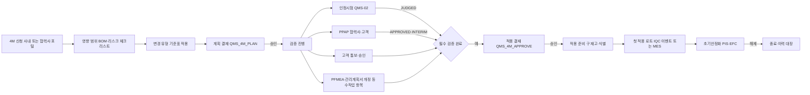
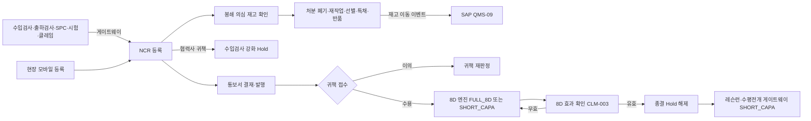

# SL QMS 워크아이템 Vol.6a — QMS-06 품질 운영 지원: 4M 변경·부적합(NCR)

Nov 1, 2026 · @배창욱

## 1. 개요

Vol.6a는 QMS RFP 품질 운영 지원 모듈 중 **Q-19 양산 4M 변경, Q-20 협력사 4M 변경(적용 시점 관리 포함), Q-21 부품 부적합, Q-22 사내 부적합**을 16개 워크아이템으로 내린다. Vol.6은 분량이 커서 6a(이 문서, 4M·NCR), 6b(한도견본·교육·측정기·MSA·분석실), 6c(협력사 실적·개선·심사·인증)로 나눠 검토한다. 두 기능은 PoC 시나리오 1(NCR Full Cycle)과 3(4M 변경)의 본체이며, 다른 메뉴가 만든 생성 서비스(인정시험·PPAP·안정화)와 게이트웨이(NCR)가 실제로 이어지는 곳이다.

| 기능코드 | 기능 | RFP | WI | 핵심 |
| --- | --- | --- | --- | --- |
| 4MC | 4M 변경 | Q-19, Q-20 | 8 | 변경 유형 기준표, 영향 범위(BOM)·리스크 평가, 검증 계획 자동 구성(DVQ·PPAP), 결재 2회, 고객 통보·승인, 적용 시점(구 재고·첫 적용 로트·로트 추적), 안정화 연계, 이력 대장 |
| NCR | 부적합 | Q-21, Q-22 | 8 | 모바일 등록·원천 자동 생성(게이트웨이 구현), 봉쇄·처분·특채, 통보서·귀책 확정, 8D 엔진 연계(FULL_8D·SHORT_CAPA), 효과 확인 연동·종결, COPQ·협력사 구상, Snowflake 실적 |

**도메인 정의**

- **4M 변경**: 양산 중 사람(Man)·설비(Machine)·자재(Material)·방법(Method)과 측정(Measurement)·환경(Environment)을 바꾸는 모든 변경이다(5M1E). IATF 16949는 변경 전 영향 평가·검증·승인과 고객 통보(고객 요구 시 사전 승인)를 요구한다. 대표 예: 금형 수정·이관, 레진 등급·공급사 변경, 공정 순서 변경, 생산 장소 이전, 측정 방법 변경, 특별특성 공정 작업자 교체.
- **변경 유형 기준표**: "어떤 변경이면 어떤 검증(인정시험, PPAP, 초기유동, 고객 승인)을 해야 하는가"를 정한 회사표준 표다. 이 Vol.은 이 표를 데이터(4MC-001)로 옮겨, 신청 즉시 필요한 검증과 결재선이 정해지게 한다.
- **적용 시점 관리(Q-20)**: 변경이 승인된 뒤 "언제부터, 어느 로트부터 변경품이 들어가는가"를 관리한다. 변경 전 재고를 어떻게 처리할지(소진·폐기·재작업·반품), 첫 적용 로트가 무엇인지, 그 로트가 어느 완제품·고객으로 갔는지를 추적해야 문제 발생 시 범위를 좁힐 수 있다.
- **부적합(NCR, Non-Conformance Report)**: 규격·기준을 벗어난 제품·부품을 발견했을 때 발행하는 보고서와 그 처리 흐름이다. 봉쇄(의심품 격리) → 처분(폐기·재작업·선별·특채·반품) → 귀책 통보 → 원인·대책 → 효과 검증 → 종결 순서다. **특채(Concession)**는 기준을 벗어났지만 조건부로 사용을 허가하는 처분이며 결재(필요 시 고객 승인)가 필수다.
- **부품 부적합 / 사내 부적합**: 귀책이 협력사면 부품 부적합(RecordType SUPPLIER, 협력사에 통보·대책 요구), SL 내부 공정·설계·물류면 사내 부적합(RecordType INTERNAL, 귀책 부서에 대책 요구)이다. 발견 위치(수입검사, 라인, 출하검사, 고객 반품)와 귀책은 다른 개념이므로 별도 필드로 둔다.

**선행 공통 WI**: ARC-002·003, MDM-001·002·003·004·005·006·007, SEC-001·002·003, UX-001·003, APV-001·002·003, TDO-001, NTF-001, DOC-001, DWH-002·003·004, AI-004. 이전 Vol. 선행: QMS-02-DVQ-005·007, QMS-03-SPP-001·002, QMS-03-IQC-004·005·006, QMS-03-PPA-002, QMS-03-PIS-001·003. 동시 작성 Vol. 선행: QMS-05-CLM-001~004(8D 엔진, NCR-004~006). 다른 메뉴 호출은 interfaces.md 5절 게이트웨이(QMS_GatewayFactory.get)로 한다.

**다른 메뉴와의 경계**

| 연결 대상 | 이 Vol.이 하는 것 | 상대 메뉴가 하는 것 |
| --- | --- | --- |
| 인정시험 (QMS-02-DVQ) | 4M 검증 계획에서 QMS_QualPlanService.createFromSource 호출, QMS_QualPlanEvent__e(JUDGED) 구독. NCR 게이트웨이 구현(requestFromQualification) | 시험 계획·실행·판정, 불합격 시 게이트웨이 호출 |
| 수입검사·포털 (QMS-03-IQC, SPP) | 게이트웨이 구현(requestFromIncoming), 협력사 귀책 NCR의 Hold 등록·해제, 4M 첫 적용 로트를 QMS_IqcDecision__e로 수신, 협력사 4M 포털 화면 | 로트 판정·이벤트, Hold 반영, 성적서 4M 표시 |
| PPAP·안정화 (QMS-03-PPA, PIS, QMS-04-RPP, EFC) | 4M에서 PPAP(SUPPLIER·CUSTOMER)·안정화(PART·PRODUCT) 생성 서비스 호출, 이벤트 구독 | PPAP 검토·결재, 안정화 계획·해제 |
| 8D 엔진 (QMS-05-CLM) | 대책 모드 판정 후 EIGHT_D 게이트웨이로 8D 생성 요청(RecordType NCR_SUPPLIER·NCR_INTERNAL, Mode FULL_8D·SHORT_CAPA), QMS_EightDEvent__e(STEP_APPROVED·REOPENED·CLOSED·CANCELLED) 구독해 원인·구현·효과 결과를 NCR에 반영, 귀책 재판정 시 cancel | 8D 단계 작성·승인, 액션·효과 확인, D7 수평전개·레슨런, 협력사 8D 포털, AI 적중 판정 |
| 출하검사·SPC·클레임·측정기 (QMS-04-FQC, SPC, QMS-05-CLM, QMS-06-GAU) | NCR 게이트웨이 구현(requestNcr, sourceType 등록부 값), 원천 NCR 번호 회신(QMS_NcrSourceConfig__mdt), 사내 NCR 상태 이벤트(PlantId·LineId·ItemId 포함) | 원천 이상 발생 시 requestNcr 호출·원천 객체 등록. FQC는 QMS_NcrEvent__e로 사내 귀책 NCR의 출하검사 Hold 등록·해제 |
| 수평전개·레슨런 (QMS-04-HZD, LEL) | SHORT_CAPA·8D 미생성 NCR과 심각도 A 임시 조치는 HORIZONTAL_DEPLOY·LESSON_LEARNED 게이트웨이를 QMS_FollowUpRequest로 호출(FULL_8D는 8D D7이 요청) | 게이트웨이 구현(자기 createFromSource 위임) |
| 분석실·측정 (QMS-06-LAB, MSA) | NCR "분석 의뢰"는 LAB_REQUEST 게이트웨이 호출, 측정 계열 4M은 "MSA 재실시 검토" To-Do(6b 비의존) | LAB 게이트웨이 구현, MSA 연구 생성·실행 |
| 협력사 실적·Audit (QMS-06-SQM, SAU) | CORE.NCR_DEFECT(귀책 협력사·확정 불량 수량·확정일), CORE.FOURM_CHANGE(UNAUTHORIZED = QMS_FourMChange__c.Unauthorized__c 복제), KPI QMS_4M_UNAUTHORIZED. 무단 4M 이벤트는 알림용 | 복제 데이터·KPI로 협력사 PPM·4M 미신고 지표·특별 Audit 판단 |
| 연계 (QMS-09) | 재고·로트 계보·첫 생산 로트·처분 재고 이동·구상 전표의 Salesforce 측 계약 | Mule·Snowflake 수집, SAP 전기 |
| AI (QMS-08) | 원인 코드를 8D와 같은 CAUSE_5M1E로 보관, 4M 검증 추천 표시 자리 | RCA 추천·적중 판정(8D 화면, QMS-05 QMS_EightDRcaHitRule), 4M 필요 시험 추천 |
| PMS | QMS_FourMEvent__e, QMS_NcrEvent__e | 액티비티·리스크 연계(필요 시) |

**앞 Vol. 상태**: Vol.0·2·3은 검토 대기다. Vol.0 D-9(지식 객체 전사 조회), Vol.2 D2-4(CONDITIONAL 판정 허용 + 조건 이행 추적), Vol.3 D3-5(검사 수준 규칙)·D3-9(PPAP 거절 부품 합격 차단)는 권고안을 가정한다. 결정이 바뀌면 이 Vol.의 해당 BR도 함께 고친다.

## 2. 업무 흐름

**4M 변경**

**부적합**

4M은 "결재 2회" 구조다. 계획 결재(QMS_4M_PLAN)는 변경 추진과 검증 계획을 승인하고, 적용 결재(QMS_4M_APPROVE)는 검증 결과를 보고 양산 적용을 허가한다(D6A-1). NCR의 처분과 귀책 통보는 병렬로 진행된다. 처분은 제품을 정리하는 일이고 통보·대책은 원인을 없애는 일이기 때문이다. 다른 메뉴에 일을 요청할 때는 게이트웨이(interfaces.md 5절)를 쓰고, 이벤트(QMS_FourMEvent__e, QMS_NcrEvent__e)는 이미 일어난 상태 변화를 알리는 데만 쓴다. 수입검사 Hold만 Vol.3 API를 직접 호출한다.

## 3. 데이터 모델 개요

**객체**

| 객체 | 구분 | 관계 | 역할 | 정의 WI |
| --- | --- | --- | --- | --- |
| QMS_ChangeTypeRule__c | 설정 | ChangeType(Lookup CMN_Code__c) | 변경 유형별 검증·통보·리스크 기준 | 4MC-001 |
| QMS_FourMChecklistTemplate__c / QMS_FourMChecklistItem__c | 설정 | Item → Template(MD) | 리스크 평가 체크리스트 | 4MC-001 |
| QMS_FourMApprovalRule__mdt | 설정 | — | 리스크·고객 통보 조건별 결재 단계 추가 규칙 | 4MC-005 |
| QMS_FourMChange__c | 업무 | Plant, Supplier(Lookup) | 4M 변경 1건(RecordType INTERNAL, SUPPLIER) | 4MC-002 |
| QMS_FourMItem__c | 업무 | FourM(MD), Item, SupplierItem(Lookup) | 변경 품번·영향 완제품 | 4MC-002 |
| QMS_FourMVerification__c | 업무 | FourM(MD) | 검증·적용 준비 항목(게이트) | 4MC-002 |
| QMS_SupplierFourMRequest__c / QMS_SupplierFourMRequestItem__c | 업무 | Item → Request(MD), SupplierItem(Lookup) | 협력사 포털 4M 신청(협력사 소유) | 4MC-004 |
| QMS_NCR__c | 업무 | Plant, Item, Supplier, SupplierItem, EightD(Lookup) | 부적합 1건(RecordType INTERNAL, SUPPLIER) | NCR-001 |
| QMS_NcrContainment__c | 업무 | NCR(MD) | 봉쇄 위치별 확인 결과 | NCR-003 |
| QMS_NcrDisposition__c | 업무 | NCR(MD) | 처분 라인(방법·수량·특채 조건·SAP 이동 상태) | NCR-003 |
| QMS_NcrSupplierResponse__c | 업무 | NCR(Lookup) | 협력사·귀책 부서 회신(접수·이의, 협력사 소유) | NCR-004 |
| QMS_NcrSourceConfig__mdt | 설정 | — | 원천 객체별 NCR 번호 회신 필드 | NCR-002 |
| QMS_NcrCost__c | 업무 | NCR(MD) | 부적합 비용 | NCR-007 |
| QMS_NcrChargeback__c | 업무 | NCR(Lookup), Supplier(Lookup) | 협력사 구상 청구 | NCR-007 |

**상태값**

| 대상 | 값(순서) |
| --- | --- |
| QMS_FourMChange__c.Status__c | DRAFT → RISK_REVIEW → PLAN_APPROVAL → VERIFYING → APPLY_APPROVAL → APPLYING → STABILIZING → CLOSED · REJECTED(불허) · CANCELLED(철회) |
| QMS_FourMVerification__c.Status__c | PLANNED → IN_PROGRESS → DONE / CONDITIONAL / FAILED · WAIVED · CANCELLED |
| QMS_FourMVerification__c.GateStage__c | BEFORE_APPLY(적용 결재 전 필수) · AFTER_APPLY(적용 후 확인) |
| QMS_SupplierFourMRequest__c.Status__c | DRAFT → SUBMITTED → ACCEPTED / RETURNED → (SUBMITTED) · REJECTED |
| QMS_NCR__c.Status__c | DRAFT → OPEN → DISPOSITION → COUNTERMEASURE → VERIFICATION → CLOSED · CANCELLED |
| QMS_NCR__c.ResponsibilityStatus__c | PROPOSED → NOTIFIED → ACCEPTED / DISPUTED → CONFIRMED · REASSIGNED |
| QMS_NCR__c.CountermeasureType__c | FULL_8D · SHORT_CAPA(8D 엔진 약식, D1·D7 생략) · LINKED_8D(클레임 8D에서 대책) |
| QMS_NcrDisposition__c.Status__c | PLANNED → APPROVAL(특채만) → APPROVED → DONE · CANCELLED |
| QMS_NcrChargeback__c.Status__c | DRAFT → APPROVAL → ISSUED → AGREED / DISPUTED → POSTED · WAIVED |

**권한 셋과 페르소나 매핑**(각 WI가 PS를 만들고 SEC-001 BR-2에 따라 PSG에 추가)

| Permission Set | 내용 | PSG |
| --- | --- | --- |
| QMS_PS_FourM_Read | 4M 조회·이력 대장 | Viewer, QualityEngineer, QualityManager, SupplierQuality, Executive(View All) |
| QMS_PS_FourM_Request | 사내 4M 작성·신청(DRAFT 소유분) | Viewer(생산·생산기술·개발), QualityEngineer |
| QMS_PS_FourM_Edit | 리스크 확정·검증 관리·상신·적용 관리 | QualityEngineer, SupplierQuality |
| QMS_PS_FourMConfig_Admin | 변경 유형 기준표·체크리스트·결재 규칙 | QualityAdmin |
| QMS_PS_Portal_FourM | 포털 4M 신청·조회 | SupplierPortal |
| QMS_PS_Ncr_Read | NCR 조회 | Viewer, QualityEngineer, QualityManager, SupplierQuality, Inspector |
| QMS_PS_Ncr_Create | NCR 등록(모바일 포함) | Inspector, Viewer(생산), QualityEngineer, SupplierQuality |
| QMS_PS_Ncr_Edit | 봉쇄·처분·통보·대책·검증 관리 | QualityEngineer, SupplierQuality |
| QMS_PS_Ncr_Respond | 사내 귀책 부서 회신(접수·이의) | Viewer |
| QMS_PS_Ncr_Admin | 취소·재개·귀책 강제 변경 | QualityManager, QualityAdmin |
| QMS_PS_NcrCost_Read / QMS_PS_NcrCost_Edit | 비용·구상 조회 / 입력·상신 | 조회: QualityManager, Executive · 입력: QualityEngineer, SupplierQuality |
| QMS_PS_Portal_Ncr | 포털 NCR 조회·회신·구상 확인 | SupplierPortal |
| QMS_PS_Ncr_Integration | 처분 SAP 이동 상태·구상 전기 상태 갱신 | 통합 사용자 |

결재·확정 권한(4M 불허, 검증 면제, NCR 8D 하향, 특채 승인, 귀책 재판정)은 APPROVAL_ROLE(QUALITY_MANAGER, SQ_MANAGER, PLANT_MANAGER, PRODUCTION_MANAGER, PE_MANAGER(신규), QM_HEAD)로 판정한다.

**다른 WI·메뉴가 쓰는 서비스와 이벤트**

| 이름 | 종류 | 제공 WI | 사용처 |
| --- | --- | --- | --- |
| QMS_ChangeTypeRuleService.resolve | Apex | 4MC-001 | 4MC-003·004, QMS-08(필요 시험 추천 근거) |
| QMS_FourMService.submit / approvePlan 콜백 / isApplicable / getStatusBySource | Apex | 4MC-002·005·007 | QMS-03-IQC-006(4M 번호 검증), QMS-06-6c, PMS |
| QMS_FourMEvent__e | Platform Event | 4MC-002 | 상태 알림: QMS-09(MES·SAP 통보), QMS-04-SPC(APPLIED), QMS-08, PMS |
| QMS_FourMHistoryService.getHistory | Apex | 4MC-008 | QMS-06-CAU(VDA 6.3 증빙), QMS-08 |
| QMS_NcrGatewayImpl(QMS_NcrGateway 구현) | Apex | NCR-002 | QMS-02-DVQ-007, QMS-03-IQC-004, QMS-04-FQC·SPC, QMS-05-CLM |
| QMS_NcrService.open / cancel / reassignResponsibility | Apex | NCR-001·004 | NCR 화면, 게이트웨이 |
| QMS_NcrQueryService.openNcrCount | Apex | NCR-001 | QMS-03-PIS-003, QMS-06-SQM |
| QMS_NcrEvent__e | Platform Event | NCR-001 | 상태 알림: QMS-04-FQC(사내 NCR 출하검사 Hold)·SPC(NCR 번호 역기록), QMS-09(SAP 처분·구상), QMS-08 |
| CORE.SAP_STOCK, CORE.SAP_BOM, CORE.SAP_MATERIAL_PRICE, CORE.SAP_FX_RATE, CORE.LOT_TRACE, CORE.F_LOT_DESCENDANTS | Snowflake(사용만) | QMS-09-INT-008·012가 정의·적재 소유 | 이 Vol.은 쿼리 키 6종만 소유(QMS_BOM_WHERE_USED, QMS_4M_OLD_STOCK, QMS_4M_LOT_TRACE, QMS_NCR_STOCK_CHECK, QMS_NCR_LOT_TRACE, QMS_ITEM_STD_PRICE) |
| CORE.NCR_DEFECT, CORE.FOURM_CHANGE | Snowflake | NCR-008, 4MC-008 | QMS-06-SQM·SAU(협력사 PPM, 4M 미신고), QMS-03-PIS-002, QMS-08 |

**이 Vol.이 호출하는 게이트웨이**(interfaces.md 5절, `QMS_GatewayFactory.get(바인딩 키)`)

| 바인딩 키 | 호출 WI | 용도 |
| --- | --- | --- |
| EIGHT_D | NCR-005 | 8D 생성(create), 진행 조회(getStatus) |
| HORIZONTAL_DEPLOY | NCR-006 | SHORT_CAPA·8D 미생성 NCR 수평전개, 심각도 A 임시 조치 확산 |
| LESSON_LEARNED | NCR-006 | SHORT_CAPA·8D 미생성 NCR 레슨런 |
| LAB_REQUEST | NCR-003 | 불량품 분석 의뢰 |
| NCR | (구현 제공) NCR-002 | 다른 메뉴가 NCR 생성 요청 |

**KPI 키**

| KpiKey | 정의 | 주기 | 차원 | 계산 위치 |
| --- | --- | --- | --- | --- |
| QMS_4M_OPENED | 신규 4M 신청 건수 | 월 | Plant, Supplier | Snowflake(4MC-008) |
| QMS_4M_OPEN | 진행 중 4M 건수(CLOSED·REJECTED·CANCELLED 제외) | 일 | Plant, Supplier | Snowflake |
| QMS_4M_LEAD_COMPLIANCE | 사전 신청 기한 준수율 % = 신청일이 적용 희망일 − MinLeadDays 이전인 건 / 신청 건 | 월 | Plant, Supplier | Snowflake |
| QMS_4M_ONTIME_APPLY | 적용 희망일 이내 적용 결재 완료율 % | 월 | Plant, Supplier | Snowflake |
| QMS_4M_CYCLE_DAYS | 신청 → 종료 평균 일수 | 월 | Plant | Snowflake |
| QMS_4M_UNAUTHORIZED | 4M 미신고·무단 변경 건수 = CORE.FOURM_CHANGE.UNAUTHORIZED(QMS_FourMChange__c.Unauthorized__c) true인 건 | 월 | Plant, Supplier | Snowflake(4MC-008) |
| QMS_NCR_OPENED | 신규 NCR 건수(취소 제외) | 일·월 | Plant, Line, Supplier, Item | Snowflake(NCR-008) |
| QMS_NCR_OPEN | 미종결 NCR 건수 | 일 | Plant, Supplier | Snowflake |
| QMS_NCR_OVERDUE | 대책 기한 경과 미종결 건수 | 일 | Plant, Supplier | Snowflake |
| QMS_NCR_CLOSE_DAYS | 등록 → 종결 평균 일수 | 월 | Plant | Snowflake |
| QMS_NCR_REPEAT_RATE | 재발 NCR 비율 % | 월 | Plant, Supplier | Snowflake |
| QMS_NCR_DEFECT_QTY | 확정 불량 수량 합 | 일·월 | Plant, Supplier, Item | Snowflake |
| QMS_COPQ | 부적합 비용 합(기업 통화) | 월 | Plant, Supplier | Snowflake. CMN_KpiValue__c에 적재하지 않고 DWH-004 쿼리 QMS_COPQ_TREND로만 조회(QMS_ViewCost 필요, NCR-008 BR-4) |
| QMS_NCR_CHARGEBACK | 협력사 구상 합의 금액 | 월 | Plant, Supplier | Snowflake. QMS_COPQ와 같은 보안 방식 |

**공통 기반 등록(각 업무 객체 WI에서 수행)**: 채번(ARC-003), CMN_SharingConfig, CMN_DeleteGuard, CMN_StatusFlow, 필드 이력, DWH 복제(15분), ko·en·zh 번역. 채번 규칙은 4M-{PLANT}-{YYYY}-{SEQ:5}(4M), S4M-{PLANT}-{YYYY}-{SEQ:5}(협력사 신청), NCR-{PLANT}-{YYYY}-{SEQ:6}(NCR), NCB-{PLANT}-{YYYY}-{SEQ:5}(구상). NCR의 협력사 공유는 Supplier__c가 아니라 통보서 승인 시 채우는 SupplierShareTo__c를 SupplierField로 등록한다(통보 전에는 협력사에게 보이지 않게, NCR-001 BR-6).

**데이터량 가정**: SL 실적 미확인. 국내외 7개 사업장 기준 NCR 연 5천~1만 건(수입검사 불합격 로트 + 공정·출하·시험·고객 반품), 처분·봉쇄 라인 NCR당 2~5건, 4M 연 500~1,500건(협력사 포함). Salesforce 레코드로 충분히 감당하는 규모이며, 통계·추세·재발 분석은 Snowflake에서 한다.

## 4. 4M 변경: 기준·신청·평가 (4MC-001~004)

### QMS-06-4MC-001 변경 유형 기준표·리스크 체크리스트

추적 Q-19, Q-20 · 필수 · W1 · SF · DM, APEX, LWC · Customization · 선행 MDM-003, MDM-004, MDM-007, SEC-001 · 5 M/D

**목적**: 회사표준의 "변경 유형별 검증 기준표"를 데이터로 둔다. 신청자가 변경 유형만 고르면 리스크 등급, 필요한 검증(인정시험·PPAP·초기유동), 고객 통보·승인 필요 여부, 최소 사전 신청 기간, 리스크 체크리스트가 정해진다. 회사표준 양산품질 개정(27년)이 끝나면 개발 없이 이 표만 고친다.

**범위** In: CHANGE_TYPE 코드 계층 초기 값, 변경 유형 규칙 객체, 체크리스트 템플릿, 규칙 해석 서비스, 기준표 편집 화면. Out: 신청 화면(4MC-003), 결재선 추가 규칙(4MC-005), PPAP 레벨(QMS-03-PPA-001이 결정).

**데이터 모델**

| 객체 / 필드 | 타입 | 필수 | 설명 |
| --- | --- | --- | --- |
| CMN_Code__c (Group CHANGE_TYPE, MaxLevel 3) | 코드 | — | L1 = 5M1E(MAN, MACHINE, MATERIAL, METHOD, MEASUREMENT, ENVIRONMENT), L2 = 분류, L3 = 세부 유형. 초기 값은 BR-1 |
| QMS_ChangeTypeRule__c.ChangeType__c | Lookup(CMN_Code__c, CHANGE_TYPE 필터) | Y | L2 또는 L3 코드 |
| QMS_ChangeTypeRule__c.Scope__c | Picklist (INTERNAL, SUPPLIER, BOTH) | Y | |
| QMS_ChangeTypeRule__c.CustomerGroup__c | Picklist(MDM-003 CustomerGroup 값) | N | 공란 = 전 고객 |
| QMS_ChangeTypeRule__c.PartCategory__c | Picklist(MDM-004 PartCategory 값) | N | 공란 = 전 부품군 |
| QMS_ChangeTypeRule__c.RiskClass__c | Picklist (A 고위험, B 중위험, C 저위험) | Y | |
| QMS_ChangeTypeRule__c.CustomerNotice__c | Picklist (NOT_REQUIRED, NOTICE 통보, APPROVAL 사전 승인) | Y | |
| QMS_ChangeTypeRule__c.CustomerLeadDays__c | Number(3,0) | N | 고객 통보·승인 사전 기한(일). 공란이면 Account.ChangeNoticeLeadDays__c(Vol.0 변경 요청) |
| QMS_ChangeTypeRule__c.QualTestRequired__c | Checkbox | Y | 인정시험(DVQ) 필요 |
| QMS_ChangeTypeRule__c.SupplierPpapRequired__c | Checkbox | Y | 협력사 PPAP 필요(SUPPLIER) |
| QMS_ChangeTypeRule__c.CustomerPpapRequired__c | Checkbox | Y | 고객 PPAP 필요(영향 완제품) |
| QMS_ChangeTypeRule__c.StabilizationRequired__c | Checkbox | Y | 적용 후 초기안정화·초기유동 필요 |
| QMS_ChangeTypeRule__c.PfmeaReview__c / ControlPlanUpdate__c / WorkInstructionUpdate__c | Checkbox | Y | 문서 개정 검증 항목 생성 |
| QMS_ChangeTypeRule__c.TrialRun__c / MsaRequired__c / TrainingRequired__c / LimitSampleReview__c | Checkbox | Y | 시생산, MSA, 작업자 교육, 한도견본 재검토 항목 생성 |
| QMS_ChangeTypeRule__c.MinLeadDays__c | Number(3,0) | Y | 적용 희망일까지 최소 사전 신청 일수(기본: 협력사 60, 사내 30) |
| QMS_ChangeTypeRule__c.ChecklistTemplate__c | Lookup(QMS_FourMChecklistTemplate__c) | N | |
| QMS_ChangeTypeRule__c.Status__c / Version__c | Picklist (DRAFT, ACTIVE, OBSOLETE) / Number(3,0) | Y | |
| QMS_ChangeTypeRule__c.StandardDocUrl__c | URL | N | 근거 회사표준(지침) |
| QMS_FourMChecklistTemplate__c.Name / Category5M1E__c | Text(80) / Picklist(5M1E, ALL) | Y | |
| QMS_FourMChecklistTemplate__c.Status__c | Picklist (DRAFT, ACTIVE, OBSOLETE) | Y | |
| QMS_FourMChecklistItem__c.Template__c | Master-Detail | Y | |
| QMS_FourMChecklistItem__c.Sequence__c | Number(3,0) | Y | |
| QMS_FourMChecklistItem__c.Question__c / QuestionEn__c / QuestionZh__c | Text(255) | Y / N / N | 예: "변경이 특별특성(CC·SC) 공정에 영향을 주는가" |
| QMS_FourMChecklistItem__c.RaiseRiskTo__c | Picklist (A, B) | N | "예" 답변 시 리스크 등급을 이 값 이상으로 올림 |
| QMS_FourMChecklistItem__c.AddVerificationType__c | Picklist(4MC-002 VerificationType 값) | N | "예" 답변 시 추가할 검증 항목 |
| QMS_FourMChecklistItem__c.SetSpecialCharImpact__c | Checkbox | N | "예" 답변 시 4M.SpecialCharImpact__c = true |
| QMS_FourMChecklistItem__c.CommentRequired__c | Checkbox | Y | "예" 답변 시 근거 서술 필수 |

**서비스 API (`QMS_ChangeTypeRuleService`)**

    QMS_FourMRequirement resolve(List<Id> changeTypeIds, String scope,
                                 Set<String> customerGroups, String partCategory)
    // 결과: riskClass, customerNoticeByGroup(Map<String,String>), customerLeadDaysByGroup,
    //       flags(qualTest, supplierPpap, customerPpap, stabilization, pfmea, controlPlan,
    //       workInstruction, trialRun, msa, training, limitSample), minLeadDays,
    //       checklistTemplateIds, matchedRuleIds, unmatchedChangeTypeIds

**비즈니스 규칙**

- BR-1: CHANGE_TYPE 초기 값(예시, SL 분류표로 교체) — MATERIAL > RESIN(원재료 등급 변경, 원재료 공급사 변경), MATERIAL > SUB_PART(하위 부품 공급사 변경), MACHINE > MOLD(금형 수정, 금형 신규·추가, 금형 이관), MACHINE > EQUIPMENT(설비 교체·이설, 설비 조건 변경), METHOD > PROCESS(공정 순서 변경, 공정 추가·삭제, 외주 전환), METHOD > CONDITION(가공 조건 변경), MAN > OPERATOR(특별특성 공정 작업자 교체), MEASUREMENT > GAUGE(측정 방법·측정기 변경), ENVIRONMENT > LOCATION(생산 장소 이전), ENVIRONMENT > CONDITION(온습도·청정도 조건 변경). 값 등록은 QualityAdmin이 하며 이 WI는 그룹 MaxLevel = 3과 초기 데이터 적재 스크립트를 제공한다.

- BR-2: 규칙 선택 — 변경 유형마다, 고객 그룹마다 ACTIVE 규칙 중 조건이 맞는 것(공란 = 와일드카드, Scope BOTH는 둘 다 일치)을 구체성 점수로 고른다: CustomerGroup 일치 +4, PartCategory 일치 +2, Scope 정확 일치 +1. 최고점 1개(동점이면 RiskClass가 높은 쪽). L3 유형에 규칙이 없으면 부모 L2 규칙을 쓴다.

- BR-3: 병합 — 여러 변경 유형·고객 그룹의 결과는 가장 엄격한 값으로 합친다. RiskClass는 A > B > C 중 최대, CustomerNotice는 고객 그룹별로 APPROVAL > NOTICE > NOT_REQUIRED, CustomerLeadDays는 최대, 체크 플래그는 OR, MinLeadDays는 최대, 체크리스트는 합집합.

- BR-4: 규칙 없음 — L2까지 올라가도 규칙이 없는 유형은 unmatchedChangeTypeIds에 넣고 가장 엄격한 값(RiskClass A, CustomerNotice APPROVAL, 모든 검증 플래그 true)으로 처리한다. 신청 화면은 "기준 미등록 유형 — 품질경영팀 확인 필요" 경고를 보여주고, 검증 항목을 줄이려면 4MC-006 BR-5 면제 절차를 거쳐야 한다(사람이 명시적으로 결정하게 함).

- BR-5: 버전 — ACTIVE 규칙은 수정할 수 없고 "새 버전" DRAFT 복사본을 고쳐 활성화하면 이전 버전은 OBSOLETE(QMS-02-DVQ-002 BR-3과 같은 방식). 같은 조건 키(ChangeType, Scope, CustomerGroup, PartCategory)의 ACTIVE 중복은 활성화 시 차단. 활성화는 QMS_PS_FourMConfig_Admin만.

- BR-6: 4M 레코드는 신청·리스크 확정 시점의 resolve 결과를 RuleSnapshotJson__c로 저장한다(4MC-002). 기준표가 나중에 바뀌어도 진행 중 4M의 검증 항목은 바뀌지 않는다(감사 재현성).

- BR-7: 기준표 편집 화면 `qmsChangeTypeMatrix` — 왼쪽 CHANGE_TYPE 트리, 오른쪽 선택 유형의 규칙 목록(Scope·고객 그룹·부품군별 행, 열 = 리스크·고객 통보·검증 플래그·MinLeadDays). "시뮬레이션" 패널에서 유형(복수)·Scope·고객 그룹·부품군을 입력하면 resolve 결과를 표로 보여준다.

- BR-8: 엑셀 일괄 등록 `qmsChangeTypeRuleImport` — CSV(유형 코드, Scope, 고객 그룹, 부품군, 리스크, 고객 통보, 검증 플래그 Y/N, MinLeadDays) → DRAFT 규칙, 행별 오류 표시. 현행 기준표 이관용.

**화면/UX**: `qmsChangeTypeMatrix`(SL QMS 앱 "4M 설정"), `qmsChangeTypeRuleImport`, 체크리스트 템플릿은 레코드 페이지 + 항목 관련 목록 인라인 편집.

**권한**: QMS_PS_FourMConfig_Admin(편집·활성화), QMS_PS_FourM_Read(조회·시뮬레이션).

**수용 기준**

- AC-1: Given 금형 수정(L3) 규칙 2개(전 고객 RiskClass B, BMW RiskClass A·APPROVAL), When resolve([금형 수정], SUPPLIER, {BMW, HKMC}, LENS), Then RiskClass A, customerNoticeByGroup = {BMW: APPROVAL, HKMC: 전 고객 규칙 값}.

- AC-2: Given L3 "금형 이관" 규칙 없음·L2 MOLD 규칙 있음, When resolve, Then L2 규칙 적용, unmatched 비어 있음.

- AC-3: Given 규칙이 전혀 없는 유형, When resolve, Then RiskClass A, 모든 플래그 true, unmatched에 해당 유형.

- AC-4: Given 유형 2개(QualTest true / false, MinLeadDays 30 / 60), When resolve, Then qualTest true, minLeadDays 60.

- AC-5: Given 같은 조건 키의 ACTIVE 규칙, When 다른 규칙 활성화, Then 차단.

- AC-6: Given CSV 50행 중 오류 2행, When 업로드, Then DRAFT 규칙 48건 + 오류 2행 사유 표시.

**에이전트 주의**: 규칙 선택을 Flow·Decision Table로 만들지 않는다(점수·병합·폴백 로직과 테스트 때문에 Apex). 고객별 통보 기준을 코드에 박지 않는다. 체크리스트 답변 결과 반영은 4MC-003이 이 WI의 템플릿 필드를 읽어 처리한다.

**오픈 이슈**: SL 현행 4M 변경 유형 분류표와 유형별 검증 기준, 고객별 변경 통보·승인 기준(CSR: BMW·HKMC·GM 등)과 사전 기한, 협력사 4M 최소 사전 신청 기간.

### QMS-06-4MC-002 4M 변경 데이터 모델·상태 규칙·이벤트

추적 Q-19, Q-20 · 필수 · W1 · SF · DM, APEX · Customization · 선행 4MC-001, ARC-003, SEC-002, SEC-003, UX-003, TDO-001 · 6 M/D

**목적**: 사내·협력사 4M을 같은 객체·같은 상태 규칙으로 관리하고, 검증 항목을 "게이트"로 둬서 적용 결재 가능 여부를 데이터로 판단하게 한다.

**범위** In: 4M·품번·검증 항목 객체, 상태 전이 서비스, 이벤트, 공통 기반 등록. Out: 신청 화면(4MC-003), 결재(4MC-005·006), 적용 시점(4MC-007).

**데이터 모델**

| 객체 / 필드 | 타입 | 필수 | 설명 |
| --- | --- | --- | --- |
| QMS_FourMChange__c (RecordType INTERNAL, SUPPLIER).RecordNo__c | Text(40), Unique | Y | 4M-{PLANT}-{YYYY}-{SEQ:5} |
| QMS_FourMChange__c.Name | Text(80) | Y | 제목(예: "렌즈 금형 2캐비티 추가") |
| QMS_FourMChange__c.Plant__c | Lookup(CMN_Plant__c) | Y | 적용 공장(공유 기준) |
| QMS_FourMChange__c.Supplier__c | Lookup(Account, 협력사 RT) | SUPPLIER면 Y | 공유 기준(SupplierField) |
| QMS_FourMChange__c.PrimaryChangeType__c | Lookup(CMN_Code__c, CHANGE_TYPE) | Y | 대표 유형(리프) |
| QMS_FourMChange__c.ChangeTypeCodes__c | Text(1000) | Y | 전체 유형 코드(쉼표). DVQ·PPAP 호출 changeTypes 값 |
| QMS_FourMChange__c.Category5M1E__c | Picklist (MAN, MACHINE, MATERIAL, METHOD, MEASUREMENT, ENVIRONMENT) | Y | 대표 유형 L1에서 자동 |
| QMS_FourMChange__c.BeforeDescription__c / AfterDescription__c | Long Text(32768) | Y | 변경 전·후 내용 |
| QMS_FourMChange__c.Reason__c | Picklist (COST 원가, QUALITY 품질 개선, CAPACITY 생산능력, SUPPLY 공급 문제, EQUIPMENT 설비 노후, CUSTOMER 고객 요청, REGULATION 법규, CORRECTIVE 시정 조치, OTHER) | Y | |
| QMS_FourMChange__c.ReasonDetail__c | Text(1000) | N | |
| QMS_FourMChange__c.PlannedApplyDate__c | Date | Y | 적용 희망일 |
| QMS_FourMChange__c.RequestedDate__c | Date | Y | 신청일(제출 시 자동) |
| QMS_FourMChange__c.LeadCompliant__c | Checkbox | — | RequestedDate ≤ PlannedApplyDate − MinLeadDays(제출 시 계산) |
| QMS_FourMChange__c.LateReason__c | Text(500) | LeadCompliant false면 Y | 사전 기한 미준수 사유 |
| QMS_FourMChange__c.RiskClass__c | Picklist (A, B, C) | RISK_REVIEW 이후 Y | 규칙 + 체크리스트 |
| QMS_FourMChange__c.RiskRationale__c | Long Text(4000) | N | |
| QMS_FourMChange__c.RiskChecklistJson__c | Long Text(32768) | RISK_REVIEW 이후 Y | `[{itemId, question, answer(YES/NO/NA), comment}]` |
| QMS_FourMChange__c.SpecialCharImpact__c | Checkbox | Y | 특별특성 영향 |
| QMS_FourMChange__c.AffectedCharacteristicIds__c | Long Text(32768) | SpecialCharImpact면 Y | 영향 특성 Id 목록 |
| QMS_FourMChange__c.PfmeaImpact__c | Picklist (NONE, UPDATE_REQUIRED) | Y | |
| QMS_FourMChange__c.CustomerNotice__c | Picklist (NOT_REQUIRED, NOTICE, APPROVAL) | Y | 영향 고객 중 가장 엄격 |
| QMS_FourMChange__c.CustomerGroups__c | Text(255) | N | 영향 고객 그룹(쉼표, 영향 완제품에서 계산) |
| QMS_FourMChange__c.RuleSnapshotJson__c | Long Text(32768) | RISK_REVIEW 이후 Y | 4MC-001 resolve 결과 |
| QMS_FourMChange__c.Status__c | 3절 상태값 | Y | |
| QMS_FourMChange__c.PlanApprovedAt__c / ApplyApprovedAt__c | DateTime | N | 결재 완료 시각 |
| QMS_FourMChange__c.OldStockDisposition__c | Picklist (USE_UP 소진 후 절환, SCRAP 폐기, REWORK 재작업, RETURN 반품, NONE 재고 없음) | APPLYING 이후 Y | 4MC-007 |
| QMS_FourMChange__c.OldStockQty__c / OldStockCheckedAt__c | Number(14,3) / DateTime | APPLYING 이후 Y | |
| QMS_FourMChange__c.CutoverCondition__c / IdentificationMethod__c | Text(255) | APPLYING 이후 Y | 절환 조건, 변경품 식별 표시 |
| QMS_FourMChange__c.FirstLotNo__c / FirstLotRecordId__c / FirstLotSource__c | Text(60) / Text(18) / Picklist (IQC, MES, MANUAL) | 첫 로트 후 Y | |
| QMS_FourMChange__c.AppliedAt__c | DateTime | 첫 로트 후 Y | 실제 적용 시각 |
| QMS_FourMChange__c.FirstShipmentDate__c / FirstShipmentRef__c | Date / Text(60) | N | 변경품 첫 고객 출하(로트 추적) |
| QMS_FourMChange__c.StabilizationPlanId__c / StabilizationStatus__c | Text(18) / Text(20) | N | 안정화 계획(Id 텍스트) |
| QMS_FourMChange__c.FollowUpEndDate__c | Date | N | 안정화 불필요 시 사후 관찰 종료일 |
| QMS_FourMChange__c.Unauthorized__c | Checkbox | N | 4M 미신고·무단 변경을 사후 등록한 건(4MC-008 BR-4). CORE.FOURM_CHANGE.UNAUTHORIZED로 복제, KPI QMS_4M_UNAUTHORIZED·QMS-06-SQM 4M 미신고 지표 원천 |
| QMS_FourMChange__c.SourceRecordId__c / SourceObject__c / SourceRecordNo__c | Text(18) / Text(80) / Text(40) | N | 원천(협력사 신청, NCR 시정 조치 등) |
| QMS_FourMChange__c.SupplierRequestId__c | Text(18) | N | 협력사 신청 원본(4MC-004) |
| QMS_FourMChange__c.RejectReason__c / CancelReason__c | Text(500) | 해당 시 Y | |
| QMS_FourMChange__c.InternalNote__c | Long Text(4000) | N | 협력사 비공개(포털 PSG FLS 없음) |
| QMS_FourMChange__c.MandatoryOpenCount__c | Roll-up(COUNT, 검증 IsMandatory·BEFORE_APPLY·Status PLANNED/IN_PROGRESS/FAILED) | — | 게이트 판정 |
| QMS_FourMChange__c.VerificationCount__c / VerificationDoneCount__c | Roll-up(COUNT) | — | 진척 |
| QMS_FourMChange__c.Progress__c | Formula(Percent) | — | Done / 전체(WAIVED·CANCELLED 제외) |
| QMS_FourMChange__c.IsOverdue__c | Formula(Checkbox) | — | APPLYING 이전 상태이고 PlannedApplyDate < TODAY() |
| QMS_FourMItem__c.FourM__c | Master-Detail | Y | |
| QMS_FourMItem__c.ItemRole__c | Picklist (CHANGED 변경 품번, AFFECTED_FG 영향 완제품) | Y | |
| QMS_FourMItem__c.Item__c | Lookup(CMN_Item__c) | Y | |
| QMS_FourMItem__c.SupplierItem__c | Lookup(CMN_SupplierItem__c) | SUPPLIER·CHANGED면 Y | |
| QMS_FourMItem__c.Line__c / Operation__c | Lookup | INTERNAL·CHANGED면 Line Y | |
| QMS_FourMItem__c.Customer__c / CustomerGroup__c | Lookup(Account) / Text(20) | AFFECTED_FG면 Y | 품번에서 복사 |
| QMS_FourMItem__c.AddedBy__c | Picklist (AUTO_BOM, MANUAL) | Y | |
| QMS_FourMItem__c.ExcludeReason__c | Text(255) | N | 자동 영향 품번을 제외한 사유(제외는 IsExcluded) |
| QMS_FourMItem__c.IsExcluded__c | Checkbox | Y | |
| QMS_FourMVerification__c.FourM__c | Master-Detail | Y | |
| QMS_FourMVerification__c.Sequence__c | Number(3,0) | Y | |
| QMS_FourMVerification__c.VerificationType__c | Picklist (QUAL_TEST, PPAP_SUPPLIER, PPAP_CUSTOMER, CUSTOMER_NOTICE, CUSTOMER_APPROVAL, PFMEA_UPDATE, CONTROL_PLAN_UPDATE, WORK_INSTRUCTION, TRIAL_RUN, MSA, TRAINING, LIMIT_SAMPLE, OLD_STOCK, IDENTIFICATION, FIRST_LOT_INSPECTION, CUSTOMER_FIRST_SHIP_NOTICE, OTHER) | Y | |
| QMS_FourMVerification__c.GateStage__c | Picklist (BEFORE_APPLY, AFTER_APPLY) | Y | |
| QMS_FourMVerification__c.IsMandatory__c | Checkbox | Y | |
| QMS_FourMVerification__c.Item__c / Customer__c | Lookup | N | 품번별·고객별 항목 |
| QMS_FourMVerification__c.Title__c | Text(255) | Y | 예: "BMW 사전 승인 획득" |
| QMS_FourMVerification__c.Owner__c | Lookup(User) | Y | 담당자(To-Do 대상) |
| QMS_FourMVerification__c.DueDate__c | Date | Y | |
| QMS_FourMVerification__c.Status__c | 3절 상태값 | Y | |
| QMS_FourMVerification__c.LinkedRecordId__c / LinkedRecordNo__c / LinkedObject__c | Text(18) / Text(40) / Text(80) | 자동 생성 항목이면 Y | DVQ 계획, PPAP 등 |
| QMS_FourMVerification__c.ResultSummary__c | Text(1000) | DONE·CONDITIONAL·FAILED면 Y | |
| QMS_FourMVerification__c.ConditionText__c / ConditionDueDate__c | Long Text(4000) / Date | CONDITIONAL이면 Y | 조건 이행 추적 |
| QMS_FourMVerification__c.ConditionFulfilled__c | Checkbox | N | |
| QMS_FourMVerification__c.CustomerRefNo__c / NoticeSentDate__c / CustomerDecision__c / CustomerDecisionDate__c | Text(60) / Date / Picklist (APPROVED, CONDITIONAL, REJECTED, NO_RESPONSE) / Date | 고객 항목 DONE이면 Y | 4MC-005 |
| QMS_FourMVerification__c.WaiverReason__c / WaivedBy__c | Text(500) / Lookup(User) | WAIVED면 Y | |
| QMS_FourMVerification__c.AutoCreated__c | Checkbox | Y | 규칙·연계로 생성 |
| QMS_FourMVerification__c.CompletedAt__c | DateTime | N | |
| QMS_FourMEvent__e | Platform Event | — | FourMId__c, RecordNo__c, RecordType__c, PlantId__c, PlantCode__c, SupplierId__c, VendorNo__c, ItemIds__c, ItemNos__c, LineIds__c, EventType__c(SUBMITTED, PLAN_APPROVED, APPLY_APPROVED, APPLIED(첫 적용 로트 등록), STABILIZING, CLOSED, REJECTED, CANCELLED, UNAUTHORIZED_REGISTERED(미신고 4M 사후 등록)), Unauthorized__c, FirstLotNo__c, PlannedApplyDate__c. 상태 알림용 |

**서비스 API (`QMS_FourMService`)**

    void submit(Id fourMId)                       // DRAFT → RISK_REVIEW
    void confirmRisk(Id fourMId)                  // 리스크·검증 계획 확정(검증 항목 생성)
    void reject(Id fourMId, String reason)        // → REJECTED
    void cancel(Id fourMId, String reason)        // → CANCELLED
    Boolean isApplicable(String recordNo, Id supplierItemId)  // APPLYING이고 해당 품번 포함
    QMS_FourMStatusDTO getStatusBySource(Id sourceId)

**비즈니스 규칙**

- BR-1: 상태 전이는 서비스로만 한다(Status FLS Read). 허용 전이 — DRAFT→RISK_REVIEW(제출), RISK_REVIEW→PLAN_APPROVAL(계획 상신, 4MC-005), PLAN_APPROVAL→VERIFYING(승인)/RISK_REVIEW(반려·회수), VERIFYING→APPLY_APPROVAL(적용 상신, 4MC-006), APPLY_APPROVAL→APPLYING(승인)/VERIFYING(반려·회수), APPLYING→STABILIZING(첫 로트 + 안정화 필요)/CLOSED(첫 로트 + 안정화 불필요 + 사후 관찰 완료), STABILIZING→CLOSED(안정화 해제), RISK_REVIEW·PLAN_APPROVAL·VERIFYING→REJECTED(QUALITY_MANAGER 또는 SUPPLIER면 SQ_MANAGER, 사유 필수), APPLYING 이전 모든 상태→CANCELLED(작성자 또는 담당 QE, 사유 필수).

- BR-2: 제출(submit) 시 검사 — 변경 품번(CHANGED) 1개 이상, 대표 유형·전후 내용·사유·적용 희망일 입력, 적용 희망일 ≥ 오늘. RequestedDate = 오늘, MinLeadDays는 4MC-001 resolve 결과로 LeadCompliant를 계산하고 false면 LateReason 필수. 제출 후 Owner를 공장 품질 담당(INTERNAL: 공장 QUALITY_MANAGER Role이 지정, SUPPLIER: 협력사 Account Owner)으로 바꾸고 그에게 To-Do "4M 리스크 검토: {RecordNo}"(기한 3일).

- BR-3: 리스크 확정(confirmRisk, 4MC-003 화면에서 호출) — resolve 결과와 체크리스트 답변을 합쳐 RiskClass·CustomerNotice·SpecialCharImpact를 확정하고 RuleSnapshotJson을 저장한 뒤, 검증 항목을 만든다(BR-4). 계획 상신 전까지 다시 확정하면 AutoCreated 항목 중 PLANNED 상태인 것만 지우고 다시 만든다.

- BR-4: 검증 항목 자동 생성 규칙 — QUAL_TEST(플래그 true, CHANGED 품번별, BEFORE_APPLY, 필수), PPAP_SUPPLIER(SUPPLIER이고 플래그 true, CHANGED SupplierItem별, BEFORE_APPLY, 필수), PPAP_CUSTOMER(플래그 true, AFFECTED_FG 고객별, BEFORE_APPLY, 필수), CUSTOMER_APPROVAL(고객 그룹 값 APPROVAL, 고객별, BEFORE_APPLY, 필수, 면제 불가), CUSTOMER_NOTICE(값 NOTICE, 고객별, BEFORE_APPLY, 필수), PFMEA_UPDATE·CONTROL_PLAN_UPDATE·WORK_INSTRUCTION·TRIAL_RUN·MSA·TRAINING·LIMIT_SAMPLE(플래그·체크리스트 AddVerificationType, BEFORE_APPLY, 필수), OLD_STOCK·IDENTIFICATION·FIRST_LOT_INSPECTION(항상, AFTER_APPLY, 필수), CUSTOMER_FIRST_SHIP_NOTICE(고객 통보 대상이 있으면, AFTER_APPLY, 필수). 담당자 기본값은 CMN 설정 QMS_4M_VERIF_OWNER_RULES(유형별 Role 코드: QUAL_TEST = DEV_MANAGER 지정자, PFMEA_UPDATE = PE_MANAGER 지정자 등)로 정하고 없으면 4M Owner. 기한 기본값 = PlannedApplyDate − CMN 설정 QMS_4M_VERIFY_BUFFER_DAYS(기본 7), 고객 항목은 PlannedApplyDate − CustomerLeadDays.

- BR-5: 검증 항목 담당자에게 To-Do "4M 검증: {Title}"을 연다(SourceType QMS_4M_VERIFICATION). 항목이 DONE·CONDITIONAL·FAILED·WAIVED·CANCELLED가 되면 To-Do를 닫는다. 자동 연계 항목(DVQ·PPAP)은 그 쪽 To-Do가 있으므로 4M 쪽 To-Do는 만들지 않는다.

- BR-6: 이벤트 — 상태 변화, 첫 적용 로트 등록(APPLIED), 미신고 4M 사후 등록(UNAUTHORIZED_REGISTERED)마다 QMS_FourMEvent__e를 발행한다. 상태 알림용이며 다른 메뉴에 일을 요청하는 데 쓰지 않는다. 이 WI는 구독 측을 구현하지 않는다.

- BR-7: 공통 기반 — 채번 4M-{PLANT}-{YYYY}-{SEQ:5}, CMN_SharingConfig(PlantField Plant__c, SupplierField Supplier__c: SUPPLIER 4M은 협력사 Read, InternalNote·RiskChecklistJson은 포털 PSG FLS 없음), CMN_DeleteGuard(DRAFT만), CMN_StatusFlow, 필드 이력(Status, RiskClass, CustomerNotice, PlannedApplyDate, AppliedAt, OldStockDisposition, Verification.Status), DWH 복제 15분(4M·품번·검증), 번역.

- BR-8: 변경 품번 수정 — PLAN_APPROVAL 이후 CHANGED 품번 추가·삭제는 불가하다. 품번이 늘어야 하면 별도 4M을 만들거나 반려로 되돌린다(검증 범위가 결재 후 바뀌는 것을 막음).

- BR-9: 측정 계열 변경 — confirmRisk 시 ChangeTypeCodes 중 L1이 MEASUREMENT인 유형이 하나라도 있으면, 규칙 플래그와 무관하게 MSA 검증 항목(Title "MSA 재실시 검토", BEFORE_APPLY, 필수)을 만들고 담당자(CMN 설정 QMS_4M_MSA_OWNER_ROLE의 공장 Role 사용자, 기본 QUALITY_MANAGER가 지정한 담당)에게 To-Do "MSA 재실시 검토: {RecordNo}"(SourceType QMS_4M_MSA_REVIEW, 기한 = 항목 DueDate)를 연다(BR-5 일반 To-Do 대신). 담당자는 영향 측정기·특성을 검토해 QMS-06-MSA 화면에서 MSA 연구를 직접 만들거나(Trigger CHANGE_4M, 원천 = 4M 번호) 불필요 사유를 남기고 항목을 DONE·WAIVED로 처리한다. 이 WI는 QMS-06-MSA 서비스·객체를 호출하지 않는다(6b 배포 여부와 무관).

**화면/UX**: 4M 레코드 페이지 = cmnStatusPath + 머리말(유형·리스크·고객 통보·적용 희망일·진척) + 탭(변경 내용, 품번, 검증 `qmsFourMVerificationGrid`, 적용 시점, 결재 이력, 코멘트, 문서). `qmsFourMVerificationGrid`는 항목별 상태 배지, 연계 레코드 링크, 담당·기한, 완료·조건부·실패 입력, 면제 버튼(권한자)을 보여준다.

**권한**: QMS_PS_FourM_Request(작성·제출·철회), QMS_PS_FourM_Edit(리스크 확정·검증 관리), QMS_PS_FourM_Read. 불허·면제는 APPROVAL_ROLE 검사.

**수용 기준**

- AC-1: Given 변경 품번 없는 DRAFT, When submit, Then 차단 + 메시지.

- AC-2: Given MinLeadDays 60, 오늘 신청·적용 희망일 30일 후, When submit, Then LeadCompliant false, LateReason 없으면 차단.

- AC-3: Given 플래그 QualTest·SupplierPpap true, CHANGED 2개(SUPPLIER), BMW APPROVAL, When confirmRisk, Then QUAL_TEST 2·PPAP_SUPPLIER 2·CUSTOMER_APPROVAL 1(BMW)·AFTER_APPLY 3종 항목 생성.

- AC-4: Given VERIFYING 4M, When 사용자가 API로 Status를 APPLYING으로 변경, Then 차단.

- AC-5: Given PLAN_APPROVAL 이후, When CHANGED 품번 추가, Then 차단.

- AC-6: Given 협력사 A 포털 사용자, When 자기 SUPPLIER 4M 조회, Then 머리말·검증 상태는 보이고 InternalNote·RiskChecklistJson은 보이지 않음.

- AC-7: Given 상태 전이 3회, When 처리, Then QMS_FourMEvent__e 3회 발행.

**에이전트 주의**: DVQ·PPAP·안정화 객체를 Lookup하지 않는다(LinkedRecordId 텍스트). 검증 항목 Status를 연계 이벤트 외 경로로 바꾸지 않게 자동 연계 항목은 화면에서 잠근다(4MC-006). Roll-up 조건에 FAILED를 넣어 실패 항목이 게이트를 막게 한다.

**오픈 이슈**: 4M 담당 지정 방식(공장 품질팀 QE 지정 규칙), 사내 4M 신청 주체(생산·생산기술·개발 중 누구까지인지).

### QMS-06-4MC-003 4M 신청·영향 범위·리스크 평가 화면

추적 Q-19, Q-20, PoC 시나리오 3 · 필수 · W1 · SF, SNOW · LWC, APEX · Customization · 선행 4MC-002, DWH-004, UX-001 · 6 M/D

**목적**: 신청자는 "무엇을 바꾸는지"만 입력하고, 시스템이 BOM으로 영향 완제품과 고객을 찾고 기준표로 리스크·필요 검증을 제시한다. 품질 담당은 같은 화면에서 체크리스트로 리스크를 확정한다. 사람의 기억으로 고객 통보를 빠뜨리는 일을 막는 것이 핵심이다.

**범위** In: 신청 마법사, BOM 역전개 영향 품번, 리스크 체크리스트 입력, 규칙 결과 미리보기, 리스크 확정 화면, AI 추천 표시 자리. Out: 협력사 포털 신청(4MC-004), 결재(4MC-005).

**화면/UX**

| 컴포넌트 | 위치 | 기능 |
| --- | --- | --- |
| qmsFourMWizard | 4M 새로 만들기 오버라이드, 모바일 지원 | 1단계 기본정보(RecordType, 공장, 협력사, 변경 유형 cmnCodePicker 다중, 전후 내용, 사유, 적용 희망일) → 2단계 변경 품번(품번 검색, SUPPLIER면 협력사 품번 목록에서 선택, INTERNAL이면 라인·공정) → 3단계 영향 완제품(BOM 역전개 결과, 제외 사유 입력) → 4단계 규칙 결과 미리보기(리스크, 고객별 통보·승인, 필요 검증, 사전 기한 준수 여부) → 저장(DRAFT) 또는 제출 |
| qmsFourMRiskReview | 4M 레코드 페이지(RISK_REVIEW) | 체크리스트 답변(YES/NO/NA, 코멘트), 영향 특성 선택(품번 ACTIVE 특성, CC·SC 강조), PFMEA 영향, 리스크 근거, 검증 항목 미리보기 → "리스크 확정" |
| AI 추천 영역(QMS-08-AIQ-014 컴포넌트 자리) | 4M 레코드 페이지(FlexiPage QMS_FourMChange_Record) "검증" 탭 맨 위 섹션 "AI 필요 시험 추천", 표시 조건 Status DRAFT·RISK_REVIEW·PLAN_APPROVAL | 이 WI는 빈 섹션과 표시 조건만 만든다. QMS-08-AIQ-014가 `qmsAiRecommendLauncher`(UseCase QMS_4M_TEST, 수동 실행)와 그 옆 `cmnAiRecommendationList`(UseCase QMS_4M_TEST, recordId = 4M Id)를 이 섹션에 배치한다. 마법사 4단계에는 "저장 후 AI 필요 시험 추천 보기" 안내만 둔다(미배포 컴포넌트를 LWC에서 정적 참조하지 않음) |

**비즈니스 규칙**

- BR-1: 영향 완제품 — 2단계 저장 시 `CMN_DwQueryService.query('QMS_BOM_WHERE_USED', {itemNos, plantCode, asOfDate})`를 호출한다. 쿼리는 `CORE.SAP_BOM`(1단계 행만 저장, 정의 QMS-09-INT-008)을 재귀 CTE로 COMPONENT_ITEM_NO → PARENT_ITEM_NO 방향으로 최대 10레벨 역전개하며 조건은 PLANT_CODE = plantCode, VALID_FROM ≤ asOfDate ≤ VALID_TO, BOM_USAGE = 생산용, ALT_BOM 기본값이다. 결과 열: inputItemNo, itemNo(상위 품번), level, isTop(더 위 상위가 없음), componentQty, plantCode. Apex는 결과 품번 중 CMN_Item__c.ItemType = FG인 것만 AFFECTED_FG 항목(AddedBy AUTO_BOM)으로 만든다. 쿼리 등록(CMN_DwQuery__mdt QMS_BOM_WHERE_USED, MaxRows 2,000)은 이 WI가 한다. BOM이 없으면 경고 + 수동 추가.

- BR-2: 고객 그룹 — AFFECTED_FG 품번(IsExcluded false)의 Customer → Account.CustomerGroup__c 집합으로 resolve를 호출한다. 자동 영향 품번을 제외하려면 ExcludeReason 필수이며 리스크 검토 화면에 제외 목록을 강조한다(고객 통보 누락 위험).

- BR-3: 미리보기 — 4단계와 리스크 검토 화면에서 resolve 결과를 표로 보여준다: 리스크 등급, 고객별 통보 구분·사전 기한(적용 희망일 기준 마감일), 필요 검증 목록, 결재선 추가 단계(4MC-005 규칙 미리보기), unmatched 경고.

- BR-4: 체크리스트 — 규칙의 ChecklistTemplate 합집합 항목을 순서대로 보여준다. 모든 항목 답변 필수, CommentRequired 항목은 YES일 때 코멘트 필수. YES 답변의 RaiseRiskTo·AddVerificationType·SetSpecialCharImpact를 반영해 최종 리스크와 검증 항목을 계산한다(리스크는 규칙 결과와 체크리스트 중 높은 값).

- BR-5: 특별특성 — SpecialCharImpact가 true면 영향 특성 1개 이상 선택 필수이고 RiskClass는 최소 A. CC 특성이 포함되면 PFMEA_UPDATE·CONTROL_PLAN_UPDATE 항목을 필수로 강제한다.

- BR-6: 리스크 확정 버튼은 QMS_PS_FourM_Edit 보유자이면서 4M Owner 또는 공장 QUALITY_MANAGER(SUPPLIER면 SQ_MANAGER) Role 사용자만 누를 수 있다. 확정 후 4MC-002 confirmRisk 호출.

- BR-7: 신청자 편의 — 이전 4M 복사(같은 품번·유형의 최근 4M에서 내용·품번 복사, 리스크·결재·검증 결과는 복사하지 않음), 작성 중 자동 저장(DRAFT), 첨부(DocClass FOURM_EVIDENCE: 변경 전후 사진·도면 링크·검토 자료).

- BR-8: 모바일 — 마법사 1~2단계는 모바일 입력 가능(현장 설비 변경 신청), 3~4단계와 리스크 검토는 데스크톱·태블릿.

**권한**: QMS_PS_FourM_Request(마법사), QMS_PS_FourM_Edit(리스크 검토·확정).

**수용 기준**

- AC-1: Given 렌즈 품번 1개가 헤드램프 FG 3개(BMW 2, HKMC 1)에 쓰임, When 2단계 저장, Then AFFECTED_FG 3건, CustomerGroups = BMW, HKMC.

- AC-2: Given 자동 영향 품번 1개 제외, When ExcludeReason 없이 저장, Then 차단.

- AC-3: Given 체크리스트 "특별특성 공정 영향" YES(RaiseRiskTo A), 규칙 리스크 C, When 확정, Then RiskClass A, 특성 선택 없으면 차단.

- AC-4: Given CC 특성 선택, When 확정, Then PFMEA_UPDATE·CONTROL_PLAN_UPDATE 필수 항목 생성.

- AC-5: Given BOM 조회 결과 2,500행, When 2단계, Then 2,000행까지 반영 + "결과 잘림" 경고(truncated).

- AC-6: Given 신청자(Viewer)가 리스크 확정 버튼 호출, When API 호출, Then 차단.

**에이전트 주의**: BOM을 Salesforce에 적재하거나 Apex로 다단계 전개하지 않는다(Snowflake 쿼리, MDM-004 BR-2). CORE.SAP_BOM 정의를 이 WI에서 만들지 않는다(QMS-09-INT-008). QMS-08 컴포넌트를 qmsFourMWizard·qmsFourMRiskReview 안에 넣지 않는다(레코드 페이지 섹션에 QMS-08이 배치). 영향 고객 계산을 화면에서만 하지 않는다(서버가 다시 계산해 저장). AI 추천 결과로 검증 항목을 자동 추가하지 않는다(사람이 채택 후 수동 추가).

**오픈 이슈**: SL BOM 다단계 데이터의 Snowflake 적재 범위(IF-SAP-003), 현행 4M 리스크 평가 양식·체크리스트.

### QMS-06-4MC-004 협력사 4M 포털 신청·SQE 접수

추적 Q-20, NFR-4.2(협력사 격리) · 필수 · W2 · EXP, SF · DM, LWC, APEX · Customization · 선행 4MC-003, QMS-03-SPP-001, QMS-03-SPP-002 · 6 M/D

**목적**: 협력사가 변경 계획을 메일 대신 포털로 사전 신청하고, 진행 상황(검증 요구, 적용 허가, 첫 출하 지시)을 포털에서 본다. 협력사 무단 변경을 줄이는 가장 직접적인 장치다.

**설계 결정**: QMS-02-DVQ-010·QMS-03-PPA-003과 같은 원칙으로, 협력사는 SL 4M 레코드를 직접 만들거나 고치지 않는다. 협력사 소유 신청 객체에 입력하고 SQE가 접수하면 서비스가 SUPPLIER 4M을 만든다(D6A-2). W1 기간에는 SQE가 4MC-003 마법사로 협력사 4M을 대신 등록한다.

**범위** In: 협력사 신청 객체, 포털 신청·조회 화면, SQE 접수·반려·불허, 4M 생성 변환, 협력사 진행 알림. Out: 리스크 확정·검증(4MC-003·005), 협력사 PPAP 제출(QMS-03-PPA-003), 첫 출하 성적서 4M 표시(QMS-03-IQC-006).

**데이터 모델**

| 객체 / 필드 | 타입 | 필수 | 설명 |
| --- | --- | --- | --- |
| QMS_SupplierFourMRequest__c.RecordNo__c | Text(40), Unique | Y | S4M-{PLANT}-{YYYY}-{SEQ:5} |
| QMS_SupplierFourMRequest__c.Supplier__c | Lookup(Account, 협력사 RT) | Y | 포털 사용자 회사로 자동, 공유 기준 |
| QMS_SupplierFourMRequest__c.Plant__c | Lookup(CMN_Plant__c) | Y | 납품 공장(신청 1건 = 공장 1개) |
| QMS_SupplierFourMRequest__c.ChangeType__c | Lookup(CMN_Code__c, CHANGE_TYPE 리프) | Y | 포털용 코드 피커 |
| QMS_SupplierFourMRequest__c.Title__c | Text(80) | Y | |
| QMS_SupplierFourMRequest__c.BeforeDescription__c / AfterDescription__c | Long Text(32768) | Y | |
| QMS_SupplierFourMRequest__c.Reason__c | Picklist(4MC-002 Reason 값) | Y | |
| QMS_SupplierFourMRequest__c.PlannedApplyDate__c | Date | Y | 적용 희망일 |
| QMS_SupplierFourMRequest__c.SupplierValidation__c | Long Text(32768) | Y | 협력사 자체 검증 계획·결과(시험, 치수, 공정능력) |
| QMS_SupplierFourMRequest__c.OldStockQtyAtSupplier__c | Number(14,3) | Y | 협력사 보유 변경 전 재고 |
| QMS_SupplierFourMRequest__c.Status__c | 3절 상태값 | Y | |
| QMS_SupplierFourMRequest__c.ReturnComment__c | Long Text(4000) | RETURNED·REJECTED면 Y | 협력사 공개 |
| QMS_SupplierFourMRequest__c.FourMChangeId__c / FourMRecordNo__c | Text(18) / Text(40) | ACCEPTED면 Y | 생성된 4M |
| QMS_SupplierFourMRequest__c.SubmittedAt__c | DateTime | 제출 시 Y | |
| QMS_SupplierFourMRequestItem__c.Request__c | Master-Detail | Y | |
| QMS_SupplierFourMRequestItem__c.SupplierItem__c | Lookup(CMN_SupplierItem__c, 자기 회사·같은 공장 필터) | Y | 변경 대상 협력사 품번 |

첨부는 DocClass FOURM_REQUEST(변경 계획서·전후 사진·자체 검증 자료, SPP-002 업로드 컴포넌트).

**비즈니스 규칙**

- BR-1: 포털 신청 `qmsSupplierFourMForm` — 공장·유형·품번(자기 SupplierItem 다중)·전후 내용·사유·적용 희망일·자체 검증·보유 재고·첨부 입력. 유형을 고르면 4MC-001 resolve(Scope SUPPLIER, 고객 그룹 = 공장 기준 전체, PartCategory)의 MinLeadDays만 보여주고(내부 검증 목록·고객 정보는 비공개), 적용 희망일 − 오늘 < MinLeadDays면 "사전 신청 기한 미달" 경고와 사유 입력을 요구한다.

- BR-2: 제출 → SUBMITTED, 협력사 Account Owner(주관 SQE)와 공장 SUPPLIER_QUALITY Role에게 To-Do "협력사 4M 신청 접수: {RecordNo}"(기한 2일).

- BR-3: SQE 접수 화면 `qmsSupplierFourMIntake`(사내) — 신청 내용, 첨부, 같은 품번 최근 4M 이력, 해당 협력사 진행 중 4M·NCR 수를 보여준다. 선택: 접수(ACCEPTED) / 보완 요청(RETURNED, 코멘트 필수) / 불허(REJECTED, 사유 필수, SQ_MANAGER Role만).

- BR-4: 접수 시 변환 — SUPPLIER 4M을 만든다(Plant, Supplier, PrimaryChangeType = 신청 유형, 전후 내용·사유·적용 희망일 복사, CHANGED 품번 = 신청 품번, SourceObject = 신청 객체, SupplierRequestId), 4MC-003 BR-1 영향 완제품 계산을 실행하고 상태는 RISK_REVIEW(Owner = 접수 SQE). 첨부는 4M에 같은 리비전을 링크한다(파일 복사 없음). 신청에 FourMChangeId·FourMRecordNo를 채운다.

- BR-5: 보완 요청 → 협력사 SupplierContactResolver(QUALITY) To-Do "4M 신청 보완"과 알림, 협력사는 같은 레코드를 고쳐 다시 제출한다(RETURNED → SUBMITTED). 제출 후에는 협력사 편집 불가.

- BR-6: 진행 조회 `qmsPortalFourMList`·`qmsPortalFourMDetail` — 협력사는 자기 회사 SUPPLIER 4M의 번호·상태·적용 희망일·협력사 조치 필요 항목(PPAP 요구, 자료 요청)·결재 결과를 본다. 리스크 체크리스트·내부 메모·고객 정보는 반환하지 않는다(Apex DTO).

- BR-7: 협력사 알림 — QMS_FourMEvent__e 구독: PLAN_APPROVED("변경 추진 승인, 검증 진행"), APPLY_APPROVED("양산 적용 허가: 첫 출하 성적서에 4M 번호 {RecordNo}를 기재하고 변경품 식별 표시"), REJECTED(사유), CLOSED. 수신자는 SupplierContactResolver(QUALITY, 해당 공장), APPLY_APPROVED는 SHIPPING 역할도 포함.

- BR-8: 공통 기반 — 채번, SharingConfig(Plant, SupplierField Supplier__c), 협력사 소유, DeleteGuard(DRAFT만), StatusFlow, 필드 이력(Status), DWH 복제 일 1회, 번역.

**화면/UX**: 포털 메뉴 "4M 변경"(목록·상세·신청), 사내 `qmsSupplierFourMIntake`(신청 레코드 페이지), SUPPLIER 4M 레코드 페이지에 "원 신청 보기" 링크.

**권한**: QMS_PS_Portal_FourM(협력사: 신청 생성·편집·제출, 자기 4M 조회), QMS_PS_FourM_Edit(SQE 접수·보완 요청), 불허는 SQ_MANAGER Role.

**수용 기준**

- AC-1: Given MinLeadDays 60, 적용 희망일 40일 후, When 협력사 제출, Then 사유 입력 요구, 입력 후 제출 + SQE To-Do 1건.

- AC-2: Given SQE 접수, When 처리, Then SUPPLIER 4M 1건(RISK_REVIEW, CHANGED 품번 = 신청 품번, 영향 완제품 자동), 신청에 4M 번호 기록, 첨부 링크.

- AC-3: Given 보완 요청, When 처리, Then 신청 RETURNED, 협력사 To-Do·알림 1건, 협력사 수정 후 재제출 가능.

- AC-4: Given 협력사 B 포털 사용자, When 협력사 A 신청·4M URL 접근, Then 권한 없음.

- AC-5: Given APPLY_APPROVED 이벤트, When 처리, Then 협력사 QUALITY·SHIPPING 역할에 4M 번호 기재 지시 알림.

- AC-6: Given 협력사 포털 4M 상세, When 조회, Then 리스크 체크리스트·고객 정보 미노출.

**에이전트 주의**: 협력사에게 SL 내부 검증 기준표·고객별 통보 기준을 노출하지 않는다. 신청 객체를 4M 객체의 Master-Detail로 만들지 않는다(협력사 편집 권한이 번짐). 접수 변환은 한 트랜잭션에서 실패 시 전체 롤백한다.

**오픈 이슈**: 현행 협력사 4M 신청서 양식, 부품개발시스템에 협력사 4M 접수 기능이 있는지(있다면 QMS-09 연계로 받음).

## 5. 4M 변경: 검증·결재·적용·종료 (4MC-005~008)

### QMS-06-4MC-005 검증 계획 자동 구성·계획 결재·고객 통보·승인

추적 Q-19, Q-20, Q-43, Q-4, Q-8, Q-15 · 필수 · W1 · SF · APEX, LWC, CFG · Customization · 선행 4MC-003, APV-001, APV-002, QMS-02-DVQ-005, QMS-03-PPA-002 · 6 M/D

**목적**: 계획 결재가 끝나는 순간 인정시험 계획과 PPAP 요구가 자동으로 만들어지고, 고객 통보·승인이 기한과 함께 추적되게 한다. 리스크가 높거나 고객 승인이 필요한 변경은 결재선이 자동으로 길어진다.

**범위** In: 계획 결재 유형·콜백, 결재선 추가 규칙, 승인 시 DVQ·PPAP 생성 서비스 호출, 고객 통보·승인 입력. Out: 검증 결과 수신·적용 결재(4MC-006), 고객 PPAP 상세 흐름(QMS-04-RPP).

**데이터 모델**

| 객체 / 필드 | 타입 | 필수 | 설명 |
| --- | --- | --- | --- |
| CMN_ApprovalType__mdt QMS_4M_PLAN | Custom Metadata | — | TargetObject QMS_FourMChange__c, CallbackClass QMS_FourMPlanApprovalCallback, LockOnSubmit true, KeepLockedAfterApproval false |
| QMS_FourMApprovalRule__mdt | Custom Metadata | — | TypeCode__c(QMS_4M_PLAN, QMS_4M_APPROVE), RecordType__c(INTERNAL, SUPPLIER, ALL), RiskClass__c(A, B, C, ALL), CustomerNotice__c(APPROVAL, NOTICE, ALL), SpecialCharImpact__c(Y, ALL), RoleCode__c, StepType__c(AGREE, APPROVE), Position__c(LAST, BEFORE_LAST), IsActive__c |

**비즈니스 규칙**

- BR-1: 계획 상신 조건 — 상태 RISK_REVIEW, 리스크 확정 완료(RuleSnapshotJson 존재), 모든 BEFORE_APPLY 항목에 담당자·기한, unmatched 유형이 있으면 리스크 근거에 "기준 미등록 유형 검토 의견" 입력. `canSubmit`으로 판정한다(APV-003 BR-2).

- BR-2: 결재선 — 템플릿(APV-002, 공장별)은 기본으로 작성 QE → 부서장(DRAFTER_MANAGER) 검토 → CFT 합의(INTERNAL: PRODUCTION_MANAGER, PE_MANAGER, QUALITY_MANAGER / SUPPLIER: SQ_MANAGER, PURCHASING_MANAGER) → 승인(QUALITY_MANAGER, SUPPLIER면 SQ_MANAGER). 결재선 기여 구현 `QMS_FourMApprovalContributor`(CMN_ApprovalLineContributor, Vol.2 변경 요청)가 QMS_FourMApprovalRule__mdt 조건에 맞는 단계를 추가한다. 기본 규칙: RiskClass A → PLANT_MANAGER 승인(LAST), CustomerNotice APPROVAL → DEV_MANAGER 합의(BEFORE_LAST, 고객 엔지니어링 승인 담당), SpecialCharImpact Y → QM_HEAD 참조(CC).

- BR-3: 콜백 — onSubmitted → PLAN_APPROVAL, onApproved → VERIFYING + PlanApprovedAt + BR-4 실행 + 이벤트 PLAN_APPROVED, onRejected·onRecalled → RISK_REVIEW.

- BR-4: 연계 생성(onApproved, Queueable — 결재 트랜잭션과 분리하고 실패 시 해당 항목만 재시도 버튼) —
  (a) QUAL_TEST 항목: `QMS_QualPlanService.createFromSource`(scope = 품번 ItemType이 PART·RAW면 PART, FG·SFG면 PRODUCT, itemId, supplierId(SUPPLIER), plantId, customerId(PRODUCT면 품번 고객), triggerType CHANGE_4M, changeTypes = ChangeTypeCodes, phase CHANGE, targetDate = 항목 DueDate, sourceId = 4M Id, sourceObject QMS_FourMChange__c, sourceNo, ownerId = 항목 Owner) → LinkedRecordId·No·Object, 항목 IN_PROGRESS.
  (b) PPAP_SUPPLIER 항목: `QMS_PpapService.createFromSource`(scope SUPPLIER, supplierItemId, trigger CHANGE_4M, changeTypes, dueDate = 항목 DueDate − 14일, requiredByDate = 항목 DueDate, sourceId = 4M Id, sourceObject, sourceNo, sqeId = 항목 Owner).
  (c) PPAP_CUSTOMER 항목: CMN 설정 QMS_RPP_ENABLED = true면 `QMS_PpapService.createFromSource`(scope CUSTOMER, 영향 완제품 기준 — 요청 필드는 QMS-04-RPP 정의를 따름), false면 수작업 항목으로 두고 담당자 To-Do.
  (d) 실패하면 항목에 오류 메시지를 남기고 4M Owner에게 To-Do "4M 연계 생성 실패: {항목}". 성공한 다른 항목은 되돌리지 않는다.

- BR-5: 고객 통보·승인 입력 `qmsFourMCustomerPanel`(4M 레코드 페이지) — 고객별 CUSTOMER_NOTICE·CUSTOMER_APPROVAL 항목에 통보일, 고객 참조 번호(OEM 포털 접수 번호 등), 고객 결정(APPROVED, CONDITIONAL, REJECTED, NO_RESPONSE)·결정일, 근거 문서(DocClass FOURM_EVIDENCE)를 입력한다. NOTICE 항목은 통보일 입력 + 근거 문서로 DONE. APPROVAL 항목은 APPROVED → DONE, CONDITIONAL → CONDITIONAL(조건 입력), REJECTED → FAILED.

- BR-6: 고객 기한 — CUSTOMER_APPROVAL·NOTICE 항목 DueDate(= 적용 희망일 − CustomerLeadDays) 7일 전·당일에 담당자와 4M Owner에게 알림 QMS_4M_CUSTOMER_DUE. NO_RESPONSE로 기한이 지나면 4M Owner·QUALITY_MANAGER에게 알림(고객 무응답을 승인으로 간주하지 않음).

- BR-7: 결재 Summary 스냅숏(APV-001 Summary)에 유형·리스크·영향 고객·검증 항목 목록·사전 기한 준수 여부를 넣어 결재자가 한 화면에서 판단하게 한다.

**권한**: 상신은 QMS_PS_FourM_Edit, 결재는 APV Role, 고객 패널 입력은 QMS_PS_FourM_Edit.

**수용 기준**

- AC-1: Given RiskClass A·BMW APPROVAL 4M, When 결재선 해석, Then 기본 단계 + DEV_MANAGER 합의(마지막 승인 직전) + PLANT_MANAGER 승인(마지막).

- AC-2: Given 계획 승인, QUAL_TEST 2·PPAP_SUPPLIER 1 항목, When 콜백 처리, Then 인정시험 계획 2건·PPAP 1건 생성, 항목 LinkedRecordId 채움, 이벤트 PLAN_APPROVED 1회.

- AC-3: Given 같은 4M 콜백 재처리(재시도), When 실행, Then DVQ·PPAP 멱등으로 추가 생성 없음.

- AC-4: Given QMS_RPP_ENABLED false, When 승인, Then PPAP_CUSTOMER 항목은 수작업 상태로 남고 담당자 To-Do 1건.

- AC-5: Given BMW APPROVAL 항목에 고객 결정 CONDITIONAL, When 저장, Then 조건 입력 없으면 차단, 입력 시 항목 CONDITIONAL.

- AC-6: Given 고객 항목 기한 경과·NO_RESPONSE, When 일 배치, Then Owner·품질팀장 알림, 항목은 DONE이 되지 않음.

**에이전트 주의**: 인정시험·PPAP 레코드를 직접 insert하지 않는다(생성 서비스만). 결재 콜백 안에서 외부 서비스 호출 실패로 결재 자체를 롤백하지 않는다(Queueable 분리). 고객 OEM 포털로 자동 제출하는 기능은 범위 밖이다.

**오픈 이슈**: 4M 계획 결재선(공장별 CFT 구성), 고객별 사전 통보·승인 기한 실제 값, 고객 승인 근거 자료 형태.

### QMS-06-4MC-006 검증 진행 게이트·적용 승인 결재

추적 Q-19, Q-20, Q-4, Q-8 · 필수 · W1 · SF · APEX, LWC · Customization · 선행 4MC-005 · 5 M/D

**목적**: 각 검증 결과를 연계 이벤트로 자동 반영하고, 필수 검증이 모두 끝났을 때만 양산 적용 결재를 올리게 한다. "검증이 끝나기 전에 변경품이 양산에 들어가는" 일을 시스템으로 막는다.

**범위** In: 이벤트 구독·항목 반영, 조건부 처리, 실패 처리, 면제, 게이트 판정, 적용 결재 유형·콜백. Out: 적용 준비·첫 로트(4MC-007).

**비즈니스 규칙**

- BR-1: 인정시험 반영 — QMS_QualPlanEvent__e 중 SourceObject = QMS_FourMChange__c를 구독한다. PlanId = 항목 LinkedRecordId인 항목에: JUDGED·PASS → DONE, JUDGED·CONDITIONAL → CONDITIONAL(조건 = 이벤트 조건 또는 계획 ResultCondition, getStatusBySource로 조회), JUDGED·FAIL → FAILED, CANCELLED → 항목 PLANNED로 되돌리고 LinkedRecordId 비움 + Owner To-Do "인정시험 계획 취소됨, 재계획 필요".

- BR-2: PPAP 반영 — QMS_PpapEvent__e 중 SourceObject = QMS_FourMChange__c: APPROVED → DONE, INTERIM → CONDITIONAL(조건 = 잠정 승인 조건, ConditionDueDate = 잠정 승인 만료일), REJECTED → FAILED, CANCELLED → BR-1과 같은 처리. INTERIM_EXPIRED → 이미 적용된 4M이면 4M Owner·SQ_MANAGER 알림.

- BR-3: 조건부 — CONDITIONAL 항목은 게이트를 통과한다(D6A-3, Vol.2 D2-4 권고와 같은 원칙). 대신 담당자에게 To-Do "4M 조건 이행: {조건}"(기한 ConditionDueDate, 없으면 적용 후 30일)을 열고, 이행 확인(ConditionFulfilled)이 없으면 4M 종료(4MC-008)를 막는다.

- BR-4: 실패 — 필수 항목이 FAILED면 게이트를 통과할 수 없다. 4M Owner에게 To-Do "4M 검증 실패 조치"를 열고 선택지를 준다: (a) 재검증(항목을 PLANNED로 되돌리고 새 연계 생성 — DVQ는 TargetDate를 바꿔 새 계획), (b) 4M 불허(REJECTED, 4MC-002 BR-1 권한).

- BR-5: 면제 — 필수 항목 면제는 QUALITY_MANAGER(SUPPLIER면 SQ_MANAGER) Role만, 사유 필수. CUSTOMER_APPROVAL·CUSTOMER_NOTICE와 SpecialCharImpact 4M의 QUAL_TEST는 면제할 수 없다. unmatched 유형 때문에 생긴 항목(4MC-001 BR-4)은 면제 사유에 품질경영팀 확인 결과를 적는다.

- BR-6: 수작업 항목 완료 — 담당자가 결과 요약과 근거 문서(DocClass FOURM_EVIDENCE, PFMEA·관리계획서는 해당 DocClass 리비전 링크)를 넣어 DONE 처리한다. 자동 연계 항목(LinkedObject가 있는 항목)은 화면에서 상태를 바꿀 수 없다.

- BR-7: 게이트 — MandatoryOpenCount = 0이면 4M 레코드에 "적용 결재 상신 가능"을 표시하고 Owner에게 To-Do "4M 적용 결재 상신". 결재 유형 QMS_4M_APPROVE(LockOnSubmit true), canSubmit = 상태 VERIFYING + MandatoryOpenCount 0 + 적용 준비 계획(4MC-007 BR-1 필드) 입력. 결재선 기본: Owner → QUALITY_MANAGER(SUPPLIER면 SQ_MANAGER) 승인, 기여 규칙(TypeCode QMS_4M_APPROVE)으로 RiskClass A면 PLANT_MANAGER 승인 추가.

- BR-8: 적용 결재 콜백 — onSubmitted → APPLY_APPROVAL, onApproved → APPLYING + ApplyApprovedAt + 이벤트 APPLY_APPROVED + 4MC-007 BR-2 실행, onRejected·onRecalled → VERIFYING.

- BR-9: 적용 희망일 경과 — VERIFYING·APPLY_APPROVAL 상태로 PlannedApplyDate가 지나면 Owner에게 매일 알림, 7일 초과 시 QUALITY_MANAGER(SUPPLIER면 SQ_MANAGER) 에스컬레이션. 적용 희망일 변경은 "일정 변경" 액션(사유, 코멘트 기록)으로만 하며 고객 항목 기한을 다시 계산한다.

**화면/UX**: `qmsFourMVerificationGrid`(4MC-002)에 이 WI의 동작(조건 이행 확인, 실패 조치, 면제, 수작업 완료)을 추가하고, 머리말에 게이트 상태 배지(통과 / 미완료 n건 / 실패 n건)를 둔다.

**권한**: 수작업 완료는 항목 Owner 또는 QMS_PS_FourM_Edit, 면제·불허는 APPROVAL_ROLE, 상신은 QMS_PS_FourM_Edit.

**수용 기준**

- AC-1: Given QUAL_TEST 항목 연계 계획, When JUDGED·PASS 이벤트, Then 항목 DONE, To-Do 없음.

- AC-2: Given PPAP INTERIM 이벤트(만료 90일 후), When 처리, Then 항목 CONDITIONAL, 조건 이행 To-Do(기한 = 만료일) 1건, 게이트 통과.

- AC-3: Given 필수 QUAL_TEST FAILED, When 적용 결재 상신, Then 차단 + 실패 조치 To-Do 존재.

- AC-4: Given CUSTOMER_APPROVAL 항목, When 품질팀장이 면제 시도, Then 차단.

- AC-5: Given 모든 필수 항목 DONE·WAIVED, When 적용 결재 승인, Then APPLYING, APPLY_APPROVED 이벤트 1회.

- AC-6: Given 자동 연계 항목, When 사용자가 화면에서 DONE으로 변경 시도, Then 버튼 비활성 + 서버 차단.

- AC-7: Given 같은 JUDGED 이벤트 2회 수신, When 처리, Then 항목 갱신 1회(이미 같은 상태면 무시).

**에이전트 주의**: 연계 레코드의 상태를 조회하려고 DVQ·PPAP 객체를 SOQL로 직접 읽지 않는다(이벤트 값 또는 getStatusBySource). 이벤트 구독은 플랫폼 이벤트 트리거 → 핸들러 클래스로 만들고, 실패 시 재시도 가능한 구조(EventBus.RetryableException 상한 3회)로 한다.

**오픈 이슈**: 4M 적용 결재선, 조건부 판정 이후 조건 이행 기한 기본값.

### QMS-06-4MC-007 적용 시점 관리(구 재고·첫 적용 로트·로트 추적)

추적 Q-20, Q-19, PoC 시나리오 3 · 필수 · W1 · SF, SNOW · APEX, LWC, SQL · Customization · 선행 4MC-006, QMS-03-IQC-004, QMS-03-IQC-006, QMS-03-PIS-001, DWH-003, DWH-004 · 7 M/D

**목적**: 양산 적용이 허가된 뒤 "변경 전 재고를 어떻게 처리했고, 어느 로트부터 변경품이며, 그 로트가 어느 완제품·고객으로 갔는가"를 한 화면에 남긴다. 문제가 생기면 영향 범위를 로트 단위로 좁히는 근거이자, 고객 감사에서 변경 관리 실행 증거다.

**범위** In: 적용 준비 계획 입력, 구 재고 조회·처리, 안정화 생성 호출, 첫 적용 로트 등록(협력사: 수입검사 이벤트, 사내: MES 이벤트·수동), 로트 추적 드릴다운, 첫 고객 출하 기록, AFTER_APPLY 항목 처리. Out: CORE.SAP_STOCK·CORE.LOT_TRACE·계보 UDTF 정의와 적재, 첫 생산 로트 감지 Task(QMS-09-INT-008·012 소유 — 이 WI는 쿼리 키·핸들러만), 안정화 실적·해제(QMS-03-PIS, QMS-04-EFC), 종료(4MC-008).

**데이터 모델**(4MC-002 필드를 쓰며 추가 객체 없음. 쿼리 등록만 추가)

| 객체 / 필드 | 타입 | 필수 | 설명 |
| --- | --- | --- | --- |
| QMS_FourMItem__c.AppliedSpecVersion__c | Text(40) | N | 선택. INTERNAL·CHANGED 품번의 변경 후 MES 사양 버전. 값이 있으면 QMS-09-INT-012 BR-5가 CORE.MES_PRODUCTION.SPEC_VERSION 일치 첫 로트를 감지한다(4M 번호를 MES에 남기지 않는 공장용) |
| CMN_DwQuery__mdt QMS_4M_OLD_STOCK | Custom Metadata | — | `CORE.SAP_STOCK`(정의 QMS-09-INT-008). 파라미터 itemNos, plantCode, vendorNo(SUPPLIER 4M이면 협력사, 선택). 조건 STOCK_TYPE IN (UNRESTRICTED, QUALITY, BLOCKED, RESTRICTED, IN_TRANSIT). 결과 열: plantCode, storageLocation, itemNo, batch, vendorBatch, stockType, specialStock, vendorNo, qty, uom, batchProdDate, snapshotTs |
| CMN_DwQuery__mdt QMS_4M_LOT_TRACE | Custom Metadata | — | 계보 UDTF `CORE.F_LOT_DESCENDANTS(plant, lotType, lotNo, maxDepth)`(정의 QMS-09-INT-012, CORE.LOT_TRACE 재귀)를 시드 로트마다 호출. 파라미터 plantCode, lotType(SUPPLIER_LOT, SAP_BATCH, MES_LOT), lotNos, itemNos, fromDate, maxDepth(기본 5, 0이면 시드 확인만). 시드: lotNos가 있으면 그 로트, 없고 lotType MES_LOT이면 CORE.MES_PRODUCTION(QMS-04 소유)의 ITEM_NO IN itemNos·PROD_DATE ≥ fromDate 생산 로트. 결과 열: seedLotNo, seedExists, depth, fromLotType, fromLotNo, fromItemNo, toLotType, toLotNo, toItemNo, qty, linkTs, linkSource, customerCode, shipDate. 출하 행은 toLotType = DELIVERY. seedExists = 시드가 CORE.MES_PRODUCTION 또는 CORE.LOT_TRACE에 있음 |
| CMN_InboundRoute__mdt QMS_4M_FIRST_LOT | Custom Metadata | — | Snowflake 감지 사내 첫 생산 로트 → `QMS_FourMFirstLotHandler` |

**비즈니스 규칙**

- BR-1: 적용 준비 계획(적용 결재 상신 전 필수, 4MC-006 BR-7) — OldStockDisposition, CutoverCondition(예: "구 금형 재고 소진 후 11/20 첫 로트부터"), IdentificationMethod(예: "첫 3로트 박스에 4M 라벨 부착, 성적서 4M 번호 기재"), 적용 예정일(PlannedApplyDate 재확인). 화면 `qmsFourMApplyPanel`의 "구 재고 조회" 버튼은 QMS_4M_OLD_STOCK 결과를 저장위치·배치·재고 유형별 표로 보여주고 합계를 OldStockQty에 넣는다(OldStockCheckedAt 기록). SUPPLIER 4M은 협력사 신청의 OldStockQtyAtSupplier도 함께 표시한다.

- BR-2: 적용 승인 직후(4MC-006 BR-8) — (a) 규칙 StabilizationRequired면 `QMS_StabilizationService.createFromSource`(SUPPLIER: recordType PART, CHANGED SupplierItem별, trigger CHANGE_4M / INTERNAL: recordType PRODUCT, CHANGED 품번이 FG·SFG면 그 품번, PART 변경이면 AFFECTED_FG 중 같은 공장 생산 품번 — CMN 설정 QMS_EFC_ENABLED가 false면 수작업 항목 "초기유동 관리"로 대체), sourceId = 4M Id, ownerId = 4M Owner → StabilizationPlanId 저장. 안정화 서비스의 멱등(PIS-001 BR-4)으로 PPAP 승인 이벤트에서 이미 만든 계획이 있으면 그 Id를 받는다. (b) AFTER_APPLY 항목 담당자 To-Do를 연다. (c) OldStockDisposition이 SCRAP·REWORK·RETURN이면 4M Owner에게 To-Do "구 재고 처리: {수량} {방법}"(처리 결과는 OLD_STOCK 항목에 입력, 실제 재고 이동은 SAP에서 처리하고 근거 번호 입력).

- BR-3: 첫 적용 로트(SUPPLIER) — QMS_IqcDecision__e 중 Supplier4mRecordNo = 이 4M RecordNo인 이벤트를 구독한다. 최초 1건에서 FirstLotNo = 로트 ExternalKey(협력사 로트 번호 병기), FirstLotRecordId = LotId, FirstLotSource = IQC, AppliedAt = 판정 시각, FIRST_LOT_INSPECTION 항목 = 판정 결과(ACCEPT → DONE, REJECT → FAILED + Owner·SQ_MANAGER 알림, 4M은 APPLYING 유지). 이벤트 APPLIED(LineIds·ItemIds 포함) 발행. QMS-03-IQC-006 성적서가 4M 번호를 검증할 수 있도록 `isApplicable(recordNo, supplierItemId)`(상태 APPLYING 이상이고 품번 포함)를 제공한다.

- BR-4: 첫 적용 로트(INTERNAL) — 두 경로. (a) MES가 생산 로트에 4M 번호(CORE.MES_PRODUCTION.FOURM_RECORD_NO)를 남기거나, QMS_FourMItem__c.AppliedSpecVersion__c가 입력된 품번의 로트에 같은 SPEC_VERSION이 찍히면, QMS-09-INT-012의 감지 Task가 EVENT_TYPE QMS_4M_FIRST_LOT(payload: fourMRecordNo, plantCode, itemNo, lotNo, producedAt)을 보내고 이 WI의 핸들러 `QMS_FourMFirstLotHandler`가 BR-3과 같은 필드를 채운다(FirstLotSource MES). 감지 Task와 SENT 중복 방지 테이블은 QMS-09 소유다. (b) 그 외에는 생산·QE가 `qmsFourMFirstLot`에서 로트 번호를 스캔·입력하면, 시스템이 QMS_4M_LOT_TRACE(lotType MES_LOT, lotNos = 입력 로트, maxDepth 0)의 seedExists로 로트 존재를 확인하고 등록한다(FirstLotSource MANUAL, 확인되지 않으면 경고 후 사유 입력 시 등록).

- BR-5: 첫 로트 등록 후 상태 — 안정화 계획이 있으면 STABILIZING + StabilizationStatus 갱신(이벤트 STABILIZING). 없으면 FollowUpEndDate = AppliedAt + CMN 설정 QMS_4M_FOLLOWUP_DAYS(기본 30)로 두고 APPLYING 유지(종료는 4MC-008).

- BR-6: 로트 추적 — 4M 레코드 "적용 시점" 탭의 `qmsFourMLotTrace`가 첫 로트 이후 변경품 로트의 사용처(상위 로트, 출하 납품 번호, 고객, 출하일)를 QMS_4M_LOT_TRACE로 조회해 표로 보여준다(최대 5,000행, truncated 표시). 시드는 SUPPLIER 4M이면 첫 로트 이후 해당 CHANGED SupplierItem 수입검사 로트의 협력사 로트 번호(Apex가 QMS_IqcLot__c에서 모아 lotType SUPPLIER_LOT로 전달), INTERNAL 4M이면 itemNos·fromDate = AppliedAt 날짜(MES_LOT). 공장·라인의 계보 수집률이 낮으면(QMS-09 MART.V_LOT_TRACE_COVERAGE) 표 위에 "계보 정보 불완전" 경고를 표시한다. 결과 중 최초 고객 출하를 FirstShipmentDate·FirstShipmentRef로 저장하는 버튼을 제공하고, CUSTOMER_FIRST_SHIP_NOTICE 항목이 있으면 그 담당자에게 To-Do "고객 첫 출하 통보: {고객} {출하일}"을 연다.

- BR-7: 혼입 방지 확인 — IDENTIFICATION 항목은 식별 표시 사진(DocClass FOURM_EVIDENCE) 첨부로 DONE. SUPPLIER 4M에서 첫 로트 이후 같은 SupplierItem의 수입검사 로트 성적서에 4M 표시가 없고 협력사 로트 번호가 첫 로트보다 앞선 체계로 보이는 경우의 자동 탐지는 범위 밖이다(오픈 이슈, QMS-08 조기경보 후보).

- BR-8: 첫 로트 예정일(PlannedApplyDate) + 14일이 지나도 첫 로트가 없으면 Owner에게 알림 "적용 지연 확인", SUPPLIER면 협력사 SHIPPING 역할에도 알림.

**화면/UX**

| 컴포넌트 | 위치 | 기능 |
| --- | --- | --- |
| qmsFourMApplyPanel | 4M 레코드 "적용 시점" 탭 | 적용 준비 계획 입력, 구 재고 조회 표, 첫 로트 정보, AFTER_APPLY 항목 요약 |
| qmsFourMFirstLot | 같은 탭, 모바일 지원 | 사내 첫 생산 로트 스캔·입력·확인 |
| qmsFourMLotTrace | 같은 탭 | 변경품 로트 사용처 표, 첫 출하 저장 |

**권한**: QMS_PS_FourM_Edit(계획 입력·첫 로트 등록·첫 출하 저장), QMS_PS_FourM_Read(조회). 로트 추적 결과는 사용자 공장 권한으로 필터(DWH-004 BR-2).

**수용 기준**

- AC-1: Given 적용 준비 계획 미입력, When 적용 결재 상신, Then 차단.

- AC-2: Given 구 재고 조회 결과 3행(가용 1,200, 품질검사 300, 보류 0), When 저장, Then OldStockQty 1,500, OldStockCheckedAt 기록.

- AC-3: Given SUPPLIER 4M(APPLYING, StabilizationRequired), When 적용 승인, Then 안정화 계획 Id 저장(이미 있으면 같은 Id), AFTER_APPLY To-Do 생성.

- AC-4: Given QMS_IqcDecision__e(Supplier4mRecordNo = 이 4M, ACCEPT), When 처리, Then FirstLot 필드·AppliedAt 저장, FIRST_LOT_INSPECTION DONE, 상태 STABILIZING, 이벤트 APPLIED·STABILIZING.

- AC-5: Given 같은 4M 번호 이벤트 두 번째 로트, When 처리, Then 첫 로트 정보 변경 없음.

- AC-6: Given 첫 로트 REJECT, When 처리, Then FIRST_LOT_INSPECTION FAILED, Owner·SQ_MANAGER 알림, 상태 APPLYING 유지.

- AC-7: Given 사내 4M 수동 첫 로트 입력, LOT_TRACE에 없음, When 저장, Then 경고 + 사유 입력 시 등록(FirstLotSource MANUAL).

- AC-8: Given 로트 추적 결과 중 최초 출하 BMW 2027-11-25, When 첫 출하 저장, Then FirstShipmentDate 저장, 고객 첫 출하 통보 To-Do 1건.

- AC-9: Given 사내 4M의 CHANGED 품번 AppliedSpecVersion = "B", When QMS_4M_FIRST_LOT 이벤트(같은 4M 번호) 수신, Then FirstLotSource MES로 첫 로트 등록, 이벤트 APPLIED 1회.

**에이전트 주의**: SAP 재고를 Salesforce에 적재하지 않는다(DWH-004 조회만). 로트 계보 테이블을 Salesforce 레코드로 만들지 않는다. 구 재고 실제 이동(폐기·반품 전기)을 이 WI에서 SAP로 보내지 않는다(SAP에서 처리 후 근거 번호 입력). 안정화 계획 객체를 Lookup하지 않는다(Id 텍스트).

**오픈 이슈**: MES 생산 로트에 4M 번호·사양 버전이 남는지, 로트 계보(부품 로트 → 완제품 로트 → 출하) 추적 가능 범위와 지연 시간, 고객별 첫 출하 통보·식별 표시 요구(CSR).

### QMS-06-4MC-008 4M 종료·변경 이력 대장·KPI

추적 Q-19, Q-20, Q-32(변경 관리 증빙) · 필수 · W2 · SF, SNOW · APEX, LWC, SQL · Customization · 선행 4MC-007, NCR-001, QMS-03-PIS-003, DWH-002, DWH-003 · 4 M/D

**목적**: 4M을 안정화까지 확인한 뒤 닫고, 품번·라인·협력사별 변경 이력을 즉시 꺼내 보여준다. 고객 감사(VDA 6.3 변경 관리 질문)의 증빙이자 무단 변경 관리 실적이다.

**범위** In: 안정화 이벤트 구독·종료 판정, 사후 관찰 종료, 무단 4M 사후 등록, 이력 대장 화면·내보내기, 이력 조회 서비스, Snowflake KPI. Out: 안정화 해제(QMS-03-PIS-003, QMS-04-EFC), Audit 증빙 매핑(QMS-06-CAU).

**서비스 API (`QMS_FourMHistoryService`)**

    List<QMS_FourMHistoryDTO> getHistory(String scopeType, Id scopeId, Date fromDate, Date toDate)
    // scopeType: ITEM, SUPPLIER_ITEM, LINE, SUPPLIER, PLANT. 결과: 번호, 유형, 전후 요약, 리스크,
    //            검증 항목별 결과, 적용일, 첫 로트, 안정화 결과, 종료일, 무단 여부

**비즈니스 규칙**

- BR-1: 안정화 연계 종료 — QMS_StabilizationEvent__e 중 SourceObject = QMS_FourMChange__c(또는 PlanId = StabilizationPlanId)를 구독한다. RELEASED → StabilizationStatus RELEASED, 종료 조건(BR-3)을 만족하면 CLOSED, 아니면 Owner To-Do "4M 종료 조건 미충족". CANCELLED → Owner To-Do "안정화 계획 취소 확인". EXTENDED → StabilizationStatus만 갱신.

- BR-2: 사후 관찰 종료(안정화 없는 4M) — 일 배치가 FollowUpEndDate가 지난 APPLYING 4M마다 `QMS_NcrQueryService.openNcrCount`(CHANGED 품번, AppliedAt 이후 등록)로 관련 NCR을 확인하고, 0건이면 종료 조건 검사 후 CLOSED, 1건 이상이면 Owner To-Do "4M 적용 후 부적합 발생 검토"(관련 NCR 목록 포함).

- BR-3: 종료 조건 — AFTER_APPLY 필수 항목 모두 DONE·WAIVED, CONDITIONAL 항목의 ConditionFulfilled 모두 true, 첫 로트 등록 완료. CLOSED 시 이벤트 CLOSED.

- BR-4: 미신고 4M 사후 등록 — NCR(NCR-005 BR-5)에서 UnauthorizedChange__c가 확인되면 SQE가 "사후 4M 등록" 액션으로 SUPPLIER 4M을 만든다(Unauthorized__c = true, SourceObject QMS_NCR__c, 상태 RISK_REVIEW, LeadCompliant false·LateReason "무단 변경 사후 등록"), 이벤트 UNAUTHORIZED_REGISTERED(알림용). 협력사 실적(QMS-06-SQM)·Audit(SAU)은 이벤트를 구독하지 않고 CORE.FOURM_CHANGE.UNAUTHORIZED 복제 데이터와 KPI QMS_4M_UNAUTHORIZED로 읽는다. 이후 흐름은 일반 4M과 같다.

- BR-5: 이력 대장 `qmsFourMHistory` — CMN_Item__c·CMN_SupplierItem__c·CMN_Line__c·협력사 Account·CMN_Plant__c 레코드 페이지에 배치. 기간 필터, 시간순 타임라인(신청 → 계획 승인 → 검증 결과 → 적용 승인 → 첫 로트 → 안정화 → 종료), 무단 4M 빨간 표시, CSV 내보내기(4M 대장: 번호, 유형, 전후, 리스크, 고객 통보, 검증 결과, 적용일, 첫 로트, 종료일).

- BR-6: Snowflake — DWH-002에 QMS_FourMChange__c·QMS_FourMItem__c·QMS_FourMVerification__c(15분) 등록, `CORE.FOURM_CHANGE`(4M 1건 1행: FOURM_ID, RECORD_NO, RECORD_TYPE, PLANT_CODE, VENDOR_NO, 유형 L1~L3, RISK_CLASS, REQUESTED_DATE, PLANNED_APPLY_DATE, APPLIED_AT, CLOSED_AT, LEAD_COMPLIANT, UNAUTHORIZED(= Unauthorized__c), STATUS, _IS_DELETED) 생성, `MART.V_SF_KPI_FOURM`이 3절 KPI 키(QMS_4M_*)를 계산해 매일 03:00 KST DWH-003으로 적재.

- BR-7: QMS-08 조기경보 입력 — `CORE.FOURM_CHANGE`와 `CORE.NCR_DEFECT`(NCR-008)를 품번·공장·적용일로 조인한 뷰 `MART.V_FOURM_AFTER_NCR`(적용 후 90일 내 NCR 건수·불량 수량)을 제공한다.

**권한**: QMS_PS_FourM_Read(이력 대장·내보내기), 사후 4M 등록은 QMS_PS_FourM_Edit.

**수용 기준**

- AC-1: Given STABILIZING 4M, AFTER_APPLY 항목 완료, When 안정화 RELEASED 이벤트, Then CLOSED, CLOSED 이벤트 1회.

- AC-2: Given CONDITIONAL 항목의 조건 미이행, When RELEASED 이벤트, Then CLOSED 안 됨 + Owner To-Do.

- AC-3: Given 안정화 없는 4M, FollowUpEndDate 경과, 관련 NCR 0건, When 일 배치, Then CLOSED.

- AC-4: Given 같은 품번 4M 5건(1건 무단), When 품번 페이지 이력 대장, Then 5건 시간순, 무단 1건 빨간 표시, CSV 5행.

- AC-5: Given 월 신청 10건 중 사전 기한 준수 8건, When KPI 계산, Then QMS_4M_LEAD_COMPLIANCE 80%.

**에이전트 주의**: 이력 대장을 리포트 타입만으로 만들지 않는다(검증·첫 로트·안정화를 한 줄로 묶어야 함, 서비스 + LWC). KPI 계산을 Apex로 하지 않는다.

**오픈 이슈**: 4M 종료 판정 주체(QE 자동 종료 허용 여부), 고객 감사에서 요구하는 4M 대장 양식.

## 6. 부적합: 등록·봉쇄·처분 (NCR-001~003)

NCR은 PoC 시나리오 1의 시작점이다. 등록 경로는 두 가지다. (1) 다른 메뉴가 이상을 발견하면 `QMS_NcrGateway`를 호출한다(인정시험 불합격, 수입검사 불합격, 출하검사 불합격, SPC 이상, 고객 클레임 반품). (2) 현장 사용자가 모바일로 직접 등록한다. 이 메뉴가 배포되면 Vol.2·3의 기본 구현(To-Do)이 `QMS_GatewayBinding__mdt`로 이 구현체로 바뀐다.

### QMS-06-NCR-001 부적합 데이터 모델·상태 규칙·공통 기반

추적 Q-21, Q-22, NFR-4.2(감사 로그) · 필수 · W1 · SF · DM, APEX · Customization · 선행 MDM-005, MDM-006, MDM-007, ARC-003, SEC-002, SEC-003, UX-003 · 6 M/D

**목적**: 사내·부품 부적합을 하나의 객체로 관리하되, 발견 위치(어디서 찾았나)와 귀책(누구 책임인가)을 분리한다. 이후 RCA 추천(QMS-08), 협력사 실적(QMS-06-SQM), 레슨런(QMS-04-LEL)이 모두 이 레코드의 코드 값을 집계·검색하므로 분류 필드를 코드로 고정한다.

**범위** In: NCR 객체·필드, 상태 전이 서비스, 재발 판정, 이벤트, 조회 서비스, 공통 기반 등록. Out: 등록 화면·게이트웨이(NCR-002), 봉쇄·처분(NCR-003), 통보(NCR-004), 대책(NCR-005), 검증·종결(NCR-006).

**데이터 모델**

| 객체 / 필드 | 타입 | 필수 | 설명 |
| --- | --- | --- | --- |
| QMS_NCR__c (RecordType INTERNAL, SUPPLIER).RecordNo__c | Text(40), Unique | Y | NCR-{PLANT}-{YYYY}-{SEQ:6} |
| QMS_NCR__c.Name | Text(80) | Y | 제목(예: "렌즈 흐림 - 대구 L3"). 기본값 "{불량 유형} - {공장} {라인}" |
| QMS_NCR__c.SourceType__c | Picklist (QUAL_TEST 인정·보증시험, IQC 수입검사, FQC 출하검사, SPC_ALARM SPC 이상, PROCESS 공정 발견, CUSTOMER_CLAIM 고객 클레임, CUSTOMER_RETURN 고객 반품, GAUGE_IMPACT 측정기 이상 영향, AUDIT 심사, OTHER) | Y | 발견 경로. 값은 interfaces.md 5절 QMS_NcrRequest sourceType과 같다 |
| QMS_NCR__c.SourceRecordId__c / SourceObject__c / SourceRecordNo__c | Text(18) / Text(80) / Text(40) | 게이트웨이 생성이면 Y | 원천 레코드 |
| QMS_NCR__c.Plant__c | Lookup(CMN_Plant__c) | Y | 공유 기준 |
| QMS_NCR__c.Line__c / Operation__c | Lookup(CMN_Line__c) / Lookup(CMN_Operation__c) | PROCESS이면 Line Y | 발견 위치 |
| QMS_NCR__c.Item__c | Lookup(CMN_Item__c) | Y | 1건 = 품번 1개(D6A-6) |
| QMS_NCR__c.Supplier__c | Lookup(Account, 협력사 RT) | SUPPLIER면 Y | 귀책 협력사(CORE.NCR_DEFECT.RESP_VENDOR_NO) |
| QMS_NCR__c.SupplierItem__c | Lookup(CMN_SupplierItem__c) | SUPPLIER면 Y | Hold 대상 |
| QMS_NCR__c.SupplierShareTo__c | Lookup(Account) | N | 통보서 승인 시 Supplier 복사. SharingConfig SupplierField(BR-6) |
| QMS_NCR__c.Customer__c / Vehicle__c | Lookup | CUSTOMER_RETURN·CLAIM이면 Customer Y | |
| QMS_NCR__c.DetectedAt__c / DetectedBy__c | DateTime / Lookup(User) | Y | |
| QMS_NCR__c.DefectType__c | Lookup(CMN_Code__c, DEFECT_TYPE 리프) | OPEN 이후 Y | |
| QMS_NCR__c.DefectTypePath__c | Text(255) | — | 코드 경로 사본(MDM-007 패턴) |
| QMS_NCR__c.DefectLocation__c | Lookup(CMN_Code__c, DEFECT_LOCATION) | N | |
| QMS_NCR__c.Characteristic__c | Lookup(CMN_Characteristic__c, 같은 Item) | N | 관련 특성 |
| QMS_NCR__c.SpecialClass__c | Text(10) | — | 특성 SpecialClass 사본(NONE, CC, SC) |
| QMS_NCR__c.Description__c | Long Text(32768) | OPEN 이후 Y | 현상(무엇이, 어디서, 언제, 얼마나, 어떻게) |
| QMS_NCR__c.SuspectQty__c | Number(14,3) | OPEN 이후 Y | 의심(보류) 수량 |
| QMS_NCR__c.DefectQty__c | Number(14,3) | DISPOSITION 완료 시 Y | 확정 불량 수량(NCR-003 BR-6) |
| QMS_NCR__c.DefectQtyConfirmedAt__c | DateTime | DefectQty 확정 시 Y | 확정일(협력사 PPM 집계 기준일) |
| QMS_NCR__c.SuspectedCause__c | Lookup(CMN_Code__c, CAUSE_5M1E) | N | 원천이 준 추정 원인(requestNcr causeCodeId). 확정 원인 아님 |
| QMS_NCR__c.Uom__c | Text(10) | Y | 품번 기본 단위 |
| QMS_NCR__c.LotNos__c | Text(1000) | N | 관련 로트(쉼표) |
| QMS_NCR__c.Severity__c | Picklist (A 안전·법규·고객 라인 정지 우려, B 기능·고객 영향, C 외관·경미) | OPEN 이후 Y | 특성 CC면 A, SC면 B 이상 강제 |
| QMS_NCR__c.CustomerImpact__c | Checkbox | Y | 출하·고객 도달 여부(봉쇄 결과 또는 원천) |
| QMS_NCR__c.IsRepeat__c / RepeatOfNcrId__c | Checkbox / Text(18) | — | 재발 판정(BR-5) |
| QMS_NCR__c.Responsibility__c | Lookup(CMN_Code__c, RESPONSIBILITY) | 통보 전 Y | 귀책 구분(사내 공정, 사내 설계, 협력사, 물류, 고객) |
| QMS_NCR__c.ResponsibleDept__c | Lookup(CMN_Department__c) | INTERNAL 통보 전 Y | 귀책 부서 |
| QMS_NCR__c.ResponsibilityStatus__c | 3절 상태값 | Y | 기본 PROPOSED |
| QMS_NCR__c.Status__c | 3절 상태값 | Y | |
| QMS_NCR__c.ContainmentDueAt__c | DateTime | OPEN 이후 Y | OPEN 시각 + 봉쇄 기한(NCR-003 BR-1) |
| QMS_NCR__c.ContainmentDone__c / ContainmentSummary__c | Checkbox / Long Text(4000) | — / 봉쇄 완료 시 Y | |
| QMS_NCR__c.CountermeasureType__c | 3절 상태값 | 통보 전 Y | NCR-005 |
| QMS_NCR__c.EightD__c | Lookup(QMS_EightD__c) | 8D 생성 후 Y | NCR-005에서 생성(선행 QMS-05-CLM-001) |
| QMS_NCR__c.EightDClosed__c | Checkbox | — | 8D CLOSED 수신(NCR-005 BR-4) |
| QMS_NCR__c.RootCause__c / RootCausePath__c | Lookup(CMN_Code__c, CAUSE_5M1E 리프) / Text(255) | COUNTERMEASURE 완료 시 Y | 8D D4 발생 원인 코드 사본 |
| QMS_NCR__c.EscapeCause__c / EscapeCausePath__c | Lookup(CMN_Code__c, CAUSE_5M1E 리프) / Text(255) | N | 8D D4 유출 원인 코드 사본(FULL_8D) |
| QMS_NCR__c.ImplementedDate__c | Date | VERIFICATION 이후 Y | 8D D6 승인 수신일(8D 없는 NCR은 Owner 입력) |
| QMS_NCR__c.CountermeasureDueDate__c | Date | 통보 시 Y | 대책 완료 기한(8D D8 기한) |
| QMS_NCR__c.VerificationResult__c / VerificationComment__c | Picklist (PENDING, EFFECTIVE, NOT_EFFECTIVE) / Long Text(4000) | CLOSED면 EFFECTIVE | 8D EffectivenessResult 사본(8D 없는 NCR만 직접 입력, NCR-006 BR-1) |
| QMS_NCR__c.UnauthorizedChange__c | Checkbox | N | 원인이 4M 미신고·무단 변경(NCR-005 BR-5). CORE.NCR_DEFECT.UNAUTHORIZED_CHANGE로 복제 |
| QMS_NCR__c.HoldActive__c | Checkbox | — | 수입검사 Hold 등록 여부 |
| QMS_NCR__c.HorizontalDeployRecordId__c / HorizontalDeployRecordNo__c / LessonLearnedRecordId__c / LessonLearnedRecordNo__c | Text(18) / Text(40) | N | 게이트웨이 요청 결과(NCR-006 BR-5~7) |
| QMS_NCR__c.ClosedAt__c / ClosedBy__c | DateTime / Lookup(User) | CLOSED면 Y | |
| QMS_NCR__c.CancelReason__c | Text(500) | CANCELLED면 Y | |
| QMS_NCR__c.InternalNote__c | Long Text(4000) | N | 협력사 비공개 |
| QMS_NCR__c.TotalCost__c | Roll-up(SUM QMS_NcrCost__c.Amount__c) | — | NCR-007, 비용 PS만 FLS |
| QMS_NCR__c.IsOverdue__c | Formula(Checkbox) | — | CLOSED·CANCELLED 아니고 CountermeasureDueDate < TODAY() |
| QMS_NcrEvent__e | Platform Event | — | NcrId__c, RecordNo__c, RecordType__c, SourceRecordId__c, SourceObject__c, SourceType__c, EventType__c(CREATED, OPENED, NOTICE_ISSUED, RESPONSIBILITY_CONFIRMED, RESPONSIBILITY_REASSIGNED, DISPOSITION_DONE, COUNTERMEASURE_DONE, VERIFIED, CLOSED, CANCELLED, REOPENED, UNAUTHORIZED_CHANGE_CONFIRMED, CHARGEBACK_AGREED), EightDId__c, PlantId__c, LineId__c, ItemId__c, SupplierId__c, SupplierItemId__c, PlantCode__c, LineCode__c, ItemNo__c, VendorNo__c, DefectTypeCode__c, CauseCode__c, ResponsibilityCode__c, Severity__c, DefectQty__c, UnauthorizedChange__c, PayloadJson__c(최대 131072). 상태 알림용(다른 메뉴에 일을 요청하는 플래그 없음) |

**서비스 API**

    // QMS_NcrService
    void open(Id ncrId)                                 // DRAFT → OPEN(필수 필드 검사)
    void advance(Id ncrId)                              // 게이트를 만족하면 다음 상태로
    void cancel(Id ncrId, String reason)
    void reopen(Id ncrId, String reason)                // CLOSED → COUNTERMEASURE(Admin)
    // QMS_NcrQueryService (다른 메뉴 조회용, with sharing 아님 — 건수만 반환)
    Map<Id, Integer> openNcrCount(Set<Id> supplierItemIds, String responsibilityScope, Date sinceDate)
    Map<Id, Integer> openNcrCountByItem(Set<Id> itemIds, Id plantId, Date sinceDate)

**비즈니스 규칙**

- BR-1: 상태 전이는 서비스로만 한다(Status FLS Read). 게이트 — DRAFT→OPEN: 필수 필드(Item, Plant, DefectType, Description, SuspectQty, Severity, SUPPLIER면 Supplier·SupplierItem). OPEN→DISPOSITION: ContainmentDone. DISPOSITION→COUNTERMEASURE: 처분 라인이 모두 DONE·CANCELLED이고 DefectQty 입력. COUNTERMEASURE→VERIFICATION: 8D(FULL_8D·SHORT_CAPA·LINKED_8D) D6 승인 수신(ImplementedDate, NCR-005 BR-4), 8D가 없는 NCR은 Owner가 대책 내용(코멘트)·ImplementedDate 입력. VERIFICATION→CLOSED: NCR-006 BR-2·3. 모든 상태(CLOSED 제외)→CANCELLED: QMS_PS_Ncr_Admin, 사유 필수(오등록·중복). CLOSED→COUNTERMEASURE(재개): QMS_PS_Ncr_Admin, 사유 필수.

- BR-2: 통보·귀책은 상태와 별개로 OPEN 이후 언제든 진행한다(NCR-004). 단 COUNTERMEASURE로 넘어가려면 ResponsibilityStatus가 CONFIRMED여야 한다.

- BR-3: 분류 고정 — Severity는 Characteristic.SpecialClass가 CC면 A, SC면 B 이상으로 서버가 강제한다. DefectTypePath·RootCausePath·SpecialClass는 저장 시 사본을 채운다.

- BR-4: RecordType 결정 — Responsibility 코드가 "협력사"면 SUPPLIER, 그 외 INTERNAL. 귀책 재판정으로 바뀌면 NCR-004 BR-6 절차로 RecordType을 바꾼다(직접 편집 불가).

- BR-5: 재발 판정(OPEN 시) — 같은 Item + DefectType L2 코드로 최근 180일(CMN 설정 QMS_NCR_REPEAT_DAYS) 안에 CLOSED된 NCR이 있으면 IsRepeat = true, RepeatOfNcrId = 가장 최근 건. 재발 NCR은 NCR-005 BR-1에 따라 8D가 필수다.

- BR-6: 공유 — CMN_SharingConfig(PlantField Plant__c, SupplierField SupplierShareTo__c). SupplierShareTo는 NCR-004 통보서 승인 시에만 채워져, 통보 전 협력사에게 보이지 않는다. 포털 PSG에는 InternalNote, TotalCost, 비용 관련 필드, UnauthorizedChangeNote FLS를 주지 않는다. 결재자 공유는 APV-001 BR-6.

- BR-7: 공통 기반 — 채번 NCR-{PLANT}-{YYYY}-{SEQ:6}, CMN_DeleteGuard(DRAFT만), CMN_StatusFlow, 필드 이력(Status, Severity, SuspectQty, DefectQty, Responsibility, ResponsibleDept, Supplier, ResponsibilityStatus, CountermeasureType, VerificationResult), DWH 복제 15분, 번역.

- BR-8: 이벤트 — BR-1 상태 변화와 통보·귀책·처분·무단 4M 확인·구상 합의마다 QMS_NcrEvent__e를 발행한다(상태 알림용). 다른 메뉴에 일을 요청할 때는 게이트웨이를 쓴다(NCR-003·005·006). 이 WI는 구독 측을 구현하지 않는다(단 NCR-002 BR-6 원천 회신과 수입검사 Hold는 NCR이 직접 수행).

- BR-9: 조회 서비스 — 다른 메뉴(QMS-03-PIS-003, 4MC-008, QMS-06-SQM)는 NCR 객체를 직접 SOQL하지 않고 QMS_NcrQueryService로 건수만 받는다. responsibilityScope = SUPPLIER(협력사 귀책), INTERNAL, ALL.

**화면/UX**: NCR 레코드 페이지(Lightning Record Page, RecordType별) = cmnStatusPath + 머리말(번호·품번·불량 유형·심각도 배지·재발 배지·귀책 상태·기한) + 탭(현상·사진, 봉쇄·처분 `qmsNcrContainmentPanel`, 통보·귀책 `qmsNcrNoticePanel`, 원인·대책 `qmsNcrCountermeasurePanel`, 검증 `qmsNcrVerificationPanel`, 비용 `qmsNcrCostPanel`, 결재 이력, 코멘트, 문서). 리스트뷰: 내 담당 미종결, 공장 미종결, 기한 경과, 심각도 A.

**권한**: QMS_PS_Ncr_Read, QMS_PS_Ncr_Create, QMS_PS_Ncr_Edit, QMS_PS_Ncr_Admin(3절).

**수용 기준**

- AC-1: Given DefectType 없는 DRAFT, When open, Then 차단 + 미입력 목록.

- AC-2: Given CC 특성 연결 NCR, Severity C 입력, When 저장, Then Severity A로 저장.

- AC-3: Given 같은 품번·같은 불량 유형 L2의 NCR이 120일 전 CLOSED, When 새 NCR open, Then IsRepeat true, RepeatOfNcrId 채움.

- AC-4: Given 처분 라인 1건 PLANNED, When advance(DISPOSITION→COUNTERMEASURE), Then 차단.

- AC-5: Given SUPPLIER NCR, 통보서 승인 전, When 해당 협력사 포털 사용자 조회, Then 권한 없음. 승인 후 조회 가능, InternalNote 미노출.

- AC-6: Given 사용자가 Status를 API로 직접 변경, When 저장, Then 차단.

- AC-7: Given 협력사 귀책 미종결 NCR 2건, When openNcrCount({SupplierItem}, SUPPLIER, null), Then 2.

**에이전트 주의**: 발견 위치(SourceType)와 귀책(Responsibility)을 한 필드로 합치지 않는다. 불량 유형·원인을 자유 텍스트 Picklist로 만들지 않는다(CMN_Code 리프 Lookup, MDM-007). EightD__c Lookup 필드는 이 WI가 아니라 NCR-005가 만든다(선행 QMS-05-CLM-001 배포 후).

**오픈 이슈**: SL 현행 NCR 양식·번호 체계, 심각도 기준(고객 라인 정지·리콜 위험 정의), 재발 판정 기간.

### QMS-06-NCR-002 부적합 등록(모바일)·원천 자동 생성 게이트웨이

추적 Q-21, Q-22, Q-2, NFR-4.4(모바일) · 필수 · W1 · SF · LWC, APEX · Customization · 선행 NCR-001, UX-001, DOC-001, QMS-02-DVQ-007, QMS-03-IQC-004, QMS-03-IQC-005 · 6 M/D

**목적**: 현장에서 사진 몇 장과 몇 개 선택으로 1분 안에 NCR을 올리고, 다른 메뉴가 찾은 불합격은 사람이 다시 입력하지 않고 NCR이 되게 한다. 등록과 동시에 협력사 귀책 부품은 수입검사가 자동 강화된다.

**범위** In: 모바일 빠른 등록, 중복 후보 안내, 게이트웨이 구현체·바인딩, 원천별 매핑, 원천 NCR 번호 회신, 기본 구현 To-Do 전환 배치, 등록 알림, 수입검사 Hold 등록. Out: 봉쇄·처분(NCR-003).

**데이터 모델**

| 객체 / 필드 | 타입 | 필수 | 설명 |
| --- | --- | --- | --- |
| QMS_GatewayBinding__mdt 레코드 NCR | Custom Metadata | — | DeveloperName NCR(바인딩 키), Interface__c QMS_NcrGateway, ImplClass__c QMS_NcrGatewayImpl, IsActive__c true. 프레임워크(메타데이터·QMS_GatewayFactory)는 Vol.2 DVQ-007 변경 요청 |
| QMS_NcrSourceConfig__mdt | Custom Metadata | — | SourceObject__c, NcrIdField__c(예: NcrRecordId__c), NcrNoField__c(선택), IsActive__c. 초기 레코드: QMS_QualPlanLine__c, QMS_IqcLot__c |
| QMS_NcrRequest(Apex DTO) | 클래스 | — | 아래 서비스 API 참조 |

**서비스 API (`QMS_NcrGatewayImpl implements QMS_NcrGateway`)**

    Id requestFromQualification(Id planLineId)   // 인정·보증시험 FAIL
    Id requestFromIncoming(Id iqcLotId)          // 수입검사 REJECT
    Id requestNcr(QMS_NcrRequest req)            // 범용(아래 sourceType)
    // QMS_NcrRequest: sourceType(QUAL_TEST, IQC, FQC, SPC_ALARM, PROCESS, CUSTOMER_CLAIM, CUSTOMER_RETURN,
    //   GAUGE_IMPACT, AUDIT, OTHER), sourceId, sourceObject, sourceNo, recordType(INTERNAL/SUPPLIER/null=자동),
    //   plantId, lineId, operationId, itemId, supplierId, customerId, characteristicId, defectTypeId,
    //   causeCodeId, qty, uom, lotNos, description, severity, detectedAt, requestedById, ownerId, documentIds
    // 호출 측: QMS_NcrGateway gw = (QMS_NcrGateway) QMS_GatewayFactory.get('NCR');

**비즈니스 규칙**

- BR-1: 모바일 빠른 등록 `qmsNcrQuickEntry`(Inspector·생산 모바일 메뉴, 데스크톱 겸용) — 공장(User.PrimaryPlant 기본), 라인(목록 또는 라인 QR 스캔), 품번(검색·부품 라벨 바코드 스캔), 불량 유형(cmnCodePicker, 내 최근 사용 10개 우선), 수량, 현상(텍스트), 사진 최대 6장(카메라 촬영, 장변 1920px, DocClass NCR_PHOTO). SourceType = PROCESS(수입검사 화면에서 열면 IQC). 특성을 고르면 특별특성 기호를 보여주고 심각도를 BR-3 규칙으로 제안한다. 저장 시 필수 값이 모두 있으면 OPEN, 아니면 DRAFT.

- BR-2: 중복 후보 — 저장 전 같은 공장·품번·불량 유형 리프로 최근 24시간 안에 등록된 미종결 NCR이 있으면 후보 목록을 보여주고 "기존 건에 수량 추가"(SuspectQty 가산 + 코멘트 기록, 사진은 기존 건에 추가)와 "새로 등록"을 고르게 한다.

- BR-3: 심각도 제안 — 특성 CC → A, SC → B, 불량 유형 코드 Attribute1이 "SAFETY"면 A, 그 외 C. 사용자는 올릴 수 있고, 내리려면 NCR-001 BR-3 강제 범위 밖에서만 가능.

- BR-4: 게이트웨이 공통 — (a) 멱등: 같은 SourceRecordId로 CANCELLED가 아닌 NCR이 있으면 그 Id를 반환. (b) 요청 값으로 NCR을 만들고 필수 값이 모두 있으면 OPEN, 아니면 DRAFT + Owner To-Do "부적합 등록 보완: {RecordNo}". (c) Owner 기본값: SUPPLIER = 공장 SUPPLIER_QUALITY Role, INTERNAL = 공장 QUALITY_MANAGER Role이 지정한 담당(없으면 QUALITY_MANAGER). (d) documentIds가 오면 같은 리비전을 NCR에도 링크(파일 복사 없음).

- BR-5: 원천별 매핑 —
  (a) requestFromQualification: QMS_QualPlanLine__c와 계획을 읽어 SourceType QUAL_TEST, 계획 Scope PART면 SUPPLIER(Supplier = 계획 협력사, SupplierItem = 협력사·품번·공장으로 조회), PRODUCT면 INTERNAL, Item·Plant = 계획, Characteristic 없음, Description = "인정시험 불합격: {시험명} {라인 결과 요약}", SuspectQty = 시료 수, DefectType은 비워 DRAFT(시험 불합격은 담당자가 분류).
  (b) requestFromIncoming: QMS_IqcLot__c를 읽어 SourceType IQC, SUPPLIER, Supplier·Item·Plant·SupplierItem = 로트, SuspectQty = RejectQty, LotNos = SupplierLotNo, DefectType = 로트 불합격 불량 유형(QMS-03 변경 요청 필드 RejectDefectType__c), Characteristic = 첫 NG 결과 라인 특성, Description = 불합격 항목·NG 시료 수 요약. 값이 다 있으면 OPEN.
  (c) requestNcr: 요청 DTO 그대로 매핑(qty → SuspectQty, causeCodeId → SuspectedCause, requestedById → DetectedBy, detectedAt 없으면 현재 시각). sourceType이 등록부 값(QUAL_TEST, IQC, FQC, SPC_ALARM, PROCESS, CUSTOMER_CLAIM, CUSTOMER_RETURN, GAUGE_IMPACT, AUDIT, OTHER)이 아니면 예외. recordType이 null이면 supplierId 유무로 정한다.

- BR-6: 원천 번호 회신 — NCR 생성(또는 DRAFT에서 수동 생성 시 Source 값 입력) 후 QMS_NcrSourceConfig__mdt에 SourceObject가 등록돼 있으면 원천 레코드의 NcrIdField(와 NcrNoField)를 채운다. 원천 객체의 사용자 권한과 무관하게 이 한 필드만 시스템 모드로 갱신한다(`Database.update(record, AccessLevel.SYSTEM_MODE)`, 다른 필드는 건드리지 않음). 다른 메뉴는 자기 원천 객체를 이 메타데이터에 등록만 한다.

- BR-7: 기본 구현 To-Do 전환 — 이 WI 배포 시 한 번 실행하는 배치 `QMS_NcrBacklogConvertBatch`가 OPEN 상태 To-Do 중 SourceType QMS_NCR_REQUEST(Vol.2·3 기본 구현이 쓰는 값, 변경 요청)를 찾아 원천 SourceObject에 맞는 게이트웨이 메서드를 호출하고(DRAFT·OPEN NCR 생성), To-Do를 DONE으로 닫는다. 결과 건수를 CMN_Logger INFO로 남긴다.

- BR-8: 수입검사 Hold — SUPPLIER NCR이 OPEN이 되면 `QMS_IqcLevelService.addHold(SupplierItem, 'NCR', 'TIGHTENED', full = (Severity A 또는 SpecialClass CC), sourceId = NCR Id, sourceNo)`를 호출하고 HoldActive = true. 해제는 NCR-006(종결)·NCR-004(귀책 재판정으로 협력사 귀책 해제)·NCR-001(취소)에서 releaseHold.

- BR-9: 등록 알림 — OPEN 시 알림 QMS_NCR_OPENED: Owner, 공장 QUALITY_MANAGER, PROCESS이면 라인 PRODUCTION_MANAGER, Severity A면 PLANT_MANAGER 추가 + 제목 긴급 표시. 이벤트 CREATED·OPENED.

**화면/UX**

| 컴포넌트 | 위치 | 기능 |
| --- | --- | --- |
| qmsNcrQuickEntry | 모바일 메뉴 "NCR 등록", SL QMS 앱 유틸리티 바 | BR-1 빠른 등록, 중복 후보 |
| qmsNcrDraftList | SL QMS 앱 "NCR" 탭 | 보완 필요(DRAFT) 목록, 일괄 분류 |

**권한**: QMS_PS_Ncr_Create(빠른 등록), 게이트웨이는 호출자 컨텍스트에서 실행하되 NCR 생성은 서비스 내부에서 시스템 모드로 수행하고 CreatedBy 대신 DetectedBy에 요청자를 기록한다.

**수용 기준**

- AC-1: Given 모바일 앱 검사원, When 품번 라벨 스캔·불량 유형·수량 5·사진 3장 입력 후 저장, Then OPEN NCR 1건, 사진 3건(장변 1920px 이하), 알림 발송.

- AC-2: Given 같은 품번·불량 유형 NCR이 3시간 전 OPEN, When 새로 등록, Then 후보 표시, "수량 추가" 선택 시 기존 건 SuspectQty 증가 + 코멘트 1건, 새 NCR 0건.

- AC-3: Given IQC 불합격 로트(불량 유형·RejectQty 1,000), When requestFromIncoming, Then OPEN SUPPLIER NCR, SuspectQty 1,000, 로트 NcrRecordId 채움, Hold 1건.

- AC-4: Given 같은 lotId로 requestFromIncoming 2회, When 호출, Then NCR 1건, 같은 Id.

- AC-5: Given 인정시험 FAIL 라인, When requestFromQualification, Then DRAFT NCR + Owner To-Do "부적합 등록 보완".

- AC-6: Given 배포 전 생성된 OPEN To-Do 3건(SourceType QMS_NCR_REQUEST), When 전환 배치 실행, Then NCR 3건 생성, To-Do 3건 DONE.

- AC-7: Given Severity A SUPPLIER NCR open, When 처리, Then Hold FullInspection true, PLANT_MANAGER 알림 포함.

**에이전트 주의**: 원천 객체를 위해 NCR 쪽에 원천별 Lookup 필드를 만들지 않는다(Source 텍스트 3종). 게이트웨이 구현체에서 원천 레코드를 수정할 때 NcrIdField 외 필드를 바꾸지 않는다. 바인딩 전환은 메타데이터 배포로만 하고 코드에서 구현 클래스를 직접 new 하지 않는다(호출 측과 같은 `QMS_GatewayFactory.get('NCR')`, 바인딩은 QMS_GatewayBinding__mdt).

**오픈 이슈**: 현장 등록 주체(검사원 외 작업자 직접 등록 허용 여부), 부품 라벨 바코드 체계, 라인 QR 부착 여부.

### QMS-06-NCR-003 봉쇄·처분·특채·재고 처리 이벤트

추적 Q-21, Q-22, Q-42 · 필수 · W1 · SF · DM, APEX, LWC · Customization · 선행 NCR-002, APV-001, APV-002, DWH-004 · 7 M/D

**목적**: 의심품을 빠짐없이 찾아 격리하고(봉쇄), 각 수량을 어떻게 처리했는지(처분)를 남긴다. 특채는 조건과 결재·고객 승인을 강제하고, 처분 결과는 SAP 재고 이동으로 이어지게 이벤트를 낸다.

**범위** In: 봉쇄 객체·기한·후보 위치 제시, 로트 추적 조회, 처분 객체, 특채 결재·고객 승인, 확정 불량 수량, 재고 이동 이벤트·회신 필드. Out: SAP 전기(QMS-09), 비용(NCR-007), 분석 수행(QMS-06-LAB, LAB_REQUEST 게이트웨이로 요청만).

**데이터 모델**

| 객체 / 필드 | 타입 | 필수 | 설명 |
| --- | --- | --- | --- |
| QMS_NcrContainment__c.Ncr__c | Master-Detail | Y | |
| QMS_NcrContainment__c.Location__c | Picklist (SUPPLIER 협력사 재고, IN_TRANSIT 운송 중, RECEIVING 입고 창고, LINE 라인 재공, WIP_WAREHOUSE 반제품 창고, FG_WAREHOUSE 완제품 창고, SHIPPED 출하 중·고객 창고, CUSTOMER 고객 라인) | Y | |
| QMS_NcrContainment__c.LocationDetail__c / LotNos__c | Text(255) / Text(1000) | N | 저장위치·로트 |
| QMS_NcrContainment__c.Method__c | Picklist (SORT_100 전수 선별, ISOLATE 격리, HOLD_TAG 보류 표시, CUSTOMER_NOTICE 고객 통보, NONE_FOUND 해당 없음) | Y | |
| QMS_NcrContainment__c.QtyChecked__c / QtyNg__c | Number(14,3) | DONE이면 Y | |
| QMS_NcrContainment__c.Status__c | Picklist (PLANNED, DONE, NOT_APPLICABLE) | Y | |
| QMS_NcrContainment__c.DoneBy__c / DoneAt__c | Lookup(User) / DateTime | DONE이면 Y | |
| QMS_NcrDisposition__c.Ncr__c | Master-Detail | Y | |
| QMS_NcrDisposition__c.Sequence__c | Number(3,0) | Y | |
| QMS_NcrDisposition__c.Disposition__c | Lookup(CMN_Code__c, DISPOSITION 리프: SCRAP, REWORK, SORT, CONCESSION, RETURN, USE_AS_IS_OK 재판정 합격) | Y | |
| QMS_NcrDisposition__c.Qty__c / Uom__c | Number(14,3) / Text(10) | Y | |
| QMS_NcrDisposition__c.LotNos__c / StorageLocation__c | Text(1000) / Text(20) | N | SAP 이동 대상 |
| QMS_NcrDisposition__c.Executor__c / PlannedDate__c / DoneDate__c | Lookup(User) / Date / Date | Y / Y / DONE이면 Y | |
| QMS_NcrDisposition__c.ResultGoodQty__c / ResultNgQty__c | Number(14,3) | SORT·REWORK DONE이면 Y | 선별·재작업 결과 |
| QMS_NcrDisposition__c.Status__c | 3절 상태값 | Y | |
| QMS_NcrDisposition__c.ConcessionConditions__c | Long Text(4000) | CONCESSION이면 Y | 사용 범위·식별·추가 검사 조건 |
| QMS_NcrDisposition__c.ConcessionValidTo__c / ConcessionMaxQty__c | Date / Number(14,3) | CONCESSION이면 Y | |
| QMS_NcrDisposition__c.CustomerApprovalRequired__c | Checkbox | Y | BR-5 계산 |
| QMS_NcrDisposition__c.CustomerApprovalRef__c / CustomerApprovalDate__c | Text(60) / Date | 고객 승인 필요면 APPROVED 전 Y | 고객 특채(Deviation) 승인 번호 |
| QMS_NcrDisposition__c.SapMovementRequired__c | Checkbox | Y | BR-7 |
| QMS_NcrDisposition__c.SapMovementStatus__c / SapDocNo__c / SapMessage__c | Picklist (NOT_REQUIRED, PENDING, SENT, CONFIRMED, FAILED) / Text(30) / Text(255) | Y / N / N | QMS-09가 갱신 |
| QMS_NcrDisposition__c.ExternalKey__c | Text(60), External ID, Unique | Y | `{NCR RecordNo}-{Sequence}` (QMS-09 회신 키) |
| CMN_ApprovalType__mdt QMS_NCR_CONCESSION | Custom Metadata | — | TargetObject QMS_NcrDisposition__c, Callback QMS_NcrConcessionCallback, LockOnSubmit true |
| CMN_DwQuery__mdt QMS_NCR_STOCK_CHECK | Custom Metadata | — | `CORE.SAP_STOCK`(정의 QMS-09-INT-008). 파라미터 itemNo, plantCode, vendorNo(SUPPLIER면 협력사, 선택), prodFrom(선택, BATCH_PROD_DATE ≥). 결과 열: plantCode, storageLocation, itemNo, batch, vendorBatch, stockType, specialStock, vendorNo, qty, uom, batchProdDate, snapshotTs(QMS_4M_OLD_STOCK과 같음) |
| CMN_DwQuery__mdt QMS_NCR_LOT_TRACE | Custom Metadata | — | 계보 UDTF `CORE.F_LOT_DESCENDANTS`(정의 QMS-09-INT-012). 시드 = NCR LotNos, lotType = SourceType IQC면 SUPPLIER_LOT, PROCESS·FQC·SPC_ALARM이면 MES_LOT, maxDepth 기본 5. 결과 열: seedLotNo, seedExists, depth, fromLotType, fromLotNo, fromItemNo, toLotType, toLotNo, toItemNo, qty, linkTs, linkSource, customerCode, shipDate(QMS_4M_LOT_TRACE와 같음) |

**비즈니스 규칙**

- BR-1: 봉쇄 기한 — ContainmentDueAt = OPEN 시각 + Severity A 4시간 / B 24시간 / C 48시간(CMN 설정 QMS_NCR_CONTAINMENT_HOURS_A·B·C). 기한 1시간 전 Owner 알림, 경과 시 QUALITY_MANAGER 에스컬레이션.

- BR-2: 봉쇄 후보 제시(OPEN 시 자동 생성, Status PLANNED) — SourceType IQC면 RECEIVING(해당 로트) + QMS_NCR_STOCK_CHECK 결과 같은 SupplierItem 가용 재고 저장위치별 행 + SUPPLIER(협력사 재고, 8D D3에서 협력사가 처리). PROCESS·SPC_ALARM이면 LINE·WIP_WAREHOUSE·FG_WAREHOUSE. 로트가 있으면 QMS_NCR_LOT_TRACE로 상위 로트·출하를 조회해 FG_WAREHOUSE·SHIPPED 행을 추가하고, 출하 기록이 있으면 CustomerImpact = true 제안. 담당자는 행을 NOT_APPLICABLE(사유)로 닫거나 결과를 입력한다.

- BR-3: 봉쇄 완료 — 모든 행이 DONE·NOT_APPLICABLE이면 ContainmentDone = true, ContainmentSummary 자동 작성(위치별 확인·불량 수량), NCR advance 가능. SHIPPED·CUSTOMER 행의 QtyNg > 0이거나 CUSTOMER_NOTICE 방법이 있으면 CustomerImpact = true, QUALITY_MANAGER 알림(고객 클레임 대응 판단 — QMS-05 등록은 사람이 결정).

- BR-4: 처분 입력 — 처분 라인 수량 합 = 봉쇄 결과 보류 수량(SuspectQty와 다르면 SuspectQty 정정 사유 요구). SORT·REWORK는 DONE 시 ResultGoodQty + ResultNgQty = Qty. REWORK는 재작업 후 재검사 결과(첨부)를 요구한다.

- BR-5: 특채 — CONCESSION 라인은 조건·유효 기간(최대 90일)·최대 수량 필수, 결재 유형 QMS_NCR_CONCESSION으로 상신한다(결재선: Owner → QUALITY_MANAGER 승인, 특성 CC·SC이거나 Severity A면 PLANT_MANAGER 승인 추가). CustomerApprovalRequired = (영향 완제품 고객의 Account.ConcessionCustomerApproval__c(Vol.0 변경 요청) = true) 또는 SpecialClass CC·SC 또는 CustomerImpact. 고객 승인이 필요하면 CustomerApprovalRef·Date 입력 전에는 APPROVED가 되어도 DONE으로 바꿀 수 없다. 특채 조건(식별·사용 범위)은 통보서(NCR-004)와 수입검사·생산 담당 알림에 포함한다. 유효 기간 7일 전 Owner 알림, 경과 시 미사용 수량 재처분 To-Do.

- BR-6: 확정 불량 수량 — DISPOSITION 완료 시 DefectQty = Σ(SCRAP + RETURN Qty) + Σ(SORT·REWORK ResultNgQty) + 봉쇄 행 중 처분 라인에 포함되지 않은 QtyNg를 서버가 제안하고 담당자가 확정한다. 이 값이 협력사 PPM·초기안정화 PPM(QMS-03-PIS-002)의 원천이다(CORE.NCR_DEFECT, NCR-008).

- BR-7: 재고 이동 이벤트 — SapMovementRequired = 처분이 SCRAP·RETURN·CONCESSION·SORT·USE_AS_IS_OK이고 공장이 CMN 설정 QMS_NCR_SAP_SYNC_PLANTS에 포함. 라인이 DONE(특채는 APPROVED + 고객 승인 완료)되면 SapMovementStatus = PENDING, QMS_NcrEvent__e(EventType DISPOSITION_DONE, PayloadJson = [{dispositionExternalKey, disposition, qty, goodQty, ngQty, uom, plantCode, itemNo, vendorNo, lotNos, storageLocation, fromStock: BLOCKED}])를 발행한다. QMS-09가 SAP 전기 후 ExternalKey로 SapMovementStatus·SapDocNo·SapMessage를 갱신한다(통합 사용자 PS QMS_PS_Ncr_Integration: 이 3필드만 편집). FAILED면 Owner·CMN_PSG_SystemAdmin 알림.

- BR-8: 분석 의뢰 — 봉쇄·처분 탭의 "분석 의뢰"는 `QMS_GatewayFactory.get('LAB_REQUEST')`(QMS_LabGateway)의 request(QMS_FollowUpRequest)를 호출한다. 요청 값: sourceId = NCR Id, sourceObject = 'QMS_NCR__c', sourceNo, title = "부적합 분석: {RecordNo}", description = 현상 + 분석 요청 내용(사용자 입력), plantId, itemId, supplierId, requestedById, dueDate(사용자 입력), payloadJson = `{"purpose":"NCR","lotNos":…,"defectTypeCode":…}`. 반환 Id·번호는 코멘트로 기록하고, 탭의 분석 의뢰 상태는 getStatus(NCR Id)로 표시한다. LAB 미배포면 기본 구현이 담당 To-Do를 연다. QMS-06-LAB 화면을 상태 파라미터(c__sourceId 등)로 여는 링크는 선택 기능이다.

**화면/UX**

| 컴포넌트 | 위치 | 기능 |
| --- | --- | --- |
| qmsNcrContainmentPanel | NCR "봉쇄·처분" 탭, 태블릿·모바일 | 봉쇄 후보 행(위치·로트·재고 수량), 결과 입력, 로트 추적 보기, 기한 카운트다운 |
| qmsNcrDispositionGrid | 같은 탭 | 처분 라인 추가·수량 검증·결과 입력, 특채 조건·상신, 고객 승인 입력, SAP 이동 상태 배지 |

**권한**: QMS_PS_Ncr_Edit(봉쇄·처분 입력·상신), 처분 Executor는 자기 라인 결과 입력(서비스 검사), 특채 승인은 APV Role, SAP 회신은 통합 사용자.

**수용 기준**

- AC-1: Given Severity A NCR OPEN 10:00, When 처리, Then ContainmentDueAt 14:00, 13:00 Owner 알림, 14:00 경과 시 품질팀장 에스컬레이션.

- AC-2: Given IQC NCR(로트 1,000, 같은 협력사 품번 가용 재고 2개 저장위치), When OPEN, Then 봉쇄 후보 RECEIVING 1 + 재고 2 + SUPPLIER 1 행.

- AC-3: Given 로트 추적 결과 출하 기록 1건, When 봉쇄 후보 생성, Then SHIPPED 행 추가, CustomerImpact 제안.

- AC-4: Given 보류 1,000, 처분 SORT 1,000(양품 950, 불량 50), When DONE, Then DefectQty 제안 50, 확정 시 DefectQtyConfirmedAt 기록.

- AC-5: Given CC 특성 NCR의 CONCESSION 라인, When 결재선 해석, Then PLANT_MANAGER 승인 포함, CustomerApprovalRequired true.

- AC-6: Given 고객 승인 필요 특채 APPROVED, 고객 승인 번호 없음, When DONE 처리, Then 차단.

- AC-7: Given SCRAP 라인 DONE(SAP 연계 공장), When 저장, Then DISPOSITION_DONE 이벤트 1회, SapMovementStatus PENDING. QMS-09 회신(CONFIRMED, 문서 번호) 후 필드 갱신.

**에이전트 주의**: SAP 재고 이동을 Apex에서 호출하지 않는다(이벤트까지). CORE.SAP_STOCK·LOT_TRACE와 계보 재귀를 이 WI에서 정의하지 않는다(QMS-09-INT-008·012, 쿼리 키만). 봉쇄 후보 재고·로트 데이터를 Salesforce 레코드로 저장하지 않는다(조회 결과로 행 생성 시 위치·수량만 기록). 특채를 처분 라인 Status 직접 변경으로 승인하지 않는다(APV 콜백만).

**오픈 이슈**: 처분별 SAP 이동 유형(폐기, 반품, 보류 해제)과 공장별 연계 시점, 특채 결재선·최대 유효 기간, 고객별 특채(Deviation) 승인 요구 기준.

## 7. 부적합: 통보·대책·검증·종결 (NCR-004~006)

### QMS-06-NCR-004 부적합 통보서·귀책 확정·이의 제기(포털)

추적 Q-21, Q-22, Q-43, NFR-4.2(협력사 격리) · 필수 · W1 · SF, EXP · DM, APEX, LWC · Customization · 선행 NCR-002, APV-001, APV-002, QMS-03-SPP-001, QMS-03-SPP-002, QMS-05-CLM-001 · 6 M/D

**목적**: 귀책 협력사·부서에 결재된 통보서를 보내고, 접수·이의 제기·귀책 확정을 기한 안에 끝낸다. 귀책이 확정돼야 8D 대책 요구가 정당해지고, 협력사 실적·구상의 근거가 된다.

**설계 결정**: 협력사·사내 귀책 부서는 NCR 레코드를 직접 고치지 않는다. 접수·이의는 `QMS_NcrSupplierResponse__c`(협력사는 협력사 소유, 사내는 귀책 부서 담당 소유)에 입력한다. 원인·대책은 이 객체가 아니라 8D 엔진(QMS-05, 협력사는 CLM-005 포털 8D)에서 작성한다(NCR-005).

**범위** In: 통보서 결재·PDF·발행, 협력사 공유 시작, 회신 객체(접수·이의), 무응답 간주, 귀책 재판정(RecordType 변경, 8D 취소 포함), 포털 NCR 화면. Out: 원인·대책(NCR-005, QMS-05-CLM-001~004), 협력사 8D 입력(QMS-05-CLM-005).

**데이터 모델**

| 객체 / 필드 | 타입 | 필수 | 설명 |
| --- | --- | --- | --- |
| CMN_ApprovalType__mdt QMS_NCR_NOTICE | Custom Metadata | — | TargetObject QMS_NCR__c, Callback QMS_NcrNoticeCallback, LockOnSubmit false |
| QMS_NCR__c.NoticeIssuedAt__c / NoticeDocumentId__c | DateTime / Text(18) | 발행 후 Y | 통보서 문서(CMN_Document) |
| QMS_NCR__c.AckDueAt__c / ContainmentResponseDueDate__c / RootCauseDueDate__c | DateTime / Date / Date | 발행 후 Y | 접수 기한, 봉쇄(8D D3) 기한, 원인(8D D4) 기한 |
| QMS_NCR__c.DeemedAccepted__c | Checkbox | N | 무응답 간주 확정 |
| QMS_NcrSupplierResponse__c.Ncr__c | Lookup(QMS_NCR__c) | Y | |
| QMS_NcrSupplierResponse__c.ResponderType__c | Picklist (SUPPLIER, INTERNAL_DEPT) | Y | |
| QMS_NcrSupplierResponse__c.Supplier__c / ResponsibleDept__c | Lookup(Account) / Lookup(CMN_Department__c) | 유형별 Y | 공유 기준(Supplier = SupplierField) |
| QMS_NcrSupplierResponse__c.Plant__c | Lookup(CMN_Plant__c) | Y | NCR에서 복사 |
| QMS_NcrSupplierResponse__c.Round__c | Number(2,0) | Y | |
| QMS_NcrSupplierResponse__c.ResponseType__c | Picklist (ACCEPT 귀책 수용, DISPUTE 이의 제기) | 제출 시 Y | |
| QMS_NcrSupplierResponse__c.DisputeReason__c | Long Text(4000) | DISPUTE면 Y | 근거(첨부 DocClass NCR_EVIDENCE) |
| QMS_NcrSupplierResponse__c.Status__c | Picklist (DRAFT, SUBMITTED, ACCEPTED, RETURNED) | Y | |
| QMS_NcrSupplierResponse__c.ReviewComment__c | Long Text(4000) | RETURNED면 Y | 회신자 공개 |
| QMS_NcrSupplierResponse__c.SubmittedAt__c / SubmittedBy__c | DateTime / Lookup(User) | 제출 시 Y | |

**비즈니스 규칙**

- BR-1: 통보 상신 조건 — 상태 OPEN 이후, Responsibility·(SUPPLIER면 Supplier, INTERNAL이면 ResponsibleDept)·CountermeasureType(NCR-005 BR-1 판정) 입력, 현상·사진 1장 이상. 결재선 기본: SUPPLIER = Owner → SQ_MANAGER 승인, INTERNAL = Owner → QUALITY_MANAGER 승인. Severity A면 PLANT_MANAGER 참조(CC).

- BR-2: 통보서 생성(onApproved, Queueable) — Visualforce `QMS_NcrNoticePdf`(renderAs pdf): NCR 번호·품번·공장·발견 경로·현상·사진(최대 6장 썸네일)·의심·불량 수량·로트·봉쇄 현황·처분 계획(특채 조건 포함)·요구 사항과 기한. 기한은 8D 엔진 기본값(QMS-05-CLM-001 BR-2)과 맞춘다: 접수 = 발행 + 1일(CMN 설정 QMS_NCR_DUE_ACK_DAYS), 봉쇄(D3) = + 1일, 원인(D4) = + 7일(QMS_NCR_DUE_ROOTCAUSE_DAYS), 종결(D8) = 협력사 + 30일 / 사내 + 21일(QMS_NCR_DUE_CLOSE_DAYS_SUPPLIER·INTERNAL), 달력일. DocClass NCR_NOTICE로 NCR에 등록, SUPPLIER면 SupplierVisible = true. 실패 시 결재는 유지하고 Owner To-Do "통보서 재생성".

- BR-3: 발행 — NoticeIssuedAt, AckDueAt, ContainmentResponseDueDate, RootCauseDueDate, CountermeasureDueDate 계산, ResponsibilityStatus = NOTIFIED, 이벤트 NOTICE_ISSUED. SUPPLIER: SupplierShareTo = Supplier(공유 시작), SupplierContactResolver(QUALITY, NCR 공장)에게 To-Do "부적합 통보 접수: {RecordNo}"(기한 AckDueAt) + 알림 QMS_NCR_NOTICE_SUPPLIER(포털 링크), Round 1 DRAFT 회신 레코드 생성(소유 = 수신자 중 첫 사용자, 같은 회사 Manager 역할 공유). INTERNAL: 귀책 부서 Manager에게 To-Do "부적합 통보 접수" + DRAFT 회신(Owner = 부서 Manager).

- BR-4: 접수(ACCEPT 제출) — SQE·QE 확인 없이 즉시 ResponsibilityStatus ACCEPTED → CONFIRMED, 이벤트 RESPONSIBILITY_CONFIRMED, NCR-005 BR-2(8D 생성 요청) 실행.

- BR-5: 이의 제기(DISPUTE 제출) — ResponsibilityStatus DISPUTED, Owner에게 To-Do "귀책 이의 검토"(기한 2일), 근거 첨부 필수. Owner 결정: (a) 귀책 유지 → 회신 RETURNED(ReviewComment 필수), ResponsibilityStatus CONFIRMED(유지 근거 코멘트), NCR-005 BR-2 실행(8D가 없을 때만). (b) 귀책 변경 → BR-6.

- BR-6: 귀책 재판정 `QMS_NcrService.reassignResponsibility(ncrId, responsibilityCodeId, supplierId, deptId, reason)` — QMS_PS_Ncr_Admin 또는 SQ_MANAGER·QUALITY_MANAGER Role. 처리: ResponsibilityStatus REASSIGNED, 이전 협력사 공유 회수(SupplierShareTo 비움 또는 새 협력사), 진행 중 8D 취소(`QMS_EightDService.cancel(eightDId, reason)` — 선행 QMS-05-CLM-001 직접 호출. 등록부 EIGHT_D 게이트웨이는 create·getStatus만 제공), EightD__c는 이력으로 남기고 새 8D는 새 통보 후 NCR-005가 요청, 협력사 귀책이 해제되면 releaseHold, RecordType 변경(SUPPLIER ↔ INTERNAL), 새 통보 상신 필요 표시, 이벤트 RESPONSIBILITY_REASSIGNED(QMS-04-FQC는 이 이벤트로 사내 NCR 출하검사 Hold를 조정). 이전 통보서·회신은 이력으로 남는다.

- BR-7: 무응답 간주 — AckDueAt 경과 시 회신이 SUBMITTED가 아니면 매시 배치(공장 시간)가 ResponsibilityStatus CONFIRMED, DeemedAccepted = true, 회신자·SQE에게 알림, NCR-005 BR-2 실행. 이의 제기 권리는 종결 전까지 남는다(DISPUTE 제출 가능, BR-5 적용).

- BR-8: 포털 NCR 화면 — `qmsPortalNcrList`(자기 회사 공유 NCR: 번호·품번·현상·수량·상태·귀책 상태·기한·기한 경과 표시), `qmsPortalNcrDetail`(통보서 PDF, 사진, 처분 요약(협력사 반품 수량 등), 접수·이의 제기 버튼, 8D 진행 단계와 협력사 8D 제출 화면 링크(QMS-05-CLM-005)). 비용·내부 메모·검사원 이름은 반환하지 않는다(Apex DTO).

- BR-9: 사내 귀책 부서 화면 — 사내 사용자는 NCR 레코드 페이지의 `qmsNcrResponsePanel`에서 같은 회신 객체로 접수·이의를 입력한다(QMS_PS_Ncr_Respond, 귀책 부서 소속 검사는 서비스에서).

**화면/UX**: `qmsNcrNoticePanel`(NCR "통보·귀책" 탭: 상신 상태, 통보서 링크, 기한, 회신 이력 타임라인, 이의 검토 결정 버튼), 포털 메뉴 "부적합"(목록·상세), `qmsNcrResponsePanel`(사내).

**권한**: QMS_PS_Ncr_Edit(상신·이의 검토), QMS_PS_Portal_Ncr(협력사 회신), QMS_PS_Ncr_Respond(사내 회신), 귀책 재판정은 QMS_PS_Ncr_Admin 또는 APPROVAL_ROLE.

**수용 기준**

- AC-1: Given SUPPLIER NCR 통보 승인, When 처리, Then 통보서 PDF 1건(협력사 공개), SupplierShareTo 채움, 협력사 To-Do 1건·알림 1건, Round 1 회신 DRAFT, 이벤트 NOTICE_ISSUED.

- AC-2: Given 협력사가 ACCEPT 제출, When 처리, Then CONFIRMED, EIGHT_D 게이트웨이 create 1회(NCR-005).

- AC-3: Given DISPUTE 제출(근거 첨부), Owner가 귀책 변경(사내 공정), When reassign, Then RecordType INTERNAL, 협력사 공유 회수, Hold 해제, QMS_EightDService.cancel 1회, 새 통보 필요 표시, RESPONSIBILITY_REASSIGNED 이벤트 1회.

- AC-4: Given AckDueAt 경과·회신 DRAFT, When 매시 배치, Then CONFIRMED, DeemedAccepted true, 알림 2건, 8D 생성 요청 1회.

- AC-5: Given 협력사 B 포털 사용자, When 협력사 A NCR·회신 URL 접근, Then 권한 없음.

- AC-6: Given 포털 상세 조회, When API 응답, Then TotalCost·InternalNote 필드 없음.

**에이전트 주의**: 협력사에게 NCR 레코드 Edit 공유를 주지 않는다. 통보서 PDF 생성 실패로 결재를 롤백하지 않는다. 귀책 재판정 시 이전 8D·통보서를 지우지 않는다(취소·이력). 원인·대책 입력란을 회신 객체에 만들지 않는다(8D 엔진).

**오픈 이슈**: 현행 부적합 통보서 양식·발행 결재선, 협력사 접수·이의 기한, 무응답 간주 규정 적용 여부(구매 계약 조건 확인).

### QMS-06-NCR-005 원인·대책(8D 엔진 연계)·무단 4M 판정

추적 Q-21, Q-22, Q-36, Q-37, PoC 시나리오 1 · 필수 · W1 · SF · APEX, LWC · Customization · 선행 NCR-004, QMS-05-CLM-001, QMS-05-CLM-002 · 4 M/D

**목적**: 원인·대책은 모두 QMS-05 8D 엔진에서 작성한다. 중대·반복·고객 영향 건은 FULL_8D, 경미 건은 SHORT_CAPA(D1·D7 생략)로 요청해, 어느 쪽이든 같은 화면·같은 원인 코드·같은 효과 확인을 쓴다. NCR은 모드 판정, 생성 요청, 결과 반영만 한다. 원인이 한 코드 체계로 남아 AI 원인 추천(QMS-08)의 학습·적중 평가 근거가 된다.

**범위** In: 대책 모드 판정, EIGHT_D 게이트웨이 생성 요청(QMS_EightDRequest), 클레임 8D 연결(LINKED_8D), QMS_EightDEvent__e 반영, EightD__c Lookup 필드, 무단 4M 판정, NCR 화면 8D 진행 요약. Out: 8D 단계 작성·승인·협력사 8D 포털(QMS-05-CLM-002·005), 액션·효과 확인(CLM-003), D7 수평전개·레슨런(CLM-004), AI 추천·적중 판정(QMS-08, QMS-05의 QMS_EightDRcaHitRule).

**데이터 모델**(NCR-001 필드를 쓰며 이 WI가 만드는 필드만 표기)

| 객체 / 필드 | 타입 | 필수 | 설명 |
| --- | --- | --- | --- |
| QMS_NCR__c.EightD__c | Lookup(QMS_EightD__c) | 8D 생성 후 Y | 선행 QMS-05-CLM-001 배포 후 생성 |
| QMS_NCR__c.UnauthorizedChangeNote__c | Long Text(2000) | UnauthorizedChange면 Y | 무단 4M 판단 근거 |

**8D 호출**

    QMS_EightDGateway gw = (QMS_EightDGateway) QMS_GatewayFactory.get('EIGHT_D');
    Id eightDId = gw.create(req);              // QMS_EightDRequest(QMS-05-CLM-001 필드명 그대로)
    QMS_EightDStatusDTO st = gw.getStatus(ncrId);   // 진행 요약, LINKED_8D는 클레임 Id로 조회

**비즈니스 규칙**

- BR-1: 모드 판정 `QMS_NcrService.resolveCountermeasureType(ncr)`(통보 상신 전 자동, Owner 변경 가능) —
  (a) LINKED_8D: RecordType INTERNAL이고 SourceType CUSTOMER_CLAIM·CUSTOMER_RETURN이며 원천 클레임에 8D가 있음(`gw.getStatus(클레임 Id)`가 eightDId를 반환). 고객 8D가 사내 원인·대책을 다루므로 NCR은 처분만 하고 8D를 새로 만들지 않는다.
  (b) FULL_8D: Severity A, SpecialClass CC·SC, CustomerImpact, IsRepeat, SUPPLIER이고 DefectQty(없으면 SuspectQty) ≥ CMN 설정 QMS_NCR_8D_QTY_THRESHOLD(기본 100), SourceType QUAL_TEST, SUPPLIER이고 SourceType CUSTOMER_CLAIM(협력사 귀책 클레임은 고객 8D와 별도로 협력사 FULL_8D — QMS-05-CLM의 클레임 협력사 귀책 규칙) 중 하나.
  (c) 그 외 SHORT_CAPA(D6A-5).
  FULL_8D → SHORT_CAPA 하향은 QUALITY_MANAGER(SUPPLIER면 SQ_MANAGER) Role만, 사유 필수. 상향은 Owner 누구나. 8D가 생성된 뒤에는 NCR에서 모드를 바꾸지 않는다(필요하면 QMS_PS_Ncr_Admin이 8D 취소 후 재요청).

- BR-2: 8D 생성 — 귀책 CONFIRMED(NCR-004 BR-4·5·7) 시 CountermeasureType이 FULL_8D·SHORT_CAPA면 `gw.create(req)`. QMS_EightDRequest 값: recordType = NCR_SUPPLIER(SUPPLIER) 또는 NCR_INTERNAL, mode = CountermeasureType, sourceId = NCR Id, sourceObject = 'QMS_NCR__c', sourceNo = RecordNo, title = NCR Name, plantId, itemId, customerId(원천이 고객 클레임·반품이면 Customer), supplierId(SUPPLIER), responsibleDeptId(INTERNAL), form = CMN 설정 QMS_NCR_8D_FORM(기본 STD_8D), championId = SUPPLIER: 공장 SQ_MANAGER Role / INTERNAL: 공장 QUALITY_MANAGER Role, leaderId = SUPPLIER: NCR Owner(SQE) / INTERNAL: 귀책 부서 Manager, problemStatement = 현상 + 발견 경로·일시 + 로트, defectTypeId = DefectType, defectQty = DefectQty(없으면 SuspectQty), stepDueDates = {D3: ContainmentResponseDueDate, D4: RootCauseDueDate, D8: CountermeasureDueDate}. 반환 Id를 EightD__c에 저장하고 NCR 사진 리비전을 8D에도 링크한다(같은 ContentDocument 링크 추가). LINKED_8D는 EightD__c = 클레임 8D Id, 생성 호출 없음.

- BR-3: 8D 미배포 — 게이트웨이 기본 구현은 Owner To-Do를 열고 null을 반환한다. EightD__c가 비어 있으면 NCR 화면에 "8D 등록 대기"를 표시하고, 8D가 나중에 같은 원천으로 만들어지면 CREATED 이벤트(SourceRecordId = NCR)로 EightD__c를 채운다.

- BR-4: 8D 이벤트 반영 — QMS_EightDEvent__e 중 (SourceObject = 'QMS_NCR__c' AND SourceRecordId = NCR Id) 또는 (LINKED_8D이고 EightDId = EightD__c)를 구독한다.
  CREATED → EightD__c가 비어 있으면 채움.
  STEP_APPROVED·StepNo D3 → 봉쇄 요약에 "8D D3(협력사·부서 봉쇄) 승인" 코멘트.
  STEP_APPROVED·StepNo D4 → RootCause__c = OccurrenceCauseCode__c, EscapeCause__c = EscapeCauseCode__c(이벤트의 CMN_Code ExternalKey로 조회), 경로 사본 갱신.
  STEP_APPROVED·StepNo D6 → ImplementedDate__c = 수신일. NCR이 COUNTERMEASURE면 VERIFICATION으로, 아니면 값만 기록하고 COUNTERMEASURE 진입 시 게이트를 다시 평가.
  REOPENED → NCR이 VERIFICATION이면 COUNTERMEASURE로, VerificationResult = PENDING, Owner 알림.
  CLOSED → VerificationResult = EffectivenessResult__c, EightDClosed__c = true, NCR-006 종결 조건 검사.
  CANCELLED → Owner To-Do "8D 취소 확인"(NCR-004 BR-6 재판정이 원인이면 생략).
  STEP_SUBMITTED·STEP_RETURNED → 무시(8D 내부 진행).

- BR-5: 무단 4M — D4 승인 이후 Owner가 "원인·대책" 탭에서 "무단 4M 확인"을 체크하면 UnauthorizedChange__c = true, UnauthorizedChangeNote__c 필수, 이벤트 UNAUTHORIZED_CHANGE_CONFIRMED(UnauthorizedChange__c = true, SupplierId)를 발행한다. SUPPLIER면 "사후 4M 등록" 버튼 활성(4MC-008 BR-4). 해제(오판 정정)는 QMS_PS_Ncr_Admin만, 해제 시 같은 EventType에 UnauthorizedChange__c = false로 발행.

- BR-6: 화면 `qmsNcrCountermeasurePanel`(NCR "원인·대책" 탭) — 모드 배지와 판정 근거(어떤 조건으로 FULL_8D가 됐는지), 하향·상향 버튼(8D 생성 전), 8D 진행 요약(`gw.getStatus`: 현재 단계, 단계별 상태, 기한, 지연 여부, 확정 발생·유출 원인 코드, 효과 결과), 8D 레코드 열기(CLM-002 화면), 무단 4M 체크. AI 원인 추천은 8D 화면에서 본다(QMS-05 QMS_EightDAssist, QMS-08).

- BR-7: 기한 관리 — 단계 기한·지연 알림은 8D 엔진(CLM-003 BR-5) 기준을 따르고 NCR은 중복 알림을 보내지 않는다. 8D가 없는 NCR(BR-3)만 CountermeasureDueDate 3일 전·당일·경과 후 매일 Owner에게 알린다.

**권한**: QMS_PS_Ncr_Edit(모드 상향·무단 4M 확인), 하향은 APPROVAL_ROLE, 해제는 QMS_PS_Ncr_Admin. 8D 작성·승인 권한은 QMS-05.

**수용 기준**

- AC-1: Given SUPPLIER NCR SuspectQty 30·Severity C·재발 아님·특성 없음·원천 IQC, When 판정, Then SHORT_CAPA.

- AC-2: Given IsRepeat true, When 판정, Then FULL_8D. Owner가 하향 시도, When 저장, Then 품질팀장 Role 아니면 차단.

- AC-3: Given CONFIRMED·FULL_8D·SUPPLIER NCR, When 처리, Then gw.create 1회(recordType NCR_SUPPLIER, mode FULL_8D, leaderId = Owner, stepDueDates D3·D4·D8), EightD__c 저장.

- AC-4: Given STEP_APPROVED D4 이벤트(OccurrenceCauseCode = CAUSE_5M1E/X), When 처리, Then RootCause = X.

- AC-5: Given COUNTERMEASURE NCR, When STEP_APPROVED D6, Then VERIFICATION, ImplementedDate 기록.

- AC-6: Given VERIFICATION NCR, When REOPENED 이벤트, Then COUNTERMEASURE, VerificationResult PENDING.

- AC-7: Given INTERNAL NCR(SourceType CUSTOMER_RETURN), 원천 클레임 8D 존재, When 판정, Then LINKED_8D, EightD__c = 클레임 8D, create 0회.

- AC-8: Given 8D 미배포(기본 구현), When CONFIRMED, Then Owner To-Do 1건·EightD__c 공란. 이후 같은 원천 CREATED 이벤트 수신 시 EightD__c 채움.

**에이전트 주의**: 8D 단계 데이터를 NCR 필드에 중복 저장하지 않는다(원인 코드·구현일·효과 결과처럼 NCR 판단에 필요한 값만 복사). 8D 레코드를 직접 insert하지 않는다(게이트웨이). submitStep·approveStep·returnStep을 NCR에서 대신 호출하지 않는다(8D 화면·CLM-005의 몫).

**오픈 이슈**: FULL_8D 기준(수량 임계값, 시험 불합격 포함 여부), 사내 귀책 건 Champion을 공장 품질팀장으로 운영하는지.

### QMS-06-NCR-006 효과 확인 연동·종결·후속 조치 요청

추적 Q-21, Q-22, Q-13, Q-14, PoC 시나리오 1 · 필수 · W1 · SF · APEX, LWC · Customization · 선행 NCR-005, QMS-05-CLM-003, QMS-05-CLM-004, QMS-03-IQC-005 · 4 M/D

**목적**: 효과가 확인된 뒤에만 NCR을 닫는다. 효과 확인은 8D 엔진(CLM-003: 재발 건수·KPI·수동)이 하고, NCR은 그 결과와 처분·귀책 상태를 합쳐 종결한다. "대책서 제출 = 종결"이 아니라 "재발 없음 확인 = 종결"이 BMW "프로세스대로 일하지 않는다" 지적에 대한 품질 측 대응이다. 종결과 함께 수입검사 Hold를 풀고, D7이 없는 SHORT_CAPA 건은 NCR에서 수평전개·레슨런을 요청한다.

**범위** In: 종결 조건·결재·처리, Hold 해제, 후속 조치 요청(HORIZONTAL_DEPLOY·LESSON_LEARNED 게이트웨이), 재개. Out: 효과 확인 판단(QMS-05-CLM-003), FULL_8D의 D7 요청과 AI 적중 판정(CLM-004), 수평전개·레슨런 레코드(QMS-04-HZD·LEL).

**데이터 모델**

| 객체 / 필드 | 타입 | 필수 | 설명 |
| --- | --- | --- | --- |
| CMN_ApprovalType__mdt QMS_NCR_CLOSE | Custom Metadata | — | TargetObject QMS_NCR__c, Callback QMS_NcrCloseCallback |
| QMS_NCR__c.HorizontalDeployRecordId__c / HorizontalDeployRecordNo__c | Text(18) / Text(40) | N | 게이트웨이 반환(NCR-001 정의) |
| QMS_NCR__c.LessonLearnedRecordId__c / LessonLearnedRecordNo__c | Text(18) / Text(40) | N | 위와 같음 |

**후속 조치 호출**

    QMS_HorizontalDeployGateway hzd = (QMS_HorizontalDeployGateway) QMS_GatewayFactory.get('HORIZONTAL_DEPLOY');
    QMS_LessonLearnedGateway lel = (QMS_LessonLearnedGateway) QMS_GatewayFactory.get('LESSON_LEARNED');
    Id hzdId = hzd.request(req);   // QMS_FollowUpRequest
    Id lelId = lel.request(req);

**비즈니스 규칙**

- BR-1: 효과 결과 — VerificationResult는 8D EffectivenessResult의 사본이다(NCR-005 BR-4, LINKED_8D 포함). 8D가 없는 NCR(8D 기본 구현 상태)만 Owner가 VerificationResult·근거(첨부·코멘트, 사유 "8D 미사용")를 직접 입력하고 ImplementedDate도 직접 입력할 수 있다.

- BR-2: 종결 조건 — VerificationResult EFFECTIVE, 처분 라인 모두 DONE·CANCELLED, ResponsibilityStatus CONFIRMED, FULL_8D·SHORT_CAPA면 EightDClosed true, LINKED_8D면 연결 8D CLOSED 또는 "연결 8D와 별도 종결"(사유 필수, 종결 결재 필수), 특채 라인의 미사용 수량 재처분 완료.

- BR-3: 종결 결재 — QMS_NCR_CLOSE는 Severity A, CustomerImpact, "연결 8D와 별도 종결" 중 하나면 필수(Owner → QUALITY_MANAGER 승인). 그 외는 Owner가 "종결" 버튼으로 바로 닫고 QUALITY_MANAGER에게 참조 알림.

- BR-4: 종결 처리 — CLOSED, ClosedAt·ClosedBy, `releaseHold(NCR Id, 'NCR')`, HoldActive false, NCR 관련 OPEN To-Do 종료, 이벤트 CLOSED(NcrId, RecordType, PlantId, LineId, ItemId, SupplierId, EightDId, DefectTypeCode, CauseCode). AI 추천 적중 판정(finalize)은 8D 종결 시 QMS-05-CLM-004가 하므로 NCR은 호출하지 않는다.

- BR-5: 수평전개 요청 — SHORT_CAPA·8D 미생성 NCR은 NCR 화면 "수평전개 요청"으로 HORIZONTAL_DEPLOY 게이트웨이를 호출한다. FULL_8D·LINKED_8D는 8D D7(CLM-004 BR-2)에서 요청하므로 NCR 화면은 "8D D7에서 요청" 안내만 보인다. 예외: Severity A는 모드와 무관하게 OPEN 이후 "임시 조치 수평전개"를 NCR에서 요청할 수 있다(payloadJson stage = CONTAINMENT, 다른 공장·라인에 즉시 봉쇄 확산). 상태는 바뀌지 않는다.

- BR-6: 레슨런 요청 — SHORT_CAPA·8D 미생성 NCR은 종결 화면에서 "레슨런 등록 요청"을 고를 수 있고, Severity A·B이거나 IsRepeat면 기본 선택(해제 시 사유 필수). 종결 처리와 같은 트랜잭션 뒤(Queueable)에서 LESSON_LEARNED 게이트웨이를 호출한다. FULL_8D는 8D D7에서 요청한다.

- BR-7: 요청 값(QMS_FollowUpRequest) — sourceId = NCR Id, sourceObject = 'QMS_NCR__c', sourceNo = RecordNo, title = NCR Name, description = 현상 + 확정 원인 경로 + 대책 요약(8D getStatus 또는 Owner 입력), plantId, itemId, supplierId, customerId, requestedById = 현재 사용자, dueDate = 오늘 + 30일, payloadJson = `{"defectTypeCode", "causeCode", "escapeCauseCode", "partCategory", "operationType", "lineCode", "stage"}`. 반환 Id·번호를 HorizontalDeployRecordId·No, LessonLearnedRecordId·No에 저장한다. 구현 미배포(기본 구현)면 담당 To-Do가 열리고 null이 오므로 "요청됨(등록 대기)"으로 표시한다.

- BR-8: 재개 — 종결 오류 정정만 QMS_PS_Ncr_Admin "재개"(COUNTERMEASURE, 사유 필수, 이벤트 REOPENED, Hold 재등록)로 한다. CLOSED 8D는 재개되지 않으므로(CLM-001 BR-7) 재발은 새 NCR로 등록한다(재발 판정 NCR-001 BR-5).

- BR-9: 화면 `qmsNcrClosurePanel`(NCR "검증·종결" 탭) — 효과 결과(8D 링크·근거), 종결 조건 체크리스트(충족 여부), 종결·종결 상신 버튼, 후속 조치 요청 상태(번호·링크).

**권한**: QMS_PS_Ncr_Edit(종결·후속 조치 요청), 종결 결재는 APV Role, 재개는 QMS_PS_Ncr_Admin.

**수용 기준**

- AC-1: Given FULL_8D NCR, 처분 완료, When 8D CLOSED 이벤트(EFFECTIVE), Then VerificationResult EFFECTIVE, 종결 가능 표시.

- AC-2: Given Severity A NCR 종결 조건 충족, When Owner가 바로 종결 시도, Then 차단, 종결 결재 상신만 가능.

- AC-3: Given 종결 승인, When 처리, Then CLOSED, Hold 해제(다음 로트 유효 수준 재평가), CLOSED 이벤트 1회(EightDId 포함), OPEN To-Do 0건.

- AC-4: Given SHORT_CAPA NCR 종결 시 레슨런 요청 선택, When 처리, Then LESSON_LEARNED request 1회, 반환 번호 저장. 구현 미배포면 To-Do 1건, 번호 공란, "요청됨" 표시.

- AC-5: Given FULL_8D NCR(Severity B), When "원인·대책" 화면, Then 수평전개 버튼 대신 "8D D7에서 요청" 안내.

- AC-6: Given Severity A OPEN NCR, When 임시 조치 수평전개 요청, Then HORIZONTAL_DEPLOY request 1회(stage CONTAINMENT), NCR 상태 변화 없음.

- AC-7: Given 8D 기본 구현 상태 NCR, When Owner가 효과 결과·근거 입력, Then 종결 가능.

**에이전트 주의**: 효과 판정을 NCR에서 다시 계산하지 않는다(8D 결과 사본). 수평전개·레슨런 객체를 직접 만들거나 이벤트 플래그로 요청하지 않는다(게이트웨이). AI finalize를 NCR에서 호출하지 않는다.

**오픈 이슈**: 종결 결재 대상 범위, 임시 조치 수평전개 운영 기준.

## 8. 부적합: 비용·실적 (NCR-007~008)

### QMS-06-NCR-007 부적합 비용(COPQ)·협력사 구상

추적 Q-21, Q-22, Q-28 · 필수 · W2 · SF, EXP · DM, APEX, LWC · Customization · 선행 NCR-003, NCR-004, APV-001, APV-002, DWH-004 · 5 M/D

**목적**: 부적합으로 생긴 폐기·재작업·선별·물류·고객 청구 비용을 NCR 단위로 모아 품질 비용(COPQ, Cost of Poor Quality)을 보이게 하고, 협력사 귀책 비용은 근거와 함께 구상 청구한다. 개선 과제 우선순위(QMS-06-IMP)와 협력사 평가의 근거다.

**범위** In: 비용 라인, 처분 기반 비용 제안, 구상 청구·결재·협력사 확인·이의, SAP 전기 이벤트·회신 필드, 비용 권한 분리. Out: SAP 차변 메모 전기(QMS-09), 고객 청구 비용 원천(QMS-05-CLM에서 입력값을 전달받음).

**데이터 모델**

| 객체 / 필드 | 타입 | 필수 | 설명 |
| --- | --- | --- | --- |
| QMS_NcrCost__c.Ncr__c | Master-Detail | Y | |
| QMS_NcrCost__c.CostType__c | Picklist (SCRAP 폐기, REWORK 재작업, SORTING 선별, LABOR 추가 공수, LOGISTICS 물류·특송, CUSTOMER_CHARGE 고객 청구, TEST 시험·분석, LINE_STOP 라인 정지, OTHER) | Y | |
| QMS_NcrCost__c.Description__c | Text(255) | Y | |
| QMS_NcrCost__c.Qty__c / UnitCost__c | Number(14,3) / Number(16,4) | 단가 방식이면 Y | 수량(개, 시간) × 단가 |
| QMS_NcrCost__c.Amount__c | Currency(16,2) | Y | 단가 방식이면 서버 계산, 일괄 금액이면 직접 입력 |
| QMS_NcrCost__c.CostSource__c | Picklist (SAP_STD_PRICE 표준가, LABOR_RATE 공장 시간 단가, MANUAL 수기, CUSTOMER_INVOICE 고객 청구서) | Y | |
| QMS_NcrCost__c.DispositionId__c | Text(18) | N | 근거 처분 라인 |
| QMS_NcrCost__c.Chargeable__c | Checkbox | Y | 협력사 구상 대상 |
| QMS_NcrCost__c.IncurredDate__c | Date | Y | |
| QMS_NcrChargeback__c.RecordNo__c | Text(40), Unique | Y | NCB-{PLANT}-{YYYY}-{SEQ:5} |
| QMS_NcrChargeback__c.Ncr__c | Lookup(QMS_NCR__c) | Y | |
| QMS_NcrChargeback__c.Supplier__c / Plant__c | Lookup | Y | 공유 기준(SupplierField Supplier__c) |
| QMS_NcrChargeback__c.ClaimAmount__c / AgreedAmount__c | Currency(16,2) | Y / AGREED면 Y | 청구액, 합의액 |
| QMS_NcrChargeback__c.BreakdownJson__c | Long Text(32768) | Y | 협력사 공개 내역 `[{costType, description, qty, amount}]` |
| QMS_NcrChargeback__c.Status__c | 3절 상태값 | Y | |
| QMS_NcrChargeback__c.IssuedAt__c / ResponseDueDate__c | DateTime / Date | ISSUED 이후 Y | |
| QMS_NcrChargeback__c.SupplierComment__c / DisputeReason__c | Long Text(4000) | DISPUTED면 DisputeReason Y | 협력사 입력(포털 서비스 경유) |
| QMS_NcrChargeback__c.WaiveReason__c | Text(500) | WAIVED면 Y | |
| QMS_NcrChargeback__c.PostingStatus__c / SapDocNo__c / PostingMessage__c | Picklist (NOT_SENT, PENDING, POSTED, FAILED) / Text(30) / Text(255) | Y / N / N | QMS-09 회신 |
| CMN_ApprovalType__mdt QMS_NCR_CHARGEBACK | Custom Metadata | — | TargetObject QMS_NcrChargeback__c, Callback QMS_NcrChargebackCallback, LockOnSubmit true |
| CMN_DwQuery__mdt QMS_ITEM_STD_PRICE | Custom Metadata | — | `CORE.SAP_MATERIAL_PRICE`(정의 QMS-09-INT-008, PRICE 마스킹). 파라미터 plantCode, itemNos, asOfDate. 품번별 VALID_FROM ≤ asOfDate 최신 1건. 결과 열: plantCode, itemNo, unitPrice(= PRICE / PRICE_UNIT), currency, priceControl, validFrom. RequiredCustomPermission QMS_ViewCost |

**비즈니스 규칙**

- BR-1: 비용 제안 — 처분 라인이 DONE이 되면 SCRAP·RETURN 수량 × 표준가(QMS_ITEM_STD_PRICE 조회)로 SCRAP 비용 라인을, SORT·REWORK는 Executor가 입력한 작업 시간 × CMN 설정 QMS_COPQ_LABOR_RATE_{PlantCode}로 SORTING·REWORK 라인을 DRAFT 성격의 제안으로 만든다(담당자가 확인 후 저장). SUPPLIER NCR의 제안 라인은 Chargeable 기본 true.

- BR-2: 통화 — Multi-Currency 활성(Vol.0 D-3)이면 비용 라인 통화 = 공장 통화, 집계는 기업 통화(KRW) 환산. 비활성이면 공장별 통화를 Text로 기록하지 않고 기업 통화로만 입력한다(D-3 결정 전 가정: 활성).

- BR-3: 권한 분리 — 비용 객체·NCR.TotalCost는 QMS_PS_NcrCost_Read/Edit 보유자만 FLS·객체 권한을 가진다. 표준가·공장 시간 단가는 Custom Permission QMS_ViewCost 보유자만 조회 서비스로 받는다(DWH-004 쿼리 호출 전 Apex 검사).

- BR-4: 구상 청구 — SUPPLIER NCR이 COUNTERMEASURE 이후이고 Chargeable 비용 합 > 0이면 SQE가 "구상 청구 작성" → ClaimAmount = 합계(수정 시 사유 코멘트), BreakdownJson 자동 작성(단가는 넣지 않고 수량·금액만). 결재 QMS_NCR_CHARGEBACK(SQE → SQ_MANAGER → PURCHASING_MANAGER 승인).

- BR-5: 발행 — 승인 시 ISSUED, IssuedAt, ResponseDueDate = +10일(CMN 설정 QMS_CHARGEBACK_RESPONSE_DAYS), 협력사 SupplierContactResolver(MANAGEMENT, QUALITY)에게 To-Do "구상 청구 확인: {RecordNo}" + 알림. 포털 `qmsPortalChargeback`에서 내역·근거(NCR 통보서, 사진, 처분 요약) 확인 후 "합의" 또는 "이의"(사유·근거 필수).

- BR-6: 합의·이의 — 합의 → AGREED, AgreedAmount = ClaimAmount, 이벤트 CHARGEBACK_AGREED(PayloadJson: chargebackRecordNo, vendorNo, plantCode, amount, currency, ncrRecordNo), PostingStatus PENDING. 이의 → DISPUTED, SQE To-Do "구상 이의 협의". SQE는 금액 조정(AgreedAmount 입력, 원 청구액의 80% 미만이면 SQ_MANAGER 승인 필요) 후 협력사 재확인을 요청하거나 WAIVED(SQ_MANAGER, 사유). 기한 내 무응답 → SQE 알림(자동 합의 간주는 하지 않음).

- BR-7: SAP 전기 — QMS-09가 이벤트를 구독해 SAP 차변 메모를 만들고 RecordNo(External Key)로 PostingStatus·SapDocNo·PostingMessage를 갱신한다(통합 사용자 PS QMS_PS_Ncr_Integration). POSTED가 되면 Status POSTED. FAILED면 SQE·CMN_PSG_SystemAdmin 알림.

- BR-8: 고객 청구 — QMS-05-CLM에서 고객이 청구한 비용은 클레임 쪽에서 관리하며, 연결 NCR(LINKED_8D)에 CUSTOMER_CHARGE 라인으로 복사할 때는 CostSource CUSTOMER_INVOICE, 근거 문서 링크를 남긴다(복사는 클레임 화면 기능, 이 WI는 라인 유형만 제공).

**화면/UX**: `qmsNcrCostPanel`(NCR "비용" 탭, 비용 PS 보유자만 표시) — 비용 라인 그리드, 제안 라인 확인, 합계(공장 통화·기업 통화), 구상 청구 작성·상태. 포털 메뉴 "구상 청구"(목록·상세·합의·이의).

**권한**: QMS_PS_NcrCost_Edit(입력·청구 작성), QMS_PS_NcrCost_Read(조회), QMS_PS_Portal_Ncr(협력사 확인·이의), 결재는 APV Role.

**수용 기준**

- AC-1: Given SCRAP 처분 200개 DONE, 표준가 1,500원, When 처리, Then SCRAP 비용 제안 라인 300,000원.

- AC-2: Given QMS_PS_NcrCost_Read 미보유 품질 엔지니어, When NCR 조회, Then 비용 탭·TotalCost 미표시, API 조회도 권한 없음.

- AC-3: Given Chargeable 합계 1,200,000원, When 구상 작성·결재 승인, Then ISSUED, 협력사 To-Do 1건, 포털 내역에 단가 없음.

- AC-4: Given 협력사 이의, SQE가 합의액 900,000원(75%) 입력, When 저장, Then SQ_MANAGER 승인 요구.

- AC-5: Given 협력사 합의, When 처리, Then AGREED, CHARGEBACK_AGREED 이벤트 1회, PostingStatus PENDING. QMS-09 회신 POSTED 후 Status POSTED.

- AC-6: Given 협력사 B, When 협력사 A 구상 URL 접근, Then 권한 없음.

**에이전트 주의**: 표준가·인건비 단가를 Salesforce 마스터에 적재하지 않는다(Snowflake 조회, 마스킹). 구상 금액을 협력사가 직접 수정하게 하지 않는다. SAP 전표 생성을 Apex에서 호출하지 않는다.

**오픈 이슈**: SL 협력사 구상 규정(대상 비용, 관리비 가산률), 공장별 시간 단가 원천, 표준가 사용 승인(원가 정보 보안), 구상 결재선.

### QMS-06-NCR-008 부적합 실적 Snowflake 집계·KPI

추적 Q-21, Q-22, Q-18, Q-38, Q-39 · 필수 · W2 · SNOW, MULE · SQL, INT · Customization · 선행 NCR-001, NCR-003, DWH-002, DWH-003, DWH-004 · 4 M/D

**목적**: NCR을 공장·협력사·품번·불량 유형·원인 단위로 집계해 대시보드(QMS-07), 협력사 실적(QMS-06-SQM), 초기안정화(QMS-03-PIS-002), 조기경보·Q&A(QMS-08)가 같은 숫자를 쓰게 한다.

**범위** In: 복제 대상 등록, CORE.NCR_DEFECT, KPI 뷰·적재, Pareto·추이 조회 쿼리, 비용 집계 보안. Out: 협력사 PPM 계산(QMS-06-SQM이 CORE.NCR_DEFECT + 수입검사 입고 수량으로 계산), 위젯(QMS-07).

**비즈니스 규칙**

- BR-1: CMN_DwhSyncConfig__mdt에 QMS_NCR__c, QMS_NcrContainment__c, QMS_NcrDisposition__c, QMS_NcrSupplierResponse__c(15분), QMS_NcrCost__c, QMS_NcrChargeback__c(일 1회)를 등록한다.

- BR-2: `CORE.NCR_DEFECT`(NCR 1건 1행, Snowflake Task가 15분마다 MERGE) — NCR_ID, RECORD_NO, RECORD_TYPE, PLANT_CODE, LINE_CODE, OPERATION_TYPE, ITEM_NO, PART_CATEGORY, PRODUCT_GROUP, RESP_VENDOR_NO(귀책 협력사 = Supplier__c), SUPPLIER_ITEM_ID, CUSTOMER_CODE, SOURCE_TYPE, SOURCE_RECORD_ID, EIGHT_D_ID, DEFECT_TYPE_L1·L2·L3, DEFECT_LOCATION, CAUSE_L1·L2·L3, RESPONSIBILITY, SEVERITY, SPECIAL_CLASS, SUSPECT_QTY, DEFECT_QTY(확정, DISPOSITION 완료 전이면 NULL), DEFECT_CONFIRMED_DATE(DefectQtyConfirmedAt 날짜), IS_REPEAT, UNAUTHORIZED_CHANGE, CUSTOMER_IMPACT, COUNTERMEASURE_TYPE(FULL_8D, SHORT_CAPA, LINKED_8D), VERIFICATION_RESULT, STATUS, DETECTED_DATE, CLOSED_DATE, COUNTERMEASURE_DUE, TOTAL_COST_KRW, _IS_DELETED. 코드 L1~L3은 CORE.SF_CMN_CODE 경로로 펼친다.

- BR-3: KPI 뷰 `MART.V_SF_KPI_NCR` — 3절 KPI 표의 QMS_NCR_* 키를 일·월 단위, (Plant, Line, Supplier, Item) 차원으로 계산해 매일 03:00 KST DWH-003으로 적재한다. 취소 NCR은 제외, DEFECT_QTY는 확정 값만 합산.

- BR-4: 비용 보안 — TOTAL_COST_KRW 컬럼에 Masking Policy(SEC-004: ROLE_FINANCE_READ와 신규 ROLE_QMS_COST만 원문)를 건다. QMS_COPQ·QMS_NCR_CHARGEBACK은 CMN_KpiValue__c에 적재하지 않고(누구나 KPI 레코드를 읽을 수 있으므로) DWH-004 쿼리 QMS_COPQ_TREND로만 조회하며, Apex가 Custom Permission QMS_ViewCost를 검사한 뒤 호출한다.

- BR-5: 드릴다운 쿼리 등록(CMN_DwQuery__mdt, 결과 열 이름은 QMS-07-DSH-007 위젯 config 계약) —

| QueryKey | 파라미터 | 결과 열 | 비고 |
| --- | --- | --- | --- |
| QMS_NCR_PARETO | plantCodes(PlantParam), months(기본 6), vendorNo·partCategory(선택), lang | defectTypeL2Code, defectTypeL2(lang에 맞는 코드 표시명: CORE.SF_CMN_CODE NAME / NAME_EN / NAME_ZH, 없으면 NAME), ncrCount, defectQty, cumulativePct | ncrCount 내림차순, 취소 제외, CacheSeconds 600 |
| QMS_NCR_TREND | plantCodes(PlantParam), months(기본 12) | month(YYYY-MM, 공장 시간 기준), opened(해당 월 신규), closed(해당 월 종결), openEnd(월말 미종결) | 취소 제외, CacheSeconds 600 |
| QMS_COPQ_TREND | plantCodes(PlantParam), months(기본 12) | month, scrap(SCRAP), rework(REWORK), sorting(SORTING), other(LABOR, LOGISTICS, CUSTOMER_CHARGE, TEST, LINE_STOP, OTHER 합), total | 기업 통화 KRW(CORE.SAP_FX_RATE 월 평균 환산, QMS-09-INT-008), RequiredCustomPermission QMS_ViewCost, CacheSeconds 1800 |

  위젯(QMS-07)·Q&A(QMS-08)가 이 키를 쓴다. 열 이름을 바꾸면 QMS-07 위젯 config도 같이 바꿔야 한다.

- BR-6: 협력사 실적·안정화 제공 — `MART.V_NCR_SUPPLIER_DEFECT`(DEFECT_CONFIRMED_DATE 일자, RESP_VENDOR_NO·SUPPLIER_ITEM_ID·PLANT_CODE, 협력사 귀책 확정 불량 수량)를 제공한다. 협력사 4M 미신고는 CORE.FOURM_CHANGE.UNAUTHORIZED(4MC-008)와 CORE.NCR_DEFECT.UNAUTHORIZED_CHANGE로 읽는다(이벤트 구독 아님). QMS-06-SQM(협력사 확정 불량 PPM)과 QMS-03-PIS-002(안정화 PPM)가 이 뷰를 쓴다.

- BR-7: 데이터 품질 점검 — 매일 DEFECT_TYPE이 비어 있는 OPEN 이후 NCR, 7일 넘은 DRAFT, DISPOSITION 완료인데 DEFECT_QTY 없는 건 수를 `MART.V_NCR_DQ`로 계산하고 0이 아니면 QualityAdmin에게 주 1회 알림(OUTBOUND_EVENT QMS_NCR_DQ → 핸들러가 NTF 발송).

**권한**: Snowflake ROLE_TRANSFORM(Task), ROLE_QMS_ANALYST(MART, 비용 마스킹), ROLE_QMS_COST(비용 원문). Salesforce 측은 DWH-002·003 통합 사용자.

**수용 기준**

- AC-1: Given NCR 1건 수정, When 15분 주기, Then CORE.NCR_DEFECT 해당 행 갱신, 불량 유형 L1~L3 채움.

- AC-2: Given 같은 날 KR01 NCR 5건(1건 취소), When KPI 계산, Then QMS_NCR_OPENED = 4.

- AC-3: Given ROLE_QMS_ANALYST, When TOTAL_COST_KRW 조회, Then 마스킹 값.

- AC-4: Given QMS_ViewCost 없는 사용자, When QMS_COPQ_TREND 조회 Apex 호출, Then 예외(권한 없음).

- AC-5: Given 협력사 귀책 확정 불량 50개 NCR, When V_NCR_SUPPLIER_DEFECT 조회, Then 해당 협력사·품번·일자 50.

- AC-6: Given DISPOSITION 완료·DEFECT_QTY 없음 2건, When 주간 점검, Then QualityAdmin 알림 1건(2건 목록).

**에이전트 주의**: NCR 통계를 Salesforce 리포트·Apex 집계로 만들지 않는다(대시보드 위젯도 KPI·쿼리 키 사용). 비용 금액을 KPI 테이블에 넣지 않는다.

## 9. 검토 요청

Vol.6a는 **16개 워크아이템, 약 87 M/D**다. W1 12개(68 M/D)가 PoC 시나리오 1(NCR Full Cycle)과 3(4M 변경 → 검증 → 결재 → 적용 시점)을 만드는 본체이고, W2 4개(19 M/D)는 협력사 포털 4M 신청, 4M 종료·이력 대장, 부적합 비용·구상, NCR 실적 집계다.

| WI | 제목 | Wave | 공수(M/D) |
| --- | --- | --- | --- |
| QMS-06-4MC-001 | 변경 유형 기준표·리스크 체크리스트 | W1 | 5 |
| QMS-06-4MC-002 | 4M 변경 데이터 모델·상태 규칙·이벤트 | W1 | 6 |
| QMS-06-4MC-003 | 4M 신청·영향 범위·리스크 평가 화면 | W1 | 6 |
| QMS-06-4MC-004 | 협력사 4M 포털 신청·SQE 접수 | W2 | 6 |
| QMS-06-4MC-005 | 검증 계획 자동 구성·계획 결재·고객 통보·승인 | W1 | 6 |
| QMS-06-4MC-006 | 검증 진행 게이트·적용 승인 결재 | W1 | 5 |
| QMS-06-4MC-007 | 적용 시점 관리(구 재고·첫 적용 로트·로트 추적) | W1 | 7 |
| QMS-06-4MC-008 | 4M 종료·변경 이력 대장·KPI | W2 | 4 |
| QMS-06-NCR-001 | 부적합 데이터 모델·상태 규칙·공통 기반 | W1 | 6 |
| QMS-06-NCR-002 | 부적합 등록(모바일)·원천 자동 생성 게이트웨이 | W1 | 6 |
| QMS-06-NCR-003 | 봉쇄·처분·특채·재고 처리 이벤트 | W1 | 7 |
| QMS-06-NCR-004 | 부적합 통보서·귀책 확정·이의 제기(포털) | W1 | 6 |
| QMS-06-NCR-005 | 원인·대책(8D 엔진 연계)·무단 4M 판정 | W1 | 4 |
| QMS-06-NCR-006 | 효과 확인 연동·종결·후속 조치 요청 | W1 | 4 |
| QMS-06-NCR-007 | 부적합 비용(COPQ)·협력사 구상 | W2 | 5 |
| QMS-06-NCR-008 | 부적합 실적 Snowflake 집계·KPI | W2 | 4 |

**결정이 필요한 항목**

- [ ] D6A-1 4M 결재 2회 구조 — 계획 결재(QMS_4M_PLAN: 변경 추진·검증 계획) + 적용 결재(QMS_4M_APPROVE: 검증 결과 확인 후 양산 적용 허가)

- [ ] D6A-2 협력사 4M은 협력사 소유 신청 객체 → SQE 접수 시 4M 생성(QMS-02-DVQ-010·QMS-03-PPA-003과 같은 원칙). W1 기간은 SQE 대리 등록

- [ ] D6A-3 검증 결과 CONDITIONAL(인정시험 조건부, PPAP 잠정 승인, 고객 조건부 승인)도 적용 결재를 허용하고 조건 이행을 To-Do로 추적, 미이행 시 4M 종료 차단(Vol.2 D2-4 권고와 같은 원칙)

- [ ] D6A-4 첫 적용 로트 기준 — 협력사 4M은 성적서에 4M 번호가 표시된 첫 수입검사 로트, 사내 4M은 MES 생산 로트(MES에 4M 번호가 없으면 수동 등록)

- [ ] D6A-5 NCR 대책은 모두 QMS-05 8D 엔진으로 — FULL_8D 기준(심각도 A, 특별특성, 고객 영향, 재발 180일, 협력사 불량 100개 이상, 시험 불합격, 협력사 귀책 클레임), 그 외 SHORT_CAPA, 사내 귀책 고객 반품·클레임은 클레임 8D 연결(LINKED_8D)

- [ ] D6A-6 NCR 1건 = 품번 1개 + 불량 현상 1개(다품번·다현상은 건을 나눔)

- [ ] D6A-7 NCR은 통보서 승인 전까지 협력사에게 보이지 않음(SupplierShareTo 방식), 통보 후 무응답 1일 경과 시 귀책 수용 간주(이의 제기는 종결 전까지 가능)

- [ ] D6A-8 처분 결과 SAP 재고 이동·구상 차변 메모는 이벤트로 QMS-09가 처리(Salesforce에서 SAP 직접 호출 없음)

- [ ] D6A-9 COPQ 단가는 SAP 표준가·공장 시간 단가를 Snowflake에서 조회하고 비용은 별도 권한(QMS_PS_NcrCost, QMS_ViewCost)으로 분리, KPI 테이블에는 금액을 적재하지 않음

- [ ] D6A-10 NCR 효과 확인은 8D 엔진 결과(QMS-05-CLM-003)를 그대로 쓰고 NCR은 다시 판정하지 않음. 수평전개·레슨런은 FULL_8D는 8D D7, SHORT_CAPA는 NCR 종결 시 게이트웨이로 요청

**Vol.0에 반영이 필요한 변경**(Vol.0 검토 시 함께 확인)

| 대상 WI | 변경 내용 | 근거 |
| --- | --- | --- |
| CMN-00-MDM-003 | Account(고객)에 ChangeNoticeLeadDays__c(4M 사전 통보·승인 기한 일수), ConcessionCustomerApproval__c(특채 시 고객 승인 필요) 추가 — CSR 필드 | 4MC-001 BR, 4MC-005 BR-6, NCR-003 BR-5 |
| CMN-00-MDM-007 | CHANGE_TYPE 3레벨 초기 값(4MC-001 BR-1), DISPOSITION 코드 값 SCRAP·REWORK·SORT·CONCESSION·RETURN·USE_AS_IS_OK, DOC_CLASS 값 FOURM_REQUEST·FOURM_EVIDENCE·NCR_PHOTO·NCR_NOTICE·NCR_EVIDENCE, DEFECT_TYPE Attribute1 = SAFETY 규칙 | 4MC-001, NCR-002·003·004 |
| CMN-00-APV-002 | APPROVAL_ROLE 값 PE_MANAGER(생산기술팀장) 추가 | 4MC-005 BR-2 |
| CMN-00-SEC-001 | Viewer PSG에 QMS_PS_FourM_Request·QMS_PS_Ncr_Create·QMS_PS_Ncr_Respond 추가, Custom Permission QMS_ViewCost를 비용 PS에 포함 | 3절 PS 매핑, NCR-007 BR-3 |
| CMN-00-SEC-004 | Snowflake 역할 ROLE_QMS_COST 추가, NCR 비용 컬럼 Masking Policy | NCR-008 BR-4 |
| CMN-00-DWH-004 | Wave W2 → W1(4M 영향 범위 BOM 조회·적용 시점 로트 추적·NCR 봉쇄 후보가 W1 PoC 시나리오 1·3에 필요) | 4MC-003, 4MC-007, NCR-003 |
| CMN-00-AI-004 | UseCase 값 QMS_4M_TEST(4M 필요 시험 추천) 추가 — QMS-08에서 확정 | 4MC-003 화면 자리 |

**Vol.2·3에 반영이 필요한 변경**

| 대상 WI | 변경 내용 | 근거 |
| --- | --- | --- |
| QMS-02-DVQ-007 | QMS_NcrGateway 인터페이스에 requestNcr(QMS_NcrRequest)와 DTO QMS_NcrRequest 추가(필드는 NCR-002 서비스 API, sourceType 등록부 값), 게이트웨이 프레임워크 QMS_GatewayBinding__mdt(DeveloperName = 바인딩 키)·QMS_GatewayFactory.get(bindingKey)·공용 DTO QMS_FollowUpRequest·QMS_FollowUpStatusDTO 정의, 기본 구현 To-Do SourceType = QMS_NCR_REQUEST로 고정, NcrRecordId 회신은 NCR이 QMS_NcrSourceConfig__mdt로 수행(원천 WI는 등록만) | NCR-002 BR-4~7 |
| QMS-02-DVQ-005 | getStatusBySource DTO에 FinalResult·ResultCondition 포함 확인(4M 조건부 처리에 사용) | 4MC-006 BR-1 |
| QMS-03-IQC-002·003 | QMS_IqcLot__c에 RejectDefectType__c(Lookup CMN_Code DEFECT_TYPE), RejectNgSampleQty__c, RejectReason__c 추가(IQC-003 BR-5 입력값 저장 위치), 기본 구현 To-Do SourceType = QMS_NCR_REQUEST | NCR-002 BR-5(b) |
| QMS-03-IQC-006 | 성적서 4M 번호 입력 시 QMS_FourMService.isApplicable(recordNo, supplierItemId)로 검증, 선행에 QMS-06-4MC-007 추가 | 4MC-007 BR-3 |
| QMS-03-PIS-001 | BR-1 QMS_PIS_AUTO_TRIGGERS 기본값을 NEW_PART만으로(CHANGE_4M 안정화는 4MC-007이 적용 승인 시 생성 — PPAP 승인 시점에 Hold가 걸려 변경 전 부품까지 강화 검사되는 것을 방지) | 4MC-007 BR-2 |
| QMS-03-PIS-002, IQC-007 | 확정 불량 수량 원천 = MART.V_NCR_SUPPLIER_DEFECT(CORE.NCR_DEFECT) | NCR-008 BR-6 |
| QMS-03-PIS-003 | BR-1 협력사 귀책 OPEN NCR 확인은 QMS_NcrQueryService.openNcrCount 사용, 선행에 QMS-06-NCR-001 추가 | NCR-001 BR-9 |

**다른 신규 Vol. 요구**

| 대상 | 요구 내용 |
| --- | --- |
| QMS-05 8D 엔진 | 계약 일치 확인(추가 요구 없음): EIGHT_D 게이트웨이 create(QMS_EightDRequest: recordType, mode, sourceId, sourceObject, sourceNo, title, plantId, itemId, customerId, supplierId, responsibleDeptId, form, championId, leaderId, problemStatement, defectTypeId, defectQty, stepDueDates)·getStatus, QMS_EightDService.cancel, QMS_EightDEvent__e(CREATED, STEP_APPROVED(StepNo, OccurrenceCauseCode, EscapeCauseCode), REOPENED, CLOSED(EffectivenessResult), CANCELLED). 확인 요청: getStatus(클레임 Id)가 고객 8D Id를 돌려줄 것(LINKED_8D), EIGHT_D 기본 구현에서 8D가 나중에 같은 원천으로 생성되면 CREATED 이벤트 발행 |
| QMS-04 EFC·RPP·SPC | QMS_StabilizationService PRODUCT가 trigger CHANGE_4M·sourceObject QMS_FourMChange__c를 받고 이벤트에 SourceRecordId를 담을 것. SPC-004는 QMS_FourMEvent__e APPLIED(LineIds·ItemIds)를 구독. QMS_PpapService CUSTOMER 요청 필드(영향 완제품·고객·trigger CHANGE_4M) 정의. 배포 여부 설정 QMS_EFC_ENABLED·QMS_RPP_ENABLED |
| QMS-04 HZD·LEL | HORIZONTAL_DEPLOY·LESSON_LEARNED 게이트웨이 구현(QMS_FollowUpRequest, 원천·payloadJson.stage 기준 멱등). NCR payloadJson 키: defectTypeCode, causeCode, escapeCauseCode, partCategory, operationType, lineCode, stage(CONTAINMENT 또는 공란) |
| QMS-04 FQC·SPC | requestNcr 호출(sourceType FQC, SPC_ALARM — 등록부 값), 원천 객체를 QMS_NcrSourceConfig__mdt에 등록. 사내 귀책 NCR 출하검사 Hold는 FQC가 QMS_NcrEvent__e(OPENED·RESPONSIBILITY_REASSIGNED·CLOSED·CANCELLED, RecordType INTERNAL, PlantId·LineId·ItemId)를 구독해 처리(NCR은 FQC 서비스를 호출하지 않음) |
| QMS-06-LAB | LAB_REQUEST 게이트웨이 구현(payloadJson.purpose = NCR → Purpose NCR). 의뢰 화면의 상태 파라미터(c__sourceId 등) 수용은 선택 |
| QMS-06-LMS·TRN·MSA | 4M 검증 항목 LIMIT_SAMPLE·TRAINING·MSA는 수작업 항목. 측정 계열(L1 MEASUREMENT) 4M은 "MSA 재실시 검토" To-Do(4MC-002 BR-9)를 열고 담당자가 MSA 화면에서 연구를 만든다(Trigger CHANGE_4M) — 6b 서비스 호출 없음 |
| QMS-06-SQM | 협력사 확정 불량 PPM(QMS_SUPPLIER_PPM) = MART.V_NCR_SUPPLIER_DEFECT(RESP_VENDOR_NO, DEFECT_QTY, DEFECT_CONFIRMED_DATE) ÷ 수입검사 입고 수량. 4M 미신고 지표 = CORE.FOURM_CHANGE.UNAUTHORIZED(VENDOR_NO) 또는 KPI QMS_4M_UNAUTHORIZED |
| QMS-06-SAU | 특별 Audit 판단은 CORE.FOURM_CHANGE.UNAUTHORIZED·CORE.NCR_DEFECT.UNAUTHORIZED_CHANGE 복제 데이터와 KPI QMS_4M_UNAUTHORIZED로 한다(이벤트 UNAUTHORIZED_REGISTERED·UNAUTHORIZED_CHANGE_CONFIRMED는 알림용) |
| QMS-06-CAU | VDA 6.3 변경 관리 증빙은 QMS_FourMHistoryService.getHistory 사용 |
| QMS-07 | KPI 키: QMS_4M_OPENED, QMS_4M_OPEN, QMS_4M_LEAD_COMPLIANCE, QMS_4M_ONTIME_APPLY, QMS_4M_CYCLE_DAYS, QMS_4M_UNAUTHORIZED, QMS_NCR_OPENED(Plant·Line·Supplier·Item), QMS_NCR_OPEN, QMS_NCR_OVERDUE, QMS_NCR_CLOSE_DAYS, QMS_NCR_REPEAT_RATE, QMS_NCR_DEFECT_QTY. 쿼리 키(결과 열은 NCR-008 BR-5 표): QMS_NCR_PARETO, QMS_NCR_TREND, QMS_COPQ_TREND(QMS_ViewCost 필요) |
| QMS-08 | RCA 추천·적중 판정은 8D 화면·QMS_EightDRcaHitRule(QMS-05)에서(NCR은 원인 코드 사본만), 4M 필요 시험 추천(UseCase QMS_4M_TEST, 4M 레코드 페이지 "검증" 탭 "AI 필요 시험 추천" 섹션에 qmsAiRecommendLauncher·cmnAiRecommendationList 배치 — 4MC-003, 근거 QMS_ChangeTypeRuleService), 조기경보 입력(CORE.NCR_DEFECT, CORE.FOURM_CHANGE, MART.V_FOURM_AFTER_NCR) |
| QMS-09 | 아래 인터페이스 표 |

**QMS-09 인터페이스(Salesforce 측 계약은 이 Vol.)**

| 방향 | 데이터 | 주기 | Salesforce·Snowflake 수신 계약 |
| --- | --- | --- | --- |
| SAP → Snowflake | 재고 `CORE.SAP_STOCK`(정의·적재 QMS-09-INT-008) | 일 전체 + 매시 증분 | 이 Vol.은 쿼리 키 QMS_4M_OLD_STOCK, QMS_NCR_STOCK_CHECK만 소유 |
| MES·SAP → Snowflake | 로트 계보 `CORE.LOT_TRACE`와 UDTF `CORE.F_LOT_DESCENDANTS`·`F_LOT_ANCESTORS`(정의·적재 QMS-09-INT-012) | 매시 | 이 Vol.은 쿼리 키 QMS_4M_LOT_TRACE, QMS_NCR_LOT_TRACE만 소유(재귀는 UDTF 호출) |
| MES → Snowflake → SF | 4M 번호 또는 적용 사양 버전(QMS_FourMItem__c.AppliedSpecVersion__c)이 일치하는 첫 생산 로트 — 감지 Task QMS-09-INT-012 | 매시 | OUTBOUND_EVENT QMS_4M_FIRST_LOT(fourMRecordNo, plantCode, itemNo, lotNo, producedAt) → QMS_FourMFirstLotHandler(이 Vol.) |
| SF → SAP | NCR 처분 재고 이동(폐기·반품·보류 해제) | 이벤트 | QMS_NcrEvent__e DISPOSITION_DONE 구독, 회신은 QMS_NcrDisposition__c.ExternalKey__c upsert(SapMovementStatus, SapDocNo, SapMessage) |
| SF → SAP | 협력사 구상 차변 메모 | 이벤트 | QMS_NcrEvent__e CHARGEBACK_AGREED 구독, 회신은 QMS_NcrChargeback__c.RecordNo__c 기준(PostingStatus, SapDocNo, PostingMessage) |
| SAP → Snowflake | 자재 표준가 `CORE.SAP_MATERIAL_PRICE`·환율 `CORE.SAP_FX_RATE`(QMS-09-INT-008) | 일 1회 | 쿼리 키 QMS_ITEM_STD_PRICE(QMS_ViewCost 검사), QMS_COPQ_TREND 환산 |
| SAP → Snowflake | BOM `CORE.SAP_BOM`(1단계 행, QMS-09-INT-008) | 일 1회 | 쿼리 키 QMS_BOM_WHERE_USED(재귀 CTE) |
| SF → MES(선택) | 4M 적용 허가 통보 | 이벤트 | QMS_FourMEvent__e APPLY_APPROVED(SL 확인 후 범위 결정) |

**SL 확인이 필요한 사실 정보**: 4M 변경 유형 분류표·유형별 검증 기준(회사표준 개정 일정), 고객별 4M 통보·승인 기준과 사전 기한(CSR), 현행 4M 신청서·리스크 평가 양식, 협력사 4M 최소 사전 신청 기간, MES 생산 로트의 4M 번호·사양 버전 기록 여부, 로트 계보 추적 범위, 구 재고 처리 기준, 현행 NCR 양식·번호 체계·심각도 기준, 부적합 통보서 결재선·접수 기한·무응답 간주 규정, 처분별 SAP 이동 유형, 특채 결재선·고객 Deviation 승인 기준, FULL_8D·SHORT_CAPA 구분 기준, 협력사 구상 규정과 시간 단가 원천, 표준가 사용 승인.

**다음 순서**: 검토 의견을 반영해 Vol.6a 승인분을 마스터 워크아이템 xlsx로 정리한다. 개발 착수 순서는 4MC-001·002, NCR-001·002가 먼저(W1 초반)이고, NCR-005는 QMS-05 8D 엔진 데이터 모델이 배포된 뒤에 착수한다.

