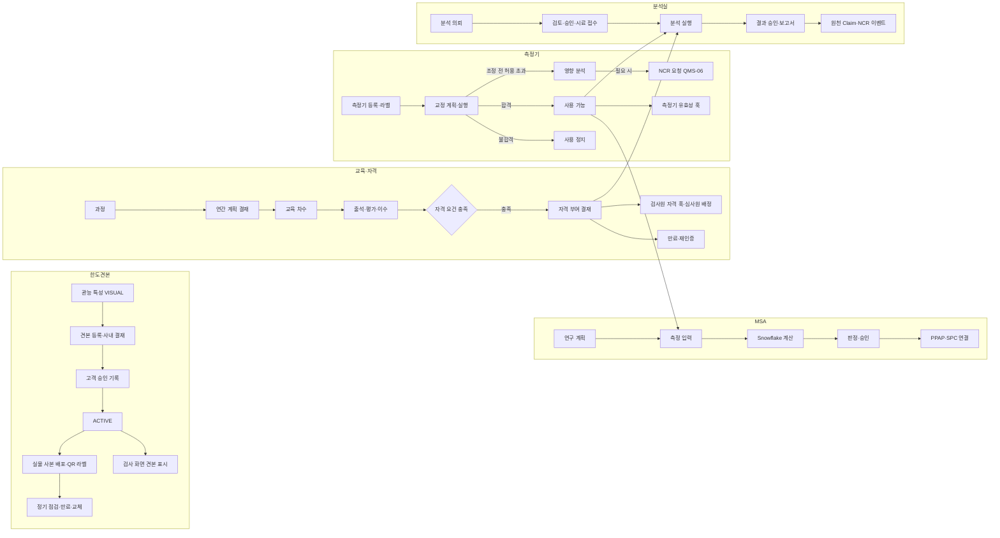

# SL QMS 워크아이템 Vol.6b — QMS-06 품질 운영 지원: 한도견본·교육/자격·측정기·MSA·분석실

Nov 1, 2026 · @배창욱

## 1. 개요

Vol.6b는 QMS RFP 품질 운영 지원 모듈 중 **Q-23 한도 설정/운영, Q-24 품질 교육/자격, Q-25 측정기, Q-26 MSA, Q-27 분석실**을 21개 워크아이템으로 내린다. 다섯 기능은 모두 "판정을 믿을 수 있는가"를 떠받치는 기반이다. 무엇을 기준으로(한도견본), 누가(자격 있는 검사원·심사원), 무엇으로(교정된 측정기), 얼마나 정확하게(MSA) 쟀는지, 그리고 원인 분석에 쓰는 재료 분석(분석실)을 관리한다. Vol.6은 6a(4M·NCR), 6b(이 문서), 6c(협력사 실적·개선·심사)로 나뉜다.

| 기능코드 | 기능 | RFP | WI | 핵심 |
| --- | --- | --- | --- | --- |
| LMS | 한도견본 | Q-23 | 3 | 관능 항목 판정 조건·한도견본 등록·개정·고객 승인, 실물 사본 보관·점검·교체, 검사 화면 연결 |
| TRN | 교육·자격 | Q-24 | 4 | 과정·연간 계획·실행·평가, 자격 유형·인증·매트릭스·재인증, 자격 검증 서비스·검사 훅 |
| GAU | 측정기 | Q-25 | 5 | 등록·라벨, 교정 계획·실행·판정, 사용 통제·수리·분실·폐기, 교정 불합격 영향 분석, 기존 시스템 이관·연계 |
| MSA | MSA | Q-26 | 5 | 연구 계획, 측정 입력, Gage R&R, 편의·직선성·안정성·계수형 일치성, 승인·연결 |
| LAB | 분석실 | Q-27 | 4 | 분석 항목(실험실 범위), 의뢰·승인·접수, 실행·결과·보고서, 정기 분석·처리 기간 KPI |

**도메인 정의**

- **한도견본(Limit Sample)**: 긁힘·이물·흐림·코팅 얼룩·웰드라인처럼 눈으로 판정하는 관능 특성의 합격 한계를 실물 샘플로 정하고 고객과 합의한 기준이다. "여기까지 합격(OK 한계)"과 "이것부터 불합격(NG)" 견본을 한 세트로 쓰고, 조명·거리·관찰 시간 같은 판정 조건을 함께 정한다. 사진은 참고용이고 판정 기준은 실물이다. 실물은 변색·손상되므로 유효기간과 정기 점검이 필요하다(IATF 16949 8.6.3 외관 품목 요구).
- **교육·자격**: 검사원·심사원 같은 품질 업무 수행자가 정해진 교육·경력·평가를 거쳐 자격을 받고, 유효기간 안에서만 그 업무를 하게 하는 체계다(IATF 16949 7.2 역량, 7.2.3 내부 심사원, 7.2.4 2자 심사원). 외관 검사원은 시력·색각 확인을 자격 요건에 포함한다.
- **측정기**: 캘리퍼·마이크로미터 같은 범용 측정기, 품번 전용 검사구(Checking Fixture), 기밀·배광·내전압 시험기, 분석 장비, 3차원 측정기를 말한다. 정해진 주기로 교정하고, 교정 시 조정 전 상태가 허용 범위를 벗어났으면 그 측정기로 낸 이전 판정의 유효성을 다시 평가한다(IATF 16949 7.1.5.2.1). 외부 교정은 ISO/IEC 17025 인정 기관을 원칙으로 한다(7.1.5.3.2).
- **MSA(Measurement System Analysis)**: 측정값의 흩어짐 중 측정 시스템(측정기·사람·방법) 때문에 생긴 몫을 평가한다. 정밀도는 Gage R&R(반복성·재현성), 정확도는 편의·직선성·안정성, 합불 판정 검사는 계수형 일치성으로 본다. 계산은 Snowflake에서 하고 Minitab 결과와 대조해 검증한다.
- **분석실**: 부품·반제품·제품의 구조·성분·열·형상·경도·마모·결정화도 등을 분석하는 사내 실험실이다. 분석 항목 목록이 곧 실험실 범위(IATF 16949 7.1.5.3.1)이며, 의뢰 → 검토 → 승인 → 실행 → 결과 보고로 처리한다. 신뢰성·환경 시험(인정시험, Vol.2)과는 별도 업무다.

**선행 공통 WI**: ARC-002·003, MDM-001·002·004·006·007, SEC-001·002·003, I18N-001, UX-001·003, APV-001·002, TDO-001, NTF-001, DOC-001, INT-001·002, DWH-002·003·004.

**다른 메뉴와의 경계**

| 연결 대상 | 이 Vol.이 하는 것 | 상대 메뉴가 하는 것 |
| --- | --- | --- |
| 수입검사·출하검사·인정시험 (QMS-03-IQC, QMS-04-FQC, QMS-02-DVQ) | 한도견본 조회 서비스·LWC `qmsLimitSampleLink`, 검사 훅 구현(측정기 유효성 validateGauge, 검사원 자격 validateInspector) 등록 | 검사 화면에 컴포넌트 배치, 훅 호출, 결과에 측정기 번호 기록 |
| 심사 (QMS-06-IAU·SAU·CAU, Vol.6c) | 심사원 자격 유형(AUDITOR_SYSTEM, AUDITOR_PROCESS, AUDITOR_PRODUCT, AUDITOR_VDA63, AUDITOR_SUPPLIER), 게이트웨이 바인딩 AUDITOR_QUALIFICATION 구현, `recordActivity`, 심사 증빙 제공자 EV-TRAINING·EV-GAUGE-CAL | 심사원 배정 시 바인딩으로 자격 조회, 심사 완료 시 활동 실적 기록, 증빙 패널에서 제공자 호출 |
| PPAP (QMS-03-PPA, QMS-04-RPP) | MSA 증빙 수집기 `QMS_MsaPpapEvidenceCollector` 구현과 `QMS_PpapCollector__mdt` 등록(MSA-005 BR-9), MSA 보고서 문서 | 증빙 수집 실행·채택(QMS-04-RPP-002 구조, 부품 PPAP도 같은 수집기) |
| SPC (QMS-04-SPC) | MSA 연구·결과의 Snowflake 복제(DWH-002 15분 `CORE.SF_QMS_MSASTUDY`, 계산 이력 `ML.MSA_RESULT`) | Snowflake 복제 데이터로 관리도 화면에 MSA 결과 표시(이벤트 구독 없음) |
| 부적합 (QMS-06-NCR, Vol.6a) | 교정 불합격 영향 분석에서 게이트웨이 바인딩 NCR의 `requestNcr`(sourceType GAUGE_IMPACT) 호출, 분석 의뢰 게이트웨이 구현(바인딩 LAB_REQUEST) | NCR 생성·처리, 바인딩 LAB_REQUEST로 불량품 분석 의뢰 |
| 고객 클레임 (QMS-05-CLM) | 분석 의뢰 게이트웨이 구현(바인딩 LAB_REQUEST), 분석 완료 이벤트 | 바인딩 LAB_REQUEST로 반품 분석 의뢰, 결과 이벤트 구독 |
| 인정시험 시험실 (QMS-02-DVQ-006) | 재료·성분·물성 분석 의뢰는 LAB 객체·대기열로 처리 | 신뢰성·환경·광학 시험은 DVQ 계획 라인·`qmsLabQueue`로 처리 |
| 연계 (QMS-09) | 측정기 시스템 수신 계약(IF-GAU-001), MSA 계산 프로시저 호출 경로 요구 | Mule 구현 |
| 대시보드 (QMS-07) | KPI 키(3절) | 위젯 |

**앞 Vol. 상태**: Vol.0·2·3은 검토 대기다. 결정 대기 항목은 권고안을 가정했다(Vol.0 D-3 Multi-Currency 활성화 가정으로 비용 필드는 Currency 타입). 검사 훅은 Vol.3 IQC-003의 인터페이스·등록 구조를 그대로 쓴다.

## 2. 업무 흐름

다섯 기능은 서로 검증한다. 교정이 유효한 측정기만 검사·MSA·분석에 쓸 수 있고(GAU-003), 자격이 유효한 사람만 검사·분석·교정을 판정할 수 있다(TRN-004). 계수형 일치성 연구(MSA-004) 결과는 외관 검사원 자격 요건으로 다시 들어간다. 검사 화면은 이 결과를 검사 훅으로만 받으며, 이 Vol.이 다른 메뉴의 검사 레코드를 직접 바꾸지 않는다.

## 3. 데이터 모델 개요

**객체**

| 객체 | 구분 | 관계 | 역할 | 정의 WI |
| --- | --- | --- | --- | --- |
| QMS_LimitSample__c | 설정 | Item, Characteristic, Plant, Customer, Supplier(Lookup) | 한도견본 세트(버전) | LMS-001 |
| QMS_LimitSampleView__c | 설정 | LimitSample(MD) | 견본 이미지 항목(OK 한계·NG·양품 기준) | LMS-001 |
| QMS_LimitSampleCopy__c | 업무 | LimitSample(MD), Plant, Line, Supplier(Lookup) | 실물 사본(보관·배포 위치) | LMS-002 |
| QMS_LimitSampleCheck__c | 업무 | Copy(MD) | 정기 점검 기록 | LMS-002 |
| QMS_TrainingCourse__c | 설정 | OwnerDept(Lookup) | 교육 과정(버전) | TRN-001 |
| QMS_TrainingPlan__c | 업무 | Plant, Department(Lookup) | 연간 교육 계획 | TRN-001 |
| QMS_TrainingSession__c | 업무 | Course, Plan(Lookup) | 교육 차수 | TRN-001 |
| QMS_TrainingAttendance__c | 업무 | Course, Session, Employee(Lookup) | 출석·평가·이수 기록 | TRN-002 |
| QMS_QualificationType__c / QMS_QualificationRequirement__c | 설정 | Requirement → Type(MD), Course(Lookup) | 자격 유형과 필수 과정 | TRN-003 |
| QMS_Qualification__c | 업무 | Employee, QualificationType, Plant(Lookup) | 개인 자격 | TRN-003 |
| QMS_Gauge__c | 마스터 | Plant, Line, Department, Item, OwnerAccount(Lookup) | 측정기·검사구·시험기·분석 장비 | GAU-001 |
| QMS_Calibration__c | 업무 | Gauge(MD) | 교정 계획·실행·결과 | GAU-002 |
| QMS_GaugeStatusChange__c | 업무 | Gauge(MD) | 상태 변경·수리·분실·폐기 이력 | GAU-003 |
| QMS_GaugeImpactAnalysis__c | 업무 | Gauge, Calibration(Lookup) | 교정 불합격 영향 분석 | GAU-004 |
| QMS_MsaSchedule__c | 설정 | Characteristic, Gauge(Lookup) | MSA 연구 계획(주기) | MSA-001 |
| QMS_MsaStudy__c / QMS_MsaAppraiser__c | 업무 | Appraiser → Study(MD), Gauge, Characteristic(Lookup) | MSA 연구와 평가자 | MSA-002 |
| QMS_LabAnalysisItem__c | 설정 | Plant(Lookup) | 분석 항목(실험실 범위) | LAB-001 |
| QMS_LabRequest__c / QMS_LabRequestItem__c | 업무 | Item → Request(MD), AnalysisItem, Equipment(QMS_Gauge__c Lookup) | 분석 의뢰와 항목별 결과 | LAB-001 |
| QMS_LabSchedule__c | 설정 | Item, Plant(Lookup) | 정기 분석 일정 | LAB-004 |

분석 장비는 별도 장비 객체를 만들지 않고 `QMS_Gauge__c`(Category LAB_INSTRUMENT)로 관리해 교정 통제를 그대로 적용한다(D6B-5).

**상태값**

| 대상 | 값(순서) |
| --- | --- |
| QMS_LimitSample__c.Status__c | DRAFT → APPROVAL → (CUSTOMER_PENDING) → ACTIVE → SUPERSEDED / OBSOLETE |
| QMS_LimitSampleCopy__c.Status__c | ACTIVE → DAMAGED / EXPIRED / RECALLED → RETIRED |
| QMS_TrainingPlan__c.Status__c | DRAFT → APPROVAL → APPROVED → CLOSED |
| QMS_TrainingSession__c.Status__c | PLANNED → OPEN → IN_PROGRESS → COMPLETED / CANCELLED |
| QMS_TrainingAttendance__c.Status__c | REGISTERED → ATTENDED / ABSENT → PASSED / FAILED · 외부 이수는 PENDING_VERIFY → PASSED / FAILED |
| QMS_Qualification__c.Status__c | CANDIDATE → PENDING_APPROVAL → QUALIFIED → EXPIRED · SUSPENDED(해제 시 QUALIFIED) · REVOKED |
| QMS_Gauge__c.Status__c | REGISTERED → ACTIVE ↔ SUSPENDED ↔ IN_REPAIR · LOST · DISPOSED |
| QMS_Calibration__c.Status__c / Result__c | PLANNED → SENT → IN_PROGRESS → DONE / CANCELLED · PASS / PASS_ADJUSTED / FAIL |
| QMS_GaugeImpactAnalysis__c.Status__c | OPEN → ANALYZED → CLOSED |
| QMS_MsaStudy__c.Status__c / Verdict__c | DRAFT → MEASURING → CALCULATED → APPROVAL → APPROVED → OBSOLETE(반려 시 CALCULATED) · ACCEPTABLE / CONDITIONAL / UNACCEPTABLE |
| QMS_LabRequest__c.Status__c | DRAFT → SUBMITTED → (APPROVAL) → ACCEPTED → IN_ANALYSIS → RESULT_REVIEW → COMPLETED · RETURNED · CANCELLED |

**권한 셋과 페르소나 매핑**(각 WI가 PS를 만들고 SEC-001 BR-2에 따라 PSG에 추가)

| Permission Set | 내용 | PSG |
| --- | --- | --- |
| QMS_PS_LimitSample_Read | 한도견본·사본 조회 | Inspector, Viewer, QualityEngineer, SupplierQuality, QualityManager |
| QMS_PS_LimitSample_Edit | 견본 등록·개정·사본·점검 | QualityEngineer, SupplierQuality |
| QMS_PS_Portal_LimitSample | 협력사: 자기 부품 견본 조회, 자사 보관 사본 점검 입력 | SupplierPortal |
| QMS_PS_Training_Read | 과정·세션 조회, 본인 이력 조회 | 모든 QMS PSG |
| QMS_PS_Training_Admin | 과정·계획·세션·출석·점수·자격 관리 | TrainingCoordinator(신규), QualityAdmin |
| QMS_PS_Qualification_Read | 자격·매트릭스 조회 | QualityEngineer, QualityManager, Auditor, SupplierQuality |
| QMS_PS_Gauge_Read | 측정기·교정 이력 조회, QR 확인 | Inspector, QualityEngineer, LabTester, Viewer |
| QMS_PS_Gauge_Edit | 등록·이동·교정 계획·실행·수리·분실 | Metrology(신규) |
| QMS_PS_Gauge_Admin | 수동 정지·해제, 영향 분석 판정, 이관·연계 설정 | Metrology(METROLOGY_LEAD Role 병행), QualityAdmin |
| QMS_PS_Msa_Read / QMS_PS_Msa_Edit | MSA 조회 / 계획·연구·입력·계산·상신 | 조회: QualityManager, Viewer, Auditor · 편집: QualityEngineer, Metrology |
| QMS_PS_Lab_Request | 분석 의뢰 생성·자기 부서 의뢰 조회 | Viewer, QualityEngineer, SupplierQuality, DevEngineer |
| QMS_PS_Lab_Analyst | 접수·배정·실행·결과 입력 | LabTester |
| QMS_PS_Lab_Admin | 분석 항목·정기 일정 관리 | LabTester(분석실 책임자), QualityAdmin |

결재 권한은 APPROVAL_ROLE(QUALITY_MANAGER, QM_HEAD, METROLOGY_LEAD 측정기 관리 책임, LAB_MANAGER 분석실 책임자, LAB_RECEIVER 접수자, TRAINING_COORDINATOR 공장 교육 담당)으로 판정한다. 신규 Role과 PSG는 Vol.0 변경 요청이다.

**다른 WI·메뉴가 쓰는 서비스와 이벤트**

| 이름 | 종류 | 제공 WI | 사용처 |
| --- | --- | --- | --- |
| QMS_LimitSampleService.getActive, qmsLimitSampleLink | Apex, LWC | LMS-003 | QMS-03-IQC-003, QMS-02-DVQ-007, QMS-04-FQC |
| QMS_QualificationService.isQualified / isUserQualified / findQualified / recordActivity | Apex | TRN-004 | GAU-002, LAB-003, MSA-004, Vol.6c(recordActivity만 직접 호출) |
| QMS_QualificationGatewayImpl | 게이트웨이 구현(바인딩 AUDITOR_QUALIFICATION) | TRN-004 | Vol.6c IAU·SAU·CAU |
| QMS_TrnAuditEvidenceProvider, QMS_GauAuditEvidenceProvider | QMS_AuditEvidenceProvider 구현(EV-TRAINING, EV-GAUGE-CAL) | TRN-004, GAU-004 | Vol.6c IAU-005, CAU |
| QMS_TrnInspectorHookIqc / QMS_TrnInspectorHookFqc | QMS_InspectionHook 구현 | TRN-004 | QMS-03-IQC-003, QMS-04-FQC |
| QMS_GaugeService.getUsability / suspend / release | Apex | GAU-003 | LAB-003, MSA-002, QMS-04-FQC·SPC |
| QMS_GauGaugeHook | QMS_InspectionHook 구현 | GAU-003 | QMS-03-IQC-003, QMS-04-FQC |
| QMS_GaugeEvent__e | Platform Event | GAU-002·003 | MSA-001, QMS-09 |
| QMS_MsaService.getStatus | Apex | MSA-005 | MSA 수집기, 측정기 패널 |
| QMS_MsaPpapEvidenceCollector | QMS_PpapEvidenceCollector 구현(QMS_PpapCollector__mdt 등록) | MSA-005 | QMS-04-RPP-002, QMS-03-PPA(부품 PPAP MSA 요소) |
| QMS_MsaEvent__e | Platform Event | MSA-005 | 구독 요구 없음(다른 메뉴는 Snowflake 복제 데이터 사용) |
| QMS_LabRequestService.createFromSource / getStatusBySource | Apex | LAB-002 | LAB-004, QMS_LabGatewayImpl(같은 Vol. 내부만) |
| QMS_LabGatewayImpl | 게이트웨이 구현(바인딩 LAB_REQUEST) | LAB-002 | QMS-05-CLM, QMS-06-NCR·4MC |
| QMS_LabRequestEvent__e | Platform Event | LAB-003 | QMS-05-CLM, QMS-06-NCR |
| CORE.MSA_MEASUREMENT, ML.MSA_RESULT, ML.MSA_CONSTANT, ML.SP_MSA_CALC | Snowflake | MSA-003·004 | — |
| DWH-004 QueryKey QMS_GAU_IMPACT_RESULTS, QMS_MSA_GAUGE_USAGE, QMS_MSA_CALC | Snowflake 등록 쿼리 | GAU-004, MSA-001, MSA-003 | — |

**KPI 키**(Vol.7 위젯이 소비, 계산은 모두 Snowflake → DWH-003)

| KpiKey | 정의 | 주기 | 차원 | 계산 위치(뷰, WI) |
| --- | --- | --- | --- | --- |
| QMS_LMS_CHECK_ONTIME | 기한 내 완료한 사본 점검 / 기한 도래 점검, % | 월 | Plant | MART.V_SF_KPI_LMS, LMS-002 |
| QMS_LMS_EXPIRED_IN_USE | EXPIRED·DAMAGED인데 RETIRED되지 않은 사본 수 | 일 | Plant | MART.V_SF_KPI_LMS, LMS-002 |
| QMS_LMS_COVERAGE | ACTIVE VISUAL 특성 중 ACTIVE 견본 보유 비율, % | 월 | Plant | MART.V_SF_KPI_LMS, LMS-002 |
| QMS_TRN_PLAN_RATE | 계획 세션 중 COMPLETED 비율(CANCELLED 포함 분모), % | 월 | Plant(Department는 Vol.0 DWH-003 변경 대기, 주석 참조) | MART.V_SF_KPI_TRN, TRN-003 |
| QMS_TRN_QUAL_EXPIRING | 90일 안에 만료되는 QUALIFIED 자격 수 | 일 | Plant | MART.V_SF_KPI_TRN, TRN-003 |
| QMS_TRN_QUAL_SHORTAGE | 최소 자격자 수 미달 (공장, 자격 유형) 조합 수 | 일 | Plant | MART.V_SF_KPI_TRN, TRN-003 |
| QMS_GAU_CAL_ONTIME | 기한 안에 DONE된 교정 / 기한 도래 교정, % | 월 | Plant | MART.V_SF_KPI_GAU, GAU-002 |
| QMS_GAU_OVERDUE | 교정 기한 경과로 SUSPENDED인 측정기 수 | 일 | Plant | MART.V_SF_KPI_GAU, GAU-002 |
| QMS_GAU_ASFOUND_OOT_RATE | DONE 교정 중 조정 전 허용 초과 비율, % | 월 | Plant | MART.V_SF_KPI_GAU, GAU-002 |
| QMS_MSA_ACCEPT_RATE | APPROVED 연구 중 ACCEPTABLE 비율, % | 월(분기 합산 표시) | Plant | MART.V_SF_KPI_MSA, MSA-005 |
| QMS_MSA_COVERAGE | CC·SC·SPC 대상 ACTIVE 특성 중 유효 MSA 보유 비율, % | 월 | Plant | MART.V_SF_KPI_MSA, MSA-005 |
| QMS_MSA_OVERDUE | NextDueDate 경과·유효 연구 없는 계획 수 | 일 | Plant | MART.V_SF_KPI_MSA, MSA-005 |
| QMS_LAB_TAT | 시료 접수~COMPLETED 평균 일수 | 월 | Plant | MART.V_SF_KPI_LAB, LAB-004 |
| QMS_LAB_ONTIME | RequiredDate 안에 COMPLETED된 비율, % | 월 | Plant | MART.V_SF_KPI_LAB, LAB-004 |
| QMS_LAB_BACKLOG | ACCEPTED·IN_ANALYSIS·RESULT_REVIEW 의뢰 수 | 일 | Plant | MART.V_SF_KPI_LAB, LAB-004 |

KPI 표 주석: QMS_TRN_PLAN_RATE의 부서 차원은 CMN_KpiValue__c에 Department__c 차원이 없어서 Vol.0 DWH-003 변경(9절 Vol.0 변경 요청)을 기다리는 상태다. 반영 전에는 `MART.V_SF_KPI_TRN`이 부서별 값을 계산해 Snowflake에만 두고, Salesforce에는 Plant 단위 값만 적재한다(TRN-003 BR-9). QMS_GAU_OVERDUE는 SuspendReason CAL_OVERDUE로 정지된 측정기만 센다. 교정 불합격·손상 등 모든 사용 정지 측정기 수는 KPI가 아니라 QMS_Gauge__c.Status__c = SUSPENDED 실시간 집계로 본다.

**화면 API명**(Vol.7 대시보드 드릴다운 등록용, 각 WI가 이 이름으로 만든다)

| 화면 | 종류·API명 | 정의 WI |
| --- | --- | --- |
| 교정 계획 | Lightning App Page `QMS_CalibrationPlan`(qmsCalibrationPlanner) | GAU-002 |
| 측정기 목록 | 탭 QMS_Gauge__c, 리스트뷰 `QMS_CalOverdue`(SuspendReason CAL_OVERDUE) | GAU-001 |
| MSA 계획 | Lightning App Page `QMS_MsaPlan`(qmsMsaCandidate, qmsMsaScheduleCalendar) | MSA-001 |
| MSA 목록 | 탭 QMS_MsaStudy__c, 리스트뷰 `QMS_RecentApproved` | MSA-005 |
| 자격 매트릭스 | Lightning App Page `QMS_QualificationMatrix`(qmsQualificationMatrix) | TRN-003 |
| 교육 계획·일정 | 탭 QMS_TrainingPlan__c 리스트뷰 `QMS_CurrentYear`, Lightning App Page `QMS_TrainingSchedule`(qmsTrainingSessionCalendar) | TRN-001 |
| 분석 대기열 | Lightning App Page `QMS_LabWorkbench`(qmsLabWorkbench) | LAB-003 |
| 견본 목록 | 탭 QMS_LimitSample__c, 리스트뷰 `QMS_Active` | LMS-001 |
| 견본 사본·점검 목록 | 탭 QMS_LimitSampleCopy__c, 리스트뷰 `QMS_CheckDue`(NextCheckDate 7일 이내), `QMS_ExpiredOrDamaged`(EXPIRED·DAMAGED) | LMS-002 |

**공통 기반 등록(각 업무 객체 WI에서 수행)**: 채번(ARC-003), CMN_SharingConfig(Plant__c, 협력사 공개 객체는 SupplierField도), CMN_DeleteGuard, CMN_StatusFlow, 필드 이력, DWH 복제(DWH-002), ko·en·zh 번역. 채번 규칙: LS-{PLANT}-{YYYY}-{SEQ:5}(한도견본), TS-{PLANT}-{YYYY}-{SEQ:4}(교육 차수), QF-{PLANT}-{YYYY}-{SEQ:5}(자격), GA-{PLANT}-{SEQ:6}(측정기, 초기화 없음), CAL-{PLANT}-{YYYY}-{SEQ:6}(교정), GIA-{PLANT}-{YYYY}-{SEQ:4}(영향 분석), MSAS-{PLANT}-{SEQ:5}(MSA 계획, 초기화 없음), MSA-{PLANT}-{YYYY}-{SEQ:5}(MSA 연구), LAB-{PLANT}-{YYYY}-{SEQ:5}(분석 의뢰), LABS-{PLANT}-{SEQ:5}(정기 분석 일정, 초기화 없음).

**데이터량 가정**(SL 확인 전): 측정기 공장당 2,000~5,000대, 7개 공장 합계 1.5만~3.5만 대, 교정 연 2만~4만 건. 교육 이수 기록은 현장 인원 포함 연 2만~5만 건, 자격 1만~2만 건. MSA 연구 연 1,000~2,000건(측정값 연 10만~20만 개 — 레코드로 만들지 않고 JSON + Snowflake). 분석 의뢰 연 2,000~5,000건. 한도견본 1,000~3,000 세트, 실물 사본 5,000~1만 개. 모두 Salesforce 레코드로 감당 가능한 규모다.

## 4. 한도견본 (LMS)

관능 검사 항목은 MDM-006 특성(CharType VISUAL)으로 정의하고, 그 특성의 합격 한계를 한도견본으로 관리한다. 검사 화면은 특성 Id로 견본을 찾는다. 같은 VISUAL 특성(예: "렌즈 외관")에 불량 유형별(이물, 흐림, 긁힘) 견본이 여러 개 있을 수 있으므로 견본의 키는 (특성, 공장, 불량 유형)이다.

### QMS-06-LMS-001 관능 검사 조건·한도견본 등록·개정·고객 승인

추적 Q-23 · 필수 · W2 · SF · DM, APEX, LWC · Customization · 선행 MDM-004, MDM-006, MDM-007, DOC-001, APV-001, APV-002, ARC-003 · 6 M/D

**목적**: 렌즈 흐림, 코팅 얼룩, 이물, 웰드라인처럼 눈으로 판정하는 항목은 숫자 규격이 없어 검사원마다 판정이 갈린다. 불량 유형별 합격 한계를 판정 조건·사진·실물로 정의하고 사내 결재와 고객 승인 이력을 남겨, 모든 공정·협력사가 같은 기준으로 판정하게 한다.

**범위** In: 판정 조건(조명·거리·시간·각도·외관 구역), 한도견본 세트와 이미지 항목, 버전 관리, 사내 결재, 고객 승인 기록, 특성 개정 연동. Out: 실물 사본·점검·교체(LMS-002), 검사 화면 연결·포털 조회(LMS-003), 특성 자체 정의(MDM-006), 외관 검사원 자격(TRN-003).

**데이터 모델**

| 객체 / 필드 | 타입 | 필수 | 설명 |
| --- | --- | --- | --- |
| QMS_LimitSample__c.RecordNo__c | Text(40), Unique | Y | LS-{PLANT}-{YYYY}-{SEQ:5}. 버전이 바뀌어도 같은 번호 유지(BR-5) |
| QMS_LimitSample__c.Name | Text(80) | Y | "{품번} {특성명} {불량 유형} 한도견본" 자동, 수정 가능 |
| QMS_LimitSample__c.Item__c | Lookup(CMN_Item__c) | Y | |
| QMS_LimitSample__c.Characteristic__c | Lookup(CMN_Characteristic__c, 같은 Item·CharType VISUAL·ACTIVE 필터) | Y | |
| QMS_LimitSample__c.Plant__c | Lookup(CMN_Plant__c) | Y | 관리 공장, 공유 기준 |
| QMS_LimitSample__c.DefectCode__c | Lookup(CMN_Code__c, DEFECT_TYPE 리프) | Y | 대상 불량 유형 |
| QMS_LimitSample__c.DefectPath__c | Text(255) | — | 코드 Path 사본(표시·검색용) |
| QMS_LimitSample__c.Customer__c | Lookup(Account, 고객 RT) | CustomerApprovalRequired면 Y | 승인 고객 |
| QMS_LimitSample__c.Supplier__c | Lookup(Account, 협력사 RT) | N | 구매 부품 견본이면 공급 협력사(협력사 공유 기준) |
| QMS_LimitSample__c.Version__c | Number(3,0) | Y | 1부터 |
| QMS_LimitSample__c.Status__c | 3절 상태값 | Y | |
| QMS_LimitSample__c.InspectionZone__c | Picklist (A 주요 시인 영역, B 보조 시인 영역, C 비시인 영역, ALL 전체) | Y | 헤드램프 외관 구역 |
| QMS_LimitSample__c.AcceptCriteria__c | Long Text(4000) | Y | 합격 기준 서술(예: "A영역 이물 직경 0.3mm 이하 1개 허용, 100mm 내 2개 이상 불가") |
| QMS_LimitSample__c.MaxSizeMm__c / MaxCount__c | Number(6,2) / Number(3,0) | N | 정량 보조 기준(있으면 검사 화면에 강조) |
| QMS_LimitSample__c.LightingLux__c | Text(40) | Y | 조도 범위(예: 1000~1500 lx) |
| QMS_LimitSample__c.LightSource__c | Text(80) | N | 광원 종류(예: D65 표준광원) |
| QMS_LimitSample__c.ViewDistanceMm__c | Number(5,0) | Y | 관찰 거리 |
| QMS_LimitSample__c.ViewTimeSec__c | Number(3,0) | Y | 면당 관찰 시간 |
| QMS_LimitSample__c.ViewAngle__c | Text(80) | N | 관찰 각도(예: 정면·45도 회전) |
| QMS_LimitSample__c.CustomerApprovalRequired__c | Checkbox | Y | 고객 승인 필요 여부(Customer.AuditStandard·CSR 기준으로 작성자 판단) |
| QMS_LimitSample__c.CustomerApprovalDate__c / CustomerApproverName__c / CustomerApprovalRef__c | Date / Text(120) / Text(80) | CUSTOMER_PENDING → ACTIVE 시 Y | 고객 승인일·승인자·근거 번호 |
| QMS_LimitSample__c.ValidMonths__c | Number(3,0) | Y | 실물 유효기간(기본 CMN 설정 QMS_LMS_DEFAULT_VALID_MONTHS = 12) |
| QMS_LimitSample__c.CheckIntervalDays__c | Number(3,0) | Y | 실물 정기 점검 주기(기본 CMN 설정 QMS_LMS_DEFAULT_CHECK_DAYS = 90) |
| QMS_LimitSample__c.EffectiveFrom__c | Date | ACTIVE면 Y | ACTIVE 전환일 자동 |
| QMS_LimitSample__c.PreviousVersion__c / SupersededBy__c | Lookup(self) | N | 버전 체인 |
| QMS_LimitSample__c.ChangeReason__c | Text(500) | Version ≥ 2면 Y | 개정 사유 |
| QMS_LimitSample__c.NeedsReview__c | Checkbox | N | 특성 개정 후 재검토 필요(BR-6) |
| QMS_LimitSampleView__c.LimitSample__c | Master-Detail | Y | |
| QMS_LimitSampleView__c.ViewType__c | Picklist (OK_LIMIT 합격 한계, NG 불합격, REFERENCE 양품 기준) | Y | |
| QMS_LimitSampleView__c.Sequence__c | Number(3,0) | Y | 표시 순서 |
| QMS_LimitSampleView__c.Description__c | Text(255) | Y | 예: "A영역 이물 0.3mm, 합격 한계" |
| QMS_LimitSampleView__c.PhotoCondition__c | Text(255) | N | 촬영 조명·각도·배율 |
| QMS_LimitSampleView__c.HasPhoto__c | Checkbox | — | 서비스가 사진 등록 시 true |

사진은 이미지 항목 1건당 CMN_Document 1건(부모 = QMS_LimitSampleView__c, DocClass LIMIT_SAMPLE_PHOTO)으로 둔다. DOC-001 BR-1에 따라 같은 부모·같은 DocClass에 다시 올리면 리비전이 되므로, 사진 여러 장은 이미지 항목 여러 개로 표현한다.

**비즈니스 규칙**

- BR-1: 키 — (Characteristic, Plant, DefectCode) 조합의 ACTIVE 견본은 1개다. 같은 키로 다른 견본을 활성화하려 하면 차단한다(같은 버전 체인의 새 버전은 BR-5로 처리).

- BR-2: 상신 전 검증 — OK_LIMIT 이미지 항목 1개 이상, NG 이미지 항목 1개 이상, 모든 이미지 항목에 사진 존재(HasPhoto), 판정 조건(LightingLux, ViewDistanceMm, ViewTimeSec) 입력. 사진은 원본 해상도로 저장하되 파일당 20MB 이하(DOC-001 50MB 제한 안에서 별도 상한), 화면 표시는 LMS-003의 썸네일을 쓴다.

- BR-3: 사내 결재 — 결재 유형 QMS_LMS_APPROVE(LockOnSubmit = true). 기본 결재선: 기안(품질 엔지니어) → 공장 QUALITY_MANAGER 승인. Supplier__c가 있으면 SQ_MANAGER 합의 단계를 결재선 기여 인터페이스(CMN_ApprovalLineContributor)로 추가한다. onApproved: CustomerApprovalRequired면 CUSTOMER_PENDING, 아니면 ACTIVE. onRejected·onRecalled: DRAFT.

- BR-4: 고객 승인 기록 — CUSTOMER_PENDING 상태에서 "고객 승인 등록" 액션: 승인일·승인자·근거 번호 입력 + 고객 서명 견본 라벨 사진 또는 고객 승인 문서(DocClass LIMIT_SAMPLE_CUSTOMER_APPROVAL, 부모 = 견본) 필수 → ACTIVE. "고객 반려" 액션은 사유(UX-003 코멘트 자동 기록)와 함께 DRAFT로 되돌린다. CUSTOMER_PENDING이 30일 넘으면 Owner에게 매주 알림 QMS_LMS_CUSTOMER_PENDING.

- BR-5: 개정 — ACTIVE 견본의 판정 조건·기준·이미지는 수정할 수 없다(FLS가 아니라 서비스·Validation으로 차단). "새 버전" 액션: 같은 RecordNo, Version + 1, PreviousVersion 연결, 필드·이미지 항목 복사로 DRAFT 생성. 사진은 "이전 사진 재사용"을 고르면 같은 ContentVersion으로 새 이미지 항목의 리비전을 만든다(DOC-001 해시 경고는 같은 버전 체인이면 표시하지 않음). 새 버전이 ACTIVE가 되는 순간 이전 버전은 SUPERSEDED, SupersededBy 설정, LMS-002 BR-6 사본 회수가 시작된다.

- BR-6: 특성 개정 연동 — CMN_Characteristic__c가 새 버전으로 바뀌면(MDM-006 BR-3, 구 버전 EffectiveTo 설정) ARC-002 트리거 프레임워크에 등록한 QMS 핸들러가 구 특성을 가리키는 ACTIVE·CUSTOMER_PENDING 견본의 Characteristic__c를 같은 Item·CharNo의 새 ACTIVE 특성으로 다시 연결하고 NeedsReview = true, Owner에게 To-Do "한도견본 재검토: 특성 개정 {CharNo}"(SourceType QMS_LMS_REVIEW)를 연다. 재연결은 검사 화면이 끊기지 않게 하기 위한 것이며, 판단은 Owner가 "재검토 완료"(NeedsReview = false) 또는 "새 버전"으로 한다.

- BR-7: 폐기 — 특성이 대체 없이 OBSOLETE가 되거나 품번이 모든 공장에서 PHASE_OUT이면 Owner에게 To-Do "한도견본 폐기 검토". Owner가 OBSOLETE 처리(사유 필수)하면 LMS-002 BR-6 회수가 시작된다.

- BR-8: 공통 기반 — 채번 LS-{PLANT}-{YYYY}-{SEQ:5}(버전 생성 시 재발번 없음), CMN_SharingConfig(PlantField Plant__c, SupplierField Supplier__c: 협력사는 자기 부품 견본 Read), CMN_DeleteGuard(DRAFT만 삭제), CMN_StatusFlow, 필드 이력(Status, Version, AcceptCriteria, InspectionZone, CustomerApprovalDate, Characteristic), DWH 복제 일 1회, 번역(ko·en·zh).

**화면/UX**

| 컴포넌트 | 위치 | 기능 |
| --- | --- | --- |
| qmsLimitSampleEditor | 견본 레코드 페이지 | 기본 정보·판정 조건 입력, 이미지 항목 그리드(유형별 열 OK_LIMIT·NG·REFERENCE, 드래그 순서, 사진 업로드·모바일 카메라 촬영), "검사 화면 미리보기"(LMS-003 모달과 같은 모습) |
| cmnApprovalLine, cmnStatusPath, cmnCommentTimeline | 견본 레코드 페이지 | 결재·상태·코멘트(Vol.0) |
| 리스트뷰 | 탭 | 품번·특성·불량 유형·상태·만료 예정 사본 수 필터 |

**권한**: QMS_PS_LimitSample_Edit(작성·개정·고객 승인 등록), QMS_PS_LimitSample_Read(조회), 결재는 APV Role.

**수용 기준**

- AC-1: Given CharType VARIABLE 특성, When 견본 Characteristic__c로 지정해 저장, Then Lookup 필터와 서버 검증으로 차단.

- AC-2: Given OK_LIMIT 이미지 항목에 사진 없음, When 상신, Then 차단 + 누락 항목 표시.

- AC-3: Given CustomerApprovalRequired = true, When 사내 결재 승인, Then CUSTOMER_PENDING. 고객 승인 문서 첨부·승인일 입력 후 등록하면 ACTIVE, EffectiveFrom = 오늘.

- AC-4: Given 같은 특성·공장·불량 유형에 ACTIVE 견본(다른 RecordNo)이 있음, When 새 견본 활성화, Then 차단.

- AC-5: Given ACTIVE 견본, When AcceptCriteria 수정 API 호출, Then 차단 + "새 버전" 안내.

- AC-6: Given Version 1 ACTIVE, When Version 2 결재·고객 승인 완료, Then Version 2 ACTIVE, Version 1 SUPERSEDED·SupersededBy = Version 2, RecordNo 동일.

- AC-7: Given 특성 새 버전 생성, When 처리, Then ACTIVE 견본의 Characteristic__c = 새 특성, NeedsReview = true, Owner To-Do 1건.

- AC-8: Given 협력사 A 포털 사용자, When Supplier = A 견본과 Supplier = B 견본 조회, Then A만 조회 가능.

**에이전트 주의**: 사진을 판정 기준처럼 표현하지 않는다(화면 고정 문구 "참고 사진 — 판정은 실물 한도견본 기준", Custom Label). 표준 Chatter 사진 피드나 Files 관련 목록만으로 이미지를 관리하지 않는다(이미지 항목 유형·순서가 없어짐). 불량 유형을 Picklist로 새로 만들지 않는다(DEFECT_TYPE 코드).

**오픈 이슈**: SL 현행 한도견본 관리 방식(대장 엑셀, 실물 라벨 양식), 고객별 견본 승인 서명 방식(실물 라벨 서명, 문서), 외관 구역(A·B·C) 정의의 고객별 차이, 판정 조건 기본값(조도·거리·시간)의 회사표준.

### QMS-06-LMS-002 실물 견본 보관·배포·정기 점검·교체

추적 Q-23 · 필수 · W2 · SF, EXP · DM, APEX, LWC · Customization · 선행 LMS-001, MDM-002, TDO-001, NTF-001, UX-001, QMS-03-SPP-001 · 4 M/D

**목적**: 한도견본 실물은 여러 개 만들어 품질 보관실·라인 검사대·수입검사장·협력사에 배포한다. 어느 사본이 어디 있고 언제 점검했는지, 변색·손상·만료·구 버전 사본이 현장에 남아 있지 않은지를 관리한다.

**범위** In: 실물 사본 등록·QR 라벨, 정기 점검(사내 모바일·협력사 포털), 만료·손상 처리, 구 버전 회수, LMS KPI 뷰. Out: 견본 기준 정의(LMS-001), 검사 화면 표시(LMS-003).

**데이터 모델**

| 객체 / 필드 | 타입 | 필수 | 설명 |
| --- | --- | --- | --- |
| QMS_LimitSampleCopy__c.LimitSample__c | Master-Detail(QMS_LimitSample__c) | Y | 특정 버전의 사본 |
| QMS_LimitSampleCopy__c.CopyNo__c | Text(50), External ID, Unique | Y | `{견본 RecordNo}-V{버전}-C{nn}` 서비스가 부여 |
| QMS_LimitSampleCopy__c.LocationType__c | Picklist (QUALITY_ROOM 품질 보관실, LINE 라인 검사대, IQC 수입검사장, FQC 출하검사장, SUPPLIER 협력사, CUSTOMER 고객 보관) | Y | |
| QMS_LimitSampleCopy__c.Plant__c | Lookup(CMN_Plant__c) | Y | 공유 기준 |
| QMS_LimitSampleCopy__c.Line__c | Lookup(CMN_Line__c) | LINE이면 Y | |
| QMS_LimitSampleCopy__c.StationName__c | Text(80) | N | 검사대·선반 위치 |
| QMS_LimitSampleCopy__c.Supplier__c | Lookup(Account, 협력사 RT) | SUPPLIER면 Y | 협력사 공유 기준 |
| QMS_LimitSampleCopy__c.Qty__c | Number(3,0) | Y | 기본 1 |
| QMS_LimitSampleCopy__c.Custodian__c | Lookup(CMN_Employee__c) | SUPPLIER 외 Y | 보관 책임자(라이선스 없는 현장 인원 가능) |
| QMS_LimitSampleCopy__c.Status__c | 3절 상태값 | Y | |
| QMS_LimitSampleCopy__c.MadeDate__c / ExpiryDate__c | Date | Y | ExpiryDate = MadeDate + 견본 ValidMonths(서비스 계산) |
| QMS_LimitSampleCopy__c.LastCheckDate__c / NextCheckDate__c | Date | N / Y | NextCheckDate 초기값 = MadeDate + CheckIntervalDays |
| QMS_LimitSampleCopy__c.RetireReason__c | Picklist (EXPIRED, DAMAGED, MISSING, SUPERSEDED, OBSOLETE) | RETIRED면 Y | |
| QMS_LimitSampleCopy__c.LabelPrintedAt__c | DateTime | N | |
| QMS_LimitSampleCheck__c.Copy__c | Master-Detail | Y | |
| QMS_LimitSampleCheck__c.CheckDate__c | Date | Y | |
| QMS_LimitSampleCheck__c.CheckedByEmployee__c | Lookup(CMN_Employee__c) | N | 사내 점검자(입력자가 대리 입력 가능) |
| QMS_LimitSampleCheck__c.CheckedBySupplierUser__c | Lookup(User) | N | 협력사 포털 점검자 |
| QMS_LimitSampleCheck__c.Result__c | Picklist (GOOD 이상 없음, DEGRADED 변색·마모 진행(사용 가능), DAMAGED 손상(사용 불가), MISSING 분실) | Y | |
| QMS_LimitSampleCheck__c.Comment__c | Text(500) | Result가 GOOD 외면 Y | |

DEGRADED·DAMAGED 점검은 사진(DocClass LIMIT_SAMPLE_CHECK_PHOTO, 부모 = 점검 레코드)이 필수다.

**비즈니스 규칙**

- BR-1: 사본 등록 — 견본이 ACTIVE일 때만 "사본 등록" 액션(여러 위치 일괄)으로 만든다. 서비스 `QMS_LimitSampleCopyService.create(limitSampleId, List<CopySpec>)`가 CopyNo를 부여하고 ExpiryDate·NextCheckDate를 계산한다.

- BR-2: QR 라벨 — 사본 레코드(또는 다중 선택) "라벨 출력" 액션: Visualforce PDF(라벨 50×30mm, A4 한 장에 배치) — QR = CopyNo, 품번, 특성명, 불량 유형, 견본 버전, 만료일. 출력 시 LabelPrintedAt 기록. 라벨 문구는 사본 공장 기본 언어(CMN_Plant__c.DefaultLanguage__c)로 렌더링한다.

- BR-3: 점검 도래 — 일 배치(공장 시간 06:00): NextCheckDate ≤ 오늘 + 7일인 ACTIVE 사본마다 To-Do "한도견본 점검: {CopyNo} {위치}"(SourceType QMS_LMS_CHECK, 기한 = NextCheckDate)를 연다. 수신자: 사내 위치는 Custodian의 User(있으면), 없으면 견본 Owner. SUPPLIER 위치는 `QMS_SupplierContactResolver.resolve(Supplier, QUALITY, Plant)`.

- BR-4: 점검 입력 — 모바일 `qmsLimitSampleCheck`: QR 스캔(UX-001 BR-5) → 사본 정보·견본 사진·판정 조건 표시 → 결과·코멘트·사진 입력. GOOD·DEGRADED: LastCheckDate = 점검일, NextCheckDate = 점검일 + CheckIntervalDays, To-Do 종료. DEGRADED가 연속 2회면 견본 Owner에게 To-Do "한도견본 교체 제작 검토". DAMAGED: 사본 DAMAGED, To-Do 종료, 알림 QMS_LMS_COPY_DAMAGED(견본 Owner, 공장 QUALITY_MANAGER), 같은 공장·같은 LocationType에 다른 ACTIVE 사본이 없으면 Owner To-Do "대체 사본 제작". MISSING: 사본 RETIRED(RetireReason MISSING) + DAMAGED와 같은 알림·To-Do.

- BR-5: 만료 — 일 배치: ExpiryDate가 30일 안이면 견본 Owner에게 To-Do "한도견본 갱신 제작: {CopyNo}"(1회). ExpiryDate가 지난 ACTIVE 사본은 EXPIRED, 알림 QMS_LMS_COPY_EXPIRED. 만료·손상 사본은 LMS-003 화면에 "사용 금지" 경고로 표시된다.

- BR-6: 회수 — 견본이 SUPERSEDED·OBSOLETE가 되면 그 버전의 ACTIVE·DAMAGED·EXPIRED 사본을 RECALLED로 바꾸고 BR-3과 같은 수신자에게 To-Do "구 버전 한도견본 회수: {CopyNo}"를 연다. 회수 확인(폐기 또는 보관실 이관 선택) 시 RETIRED(RetireReason SUPERSEDED·OBSOLETE).

- BR-7: 협력사 사본 — 포털 `qmsPortalLimitSampleCheck`(QMS_PS_Portal_LimitSample)에서 협력사 QUALITY 역할 사용자가 자기 회사 사본의 점검 결과·사진을 입력한다. 처리 규칙은 BR-4와 같고, 점검 레코드 Owner = 협력사 사용자. 협력사는 사본 위치·상태를 바꿀 수 없다.

- BR-8: 상태 변경은 서비스로만(Status FLS Read). 사본은 삭제하지 않고 RETIRED로 종료한다.

- BR-9: KPI — Snowflake `MART.V_SF_KPI_LMS`가 QMS_LMS_CHECK_ONTIME, QMS_LMS_EXPIRED_IN_USE, QMS_LMS_COVERAGE(3절)를 계산해 DWH-003으로 보낸다. 복제 대상: QMS_LimitSample__c·Copy·Check(일 1회).

- BR-10: 공통 기반 — CMN_SharingConfig(사본: PlantField Plant__c, SupplierField Supplier__c), CMN_DeleteGuard(사본·점검 삭제 불가), 필드 이력(사본 Status, Custodian, NextCheckDate, ExpiryDate), 번역.

**화면/UX**

| 컴포넌트 | 위치 | 기능 |
| --- | --- | --- |
| qmsLimitSampleCopyPanel | 견본 레코드 페이지 | 사본 목록(위치·상태·만료·다음 점검 색 표시), 사본 등록, 라벨 출력, 회수 처리 |
| qmsLimitSampleCheck | 모바일 메뉴 "한도견본 점검"(Inspector·QualityEngineer) | QR 스캔 → 점검 입력 |
| qmsPortalLimitSampleCheck | 협력사 포털 메뉴 "한도견본" | 자사 보관 사본 목록·점검 입력 |

**권한**: QMS_PS_LimitSample_Edit(사본 등록·라벨·회수·점검), QMS_PS_LimitSample_Read(조회·점검 입력은 Inspector에게 Check 생성 권한 포함), QMS_PS_Portal_LimitSample(협력사).

**수용 기준**

- AC-1: Given ValidMonths 12 견본, MadeDate 2027-03-01, When 사본 등록, Then ExpiryDate = 2028-03-01, NextCheckDate = 2027-05-30(CheckIntervalDays 90), CopyNo `{RecordNo}-V1-C01`.

- AC-2: Given NextCheckDate가 5일 뒤인 사본, When 06:00 배치, Then To-Do 1건. 다음 날 재실행해도 추가 없음.

- AC-3: Given 점검 결과 DAMAGED(사진 첨부), 같은 위치 유형에 다른 사본 없음, When 저장, Then 사본 DAMAGED, 알림 2명, Owner To-Do "대체 사본 제작" 1건.

- AC-4: Given DEGRADED를 사진 없이 저장, When 저장, Then 차단.

- AC-5: Given 견본 Version 2 ACTIVE, Version 1 사본 3개, When 처리, Then 3개 RECALLED + 회수 To-Do 3건.

- AC-6: Given 협력사 A 보관 사본, When A 포털 사용자가 GOOD 점검 입력, Then NextCheckDate 갱신, 점검 Owner = 포털 사용자. 협력사 B 사용자는 해당 사본 조회 불가.

- AC-7: Given 모바일 앱에서 사본 QR 스캔, When 일치 사본 있음, Then 점검 화면이 바로 열림.

**에이전트 주의**: 사본별 점검 To-Do를 만들되 같은 사본에 OPEN To-Do가 있으면 새로 열지 않는다(TDO-001 ExternalKey 멱등). 라벨 PDF에 한글 하드코딩 문구를 넣지 않는다(Custom Label). 협력사 포털 화면에 다른 협력사 위치 정보를 노출하지 않는다.

**오픈 이슈**: 실물 견본 유효기간·점검 주기 회사표준(재질별 차이), 라벨 프린터 규격, 협력사 보관 견본 운영 범위.

### QMS-06-LMS-003 검사 화면 견본 연결·모바일·포털 조회

추적 Q-23, Q-2 · 필수 · W2 · SF, EXP · LWC, APEX · Customization · 선행 LMS-001, LMS-002, UX-001, QMS-03-SPP-002 · 3 M/D

**목적**: 검사원이 수입검사·출하검사·인정시험 외관 판정 중에 그 자리에서 해당 특성의 한도견본 사진·판정 조건·실물 위치를 본다. 협력사도 자기 부품의 기준을 포털에서 같은 모습으로 본다.

**범위** In: 견본 조회 서비스, 재사용 LWC `qmsLimitSampleLink`, 포털 조회 화면, 캐시. Out: 검사 화면에 컴포넌트를 배치하는 작업(QMS-03-IQC-003, QMS-02-DVQ-007, QMS-04-FQC가 수행).

**서비스 API (`QMS_LimitSampleService`)**

    List<QMS_LimitSampleDTO> getActive(Id characteristicId, Id itemId, Id plantId, Id defectCodeIdOrNull)
    // DTO: id, recordNo, version, defectPath, inspectionZone, acceptCriteria, maxSizeMm, maxCount,
    //      lightingLux, lightSource, viewDistanceMm, viewTimeSec, viewAngle, isOtherPlant, needsReview,
    //      views[{viewType, sequence, description, thumbUrl, fullUrl}],
    //      copies[{copyNo, locationType, stationName, status, expiryDate}], warnings[]

**비즈니스 규칙**

- BR-1: 조회 순서 — (a) characteristicId가 있으면 그 특성의 ACTIVE 견본(같은 공장 우선). (b) 없으면 같은 Item·CharNo의 다른 특성 버전에 연결된 ACTIVE 견본(특성 개정 직후 대비). (c) characteristicId가 없고 itemId만 있으면 그 품번의 ACTIVE 견본 전체(인정시험처럼 특성이 아닌 시험 항목 화면용). 요청 공장에 견본이 없으면 다른 공장 ACTIVE 견본을 isOtherPlant = true로 반환한다(화면에 "타 공장 기준" 표시).

- BR-2: 경고 — 견본 없음: warnings "한도견본 미등록"(화면 회색 배지, 판정은 막지 않음). 요청 공장에 ACTIVE 사본이 없거나 EXPIRED·DAMAGED·RECALLED 사본만 있음: "실물 견본 사용 불가 — 품질 엔지니어 확인". NeedsReview = true: "기준 재검토 중".

- BR-3: 이미지 — 썸네일은 ContentVersion 렌디션(THUMB720BY480), 원본은 다운로드 URL. 포털에서는 SPP-002 BR-3 규칙(ContentDocumentLink Visibility AllUsers)으로 공개된 파일만 반환한다. 견본 등록 시 협력사 공개 견본(Supplier__c 있음)의 사진 링크는 Visibility AllUsers로 만든다(LMS-001 등록 서비스에서 처리).

- BR-4: 캐시 — 결과를 Platform Cache(Org 파티션 QMS, TTL 10분, 키 = 특성·공장·불량 유형)에 둔다. 견본·사본 상태가 바뀌면 해당 키를 지운다.

- BR-5: `qmsLimitSampleLink` 계약 — 속성 characteristicId, itemId, plantId(생략 시 사용자 PrimaryPlant), defectCodeId(선택), variant(button 또는 inline). button: 견본 수 배지 버튼 → 모달. inline: 카드 안에 OK·NG 첫 사진 나란히 표시. 모달: OK 한계·NG·양품 기준 사진 좌우 비교, 확대·회전, 판정 조건, 합격 기준, 실물 사본 위치·상태. 모바일(formFactor Small)은 전체 화면. LWC 타깃: lightning__RecordPage, lightning__AppPage, lightningCommunity__Page, lightningCommunity__Default.

- BR-6: 포털 `qmsPortalLimitSample` — 협력사가 자기 공급 품번(CMN_SupplierItem__c 기준)의 ACTIVE 견본 목록과 상세(BR-5 모달)를 본다. 사내 공장 사본 위치는 표시하지 않고 자사 보관 사본만 표시한다.

- BR-7: 검사 화면 배치 규칙(소비 메뉴용) — VISUAL 결과 라인·시험 라인 카드에 variant button으로 둔다. 일반 점검 항목(특성 없음)에는 두지 않는다.

**화면/UX**: `qmsLimitSampleLink`(재사용), `qmsPortalLimitSample`(포털 메뉴 "한도견본"), 사내 탭 "한도견본 찾기"(품번·특성 검색 → 같은 모달).

**권한**: QMS_PS_LimitSample_Read(사내), QMS_PS_Portal_LimitSample(포털).

**수용 기준**

- AC-1: Given IQC 로트의 VISUAL 결과 라인(특성 X, 공장 KR01)과 ACTIVE 견본 1개, When 버튼 클릭, Then OK 한계·NG 사진과 판정 조건 표시.

- AC-2: Given 특성 X에 견본 없음, When 조회, Then 빈 목록 + "한도견본 미등록" 경고, 검사 저장은 가능.

- AC-3: Given KR01에 견본 없고 CN01에 ACTIVE 견본, When KR01 기준 조회, Then CN01 견본이 "타 공장 기준" 표시로 반환.

- AC-4: Given KR01 사본이 모두 EXPIRED, When 조회, Then "실물 견본 사용 불가" 경고.

- AC-5: Given 협력사 A 포털 사용자, When 견본 조회, Then A 공급 품번 견본만, 사내 사본 위치 미표시.

- AC-6: Given 같은 특성·공장으로 10회 연속 호출, When 조회, Then SOQL은 첫 호출에서만 실행(캐시).

**에이전트 주의**: 이 컴포넌트가 검사 결과를 쓰거나 판정을 바꾸지 않는다(조회 전용). 다른 메뉴 검사 객체를 Lookup하지 않는다(속성은 Id만 받음).

## 5. 교육·자격 (TRN)

교육·자격의 대상은 Salesforce 사용자가 아니라 **임직원(CMN_Employee__c)**이다. 현장 검사원 상당수는 라이선스가 없으므로 출석·이수·자격 레코드는 임직원 기준으로 쌓고, 검사 화면에서 자격을 확인할 때는 User → CMN_Employee__c.User__c로 거꾸로 찾는다(D6B-6). 사람 레코드가 아니라 자격 레코드를 공유 단위로 쓰므로 공장 격리(SEC-002)를 그대로 적용한다.

`QMS_Qualification__c`(인원 자격)와 Vol.2의 `QMS_QualPlan__c`(인정시험)는 이름이 비슷하지만 다른 도메인이다.

### QMS-06-TRN-001 교육 과정·연간 교육 계획·교육 차수

추적 Q-24 · 필수 · W2 · SF · DM, APEX, LWC · Customization · 선행 MDM-001, INT-002, DOC-001, APV-001, APV-002, ARC-003 · 5 M/D

**목적**: 품질 교육 과정(커리큘럼·교재·평가 기준)을 정의하고, 자격 만료·신규 인원·고객 요구에서 교육 필요를 뽑아 연간 계획을 세워 결재받는다. "계획 없이 일한다"는 지적을 교육 영역에서 데이터로 막는다.

**범위** In: 교육 과정·버전·교재, 연간 계획·결재, 교육 필요 산출, 교육 차수(세션) 생성·상태. Out: 출석·평가·이수(TRN-002), 자격 요건·부여(TRN-003).

**데이터 모델**

| 객체 / 필드 | 타입 | 필수 | 설명 |
| --- | --- | --- | --- |
| QMS_TrainingCourse__c.CourseCode__c | Text(30), External ID, Unique | Y | 예: QI-VIS-01(외관 검사 기초), AU-VDA63-01 |
| QMS_TrainingCourse__c.Name / NameEn__c / NameZh__c | Text(80) | Y / N / N | 다국어 표시명(I18N-001 패턴) |
| QMS_TrainingCourse__c.Category__c | Picklist (INSPECTOR 검사원, AUDITOR 심사원, CORE_TOOLS 코어툴, PROBLEM_SOLVING 문제 해결, QMS_SYSTEM 품질경영시스템, CUSTOMER_CSR 고객 요구, PRODUCT_SAFETY 제품 안전, CALIBRATION 교정·측정, LAB 분석, OTHER) | Y | |
| QMS_TrainingCourse__c.DeliveryType__c | Picklist (CLASSROOM 집합, OJT 현장 실습, ELEARNING_EXTERNAL 외부 이러닝, EXTERNAL_COURSE 외부 기관) | Y | |
| QMS_TrainingCourse__c.DurationHours__c | Number(5,1) | Y | 표준 교육 시간 |
| QMS_TrainingCourse__c.HasExam__c / PassScore__c | Checkbox / Number(3,0) | Y / HasExam면 Y | 0~100 |
| QMS_TrainingCourse__c.MinAttendancePct__c | Number(3,0) | Y | 이수 최소 출석 비율(기본 80) |
| QMS_TrainingCourse__c.Objectives__c | Long Text(4000) | Y | 학습 목표 |
| QMS_TrainingCourse__c.Curriculum__c | Long Text(32768) | Y | 차시별 내용 |
| QMS_TrainingCourse__c.RefreshMonths__c | Number(3,0) | N | 재교육 주기(공란 = 없음) |
| QMS_TrainingCourse__c.Languages__c | Multi-Picklist (ko, en_US, zh_CN, pl, es, pt_BR) | Y | 교재 제공 언어 |
| QMS_TrainingCourse__c.OwnerDept__c | Lookup(CMN_Department__c) | Y | 과정 관리 부서 |
| QMS_TrainingCourse__c.Version__c / Status__c | Number(3,0) / Picklist (DRAFT, ACTIVE, OBSOLETE) | Y | |
| QMS_TrainingPlan__c.Name | Text(80) | Y | 예: "2027 KR01 품질 교육 계획" |
| QMS_TrainingPlan__c.Year__c | Number(4,0) | Y | |
| QMS_TrainingPlan__c.Plant__c | Lookup(CMN_Plant__c) | Y | 공유 기준 |
| QMS_TrainingPlan__c.Department__c | Lookup(CMN_Department__c) | N | 공란 = 공장 전체 |
| QMS_TrainingPlan__c.Status__c | 3절 상태값 | Y | |
| QMS_TrainingPlan__c.NeedsAnalysis__c | Long Text(32768) | N | 교육 필요 산출 결과 JSON(BR-3) |
| QMS_TrainingPlan__c.PlannedSessions__c / CompletedSessions__c / CancelledSessions__c | Number(4,0) | — | 서비스가 갱신 |
| QMS_TrainingPlan__c.PlanRate__c | Formula(Percent) | — | CompletedSessions / PlannedSessions |
| QMS_TrainingSession__c.RecordNo__c | Text(40), Unique | Y | TS-{PLANT}-{YYYY}-{SEQ:4} |
| QMS_TrainingSession__c.Course__c / CourseVersion__c | Lookup(QMS_TrainingCourse__c, ACTIVE) / Number(3,0) | Y | 생성 시 과정 버전 스냅숏 |
| QMS_TrainingSession__c.Plan__c | Lookup(QMS_TrainingPlan__c) | N | 공란 = 계획 외 차수 |
| QMS_TrainingSession__c.AddedAfterApproval__c | Checkbox | — | 계획 승인 후 추가 |
| QMS_TrainingSession__c.Plant__c | Lookup(CMN_Plant__c) | Y | |
| QMS_TrainingSession__c.PlannedDate__c | Date | Y | |
| QMS_TrainingSession__c.StartAt__c / EndAt__c | DateTime | OPEN 이후 Y | |
| QMS_TrainingSession__c.Location__c | Text(120) | N | |
| QMS_TrainingSession__c.Language__c | Picklist(Languages 값) | Y | 진행 언어 |
| QMS_TrainingSession__c.Instructor__c / ExternalInstructor__c | Lookup(CMN_Employee__c) / Text(120) | 둘 중 하나 Y(OPEN 시) | |
| QMS_TrainingSession__c.Capacity__c | Number(4,0) | Y | |
| QMS_TrainingSession__c.Status__c | 3절 상태값 | Y | |
| QMS_TrainingSession__c.CancelReason__c | Text(255) | CANCELLED면 Y | |
| QMS_TrainingSession__c.RegisteredCount__c / PassedCount__c | Number(4,0) | — | 서비스가 갱신(출석은 Lookup이라 Roll-up 불가) |

교재는 CMN_Document(부모 = 과정, DocClass TRAINING_MATERIAL, 언어별 리비전)로 둔다.

**비즈니스 규칙**

- BR-1: 과정 버전 — ACTIVE 과정의 교육 시간·평가 기준·커리큘럼은 직접 고칠 수 없고 "새 버전"(Version + 1, DRAFT 복사)으로 바꾼다. 활성화하면 이전 버전 OBSOLETE. 진행 중(OPEN·IN_PROGRESS) 차수는 생성 시 스냅숏한 버전으로 끝까지 진행한다. 과정 활성화는 QMS_PS_Training_Admin.

- BR-2: 계획 작성 — 공장·연도별 계획은 1개(Department 지정 시 공장·부서별 1개). 같은 키 중복 생성 차단.

- BR-3: 교육 필요 산출 `QMS_TrainingNeedsService.analyze(planId)` — 계획 연도 기준으로 (a) 계획 연도 말까지 만료되는 QUALIFIED 자격의 재인증에 필요한 과정(TRN-003 요건), (b) CANDIDATE 자격의 미이수 필수 과정, (c) RefreshMonths가 있는 과정 중 재교육 기한이 계획 연도에 도래하는 이수자, (d) 내부심사·고객 Audit 지적에서 교육 조치로 등록된 요구(Vol.6c가 `QMS_TrainingNeedsService.addExternalNeed(planId 또는 plantId, courseCode, employeeIds, sourceId)`로 넣음)를 과정별로 묶어 {과정, 대상 인원 수, 대상자 목록, 근거} 표를 NeedsAnalysis에 저장한다. 화면에서 과정별 "차수 초안 생성"(대상 인원 / Capacity만큼 차수, 월은 사용자가 지정)을 누르면 PLANNED 차수가 만들어진다.

- BR-4: 계획 결재 — 결재 유형 QMS_TRN_PLAN_APPROVE: 기안(공장 TRAINING_COORDINATOR) → 공장 QUALITY_MANAGER 승인. 본사 품질경영팀 계획(Plant = 본사 공장 코드)은 QM_HEAD 승인 단계를 추가한다. onApproved: APPROVED, PlannedSessions 확정. 승인 후 추가한 차수는 AddedAfterApproval = true로 표시하고 PlannedSessions에 더한다.

- BR-5: 차수 상태 — PLANNED → OPEN("대상자 모집 시작": StartAt·EndAt·강사 필수, 등록된 대상자에게 알림) → IN_PROGRESS(StartAt 도래 시 일 배치·시간 배치 자동) → COMPLETED(TRN-002 BR-5) / CANCELLED(사유 필수, 등록 대상자·부서장 알림 QMS_TRN_SESSION_CANCELLED). 상태 변경은 서비스로만.

- BR-6: 연도 마감 — 다음 해 1월 31일 일 배치가 이전 연도 APPROVED 계획을 CLOSED로 바꾸고, 미완료 PLANNED 차수 목록을 TRAINING_COORDINATOR에게 알린다.

- BR-7: KPI 원천 — 계획·차수는 DWH 복제(일 1회) 대상이며 QMS_TRN_PLAN_RATE는 TRN-003 BR-9의 MART 뷰에서 계산한다.

- BR-8: 공통 기반 — 채번 TS-{PLANT}-{YYYY}-{SEQ:4}, CMN_SharingConfig(계획·차수 PlantField Plant__c, 과정은 OWD Public Read Only), CMN_DeleteGuard(계획 DRAFT, 차수 PLANNED만), CMN_StatusFlow(계획·차수), 필드 이력(계획 Status, 차수 Status·PlannedDate·Instructor), 번역.

**화면/UX**

| 컴포넌트 | 위치 | 기능 |
| --- | --- | --- |
| qmsTrainingPlanBoard | 계획 레코드 페이지 | 교육 필요 표(과정·인원·근거), 차수 초안 생성, 월별 차수 캘린더, 이행률 |
| cmnDocumentPanel | 과정 레코드 페이지 | 언어별 교재 리비전 |
| qmsTrainingSessionCalendar | SL QMS 앱 페이지 "교육 일정" | 공장별 월간 차수 캘린더, 상태 색 |

**권한**: QMS_PS_Training_Admin(과정·계획·차수 편집), QMS_PS_Training_Read(조회), 결재는 APV Role.

**수용 기준**

- AC-1: Given 2027년에 만료되는 외관 검사원 자격 3건(요건 과정 QI-VIS-01), When 2027 계획 교육 필요 산출, Then QI-VIS-01 행 대상 3명 + 근거 "자격 재인증".

- AC-2: Given 대상 25명, Capacity 12, When 차수 초안 생성, Then PLANNED 차수 3건.

- AC-3: Given 계획 결재 승인, When 처리, Then APPROVED, PlannedSessions = 차수 수.

- AC-4: Given OPEN 차수에 등록자 10명, When 사유 입력 후 취소, Then CANCELLED, 알림 발송(라이선스 사용자 본인 + 부서장).

- AC-5: Given ACTIVE 과정, When DurationHours 수정, Then 차단 + "새 버전" 안내.

- AC-6: Given 같은 공장·연도 계획 존재, When 새 계획 생성, Then 차단.

**에이전트 주의**: 표준 Event·Campaign 객체로 교육 차수를 만들지 않는다. 대상자를 User로만 찾지 않는다(CMN_Employee__c 기준). 교육 필요 산출을 Flow로 만들지 않는다.

**오픈 이슈**: SL 현행 교육 체계(사내 이러닝 시스템 유무, HR 교육 이력 관리 범위), 공장별 교육 담당 지정 방식, 외부 교육 비용 관리 필요 여부.

### QMS-06-TRN-002 교육 실행·출석·평가·이수 기록

추적 Q-24 · 필수 · W2 · SF · DM, APEX, LWC · Customization · 선행 TRN-001, INT-002, UX-001, NTF-001 · 5 M/D

**목적**: 교육 차수의 대상자 등록, 현장 출석 확인, 평가 점수, 이수 여부를 사람별 기록으로 남긴다. 외부 교육 이수와 기존 교육 이력 이관도 같은 기록으로 받는다. 자격(TRN-003)과 고객 감사의 "교육 기록 제시" 요구가 이 기록을 근거로 한다.

**범위** In: 대상자 등록, 출석 체크(QR·사원증·명단), 점수 입력, 이수 판정, 차수 완료, 외부 이수 등록·확인, 이력 이관, 개인 이력 화면. Out: 자격 요건 평가(TRN-003).

**데이터 모델**

| 객체 / 필드 | 타입 | 필수 | 설명 |
| --- | --- | --- | --- |
| QMS_TrainingAttendance__c.Course__c / CourseVersion__c | Lookup(QMS_TrainingCourse__c) / Number(3,0) | Y | 이수 당시 과정 버전 |
| QMS_TrainingAttendance__c.Session__c | Lookup(QMS_TrainingSession__c) | Source SESSION이면 Y | |
| QMS_TrainingAttendance__c.Employee__c | Lookup(CMN_Employee__c) | Y | |
| QMS_TrainingAttendance__c.Plant__c | Lookup(CMN_Plant__c) | Y | 임직원 소속 부서의 공장(본사 부서면 차수 공장). 공유 기준 |
| QMS_TrainingAttendance__c.Source__c | Picklist (SESSION, EXTERNAL_RECORD 외부 이수, MIGRATION 이관) | Y | |
| QMS_TrainingAttendance__c.Status__c | 3절 상태값 | Y | |
| QMS_TrainingAttendance__c.AttendedHours__c | Number(5,1) | ATTENDED 이후 Y | |
| QMS_TrainingAttendance__c.CheckInAt__c | DateTime | N | 출석 체크 시각 |
| QMS_TrainingAttendance__c.Score__c | Number(5,1) | 과정 HasExam이고 판정 시 Y | FLS: QMS_PS_Training_Admin만 Read |
| QMS_TrainingAttendance__c.CompletedDate__c | Date | PASSED면 Y | |
| QMS_TrainingAttendance__c.RefreshDueDate__c | Date | — | CompletedDate + 과정 RefreshMonths(있을 때) |
| QMS_TrainingAttendance__c.ExternalProvider__c / ExternalCertNo__c | Text(120) / Text(80) | EXTERNAL_RECORD면 Y | |
| QMS_TrainingAttendance__c.VerifiedBy__c / VerifiedAt__c | Lookup(User) / DateTime | 외부 이수 확인 시 Y | |
| QMS_TrainingAttendance__c.ExternalKey__c | Text(120), External ID, Unique | Y | `{EmployeeNo}-{CourseCode}-{세션 RecordNo 또는 이수일 yyyymmdd}` |

외부 이수증은 CMN_Document(부모 = 출석 레코드, DocClass TRAINING_CERT)로 둔다.

**비즈니스 규칙**

- BR-1: 대상자 등록 — OPEN 차수에서 TRAINING_COORDINATOR가 `qmsTrainingRoster`로 부서·자격 후보(CANDIDATE)·만료 예정자·교육 필요 대상자(TRN-001 BR-3)를 검색해 일괄 등록한다(REGISTERED). 등록 수가 Capacity를 넘으면 차단한다. HrStatus가 RETIRED인 임직원은 검색에서 제외. 대상자 알림 QMS_TRN_REGISTERED: 라이선스 User가 있으면 본인, 없으면 부서장(CMN_Department__c.Manager__c)에게 부서원 명단으로 1건.

- BR-2: 출석 — 모바일 `qmsTrainingCheckin`(강사·TRAINING_COORDINATOR 태블릿): (a) 사원증 바코드(값 = 사번) 스캔, (b) 명단 체크, (c) 참석자가 자기 휴대폰으로 차수 QR을 찍는 방식은 쓰지 않는다(현장 인원 다수가 계정 없음). 체크 시 ATTENDED, CheckInAt, AttendedHours 기본값 = 차수 시간(EndAt − StartAt). 등록되지 않은 사번을 스캔하면 "명단 외 참석"으로 추가 등록(Capacity 초과 허용, 표시).

- BR-3: 평가 입력 — 점수 일괄 입력 그리드(사번·이름·점수, 엑셀 붙여넣기). 판정: HasExam = true면 Score ≥ PassScore이고 AttendedHours ≥ DurationHours × MinAttendancePct/100이면 PASSED, 아니면 FAILED. HasExam = false면 출석 시간 조건만으로 PASSED. 차수 종료 시점까지 ATTENDED가 아닌 등록자는 ABSENT.

- BR-4: 판정 확정 후 PASSED는 CompletedDate = 차수 종료일, RefreshDueDate 계산.

- BR-5: 차수 완료 — 모든 등록자가 PASSED·FAILED·ABSENT일 때 "완료" 버튼 → 차수 COMPLETED, 계획 CompletedSessions·차수 PassedCount 갱신, `QMS_QualificationService.reevaluate(PASSED 임직원 Id 집합)` 호출(TRN-003 BR-1).

- BR-6: 외부 이수 등록 — 라이선스 사용자는 본인 이력 화면에서, TRAINING_COORDINATOR는 누구든 외부 이수를 등록한다(과정 선택 — 외부 과정은 DeliveryType EXTERNAL_COURSE·ELEARNING_EXTERNAL, 이수일, 기관, 이수증 첨부 필수). 상태 PENDING_VERIFY → TRAINING_COORDINATOR 확인 시 PASSED(VerifiedBy·At) + reevaluate, 반려 시 FAILED(사유 코멘트).

- BR-7: 이관 — `qmsTrainingImport` CSV(사번, 과정 코드, 이수일, 점수, 결과)로 Source MIGRATION 레코드를 ExternalKey upsert한다. 행별 오류(사번·과정 없음) 표시. 이관 직후 대상 임직원 전체 reevaluate(Queueable, 200명 단위).

- BR-8: 개인 이력 `qmsTrainingHistory` — CMN_Employee__c 레코드 페이지와 사용자 홈(본인): 이수 과정·이수일·재교육 기한, 보유 자격(TRN-003)·만료일, 예정 차수. 점수는 QMS_PS_Training_Admin에게만 보인다(FLS). 본인 화면에서도 점수는 PASSED·FAILED로만 표시한다.

- BR-9: 공통 기반 — CMN_SharingConfig(PlantField Plant__c), CMN_DeleteGuard(REGISTERED만 삭제, 이관 레코드 삭제 불가), 필드 이력(Status, Score, CompletedDate), DWH 복제 일 1회, 번역.

**화면/UX**

| 컴포넌트 | 위치 | 기능 |
| --- | --- | --- |
| qmsTrainingRoster | 차수 레코드 페이지 | 대상자 검색·등록, 명단, 점수 그리드, 완료 |
| qmsTrainingCheckin | 모바일 메뉴 "교육 출석"(TRAINING_COORDINATOR) | 차수 선택 → 사원증 스캔·명단 체크 |
| qmsTrainingHistory | CMN_Employee__c 레코드 페이지, 사용자 홈 | 개인 교육·자격 이력, 외부 이수 등록 |
| qmsTrainingImport | SL QMS 앱 "교육 설정" | 이력 CSV 이관 |

**권한**: QMS_PS_Training_Admin(등록·출석·점수·완료·확인·이관), QMS_PS_Training_Read(본인 이력·외부 이수 등록 신청).

**수용 기준**

- AC-1: Given Capacity 12, 등록 12명, When 1명 추가 등록, Then 차단.

- AC-2: Given 등록되지 않은 사번 스캔, When 체크인, Then "명단 외 참석" 표시로 등록 + ATTENDED.

- AC-3: Given PassScore 70, DurationHours 8, MinAttendancePct 80, 점수 75·출석 7시간, When 판정, Then PASSED. 점수 75·출석 6시간이면 FAILED.

- AC-4: Given REGISTERED 1명이 남은 차수, When 완료, Then 차단. 모두 확정 후 완료하면 COMPLETED + PASSED 인원 reevaluate 1회 호출.

- AC-5: Given 외부 이수 등록(이수증 첨부), When 확인, Then PASSED, VerifiedBy 기록.

- AC-6: Given QMS_PS_Training_Read만 가진 사용자, When 다른 사람 출석 레코드 조회, Then Score 필드가 보이지 않음.

- AC-7: Given 이관 CSV 1,000행 중 사번 오류 5행, When 업로드, Then 995건 생성 + 오류 5행 사유.

**에이전트 주의**: 출석 레코드를 Session의 Master-Detail로 만들지 않는다(외부 이수·이관 레코드는 차수가 없음). 사번을 이름으로 대체 검색하지 않는다(동명이인). 점수를 일반 사용자 화면·리포트에 노출하지 않는다.

**오픈 이슈**: 사원증 바코드 체계(사번 그대로인지), 사내 이러닝 시스템 이수 연동 필요 여부(필요 시 Vol.9 인터페이스 추가), 해외 공장 교육 이력 원천.

### QMS-06-TRN-003 자격 유형·자격 인증·자격 매트릭스·재인증

추적 Q-24, Q-30, Q-31, Q-32 · 필수 · W2 · SF, SNOW · DM, APEX, LWC, SQL · Customization · 선행 TRN-002, MDM-002, MDM-004, APV-001, APV-002, DWH-003 · 6 M/D

**목적**: 검사원·심사원·교정 담당·분석자 자격을 "요건 → 충족 확인 → 결재 → 유효기간 → 재인증"의 흐름으로 관리하고, 공장·공정별로 누가 어떤 자격을 가졌는지 매트릭스로 보여준다. 고객 감사에서 "이 판정자는 자격이 있었나"에 즉시 답하는 근거다.

**범위** In: 자격 유형·필수 과정 정의, 개인 자격, 요건 평가 서비스, 자격 부여·외부 자격 결재, 만료·재인증·정지·취소, 자격 매트릭스·최소 인원 경고, 이관, TRN KPI 뷰. Out: 자격 조회 API·검사 훅(TRN-004), 심사원 배정 화면(Vol.6c).

**데이터 모델**

| 객체 / 필드 | 타입 | 필수 | 설명 |
| --- | --- | --- | --- |
| QMS_QualificationType__c.TypeCode__c | Text(40), External ID, Unique | Y | 예: INSP_VISUAL, INSP_DIMENSION, INSP_IQC, INSP_FQC, AUDITOR_SYSTEM, AUDITOR_PROCESS, AUDITOR_PRODUCT, AUDITOR_VDA63, AUDITOR_SUPPLIER, CAL_TECH, LAB_ANALYST(심사원 코드는 Vol.6c QMS_AuditQualificationMap__mdt와 같게 고정, TRN-004 BR-8) |
| QMS_QualificationType__c.Name / NameEn__c / NameZh__c | Text(80) | Y / N / N | |
| QMS_QualificationType__c.Category__c | Picklist (INSPECTOR, AUDITOR, CALIBRATION, LAB, OTHER) | Y | |
| QMS_QualificationType__c.ScopeDimensions__c | Multi-Picklist (PLANT, PART_CATEGORY, OPERATION_TYPE, INSPECTION_CONTEXT, AUDIT_STANDARD, ANALYSIS_CATEGORY) | Y | 자격 범위로 쓰는 차원 |
| QMS_QualificationType__c.ValidMonths__c | Number(3,0) | Y | 자격 유효기간 |
| QMS_QualificationType__c.RequiresVisionTest__c / VisionTestValidMonths__c | Checkbox / Number(3,0) | Y / 시력 필요 시 Y | 시력·색각 확인 |
| QMS_QualificationType__c.RequiresAttributeStudy__c | Checkbox | Y | 계수형 일치성 연구 합격 요구(MSA-004) |
| QMS_QualificationType__c.MinExperienceMonths__c | Number(3,0) | N | 관련 업무 경력 |
| QMS_QualificationType__c.MinOjtHours__c | Number(5,1) | N | OJT 시간 |
| QMS_QualificationType__c.MinActivityCount__c / ActivityType__c | Number(3,0) / Picklist (AUDIT_MEMBER 심사 참여, AUDIT_LEAD 주심, CALIBRATION 교정 수행, ANALYSIS 분석 수행) | N | 부여·유지에 필요한 활동 실적 |
| QMS_QualificationType__c.RenewalRule__c | Picklist (RETRAIN 재교육, REEXAM 재평가, ACTIVITY 활동 실적, RETRAIN_AND_ACTIVITY) | Y | 재인증 방식 |
| QMS_QualificationType__c.ApprovalRoleCode__c | Text(40) | Y | 부여 승인 Role(기본 QUALITY_MANAGER) |
| QMS_QualificationType__c.IsExternalCert__c | Checkbox | Y | 외부 기관 자격(예: VDA 6.3 공정 심사원) |
| QMS_QualificationType__c.Status__c | Picklist (ACTIVE, OBSOLETE) | Y | |
| QMS_QualificationRequirement__c.QualificationType__c | Master-Detail | Y | |
| QMS_QualificationRequirement__c.Course__c | Lookup(QMS_TrainingCourse__c) | Y | 필수 과정 |
| QMS_QualificationRequirement__c.WithinMonths__c | Number(3,0) | N | 이수일이 최근 n개월 안이어야 함(공란 = 기간 무관) |
| QMS_QualificationRequirement__c.ForRenewal__c | Checkbox | Y | 재인증에도 요구 |
| QMS_Qualification__c.RecordNo__c | Text(40), Unique | Y | QF-{PLANT}-{YYYY}-{SEQ:5} |
| QMS_Qualification__c.Employee__c | Lookup(CMN_Employee__c) | Y | |
| QMS_Qualification__c.QualificationType__c | Lookup(QMS_QualificationType__c, ACTIVE) | Y | |
| QMS_Qualification__c.Plant__c | Lookup(CMN_Plant__c) | Y | 자격 공장(범위)·공유 기준 |
| QMS_Qualification__c.ScopePartCategories__c / ScopeOperationTypes__c / ScopeContexts__c / ScopeAuditStandards__c / ScopeAnalysisCategories__c | Text(255) | 유형의 ScopeDimensions에 있으면 입력 가능, 공란 = 전체 | 쉼표 구분 값(MDM-004 PartCategory, MDM-002 OperationType, IQC·FQC·PROCESS, VDA63·IATF16949·CUSTOMER_SPECIFIC, LAB-001 Category) |
| QMS_Qualification__c.Status__c | 3절 상태값 | Y | |
| QMS_Qualification__c.ValidFrom__c / ValidTo__c | Date | QUALIFIED면 Y | |
| QMS_Qualification__c.ExperienceStartDate__c | Date | 경력 요건 있으면 Y | 관련 업무 시작일(수기) |
| QMS_Qualification__c.OjtHours__c | Number(5,1) | N | 누적 OJT(교육 담당 입력) |
| QMS_Qualification__c.ActivityCount__c | Number(4,0) | N | TRN-004 recordActivity가 갱신 |
| QMS_Qualification__c.LastActivityDate__c | Date | N | |
| QMS_Qualification__c.VisionTestDate__c / VisionTestResult__c | Date / Picklist (PASS, FAIL) | 시력 요건 있으면 Y | |
| QMS_Qualification__c.LastAttributeStudyDate__c / LastAttributeStudyId__c | Date / Text(18) | N | MSA-004가 갱신 |
| QMS_Qualification__c.ExternalCertNo__c / ExternalValidTo__c | Text(80) / Date | 외부 자격이면 Y | |
| QMS_Qualification__c.RequirementStatusJson__c | Long Text(32768) | — | 요건별 충족 현황(서버 계산) |
| QMS_Qualification__c.RequirementsMet__c | Checkbox | — | 서버 계산 |
| QMS_Qualification__c.ApprovalRequestId__c | Text(18) | N | 최근 부여·재인증 결재 |
| QMS_Qualification__c.SuspendReason__c / RevokeReason__c | Text(500) | 해당 상태면 Y | |
| QMS_Qualification__c.Source__c | Picklist (NORMAL, MIGRATION) | Y | |
| QMS_QualMinStaff__mdt | Custom Metadata | — | PlantCode__c, TypeCode__c, Scope__c(선택), MinCount__c — 최소 자격자 수 |

외부 자격 인증서는 CMN_Document(부모 = 자격, DocClass QUALIFICATION_CERT)로 둔다.

**비즈니스 규칙**

- BR-1: 요건 평가 `QMS_QualificationService.reevaluate(Set<Id> employeeIds)` — 대상 임직원의 CANDIDATE·PENDING_APPROVAL·QUALIFIED 자격마다: (a) 필수 과정(신규면 전체, 재인증 평가면 ForRenewal = true만)마다 PASSED 출석이 있고 WithinMonths 안인지, (b) 시력 요건(VisionTestResult PASS이고 VisionTestDate + VisionTestValidMonths ≥ 오늘), (c) 경력(ExperienceStartDate + MinExperienceMonths ≤ 오늘), (d) OJT 시간, (e) 활동 실적(ActivityCount ≥ MinActivityCount), (f) RequiresAttributeStudy면 LastAttributeStudyDate가 유효기간(ValidMonths) 안 → 결과를 RequirementStatusJson과 RequirementsMet에 쓴다. CANDIDATE가 새로 충족되면 TRAINING_COORDINATOR(자격 공장)에게 To-Do "자격 부여 상신 가능: {이름}/{자격}". 200명 단위 Queueable로 나눈다.

- BR-2: 후보 등록 — TRAINING_COORDINATOR가 `qmsQualificationMatrix` 또는 임직원 이력 화면에서 자격 후보(CANDIDATE)를 등록한다(유형·공장·범위). 같은 임직원·유형·공장에 CANDIDATE·PENDING_APPROVAL·QUALIFIED가 있으면 중복 생성을 막는다(범위는 기존 자격 수정으로 넓힘).

- BR-3: 부여 결재 — RequirementsMet = true일 때만 상신 가능. 결재 유형 QMS_TRN_QUALIFY: 기안(TRAINING_COORDINATOR) → 유형의 ApprovalRoleCode Role(자격 공장 기준) 승인. 상신 시 PENDING_APPROVAL, onApproved: QUALIFIED, ValidFrom = 승인일, ValidTo = min(승인일 + ValidMonths, 시력 유효 만료일, 외부 자격이면 ExternalValidTo). onRejected: CANDIDATE.

- BR-4: 외부 자격 — IsExternalCert 유형은 ExternalCertNo·ExternalValidTo·인증서 문서가 있어야 상신할 수 있다. 외부 유효기간이 연장되면 새 인증서 등록 후 재인증 결재(BR-5)로 ValidTo를 늘린다.

- BR-5: 만료·재인증 — 일 배치(공장 시간 05:00): ValidTo 90일·30일 전에 본인(User 있으면), 부서장, TRAINING_COORDINATOR에게 알림 QMS_TRN_QUAL_EXPIRING. 재인증 요건(RenewalRule)을 reevaluate로 평가해 충족되면 TRAINING_COORDINATOR To-Do "재인증 상신 가능". 재인증 결재(같은 유형 QMS_TRN_QUALIFY, 사유 RENEWAL)가 승인되면 같은 자격 레코드의 ValidFrom = 기존 ValidTo + 1일(만료 전 승인) 또는 승인일(만료 후 승인), ValidTo 재계산, ActivityCount 0으로 초기화. ValidTo가 지나면 EXPIRED, 알림.

- BR-6: 정지·취소 — QUALITY_MANAGER Role(자격 공장)은 사유와 함께 SUSPENDED(예: 오판정 유출, 시력 불합격)로, 같은 Role이 해제하면 QUALIFIED로 되돌린다(ValidTo는 그대로). REVOKED는 종결이며 복구하지 않는다(새 후보로 다시 시작). 모든 변경은 UX-003 코멘트 자동 기록.

- BR-7: 자격 매트릭스 `qmsQualificationMatrix` — 공장·부서·자격 범주 선택 → 행 = 임직원, 열 = 자격 유형, 셀 = 상태 색(QUALIFIED 초록, 90일 안 만료 노랑, CANDIDATE 회색, EXPIRED·SUSPENDED 빨강, 없음 빈칸)과 범위 요약 툴팁. 상단에 QMS_QualMinStaff__mdt 기준 부족 경고(예: "KR01 INSP_VISUAL 자격자 4명, 최소 6명"). 엑셀 내보내기(정적 리소스 SheetJS). 1,000명 × 15유형을 3초 안에 표시(서버 집계 DTO, 가상 스크롤).

- BR-8: 이관 — `qmsQualificationImport` CSV(사번, 유형 코드, 공장, 범위, 유효 시작·종료, 외부 인증 번호)로 Source MIGRATION, Status QUALIFIED 레코드를 결재 없이 만든다. QMS_PS_Training_Admin + QualityAdmin PSG 보유자만 실행. 이관 후 reevaluate는 하지 않는다(요건 원천이 없으므로 다음 재인증부터 적용).

- BR-9: KPI — Snowflake `MART.V_SF_KPI_TRN`이 QMS_TRN_PLAN_RATE, QMS_TRN_QUAL_EXPIRING, QMS_TRN_QUAL_SHORTAGE(3절)를 계산해 DWH-003으로 보낸다(복제: 자격·유형·계획·차수 일 1회, QMS_QualMinStaff__mdt 값은 Salesforce가 일 1회 `RAW.SF_QMS_QUALMINSTAFF`로 내보냄). QMS_TRN_PLAN_RATE의 Department 차원은 Vol.0 DWH-003 변경(CMN_KpiValue__c.Department__c 추가)을 기다리는 상태다. 반영 전에는 뷰가 Plant·Department 두 단위를 모두 계산하되 Salesforce 적재는 Plant 단위 행만 하고(Department가 있는 행은 적재 대상에서 제외), 반영 후 적재 필터만 풀면 된다.

- BR-10: 공통 기반 — 채번 QF-{PLANT}-{YYYY}-{SEQ:5}, CMN_SharingConfig(자격 PlantField Plant__c, 유형은 OWD Public Read Only), CMN_DeleteGuard(CANDIDATE만), CMN_StatusFlow, 필드 이력(Status, ValidFrom, ValidTo, 범위 필드 5개, VisionTestResult), DWH 복제, 번역.

**화면/UX**

| 컴포넌트 | 위치 | 기능 |
| --- | --- | --- |
| qmsQualificationMatrix | SL QMS 앱 페이지 "자격 매트릭스" | 매트릭스, 부족 경고, 후보 등록, 엑셀 내보내기 |
| qmsQualificationCard | 자격 레코드 페이지 | 요건별 충족 체크리스트(RequirementStatusJson), 상신·정지·해제 버튼, 결재 이력 |
| qmsQualificationImport | SL QMS 앱 "교육 설정" | 자격 이관 |

**권한**: QMS_PS_Training_Admin(유형·후보·상신·이관), QMS_PS_Qualification_Read(조회·매트릭스), 정지·해제는 QUALITY_MANAGER Role, 부여는 유형별 승인 Role.

**수용 기준**

- AC-1: Given INSP_VISUAL 유형(필수 과정 QI-VIS-01, 시력 요건, 유효 24개월)과 CANDIDATE 자격, When QI-VIS-01 PASSED + 시력 PASS 등록 후 reevaluate, Then RequirementsMet = true, TRAINING_COORDINATOR To-Do 1건.

- AC-2: Given RequirementsMet = false, When 상신, Then 차단 + 미충족 요건 표시.

- AC-3: Given 승인일 2027-04-01, ValidMonths 24, 시력 유효 만료 2028-01-31, When 승인, Then QUALIFIED, ValidTo = 2028-01-31.

- AC-4: Given ValidTo가 30일 남은 자격, When 05:00 배치, Then 알림(본인·부서장·교육 담당) 1회.

- AC-5: Given ValidTo 경과, When 배치, Then EXPIRED.

- AC-6: Given 만료 10일 전 재인증 결재 승인(기존 ValidTo 2027-06-30), When 처리, Then ValidFrom = 2027-07-01, ValidTo = 2029-06-30.

- AC-7: Given KR01 INSP_VISUAL 최소 6명 설정, QUALIFIED 4명, When 매트릭스 조회, Then 부족 경고 표시.

- AC-8: Given 같은 임직원·유형·공장 QUALIFIED 존재, When 후보 추가, Then 차단.

**에이전트 주의**: 자격 상태를 화면에서 직접 편집하게 하지 않는다(서비스·결재로만). 경력 계산에 HR 개인정보(입사일 등)를 새로 받지 않는다(INT-002 BR-4, 수기 ExperienceStartDate). 자격 유형 코드를 Apex에 하드코딩하지 않는다(검사 훅 매핑은 TRN-004의 Custom Metadata).

**오픈 이슈**: SL 현행 자격 체계(검사원 등급, 유효기간, 시력·색각 검사 주기), VDA 6.3 심사원 보유 현황과 인증 기관, 공장·자격별 최소 인원 기준, 자격 부여 승인권자.

### QMS-06-TRN-004 자격 검증 서비스·검사원 훅·심사원 배정 API

추적 Q-24, Q-6, Q-12, Q-30, Q-32 · 필수 · W2 · SF · APEX, CFG · Customization · 선행 TRN-003, QMS-03-IQC-003, QMS-02-DVQ-007, QMS-06-IAU-005 · 4 M/D

**목적**: 검사·분석·교정·심사 화면이 "이 사람이 지금 이 범위의 자격이 있는가"를 한 서비스로 묻게 한다. 수입·출하 검사에서는 Vol.3의 검사 훅 구조에 자격 검증을 등록해, 무자격 판정을 경고하거나 막는다.

**범위** In: 자격 조회·검색 API, 활동 실적 기록 API, 검사원 훅 구현(IQC·FQC), 운영 모드 설정, 캐시, 게이트웨이 바인딩 AUDITOR_QUALIFICATION 구현과 심사원 자격 유형 초기 데이터, 심사 증빙 제공자 EV-TRAINING. Out: 훅 호출(QMS-03-IQC-003, QMS-04-FQC), 심사원 배정 화면·증빙 패널(Vol.6c).

**서비스 API (`QMS_QualificationService`)**

    Boolean isQualified(Id employeeId, String typeCode, QMS_QualScope scope, Date onDate)
    Boolean isUserQualified(Id userId, String typeCode, QMS_QualScope scope, Date onDate)
    List<QMS_QualifiedPersonDTO> findQualified(String typeCode, QMS_QualScope scope, Date onDate)
    // DTO: employeeId, userId, name, departmentPath, validTo, activityCount, lastActivityDate
    void recordActivity(Id employeeId, String typeCode, String activityType, Id sourceId, Date activityDate)
    void reevaluate(Set<Id> employeeIds)   // TRN-003 BR-1
    // QMS_QualScope: plantId, partCategory, operationType, context(IQC, FQC, PROCESS), auditStandard, analysisCategory

**비즈니스 규칙**

- BR-1: 일치 규칙 — Status = QUALIFIED, ValidFrom ≤ onDate ≤ ValidTo, 자격 Plant = scope.plantId(scope.plantId가 공란이면 공장 무관), 범위 필드마다 자격 값이 공란이면 전체 허용, 값이 있으면 scope 값이 목록에 포함돼야 함. scope 값이 공란인 차원은 검사하지 않는다. isUserQualified는 CMN_Employee__c.User__c = userId인 임직원으로 바꿔 isQualified를 호출하고, 임직원이 없으면 false.

- BR-2: 검사원 훅 — 필요한 자격을 Custom Metadata `QMS_InspectorQualRule__mdt`(Context__c IQC·FQC, PartCategory__c(공란 = 전체), RequiredTypeCodes__c(쉼표), IsActive__c)로 정한다. 구현 클래스 `QMS_TrnInspectorHookIqc`, `QMS_TrnInspectorHookFqc`(공통 부모 `QMS_TrnInspectorHookBase`)를 QMS_InspectionHook__mdt에 Context별로 등록한다. Vol.3 IQC-003의 `validateInspector(userId, plantId, itemId)`에는 컨텍스트 인자가 없으므로 컨텍스트별 클래스를 따로 등록하는 방식으로 맞춘다. 판정: 품번 PartCategory로 규칙을 고르고, 규칙의 모든 자격 유형에 대해 isUserQualified(scope = plant, partCategory, context, onDate = 오늘)가 참이어야 한다. validateGauge는 이 클래스에서 구현하지 않는다(통과).

- BR-3: 운영 모드 — CMN 설정 QMS_TRN_HOOK_MODE = OFF / WARN / BLOCK(기본 WARN). OFF: 항상 통과. WARN: 통과시키되 CMN_Logger WARN(source QMS_TRN_HOOK, 사용자·로트 Id·부족 자격) 기록 → Snowflake 집계로 무자격 판정 건수 확인. BLOCK: 오류 메시지 "검사 자격 없음: {자격명} — 교육 담당 확인"을 반환해 저장을 막는다. 모드 전환은 QualityAdmin만(D6B-1).

- BR-4: 심사원 검색 — `findQualified('AUDITOR_PROCESS', scope{plantId, auditStandard})`는 일치 자격자를 ValidTo 내림차순으로 반환한다. Vol.6c는 이 서비스를 직접 부르지 않고 BR-8 게이트웨이로 부른다. 심사 독립성(자기 부서 심사 금지)은 Vol.6c가 판단한다.

- BR-5: 활동 실적 — `recordActivity`는 해당 임직원의 같은 유형 QUALIFIED·CANDIDATE 자격의 ActivityCount를 1 올리고 LastActivityDate를 쓴다. 같은 (employeeId, typeCode, activityType, sourceId)는 한 번만 센다. 이를 위해 이 WI가 `QMS_Qualification__c.ActivitySourceIds__c`(Long Text 32768, 최근 sourceId 200개, 쉼표 구분)를 추가해 중복을 확인한다. 호출처: Vol.6c(심사 완료: AUDIT_LEAD·AUDIT_MEMBER), GAU-002(교정 DONE: CALIBRATION), LAB-003(분석 완료: ANALYSIS), MSA-004(계수형 연구 승인: 별도 필드 LastAttributeStudyDate 갱신 메서드 `recordAttributeStudy(employeeId, studyId, studyDate, passed)`).

- BR-6: 캐시 — isUserQualified 결과를 Platform Cache(세션 파티션, 키 = 사용자·유형·범위·날짜, TTL 10분)에 둔다. 자격 상태 변경 트리거가 해당 임직원의 키를 지울 수 없으므로(세션 캐시) TTL로만 만료시키고, BLOCK 모드에서 막힌 경우에는 캐시를 쓰지 않고 다시 조회한다.

- BR-7: 대량 호출 — 검사 저장은 로트 1건 단위지만, 서비스는 `Map<Id, Boolean> isUsersQualified(Set<Id> userIds, ...)` 벌크 메서드도 제공해 SOQL 1회로 처리한다.

- BR-8: 게이트웨이 바인딩 AUDITOR_QUALIFICATION — `QMS_QualificationGatewayImpl`(인터페이스 `QMS_QualificationGateway`, interfaces.md 5절)을 `QMS_GatewayBinding__mdt`(DeveloperName AUDITOR_QUALIFICATION, ImplClass QMS_QualificationGatewayImpl)에 등록한다. IsActive는 TRN-003 자격 이관이 끝난 공장부터 운영자가 켠다(꺼져 있으면 팩토리 기본 구현이 "항상 true + WARN 로그"). 메서드: (a) `Boolean isQualified(Id personId, String qualificationType, Map<String,Object> scope)` — personId가 User Id면 isUserQualified, CMN_Employee__c Id면 isQualified로 위임한다. scope 키 plantId, partCategory, operationType, context, auditStandard, analysisCategory, onDate(없으면 오늘)를 QMS_QualScope로 바꾸고 모르는 키는 무시한다. (b) `List<Id> findQualified(String qualificationType, Map<String,Object> scope)` — findQualified 결과의 User Id 목록을 ValidTo 내림차순으로 반환한다(심사팀은 User로 배정하므로 User가 없는 임직원은 제외). scope.returnType = 'EMPLOYEE'면 CMN_Employee__c Id 목록을 반환한다. 이 WI는 배포 시 자격 유형 초기 데이터로 AUDITOR_SYSTEM(내부 시스템 심사원), AUDITOR_PROCESS(내부 공정 심사원), AUDITOR_PRODUCT(내부 제품 심사원), AUDITOR_VDA63(VDA 6.3 공정 심사원, IsExternalCert = true), AUDITOR_SUPPLIER(협력사 심사원)을 TypeCode 기준 upsert한다(Vol.6c QMS_AuditQualificationMap__mdt가 쓰는 코드와 같음). 요건·유효기간 값은 품질경영팀이 채운다.

- BR-9: 심사 증빙 제공자 EV-TRAINING — `QMS_TrnAuditEvidenceProvider`(Vol.6c IAU-005의 `QMS_AuditEvidenceProvider` 구현)를 만들고, 배포 시 설정 데이터로 QMS_AuditEvidenceRule__c(RuleKey EV-TRAINING, ProviderType APEX, ProviderClass QMS_TrnAuditEvidenceProvider, PeriodMonths 12, IsActive = true)를 RuleKey 기준 upsert한다(6c 초기 규칙 세트와 같은 키). provide(ctx): ctx.plantId 공장의 자격 유형별 행(유형명, QUALIFIED 인원, 90일 안 만료, EXPIRED·SUSPENDED, QMS_QualMinStaff__mdt 최소 인원, 부족 여부)과 기간(ctx.fromDate~toDate) 안 교육 계획 이행 행(계획 차수, 완료 차수, 이행률, 이수자 수)을 반환한다. 건수 = 자격 유형 행 수, 상태는 행이 있으면 OK·없으면 EMPTY, 링크는 자격 매트릭스(공장 필터)와 해당 연도 교육 계획 레코드. 개인 이름·점수는 반환하지 않고 집계만 돌려주므로 공장 공유와 무관하게 이 WI 권한 절의 `QMS_QualificationReader`로 집계한다. 협력사 심사(ctx.supplierId만 있고 plantId 없음)는 SL 교육 증빙 대상이 아니므로 EMPTY.

**권한**: 서비스는 `with sharing`이지만 공장 공유와 무관하게 자격 판정을 해야 하므로 자격 조회 부분만 내부 클래스 `QMS_QualificationReader`(without sharing, SELECT 전용, 반환은 Boolean·DTO만)를 둔다. 이 예외는 이 WI에서만 허용하며 코드 주석에 근거를 남긴다.

**수용 기준**

- AC-1: Given 임직원 E의 INSP_VISUAL 자격(KR01, ScopePartCategories LENS, ValidTo 2028-01-31), When isQualified(E, INSP_VISUAL, {KR01, LENS}, 2027-06-01), Then true. PartCategory HOUSING이면 false.

- AC-2: Given ValidTo가 지난 자격, When isQualified, Then false.

- AC-3: Given BLOCK 모드, 규칙(IQC, LENS → INSP_VISUAL), 자격 없는 검사원, When IQC 결과 저장, Then 저장 차단 + "검사 자격 없음" 메시지.

- AC-4: Given WARN 모드, When 같은 저장, Then 저장 성공 + WARN 로그 1건.

- AC-5: Given AUDITOR_PROCESS 자격자 3명(1명 SUSPENDED), When findQualified, Then 2명.

- AC-6: Given 같은 심사 Id로 recordActivity 2회, When 처리, Then ActivityCount 1 증가.

- AC-7: Given 사용자 200명, When isUsersQualified, Then SOQL 2회 이하.

- AC-8: Given 바인딩 AUDITOR_QUALIFICATION 활성, 사용자 U의 AUDITOR_PROCESS 자격(KR01, 유효), When `QMS_GatewayFactory.get('AUDITOR_QUALIFICATION')`의 isQualified(U, 'AUDITOR_PROCESS', {plantId: KR01}), Then true. CN01이면 false. findQualified('AUDITOR_PROCESS', {plantId: KR01})는 U의 User Id를 포함.

- AC-9: Given 배포 후, When 자격 유형 조회, Then AUDITOR_SYSTEM, AUDITOR_PROCESS, AUDITOR_PRODUCT, AUDITOR_VDA63, AUDITOR_SUPPLIER 5건 존재.

- AC-10: Given KR01 INSP_VISUAL QUALIFIED 4명·최소 6명, When EV-TRAINING provide(plantId KR01), Then INSP_VISUAL 행 부족 여부 = true, 개인 이름 없음, 상태 OK.

**에이전트 주의**: 자격 판정을 각 화면에서 따로 SOQL로 구현하지 않는다(이 서비스만). without sharing 클래스에서 자격 외 레코드를 조회하지 않는다. IQC·FQC 훅 등록 레코드를 여기서 만들되 IQC-003 인터페이스 시그니처를 바꾸지 않는다.

## 6. 측정기 (GAU)

측정기 관리의 핵심은 두 가지다. (1) 교정이 유효하지 않은 측정기로 판정하지 못하게 막고(GAU-003), (2) 교정에서 조정 전 상태가 허용 범위를 벗어났으면 그 측정기로 낸 과거 판정을 되짚는 것(GAU-004)이다. 범용 측정기·검사구·시험기·분석 장비·3차원 측정기를 한 객체로 관리하고, 분석실 장비도 여기 포함한다(D6B-5).

### QMS-06-GAU-001 측정기 마스터·등록·QR 라벨·위치 관리

추적 Q-25 · 필수 · W2 · SF · DM, APEX, LWC · Customization · 선행 MDM-001, MDM-002, MDM-004, MDM-007, SEC-002, SEC-003, UX-001, ARC-003 · 5 M/D

**목적**: 공장마다 수천 대인 측정기를 한 대장으로 관리하고, 현장에서 QR 하나로 "이 측정기를 지금 써도 되는가"를 확인하게 한다.

**범위** In: 측정기 객체, 유형별 기본값, 등록·이동, QR 라벨, 모바일 조회, 공통 기반 등록. Out: 교정(GAU-002), 사용 통제·수리·분실·폐기(GAU-003), 이관·연계(GAU-005).

**데이터 모델**

| 객체 / 필드 | 타입 | 필수 | 설명 |
| --- | --- | --- | --- |
| QMS_Gauge__c.RecordNo__c | Text(40), Unique | Y | GA-{PLANT}-{SEQ:6}(초기화 없음) |
| QMS_Gauge__c.GaugeNo__c | Text(40), External ID, Unique | Y | 현장 식별 번호. 신규는 RecordNo 복사, 이관 측정기는 현행 번호 유지 |
| QMS_Gauge__c.Name | Text(80) | Y | 예: "디지털 캘리퍼 0-150mm" |
| QMS_Gauge__c.GaugeType__c | Lookup(CMN_Code__c, GAUGE_TYPE 리프) | Y | 계층 코드(Vol.0 변경 요청) |
| QMS_Gauge__c.Category__c | Picklist (GENERAL 범용 측정기, FIXTURE 검사구, TEST_EQUIPMENT 시험기, LAB_INSTRUMENT 분석 장비, CMM 3차원 측정기) | Y | GaugeType 상위 코드에서 자동 |
| QMS_Gauge__c.Manufacturer__c / Model__c / SerialNo__c | Text(80) | N | |
| QMS_Gauge__c.RangeMin__c / RangeMax__c | Number(18,6) | GENERAL·CMM이면 Y | 측정 범위 |
| QMS_Gauge__c.Unit__c | Picklist(MDM-006 Unit 값) | 범위 있으면 Y | |
| QMS_Gauge__c.Resolution__c | Number(18,6) | GENERAL이면 Y | 분해능(MSA-002 분해능 검사에 사용) |
| QMS_Gauge__c.AccuracySpec__c | Text(120) | N | 정확도 사양(예: ±0.02mm) |
| QMS_Gauge__c.Plant__c | Lookup(CMN_Plant__c) | Y | 공유 기준 |
| QMS_Gauge__c.Department__c | Lookup(CMN_Department__c) | Y | 관리 부서 |
| QMS_Gauge__c.Line__c / Location__c | Lookup(CMN_Line__c) / Text(120) | N / Y | 설치·보관 위치 |
| QMS_Gauge__c.Custodian__c | Lookup(CMN_Employee__c) | Y | 사용·보관 책임자 |
| QMS_Gauge__c.Ownership__c | Picklist (SL, CUSTOMER 고객 지급 검사구, SUPPLIER 협력사 보관 SL 자산) | Y | |
| QMS_Gauge__c.OwnerAccount__c | Lookup(Account) | Ownership이 SL 외면 Y | 고객 또는 협력사 |
| QMS_Gauge__c.Item__c | Lookup(CMN_Item__c) | FIXTURE면 Y | 전용 검사구 대상 품번 |
| QMS_Gauge__c.CalibrationType__c | Picklist (INTERNAL 사내 교정, EXTERNAL 외부 교정, VERIFICATION 사용 전 점검만, NOT_REQUIRED 참고용) | Y | GaugeType Attribute2 기본값 |
| QMS_Gauge__c.CalIntervalMonths__c | Number(3,0) | INTERNAL·EXTERNAL이면 Y | GaugeType Attribute1 기본값 |
| QMS_Gauge__c.LastCalDate__c / NextCalDueDate__c | Date | — | GAU-002가 갱신 |
| QMS_Gauge__c.CalState__c | Formula(Text) | — | NOT_REQUIRED(CalibrationType NOT_REQUIRED·VERIFICATION) / NONE(교정 이력 없음) / OVERDUE(NextCalDueDate < TODAY()) / DUE_SOON(30일 이내) / OK |
| QMS_Gauge__c.Status__c | 3절 상태값 | Y | 서비스로만 변경(FLS Read) |
| QMS_Gauge__c.SuspendReason__c | Picklist (CAL_OVERDUE, CAL_FAILED, DAMAGED, MSA_FAILED, OTHER) | SUSPENDED면 Y | |
| QMS_Gauge__c.MsaRequired__c | Checkbox | Y | MSA 대상(GaugeType Attribute3 기본값) |
| QMS_Gauge__c.AcquiredDate__c / AssetNo__c | Date / Text(40) | N | SAP 자산 번호 |
| QMS_Gauge__c.LegacySystemId__c | Text(40), External ID, Unique | N | 기존 측정기 시스템 키(GAU-005) |
| QMS_Gauge__c.MasterSource__c | Picklist (QMS, LEGACY) | Y | 마스터 원천(GAU-005, 공장 설정 기본값) |
| QMS_Gauge__c.LabelPrintedAt__c | DateTime | N | |

**비즈니스 규칙**

- BR-1: 등록 — `qmsGaugeRegister`(데스크톱·모바일)에서 유형을 고르면 Category·CalibrationType·CalIntervalMonths·MsaRequired 기본값을 GAUGE_TYPE 코드 속성(Attribute1 기본 교정 주기 월, Attribute2 교정 구분, Attribute3 MSA 대상 Y/N)에서 채운다. 사용자는 바꿀 수 있고, 주기를 기본값보다 늘리면 사유(코멘트 자동 기록)를 받는다. 저장 시 Status = REGISTERED.

- BR-2: 번호 — RecordNo는 ARC-003이 발행한다. GaugeNo가 비어 있으면 RecordNo를 복사한다. GaugeNo는 insert 후 바꿀 수 없다(ARC-003 BR-3과 같은 Validation).

- BR-3: 사용 개시 — REGISTERED 측정기는 CalibrationType이 INTERNAL·EXTERNAL이면 최초 교정(GAU-002, Reason INITIAL) PASS 시, VERIFICATION·NOT_REQUIRED면 "사용 개시" 액션(점검 결과 코멘트 필수) 시 ACTIVE가 된다.

- BR-4: QR 라벨 — "라벨 출력"(단건·다중): Visualforce PDF 40×20mm — QR = GaugeNo, 번호, 이름, 다음 교정일. 교정 완료 시(GAU-002) 담당자에게 "라벨 재출력" 안내를 띄운다.

- BR-5: 이동 — "이동" 액션: 새 공장·라인·위치·관리 부서·Custodian·사유 입력. 공장이 바뀌면 SEC-002 재계산으로 공유가 이동하고, 진행 중(PLANNED·SENT) 교정의 공장도 함께 바꾼다. 이동은 GAU-003 이력(ChangeType MOVE)에 남긴다.

- BR-6: 모바일 조회 `qmsGaugeLookup` — QR 스캔 → 카드: 번호·이름·상태·CalState 색(OK 초록, DUE_SOON 노랑, OVERDUE·SUSPENDED 빨강)·다음 교정일·최근 교정 결과·성적서 링크·Custodian. Inspector 모바일 메뉴에 둔다.

- BR-7: 고객 소유 — Ownership CUSTOMER 측정기는 화면에 "고객 자산" 배지를 표시하고, 분실·폐기·손상 처리 시 고객 통보 절차를 요구한다(GAU-003 BR-4·5).

- BR-8: 공통 기반 — 채번 GA-{PLANT}-{SEQ:6}, CMN_SharingConfig(PlantField Plant__c, SupplierField OwnerAccount__c — Ownership SUPPLIER인 측정기만 협력사 포털 그룹이 있어 실제 공유됨), CMN_DeleteGuard(REGISTERED만 삭제), CMN_StatusFlow, 필드 이력(Status, Location, Custodian, Plant, CalIntervalMonths, NextCalDueDate, SuspendReason), DWH 복제 일 1회 + 상태 변경 15분, 번역.

**화면/UX**

| 컴포넌트 | 위치 | 기능 |
| --- | --- | --- |
| qmsGaugeRegister | 측정기 탭 "새로 만들기" 오버라이드 | 유형 기본값, 등록 |
| qmsGaugeLookup | 모바일 메뉴 "측정기 확인" | QR 스캔 → 카드 |
| qmsGaugeOverview | 측정기 레코드 페이지 상단 | 상태·교정 상태·다음 교정일·MSA 상태(MSA-005 패널) |
| 리스트뷰 | 탭 | 공장·부서·CalState·상태 필터 |

**권한**: QMS_PS_Gauge_Edit(등록·이동·라벨), QMS_PS_Gauge_Read(조회·QR 확인).

**수용 기준**

- AC-1: Given GAUGE_TYPE "디지털 캘리퍼"(Attribute1 = 12, Attribute2 = INTERNAL, Attribute3 = Y), When 등록 화면에서 유형 선택, Then 교정 주기 12·INTERNAL·MsaRequired 체크가 채워짐.

- AC-2: Given GaugeNo 공란으로 신규 등록, When 저장, Then GaugeNo = RecordNo(GA-KR01-000123 형식), Status REGISTERED.

- AC-3: Given 이관 측정기(GaugeNo "M-2231"), When 저장, Then GaugeNo 유지, 이후 수정 차단.

- AC-4: Given KR01 측정기를 KR02로 이동, When 저장, Then KR02 공장 그룹이 조회 가능하고 KR01 그룹 공유 삭제.

- AC-5: Given NextCalDueDate = 오늘 − 1일, When 조회, Then CalState = OVERDUE.

- AC-6: Given 모바일 앱에서 측정기 QR 스캔, When 일치, Then 카드가 2초 이내 표시.

**에이전트 주의**: 표준 Asset 객체를 쓰지 않는다(라이선스·공유 모델이 다름). GaugeNo를 Name 필드에 넣지 않는다. 분석 장비용 별도 객체를 만들지 않는다(Category LAB_INSTRUMENT).

**오픈 이슈**: 공장별 측정기 수·현행 번호 체계, 측정기 유형 분류와 유형별 교정 주기 기준, 고객 지급 검사구 관리 요구(고객별).

### QMS-06-GAU-002 교정 계획·교정 실행·성적서·판정

추적 Q-25 · 필수 · W2 · SF, SNOW · DM, APEX, LWC, SQL · Customization · 선행 GAU-001, TDO-001, NTF-001, DOC-001, ARC-003, DWH-003 · 6 M/D

**목적**: 교정 기한 전에 계획이 자동으로 생기고, 사내·외부 교정 결과(조정 전·후 상태, 점별 측정값, 성적서)를 기록해 측정기 사용 가능 여부와 영향 분석을 자동으로 이어 간다.

**범위** In: 교정 객체, 계획 배치, 월간 계획·외부 발송 화면, 결과 입력·판정, 측정기 반영, 기한 경과 정지, 주기 조정 제안, GAU KPI 뷰. Out: 영향 분석(GAU-004), 수동 정지·해제(GAU-003).

**데이터 모델**

| 객체 / 필드 | 타입 | 필수 | 설명 |
| --- | --- | --- | --- |
| QMS_Calibration__c.RecordNo__c | Text(40), Unique | Y | CAL-{PLANT}-{YYYY}-{SEQ:6} |
| QMS_Calibration__c.Gauge__c | Master-Detail(QMS_Gauge__c) | Y | |
| QMS_Calibration__c.CalType__c | Picklist (INTERNAL, EXTERNAL, VERIFICATION) | Y | 측정기 CalibrationType 복사, 변경 가능 |
| QMS_Calibration__c.Reason__c | Picklist (PERIODIC 정기, INITIAL 최초, AFTER_REPAIR 수리 후, SUSPECT 이상 의심, FOUND 분실 회수 후) | Y | |
| QMS_Calibration__c.DueDate__c | Date | Y | |
| QMS_Calibration__c.Status__c | 3절 상태값 | Y | |
| QMS_Calibration__c.Vendor__c | Text(120) | EXTERNAL이면 Y | 교정 기관 |
| QMS_Calibration__c.VendorAccredited__c / AccreditationNo__c | Checkbox / Text(80) | EXTERNAL이면 Y / 인정이면 Y | ISO/IEC 17025 인정 여부·번호 |
| QMS_Calibration__c.NonAccreditedReason__c | Text(500) | 비인정 기관이면 Y | 고객 승인 근거 등 |
| QMS_Calibration__c.SentDate__c / ReturnedDate__c | Date | SENT 이후 Y / DONE이면 Y(외부) | |
| QMS_Calibration__c.PerformedDate__c | Date | DONE이면 Y | |
| QMS_Calibration__c.PerformedBy__c | Lookup(CMN_Employee__c) | INTERNAL이면 Y | |
| QMS_Calibration__c.Procedure__c | Text(120) | INTERNAL이면 Y | 교정 절차서 번호 |
| QMS_Calibration__c.ReferenceStandard__c | Text(255) | INTERNAL이면 Y | 사용 표준기·소급성 |
| QMS_Calibration__c.Environment__c | Text(120) | N | 온도·습도 |
| QMS_Calibration__c.PointsJson__c | Long Text(32768) | INTERNAL DONE이면 Y | `[{point, reference, asFound, asLeft, tolerance, okAsFound, okAsLeft}]` |
| QMS_Calibration__c.AsFoundResult__c | Picklist (IN_TOL, OUT_OF_TOL) | DONE이면 Y | 조정 전 상태(INTERNAL은 PointsJson에서 서버 계산) |
| QMS_Calibration__c.AsLeftResult__c | Picklist (IN_TOL, OUT_OF_TOL, NOT_ADJUSTED) | DONE이면 Y | 조정 후 상태 |
| QMS_Calibration__c.Result__c | Picklist (PASS, PASS_ADJUSTED, FAIL) | — | 서버 계산(BR-4) |
| QMS_Calibration__c.MaxErrorAsFound__c / MaxErrorPctOfTol__c | Number(18,6) / Number(6,1) | — | 조정 전 최대 오차, 허용 대비 %(GAU-004 입력) |
| QMS_Calibration__c.CertificateNo__c | Text(80) | DONE이면 Y | |
| QMS_Calibration__c.Cost__c | Currency(12,2) | N | Multi-Currency 활성 가정(Vol.0 D-3) |
| QMS_Calibration__c.NextDueDate__c | Date | — | PerformedDate + 측정기 CalIntervalMonths |
| QMS_Calibration__c.CancelReason__c | Text(255) | CANCELLED면 Y | |

성적서는 CMN_Document(부모 = 교정, DocClass CALIBRATION_CERT, DONE 시 필수)로 둔다.

**비즈니스 규칙**

- BR-1: 계획 생성 — 일 배치(공장 시간 02:00): CalibrationType INTERNAL·EXTERNAL, Status ACTIVE 또는 SUSPENDED(SuspendReason CAL_OVERDUE), 진행 중 교정(PLANNED·SENT·IN_PROGRESS)이 없는 측정기 중 NextCalDueDate − CMN 설정 QMS_GAU_PLAN_LEAD_DAYS(기본 45) ≤ 오늘인 것에 PLANNED 교정(Reason PERIODIC, DueDate = NextCalDueDate)을 만든다. 같은 측정기·같은 DueDate 중복은 만들지 않는다(멱등). 측정기 공장의 METROLOGY_LEAD Role에게 공장별 To-Do 1건 "교정 계획 {n}건 생성(기한 {최초 DueDate})"(SourceType QMS_GAU_PLAN, SourceRecordId = 공장 Id, TargetRecordId = 공장 Id — 클릭 시 `qmsCalibrationPlanner`가 열리도록 공장 레코드 페이지에 컴포넌트 배치).

- BR-2: 월간 계획 화면 `qmsCalibrationPlanner` — 공장·월·유형·교정 구분 필터, 대상 목록(측정기·위치·Custodian·DueDate), 외부 교정 묶음: 업체 선택 → SENT 일괄(SentDate), 회수 일괄 입력(ReturnedDate, 결과 요약, 성적서 다중 업로드 → 측정기 번호로 자동 매칭). 측정기 공장 기준으로만 보인다.

- BR-3: 결과 입력 `qmsCalibrationEntry` — INTERNAL: 교정 점별 기준값·조정 전 값·조정 후 값·허용 오차 입력(엑셀 붙여넣기), 점별 OK 자동 계산, AsFound·AsLeft 서버 계산. EXTERNAL: 성적서의 결과를 AsFound·AsLeft로 선택 입력(점별 입력 선택). 수행자 자격: INTERNAL은 `QMS_QualificationService.isQualified(PerformedBy, 'CAL_TECH', {plant}, PerformedDate)`를 확인하고 QMS_TRN_HOOK_MODE에 따라 경고 또는 차단(TRN-004 BR-3 모드 공유).

- BR-4: 판정 — AsFound IN_TOL → PASS. AsFound OUT_OF_TOL이고 AsLeft IN_TOL → PASS_ADJUSTED. AsLeft OUT_OF_TOL → FAIL. NOT_ADJUSTED는 AsFound 결과를 따른다.

- BR-5: 완료(DONE) 처리 — 성적서·필수 필드 확인 후: PASS·PASS_ADJUSTED → 측정기 LastCalDate = PerformedDate, NextCalDueDate = NextDueDate, Status가 REGISTERED·SUSPENDED(CAL_OVERDUE·CAL_FAILED) 또는 Reason AFTER_REPAIR·FOUND이면 ACTIVE로(GAU-003 release 서비스 호출), 이벤트 QMS_GaugeEvent__e(ACTIVATED 또는 RELEASED). FAIL → GAU-003 suspend(CAL_FAILED), 이벤트 CALIBRATION_FAILED. **AsFound OUT_OF_TOL이면 결과와 관계없이** GAU-004 영향 분석을 생성한다. INTERNAL 완료 시 `recordActivity(PerformedBy, 'CAL_TECH', 'CALIBRATION', 교정 Id)`.

- BR-6: 외부 기관 인정 — EXTERNAL DONE 시 VendorAccredited = false면 NonAccreditedReason 필수 + 측정기 공장 QUALITY_MANAGER에게 알림 QMS_GAU_NON_ACCREDITED.

- BR-7: 기한 경과 — 일 배치(공장 시간 00:30): NextCalDueDate < 오늘이고 Status ACTIVE인 측정기를 GAU-003 suspend(CAL_OVERDUE)로 정지, Custodian 부서장·METROLOGY_LEAD에게 공장별 목록 알림 1건 QMS_GAU_OVERDUE.

- BR-8: 주기 조정 제안 — DONE 시 같은 측정기의 최근 3회가 모두 AsFound IN_TOL이고 MaxErrorPctOfTol ≤ 50%면 METROLOGY_LEAD에게 To-Do "교정 주기 연장 검토", AsFound OUT_OF_TOL이면 "교정 주기 단축 검토". 주기 변경은 GAU-001 측정기 수정(사유)으로만 한다.

- BR-9: KPI — Snowflake `MART.V_SF_KPI_GAU`가 QMS_GAU_CAL_ONTIME, QMS_GAU_OVERDUE, QMS_GAU_ASFOUND_OOT_RATE(3절)를 계산해 DWH-003으로 보낸다(복제: 측정기·교정 15분).

- BR-10: 공통 기반 — 채번, 공유는 측정기 MD 상속, CMN_DeleteGuard(PLANNED만), CMN_StatusFlow, 필드 이력(Status, Result, AsFoundResult, PerformedDate, DueDate), 번역.

**화면/UX**: `qmsCalibrationPlanner`(SL QMS 앱 페이지 "교정 계획", 공장 레코드 페이지), `qmsCalibrationEntry`(교정 레코드 페이지, 태블릿), 측정기 레코드 페이지 관련 목록 "교정 이력"(결과 색 표시).

**권한**: QMS_PS_Gauge_Edit(계획·발송·결과 입력·완료), QMS_PS_Gauge_Read(조회).

**수용 기준**

- AC-1: Given NextCalDueDate 2027-06-30, 리드 45일, When 2027-05-16 배치, Then PLANNED 교정 1건(DueDate 2027-06-30), 공장 To-Do 1건. 다음 날 재실행해도 추가 없음.

- AC-2: Given INTERNAL 교정 점 5개 중 조정 전 1개 허용 초과·조정 후 모두 허용 이내, When 완료, Then Result = PASS_ADJUSTED, 측정기 NextCalDueDate 갱신, 영향 분석 1건 생성.

- AC-3: Given AsLeft OUT_OF_TOL, When 완료, Then Result FAIL, 측정기 SUSPENDED(CAL_FAILED), 이벤트 CALIBRATION_FAILED 1회.

- AC-4: Given 성적서 미첨부, When 완료, Then 차단.

- AC-5: Given 비인정 외부 기관, When 사유 없이 완료, Then 차단. 사유 입력 시 완료 + 품질팀장 알림.

- AC-6: Given NextCalDueDate가 어제인 ACTIVE 측정기 3대, When 00:30 배치, Then 3대 SUSPENDED(CAL_OVERDUE), 공장 알림 1건.

- AC-7: Given CAL_TECH 자격 없는 수행자, BLOCK 모드, When INTERNAL 완료, Then 차단.

**에이전트 주의**: 교정 판정(AsFound·AsLeft)을 화면 계산값으로 믿지 않는다(서버 재계산). 측정기 Status를 이 WI에서 직접 쓰지 않고 GAU-003 서비스를 호출한다. 기한 경과 정지를 측정기 Formula 필드만으로 표현하지 않는다(상태 변경 + 이력 필요).

**오픈 이슈**: 사내 교정실 보유 여부·교정 절차서 체계, 외부 교정 기관 목록과 인정 여부, 교정 비용 관리 필요 여부.

### QMS-06-GAU-003 사용 통제·검사 훅 구현·수리·분실·폐기

추적 Q-25, Q-6, Q-12 · 필수 · W2 · SF · DM, APEX, LWC · Customization · 선행 GAU-002, APV-001, APV-002, QMS-03-IQC-003 · 5 M/D

**목적**: 교정 기한이 지났거나 정지된 측정기로 검사·분석·MSA를 하지 못하게 한 서비스로 막고, 수리·분실·폐기 같은 생애 이벤트를 이력과 결재로 남긴다.

**범위** In: 상태 변경 이력 객체, 사용 가능 판정 서비스, 정지·해제, 측정기 검사 훅 구현, 수리·분실·회수·폐기 흐름. Out: 교정에 따른 자동 정지·해제의 판단(GAU-002가 호출), 훅 호출(IQC-003, FQC).

**데이터 모델**

| 객체 / 필드 | 타입 | 필수 | 설명 |
| --- | --- | --- | --- |
| QMS_GaugeStatusChange__c.Gauge__c | Master-Detail | Y | |
| QMS_GaugeStatusChange__c.ChangeType__c | Picklist (SUSPEND, RELEASE, REPAIR_START, REPAIR_END, LOST, FOUND, DISPOSE, MOVE, ACTIVATE) | Y | |
| QMS_GaugeStatusChange__c.FromStatus__c / ToStatus__c | Text(20) | Y | |
| QMS_GaugeStatusChange__c.Reason__c | Text(500) | Y | |
| QMS_GaugeStatusChange__c.RepairVendor__c / RepairCost__c / RepairDescription__c | Text(120) / Currency(12,2) / Text(1000) | REPAIR_END면 Vendor·Description Y | |
| QMS_GaugeStatusChange__c.LastUsedConfirmedDate__c | Date | LOST면 Y | 마지막 사용 확인일 |
| QMS_GaugeStatusChange__c.ApprovalRequestId__c | Text(18) | DISPOSE면 Y | |
| QMS_GaugeStatusChange__c.SourceRecordId__c | Text(18) | N | 근거 교정·영향 분석·MSA |

**서비스 API (`QMS_GaugeService`)**

    QMS_GaugeUsabilityDTO getUsability(String gaugeNo, Date onDate)
    // DTO: found, gaugeId, usable, status, calState, nextCalDueDate, messageLabel, messageParams
    Map<String, QMS_GaugeUsabilityDTO> getUsabilityBulk(Set<String> gaugeNos, Date onDate)
    void suspend(Id gaugeId, String reasonCode, String note, Id sourceId)
    void release(Id gaugeId, String note, Id sourceId)
    void activate(Id gaugeId, String note, Id sourceId)

**비즈니스 규칙**

- BR-1: 사용 가능 판정 — usable = Status ACTIVE이고 (CalibrationType이 VERIFICATION·NOT_REQUIRED이거나 NextCalDueDate ≥ onDate). 그 외 메시지: 미등록("등록되지 않은 측정기"), SUSPENDED("사용 정지: {사유}"), OVERDUE("교정 기한 경과: {날짜}"), IN_REPAIR·LOST·DISPOSED("사용 불가 상태: {상태}").

- BR-2: 측정기 훅 — 구현 클래스 `QMS_GauGaugeHook`(validateGauge)를 QMS_InspectionHook__mdt에 Context IQC·FQC로 등록한다. gaugeNo가 비어 있으면 통과(측정기 입력 필수 여부는 검사 WI가 정함, Vol.3 변경 요청 참조). CMN 설정 QMS_GAU_HOOK_MODE = OFF / WARN / BLOCK(기본 WARN, 이관 완료 후 BLOCK — D6B-1). BLOCK이면 BR-1 메시지로 저장을 막고, WARN이면 통과시키며 CMN_Logger WARN(source QMS_GAU_HOOK). validateInspector는 통과.

- BR-3: 수리 — "수리 시작"(사유, 업체) → IN_REPAIR, 진행 중 PLANNED 교정 유지. "수리 완료"(업체·내용·비용) → SUSPENDED(OTHER) + 교정 PLANNED 자동 생성(Reason AFTER_REPAIR, DueDate = 오늘 + 7일). 교정 PASS 시 GAU-002가 ACTIVE로 되돌린다.

- BR-4: 분실 — "분실 신고"(마지막 사용 확인일, 사유) → LOST, METROLOGY_LEAD 알림. Ownership CUSTOMER면 측정기 공장 QUALITY_MANAGER에게 To-Do "고객 자산 분실 통보"(SourceType QMS_GAU_CUSTOMER_ASSET). "회수" → SUSPENDED + 교정 PLANNED(Reason FOUND).

- BR-5: 폐기 — "폐기 신청" → 결재 유형 QMS_GAU_DISPOSE: 기안(Custodian 부서 또는 METROLOGY_LEAD) → METROLOGY_LEAD 승인. Ownership CUSTOMER면 QUALITY_MANAGER 승인 단계 추가(결재선 기여 인터페이스)와 고객 동의 문서(DocClass GAUGE_DISPOSAL_CONSENT) 필수. onApproved: DISPOSED, 진행 중 교정 CANCELLED(사유 "폐기"), 진행 중 MSA 계획(MSA-001) SUSPENDED 요청 이벤트(QMS_GaugeEvent__e DISPOSED).

- BR-6: 수동 정지·해제 — QMS_PS_Gauge_Admin 보유자 또는 METROLOGY_LEAD Role. 정지 사유 DAMAGED·MSA_FAILED·OTHER는 수동 해제 가능(사유 필수). CAL_OVERDUE·CAL_FAILED 정지는 교정 PASS로만 해제된다(수동 해제 차단).

- BR-7: 모든 상태 변경은 이 서비스로만 하고(측정기 Status·SuspendReason FLS Read) QMS_GaugeStatusChange__c를 남기며, 이벤트 QMS_GaugeEvent__e(GaugeId__c, GaugeNo__c, EventType__c: ACTIVATED, SUSPENDED, RELEASED, CALIBRATION_FAILED, LOST, DISPOSED, ReasonCode__c)를 발행한다.

- BR-8: 사용 통제 대상 확장 — LAB-003(분석 장비 착수), MSA-002(연구 측정 시작), GAU-002 교정 표준기(ReferenceStandard가 측정기 번호이면 그 표준기도 usable이어야 함)도 getUsability를 호출한다.

**화면/UX**: 측정기 레코드 페이지 액션 "사용 정지", "정지 해제", "수리 시작", "수리 완료", "분실 신고", "회수", "폐기 신청"(권한·상태에 따라 표시), 관련 목록 "상태 이력".

**권한**: QMS_PS_Gauge_Edit(수리·분실·회수·폐기 신청), QMS_PS_Gauge_Admin(수동 정지·해제), 결재는 APV Role.

**수용 기준**

- AC-1: Given BLOCK 모드, NextCalDueDate가 지난 측정기 번호, When IQC 결과 저장, Then 차단 + "교정 기한 경과: {날짜}".

- AC-2: Given WARN 모드, When 같은 저장, Then 저장 성공 + WARN 로그 1건.

- AC-3: Given 등록되지 않은 번호, When BLOCK 모드 저장, Then "등록되지 않은 측정기"로 차단.

- AC-4: Given IN_REPAIR 측정기, When 수리 완료, Then SUSPENDED, AFTER_REPAIR 교정 PLANNED 1건.

- AC-5: Given SuspendReason CAL_FAILED, When 관리자가 수동 해제, Then 차단.

- AC-6: Given 고객 소유 측정기 폐기 신청(동의 문서 없음), When 상신, Then 차단. 첨부 후 승인 시 DISPOSED, 진행 중 교정 CANCELLED, DISPOSED 이벤트 1회.

- AC-7: Given 측정기 번호 50개, When getUsabilityBulk, Then SOQL 1회.

**에이전트 주의**: 측정기 상태를 다른 WI·Flow에서 직접 update하지 않는다(서비스 경유). 검사 훅에서 측정기 레코드를 수정하지 않는다(판정만). IQC-003 인터페이스 시그니처를 바꾸지 않는다.

**오픈 이슈**: 측정기 폐기 승인권자, 고객 지급 검사구 분실·폐기 통보 기준(고객별), 수리 비용 관리 범위.

### QMS-06-GAU-004 교정 불합격 영향 분석·교정 현황 심사 증빙

추적 Q-25, Q-21, Q-22, Q-32 · 필수 · W2 · SF, SNOW · DM, APEX, SQL, LWC · Customization · 선행 GAU-002, DWH-004, NTF-001, TDO-001, QMS-03-IQC-007, QMS-02-DVQ-007, QMS-06-IAU-005 · 5 M/D

**목적**: 교정에서 조정 전 상태가 허용 범위를 벗어났다면, 마지막 합격 교정 이후 그 측정기로 내린 판정은 믿을 수 없다. 영향 받은 로트·특성을 데이터로 찾고 재평가·부적합·고객 통보 여부를 결정해 기록한다(IATF 16949 7.1.5.2.1 요구).

**범위** In: 영향 분석 객체, Snowflake 영향 조회 쿼리, 위험 마진 계산, 판정·조치·종결, 게이트웨이 바인딩 NCR로 NCR 요청, 심사 증빙 제공자 EV-GAUGE-CAL. Out: NCR 처리(Vol.6a), 측정 결과에 측정기 번호를 남기는 일(IQC·FQC — Vol.3·4 변경 요청).

**데이터 모델**

| 객체 / 필드 | 타입 | 필수 | 설명 |
| --- | --- | --- | --- |
| QMS_GaugeImpactAnalysis__c.RecordNo__c | Text(40), Unique | Y | GIA-{PLANT}-{YYYY}-{SEQ:4} |
| QMS_GaugeImpactAnalysis__c.Gauge__c / Calibration__c | Lookup(QMS_Gauge__c) / Lookup(QMS_Calibration__c) | Y | |
| QMS_GaugeImpactAnalysis__c.Plant__c | Lookup(CMN_Plant__c) | Y | 공유 기준(측정기 공장) |
| QMS_GaugeImpactAnalysis__c.PeriodFrom__c / PeriodTo__c | Date | Y | 직전 AsFound IN_TOL 교정 PerformedDate(없으면 측정기 ACTIVE 개시일) ~ 이번 교정 PerformedDate |
| QMS_GaugeImpactAnalysis__c.MaxErrorAsFound__c / MaxErrorPctOfTol__c | Number(18,6) / Number(6,1) | Y | 교정에서 복사 |
| QMS_GaugeImpactAnalysis__c.AffectedLotCount__c / AffectedResultCount__c / HighRiskLotCount__c | Number(8,0) | — | 조회 결과 |
| QMS_GaugeImpactAnalysis__c.AffectedSummaryJson__c | Long Text(131072) | — | `[{source, lotId, lotNo, itemNo, charNo, specialClass, inspectedAt, decision, n, minMarginPct, highRisk}]` 상위 500건 |
| QMS_GaugeImpactAnalysis__c.UncoveredSources__c | Text(500) | N | 측정기 번호가 남지 않는 소스(예: 인정시험) 수동 확인 메모 |
| QMS_GaugeImpactAnalysis__c.RiskAssessment__c | Long Text(4000) | ANALYZED면 Y | |
| QMS_GaugeImpactAnalysis__c.Decisions__c | Multi-Picklist (NO_IMPACT 영향 없음, REINSPECT 재검사, NCR 부적합 처리, CUSTOMER_NOTIFY 고객 통보) | ANALYZED면 Y | |
| QMS_GaugeImpactAnalysis__c.NcrRecordIds__c | Text(255) | N | 요청한 NCR Id |
| QMS_GaugeImpactAnalysis__c.Status__c | 3절 상태값 | Y | |
| QMS_GaugeImpactAnalysis__c.ClosedBy__c / ClosedAt__c | Lookup(User) / DateTime | CLOSED면 Y | |

**비즈니스 규칙**

- BR-1: 생성 — GAU-002 BR-5에서 AsFound OUT_OF_TOL 교정이 DONE이 되면 OPEN 분석을 만들고 METROLOGY_LEAD에게 To-Do "교정 불합격 영향 분석: {GaugeNo}"(기한 5일), 측정기 공장 QUALITY_MANAGER에게 알림 QMS_GAU_IMPACT_OPEN.

- BR-2: 영향 조회 — 분석 화면을 열거나 "다시 조회"하면 `CMN_DwQueryService.query('QMS_GAU_IMPACT_RESULTS', {gaugeNo, plantCode, dateFrom, dateTo, maxError})`를 호출한다. 등록 쿼리는 `CORE.INSPECTION_RESULT`에서 GAUGE_NO = :gaugeNo, INSPECTED_AT이 기간 안인 행을 (SOURCE, LOT_ID, CHAR_ID)로 묶어 시료 수, 판정, 최소 마진을 돌려준다. 마진 = min(USL − 값, 값 − LSL) / (USL − LSL) × 100(편측 규격은 있는 쪽만, 공차는 절댓값(규격 − Nominal) × 2로 대체). highRisk = (USL − (값 + maxError) < 0) 또는 ((값 − maxError) − LSL < 0)인 시료가 1개 이상(교정 오차를 반영하면 규격 밖일 수 있는 시료). 결과를 AffectedSummaryJson과 건수 필드에 저장한다. 이 쿼리는 Vol.3 IQC-007 변경 요청(INSPECTION_RESULT에 GAUGE_NO 추가)이 반영된 뒤에만 결과가 나온다.

- BR-3: 화면 `qmsGaugeImpactAnalysis` — 상단 요약(기간, 최대 오차, 영향 로트·결과·고위험 로트 수), 로트 표(고위험 빨강 우선, 특별특성 표시, 로트 링크는 Id로 레코드 페이지 이동), 측정기 번호가 기록되지 않는 소스 안내(UncoveredSources 입력), 판정 영역.

- BR-4: 판정 — METROLOGY_LEAD 또는 품질 엔지니어가 Decisions·RiskAssessment를 입력하고 "분석 완료" → ANALYZED. NCR을 고르면 고위험 로트(또는 사용자가 고른 로트)를 품번별로 묶어 `QMS_GatewayFactory.get('NCR')`로 얻은 `QMS_NcrGateway`의 `requestNcr(QMS_NcrRequest)`를 품번별 1회 호출한다(sourceType GAUGE_IMPACT, sourceId = 분석 Id, sourceObject QMS_GaugeImpactAnalysis__c, sourceNo = 분석 번호, plantId, itemId = 로트 품번, description = 요약, 로트 번호 목록은 요청 DTO의 추가 값). 반환 Id를 NcrRecordIds에 쌓는다. 바인딩이 없거나 비활성이면 팩토리 기본 구현이 To-Do(SourceType QMS_NCR_REQUEST)를 연다. NCR 서비스·객체를 직접 참조하지 않는다. CUSTOMER_NOTIFY면 QUALITY_MANAGER에게 To-Do "측정기 이상 고객 통보 검토". REINSPECT면 해당 로트 공장 IQC_LEAD Role에게 To-Do "재검사: {로트 목록}".

- BR-5: 종결 — 판정에 따른 To-Do·NCR 요청이 모두 끝났거나 사유를 남긴 뒤 측정기 공장 QUALITY_MANAGER Role이 "종결" → CLOSED. NO_IMPACT 단독이면 RiskAssessment에 근거(예: 고위험 0건, 최대 오차가 공차의 5% 미만)를 반드시 쓴다.

- BR-6: 기한 — OPEN 5일 경과 시 METROLOGY_LEAD·QUALITY_MANAGER 알림, 10일 경과 시 QM_HEAD 알림.

- BR-7: 공통 기반 — 채번, CMN_SharingConfig(PlantField Plant__c), CMN_DeleteGuard(삭제 불가), CMN_StatusFlow, 필드 이력(Status, Decisions), DWH 복제 일 1회, 번역.

- BR-8: 심사 증빙 제공자 EV-GAUGE-CAL — `QMS_GauAuditEvidenceProvider`(Vol.6c IAU-005의 `QMS_AuditEvidenceProvider` 구현)를 만들고, 배포 시 설정 데이터로 QMS_AuditEvidenceRule__c(RuleKey EV-GAUGE-CAL, ProviderType APEX, ProviderClass QMS_GauAuditEvidenceProvider, PeriodMonths 12, IsActive = true)를 RuleKey 기준 upsert한다(6c 초기 규칙 세트와 같은 키). provide(ctx): (a) 요약 행 — ctx.plantId 공장의 ACTIVE 측정기 수, 교정 기한 경과로 SUSPENDED인 수, 기간(ctx.fromDate~toDate) 안 교정 완료 수와 기한 준수율(CMN_KpiValue__c QMS_GAU_CAL_ONTIME 월 값), 조정 전 허용 초과 교정 수, 영향 분석 상태별 수(OPEN·ANALYZED·CLOSED), (b) 상세 행(최대 20) — 기한 경과 측정기(번호·이름·위치·기한)와 기간 안 OPEN·ANALYZED 영향 분석(번호·측정기·판정). ctx.itemId가 있으면 그 품번 전용 검사구(Category FIXTURE, Item__c 일치)의 교정 상태 행을 맨 위에 둔다. ctx.supplierId만 있는 협력사 심사는 Ownership SUPPLIER이고 OwnerAccount = 협력사인 측정기만 대상으로 한다. 링크는 측정기 리스트뷰(공장·CalState 필터)와 영향 분석 레코드. 사용자 권한으로 조회하며(with sharing), 대상이 하나도 없으면 EMPTY.

**권한**: QMS_PS_Gauge_Admin(분석·판정), 종결은 QUALITY_MANAGER Role, 조회 QMS_PS_Gauge_Read.

**수용 기준**

- AC-1: Given AsFound OUT_OF_TOL 교정 DONE, When 처리, Then OPEN 분석 1건, PeriodFrom = 직전 IN_TOL 교정일, To-Do 1건.

- AC-2: Given 기간 안 INSPECTION_RESULT 120행(로트 15개), maxError 0.03, 값 3.09·USL 3.10인 시료가 있는 로트 2개, When 조회, Then AffectedLotCount 15, HighRiskLotCount 2.

- AC-3: Given NCR 판정, 고위험 로트 2개(품번 2종), When 분석 완료, Then 바인딩 NCR의 requestNcr 2회 호출(sourceType GAUGE_IMPACT), NcrRecordIds에 기록. 바인딩이 비활성이면 기본 구현 To-Do 2건.

- AC-4: Given NO_IMPACT만 선택, RiskAssessment 공란, When 분석 완료, Then 차단.

- AC-5: Given 다른 공장 사용자, When 분석 조회, Then 권한 없음.

- AC-6: Given KR01 ACTIVE 측정기 1,200대 중 기한 경과 정지 3대, OPEN 영향 분석 1건, When EV-GAUGE-CAL provide(plantId KR01), Then 요약 행에 1,200·3·OPEN 1, 상세 행에 기한 경과 측정기 3대와 영향 분석 1건, 상태 OK.

- AC-7: Given ctx.itemId = 품번 P(전용 검사구 2대), When provide, Then 검사구 2대 행이 맨 위.

**에이전트 주의**: 검사 결과를 Salesforce에서 로트를 하나씩 읽어 찾지 않는다(Snowflake 등록 쿼리). 영향 분석에서 다른 메뉴 로트·결과 레코드를 수정하지 않는다(판정은 사람, 처리는 NCR·재검사 To-Do). maxError 부호·단위가 특성 단위와 같은지 확인한다(측정기 Unit과 특성 Unit이 다르면 분석 화면에 경고).

**오픈 이슈**: 인정시험·분석실 결과처럼 측정기 번호가 남지 않는 소스의 처리 범위, 고객 통보 기준.

### QMS-06-GAU-005 기존 측정기 시스템 이관·연계 수신 계약

추적 Q-25, Q-42 · 필수 · W2 · SF, MULE · INT, APEX, DM · Tailoring · 선행 GAU-001, GAU-002, INT-001 · 3 M/D

**목적**: SL은 측정기 교정 관리 시스템을 일부 공장에서 운영 중이다. 공장마다 (A) QMS로 넘어오면서 기존 시스템을 끝내거나 (B) 기존 시스템을 마스터로 두고 QMS에 동기화하는 방식을 고를 수 있게, Salesforce 쪽 수신 계약과 이관 도구를 만든다.

**범위** In: 공장별 마스터 원천 설정, 이관 CSV 도구, IF-GAU-001 수신 계약(필드·키·상태 매핑), LEGACY 원천 공장의 편집 잠금, 오류 처리. Out: Mule 인터페이스 구현(QMS-09).

**데이터 모델**

| 객체 / 필드 | 타입 | 필수 | 설명 |
| --- | --- | --- | --- |
| QMS_GaugeSourceSetting__mdt | Custom Metadata | — | PlantCode__c, MasterSource__c(QMS, LEGACY), SyncStartDate__c, LegacySystemName__c |
| QMS_GaugeStatusMap__mdt | Custom Metadata | — | LegacyStatus__c, Status__c, SuspendReason__c — 기존 시스템 상태 → QMS 상태 |
| QMS_Calibration__c.LegacySystemId__c | Text(40), External ID, Unique | N | 기존 시스템 교정 이력 키 |
| QMS_Calibration__c.CertificateUrl__c | URL(255) | N | 기존 시스템 성적서 파일 URL(사내 파일 서버). IF-GAU-001(QMS-09-INT-017 매핑의 "성적서 파일 위치")이 채우며, BR-6이 DOC-001 리비전으로 등록 |

**비즈니스 규칙**

- BR-1: 원천 설정 — 공장별 MasterSource. QMS면 GAU-001~004가 원천이고 IF-GAU-001은 이관 후 종료한다. LEGACY면 측정기·교정 마스터 필드는 연계로만 갱신하고 화면 편집을 잠근다(측정기 레코드 MasterSource__c = LEGACY일 때 Validation: 통합 사용자 외 마스터 필드 수정 차단). LEGACY 공장에서도 사용 통제(GAU-003 훅)·영향 분석(GAU-004)·MSA는 QMS에서 동작한다.

- BR-2: 수신 계약(IF-GAU-001, 통합 사용자 upsert) — 측정기: 키 LegacySystemId, 필드 GaugeNo, Name, GaugeType(코드 ExternalKey `GAUGE_TYPE/{Code}`), Plant(PlantCode), Department(DeptCode), Location, Custodian(EmployeeNo), CalibrationType, CalIntervalMonths, LastCalDate, NextCalDueDate, LegacyStatus(→ BR-3 매핑). 교정: 키 LegacySystemId, Gauge(측정기 LegacySystemId), CalType, PerformedDate, Vendor, CertificateNo, AsFoundResult, AsLeftResult, CertificateUrl__c(성적서 파일 URL, BR-6). Status는 PerformedDate가 있으면 DONE으로 보낸다. 200건 이하 Composite, 초과 Bulk API 2.0(INT-001 BR-2).

- BR-3: 상태 매핑 — LegacyStatus를 QMS_GaugeStatusMap__mdt로 바꾼다. 매핑이 없으면 Status를 바꾸지 않고 CMN_InterfaceLog__c ErrorSummary에 남긴다(WARN). 연계로 들어온 교정이 DONE이고 AsFound OUT_OF_TOL이면 GAU-004 영향 분석을 QMS 쪽에서 똑같이 생성한다.

- BR-4: 이관 도구 `qmsGaugeImport` — CSV(측정기, 교정 이력 최근 3회)를 LegacySystemId 기준 upsert, 행별 오류 표시, 드라이런(검증만) 모드. QMS 원천 공장 전환 시 1회 실행 후 공장 설정을 QMS로 바꾼다.

- BR-5: 정합성 점검 — 일 배치가 LEGACY 공장의 측정기 중 NextCalDueDate가 비었거나 GaugeType이 없는 레코드를 METROLOGY_LEAD에게 목록 알림.

- BR-6: 성적서 URL 등록 — 교정 레코드의 CertificateUrl__c가 새로 채워지거나 바뀌면 트리거 핸들러(ARC-002, Queueable)가 CMN_Document(부모 = 교정, DocClass CALIBRATION_CERT)에 새 리비전을 StorageType URL, ExternalUrl = CertificateUrl__c로 만들고 RELEASED로 둔다(DOC-001 BR-3, 이전 리비전 SUPERSEDED). 같은 URL을 다시 받으면 리비전을 만들지 않는다. 통합 사용자가 DONE 교정을 upsert할 때 GAU-002 BR-5의 "성적서 첨부 필수" 검증은 CertificateUrl__c 또는 CertificateNo가 있으면 충족된 것으로 본다(파일은 비동기로 붙으므로). 둘 다 없으면 DONE으로 저장하되 인터페이스 로그에 WARN을 남기고 METROLOGY_LEAD에게 To-Do "교정 성적서 누락: {GaugeNo}"를 연다.

**권한**: QMS_PS_Gauge_Admin(이관 실행), 통합 사용자 PS QMS_PS_Gauge_Integration(측정기·교정 upsert, 마스터 필드 편집).

**수용 기준**

- AC-1: Given 같은 LegacySystemId 측정기 2회 수신, When upsert, Then 레코드 1건, 변경 필드만 갱신.

- AC-2: Given LEGACY 공장 측정기, When 사내 사용자가 CalIntervalMonths 수정, Then 차단. 통합 사용자는 성공.

- AC-3: Given 매핑 없는 LegacyStatus "X9", When 수신, Then 상태 유지 + 인터페이스 로그 WARN.

- AC-4: Given 연계 교정 AsFound OUT_OF_TOL, When 수신, Then 영향 분석 1건 생성.

- AC-5: Given CSV 5,000행 드라이런, When 실행, Then 레코드 변경 없이 오류 행 목록만 표시.

- AC-6: Given 연계 교정 upsert(CertificateUrl__c = `http://gauge-fs/cert/C-123.pdf`), When 처리, Then CALIBRATION_CERT 문서 리비전 1건(StorageType URL, RELEASED). 같은 URL로 다시 upsert하면 리비전 추가 없음, 다른 URL이면 리비전 2.

- AC-7: Given CertificateUrl__c·CertificateNo가 모두 없는 연계 DONE 교정, When upsert, Then 저장 성공 + WARN 로그 + METROLOGY_LEAD To-Do 1건.

**에이전트 주의**: Apex에서 기존 측정기 시스템을 직접 호출하지 않는다(INT-001 BR-1, Mule 경유). 이관 시 GaugeNo를 새로 발행하지 않는다(현행 번호 유지).

**오픈 이슈**: 기존 측정기 시스템 제품·운영 공장·API 제공 여부, 공장별 전환 일정, 교정 성적서 원본 저장 위치.

## 7. MSA

MSA는 계획(MSA-001) → 연구·측정 입력(MSA-002) → 계산(MSA-003 Gage R&R, MSA-004 편의·직선성·안정성·계수형) → 승인·연결(MSA-005)로 나눈다. 측정값은 레코드가 아니라 연구 레코드의 JSON에 담고, 계산은 Snowflake 저장 프로시저(Snowpark Python)가 한다. 화면에서 기다릴 수 있도록 계산은 DWH-004 경로의 등록 프로시저를 호출하는 준동기 방식(Queueable 콜아웃 + 결과 이벤트)으로 하며, 이를 위해 DWH-004에 프로시저 호출 모드를 추가한다(Vol.0 변경 요청, D6B-3).

통계 상수(평균범위법 K1·K2·K3, 관리도 d2·A2·D3·D4 등)는 코드에 넣지 않고 Snowflake `ML.MSA_CONSTANT` 표에 두며, 값은 품질경영팀이 AIAG MSA 매뉴얼 원문으로 검수해 적재한다. 판정 기준값도 Custom Metadata `QMS_MsaCriteria__mdt`로 둔다.

### QMS-06-MSA-001 MSA 대상·연구 계획·주기 관리

추적 Q-26 · 필수 · W2 · SF, SNOW · DM, APEX, LWC, SQL · Customization · 선행 GAU-001, MDM-006, ARC-003, DWH-004 · 4 M/D

**목적**: 관리계획서의 측정 시스템(특별특성·SPC 대상 특성을 재는 측정기) 중 어떤 것을 언제 다시 평가해야 하는지 계획으로 두고, 기한 전에 연구가 자동으로 생기게 한다.

**범위** In: MSA 계획 객체, 대상 후보 산출, 일 배치 연구 생성, 측정기 이벤트에 따른 비정기 연구 제안, 계획 캘린더. Out: 연구 데이터·계산·승인(MSA-002~005).

**데이터 모델**

| 객체 / 필드 | 타입 | 필수 | 설명 |
| --- | --- | --- | --- |
| QMS_MsaSchedule__c.RecordNo__c | Text(40), Unique | Y | MSAS-{PLANT}-{SEQ:5} |
| QMS_MsaSchedule__c.Plant__c | Lookup(CMN_Plant__c) | Y | 공유 기준 |
| QMS_MsaSchedule__c.Characteristic__c | Lookup(CMN_Characteristic__c) | ATTRIBUTE 외 Y | 대상 특성 |
| QMS_MsaSchedule__c.Gauge__c | Lookup(QMS_Gauge__c) | GaugeType 공란이면 Y | 측정기 개체 |
| QMS_MsaSchedule__c.GaugeType__c | Lookup(CMN_Code__c, GAUGE_TYPE) | N | 같은 유형 대표 연구일 때(Gauge 공란) |
| QMS_MsaSchedule__c.MeasurementProcess__c | Text(255) | Y | 측정 방법 설명(관리계획서 측정 방법) |
| QMS_MsaSchedule__c.StudyTypes__c | Multi-Picklist (GRR_ANOVA, GRR_XBAR_R, BIAS, LINEARITY, STABILITY, ATTRIBUTE) | Y | |
| QMS_MsaSchedule__c.FrequencyMonths__c | Number(3,0) | Y | 기본 12 |
| QMS_MsaSchedule__c.NextDueDate__c | Date | Y | |
| QMS_MsaSchedule__c.LeadDays__c | Number(3,0) | Y | 기본 30 |
| QMS_MsaSchedule__c.LastStudyIds__c | Text(255) | N | 유형별 최근 승인 연구 Id(쉼표) |
| QMS_MsaSchedule__c.Status__c | Picklist (ACTIVE, SUSPENDED, ENDED) | Y | |
| QMS_MsaSchedule__c.SuspendReason__c | Text(255) | SUSPENDED면 Y | |

**비즈니스 규칙**

- BR-1: 대상 후보 — "MSA 대상 후보" 화면 `qmsMsaCandidate`(공장 선택): (a) 공장에서 쓰는 품번(CMN_ItemPlant__c ACTIVE)의 ACTIVE 특성 중 SpecialClass CC·SC이거나 SpcRequired인 VARIABLE 특성, (b) 그 특성을 최근 12개월 측정한 측정기 — Snowflake 등록 쿼리 `QMS_MSA_GAUGE_USAGE`(CORE.INSPECTION_RESULT의 CHAR_ID·GAUGE_NO별 측정 수), (c) MsaRequired 측정기 중 계획 없는 것, (d) VISUAL 특성(계수형 일치성 후보)을 보여주고, 이미 ACTIVE 계획이 있는 조합은 회색 표시한다. 선택 → 계획 일괄 생성(첫 NextDueDate 지정).

- BR-2: 중복 — 같은 (Plant, Characteristic, Gauge 또는 GaugeType) ACTIVE 계획은 1개.

- BR-3: 일 배치(공장 시간 03:00) — ACTIVE 계획 중 NextDueDate − LeadDays ≤ 오늘이고 StudyTypes의 각 유형에 진행 중 연구(DRAFT·MEASURING·CALCULATED·APPROVAL)가 없으면 유형마다 MSA-002 연구를 DRAFT로 만들고(Trigger PERIODIC) 계획 Owner에게 To-Do "MSA 연구 수행: {특성}/{측정기}"(기한 = NextDueDate)를 연다.

- BR-4: 비정기 제안 — QMS_GaugeEvent__e 구독: (a) ACTIVATED이고 MsaRequired인 측정기, (b) RELEASED이고 근거 교정 Reason AFTER_REPAIR인 측정기 → 해당 측정기를 쓰는 ACTIVE 계획 Owner(계획이 없으면 측정기 공장 METROLOGY_LEAD)에게 To-Do "MSA 필요 검토: {사유}". DISPOSED → 그 측정기 계획을 SUSPENDED(사유 "측정기 폐기")로 바꾸고 Owner 알림.

- BR-5: 승인 반영 — MSA-005 승인 시 해당 유형의 LastStudyIds 갱신, 계획의 모든 유형이 승인되면 NextDueDate = 마지막 승인일 + FrequencyMonths.

- BR-6: 캘린더 `qmsMsaScheduleCalendar` — 공장·월별 예정·진행·완료·지연 건수, 클릭 시 목록.

- BR-7: 공통 기반 — 채번 MSAS-{PLANT}-{SEQ:5}, CMN_SharingConfig(Plant), CMN_DeleteGuard(진행 연구가 없는 계획만), 필드 이력(Status, NextDueDate, FrequencyMonths), DWH 복제 일 1회, 번역.

**화면/UX**: `qmsMsaCandidate`(SL QMS 앱 페이지 "MSA 계획"), `qmsMsaScheduleCalendar`(같은 페이지 탭), 계획 레코드 페이지 관련 목록 "연구".

**권한**: QMS_PS_Msa_Edit(계획 생성·편집), QMS_PS_Msa_Read(조회).

**수용 기준**

- AC-1: Given KR01 CC 특성 20개, 그중 5개에 ACTIVE 계획, When 후보 조회, Then 20개 표시, 5개 회색.

- AC-2: Given StudyTypes GRR_ANOVA·BIAS, NextDueDate 2027-09-30, LeadDays 30, When 2027-08-31 배치, Then DRAFT 연구 2건 + To-Do 1건. 재실행 시 추가 없음.

- AC-3: Given 수리 후 교정 PASS로 RELEASED 이벤트, When 처리, Then 계획 Owner To-Do "MSA 필요 검토" 1건.

- AC-4: Given 측정기 DISPOSED 이벤트, When 처리, Then 그 측정기 계획 SUSPENDED.

- AC-5: Given 같은 공장·특성·측정기 ACTIVE 계획 존재, When 새 계획 생성, Then 차단.

**에이전트 주의**: 연구를 계획의 Master-Detail로 만들지 않는다(비정기 연구는 계획 없이 생김). 후보 산출을 위해 Salesforce에서 검사 결과를 집계하지 않는다(Snowflake 등록 쿼리).

**오픈 이슈**: SL MSA 대상 범위(관리계획서 전체인지 특별특성만인지), 재연구 주기 기준, 같은 유형 측정기 대표 연구 허용 여부.

### QMS-06-MSA-002 MSA 연구 데이터 모델·측정 입력 그리드

추적 Q-26 · 필수 · W2 · SF, SNOW · DM, LWC, APEX · Customization · 선행 MSA-001, GAU-003, TRN-004, DWH-002, ARC-003 · 6 M/D

**목적**: 연구 유형별로 정해진 실험 설계(부품 수 × 평가자 수 × 반복 수)에 맞춰 측정값을 빠르고 실수 없이 입력하게 한다. 블라인드 측정 순서를 시스템이 만들어 평가자가 부품을 알아보는 편향을 줄인다.

**범위** In: 연구·평가자 객체, 유형별 기본 설계, 연구 생성, 측정 전 검사(측정기·평가자), 입력 그리드(GRR·편의·직선성·안정성·계수형), 블라인드 순서표, 입력 검증, 공통 기반 등록. Out: 계산(MSA-003·004), 승인(MSA-005).

**데이터 모델**

| 객체 / 필드 | 타입 | 필수 | 설명 |
| --- | --- | --- | --- |
| QMS_MsaStudy__c.RecordNo__c | Text(40), Unique | Y | MSA-{PLANT}-{YYYY}-{SEQ:5} |
| QMS_MsaStudy__c.Name | Text(80) | Y | "{특성} {측정기} {유형}" 자동 |
| QMS_MsaStudy__c.Schedule__c | Lookup(QMS_MsaSchedule__c) | N | 비정기면 공란 |
| QMS_MsaStudy__c.StudyType__c | Picklist (GRR_ANOVA, GRR_XBAR_R, BIAS, LINEARITY, STABILITY, ATTRIBUTE) | Y | |
| QMS_MsaStudy__c.Trigger__c | Picklist (PERIODIC, NEW_GAUGE, AFTER_REPAIR, CHANGE_4M, PPAP, CUSTOMER_REQUEST, OTHER) | Y | |
| QMS_MsaStudy__c.Plant__c | Lookup(CMN_Plant__c) | Y | 공유 기준 |
| QMS_MsaStudy__c.Gauge__c | Lookup(QMS_Gauge__c) | ATTRIBUTE 외 Y | |
| QMS_MsaStudy__c.Characteristic__c | Lookup(CMN_Characteristic__c) | Y | |
| QMS_MsaStudy__c 스냅숏: CharNo__c, Nominal__c, LSL__c, USL__c, Unit__c, SpecialClass__c | 원본과 같은 타입 | Y(해당 시) | 생성 시 복사 |
| QMS_MsaStudy__c.Tolerance__c | Number(18,6) | VARIABLE 유형 Y | USL − LSL. 편측이면 사용자 입력(근거 코멘트) |
| QMS_MsaStudy__c.ProcessSigma__c / ProcessSigmaSource__c | Number(18,6) / Picklist (SPC 최근 공정 표준편차, MANUAL 수기, NONE) | N / Y | 공정 변동 기준 %GRR용 |
| QMS_MsaStudy__c.PartCount__c / AppraiserCount__c / TrialCount__c | Number(3,0) / Number(2,0) / Number(2,0) | Y | 유형별 기본값(BR-1) |
| QMS_MsaStudy__c.SubgroupSize__c | Number(2,0) | STABILITY면 Y | |
| QMS_MsaStudy__c.ReferenceValuesJson__c | Long Text(32768) | BIAS·LINEARITY·ATTRIBUTE면 Y | 부품별 기준값 또는 기준 판정 `[{part, reference}]` |
| QMS_MsaStudy__c.MeasurementJson__c | Long Text(131072) | 계산 시 Y | GRR `[{part, appraiser, trial, value}]`, ATTRIBUTE `[{part, appraiser, trial, result}]`, STABILITY `[{subgroup, at, values:[...]}]`, BIAS·LINEARITY `[{part, trial, value}]` |
| QMS_MsaStudy__c.BlindMapJson__c | Long Text(32768) | N | 블라인드 코드 ↔ 부품 번호(평가자 화면에 노출 안 함) |
| QMS_MsaStudy__c.PerformedFrom__c / PerformedTo__c | Date | MEASURING 이후 Y | |
| QMS_MsaStudy__c.Status__c | 3절 상태값 | Y | 서비스로만 변경 |
| QMS_MsaStudy__c.InputWarningsJson__c | Long Text(32768) | — | 입력 검증 경고(BR-5) |
| QMS_MsaAppraiser__c.Study__c | Master-Detail | Y | |
| QMS_MsaAppraiser__c.Employee__c | Lookup(CMN_Employee__c) | Y | 라이선스 없는 검사원 가능 |
| QMS_MsaAppraiser__c.Label__c | Text(2) | Y | A, B, C… 연구 내 Unique |
| QMS_MsaAppraiser__c.QualifiedAtStart__c | Checkbox | — | 측정 시작 시 자격 확인 결과 |

결과 필드(EV, AV, GRR, %GRR, ndc, Bias, Kappa 등)와 Verdict는 MSA-003·004가 이 객체에 추가한다.

**비즈니스 규칙**

- BR-1: 기본 설계 — Custom Metadata `QMS_MsaDesignDefault__mdt`(StudyType, PartCount, AppraiserCount, TrialCount, SubgroupSize, MinSubgroups)로 유형별 기본값을 채운다. 초기값: GRR 10·3·3, BIAS 1·1·10 이상, LINEARITY 5·1·10 이상, STABILITY 서브그룹 5·최소 20개, ATTRIBUTE 50·3·3(값은 SL 확인 후 조정). 사용자가 기본값보다 줄이면 사유(코멘트 자동 기록)를 받는다.

- BR-2: 측정 시작(DRAFT → MEASURING) 조건 — 평가자 등록(AppraiserCount만큼, ATTRIBUTE·GRR), ReferenceValuesJson(필요 유형), Tolerance, 측정기 `QMS_GaugeService.getUsability(gaugeNo, 오늘)`.usable = true(아니면 차단, 메시지 그대로 표시). 평가자 자격은 특성 품번의 PartCategory로 `isQualified(employee, 'INSP_DIMENSION' 또는 VISUAL이면 'INSP_VISUAL', scope, 오늘)`를 확인해 QualifiedAtStart에 남긴다(차단하지 않음 — 무자격 평가자의 MSA도 측정 시스템 평가로는 유효하므로 경고만).

- BR-3: 블라인드 순서표 — "측정 순서표 출력": 평가자·반복마다 부품 순서를 무작위로 섞고 부품 번호를 무작위 코드(예: K7, M2)로 바꾼 표를 PDF로 만든다(BlindMapJson 저장). 입력 그리드는 블라인드 코드 입력을 받아 원 부품 번호로 되돌려 저장한다. 블라인드를 쓰지 않으려면 사유를 남긴다.

- BR-4: 입력 그리드 `qmsMsaDataGrid` — GRR: 행 = 부품 1~n, 열 = 평가자 × 반복(A1, A2, A3, B1 …), 엑셀 블록(n × k·r) 붙여넣기. BIAS·LINEARITY: 행 = 기준 부품(기준값 열) × 반복 열. STABILITY: 서브그룹 행 추가(측정 일시 + 값 SubgroupSize개), 기존 행 수정은 사유 필요. ATTRIBUTE: 셀 OK/NG 토글, 기준 판정 열 표시(평가자에게는 숨김 모드 제공). 입력 중 5초 단위 자동 저장.

- BR-5: 입력 검증(저장 시 서버) — 빈 셀 수, 숫자 형식, 측정기 범위(RangeMin~RangeMax) 밖 값, 분해능 검사(측정기 Resolution > Tolerance / 10이면 "분해능 부족" 경고, AIAG 10분의 1 규칙), 평가자 내 반복값이 모두 같은 부품 비율 50% 초과 시 "분해능·기록 의심" 경고 → InputWarningsJson. 경고는 계산을 막지 않는다.

- BR-6: 계산 요청 가능 조건 — MEASURING이고 설계 셀이 모두 입력됨(STABILITY는 MinSubgroups 이상). "계산" 버튼은 MSA-003 서비스를 호출한다.

- BR-7: 결과 후 수정 — CALCULATED 이후 측정값을 고치면 사유를 받고 Status = MEASURING, 결과 필드를 비우며(이전 결과는 ML.MSA_RESULT 이력에 남아 있음) 코멘트를 자동 기록한다. APPROVED·OBSOLETE 연구는 수정 불가.

- BR-8: 공통 기반 — 채번 MSA-{PLANT}-{YYYY}-{SEQ:5}, CMN_SharingConfig(Plant), CMN_DeleteGuard(DRAFT·MEASURING), CMN_StatusFlow, 필드 이력(Status, Verdict, PartCount, AppraiserCount, TrialCount, Tolerance), DWH 복제 15분(MeasurementJson 포함 — Snowflake Task가 CORE.MSA_MEASUREMENT로 펼쳐 분석·백업용으로 둠), 번역.

**화면/UX**

| 컴포넌트 | 위치 | 기능 |
| --- | --- | --- |
| qmsMsaStudySetup | 연구 레코드 페이지(DRAFT) | 설계값, 평가자 등록(사번 검색·스캔), 기준값 입력, 측정 시작 |
| qmsMsaDataGrid | 연구 레코드 페이지(MEASURING), 태블릿 | 유형별 입력 그리드, 붙여넣기, 블라인드 입력, 경고 표시, 계산 버튼 |
| 측정 순서표 PDF | 연구 레코드 액션 | 평가자·반복별 블라인드 순서 |

**권한**: QMS_PS_Msa_Edit(생성·입력·계산 요청), QMS_PS_Msa_Read(조회).

**수용 기준**

- AC-1: Given GRR 10·3·3 연구, When 엑셀 10행 × 9열 붙여넣기, Then 90개 값이 부품·평가자·반복에 맞게 저장.

- AC-2: Given 측정기 SUSPENDED, When 측정 시작, Then 차단 + 측정기 메시지 표시.

- AC-3: Given 블라인드 순서표 출력 후 평가자 A가 코드 K7에 3.012 입력, When 저장, Then BlindMap 기준 원 부품 번호에 저장.

- AC-4: Given Resolution 0.01, Tolerance 0.05, When 저장, Then "분해능 부족" 경고(Resolution > 0.005).

- AC-5: Given 90칸 중 2칸 공란, When 계산 버튼, Then 비활성.

- AC-6: Given CALCULATED 연구, When 값 수정, Then 사유 요구, 저장 후 MEASURING·결과 비움·코멘트 1건.

- AC-7: Given 측정기 범위 0~150 밖 값 180, When 저장, Then 경고 표시(저장 가능).

**에이전트 주의**: 측정값을 시료별 레코드로 만들지 않는다(JSON + Snowflake). 평가자를 User Lookup으로 만들지 않는다(CMN_Employee__c). 블라인드 매핑을 평가자 화면·리포트에 노출하지 않는다(FLS: QMS_PS_Msa_Edit만).

**오픈 이슈**: 현장 MSA 실험 설계 기준(부품·평가자·반복 수), 블라인드 측정 운영 여부, 측정 데이터 직접 수집 장비(디지털 측정기 출력) 연동 필요 여부.

### QMS-06-MSA-003 Gage R&R 계산(ANOVA·평균범위법)·판정

추적 Q-26 · 필수 · W2 · SNOW, SF, MULE · SNOWPARK, APEX, INT · Customization · 선행 MSA-002, DWH-004 · 7 M/D

**목적**: Gage R&R(반복성·재현성)을 Minitab과 같은 결과로 계산하고, 판정 기준에 따라 합격·조건부·불가를 자동 제안한다. 감사에서 "이 계산이 맞는가"에 답할 수 있게 Minitab 대조 검증을 테스트로 고정한다.

**범위** In: 계산 호출 경로(Queueable 콜아웃 → Mule → Snowflake 프로시저), Snowpark 계산 모듈(ANOVA·평균범위법), 상수 표, 판정 규칙, 결과 필드·차트 데이터, 검증 데이터셋·테스트. Out: 편의·직선성·안정성·계수형(MSA-004), 승인·보고서(MSA-005).

**이 WI가 QMS_MsaStudy__c에 추가하는 필드**

| 필드 | 타입 | 설명 |
| --- | --- | --- |
| CalcStatus__c | Picklist (NONE, REQUESTED, DONE, FAILED) | 계산 상태(Status와 별개) |
| CalcRequestedAt__c / CalculatedAt__c | DateTime | |
| CalcError__c | Text(1000) | 실패 사유 |
| CalcEngineVersion__c | Text(40) | 프로시저 버전(재현성) |
| Method__c | Picklist (ANOVA, XBAR_R) | |
| EV__c / AV__c / Interaction__c / GRR__c / PV__c / TV__c | Number(18,8) | 표준편차 단위 변동 성분 |
| PctGrrStudyVar__c / PctGrrTolerance__c / PctGrrProcess__c | Number(6,2) | %GRR(연구 변동, 공차, 공정 변동 기준) |
| Ndc__c | Number(4,0) | 구별 범주 수(소수점 버림) |
| InteractionPValue__c / InteractionPooled__c | Number(8,6) / Checkbox | ANOVA 교호작용 |
| RangeOutOfControlCount__c | Number(4,0) | R 관리도 한계 밖 점 수 |
| Verdict__c | Picklist (ACCEPTABLE, CONDITIONAL, UNACCEPTABLE) | |
| VerdictBasis__c / VerdictReason__c | Text(40) / Text(255) | 판정에 쓴 기준과 근거 |
| ResultJson__c | Long Text(131072) | ANOVA 표, 분산 성분 표, 차트 데이터(평가자별 R·X̄, 교호작용 그림, 성분 막대) |

**계산 경로**

    // Apex
    Id QMS_MsaCalcService.requestCalculation(Id studyId)   // CalcStatus REQUESTED, Queueable enqueue
    // Queueable(Database.AllowsCallouts): CMN_DwQueryService.callProcedure('QMS_MSA_CALC',
    //     {studyId, studyType, method, designJson, toleranceJson, measurementJson, criteriaJson})
    // Snowflake: CALL ML.SP_MSA_CALC(:studyId, :studyType, :payload) RETURNS VARIANT
    //   1) CORE.MSA_MEASUREMENT에 연구 측정값 MERGE(키 STUDY_ID, PART, APPRAISER, TRIAL)
    //   2) 계산(BR-2~5)
    //   3) ML.MSA_RESULT에 이력 INSERT(STUDY_ID, CALC_AT, ENGINE_VERSION, RESULT VARIANT)
    //   4) 결과 JSON 반환
    // Apex: 결과 필드 저장, Status MEASURING → CALCULATED, CalcStatus DONE, QMS_MsaCalcDone__e 발행

**비즈니스 규칙**

- BR-1: 호출 — `callProcedure`는 Vol.0 DWH-004에 추가 요청한 프로시저 모드(CMN_DwQuery__mdt.Mode__c = PROCEDURE, Mule `prc-dw-query-api`가 ROLE_TRANSFORM 연결로 실행, 타임아웃 60초)를 쓴다. 실패·타임아웃은 CalcStatus FAILED + CalcError, 화면에 "다시 계산" 버튼. 같은 연구에 REQUESTED가 있으면 중복 요청을 막는다. 화면은 lightning/empApi로 QMS_MsaCalcDone__e(StudyId__c, CalcStatus__c)를 구독해 결과를 새로 그린다(구독 실패 시 5초 간격 폴링, 최대 90초).

- BR-2: ANOVA 방법(GRR_ANOVA, 2요인 교차 + 교호작용) — 부품·평가자·교호작용·반복 오차의 제곱합·자유도·평균제곱을 구하고 교호작용 F 검정 p값을 계산한다(scipy.stats). p값이 기준 α(QMS_MsaCriteria__mdt ANOVA_INTERACTION_ALPHA, Minitab 설정과 같게 SL 확인 후 확정)보다 크면 교호작용을 오차에 합쳐(InteractionPooled = true) 다시 계산한다. 분산 성분: 반복성 = MS_오차, 교호작용 = (MS_교호 − MS_오차)/r, 평가자 = (MS_평가자 − MS_교호)/(n·r), 부품 = (MS_부품 − MS_교호)/(k·r)(합쳤으면 MS_교호 대신 합친 MS_오차). 음수 성분은 0으로 둔다. EV = √반복성, AV = √(평가자 + 교호작용), GRR = √(EV² + AV²), PV = √부품, TV = √(GRR² + PV²).

- BR-3: 평균범위법(GRR_XBAR_R) — EV = R̄̄ × K1, AV = √((X̄diff × K2)² − EV²/(n·r))(음수면 0), PV = Rp × K3, GRR·TV는 BR-2와 같다. K1·K2·K3는 `ML.MSA_CONSTANT`(CONSTANT_NAME, TRIALS, APPRAISERS, PARTS, VALUE, SOURCE_REF, VERIFIED_BY, VERIFIED_AT)에서 설계값으로 찾고, 행이 없거나 VERIFIED_BY가 비면 계산을 실패시킨다("상수 미검증").

- BR-4: 지표 — 연구 변동 배수 L = QMS_MsaCriteria__mdt STUDY_VAR_MULTIPLIER(기본 6). %GRR(연구 변동) = GRR/TV × 100, %GRR(공차) = L × GRR / Tolerance × 100, %GRR(공정) = GRR / ProcessSigma × 100(ProcessSigma가 있을 때). ndc = floor(1.41 × PV / GRR)(GRR = 0이면 계산 불가 경고). R 관리도: 평가자별 범위의 UCL = D4 × R̄(상수 표), 한계 밖 점 수를 RangeOutOfControlCount에.

- BR-5: 판정 — QMS_MsaCriteria__mdt: GRR_BASIS(TOLERANCE, STUDY_VAR, WORST 중 기본 WORST — 두 %GRR 중 큰 값), GRR_OK_MAX(10), GRR_COND_MAX(30), NDC_MIN(5). ACCEPTABLE = 기준 %GRR < GRR_OK_MAX 그리고 ndc ≥ NDC_MIN. CONDITIONAL = 기준 %GRR ≤ GRR_COND_MAX 그리고 ndc ≥ NDC_MIN. 그 외 UNACCEPTABLE. VerdictBasis·VerdictReason에 근거를 쓴다. RangeOutOfControlCount > 0이면 판정과 별개로 "측정 이상 점 확인" 경고. 기준값은 설정이며 SL 확인 전 임시값이다(D6B-4).

- BR-6: 결과 화면 `qmsMsaResult` — 판정 배지, 지표 표, 분산 성분 표(분산·기여율·표준편차·연구 변동·%연구 변동·%공차), ANOVA 표, 차트 4종(성분 막대, 평가자별 R 관리도, 평가자별 X̄ 관리도, 부품 × 평가자 교호작용)을 정적 리소스 Chart.js로 그린다.

- BR-7: 검증 — 저장소 `snowflake/tests/msa/`에 SL 검수 데이터셋 5개 이상(교호작용 유의·비유의, 음수 성분 발생, 편측 공차, 평가자 2명)과 각 Minitab 출력 값을 둔다. CI는 계산 모듈(순수 Python 모듈, 프로시저가 import)을 pytest로 돌려 분산 성분 상대 오차 0.5% 이하, %GRR 절대 오차 0.1%p 이하, ndc 일치를 검사한다. 엔진 버전을 바꾸면 이 테스트가 통과해야 배포한다.

- BR-8: 이력 — 재계산할 때마다 ML.MSA_RESULT에 새 행이 쌓이며, Salesforce 연구에는 최신 결과만 둔다. CalcEngineVersion은 반드시 남긴다.

**권한**: QMS_PS_Msa_Edit(계산 요청), 통합 경로는 DWH-004 통합 사용자, Snowflake ROLE_TRANSFORM(프로시저 실행), ROLE_QMS_ANALYST(ML.MSA_RESULT 조회).

**수용 기준**

- AC-1: Given 검증 데이터셋 1(교호작용 비유의), When 계산, Then 분산 성분·%GRR·ndc가 Minitab 출력과 BR-7 허용 오차 안, InteractionPooled = true.

- AC-2: Given 검증 데이터셋 2(교호작용 유의, p < α), When 계산, Then InteractionPooled = false, Interaction > 0.

- AC-3: Given 평가자 성분이 음수로 계산되는 데이터, When 계산, Then AV 계산에서 평가자 성분 0 처리, 오류 없음.

- AC-4: Given %GRR(공차) 8%, %GRR(연구 변동) 12%, ndc 6, GRR_BASIS WORST, When 판정, Then CONDITIONAL(기준 12%).

- AC-5: Given ndc 4, %GRR 8%, When 판정, Then UNACCEPTABLE, 근거 "ndc < 5".

- AC-6: Given ML.MSA_CONSTANT에 K3(부품 7) 행 없음, When XBAR_R 계산, Then FAILED + "상수 미검증".

- AC-7: Given Mule 타임아웃, When 계산, Then CalcStatus FAILED, 연구 Status MEASURING 유지, 재계산 가능.

**에이전트 주의**: 통계 상수·F 분포 값을 코드에 적지 않는다(상수 표, scipy). Apex에서 ANOVA를 계산하지 않는다(Snowflake 단일 엔진, 결과 재현성). 계산 결과를 화면 JavaScript로 다시 계산해 보여주지 않는다. 검증 데이터에 AIAG 매뉴얼 예제 값을 그대로 옮기지 않는다(SL 검수 자체 데이터와 Minitab 출력 사용).

**오픈 이슈**: SL Minitab 설정(교호작용 제거 α, 연구 변동 배수 6 또는 5.15), %GRR 판정 기준(공차·연구 변동·둘 중 큰 값), 검증 데이터셋 제공(품질경영팀).

### QMS-06-MSA-004 편의·직선성·안정성·계수형 일치성 계산

추적 Q-26, Q-23, Q-24 · 필수 · W2 · SNOW, SF · SNOWPARK, APEX, LWC · Customization · 선행 MSA-003, TRN-004 · 6 M/D

**목적**: RFP의 "정확도" 평가(편의·직선성·안정성)와 외관·합불 판정 검사의 일치성(계수형)을 같은 계산 경로로 처리한다. 계수형 결과는 외관 검사원 자격 요건으로 다시 쓴다.

**범위** In: BIAS, LINEARITY, STABILITY, ATTRIBUTE 계산(Snowpark 모듈, MSA-003 경로 재사용), 유형별 결과 필드·판정, 결과 화면, 계수형 평가자 결과의 자격 반영. Out: 승인(MSA-005).

**이 WI가 QMS_MsaStudy__c에 추가하는 필드**

| 필드 | 타입 | 설명 |
| --- | --- | --- |
| Bias__c / BiasPctTolerance__c / BiasTStat__c / BiasPValue__c / BiasCiLow__c / BiasCiHigh__c | Number(18,8) | 편의 |
| LinearitySlope__c / LinearityIntercept__c / LinearityR2__c / SlopePValue__c / InterceptPValue__c / LinearityPctProcess__c | Number(18,8) | 직선성 |
| StabilityInControl__c / StabilityViolationCount__c / StabilitySubgroups__c | Checkbox / Number(4,0) / Number(4,0) | 안정성 |
| KappaWithinMin__c / KappaBetween__c / KappaVsStandardMin__c | Number(6,4) | 계수형: 평가자 내 최소, 평가자 간(Fleiss), 기준 대비 최소(Cohen) |
| EffectivenessPct__c / MissRatePct__c / FalseAlarmPct__c | Number(6,2) | 계수형 전체 |
| AppraiserResultsJson__c | Long Text(32768) | 평가자별 kappa·유효성·미검출률·오검출률·판정 |

**비즈니스 규칙**

- BR-1: 편의(BIAS) — 기준 부품 1개를 n회(n ≥ 10) 측정: Bias = 평균 − 기준값, 반복성 표준편차 s, t = Bias / (s/√n), p값과 95% 신뢰구간(scipy.stats.t). 판정: 신뢰구간이 0을 포함(통계적으로 유의하지 않음)이고 BiasPctTolerance = |Bias|/Tolerance × 100 ≤ BIAS_PCT_MAX(설정)면 ACCEPTABLE, 신뢰구간이 0을 포함하지 않지만 BiasPctTolerance ≤ BIAS_PCT_MAX면 CONDITIONAL(보정 검토), 그 외 UNACCEPTABLE.

- BR-2: 직선성(LINEARITY) — 측정 범위를 덮는 기준 부품 g개(g ≥ 5) × 반복 m회(m ≥ 10): 편의 = 측정값 − 기준값을 기준값에 회귀(최소제곱) → 기울기·절편·R²·기울기 p값·절편 p값. LinearityPctProcess = |기울기| × 100(공정 변동 6σ 대비, ProcessSigma가 있을 때). 판정: 기울기·절편 p값 모두 > α(LINEARITY_ALPHA, 기본 0.05)면 ACCEPTABLE, 하나라도 ≤ α이지만 범위 내 최대 |편의|/Tolerance ≤ BIAS_PCT_MAX면 CONDITIONAL, 그 외 UNACCEPTABLE.

- BR-3: 안정성(STABILITY) — 마스터 부품을 정기적으로 SubgroupSize개씩 측정한 서브그룹 ≥ MinSubgroups: X̄-R 관리도 한계(A2, D3, D4 — ML.MSA_CONSTANT), 이상 판정 규칙은 한계 밖 1점과 중심선 한쪽 연속 n점(STABILITY_RUN_LENGTH, 기본 7)만 쓴다(SPC 규칙 세트와 통합은 Vol.4 SPC와 협의 — 다른 신규 Vol 요구). StabilityInControl = 위반 0. 판정: 위반 0이면 ACCEPTABLE, 위반이 있으면 UNACCEPTABLE. 안정성 연구는 MEASURING 상태로 서브그룹을 계속 추가하며, 사용자가 "기간 마감 계산"을 누를 때 판정한다.

- BR-4: 계수형 일치성(ATTRIBUTE) — 평가자 k명 × 반복 r회 × 부품 n개(경계 부품 포함) OK/NG와 기준 판정: 평가자 내 일치(반복 간 같은 판정 비율, Fleiss kappa), 평가자별 기준 대비(Cohen kappa), 평가자 간(Fleiss kappa, 반복 첫 회 기준), 유효성 = 기준과 같은 판정 비율, 미검출률 = 기준 NG를 OK로 본 비율, 오검출률 = 기준 OK를 NG로 본 비율(statsmodels.stats.inter_rater). 판정: 설정 KAPPA_OK_MIN, EFFECTIVENESS_OK_MIN, MISS_RATE_MAX, FALSE_ALARM_MAX, 각 COND 값으로 전체와 평가자별 판정을 낸다(초기값은 SL 확인 전 임시값으로 QMS_MsaCriteria__mdt에 둠).

- BR-5: 계산 경로 — MSA-003 BR-1과 같다(같은 프로시저가 StudyType으로 분기). 검증은 MSA-003 BR-7 방식으로 유형별 데이터셋 3개 이상과 Minitab 출력(편의·직선성·계수형) 대조.

- BR-6: 자격 반영 — ATTRIBUTE 연구가 APPROVED되면(MSA-005 콜백에서 호출) 평가자마다 `QMS_QualificationService.recordAttributeStudy(employeeId, studyId, PerformedTo, passed = 평가자별 판정이 ACCEPTABLE)`를 호출한다. TRN-003 요건(RequiresAttributeStudy)이 이 결과를 쓴다.

- BR-7: 결과 화면 — `qmsMsaResult`가 유형별 레이아웃을 쓴다: 편의(히스토그램·신뢰구간), 직선성(편의-기준값 산점도·회귀선·신뢰대), 안정성(X̄·R 관리도, 위반 점 빨강), 계수형(평가자별 일치율 표·kappa 막대).

**권한**: QMS_PS_Msa_Edit(계산 요청), QMS_PS_Msa_Read(조회).

**수용 기준**

- AC-1: Given 기준값 10.000, 측정 12회 평균 10.004, s 0.002, Tolerance 0.10, When 계산, Then Bias 0.004, BiasPctTolerance 4.0, t·p·신뢰구간이 Minitab과 허용 오차 안.

- AC-2: Given 기울기 p값 0.01인 직선성 데이터, 최대 편의/공차 3%, BIAS_PCT_MAX 5, When 판정, Then CONDITIONAL.

- AC-3: Given 안정성 서브그룹 25개 중 1개가 UCL 밖, When 기간 마감 계산, Then StabilityInControl = false, UNACCEPTABLE, 위반 점 1개 표시.

- AC-4: Given 계수형 50부품 × 3평가자 × 3반복, When 계산, Then 평가자별 kappa·유효성·미검출률·오검출률이 statsmodels·Minitab 결과와 일치.

- AC-5: Given ATTRIBUTE 연구 승인, 평가자 A 판정 ACCEPTABLE·B 판정 UNACCEPTABLE, When 처리, Then A·B 모두 recordAttributeStudy 호출(B는 passed = false), A의 자격 LastAttributeStudyDate 갱신.

- AC-6: Given STABILITY 연구에 서브그룹 15개(MinSubgroups 20), When 기간 마감 계산, Then 차단.

**에이전트 주의**: kappa·t 분포를 직접 구현하지 않는다(검증된 라이브러리). 계수형 기준 판정을 평가자 입력 화면에 노출하지 않는 모드를 기본으로 한다. 안정성 연구를 측정할 때마다 자동 계산하지 않는다(사용자 요청 시만, Snowflake 비용).

**오픈 이슈**: 편의·직선성 허용 기준(BIAS_PCT_MAX), 계수형 판정 기준값, 안정성 연구 운영 대상(3차원 측정기·배광 시험기 등).

### QMS-06-MSA-005 MSA 승인·보고서·PPAP 증빙 수집기·측정기 연결

추적 Q-26, Q-8, Q-15, Q-11 · 필수 · W2 · SF, SNOW · APEX, LWC, CFG, SQL · Customization · 선행 MSA-003, MSA-004, APV-001, APV-002, DOC-001, DWH-003, QMS-04-RPP-002 · 5 M/D

**목적**: 계산이 끝난 연구를 결재로 확정하고 보고서를 남겨, PPAP의 MSA 요소·SPC 계획·측정기 화면·고객 감사가 "이 특성의 측정 시스템은 유효한가"를 한 서비스로 확인하게 한다.

**범위** In: 결재·판정 확정, 이전 연구 폐기, 보고서 PDF(차트 포함), 조회 서비스, 이벤트, 측정기 패널, 불합격 후속 조치, MSA KPI 뷰, PPAP MSA 증빙 수집기(고객·부품 PPAP 공용). Out: 증빙 수집 실행·채택·패널(QMS-04-RPP-002), SPC 화면의 MSA 표시(QMS-04-SPC, Snowflake 복제 데이터 사용).

**서비스 API (`QMS_MsaService`)**

    QMS_MsaStatusDTO getStatus(Id characteristicId, Id gaugeIdOrNull)
    // DTO: hasValid, latestVerdict, studyId, studyNo, studyType, approvedDate, validUntil,
    //      reportRevisionId, pctGrr, ndc, message
    Map<Id, QMS_MsaStatusDTO> getStatusBulk(Set<Id> characteristicIds)

**비즈니스 규칙**

- BR-1: 상신 — CALCULATED 연구에서 `qmsMsaResult`의 "판정 상신": Verdict는 계산 제안값이 기본이며 사용자는 더 엄격한 쪽으로만 바꿀 수 있다(사유). CONDITIONAL이면 조건(개선 계획·기한) 필수. UNACCEPTABLE은 "기록 승인"으로만 상신할 수 있다(측정 시스템을 쓸 수 있다는 승인이 아님). 결재 유형 QMS_MSA_APPROVE: 기안 → 연구 공장 QUALITY_MANAGER 승인. 특성 SpecialClass CC이고 CONDITIONAL이면 QM_HEAD 승인 단계를 결재선 기여 인터페이스로 추가한다. onApproved: APPROVED. onRejected: CALCULATED.

- BR-2: 승인 처리 — 같은 (Characteristic, Gauge, StudyType)의 이전 APPROVED 연구를 OBSOLETE로 바꾸고, MSA-001 BR-5 계획 반영, MSA-004 BR-6 자격 반영(ATTRIBUTE), 이벤트 QMS_MsaEvent__e(StudyId__c, CharacteristicId__c, GaugeId__c, StudyType__c, Verdict__c, EventType__c APPROVED) 발행.

- BR-3: 불합격·조건부 후속 — UNACCEPTABLE: 연구 Owner에게 To-Do "측정 시스템 개선"(기한 30일). StudyType BIAS·LINEARITY·STABILITY의 UNACCEPTABLE은 측정기 자체 문제이므로 METROLOGY_LEAD에게 To-Do "측정기 사용 정지 검토"(확인 시 GAU-003 suspend MSA_FAILED). CONDITIONAL: 조건 기한에 맞춰 Owner To-Do "MSA 조건 이행 확인".

- BR-4: 보고서 — 승인 시 Queueable이 Visualforce `QMS_MsaReportPdf`(renderAs pdf)로 보고서(연구 정보, 설계, 평가자, 측정 데이터 표, 결과 표, 판정·결재 이력, 차트)를 만들어 CMN_Document(부모 = 연구, DocClass MSA_REPORT, RELEASED)로 등록한다. 차트는 PDF에서 JavaScript가 돌지 않으므로 MSA-003·004 프로시저가 matplotlib로 만든 PNG(각 500KB 이하, base64)를 결과와 함께 받아 ContentVersion(DocClass MSA_CHART)으로 저장한 뒤 PDF에 넣는다. PDF 생성 실패는 승인을 되돌리지 않고 Owner To-Do "MSA 보고서 재생성"(QMS-02-DVQ-009 방식).

- BR-5: 조회 서비스 — getStatus는 특성(과 측정기가 주어지면 그 측정기)의 최신 APPROVED 연구 중 유형 우선순위(GRR_ANOVA > GRR_XBAR_R > ATTRIBUTE > 나머지)로 대표 연구를 고르고, validUntil = 승인일 + 계획 FrequencyMonths(계획 없으면 CMN 설정 QMS_MSA_DEFAULT_VALID_MONTHS = 12). hasValid = 대표 연구 Verdict가 ACCEPTABLE·CONDITIONAL이고 validUntil ≥ 오늘. 소비처: PPAP MSA 수집기(BR-9), 측정기 패널. 다른 메뉴 화면(SPC 등)은 이 서비스나 이벤트 대신 Snowflake 복제 데이터(`CORE.SF_QMS_MSASTUDY`, `ML.MSA_RESULT`)로 MSA 결과를 표시한다.

- BR-6: 만료 — 일 배치: validUntil이 지난 대표 연구에 이벤트 QMS_MsaEvent__e(EXPIRED)를 1회 발행한다. 이벤트는 "만료됐다"는 사실 통지일 뿐 다른 메뉴에 구독을 요구하지 않는다. 재연구 착수는 MSA-001 BR-3 계획 배치가 맡는다.

- BR-7: 측정기 패널 `qmsGaugeMsaPanel`(측정기 레코드 페이지) — 그 측정기로 수행한 연구 목록(유형·특성·판정·승인일·만료일·보고서 링크).

- BR-8: KPI — Snowflake `MART.V_SF_KPI_MSA`가 QMS_MSA_ACCEPT_RATE, QMS_MSA_COVERAGE, QMS_MSA_OVERDUE(3절)를 계산해 DWH-003으로 보낸다.

- BR-9: PPAP MSA 증빙 수집기 — `QMS_MsaPpapEvidenceCollector`(Vol.4 RPP-002 인터페이스 `QMS_PpapEvidenceCollector` 구현)를 만들고 배포 시 `QMS_PpapCollector__mdt`(DocClassCode = DOC_CLASS의 PPAP > MSA 코드, CollectorClass QMS_MsaPpapEvidenceCollector, Sequence 10, IsActive = true)로 등록한다. `collect(QMS_Ppap__c ppap, QMS_PpapElementLine__c line)`: (a) 대상 = ppap.Item__c의 ACTIVE 특성 중 SpecialClass CC·SC이거나 SpcRequired인 것(VARIABLE은 GRR·편의 계열, VISUAL은 ATTRIBUTE 연구 대상). (b) 특성마다 getStatusBulk로 대표 연구를 찾아 QMS_PpapEvidence__c 1건을 만든다: ElementLine = line, EvidenceType MSA_STUDY, SourceRecordId·SourceRecordNo = 연구 Id·번호, DocumentRevisionId = MSA 보고서(MSA_REPORT) 현재 리비전, Summary 예 "렌즈 두께 CC — %GRR 8.2%, ndc 7, ACCEPTABLE(유효 2028-03-10)", DataJson {characteristicId, charNo, studyType, pctGrr, ndc, verdict, validUntil, gaugeNo}, CollectorKey 'MSA', CollectedAt = 지금. (c) ResultStatus: ACCEPTABLE이고 유효 = OK, CONDITIONAL이거나 30일 안 만료 = WARNING, UNACCEPTABLE = NG, 연구 없음·만료 = MISSING. (d) 대상 특성이 없으면 MISSING 1건("MSA 대상 특성 없음"). 수집기는 레코드를 insert하지 않고 리스트만 반환한다(저장·후보 교체는 QMS_PpapEvidenceService). 같은 수집기를 Vol.3 부품 PPAP(RecordType SUPPLIER)의 MSA 요소에도 쓴다. 이때 대상은 SL 수입검사 측정 시스템 MSA(같은 품번 특성)이며, 연구가 없으면 MISSING에 Summary "SL 보유 MSA 없음 — 협력사 제출 MSA 자료로 검토"를 쓴다(부품 PPAP의 MSA 증빙은 원래 협력사 제출이 기본이므로 MISSING이 오류가 아님).

**권한**: QMS_PS_Msa_Edit(상신), QMS_PS_Msa_Read(조회·패널), 결재는 APV Role.

**수용 기준**

- AC-1: Given CALCULATED 연구(제안 ACCEPTABLE), When 사용자가 CONDITIONAL로 바꿔 조건 입력 후 상신, Then 허용. 제안 UNACCEPTABLE을 ACCEPTABLE로 바꾸면 차단.

- AC-2: Given CC 특성 CONDITIONAL 상신, When 결재선 해석, Then 마지막 단계에 품질본부장 승인.

- AC-3: Given 승인, 같은 특성·측정기·유형의 이전 APPROVED 연구 존재, When 처리, Then 이전 연구 OBSOLETE, APPROVED 이벤트 1회, 보고서 문서 Rev 1 RELEASED(차트 4개 포함).

- AC-4: Given 대표 연구 승인일 2027-03-10, 계획 주기 12개월, When getStatus(2028-03-11 기준), Then hasValid = false, 만료 메시지.

- AC-5: Given BIAS 연구 UNACCEPTABLE 기록 승인, When 처리, Then Owner To-Do 1건 + METROLOGY_LEAD To-Do "측정기 사용 정지 검토" 1건.

- AC-6: Given 특성 300개, When getStatusBulk, Then SOQL 2회 이하.

- AC-7: Given 고객 PPAP 품번의 CC 특성 2개(하나는 ACCEPTABLE·유효 연구, 하나는 연구 없음), When QMS_PpapEvidenceService가 MSA 요소 수집, Then 증빙 후보 2건(OK, MISSING), OK 건에 MSA 보고서 리비전 Id.

- AC-8: Given 부품 PPAP(SUPPLIER) MSA 요소, SL 연구 없음, When 수집, Then MISSING 1건 + Summary "SL 보유 MSA 없음 — 협력사 제출 MSA 자료로 검토".

- AC-9: Given QMS_PpapCollector__mdt에 MSA 수집기 등록 레코드 IsActive = false, When 수집, Then MSA 요소는 Vol.4 RPP-002 기본 동작(MISSING "MSA 모듈 미배포").

**에이전트 주의**: PPAP·SPC 레코드를 이 WI에서 수정하지 않는다(수집기는 증빙 후보 리스트만 반환하고 저장은 QMS_PpapEvidenceService가 한다). 수집기에서 PPAP 객체를 갱신하거나 DML을 하지 않는다. UNACCEPTABLE 승인을 "사용 가능"으로 표시하지 않는다(hasValid = false).

**오픈 이슈**: MSA 승인권자, 조건부 사용 허용 기준, 고객별 MSA 보고서 양식 요구.

## 8. 분석실 (LAB)

분석실은 "의뢰 1건 = 시료 1묶음 + 분석 항목 n개"로 처리한다. 분석 항목 목록이 실험실 범위(어떤 분석을 어떤 방법·장비·자격으로 할 수 있는가)이며, 장비는 측정기 객체로 교정 통제를 받는다. 인정시험(Vol.2)의 신뢰성 시험 라인·`qmsLabQueue`와는 객체·화면을 나누고, 같은 시험센터 인원이 두 화면을 모두 쓸 수 있게 권한만 공유한다.

### QMS-06-LAB-001 분석 항목(실험실 범위)·분석 의뢰 데이터 모델

추적 Q-27 · 필수 · W2 · SF · DM, APEX, LWC · Customization · 선행 MDM-004, MDM-005, GAU-001, ARC-003, SEC-002, SEC-003, UX-003 · 5 M/D

**목적**: 분석실이 할 수 있는 분석 항목(방법·장비 유형·표준 처리 일수·분석자 자격)을 실험실 범위로 정의하고, 의뢰와 항목별 결과를 담는 데이터 모델과 상태 규칙을 만든다.

**범위** In: 분석 항목 마스터, 의뢰·의뢰 항목 객체, 상태 전이 서비스, 스냅숏, 공유(의뢰자 공장 포함), 공통 기반 등록. Out: 의뢰·승인·접수 화면(LAB-002), 실행·결과(LAB-003), 정기 분석(LAB-004).

**데이터 모델**

| 객체 / 필드 | 타입 | 필수 | 설명 |
| --- | --- | --- | --- |
| QMS_LabAnalysisItem__c.ItemCode__c | Text(30), External ID, Unique | Y | 예: COMP-FTIR, THERM-DSC, HARD-SHORE, WEAR-TABER, CRYST-XRD, STRUCT-SECTION |
| QMS_LabAnalysisItem__c.Name / NameEn__c / NameZh__c | Text(80) | Y / N / N | |
| QMS_LabAnalysisItem__c.Category__c | Picklist (STRUCTURE 구조·단면, COMPOSITION 성분, THERMAL 열, SHAPE 형상·치수, HARDNESS 경도, WEAR 마모, CRYSTALLINITY 결정화도, SURFACE 표면·코팅, OTHER) | Y | |
| QMS_LabAnalysisItem__c.MethodStandard__c | Text(255) | Y | ISO·ASTM·사내 방법 |
| QMS_LabAnalysisItem__c.EquipmentTypeCodes__c | Text(255) | 내부 항목이면 Y | 사용 가능 장비 유형(GAUGE_TYPE 코드, 쉼표) |
| QMS_LabAnalysisItem__c.ResultType__c | Picklist (VALUE 수치, MULTI_VALUE 다수 수치, TEXT 서술, FILE 스펙트럼·이미지 파일) | Y | 결과 입력 형태 |
| QMS_LabAnalysisItem__c.Unit__c | Text(20) | VALUE면 Y | |
| QMS_LabAnalysisItem__c.StandardTatDays__c | Number(3,0) | Y | 시료 접수 후 표준 처리 일수(달력일) |
| QMS_LabAnalysisItem__c.RequiredQualTypeCode__c | Text(40) | N | 분석자 자격 유형(TRN, 예: LAB_ANALYST) |
| QMS_LabAnalysisItem__c.SampleRequirement__c | Text(500) | Y | 시료 수량·크기·전처리 |
| QMS_LabAnalysisItem__c.Plant__c | Lookup(CMN_Plant__c) | Y | 실험실이 있는 공장 |
| QMS_LabAnalysisItem__c.IsExternal__c / ExternalLabName__c | Checkbox / Text(120) | Y / 외부면 Y | 외부 기관 의뢰 항목 |
| QMS_LabAnalysisItem__c.UnitCost__c | Currency(12,2) | N | 비용(외부 항목은 필수) |
| QMS_LabAnalysisItem__c.Status__c | Picklist (ACTIVE, OBSOLETE) | Y | |
| QMS_LabRequest__c.RecordNo__c | Text(40), Unique | Y | LAB-{PLANT}-{YYYY}-{SEQ:5}(실험실 공장 기준) |
| QMS_LabRequest__c.Name | Text(80) | Y | 제목 |
| QMS_LabRequest__c.RequestType__c | Picklist (REGULAR 정기, ADHOC 비정기) | Y | |
| QMS_LabRequest__c.Purpose__c | Picklist (NCR 부적합 분석, CLAIM 클레임·반품 분석, DEVELOPMENT 개발 검증, CHANGE_4M 4M 변경 검증, SUPPLIER 협력사 품질, PERIODIC 정기 모니터링, OTHER) | Y | |
| QMS_LabRequest__c.SourceRecordId__c / SourceObject__c / SourceRecordNo__c | Text(18) / Text(80) / Text(40) | N | 원천(Claim, NCR, 4M, 정기 일정) |
| QMS_LabRequest__c.Plant__c | Lookup(CMN_Plant__c) | Y | 실험실 공장(공유 기준) |
| QMS_LabRequest__c.RequesterPlant__c | Lookup(CMN_Plant__c) | Y | 의뢰자 공장(추가 공유, BR-4) |
| QMS_LabRequest__c.RequesterDept__c | Lookup(CMN_Department__c) | Y | |
| QMS_LabRequest__c.Requester__c | Lookup(User) | Y | |
| QMS_LabRequest__c.SampleType__c | Picklist (PART 부품, SFG 반제품, PRODUCT 완제품, RAW 원재료) | Y | |
| QMS_LabRequest__c.Item__c / Supplier__c | Lookup(CMN_Item__c) / Lookup(Account, 협력사 RT) | N | |
| QMS_LabRequest__c.LotNo__c | Text(40) | N | |
| QMS_LabRequest__c.SampleQty__c | Number(4,0) | Y | |
| QMS_LabRequest__c.SampleDescription__c | Text(500) | Y | 상태·보관 조건 |
| QMS_LabRequest__c.Priority__c / UrgentReason__c | Picklist (NORMAL, URGENT) / Text(255) | Y / URGENT면 Y | |
| QMS_LabRequest__c.RequiredDate__c | Date | Y | 의뢰자 희망 완료일 |
| QMS_LabRequest__c.Status__c | 3절 상태값 | Y | 서비스로만 변경 |
| QMS_LabRequest__c.ReturnReason__c | Text(500) | RETURNED면 Y | |
| QMS_LabRequest__c.AcceptedBy__c / AcceptedAt__c | Lookup(User) / DateTime | ACCEPTED 이후 Y | |
| QMS_LabRequest__c.SampleReceivedAt__c | DateTime | IN_ANALYSIS 이후 Y | |
| QMS_LabRequest__c.DueDate__c | Date | ACCEPTED 이후 Y | LAB-002 BR-5 |
| QMS_LabRequest__c.IsOverdue__c | Formula(Checkbox) | — | COMPLETED·CANCELLED 아니고 DueDate < TODAY() |
| QMS_LabRequest__c.EstimatedCost__c | Currency(12,2) | — | 항목 UnitCost 합(서비스 계산) |
| QMS_LabRequest__c.Conclusion__c | Picklist (CONFORM 적합, NONCONFORM 부적합, INFO 정보 제공) | COMPLETED면 Y | |
| QMS_LabRequest__c.Summary__c | Long Text(4000) | COMPLETED면 Y | 결론 서술 |
| QMS_LabRequest__c.ReportRevisionId__c | Text(18) | — | 결과 보고서 리비전(LAB-003) |
| QMS_LabRequest__c.ItemCount__c / DoneItemCount__c | Roll-up(COUNT, 항목 MD) | — | |
| QMS_LabRequestItem__c.Request__c | Master-Detail | Y | |
| QMS_LabRequestItem__c.AnalysisItem__c | Lookup(QMS_LabAnalysisItem__c, ACTIVE·같은 Plant) | Y | |
| QMS_LabRequestItem__c 스냅숏: ItemCode__c, ItemName__c, MethodStandard__c, ResultType__c, Unit__c, IsExternal__c, StandardTatDays__c | 원본과 같은 타입 | Y | 생성 시 복사 |
| QMS_LabRequestItem__c.Criteria__c | Text(500) | N | 의뢰자 판정 기준 서술 |
| QMS_LabRequestItem__c.LSL__c / USL__c | Number(18,6) | N | VALUE 판정 범위 |
| QMS_LabRequestItem__c.Equipment__c | Lookup(QMS_Gauge__c, Category LAB_INSTRUMENT·TEST_EQUIPMENT·CMM) | 내부 항목 IN_PROGRESS 이후 Y | |
| QMS_LabRequestItem__c.Analyst__c | Lookup(User) | 내부 항목 IN_PROGRESS 이후 Y | |
| QMS_LabRequestItem__c.Status__c | Picklist (PENDING, IN_PROGRESS, DONE, CANCELLED) | Y | |
| QMS_LabRequestItem__c.ResultValue__c | Number(18,6) | VALUE면 DONE 시 Y | |
| QMS_LabRequestItem__c.ResultJson__c | Long Text(32768) | MULTI_VALUE면 DONE 시 Y | `[{name, value, unit}]` |
| QMS_LabRequestItem__c.ResultText__c | Long Text(4000) | TEXT면 DONE 시 Y | |
| QMS_LabRequestItem__c.Judgment__c | Picklist (OK, NG, NA) | DONE이면 Y | VALUE는 범위로 자동 제안 |
| QMS_LabRequestItem__c.StartedAt__c / CompletedAt__c | DateTime | 해당 상태면 Y | |
| QMS_LabRequestItem__c.ExternalSentDate__c / ExternalReportNo__c | Date / Text(80) | 외부 항목 DONE이면 Y | |

원시 데이터·이미지·외부 성적서는 CMN_Document(부모 = 의뢰 항목, DocClass LAB_RAW_DATA·LAB_IMAGE·LAB_EXTERNAL_REPORT)로 둔다.

**비즈니스 규칙**

- BR-1: 상태 전이 — 서비스 `QMS_LabRequestService`만 바꾼다(Status FLS Read). 허용: DRAFT→SUBMITTED(제출), SUBMITTED→APPROVAL(승인 필요 시 자동)/ACCEPTED(접수)/RETURNED(반려), APPROVAL→SUBMITTED(승인, 실험실 검토 대기)/RETURNED(결재 반려), RETURNED→SUBMITTED(재제출), ACCEPTED→IN_ANALYSIS(시료 접수), IN_ANALYSIS→RESULT_REVIEW(모든 항목 DONE·CANCELLED), RESULT_REVIEW→COMPLETED(결과 승인)/IN_ANALYSIS(결과 반려), COMPLETED→RESULT_REVIEW(보고서 개정, LAB-003 BR-7), COMPLETED 이전 모든 상태→CANCELLED(의뢰자 또는 LAB_MANAGER, 사유 필수).

- BR-2: 스냅숏 — 의뢰 항목 생성 시 분석 항목 필드를 복사한다. SUBMITTED 이후 의뢰 항목 추가·삭제는 실험실(QMS_PS_Lab_Analyst) 검토 단계(ACCEPTED 전)에서만 가능하다.

- BR-3: 분석 항목 관리 — QMS_PS_Lab_Admin만 편집. 사용 중 항목은 삭제 불가, OBSOLETE만. 외부 항목은 UnitCost·ExternalLabName 필수.

- BR-4: 공유 — CMN_SharingConfig(PlantField Plant__c, 실험실 공장). 의뢰자 공장이 다르면 Apex Sharing Reason `QMS_LabRequester`로 RequesterPlant 공장 R 그룹과 Requester 사용자에게 Read를 준다(서비스가 제출 시 생성). 원천 레코드 담당자에게는 공유하지 않는다(원천 메뉴는 getStatusBySource·이벤트로 상태를 본다).

- BR-5: 공통 기반 — 채번 LAB-{PLANT}-{YYYY}-{SEQ:5}, CMN_DeleteGuard(DRAFT만), CMN_StatusFlow, 필드 이력(Status, DueDate, Conclusion, 항목 Status·Judgment), DWH 복제 15분, 번역.

**화면/UX**: 분석 항목 리스트뷰·레코드 페이지(실험실 범위 문서 출력 액션: 공장별 ACTIVE 항목 PDF — 방법·장비 유형·자격 포함, IATF 실험실 범위 증빙), 의뢰 레코드 페이지(cmnStatusPath, cmnCommentTimeline, 항목 관련 목록).

**권한**: QMS_PS_Lab_Admin(분석 항목), QMS_PS_Lab_Request(의뢰 생성·조회), QMS_PS_Lab_Analyst(실험실 처리).

**수용 기준**

- AC-1: Given 분석 항목 2개 선택해 의뢰 생성, When 저장, Then 의뢰 항목 2건에 방법·결과 형태·표준 일수 스냅숏.

- AC-2: Given 사용자가 Status를 API로 IN_ANALYSIS로 변경, When 저장, Then 차단.

- AC-3: Given KR02 의뢰자가 KR01 실험실에 제출, When 처리, Then KR02 공장 R 그룹과 의뢰자가 의뢰를 조회 가능.

- AC-4: Given 의뢰에 쓰인 분석 항목, When 삭제, Then 차단.

- AC-5: Given 실험실 범위 문서 출력, When 실행, Then 공장 ACTIVE 항목 목록 PDF 생성.

**에이전트 주의**: 인정시험 객체(QMS_QualPlanLine__c)를 재사용하지 않는다(계획·판정 구조가 다름). 분석 장비를 별도 객체로 만들지 않는다(QMS_Gauge__c). 원천 Claim·NCR 객체를 Lookup하지 않는다(SourceRecordId 텍스트).

**오픈 이슈**: 분석실 보유 장비·분석 항목 목록, 외부 의뢰 기관, 다른 공장 의뢰 허용 여부, 분석 비용 정산(부서 청구) 필요 여부.

### QMS-06-LAB-002 분석 의뢰·검토·승인·시료 접수

추적 Q-27, Q-17, Q-21 · 필수 · W2 · SF · LWC, APEX, CFG · Customization · 선행 LAB-001, APV-001, APV-002, TDO-001, NTF-001, QMS-02-DVQ-007 · 5 M/D

**목적**: 개발·생산·품질 누구나 같은 화면으로 분석을 의뢰하고, 분석실이 검토·승인·시료 접수를 거쳐 완료 예정일을 약속하게 한다. 클레임·부적합 화면에서도 같은 서비스로 의뢰를 만든다.

**범위** In: 의뢰 화면, 생성 서비스(원천 연계), 게이트웨이 바인딩 LAB_REQUEST 구현, 제출·승인 조건·결재, 실험실 검토(접수·반려), 시료 라벨·접수, 완료 예정일, 상태 조회 서비스. Out: 분석 실행·결과(LAB-003).

**서비스 API (`QMS_LabRequestService`)**

    Id createFromSource(QMS_LabRequestDTO req)
    // req: purpose, sourceId, sourceObject, sourceNo, labPlantId, itemId, supplierId, lotNo,
    //      sampleType, sampleQty, sampleDescription, analysisItemCodes, requiredDate, requesterId, submit(Boolean)
    void submit(Id requestId)
    void accept(Id requestId, Date committedDueDate)
    void returnRequest(Id requestId, String reason)
    void receiveSample(Id requestId, Datetime receivedAt)
    QMS_LabStatusDTO getStatusBySource(Id sourceId)   // 원천 화면 표시용: 의뢰 목록·상태·결론·보고서 링크

**비즈니스 규칙**

- BR-1: 의뢰 화면 `qmsLabRequestForm` — 실험실 공장 선택 → 분석 항목 검색(카테고리 필터, 항목별 표준 일수·시료 요구·비용·외부 여부 표시) → 판정 기준 입력 → 예상 완료일(오늘 + 시료 준비 2일 + 항목 최대 StandardTatDays)과 RequiredDate 비교 표시 → 저장(DRAFT) 또는 제출.

- BR-2: 원천 연계 — createFromSource는 DRAFT를 만들고 submit = true면 바로 제출한다. 멱등: 같은 SourceRecordId에 같은 분석 항목 집합의 진행 중(COMPLETED·CANCELLED 아님) 의뢰가 있으면 기존 Id를 반환한다. 다른 메뉴(QMS-05-CLM 반품 분석, QMS-06-NCR, QMS-06-4MC)는 이 서비스를 직접 부르지 않고 게이트웨이 바인딩 LAB_REQUEST(BR-8)로 부른다. 이 서비스를 직접 부르는 것은 같은 Vol.의 LAB-004(정기)와 게이트웨이 구현뿐이다. 이벤트 QMS_LabRequestEvent__e(RequestId__c, SourceRecordId__c, SourceObject__c, EventType__c: SUBMITTED, ACCEPTED, RETURNED, COMPLETED, CANCELLED, Conclusion__c)를 상태 변화마다 발행한다(구독은 원천 메뉴).

- BR-3: 승인 필요 조건 — 외부 항목 포함, EstimatedCost ≥ CMN 설정 QMS_LAB_APPROVAL_COST(기본 1,000,000, 기업 통화), Priority URGENT 중 하나면 제출 시 결재 유형 QMS_LAB_REQUEST_APPROVE: 기안(의뢰자) → 의뢰자 부서장(DRAFTER_MANAGER) 승인 → (외부·비용 조건이면) 실험실 공장 LAB_MANAGER 승인. onApproved: SUBMITTED(실험실 검토 대기). onRejected: RETURNED(사유는 결재 의견).

- BR-4: 실험실 검토 — SUBMITTED가 되면 실험실 공장 LAB_RECEIVER Role(부서 = 분석 항목 담당 부서, 없으면 공장 기준)에게 To-Do "분석 의뢰 검토: {RecordNo}"(기한 1영업일 — 기본 달력 1일). 검토자는 항목 추가·삭제·기준 보완 후 "접수"(완료 약속일 입력, 기본 = BR-5 계산값) 또는 "반려"(사유: 범위 외, 시료 부족, 기준 불명확 등) → 의뢰자 To-Do "분석 의뢰 보완".

- BR-5: 완료 예정일 — 접수 시 DueDate = 약속일. 약속일을 입력하지 않으면 접수일 + 항목 최대 StandardTatDays(시료 접수 전이면 시료 접수 예정 2일 더함). 시료 접수(receiveSample)가 접수일보다 3일 넘게 늦으면 DueDate를 같은 날수만큼 뒤로 미루고 의뢰자에게 알림.

- BR-6: 시료 라벨·접수 — ACCEPTED 의뢰에 "시료 라벨 출력"(QR = RecordNo, 시료 수만큼 일련번호 -S01…, Visualforce PDF). 실험실이 QR을 스캔해 수령하면 SampleReceivedAt, IN_ANALYSIS, 항목은 PENDING 유지. 의뢰자에게 알림 QMS_LAB_SAMPLE_RECEIVED.

- BR-7: 미접수 — ACCEPTED 후 7일 동안 시료가 오지 않으면 의뢰자에게 매일 알림, 14일이면 LAB_MANAGER가 취소 여부를 정하도록 To-Do.

- BR-8: 게이트웨이 바인딩 LAB_REQUEST — `QMS_LabGatewayImpl`(인터페이스 `QMS_LabGateway`, interfaces.md 5절)을 `QMS_GatewayBinding__mdt`(DeveloperName LAB_REQUEST, ImplClass QMS_LabGatewayImpl, IsActive = true)에 등록한다. (a) `Id request(QMS_FollowUpRequest req)`는 createFromSource에 위임한다: sourceId·sourceObject·sourceNo 그대로, Name = title, SampleDescription = description, itemId·supplierId 그대로, RequiredDate = dueDate(없으면 오늘 + 14일), requesterId = requestedById. 실험실 공장 = payloadJson.labPlantId, 없으면 Custom Metadata `QMS_LabPlantMap__mdt`(RequestPlantCode__c → LabPlantCode__c)로 req.plantId를 바꾼 값, 매핑이 없으면 req.plantId. Purpose = payloadJson.purpose, 없으면 sourceObject로 정한다(QMS_Claim__c → CLAIM, QMS_NCR__c → NCR, QMS_FourMChange__c → CHANGE_4M, 그 외 OTHER). sampleType·sampleQty·lotNo·analysisItemCodes는 payloadJson 값(sampleType 기본 PART, sampleQty 기본 1). analysisItemCodes가 있으면 submit = true로 바로 제출하고, 없으면 항목 없이 DRAFT로 만든 뒤 의뢰자에게 To-Do "분석 항목 선택: {RecordNo}"를 연다. 멱등은 BR-2를 그대로 따른다. (b) `QMS_FollowUpStatusDTO getStatus(Id sourceId)`는 getStatusBySource 결과를 공용 DTO로 바꾼다: 같은 원천의 가장 최근 의뢰 기준 레코드 Id·번호·상태·완료 예정일·결론(Conclusion)·보고서 리비전 Id·링크, 같은 원천 의뢰가 여러 건이면 건수와 미완료 건수를 함께 담는다. 바인딩이 꺼져 있으면 팩토리 기본 구현(To-Do)이 동작하므로 다른 메뉴는 LAB 배포 여부와 무관하게 같은 코드를 쓴다.

**화면/UX**: `qmsLabRequestForm`(탭 "분석 의뢰" 새로 만들기 오버라이드, 원천 화면 액션에서도 호출), `qmsLabIntake`(실험실 접수함: SUBMITTED·ACCEPTED 목록, 접수·반려, 라벨, 시료 스캔), 의뢰자용 리스트뷰 "내 의뢰".

**권한**: QMS_PS_Lab_Request(의뢰·조회), QMS_PS_Lab_Analyst(검토·접수·시료 수령), 결재는 APV Role.

**수용 기준**

- AC-1: Given 내부 항목만, 비용 30만 원, NORMAL, When 제출, Then 결재 없이 SUBMITTED, LAB_RECEIVER To-Do 1건.

- AC-2: Given 외부 항목 포함, When 제출, Then APPROVAL, 결재선 = 의뢰자 부서장 → 실험실 LAB_MANAGER.

- AC-3: Given 같은 NCR Id·같은 항목 집합으로 createFromSource 2회, When 호출, Then 의뢰 1건, 같은 Id 반환.

- AC-4: Given 항목 표준 일수 5·10일, 약속일 미입력, When 접수, Then DueDate = 접수일 + 10일(시료 접수 전이면 + 2일).

- AC-5: Given 반려, When 처리, Then RETURNED, 의뢰자 To-Do 1건, RETURNED 이벤트 1회.

- AC-6: Given 시료 QR 스캔, When 수령, Then IN_ANALYSIS, 의뢰자 알림 1건.

- AC-7: Given 바인딩 LAB_REQUEST 활성, Claim 원천 요청(payloadJson analysisItemCodes [COMP-FTIR], 요청 공장 KR02, 매핑 KR02 → KR01), When `QMS_GatewayFactory.get('LAB_REQUEST').request(req)`, Then KR01 실험실 의뢰 1건 SUBMITTED, Purpose CLAIM. 같은 요청 반복 시 같은 Id.

- AC-8: Given analysisItemCodes 없는 요청, When request, Then DRAFT 의뢰 + 의뢰자 To-Do "분석 항목 선택" 1건.

- AC-9: Given 같은 원천에 의뢰 2건(1건 COMPLETED NONCONFORM, 1건 IN_ANALYSIS), When getStatus(sourceId), Then 최근 의뢰 상태와 건수 2·미완료 1.

**에이전트 주의**: 원천(Claim·NCR) 레코드 상태를 바꾸지 않는다(이벤트 발행까지). 승인 조건 금액을 코드에 박지 않는다(CMN 설정). 분석 의뢰를 표준 Case로 만들지 않는다.

**오픈 이슈**: 분석 의뢰 승인 기준(비용·외부), 실험실 접수 담당 체계(공장·부서별), 영업일 기준 처리 일수 필요 여부.

### QMS-06-LAB-003 분석 실행·대기열·결과 입력·결과 보고서

추적 Q-27, Q-17, Q-21 · 필수 · W2 · SF · LWC, APEX, CFG · Customization · 선행 LAB-002, GAU-003, TRN-004, DOC-001, APV-001 · 6 M/D

**목적**: 분석자가 장비별·기한별 대기열에서 일을 고르고, 교정된 장비·자격 있는 분석자만 결과를 내며, 결과가 승인되면 같은 데이터로 보고서가 만들어져 원천 업무로 돌아가게 한다.

**범위** In: 실험실 대기열, 배정·착수(장비·자격 검사), 결과 입력·판정, 결과 승인 결재, 보고서 PDF, 보고서 개정, 지연 알림. Out: 원천 업무의 후속 판단(Claim·NCR).

**비즈니스 규칙**

- BR-1: 대기열 `qmsLabWorkbench` — 실험실 공장 기준 의뢰 항목(PENDING·IN_PROGRESS) 목록: 의뢰 번호, 목적, 우선순위(URGENT 상단), 항목, 장비 유형, 분석자, DueDate, 지연 표시. 보기 전환: 분석자별, 장비별(장비마다 오늘·이번 주 배정 항목 수), 기한순. 다중 선택 배정(분석자·장비).

- BR-2: 착수(PENDING → IN_PROGRESS) — 장비 선택 시 `QMS_GaugeService.getUsability(장비 GaugeNo, 오늘)`.usable = false면 차단(측정기 메시지 표시). 분석자에게 항목 RequiredQualTypeCode가 있으면 `isUserQualified(분석자, 유형, {plant, analysisCategory}, 오늘)`를 QMS_TRN_HOOK_MODE에 따라 경고 또는 차단. 외부 항목은 착수 대신 "외부 발송"(ExternalSentDate)으로 IN_PROGRESS.

- BR-3: 결과 입력 `qmsLabResultEntry` — ResultType별: VALUE(값 → LSL·USL이 있으면 OK·NG 자동 제안), MULTI_VALUE(이름·값·단위 행 추가, 엑셀 붙여넣기), TEXT(서술), FILE(원시 데이터·이미지 업로드 필수, 50MB 초과 파일은 DOC-001 외부 링크). 판정 OK·NG·NA 선택(자동 제안보다 엄격한 쪽으로만 변경 가능, 사유). 외부 항목은 외부 성적서(LAB_EXTERNAL_REPORT)와 ExternalReportNo 필수. 저장 시 DONE, CompletedAt. 분석 완료 시 `recordActivity(분석자 임직원, RequiredQualTypeCode, 'ANALYSIS', 항목 Id)`.

- BR-4: 결과 검토 — 모든 항목이 DONE·CANCELLED면 의뢰 RESULT_REVIEW, 담당 분석자(첫 항목 분석자)에게 To-Do "분석 결론 작성": Conclusion·Summary 입력 → 결재 유형 QMS_LAB_RESULT_APPROVE(기안 분석자 → 실험실 공장 LAB_MANAGER 승인). onApproved: COMPLETED, 보고서 생성(BR-5), 이벤트 COMPLETED(Conclusion 포함), 의뢰자 알림 QMS_LAB_COMPLETED, 의뢰 관련 OPEN To-Do 종료. onRejected: IN_ANALYSIS(반려 의견에 따라 항목 재개 — 해당 항목 IN_PROGRESS).

- BR-5: 보고서 — Queueable이 Visualforce `QMS_LabReportPdf`(renderAs pdf)로 보고서(의뢰 정보·시료·항목별 방법·장비(번호·교정 유효일)·분석자·결과·판정·결론·승인자·일시, 이미지 썸네일)를 만들어 CMN_Document(부모 = 의뢰, DocClass LAB_REPORT, RELEASED)로 등록하고 ReportRevisionId를 채운다. 언어는 의뢰자 언어(ko·en_US·zh_CN, 그 외 en_US). 생성 실패는 COMPLETED를 되돌리지 않고 분석자 To-Do "분석 보고서 재생성".

- BR-6: 지연 — 일 배치: DueDate가 지난 의뢰는 담당 분석자·LAB_MANAGER·의뢰자에게 매일 알림(하루 1회), DueDate − 2일에 분석자 사전 알림.

- BR-7: 보고서 개정 — COMPLETED 의뢰의 결과 정정은 LAB_MANAGER Role의 "보고서 개정"(사유 필수) → RESULT_REVIEW, 해당 항목 재개, 재승인 시 보고서 새 리비전(DOC-001 BR-1·2), 이벤트 COMPLETED 재발행(EventType COMPLETED, 원천이 최신 결론을 받도록).

- BR-8: 결과 데이터 — 항목 결과는 DWH 복제(15분)로 Snowflake `CORE.SF_QMS_LABREQUESTITEM`에 들어가며, AI RCA(Vol.8)와 정기 분석 추세(LAB-004)가 쓴다.

**화면/UX**

| 컴포넌트 | 위치 | 기능 |
| --- | --- | --- |
| qmsLabWorkbench | SL QMS 앱 페이지 "분석실"(LabTester) | 대기열, 보기 전환, 배정, 착수 |
| qmsLabResultEntry | 의뢰 항목 레코드 페이지, 대기열에서 열기 | 결과 입력·판정·파일 |
| qmsLabConclusion | 의뢰 레코드 페이지(RESULT_REVIEW) | 항목 결과 요약, 결론·요약 입력, 결재 상신 |

**권한**: QMS_PS_Lab_Analyst(배정·착수·결과·결론), 결과 승인·보고서 개정은 LAB_MANAGER Role, 의뢰자는 QMS_PS_Lab_Request로 결과·보고서 조회.

**수용 기준**

- AC-1: Given 교정 기한 경과로 SUSPENDED인 DSC 장비, When 착수에서 선택, Then 차단 + "교정 기한 경과" 메시지.

- AC-2: Given LSL 140, USL 150, 결과 152, When 저장, Then NG 제안, OK로 바꿀 수 없음.

- AC-3: Given FILE 유형 항목에 파일 없음, When 저장, Then 차단.

- AC-4: Given 항목 3개 모두 DONE, When 마지막 저장, Then RESULT_REVIEW + 분석자 To-Do "분석 결론 작성".

- AC-5: Given 결과 승인(Conclusion NONCONFORM), When 처리, Then COMPLETED, 보고서 Rev 1 RELEASED, COMPLETED 이벤트(Conclusion NONCONFORM) 1회, 의뢰자 알림 1건.

- AC-6: Given COMPLETED 의뢰 보고서 개정 후 재승인, When 처리, Then 보고서 Rev 2, Rev 1 SUPERSEDED, 이벤트 재발행.

- AC-7: Given URGENT 의뢰 1건과 NORMAL 10건, When 대기열 조회, Then URGENT가 맨 위.

**에이전트 주의**: Vol.2 `qmsLabQueue`를 확장해 분석 의뢰를 섞지 않는다(객체·상태가 다름). 판정을 화면 계산값만으로 저장하지 않는다(서버 재계산). 보고서 PDF에 한글 문구를 하드코딩하지 않는다(Custom Label, 언어별 렌더링).

**오픈 이슈**: 분석 결과 보고서 양식(사내·고객 제출용 구분), 장비 PC 결과 파일 자동 수집 필요 여부, 결과 승인권자.

### QMS-06-LAB-004 정기 분석 일정·처리 기간 KPI

추적 Q-27 · 필수 · W2 · SF, SNOW · DM, APEX, SQL · Customization · 선행 LAB-003, DWH-002, DWH-003, ARC-003 · 3 M/D

**목적**: 원재료 입고분 성분 확인, 코팅액 정기 분석처럼 주기적으로 반복하는 분석을 일정으로 두고 의뢰를 자동 생성하며, 분석실 처리 기간·지연을 KPI로 관리한다.

**범위** In: 정기 분석 일정 객체, 일 배치 의뢰 생성, 완료 반영, 정기 분석 추세 보기, LAB KPI 뷰. Out: 의뢰 처리(LAB-002·003).

**데이터 모델**

| 객체 / 필드 | 타입 | 필수 | 설명 |
| --- | --- | --- | --- |
| QMS_LabSchedule__c.RecordNo__c | Text(40), Unique | Y | LABS-{PLANT}-{SEQ:5} |
| QMS_LabSchedule__c.Name | Text(80) | Y | 예: "PC 렌즈 원재료 성분 정기 분석" |
| QMS_LabSchedule__c.Plant__c | Lookup(CMN_Plant__c) | Y | 실험실 공장 |
| QMS_LabSchedule__c.Item__c / Supplier__c | Lookup(CMN_Item__c) / Lookup(Account, 협력사 RT) | Y / N | |
| QMS_LabSchedule__c.SampleType__c | Picklist(LAB-001 값) | Y | |
| QMS_LabSchedule__c.AnalysisItemCodes__c | Text(255) | Y | 분석 항목 코드(쉼표) |
| QMS_LabSchedule__c.CriteriaJson__c | Long Text(32768) | N | 항목별 기준 `[{itemCode, lsl, usl, criteria}]` |
| QMS_LabSchedule__c.FrequencyMonths__c | Number(3,0) | Y | 1·3·6·12 등 |
| QMS_LabSchedule__c.LeadDays__c | Number(3,0) | Y | 기본 14 |
| QMS_LabSchedule__c.NextDueDate__c | Date | Y | |
| QMS_LabSchedule__c.Requester__c / RequesterDept__c | Lookup(User) / Lookup(CMN_Department__c) | Y | 생성 의뢰의 의뢰자 |
| QMS_LabSchedule__c.CurrentRequestId__c / LastRequestId__c | Text(18) | N | |
| QMS_LabSchedule__c.LastConclusion__c | Picklist (CONFORM, NONCONFORM, INFO) | N | |
| QMS_LabSchedule__c.Status__c | Picklist (ACTIVE, SUSPENDED, ENDED) | Y | |

**비즈니스 규칙**

- BR-1: 일 배치(공장 시간 03:30) — ACTIVE 일정 중 NextDueDate − LeadDays ≤ 오늘이고 CurrentRequestId가 비어 있으면 `createFromSource`(RequestType REGULAR, Purpose PERIODIC, sourceId = 일정 Id, requiredDate = NextDueDate, submit = true, 기준은 CriteriaJson)를 호출하고 CurrentRequestId를 채운다. 멱등은 LAB-002 BR-2 + CurrentRequestId.

- BR-2: 완료 반영 — QMS_LabRequestEvent__e(SourceObject = 이 객체) 구독: COMPLETED면 LastRequestId·LastConclusion 갱신, CurrentRequestId 비움, NextDueDate = 기존 NextDueDate + FrequencyMonths. CANCELLED면 CurrentRequestId만 비운다. NONCONFORM이면 Requester와 품번 공장 QUALITY_MANAGER에게 알림 QMS_LAB_PERIODIC_NG.

- BR-3: 추세 보기 `qmsLabPeriodicTrend`(일정 레코드 페이지) — 최근 12회 정기 의뢰의 항목별 결과값 추이(기준선 포함, VALUE 항목만)를 DWH-004 등록 쿼리 `QMS_LAB_PERIODIC_TREND`(CORE.SF_QMS_LABREQUESTITEM 기준)로 그린다.

- BR-4: 공급 종료 — 품번 PHASE_OUT 또는 협력사 비활성 시 SUSPENDED + Requester 알림(ARC-002 핸들러).

- BR-5: KPI — Snowflake `MART.V_SF_KPI_LAB`이 QMS_LAB_TAT, QMS_LAB_ONTIME, QMS_LAB_BACKLOG(3절)를 계산해 DWH-003으로 보낸다. TAT는 SampleReceivedAt ~ COMPLETED 결재 완료 시각(달력일).

- BR-6: 공통 기반 — 채번 LABS-{PLANT}-{SEQ:5}, CMN_SharingConfig(Plant), CMN_DeleteGuard(진행 의뢰 없는 일정만), 필드 이력(Status, NextDueDate, FrequencyMonths), DWH 복제 일 1회, 번역.

**화면/UX**: 일정 리스트뷰(공장·다음 기한·최근 결론), 레코드 페이지(`qmsLabPeriodicTrend`, 관련 의뢰 목록).

**권한**: QMS_PS_Lab_Admin(일정 편집), QMS_PS_Lab_Request(조회).

**수용 기준**

- AC-1: Given FrequencyMonths 3, NextDueDate 2027-06-30, LeadDays 14, When 2027-06-16 배치, Then REGULAR 의뢰 1건 제출, CurrentRequestId 채움. 재실행 시 추가 없음.

- AC-2: Given 정기 의뢰 COMPLETED(CONFORM), When 이벤트 처리, Then NextDueDate = 2027-09-30, CurrentRequestId 비움.

- AC-3: Given NONCONFORM 완료, When 처리, Then 알림 2명.

- AC-4: Given 한 달 COMPLETED 의뢰 20건 중 RequiredDate 안 완료 17건, When KPI 계산, Then QMS_LAB_ONTIME = 85%.

**에이전트 주의**: 정기 분석 의뢰를 일정 객체의 하위(MD)로 만들지 않는다(일반 의뢰와 같은 처리). KPI를 Apex로 계산하지 않는다(Snowflake).

## 9. 검토 요청

Vol.6b는 **21개 워크아이템, 약 104 M/D**다. 모두 W2다. 다섯 기능은 PoC 시나리오에 직접 들어가지 않지만 IATF 16949 감사에서 판정의 신뢰성을 증명하는 기반이므로 필수다. 검사 훅은 WARN 모드로 먼저 열어 수입검사(W1)가 운영 중일 때도 영향 없이 붙일 수 있게 했다.

| WI | 제목 | Wave | 공수(M/D) |
| --- | --- | --- | --- |
| QMS-06-LMS-001 | 관능 검사 조건·한도견본 등록·개정·고객 승인 | W2 | 6 |
| QMS-06-LMS-002 | 실물 견본 보관·배포·정기 점검·교체 | W2 | 4 |
| QMS-06-LMS-003 | 검사 화면 견본 연결·모바일·포털 조회 | W2 | 3 |
| QMS-06-TRN-001 | 교육 과정·연간 교육 계획·교육 차수 | W2 | 5 |
| QMS-06-TRN-002 | 교육 실행·출석·평가·이수 기록 | W2 | 5 |
| QMS-06-TRN-003 | 자격 유형·자격 인증·자격 매트릭스·재인증 | W2 | 6 |
| QMS-06-TRN-004 | 자격 검증 서비스·검사원 훅·심사원 배정 API | W2 | 4 |
| QMS-06-GAU-001 | 측정기 마스터·등록·QR 라벨·위치 관리 | W2 | 5 |
| QMS-06-GAU-002 | 교정 계획·교정 실행·성적서·판정 | W2 | 6 |
| QMS-06-GAU-003 | 사용 통제·검사 훅 구현·수리·분실·폐기 | W2 | 5 |
| QMS-06-GAU-004 | 교정 불합격 영향 분석·교정 현황 심사 증빙 | W2 | 5 |
| QMS-06-GAU-005 | 기존 측정기 시스템 이관·연계 수신 계약 | W2 | 3 |
| QMS-06-MSA-001 | MSA 대상·연구 계획·주기 관리 | W2 | 4 |
| QMS-06-MSA-002 | MSA 연구 데이터 모델·측정 입력 그리드 | W2 | 6 |
| QMS-06-MSA-003 | Gage R&R 계산(ANOVA·평균범위법)·판정 | W2 | 7 |
| QMS-06-MSA-004 | 편의·직선성·안정성·계수형 일치성 계산 | W2 | 6 |
| QMS-06-MSA-005 | MSA 승인·보고서·PPAP 증빙 수집기·측정기 연결 | W2 | 5 |
| QMS-06-LAB-001 | 분석 항목(실험실 범위)·분석 의뢰 데이터 모델 | W2 | 5 |
| QMS-06-LAB-002 | 분석 의뢰·검토·승인·시료 접수 | W2 | 5 |
| QMS-06-LAB-003 | 분석 실행·대기열·결과 입력·결과 보고서 | W2 | 6 |
| QMS-06-LAB-004 | 정기 분석 일정·처리 기간 KPI | W2 | 3 |

**결정이 필요한 항목**

- [ ] D6B-1 검사원 자격·측정기 교정 검사 훅을 WARN 모드로 시작하고, 자격·측정기 이관이 끝난 공장부터 BLOCK으로 전환 — 전환 기준과 시점

- [ ] D6B-2 측정기 마스터 원천: 공장별로 QMS 일원화(기존 측정기 시스템 이관 후 종료) 또는 기존 시스템 유지·동기화를 고르는 방식 승인 — 기본 가정은 이관 후 QMS 일원화

- [ ] D6B-3 MSA 계산은 Snowflake Snowpark 단일 엔진, Salesforce는 DWH-004 프로시저 모드로 준동기 호출 — Vol.0 DWH-004 확장 승인, Minitab 대조 허용 오차(분산 성분 0.5%, %GRR 0.1%p)

- [ ] D6B-4 MSA 판정 기준 초기값(%GRR 10%·30%, ndc 5, 기준 = 공차·연구 변동 중 큰 값, 연구 변동 배수 6, ANOVA 교호작용 α, 편의·계수형 기준) — SL 품질경영팀 확정 필요

- [ ] D6B-5 분석실 장비를 별도 객체 없이 측정기(QMS_Gauge__c, Category LAB_INSTRUMENT)로 관리해 교정 통제를 공통 적용

- [ ] D6B-6 교육·자격 대상은 CMN_Employee__c(라이선스 없는 현장 인원 포함), 출석은 사원증 스캔·명단 체크

- [ ] D6B-7 한도견본 사진은 참고, 판정 기준은 실물. 실물 유효기간·점검 주기 기본값 12개월·90일

- [ ] D6B-8 협력사에 자기 부품 한도견본 공개, 협력사 보관 사본은 포털에서 협력사가 점검 입력

- [ ] D6B-9 교정 불합격 영향 분석은 Snowflake 검사 결과(측정기 번호 기록분)만 자동 조회, 인정시험 등 나머지 소스는 수동 확인

**Vol.0에 반영이 필요한 변경**

| 대상 WI | 변경 내용 | 근거 |
| --- | --- | --- |
| CMN-00-MDM-007 | 코드 그룹 GAUGE_TYPE(계층, Attribute1 기본 교정 주기 월, Attribute2 교정 구분, Attribute3 MSA 대상 Y/N). DOC_CLASS 값 LIMIT_SAMPLE_PHOTO, LIMIT_SAMPLE_CUSTOMER_APPROVAL, LIMIT_SAMPLE_CHECK_PHOTO, TRAINING_MATERIAL, TRAINING_CERT, QUALIFICATION_CERT, CALIBRATION_CERT, GAUGE_DISPOSAL_CONSENT, MSA_REPORT, MSA_CHART, LAB_RAW_DATA, LAB_IMAGE, LAB_EXTERNAL_REPORT, LAB_REPORT | GAU-001, LMS-001·002, TRN-001~003, GAU-002·003, MSA-005, LAB-001·003 |
| CMN-00-APV-002 | APPROVAL_ROLE 값 METROLOGY_LEAD(측정기 관리 책임), LAB_MANAGER(분석실 책임자), TRAINING_COORDINATOR(공장 교육 담당). LAB_RECEIVER는 Vol.2 요청 값을 분석실 접수에도 사용 | GAU-002~004, LAB-002·003, TRN-001~003 |
| CMN-00-SEC-001 | PSG 추가: QMS_PSG_Metrology(측정기·교정 담당), QMS_PSG_TrainingCoordinator(공장 교육 담당). Vol.2 요청 QMS_PSG_LabTester의 범위에 분석실 분석자 포함 | 3절 매핑 |
| CMN-00-DWH-004 | CMN_DwQuery__mdt에 Mode__c(QUERY, PROCEDURE) 추가, `CMN_DwQueryService.callProcedure(queryKey, params)` — Mule이 ROLE_TRANSFORM 연결로 등록 프로시저만 실행, 타임아웃 60초, 응답 VARIANT 최대 1MB | MSA-003 BR-1 |
| CMN-00-UX-001 | 사원증 바코드(사번) 스캔을 BarcodeScanner 공통 유틸리티에 포함(교육 출석·MSA 평가자 등록) | TRN-002, MSA-002 |
| CMN-00-DWH-003 | CMN_KpiValue__c에 차원 Department__c(Lookup CMN_Department__c) 추가, ExternalKey 해시에 포함. 6b의 QMS_TRN_PLAN_RATE Department 차원이 이 변경을 기다리는 상태(반영 전에는 Plant 단위만 적재) | TRN-003 BR-9, 3절 KPI 표 주석 |

**Vol.2·3에 반영이 필요한 변경**

| 대상 WI | 변경 내용 | 근거 |
| --- | --- | --- |
| QMS-03-IQC-007 | BR-2 CORE.INSPECTION_RESULT에 GAUGE_NO 열 추가(IQC 결과 라인 GaugeNo__c), 키는 그대로 | GAU-004 BR-2, MSA-001 BR-1 |
| QMS-03-IQC-003 | VARIABLE 결과 저장 시 측정기 번호 입력 필수 옵션(CMN 설정 QMS_IQC_GAUGE_REQUIRED, 기본 false → GAU 이관 후 true) | GAU-003 BR-2, GAU-004 |
| QMS-03-IQC-003 | (참고) 검사 훅 validateInspector에 컨텍스트 인자가 없어 6b는 컨텍스트별 구현 클래스를 등록한다. 인자 추가를 원하면 IQC-003 시그니처 변경 필요 | TRN-004 BR-2 |
| QMS-03-PPA-002·003 | 부품 PPAP의 MSA 요소도 Vol.4 RPP-002 증빙 수집 구조(QMS_PpapEvidenceCollector, QMS_PpapCollector__mdt)로 6b MSA 수집기를 실행해 "SL 보유 증빙"으로 표시 | MSA-005 BR-9 |
| QMS-02-DVQ-007 | VISUAL·PASS_FAIL 입력 화면의 한도견본 링크는 `qmsLimitSampleLink`(itemId만 넘기는 품번 단위 모드) 사용 | LMS-003 BR-1(c) |
| QMS-02-DVQ-006·007 | (선택) 시험 라인에 사용 장비 번호(EquipmentNo__c)를 남기고 착수 시 `QMS_GaugeService.getUsability` 확인 — 신뢰성 시험 장비도 교정 통제·영향 분석 대상이 됨 | GAU-003 BR-8, GAU-004 BR-6 |
| QMS-02-DVQ-007 | 게이트웨이 프레임워크(QMS_GatewayBinding__mdt, QMS_GatewayFactory, QMS_FollowUpRequest·QMS_FollowUpStatusDTO — interfaces.md 5절). 6b는 바인딩 NCR을 사용하고 AUDITOR_QUALIFICATION·LAB_REQUEST 구현을 등록 | TRN-004 BR-8, LAB-002 BR-8, GAU-004 BR-4 |

**다른 신규 Vol. 요구**

| 대상 | 요구 |
| --- | --- |
| Vol.4 FQC | 결과 라인에 측정기 번호 기록, CORE.INSPECTION_RESULT SOURCE 'FQC'에 GAUGE_NO 포함, QMS_InspectionHook Context FQC 호출, VISUAL 항목에 `qmsLimitSampleLink` 배치 |
| Vol.4 SPC | MSA 결과는 Snowflake 복제 데이터(`CORE.SF_QMS_MSASTUDY`, `ML.MSA_RESULT`)로 표시(이벤트 구독 요구 없음). 관리도 상수 표·이상 판정 규칙을 ML.MSA_CONSTANT·MSA 안정성 규칙과 통합할지 협의 |
| Vol.4 RPP | MSA 수집기는 6b가 구현해 QMS_PpapCollector__mdt에 등록(MSA-005 BR-9). RPP-002는 수집 실행·채택만 |
| Vol.5 CLM | 반품 분석은 게이트웨이 바인딩 LAB_REQUEST의 request(payloadJson purpose CLAIM, analysisItemCodes) 호출, QMS_LabRequestEvent__e 구독(결론을 8D D4 근거로 표시) |
| Vol.6a NCR | GAU-004가 바인딩 NCR의 requestNcr(sourceType GAUGE_IMPACT, 등록부 값)로 NCR을 요청함. NCR 화면의 분석 의뢰는 바인딩 LAB_REQUEST(Purpose NCR) 호출, 분석 완료 이벤트 구독. 검사원 오판정 유출 NCR 시 자격 정지(TRN-003 BR-6) 검토 To-Do 연결 |
| Vol.6a 4MC | 측정 방법 변경(5M1E Measurement) 4M 승인 시 MSA 연구 생성 제안(Trigger CHANGE_4M) |
| Vol.6c IAU·SAU·CAU | 심사원 자격은 게이트웨이 바인딩 AUDITOR_QUALIFICATION(QMS_QualificationGateway의 isQualified·findQualified, 유형 AUDITOR_SYSTEM·AUDITOR_PROCESS·AUDITOR_PRODUCT·AUDITOR_VDA63·AUDITOR_SUPPLIER)으로 조회. (Vol.6c IAU-002는 등록부 시그니처로 호출함, 정합 확인 완료.) 심사 완료 시 `recordActivity`(AUDIT_LEAD·AUDIT_MEMBER), 지적의 교육 조치는 `QMS_TrainingNeedsService.addExternalNeed`. 증빙 제공자 EV-TRAINING(TRN-004 BR-9)·EV-GAUGE-CAL(GAU-004 BR-8)은 6b가 구현·규칙 등록 |
| Vol.7 | KPI 키 15개(3절 표): QMS_LMS_CHECK_ONTIME, QMS_LMS_EXPIRED_IN_USE, QMS_LMS_COVERAGE, QMS_TRN_PLAN_RATE, QMS_TRN_QUAL_EXPIRING, QMS_TRN_QUAL_SHORTAGE, QMS_GAU_CAL_ONTIME, QMS_GAU_OVERDUE, QMS_GAU_ASFOUND_OOT_RATE, QMS_MSA_ACCEPT_RATE, QMS_MSA_COVERAGE, QMS_MSA_OVERDUE, QMS_LAB_TAT, QMS_LAB_ONTIME, QMS_LAB_BACKLOG |
| Vol.8 | Q&A 토픽 데이터(교정 기한 경과 측정기, 자격자 조회, MSA 유효 여부), 분석 결과(CORE.SF_QMS_LABREQUESTITEM)를 RCA 근거 소스로, 교재·분석 보고서·MSA 보고서를 문서 검색(AI-002) 대상 DocClass로 |
| Vol.9 | IF-GAU-001(측정기 시스템 ↔ SF: 측정기·교정 upsert, LegacySystemId 키, 일 1회 + 수동, GAU-005 수신 계약), DWH-004 프로시저 모드 Mule 구현(prc-dw-query-api, MSA 계산), (선택) 사내 이러닝 이수 연동(TRN-002 ExternalKey upsert, 일 1회) |

**SL 확인이 필요한 사실 정보**: 현행 한도견본 관리 방식·고객 승인 서명 방식·외관 구역 정의·실물 유효기간 기준, 교육 체계와 사내 이러닝 시스템 유무, 자격 유형·유효기간·시력 검사 기준·VDA 6.3 심사원 현황·공장별 최소 자격자 수, 공장별 측정기 수·현행 측정기 시스템(제품·운영 공장·API)·번호 체계·유형별 교정 주기·외부 교정 기관 인정 여부, MSA 대상 범위·Minitab 설정·판정 기준·검증 데이터셋, 분석실 장비·분석 항목·외부 기관·처리 기간·비용 정산 여부, 사원증 바코드 체계.

**다음 순서**: Vol.6a(4M·NCR)·Vol.6c(협력사 실적·개선·심사)와 함께 Vol.6 전체를 검토하고, 승인분을 마스터 워크아이템 xlsx로 정리한다. 6b의 검사 훅(TRN-004, GAU-003)은 Vol.3 IQC-003이 배포된 뒤 WARN 모드로 먼저 붙인다.
