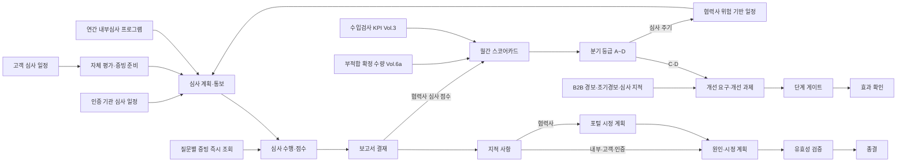

# SL QMS 워크아이템 Vol.6c — QMS-06 품질 운영 지원(협력사 실적·개선·심사·인증)

Nov 1, 2026 · @배창욱

## 1. 개요

Vol.6c는 QMS RFP 품질 운영 지원 모듈 중 **Q-18 협력사 품질목표/실적/개선, Q-28 개선 관리, Q-30 내부심사, Q-31 협력사/아웃소싱 Audit, Q-32 고객 Audit 대응(VDA 6.3), Q-33 품질경영 시스템 인증**을 20개 워크아이템으로 내린다. Vol.6은 분량 때문에 6a(4M·NCR), 6b(한도견본·교육·측정기·MSA·분석실), 6c(이 문서)로 나눠 작성·검토한다.

네 가지 심사(내부·협력사·고객·인증 기관)는 "질문지로 점검하고, 점수를 내고, 지적을 시정하고, 유효성을 확인한다"는 같은 뼈대를 가지므로 **공용 심사 엔진(IAU가 소유)** 하나로 만들고, 협력사(SAU)·고객(CAU)·인증(CER)은 RecordType과 고유 화면·규칙만 더한다. 고객 Audit 대응은 PoC 시나리오 4(심사 준비 체크리스트 → 증빙 즉시 제시 → 지적 등록·이력)라 엔진과 함께 W1에 둔다.

| 기능코드 | 기능 | RFP | WI | 핵심 |
| --- | --- | --- | --- | --- |
| IAU | 내부심사 + 공용 심사 엔진 | Q-30 (엔진은 Q-31~33 공용) | 7 | 질문 라이브러리·점수 체계, 심사 레코드·심사팀(자격·독립성), 모바일 수행·점수·보고서, 지적·시정·유효성, 증빙 즉시 제시, 연간 심사 프로그램·커버리지, 심사 KPI |
| SAU | 협력사/아웃소싱 Audit | Q-31 | 3 | 위험 기반 일정·잠재력 평가(P1)·지도/진단, 협력사 포털 시정 계획, 결과의 등급 반영·재심사 |
| CAU | 고객 Audit 대응(VDA 6.3) | Q-32 | 3 | 고객 심사 일정·준비 체크리스트·자체 평가, VDA 6.3 점수·등급·강등(설정 데이터), 고객 지적 대응·회신 이력 |
| CER | 품질경영 시스템 인증 | Q-33 | 2 | 사업장 인증·인증 심사 주기·준비도 점검, 인증 기관 지적 종결 기한·경영검토 연계 |
| SQM | 협력사 품질목표/실적/개선 | Q-18 | 3 | 연간 목표, 월간 스코어카드(Snowflake)·분기 등급 A~D, 등급 반영·저성과 협력사 개선·포털 스코어카드 |
| IMP | 개선 관리 | Q-28 | 2 | 개선 과제·단계·게이트 승인, 원천 연계·KPI 추적·효과 확인 |

**도메인 정의**

- **내부심사**: IATF 16949는 품질경영시스템 심사(시스템 심사), 제조 공정 심사, 제품 심사를 위험 기반 심사 프로그램으로 운영하고, 3년 주기 안에 모든 프로세스·제조 공정·교대를 다루도록 요구한다. 심사원은 자격을 갖추고 자기 업무를 심사하지 않아야 한다(독립성).
- **협력사 Audit**: 신규 협력사 선정 전 잠재력 평가(VDA 6.3 P1), 거래 중 협력사의 공정·시스템 심사(VDA 6.3 P2~P7 또는 SL 기준), 점수 없이 개선을 돕는 지도·진단 방문으로 나뉜다. 심사 주기는 협력사 위험(등급)에 따라 달라진다.
- **고객 Audit 대응**: BMW 등 독일계 OEM은 VDA 6.3 공정 심사로 공급사를 평가한다. 질문별 점수(10·8·6·4·0점 단계)로 요소·전체 달성률(EG)과 등급(A·B·C)을 내고, 특정 조건(별표 질문 저점 등)에서 등급을 낮추는 강등 규칙이 있다. C 등급은 신규 수주 제한으로 이어질 수 있어, 사전 자체 평가와 "질문을 받으면 그 자리에서 시스템 증빙을 보여주는" 준비가 핵심이다.
- **품질경영 인증**: 사업장별 ISO 9001·IATF 16949 등 인증을 인증 기관(CB)의 사후·갱신 심사로 유지한다. 인증 기관 지적은 정해진 기한 안에 원인·시정 계획을 내고 종결해야 하며, 늦으면 인증 정지 위험이 있다.
- **협력사 품질목표/실적**: 협력사·부품군별 연간 목표(PPM, 로트 합격률 등)를 정하고, 수입검사·부적합·클레임·심사 결과로 월간 스코어카드를 만들어 분기 등급(A~D)을 매긴다. 등급은 무검사 자격(Vol.3 IQC-005), 협력사 심사 주기(SAU), 개선 요구의 근거가 된다. RFP Q-18의 "목표 조기 확보를 위한 안정화 계획"은 Vol.3 부품 초기안정화(PIS)가 담당하고, 이 Vol.은 그 진행 상태를 스코어카드에 보여준다.
- **개선 관리**: 품질 개선 과제를 등록해 관리 지표(기준·목표·실적), 단계(DMAIC 등), 일정, 게이트 승인, 효과 확인까지 추적한다.

**선행 공통 WI**: ARC-002·003, MDM-001·002·003·004·005·007, SEC-001·002·003, I18N-001, UX-001·003, APV-001·002, TDO-001, NTF-001, DOC-001, MTG-001, DWH-002·003·004, AI-004. 협력사 포털은 Vol.3 QMS-03-SPP-001·002.

**다른 메뉴와의 경계**

| 연결 대상 | 이 Vol.이 하는 것 | 상대 메뉴가 하는 것 |
| --- | --- | --- |
| 협력사 포털 (QMS-03-SPP) | 협력사 심사 통보·지적 시정 계획 제출, 스코어카드·개선 계획 화면, 포털 경로 등록 | 사이트·사용자·수신자 해석·업로드 컴포넌트 |
| 수입검사 (QMS-03-IQC) | IQC KPI(로트 합격률·보류 PPM)를 스코어카드 지표로 사용, Account.SupplierGrade__c 갱신 | 등급 A 조건을 무검사 전환 판단에 사용(IQC-005) |
| 부품 초기안정화 (QMS-03-PIS) | 협력사별 진행 중 안정화 계획을 스코어카드에 표시 | 안정화 계획·실적 |
| 부적합 NCR (QMS-06-NCR, Vol.6a) | MART.V_NCR_SUPPLIER_DEFECT(협력사 확정 불량 수량)로 QMS_SUPPLIER_PPM 계산, KPI QMS_NCR_OPENED(Plant·Line)를 심사 위험 요인·특별 심사 신호로 사용 | NCR 원장, CORE.NCR_DEFECT·MART.V_NCR_SUPPLIER_DEFECT, KPI |
| 4M 변경 (QMS-06-4MC, Vol.6a) | 등록 증빙 쿼리 EV-4M-HISTORY(4M 이력), 무단 4M(CORE.FOURM_CHANGE 무단 여부, KPI QMS_4M_UNAUTHORIZED)을 스코어카드 지표·특별 심사 신호로 사용(Snowflake 조회, 이벤트 구독 없음) | 4M 원장·무단 표시(Unauthorized__c)·CORE.FOURM_CHANGE·KPI |
| 교육·자격 (QMS-06-TRN, Vol.6b) | QMS_QualificationGateway(바인딩 AUDITOR_QUALIFICATION) 호출, 자격 유형 사용, 증빙 규칙 등록 구조 제공 | 심사원 자격 유형·게이트웨이 구현 등록, 증빙 규칙 EV-TRAINING·EV-GAUGE-CAL 등록 |
| 8D 엔진 (QMS-05-CLM, Vol.5) | 고객이 8D 양식을 요구한 고객 심사 지적만 QMS_EightDGateway(바인딩 EIGHT_D)로 8D 생성 요청 | 8D RecordType AUDIT_FINDING, EIGHT_D 구현 등록 |
| 수평전개·레슨런 (QMS-04-HZD, LEL) | 지적·개선 과제에서 QMS_HorizontalDeployGateway·QMS_LessonLearnedGateway로 요청. 제품 심사는 IAU에서 하고 출하검사 로트를 만들지 않음(필요 시 FQC 로트 Id를 SourceRecordId로 참조) | 수평전개·LELE 생성, 바인딩 구현 등록 |
| 고객 B2B·클레임 (QMS-05) | 클레임 귀책 건수를 스코어카드 지표로, B2B 경보에서 개선 과제 생성 서비스 제공 | 경보·클레임 원장, 서비스 호출 |
| 회의 (CMN-00-MTG-001) | 경영검토 입력 자료 패키지 생성·회의 연결 | 회의 일정·회의록·Follow-up |
| 대시보드 (QMS-07) | KPI 키(3절 표)와 조회 서비스 | 위젯 |
| AI (QMS-08) | 지적 원인 코드와 AI-004 적중 규칙(QMS_AuditFindingHitRule), 개선 과제 생성 서비스 | 지적 Root Cause 추천, 심사 대비 예상 지적, 조기경보 → 개선 과제 |
| 연계 (QMS-09) | — (선택: 협력사 등급의 SAP 공급업체 평가 반영) | 인터페이스 구현 |

**앞 Vol. 상태**: Vol.0·2·3은 검토 대기다. 이 Vol.은 Vol.0 D-9 권고(업무 원장은 공장 격리, 본사 품질경영팀·경영진은 View All)와 Vol.3 D3-1(Customer Community Plus)을 가정한다. 6a·6b·Vol.4·5와는 `interfaces.md` 계약으로 이름을 맞춘다. 다른 메뉴 서비스 호출은 `interfaces.md` 5절 게이트웨이 등록부의 인터페이스를 `QMS_GatewayFactory.get(바인딩 키)`로 얻어 호출하고(프레임워크 `QMS_GatewayBinding__mdt`·`QMS_GatewayFactory`·`QMS_FollowUpRequest`·`QMS_FollowUpStatusDTO`는 Vol.2 DVQ-007 변경 요청 소유), 다른 메뉴 데이터는 Snowflake 복제·KPI·등록 쿼리로 읽는다.

## 2. 업무 흐름

심사는 출처(내부·협력사·고객·인증 기관)와 관계없이 같은 레코드(QMS_Audit__c)·결과(QMS_AuditResultItem__c)·지적(QMS_AuditFinding__c)을 쓴다. 협력사는 지적 레코드를 직접 고치지 않고 포털 응답 객체로 시정 계획을 낸다(Vol.2 DVQ-010, Vol.3 PPA-003과 같은 원칙). 스코어카드 계산은 Snowflake가 하고 Salesforce에는 월별 결과와 등급만 들어온다. 협력사 등급(Account.SupplierGrade__c)은 SQM 서비스만 바꾼다.

## 3. 데이터 모델 개요

**객체**

| 객체 | 구분 | 관계 | 역할 | 정의 WI |
| --- | --- | --- | --- | --- |
| QMS_AuditChecklist__c / QMS_AuditQuestion__c | 설정 | Question → Checklist(MD) | 질문지(버전)와 질문 | IAU-001 |
| QMS_AuditGradeRule__c | 설정 | Checklist(Lookup) | 등급 구간·강등 규칙(설정 데이터) | IAU-001 |
| QMS_AuditScorer__mdt | 설정 | — | 점수 체계별 계산 클래스 등록 | IAU-001 |
| QMS_Audit__c | 업무 | Checklist, Plant, Supplier, Customer(Lookup), Parent(self) | 심사 1건(RecordType INTERNAL, SUPPLIER, CUSTOMER, CERTIFICATION) | IAU-002 |
| QMS_AuditTeamMember__c | 업무 | Audit(MD) | 심사팀(역할·자격 확인 결과) | IAU-002 |
| QMS_AuditResultItem__c | 업무 | Audit(MD), Question(Lookup) | 질문별 답·점수(스냅숏) | IAU-002 |
| QMS_AuditFinding__c / QMS_AuditFindingAction__c | 업무 | Finding → Audit(MD), Action → Finding(MD) | 지적 사항, 시정 조치 항목 | IAU-004 |
| QMS_FindingDueRule__mdt | 설정 | — | RecordType·분류별 회신·종결 기한 | IAU-004 |
| QMS_AuditEvidenceQuery__mdt / QMS_AuditEvidenceRule__c | 설정 | Rule → Question(Lookup) | 등록 증빙 쿼리, 질문별 증빙 규칙 | IAU-005 |
| QMS_AuditEvidenceSnapshot__c | 업무 | Audit(MD) | 심사 시점 증빙 조회 결과 보관 | IAU-005 |
| QMS_AuditProgram__c / QMS_AuditProgramItem__c | 업무 | Item → Program(MD) | 연간 내부심사 프로그램과 항목 | IAU-006 |
| QMS_AuditFindingResponse__c | 업무 | Finding(Lookup) | 협력사 시정 계획·완료 보고(협력사 소유) | SAU-002 |
| QMS_SupplierAuditRule__mdt | 설정 | — | 등급별 협력사 심사 주기 | SAU-001 |
| QMS_CustomerAuditPrepTask__c | 업무 | Audit(MD) | 고객 심사 준비 과제 | CAU-001 |
| QMS_Certification__c | 업무 | Plant(Lookup) | 사업장 인증서 | CER-001 |
| QMS_SupplierTargetSet__c / QMS_SupplierTarget__c | 설정 | Target → Set(MD), Supplier(Lookup) | 연도·공장 목표 묶음(결재 단위)과 협력사·부품군 목표 | SQM-001 |
| QMS_ScorecardMetric__mdt / QMS_SupplierGradeBand__mdt | 설정 | — | 스코어카드 지표·가중치·점수 구간 / 등급 구간 | SQM-002 |
| QMS_SupplierScorecard__c | 업무 | Supplier(Lookup) | 협력사 월간 스코어카드·분기 등급 | SQM-002 |
| QMS_SupplierImprovementPlan__c | 업무 | Supplier, Scorecard(Lookup) | 저성과 협력사 개선 계획(협력사 소유) | SQM-003 |
| QMS_ImprovementProject__c / QMS_ImprovementPhase__c / QMS_ImprovementMember__c | 업무 | Phase·Member → Project(MD) | 개선 과제, 단계, 팀 | IMP-001 |
| QMS_ImprovementTemplate__mdt | 설정 | — | 방법론별 단계 템플릿 | IMP-001 |
| QMS_ImprovementKpiValue__c | 업무 | Project(MD) | 과제 KPI 월별 실적 | IMP-002 |

**상태값**

| 대상 | 값(순서) |
| --- | --- |
| QMS_AuditChecklist__c.Status__c | DRAFT → ACTIVE → OBSOLETE |
| QMS_Audit__c.Status__c | PLANNED → PREPARING(통보·준비) → IN_PROGRESS → REPORTING → REPORT_APPROVAL → FOLLOW_UP(지적 시정 중) → CLOSED · CANCELLED (지적이 없으면 REPORT_APPROVAL → CLOSED) |
| QMS_AuditResultItem__c.Status__c | OPEN → ANSWERED · NA |
| QMS_AuditFinding__c.Status__c | OPEN → PLAN_SUBMITTED → PLAN_ACCEPTED → IMPLEMENTED → VERIFIED → CLOSED (반려 시 PLAN_SUBMITTED → OPEN, 유효성 미흡 시 IMPLEMENTED → PLAN_ACCEPTED) · CANCELLED |
| QMS_AuditFinding__c.Classification__c | MAJOR 중대 부적합 · MINOR 경미 부적합 · OFI 개선 기회 |
| QMS_AuditFindingResponse__c.Status__c | DRAFT → SUBMITTED → ACCEPTED / RETURNED |
| QMS_AuditProgramItem__c.Status__c | PLANNED → SCHEDULED → DONE · POSTPONED · CANCELLED |
| QMS_Certification__c.Status__c | ACTIVE · SUSPENDED · EXPIRED · WITHDRAWN |
| QMS_SupplierTargetSet__c.Status__c | DRAFT → APPROVAL → ACTIVE → SUPERSEDED |
| QMS_SupplierScorecard__c.GradeStatus__c | CALCULATED → CONFIRMED · OVERRIDDEN (월간은 CALCULATED만, 분기만 확정) |
| QMS_SupplierImprovementPlan__c.Status__c | REQUESTED → SUBMITTED → ACCEPTED / RETURNED → IN_PROGRESS → COMPLETED · CANCELLED |
| QMS_ImprovementProject__c.Status__c | DRAFT → REGISTRATION_APPROVAL → IN_PROGRESS → EFFECT_CHECK → CLOSURE_APPROVAL → CLOSED · ON_HOLD · CANCELLED |
| QMS_ImprovementPhase__c.Status__c | NOT_STARTED → IN_PROGRESS → GATE_REVIEW → DONE · SKIPPED |

**권한 셋과 페르소나 매핑**(각 WI가 PS를 만들고 SEC-001 BR-2에 따라 PSG에 추가)

| Permission Set | 내용 | PSG |
| --- | --- | --- |
| QMS_PS_Audit_Read | 심사·결과·지적 조회(공유 범위 안) | Viewer, QualityEngineer, QualityManager, SupplierQuality, CMN_PSG_Executive |
| QMS_PS_Audit_Execute | 심사 생성·계획·수행·보고서 작성·지적 등록·검증 | Auditor, QualityManager |
| QMS_PS_Audit_Admin | 질문지·등급 규칙·증빙 규칙·기한 규칙·심사 프로그램 | QualityAdmin |
| QMS_PS_AuditFinding_Respond | 자기 담당 지적의 원인·시정 계획·조치 입력 | Viewer, QualityEngineer, QualityManager |
| QMS_PS_CustomerAudit_Edit | 고객 심사 등록·준비 과제·고객 결과·고객 회신 | QualityManager, QualityAdmin, QualityEngineer |
| QMS_PS_SupplierAudit_Edit | 협력사 심사 계획·포털 응답 검토 | SupplierQuality, Auditor |
| QMS_PS_Cert_Edit | 인증서·인증 심사·경영검토 입력 패키지 | QualityAdmin, QualityManager |
| QMS_PS_SupplierScore_Read / QMS_PS_SupplierScore_Admin | 스코어카드 조회 / 목표·지표·등급 확정 | 조회: SupplierQuality, QualityManager, CMN_PSG_Executive · 관리: QualityAdmin, SupplierQuality |
| QMS_PS_Imp_Read / QMS_PS_Imp_Edit / QMS_PS_Imp_Admin | 개선 과제 조회 / 생성·편집(본인 팀) / 전체 관리 | 조회: 전 품질 PSG, Viewer · 편집: QualityEngineer, QualityManager, SupplierQuality · 관리: QualityAdmin |
| QMS_PS_Portal_Audit / QMS_PS_Portal_Scorecard | 포털: 자기 회사 심사·지적 조회와 응답 / 스코어카드·개선 계획 | SupplierPortal |

결재 권한은 APPROVAL_ROLE(QUALITY_MANAGER, QM_HEAD, SQ_MANAGER, 신규 QMS_MANAGER 품질경영팀장)로 판정한다.

**다른 WI·메뉴가 쓰는 서비스와 이벤트**

| 이름 | 종류 | 제공 WI | 사용처 |
| --- | --- | --- | --- |
| QMS_AuditService.createAudit / getStatusBySource | Apex | IAU-002 | IAU-006, SAU-001, CAU-001, CER-001 |
| QMS_QualificationGateway(바인딩 AUDITOR_QUALIFICATION) | 호출(구현은 Vol.6b TRN) | IAU-002 | 심사원 자격 확인 |
| QMS_AuditScoringService.calculate, QMS_AuditScorer | Apex / Interface | IAU-003 | CAU-002(VDA 6.3 계산기), SAU |
| QMS_AuditFindingService.createFinding / transition | Apex | IAU-004 | SAU-002, CAU-003, CER-002 |
| QMS_AuditFindingHitRule | CMN_AiHitRule 구현 | IAU-004 | Vol.8 지적 RCA 정확도 |
| QMS_AuditEvidenceService.collect / snapshot, QMS_AuditEvidenceProvider | Apex / Interface | IAU-005 | CAU-001, 각 Vol. 증빙 제공자(선택) |
| QMS_AuditEvent__e, QMS_AuditFindingEvent__e | Platform Event | IAU-002, IAU-004 | SQM, Vol.7, Vol.8 |
| QMS_SupplierAuditService.getLatestResult | Apex | SAU-003 | SQM, 구매(신규 협력사 선정), Vol.8 |
| QMS_CertificationService.getReadiness | Apex | CER-001 | Vol.7 |
| QMS_SupplierGradeService.applyGrade | Apex | SQM-003 | Account.SupplierGrade__c의 유일한 변경 경로 |
| QMS_SupplierScorecardService.getScorecard | Apex | SQM-002 | 포털, Vol.7, Vol.8 |
| QMS_ImprovementService.createFromSource / getStatusBySource, QMS_ImprovementEvent__e | Apex / Platform Event | IMP-001·002 | Vol.5 B2B, SQM-003, IAU-004, Vol.8 조기경보 |
| QMS_ImprovementGateway 구현체 QMS_ImprovementGatewayImpl(바인딩 IMPROVEMENT) | 게이트웨이 구현 등록 | IMP-002 | Vol.4·5·8 등 다른 Vol.이 QMS_GatewayFactory.get('IMPROVEMENT')로 호출 |
| QMS_SupplierGradeEvent__e | Platform Event | SQM-003 | Vol.3 IQC-005(무검사 재평가), Vol.7, Vol.8 |
| QMS_EightDGateway(바인딩 EIGHT_D) | 호출(구현은 Vol.5 CLM) | CAU-003 | 고객 요구 8D(RecordType AUDIT_FINDING) 생성·상태 조회 |
| QMS_HorizontalDeployGateway, QMS_LessonLearnedGateway(바인딩 HORIZONTAL_DEPLOY, LESSON_LEARNED) | 호출(구현은 Vol.4) | IAU-004, IMP-001 | 지적·개선 과제의 수평전개·레슨런 요청 |
| QMS_AuditEvidenceProvider, QMS_AuditEvidenceRule__c | 등록 구조 | IAU-005 | 다른 Vol.이 증빙 규칙·제공자 등록(Vol.6b EV-TRAINING·EV-GAUGE-CAL 등) |

**KPI 키**(CMN_KpiValue__c, DWH-003 경로)

| KpiKey | 정의 | 주기 | 차원 | 계산 위치 |
| --- | --- | --- | --- | --- |
| QMS_AUDIT_PROGRAM_COMPLIANCE | 내부심사 프로그램 이행률 = 기한(계획 월) 내 완료 항목 / 기한 도래 항목, % | 월 | Plant | Snowflake(IAU-007) |
| QMS_AUDIT_FINDING_OPEN | 미종결 지적 수(CLOSED·CANCELLED 제외) | 일 | Plant, Supplier, Customer(RecordType별 분리 키 접미사 _INT, _SUP, _CUS, _CER) | Snowflake(IAU-007) |
| QMS_AUDIT_FINDING_OVERDUE | 종결 기한 경과 미종결 지적 수 | 일 | 위와 같음 | Snowflake(IAU-007) |
| QMS_AUDIT_FINDING_CLOSE_DAYS | 해당 월 종결 지적의 평균 종결 일수 | 월 | Plant | Snowflake(IAU-007) |
| QMS_AUDIT_REPEAT_RATE | 반복 지적 비율 = IsRepeat 지적 / 전체 지적, % | 분기(DWH-003 QUARTER 추가 후 적재) | Plant | Snowflake(IAU-007) |
| QMS_AUDIT_SCORE | 심사 달성률(EG%) 월 평균 | 월 | Plant, Supplier, Customer | Snowflake(IAU-007) |
| QMS_SUPPLIER_PPM | 협력사 확정 불량 PPM = MART.V_NCR_SUPPLIER_DEFECT 확정 불량 수량 / 수입검사 입고 수량 × 1,000,000 | 월 | Supplier, Item, Plant | Snowflake(SQM-002) |
| QMS_SUPPLIER_SCORE | 협력사 스코어카드 종합 점수(0~100) | 월 | Supplier | Snowflake(SQM-002) |
| QMS_SUPPLIER_GRADE_COUNT_A ~ _D | 등급별 협력사 수 | 분기(DWH-003 QUARTER 추가 후 적재) | Plant(주관 공장) | Snowflake(SQM-002) |
| QMS_SUPPLIER_TARGET_ACHIEVE | 목표 달성 협력사 비율, % | 월 | Plant | Snowflake(SQM-002) |
| QMS_IMP_ACTIVE | 진행 중 개선 과제 수 | 월 | Plant | Snowflake(IMP-002) |
| QMS_IMP_ONTIME_RATE | 계획 일정 내 단계 완료 비율, % | 월 | Plant | Snowflake(IMP-002) |
| QMS_IMP_SAVINGS | 확정 절감액 누계(통화 = 기업 통화) | 월 | Plant | Snowflake(IMP-002) |

**RAG 판정과 주기**: 이 Vol.의 KPI는 자체 RAG 규칙을 두지 않는다. Snowflake 적재 뷰가 Vol.7 공통 UDF `MART.F_KPI_RAG(kpi_key, value, target)`를 호출하고, 기준은 Vol.7 KPI 정의 레지스트리 `QMS_KpiDefinition__mdt`(QMS-07-DSH-001)가 매일 동기화하는 `MART.KPI_RAG_RULE`에서 온다. 목표형(TGT) KPI는 이 Vol.이 CMN_KpiValue__c.Target__c에 차원별 목표를 넣는다(QMS_SUPPLIER_PPM 등 SQM-001 목표). 분기(QUARTER) 주기 KPI(QMS_AUDIT_REPEAT_RATE, QMS_SUPPLIER_GRADE_COUNT_A~D)는 Vol.0 DWH-003의 CMN_KpiValue__c.PeriodType__c에 QUARTER 값이 추가되기를 기다리는 상태다(Vol.0 변경 요청, Vol.7 DSH-005 BR-4와 같음). 그 전까지 Snowflake 뷰에는 계산해 두되 Salesforce 적재는 하지 않는다.

**공통 기반 등록(각 업무 객체 WI에서 수행)**: 채번(ARC-003), CMN_SharingConfig(PlantField; 협력사 심사는 공개 시점에 SAU-002 서비스가 협력사 공유를 명시적으로 추가), CMN_DeleteGuard(DRAFT·PLANNED만), CMN_StatusFlow, 필드 이력, DWH 복제(DWH-002), ko·en·zh 번역. 채번 규칙은 AUD-{PLANT}-{YYYY}-{SEQ:5}(심사), AF-{PLANT}-{YYYY}-{SEQ:6}(지적), APG-{PLANT}-{YYYY}-{SEQ:2}(심사 프로그램, 공장·연도당 1건은 ExternalKey로 보장), CRT-{PLANT}-{SEQ:4}(인증, ResetPolicy NEVER), IMP-{PLANT}-{YYYY}-{SEQ:5}(개선 과제). 스코어카드·목표는 번호 없이 ExternalKey를 쓴다.

**데이터량 가정**: 내부심사 공장당 연 30~60건(7개 공장 연 200~400건), 협력사 심사 연 100~200건, 고객 심사 연 20~40건, 인증 심사 연 10~20건 → 심사 연 약 600건, 질문 결과 라인 심사당 30~80개 → 연 2만~5만 건, 지적 연 2천~4천 건. 스코어카드는 협력사 약 300곳 × 12개월 = 연 3,600건. 모두 Salesforce 레코드로 감당 가능한 규모이며 집계만 Snowflake에서 한다.

## 4. 심사 엔진·내부심사: 질문지·심사·수행·지적 (IAU-001~004)

### QMS-06-IAU-001 심사 질문지 라이브러리·점수 체계·등급 규칙

추적 Q-30, Q-31, Q-32, Q-33 · 필수 · W1 · SF · DM, LWC, APEX · Customization · 선행 MDM-007, I18N-001, SEC-001 · 6 M/D

**목적**: 내부 시스템·공정·제품 심사, 협력사 심사, VDA 6.3 자체 평가가 모두 "버전 관리되는 질문지 + 점수 체계 + 등급 규칙"을 데이터로 갖게 한다. 회사표준 개정(27년)이나 VDA 6.3 개정판을 개발 없이 반영하고, 심사 당시 어떤 판의 질문으로 판정했는지 재현하기 위해서다.

**범위** In: 질문지·질문 객체, 등급 구간·강등 규칙 객체, 점수 계산기 등록 메타데이터, 편집기·CSV 일괄 등록·규칙 시뮬레이터. Out: 심사 레코드·결과 라인 생성(IAU-002), 점수 계산 구현(IAU-003 일반 계산기, CAU-002 VDA 6.3 계산기), 증빙 규칙(IAU-005).

**데이터 모델**

| 객체 / 필드 | 타입 | 필수 | 설명 |
| --- | --- | --- | --- |
| QMS_AuditChecklist__c.ChecklistCode__c | Text(40), External ID, Unique | Y | `{Family}-V{Version}` 자동. 예: VDA63-PROC-V1 |
| QMS_AuditChecklist__c.Family__c | Text(30) | Y | 같은 질문지의 버전 묶음 키. 예: VDA63-PROC, IATF-SYS, PROD-HL |
| QMS_AuditChecklist__c.Version__c | Number(3,0) | Y | 1부터 |
| QMS_AuditChecklist__c.Name / NameEn__c / NameZh__c | Text(80) | Y / N / N | 다국어 표시명 |
| QMS_AuditChecklist__c.Scheme__c | Picklist (COMPLIANCE 적합·부적합, POINTS 배점 합, VDA63 VDA 6.3 점수, PRODUCT_AUDIT 제품 심사 결함 가중) | Y | 점수 계산기 선택 키 |
| QMS_AuditChecklist__c.RecordTypes__c | Multi-Picklist (INTERNAL, SUPPLIER, CUSTOMER, CERTIFICATION) | Y | 이 질문지를 쓸 수 있는 심사 종류 |
| QMS_AuditChecklist__c.AuditTypes__c | Multi-Picklist (IAU-002 AuditType 값) | Y | 쓸 수 있는 심사 유형 |
| QMS_AuditChecklist__c.CustomerGroup__c | Picklist (MDM-003 CustomerGroup 값) | N | 고객 전용 질문지(예: BMW 대비 자체 평가) |
| QMS_AuditChecklist__c.StandardRef__c | Text(80) | Y | 근거 규격과 판(예: VDA 6.3 2023, IATF 16949 2016) |
| QMS_AuditChecklist__c.AllowedScores__c | Text(40) | VDA63·POINTS 단계형이면 Y | 허용 점수 단계(쉼표). 품질경영팀이 원문 기준으로 입력 |
| QMS_AuditChecklist__c.DefectWeightA__c / B__c / C__c | Number(5,2) | PRODUCT_AUDIT면 Y | 결함 등급별 가중치(SL 기준값) |
| QMS_AuditChecklist__c.TextSource__c | Picklist (SL_WORDING SL 자체 문구, LICENSED_ORIGINAL 라이선스 원문) | Y | 질문 문구의 출처 선언(D6C-2) |
| QMS_AuditChecklist__c.LicenseConfirmed__c / LicenseRef__c | Checkbox / Text(255) | N / LicenseConfirmed면 Y | 원문 사용 라이선스 확인과 근거 |
| QMS_AuditChecklist__c.Status__c / EffectiveFrom__c | Picklist (DRAFT, ACTIVE, OBSOLETE) / Date | Y / ACTIVE면 Y | |
| QMS_AuditQuestion__c.Checklist__c | Master-Detail | Y | |
| QMS_AuditQuestion__c.QuestionNo__c | Text(20) | Y | 예: 6.2.3, SYS-07-02. 질문지 안 Unique |
| QMS_AuditQuestion__c.Element__c / SubElement__c | Text(20) / Text(20) | VDA63이면 Element Y / N | 예: P6 / 6.2 |
| QMS_AuditQuestion__c.Sequence__c | Number(4,0) | Y | |
| QMS_AuditQuestion__c.QuestionText__c / QuestionTextEn__c / QuestionTextZh__c | Long Text(2000) | Y / N / N | TextSource 규칙(BR-2) |
| QMS_AuditQuestion__c.Guidance__c | Long Text(4000) | N | 확인 포인트·예시 증빙(SL 작성) |
| QMS_AuditQuestion__c.IsStarQuestion__c | Checkbox | N | 강등 규칙 대상 질문(별표) |
| QMS_AuditQuestion__c.AnswerType__c | Picklist (SCORE_STEPS 단계 점수, COMPLIANCE 적합·부적합·해당 없음, POINTS 0~최대, DEFECT_CLASS 결함 등급 개수, TEXT 서술) | Y | 입력 화면 형태 |
| QMS_AuditQuestion__c.MaxPoints__c | Number(5,2) | SCORE_STEPS·POINTS면 Y | SCORE_STEPS는 AllowedScores 최댓값 자동 |
| QMS_AuditQuestion__c.Weight__c | Number(5,2) | Y | 기본 1 |
| QMS_AuditQuestion__c.AllowNA__c | Checkbox | Y | 해당 없음 허용 |
| QMS_AuditQuestion__c.ProcessCodes__c | Text(255) | N | QMS_PROCESS 코드(쉼표). 공란 = 공통 질문 |
| QMS_AuditQuestion__c.EvidenceKeys__c | Text(1000) | N | 연결 증빙 규칙 키(IAU-005) |
| QMS_AuditQuestion__c.ExternalKey__c | Text(80), External ID, Unique | Y | `{ChecklistCode}-{QuestionNo}` |
| QMS_AuditGradeRule__c.Checklist__c | Lookup(QMS_AuditChecklist__c) | Y | |
| QMS_AuditGradeRule__c.RuleType__c | Picklist (GRADE_BAND 등급 구간, DOWNGRADE 강등) | Y | |
| QMS_AuditGradeRule__c.Grade__c | Text(5) | GRADE_BAND면 Y | 예: A, B, C |
| QMS_AuditGradeRule__c.MinPercent__c / MaxPercent__c | Number(5,2) | GRADE_BAND면 Y | Min ≤ 달성률 < Max(마지막 구간은 Max 포함) |
| QMS_AuditGradeRule__c.Condition__c | Picklist (STAR_QUESTION_SCORE_LE 별표 질문 점수 이하, ANY_QUESTION_SCORE_LE 임의 질문 점수 이하, ELEMENT_PERCENT_LT 요소 달성률 미만, SUBELEMENT_PERCENT_LT 하위 요소 달성률 미만, MAJOR_FINDING_COUNT_GE 중대 지적 수 이상) | DOWNGRADE면 Y | |
| QMS_AuditGradeRule__c.Threshold__c | Number(5,2) | DOWNGRADE면 Y | 조건 기준값 |
| QMS_AuditGradeRule__c.AppliesToGrades__c / ResultGrade__c | Text(20) / Text(5) | DOWNGRADE면 Y | 적용 대상 등급(쉼표)과 결과 등급 |
| QMS_AuditGradeRule__c.Sequence__c / Description__c | Number(3,0) / Text(255) | Y | 적용 순서, 보고서 표시 문구 |
| QMS_AuditScorer__mdt | Custom Metadata | — | Scheme__c, ScorerClass__c, IsActive__c |

**비즈니스 규칙**

- BR-1: 버전 — ACTIVE 질문지와 그 질문·등급 규칙은 고칠 수 없다. "새 버전"은 같은 Family로 Version + 1인 DRAFT를 만들고 질문·규칙을 복사한다. 활성화하면 같은 Family의 이전 ACTIVE는 OBSOLETE. 이미 만들어진 심사는 질문 스냅숏(IAU-002 BR-1)을 갖고 있어 영향받지 않는다. 활성화는 QMS_PS_Audit_Admin 보유자만.

- BR-2: 문구 출처 — TextSource = LICENSED_ORIGINAL은 LicenseConfirmed = true이고 LicenseRef가 있을 때만 고를 수 있다. SL_WORDING 질문지는 활성화 화면에서 "외부 규격 원문을 옮겨 적지 않았음" 확인 체크를 받아 이력(코멘트)에 남긴다(D6C-2).

- BR-3: 점수 체계별 검증(활성화 시) — VDA63: 모든 질문 AnswerType = SCORE_STEPS 또는 TEXT, Element 필수, AllowedScores 필수. COMPLIANCE: AnswerType = COMPLIANCE 또는 TEXT. POINTS: MaxPoints > 0. PRODUCT_AUDIT: DefectWeightA~C 필수, DEFECT_CLASS 질문 1개 이상. 해당 Scheme의 QMS_AuditScorer__mdt가 활성이어야 한다.

- BR-4: 등급 구간 검증(활성화 시) — GRADE_BAND가 하나라도 있으면 0~100을 겹침·빈틈 없이 덮어야 한다. DOWNGRADE의 AppliesToGrades·ResultGrade는 GRADE_BAND에 있는 등급만 허용. 등급 구간이 없으면 점수만 계산하고 등급은 비운다.

- BR-5: 규칙 값의 원천 — VDA 6.3 등급 구간·강등 조건 값과 허용 점수 단계는 품질경영팀이 원문으로 검수해 입력한다(D6C-3). 개발 산출물(코드·초기 데이터 스크립트)에 규칙 숫자를 넣지 않는다. 테스트는 테스트 전용 가상 규칙으로 한다.

- BR-6: 질문 필터 키 — ProcessCodes는 코드 그룹 QMS_PROCESS(회사표준 프로세스 목록, Vol.0 변경 요청) 값만 허용한다. 공란 질문은 모든 범위에 들어간다(IAU-002 BR-1).

- BR-7: 편집기 `qmsAuditChecklistEditor` — 왼쪽 트리(요소 → 하위 요소 → 질문, 드래그로 순서), 오른쪽 질문 편집(ko·en·zh 탭, Guidance, 별표, 답 형태, 배점, 가중치, 프로세스 코드, 증빙 키), 탭 "등급 규칙"(구간·강등 표 편집), 탭 "시뮬레이터"(질문별 가상 점수 입력 → 해당 Scheme 계산기로 요소·전체 달성률, 강등 전·후 등급, 적용 강등 규칙 표시).

- BR-8: 일괄 등록 `qmsAuditChecklistImport` — CSV(QuestionNo, Element, SubElement, 문구 ko·en·zh, Guidance, IsStar, AnswerType, MaxPoints, Weight, AllowNA, ProcessCodes, EvidenceKeys)로 DRAFT 질문지에 질문을 upsert하고 행별 오류를 표시한다(QMS-02-DVQ-001 BR-4 방식). SL 현행 체크리스트 이관용.

- BR-9: 사용 중 보호 — 심사에서 쓰인 질문지·질문은 삭제할 수 없다(OBSOLETE만).

**화면/UX**: `qmsAuditChecklistEditor`(질문지 레코드 페이지), `qmsAuditChecklistImport`(SL QMS 앱 "심사 설정" 페이지), 질문지 리스트뷰(Family·Scheme·상태 필터).

**권한**: QMS_PS_Audit_Admin(편집·활성화), QMS_PS_Audit_Read·QMS_PS_Audit_Execute(조회).

**수용 기준**

- AC-1: Given ACTIVE 질문지의 질문, When 문구 수정, Then 차단 + "새 버전 만들기" 안내.

- AC-2: Given 질문 58개 ACTIVE 질문지 V1, When 새 버전, Then V2 DRAFT에 질문 58개·등급 규칙 복사, 활성화 시 V1 OBSOLETE.

- AC-3: Given 테스트 구간 0~80 C, 90~100 A만 등록, When 활성화, Then 80~90 빈 구간 오류로 차단.

- AC-4: Given LicenseConfirmed = false 질문지, When TextSource를 LICENSED_ORIGINAL로 저장, Then 차단.

- AC-5: Given 영어 사용자, QuestionTextEn 공란, When 질문 표시, Then 기본(ko) 문구 표시.

- AC-6: Given CSV 60행 중 2행 AnswerType 오류, When 업로드, Then 58행 반영 + 2행 사유 표시.

- AC-7: Given 시뮬레이터에서 별표 질문 1개를 테스트 강등 조건 이하 점수로 입력, When 계산, Then 강등 전 등급·강등 후 등급과 적용 규칙 Description 표시.

**에이전트 주의**: VDA 6.3·IATF 질문 문구를 기억이나 인터넷에서 옮겨 초기 데이터로 넣지 않는다. 등급 구간·강등 조건·허용 점수 숫자를 코드에 하드코딩하지 않는다(모두 QMS_AuditGradeRule__c와 질문지 필드). 질문지 편집을 표준 레코드 관련 목록 편집으로 대신하지 않는다(버전 보호 검사가 서비스에 있어야 함).

**오픈 이슈**: SL 현행 내부심사 체크리스트(시스템·공정·제품) 형태와 수, 회사표준 프로세스 목록(27년 개정 중) 확정 시점, 고객별 자체 평가 질문지 필요 여부.

### QMS-06-IAU-002 심사 데이터 모델·상태 규칙·심사팀 배정(자격·독립성)

추적 Q-30, Q-31, Q-32, Q-33, NFR-4.2 · 필수 · W1 · SF · DM, APEX, LWC · Customization · 선행 IAU-001, ARC-003, SEC-002, SEC-003, UX-003, APV-001, TDO-001, NTF-001, QMS-02-DVQ-007 · 7 M/D

**목적**: 내부·협력사·고객·인증 기관 심사를 같은 레코드 구조로 만들고, 심사팀이 자격을 갖추고 독립적인지 저장 시점에 확인한다. IATF 내부심사의 "자격 있는 심사원이 자기 업무를 심사하지 않는다" 요구를 시스템 규칙으로 만든다.

**범위** In: 심사·심사팀·결과 라인 객체, 생성 서비스(질문 스냅숏), 상태 전이, 통보, 심사원 자격 게이트웨이, 독립성 검사, 심사 캘린더, 이벤트, 공통 기반 등록. Out: 수행·점수·보고서(IAU-003), 지적(IAU-004), RecordType별 고유 화면(SAU·CAU·CER).

**데이터 모델**

| 객체 / 필드 | 타입 | 필수 | 설명 |
| --- | --- | --- | --- |
| QMS_Audit__c (RecordType INTERNAL, SUPPLIER, CUSTOMER, CERTIFICATION).RecordNo__c | Text(40), Unique | Y | AUD-{PLANT}-{YYYY}-{SEQ:5} |
| QMS_Audit__c.Name | Text(80) | Y | 제목(예: "2027 KR01 L3 조립 공정 심사") |
| QMS_Audit__c.AuditType__c | Picklist (SYSTEM 시스템, PROCESS 제조 공정, PRODUCT 제품, POTENTIAL 잠재력 평가, GUIDANCE 지도·진단, PRE_ASSESSMENT 고객 심사 대비 자체 평가, CUSTOMER_AUDIT 고객 심사, CERT_INITIAL 최초 인증, CERT_SURVEILLANCE 사후 심사, CERT_RECERT 갱신 심사, CERT_SPECIAL 특별 심사, FOLLOW_UP 후속 심사) | Y | RecordType별 허용 값은 BR-1 표 |
| QMS_Audit__c.Plant__c | Lookup(CMN_Plant__c) | Y | 공유 기준. 협력사 심사는 주관(납품 대상) 공장 |
| QMS_Audit__c.Supplier__c / Customer__c | Lookup(Account, 협력사 RT) / Lookup(Account, 고객 RT) | SUPPLIER면 Supplier Y / CUSTOMER면 Customer Y | |
| QMS_Audit__c.CertificationId__c | Text(18) | CERTIFICATION면 Y | QMS_Certification__c Id(CER-001이 Lookup으로 승격하지 않고 텍스트 유지, 배포 순서 무관) |
| QMS_Audit__c.Checklist__c / ChecklistCode__c | Lookup(QMS_AuditChecklist__c) / Text(40) | INTERNAL·SUPPLIER면 Y | 고객·인증 심사는 선택 |
| QMS_Audit__c.ScopeProcessCodes__c | Text(255) | SYSTEM·PROCESS면 Y | QMS_PROCESS 코드(쉼표) |
| QMS_Audit__c.ScopeLineIds__c | Text(1000) | PROCESS면 Y(INTERNAL) | CMN_Line__c Id(쉼표) |
| QMS_Audit__c.ProductGroup__c / Item__c | Lookup | PRODUCT면 둘 중 1개 Y | |
| QMS_Audit__c.Shift__c | Picklist (A, B, C, D, ALL) | PROCESS면 Y(INTERNAL) | 교대 커버리지(IAU-006) |
| QMS_Audit__c.AuditeeDept__c | Lookup(CMN_Department__c) | INTERNAL면 Y | 피심사 부서(독립성 기준) |
| QMS_Audit__c.PlannedStart__c / PlannedEnd__c | Date | Y | |
| QMS_Audit__c.ActualStart__c / ActualEnd__c | Date | IN_PROGRESS 이후 Y / REPORTING 이후 Y | |
| QMS_Audit__c.LeadAuditor__c | Lookup(User) | Y | 외부 심사(고객·인증)는 SL 주관자 |
| QMS_Audit__c.ExternalAuditors__c | Text(255) | CUSTOMER·CERTIFICATION면 Y | 고객·인증 기관 심사원 이름·소속 |
| QMS_Audit__c.IsRemote__c | Checkbox | N | 원격 심사 |
| QMS_Audit__c.ParentAudit__c | Lookup(QMS_Audit__c) | FOLLOW_UP·PRE_ASSESSMENT면 Y | 후속 심사 ↔ 원 심사, 자체 평가 ↔ 고객 심사 |
| QMS_Audit__c.SourceRecordId__c / SourceObject__c / SourceRecordNo__c | Text(18) / Text(80) / Text(40) | N | 생성 원천(프로그램 항목, 협력사 등급, NCR 등) |
| QMS_Audit__c.Status__c | 3절 상태값 | Y | 서비스로만 변경 |
| QMS_Audit__c.CancelReason__c | Text(255) | CANCELLED면 Y | |
| QMS_Audit__c.ScorePercent__c / GradeBeforeDowngrade__c / Grade__c | Number(5,2) / Text(5) / Text(5) | N | IAU-003·CAU-003 |
| QMS_Audit__c.ScoreSource__c | Picklist (CALCULATED 계산, ENTERED 외부 결과 입력) | N | |
| QMS_Audit__c.DowngradeReasons__c / ScoreDetailJson__c | Long Text(4000) / Long Text(32768) | N | 강등 사유, 요소별 점수 |
| QMS_Audit__c.Conclusion__c / Strengths__c | Long Text(4000) | REPORTING 이후 Conclusion Y | 총평, 강점 |
| QMS_Audit__c.FindingCount__c / MajorCount__c / OpenFindingCount__c | Roll-up(COUNT, QMS_AuditFinding__c) | — | IAU-004에서 생성 |
| QMS_Audit__c.PublishedToSupplier__c | Checkbox | N | SAU-002가 설정(협력사 공개) |
| QMS_AuditTeamMember__c.Audit__c | Master-Detail | Y | |
| QMS_AuditTeamMember__c.User__c | Lookup(User) | Y | 같은 심사 안 Unique |
| QMS_AuditTeamMember__c.Role__c | Picklist (LEAD, AUDITOR, TECH_EXPERT 기술 전문가, TRAINEE 수습, OBSERVER 참관) | Y | |
| QMS_AuditTeamMember__c.QualificationType__c | Text(40) | N | 확인한 자격 유형 |
| QMS_AuditTeamMember__c.QualificationResult__c | Picklist (QUALIFIED, NOT_QUALIFIED, NOT_CONFIGURED, NOT_REQUIRED, OVERRIDDEN) | Y | |
| QMS_AuditTeamMember__c.IndependenceResult__c | Picklist (OK, CONFLICT, OVERRIDDEN, NOT_REQUIRED) | Y | |
| QMS_AuditTeamMember__c.OverrideReason__c / OverriddenBy__c | Text(255) / Lookup(User) | OVERRIDDEN면 Y | |
| QMS_AuditTeamMember__c.AssignedElements__c | Text(255) | N | 분담 요소(예: P5, P6) |
| QMS_AuditResultItem__c.Audit__c | Master-Detail | Y | |
| QMS_AuditResultItem__c.Question__c | Lookup(QMS_AuditQuestion__c) | Y | |
| QMS_AuditResultItem__c 스냅숏: QuestionNo__c, Element__c, SubElement__c, Sequence__c, QuestionText__c, QuestionTextEn__c, QuestionTextZh__c, Guidance__c, IsStarQuestion__c, AnswerType__c, MaxPoints__c, Weight__c, AllowNA__c, EvidenceKeys__c | 원본과 같은 타입 | Y(해당 시) | 생성 시 복사 |
| QMS_AuditResultItem__c.Points__c | Number(5,2) | 답한 SCORE_STEPS·POINTS면 Y | |
| QMS_AuditResultItem__c.Compliance__c | Picklist (CONFORM, NONCONFORM) | 답한 COMPLIANCE면 Y | |
| QMS_AuditResultItem__c.SampleQty__c / DefectA__c / DefectB__c / DefectC__c | Number(6,0) | DEFECT_CLASS면 Y | |
| QMS_AuditResultItem__c.Notes__c | Long Text(4000) | 조건부(IAU-003 BR-2) | 관찰 내용 |
| QMS_AuditResultItem__c.NaReason__c | Text(255) | NA면 Y | |
| QMS_AuditResultItem__c.NoFindingReason__c | Text(255) | 조건부(IAU-003 BR-2) | 저점인데 지적을 내지 않은 사유 |
| QMS_AuditResultItem__c.AssignedAuditor__c | Lookup(User) | N | |
| QMS_AuditResultItem__c.Status__c | 3절 상태값 | Y | |
| QMS_AuditResultItem__c.AnsweredBy__c / AnsweredAt__c | Lookup(User) / DateTime | ANSWERED면 Y | |
| QMS_AuditQualificationMap__mdt | Custom Metadata | — | RecordTypeName__c, AuditType__c, Scheme__c(공란 = 전체), QualificationType__c |

**서비스 API (`QMS_AuditService`)**

    Id createAudit(QMS_AuditRequest req)
    // req: recordType, auditType, plantId, supplierId, customerId, certificationId,
    //      checklistId, scopeProcessCodes, lineIds, productGroupId, itemId, shift,
    //      auditeeDeptId, plannedStart, plannedEnd, leadAuditorId, externalAuditors,
    //      parentAuditId, sourceId, sourceObject, sourceNo
    void notifyAudit(Id auditId)                       // PLANNED → PREPARING
    void startAudit(Id auditId)                        // PREPARING → IN_PROGRESS
    void completeFieldwork(Id auditId)                 // IN_PROGRESS → REPORTING
    void reschedule(Id auditId, Date startDate, Date endDate, String reason)
    void cancelAudit(Id auditId, String reason)
    QMS_AuditStatusDTO getStatusBySource(Id sourceId)

    // 자격 확인은 등록부 게이트웨이를 쓴다(interfaces.md 5절, 구현 Vol.6b TRN)
    QMS_QualificationGateway g = (QMS_QualificationGateway) QMS_GatewayFactory.get('AUDITOR_QUALIFICATION');
    Boolean ok = g.isQualified(userId, qualificationType, new Map<String, Object>{ 'plantId' => plantId, 'onDate' => plannedStart });

**비즈니스 규칙**

- BR-1: 생성 검증과 결과 라인 — RecordType별 허용 AuditType: INTERNAL = SYSTEM, PROCESS, PRODUCT, PRE_ASSESSMENT, FOLLOW_UP / SUPPLIER = POTENTIAL, PROCESS, SYSTEM, PRODUCT, GUIDANCE, FOLLOW_UP / CUSTOMER = CUSTOMER_AUDIT / CERTIFICATION = CERT_INITIAL, CERT_SURVEILLANCE, CERT_RECERT, CERT_SPECIAL. 질문지는 ACTIVE이고 RecordTypes·AuditTypes에 해당 값이 있어야 한다. 질문지가 있으면 질문 중 ProcessCodes가 공란이거나 ScopeProcessCodes와 교집합이 있는 것만 결과 라인으로 스냅숏한다(Status OPEN). GUIDANCE·CUSTOMER_AUDIT·CERT_*는 질문지 없이 만들 수 있다. 제품 심사(PRODUCT)는 이 엔진의 심사로만 수행하며 출하검사(Vol.4 FQC) 로트를 만들지 않는다. 특정 출하 로트를 대상으로 하면 SourceRecordId·SourceObject·SourceRecordNo에 FQC 로트를 텍스트로 남긴다.

- BR-2: 상태 전이는 서비스로만 한다(Status FLS Read). 허용 전이: PLANNED → PREPARING(notifyAudit), PREPARING → IN_PROGRESS(startAudit, ActualStart = 오늘), IN_PROGRESS → REPORTING(completeFieldwork: 결과 라인이 모두 ANSWERED 또는 NA, ActualEnd 입력. 결과 라인이 없는 심사와 CUSTOMER·CERTIFICATION 심사는 결과 라인 조건 없음), REPORTING → REPORT_APPROVAL(보고서 상신, IAU-003), REPORT_APPROVAL → FOLLOW_UP(승인, MAJOR·MINOR 지적 1건 이상) / CLOSED(승인, MAJOR·MINOR 없음) / REPORTING(반려), FOLLOW_UP → CLOSED(MAJOR·MINOR 미종결 0건이 되는 순간 자동, IAU-004 BR-9), CLOSED 전 모든 상태 → CANCELLED(LeadAuditor 또는 QualityAdmin, 사유 필수).

- BR-3: 통보 — notifyAudit는 INTERNAL이면 피심사 부서장(AuditeeDept.Manager)과 공장 QUALITY_MANAGER Role에게 알림 QMS_AUDIT_NOTICE(일정·범위·심사팀·준비 요청)를 보낸다. 통보 기한 = PlannedStart − CMN 설정 QMS_AUDIT_NOTICE_DAYS(기본 7일). 일 배치(공장 08:00)가 기한까지 3일 남은 PLANNED 심사의 LeadAuditor에게 To-Do "심사 통보: {RecordNo}"를 연다. SUPPLIER 통보는 SAU-002, CUSTOMER·CERTIFICATION은 통보 대상이 사내 관련 부서(CAU-001, CER-001).

- BR-4: 심사팀 자격 — LEAD 1명이 필수(INTERNAL·SUPPLIER). LEAD·AUDITOR 추가 시 QMS_AuditQualificationMap__mdt에서 자격 유형을 찾아 `QMS_GatewayFactory.get('AUDITOR_QUALIFICATION')`로 얻은 QMS_QualificationGateway의 isQualified(userId, 자격 유형, scope = {plantId, onDate = PlannedStart})를 호출한다(구현은 Vol.6b TRN이 등록). AUDITOR_QUALIFICATION 바인딩 레코드가 없거나 비활성이면 팩토리 기본 구현(항상 true + WARN 로그)이 돌아오므로 결과를 NOT_CONFIGURED(경고 배지, 저장 허용)로 기록한다. false면 NOT_QUALIFIED로 저장 차단하고, QMS_MANAGER Role 사용자만 사유와 함께 OVERRIDDEN으로 저장할 수 있다. TECH_EXPERT·TRAINEE·OBSERVER와 CUSTOMER·CERTIFICATION 심사는 NOT_REQUIRED.

- BR-5: 독립성 — INTERNAL 심사에서 LEAD·AUDITOR의 User.Department__c가 AuditeeDept 또는 그 하위 부서(Parent 체인)이거나, ScopeProcessCodes 코드의 책임 부서(QMS_PROCESS 코드 Attribute1 = 부서 코드)와 같으면 CONFLICT로 저장 차단한다. 소규모 공장 예외는 QMS_MANAGER Role의 OVERRIDDEN(사유 필수)만 허용한다.

- BR-6: 일정 변경 — reschedule은 사유 필수, UX-003 코멘트 자동 기록. PREPARING 이후면 통보 대상에게 변경 알림. 프로그램 항목(IAU-006)의 계획 월을 벗어나면 그 항목을 POSTPONED로 표시한다.

- BR-7: 접근 — 심사팀원은 공장이 달라도 심사를 편집할 수 있어야 하므로 팀원 추가 시 Apex Sharing Reason QMS_AuditTeam으로 Edit 공유, 제거 시 회수. 결과 라인·지적은 Master-Detail로 따라간다.

- BR-8: 이벤트 `QMS_AuditEvent__e`(AuditId__c, RecordTypeName__c, AuditType__c, EventType__c: SCHEDULED, NOTIFIED, STARTED, REPORT_APPROVED, CLOSED, CANCELLED, PlantId__c, SupplierId__c, CustomerId__c, ScorePercent__c, Grade__c, SourceRecordId__c)를 상태 변화마다 발행한다.

- BR-9: 공통 기반 — 채번 AUD, CMN_SharingConfig(PlantField Plant__c, SupplierField 미등록: 협력사 공개는 SAU-002가 명시 공유), CMN_DeleteGuard(PLANNED만), CMN_StatusFlow, 필드 이력(Status, PlannedStart, PlannedEnd, LeadAuditor, ScorePercent, Grade), DWH 복제 15분(QMS_Audit__c, QMS_AuditTeamMember__c, QMS_AuditResultItem__c), 번역.

**화면/UX**

| 컴포넌트 | 위치 | 기능 |
| --- | --- | --- |
| qmsAuditPlanner | QMS_Audit__c 새로 만들기 오버라이드 | 1단계 종류·유형 → 2단계 범위(공장·프로세스·라인·교대·품번·협력사·고객) → 3단계 질문지 추천(조건 일치 ACTIVE, 고객 그룹 일치 우선) → 4단계 일정·심사팀(자격·독립성 배지) → 저장(PLANNED) |
| qmsAuditTeam | 심사 레코드 페이지 | 팀원 추가·역할·분담 요소, 자격·독립성 결과, 예외 승인(권한자) |
| qmsAuditCalendar | SL QMS 앱 "심사 캘린더" | 월·주 보기, RecordType 색 구분, 공장·유형 필터, 클릭 시 심사 열기 |
| cmnStatusPath | 심사 레코드 페이지 상단 | 상태 진행 |

**권한**: QMS_PS_Audit_Execute(생성·통보·시작·팀 편집), QMS_PS_Audit_Read(조회), 예외 승인은 QMS_MANAGER Role.

**수용 기준**

- AC-1: Given 질문 60개 중 ProcessCodes가 범위와 맞는 질문 30개·공통 질문 12개, When INTERNAL PROCESS 심사 생성, Then 결과 라인 42건(스냅숏 포함).

- AC-2: Given 팀원 부서 = 피심사 부서의 하위 부서, When 팀원 저장, Then CONFLICT로 차단. QMS_MANAGER가 사유 입력 시 OVERRIDDEN으로 저장.

- AC-3: Given AUDITOR_QUALIFICATION 바인딩 없음, When AUDITOR 추가, Then NOT_CONFIGURED 경고, 저장 성공.

- AC-4: Given 바인딩 구현이 NOT_QUALIFIED 반환, When AUDITOR 추가, Then 저장 차단.

- AC-5: Given 결과 라인 5건 OPEN, When completeFieldwork, Then 차단 + 미답 질문 목록.

- AC-6: Given 다른 공장 소속 본사 심사원을 팀원으로 추가, When 그 사용자가 심사 조회·결과 입력, Then 가능. 팀원 제거 후 접근 불가.

- AC-7: Given 사용자가 API로 Status를 직접 변경, When 저장, Then 차단.

- AC-8: Given PlannedStart 10일 후 PLANNED 심사, When 일 배치(통보 기한 3일 전), Then LeadAuditor To-Do 1건.

**에이전트 주의**: 심사원 자격을 이 WI에서 직접 판단하지 않는다(게이트웨이). Vol.6b 객체를 Lookup하지 않는다. CUSTOMER·CERTIFICATION 심사의 외부 심사원을 User로 만들지 않는다(ExternalAuditors 텍스트). 결과 라인을 질문지와 Lookup만으로 표시하지 않는다(스냅숏이 판정 근거).

**오픈 이슈**: SL 심사원 자격 체계(유형·유효 기간)와 Vol.6b 정의 일치 여부, 교대 코드 체계(공장별 교대 수), 피심사 부서와 프로세스 책임 부서 매핑 원천.

### QMS-06-IAU-003 심사 수행(모바일)·점수 계산·심사 보고서

추적 Q-30, Q-31, Q-32, Q-2 · 필수 · W1 · SF · LWC, APEX · Customization · 선행 IAU-002, DOC-001, UX-001 · 7 M/D

**목적**: 심사원이 현장에서 태블릿으로 질문별 답·관찰·사진을 남기고, 점수·등급이 질문지 규칙대로 계산되며, 결재된 보고서가 같은 데이터로 나오게 한다.

**범위** In: 수행 화면, 답 입력 규칙, 점수 계산 서비스와 일반 계산기(COMPLIANCE, POINTS, PRODUCT_AUDIT), 공통 등급 평가기, 보고서 상신·결재·PDF. Out: VDA 6.3 계산기(CAU-002), 지적 등록·시정(IAU-004), 증빙 패널(IAU-005).

**화면/UX**

| 컴포넌트 | 위치 | 기능 |
| --- | --- | --- |
| qmsAuditExecution | 심사 레코드 페이지, 모바일 메뉴 "심사 수행"(Auditor) | 요소 탭 → 질문 카드: 질문(사용자 언어), Guidance, 별표 표시, 답 입력(AnswerType별), 관찰 메모, 사진·파일(DocClass AUDIT_EVIDENCE), 증빙 패널 자리(IAU-005 배포 후), "지적 등록" 버튼, 진행률, "내 분담만" 필터 |
| qmsAuditScoreSummary | 심사 레코드 페이지 | 요소·하위 요소별 달성률 표와 막대, 전체 달성률, 강등 전·후 등급, 강등 사유, 미답 질문 수(미리보기, 저장 안 함) |
| qmsAuditReport | 심사 레코드 페이지(REPORTING) | 총평·강점 입력, 지적 요약(IAU-004), 보고서 언어 선택, PDF 미리보기, 상신 |

**서비스 API**

    QMS_AuditScoreResult calculate(Id auditId)   // 저장하지 않고 계산(미리보기)
    void applyScore(Id auditId)                  // 계산 결과를 심사 필드에 저장
    void submitReport(Id auditId, String comment)

    public interface QMS_AuditScorer {
        QMS_AuditScoreResult score(QMS_AuditScoreInput input);
    }
    // QMS_AuditScoreResult: totalPercent, elementScores[{element, subElement, earned, possible, percent}],
    //   gradeBeforeDowngrade, grade, downgradeReasons[{ruleId, description}], answeredCount, naCount

**비즈니스 규칙**

- BR-1: 답 입력 규칙 — SCORE_STEPS: 질문지 AllowedScores 값만. COMPLIANCE: CONFORM·NONCONFORM 또는 NA. POINTS: 0 ≤ 값 ≤ MaxPoints. DEFECT_CLASS: SampleQty ≥ 1, 결함 개수 ≥ 0. NA는 AllowNA 질문만, NaReason 필수. 답하면 Status ANSWERED(NA면 NA), AnsweredBy·At 기록. 입력은 5초 후 자동 저장(통신 끊김 대비), 사진은 장변 1920px(UX-001 BR-4). 오프라인 입력은 범위 밖.

- BR-2: 저점 기록 — SCORE_STEPS에서 최고 점수 미만이거나 COMPLIANCE NONCONFORM이면 Notes 필수. 0점(허용 점수 중 최솟값)이거나 NONCONFORM인 질문은 MAJOR·MINOR 지적이 연결되거나 NoFindingReason이 있어야 보고서를 상신할 수 있다(상신 화면에 해당 질문 목록 표시).

- BR-3: 계산기 선택 — `calculate`는 Checklist.Scheme의 QMS_AuditScorer__mdt ScorerClass를 `Type.forName`으로 만들어 호출한다. 미등록·비활성이면 "점수 계산기 미등록: {Scheme}" 예외. 질문지 없는 심사는 점수 없음(ScoreSource 공란).

- BR-4: COMPLIANCE 계산 — 달성률 = Σ(가중치 × CONFORM) / Σ(가중치 × (CONFORM + NONCONFORM)) × 100, NA 제외. 요소·하위 요소별로 같은 식. 질문 "점수"는 CONFORM = 1, NONCONFORM = 0으로 보고 강등 조건(BR-7)에 쓴다.

- BR-5: POINTS 계산 — 달성률 = Σ(가중치 × Points) / Σ(가중치 × MaxPoints) × 100, NA 제외.

- BR-6: PRODUCT_AUDIT 계산 — 결함 점수 = Σ(질문별 DefectA × WeightA + DefectB × WeightB + DefectC × WeightC), 제품 심사 지수 = max(0, 100 − 결함 점수 / Σ SampleQty × 100). 가중치는 질문지 값(SL 기준), 고객 고유 제품 심사 방식(VDA 6.5 등)은 오픈 이슈로 두고 필요 시 별도 계산기를 등록한다.

- BR-7: 공통 등급 평가기 `QMS_AuditGradeEvaluator.evaluate(checklistId, result, questionScores, majorFindingCount)` — GRADE_BAND로 강등 전 등급을 정하고, DOWNGRADE 규칙을 Sequence 순서로 적용한다(조건 충족 + 현재 등급이 AppliesToGrades에 있으면 ResultGrade로, 한 규칙 적용 후에도 다음 규칙 계속 평가). 적용된 규칙 Description을 downgradeReasons에 담는다. 모든 계산기(VDA63 포함)는 이 평가기를 쓴다.

- BR-8: 점수 저장 — `applyScore`는 ScorePercent, GradeBeforeDowngrade, Grade, DowngradeReasons, ScoreDetailJson, ScoreSource = CALCULATED를 저장한다. 결과 라인 저장마다 계산하지 않고, 화면 미리보기는 calculate, 저장은 보고서 상신 직전에 한 번 한다.

- BR-9: 보고서 상신 — 조건: Status REPORTING, Conclusion 입력, BR-2 충족, 등록된 지적의 Classification·Description·(MAJOR·MINOR면) RequirementRef·ObjectiveEvidence 완비. 결재 유형 QMS_AUDIT_REPORT(LockOnSubmit = true). 결재선 기본: INTERNAL = LeadAuditor 기안 → 피심사 부서장 REVIEW(사실 확인) → QMS_MANAGER 승인 / SUPPLIER = SQ_MANAGER 승인 / CUSTOMER·CERTIFICATION = QUALITY_MANAGER 승인. 콜백 onSubmitted → REPORT_APPROVAL, onApproved → IAU-002 BR-2 전이 + 지적 공개·기한 확정(IAU-004 BR-2) + PDF 생성 큐 + 이벤트 REPORT_APPROVED, onRejected → REPORTING.

- BR-10: 보고서 PDF — Visualforce `QMS_AuditReportPdf`(renderAs pdf)를 Queueable에서 생성해 DocClass AUDIT_REPORT로 심사에 등록, RELEASED. 구성: 머리말(번호, 종류·유형, 공장·협력사·고객, 범위, 일정, 심사팀, 질문지 코드·판), 점수(요소별 표, 전체 달성률, 강등 전·후 등급, 강등 사유), 지적 목록(번호·분류·요구 근거·내용·기한), 총평·강점, 결재 이력. 언어는 상신 시 선택(ko·en). 생성 실패는 CMN_Logger + LeadAuditor To-Do "심사 보고서 재생성"이며 결재를 되돌리지 않는다.

**권한**: QMS_PS_Audit_Execute(입력은 심사팀원만: 서비스에서 팀원 여부 확인), QMS_PS_Audit_Read(조회·보고서 열람).

**수용 기준**

- AC-1: Given COMPLIANCE 질문 20개(가중치 1) 중 CONFORM 18, NONCONFORM 1, NA 1, When calculate, Then 달성률 94.74%.

- AC-2: Given Scheme VDA63인데 계산기 미등록, When calculate, Then "점수 계산기 미등록: VDA63" 예외.

- AC-3: Given AllowedScores "0,4,6,8,10" 질문, When 5 입력, Then 저장 차단.

- AC-4: Given 0점 질문에 지적·NoFindingReason 없음, When 보고서 상신, Then 차단 + 해당 질문 목록 표시.

- AC-5: Given 테스트 규칙(구간 A 90~100, 강등: 별표 질문 점수 ≤ 4이면 A → B), 달성률 92%, 별표 질문 4점 1개, When calculate, Then 강등 전 A, 등급 B, 강등 사유 1건.

- AC-6: Given MINOR 2건이 있는 INTERNAL 심사, When 보고서 승인, Then FOLLOW_UP, AUDIT_REPORT 문서 Rev 1 RELEASED, REPORT_APPROVED 이벤트 1회.

- AC-7: Given 지적 없는 심사, When 보고서 승인, Then CLOSED.

- AC-8: Given 결과 라인 80개, When 수행 화면 진입(태블릿), Then 첫 요소 탭 2초 이내 표시.

**에이전트 주의**: 점수를 LWC에서만 계산해 저장하지 않는다(서버 계산이 기준). VDA 6.3 계산 로직을 이 WI에 넣지 않는다(CAU-002 계산기 + 공통 평가기). 등급 숫자를 코드에 넣지 않는다. 보고서 템플릿 문구는 Custom Label로 다국어 처리한다.

**오픈 이슈**: 제품 심사 방식(SL 기준 결함 등급·가중치, 고객별 VDA 6.5 요구), 보고서 양식(회사표준 양식 여부), 심사원 전자 서명 필요 여부.

### QMS-06-IAU-004 심사 지적 사항·시정 조치·유효성 검증

추적 Q-30, Q-31, Q-32, Q-33, Q-36 · 필수 · W1 · SF · DM, APEX, LWC · Customization · 선행 IAU-003, TDO-001, NTF-001, AI-004, QMS-02-DVQ-007 · 6 M/D

**목적**: 모든 심사 지적이 "원인 → 시정 계획 → 실행 → 유효성 확인 → 종결"을 기한 안에 밟게 한다. 반복 지적을 자동으로 표시해 근본 원인이 해결되지 않은 영역을 드러낸다. 확정 원인 코드는 AI Root Cause 추천(Q-36 Audit Finding)의 정답 데이터가 된다.

**범위** In: 지적·조치 항목 객체, 기한 규칙, 사내 담당자 시정 계획 입력·검토·실행·검증·종결, 반복 지적 판정, 기한 경과 알림, AI 적중 규칙, 후속 연계 버튼(게이트웨이), 이벤트. Out: 협력사 포털 응답(SAU-002), 고객 회신 추적(CAU-003), 인증 기관 제출(CER-002), AI 추천 생성(Vol.8).

**데이터 모델**

| 객체 / 필드 | 타입 | 필수 | 설명 |
| --- | --- | --- | --- |
| QMS_AuditFinding__c.Audit__c | Master-Detail(QMS_Audit__c), 공유 설정 "Read Only"(상위 Read로 하위 편집 가능) | Y | BR-12 |
| QMS_AuditFinding__c.RecordNo__c | Text(40), Unique | Y | AF-{PLANT}-{YYYY}-{SEQ:6} |
| QMS_AuditFinding__c.ResultItem__c / QuestionNo__c | Lookup(QMS_AuditResultItem__c) / Text(20) | N | 근거 질문(번호 사본) |
| QMS_AuditFinding__c.Classification__c | 3절 값 | Y | |
| QMS_AuditFinding__c.RequirementRef__c | Text(255) | MAJOR·MINOR면 Y | 규격 조항·질문 번호·고객 요구 |
| QMS_AuditFinding__c.Description__c | Long Text(4000) | Y | 지적 내용 |
| QMS_AuditFinding__c.ObjectiveEvidence__c | Long Text(4000) | MAJOR·MINOR면 Y | 객관적 증거 |
| QMS_AuditFinding__c.Plant__c / Supplier__c / Customer__c | Lookup | Plant Y | 심사에서 복사 |
| QMS_AuditFinding__c.ResponsibleDept__c / ResponsibleUser__c | Lookup(CMN_Department__c) / Lookup(User) | 사내 지적이면 Y | 기본 = 피심사 부서와 그 부서장 |
| QMS_AuditFinding__c.IsReleased__c / ReleasedAt__c | Checkbox / DateTime | Y / 공개 후 Y | 보고서 승인 전 false(담당자 미공개), 공개 일시 |
| QMS_AuditFinding__c.ClosedAt__c | DateTime | CLOSED면 Y | 종결 일시(KPI 종결 일수) |
| QMS_AuditFinding__c.ResponseDue__c / ClosureDue__c | Date | 공개 후 Y(OFI 제외) | BR-2 |
| QMS_AuditFinding__c.Correction__c | Long Text(4000) | 계획 제출 시 Y | 즉시 수정 |
| QMS_AuditFinding__c.RootCause__c | Long Text(4000) | 계획 제출 시 Y | 원인(발생·미검출) |
| QMS_AuditFinding__c.RootCauseCode__c / RootCausePath__c | Lookup(CMN_Code__c, CAUSE_5M1E 리프) / Text(255) | 계획 제출 시 Y | cmnCodePicker |
| QMS_AuditFinding__c.Status__c | 3절 상태값 | Y | 서비스로만 변경 |
| QMS_AuditFinding__c.PlanReviewComment__c | Long Text(4000) | 반려 시 Y | |
| QMS_AuditFinding__c.ImplementedDate__c | Date | IMPLEMENTED면 Y | |
| QMS_AuditFinding__c.VerificationMethod__c / VerificationComment__c | Picklist (ON_SITE 현장 확인, DOCUMENT 문서 확인, NEXT_AUDIT 다음 심사 확인) / Long Text(4000) | 검증 시 Y | |
| QMS_AuditFinding__c.VerificationRound__c | Number(2,0) | Y | 기본 1 |
| QMS_AuditFinding__c.VerifiedBy__c / VerifiedAt__c | Lookup(User) / DateTime | VERIFIED면 Y | |
| QMS_AuditFinding__c.IsRepeat__c / PreviousFindingId__c | Checkbox / Text(18) | N | BR-7 |
| QMS_AuditFinding__c.IsOverdue__c | Formula(Checkbox) | — | 종결 전이고 (오늘 > ResponseDue이며 계획 미제출) 또는 오늘 > ClosureDue |
| QMS_AuditFinding__c.EightDId__c / HorizontalDeployId__c / LessonLearnedId__c | Text(18) | N | 후속 연계 결과 Id |
| QMS_AuditFinding__c.InternalNote__c | Long Text(4000) | N | 협력사 비공개 메모(포털 PSG FLS 없음) |
| QMS_AuditFindingAction__c.Finding__c | Master-Detail | Y | |
| QMS_AuditFindingAction__c.ActionType__c | Picklist (CORRECTIVE 시정, PREVENTIVE 재발 방지·수평 적용) | Y | |
| QMS_AuditFindingAction__c.Description__c | Long Text(4000) | Y | |
| QMS_AuditFindingAction__c.Owner__c / DueDate__c | Lookup(User) / Date | Y | DueDate ≤ ClosureDue |
| QMS_AuditFindingAction__c.Status__c | Picklist (OPEN, DONE, CANCELLED) | Y | |
| QMS_AuditFindingAction__c.CompletedDate__c / CompletionNote__c | Date / Text(1000) | DONE면 Y | 증빙 파일은 DocClass FINDING_EVIDENCE 필수 |
| QMS_FindingDueRule__mdt | Custom Metadata | — | RecordTypeName__c, AuditType__c(공란 = 전체), Classification__c, ResponseDays__c, ClosureDays__c, ExternalDueRequired__c, CloseApprovalRole__c |

**서비스 API (`QMS_AuditFindingService`)**

    Id createFinding(QMS_FindingRequest req)
    // req: auditId, resultItemId, classification, requirementRef, description,
    //      objectiveEvidence, responsibleDeptId, responsibleUserId
    void releaseFindings(Id auditId)                  // 보고서 승인 콜백에서 호출
    void submitPlan(Id findingId)                     // OPEN → PLAN_SUBMITTED
    void reviewPlan(Id findingId, Boolean accept, String comment)
    void verify(Id findingId, Boolean effective, String method, String comment)
    void cancelFinding(Id findingId, String reason)

**비즈니스 규칙**

- BR-1: 등록 — 심사가 IN_PROGRESS·REPORTING일 때 심사팀원이 결과 라인 또는 단독으로 등록한다. 채번 AF, Plant·Supplier·Customer는 심사에서 복사, IsReleased = false. REPORT_APPROVAL 이후 추가는 LeadAuditor만 하고 즉시 공개된다. CUSTOMER·CERTIFICATION 심사의 외부 지적은 SL 주관자가 받은 그대로 등록한다(CAU-003, CER-002).

- BR-2: 공개와 기한 — `releaseFindings`(보고서 승인)는 IsReleased = true로 바꾸고 QMS_FindingDueRule__mdt(RecordType, AuditType 우선 → 공란, Classification)로 ResponseDue = 승인일 + ResponseDays, ClosureDue = 승인일 + ClosureDays(공장 시간대)를 넣는다. ExternalDueRequired = true(고객·인증 기관 기한)인 규칙은 사용자가 입력한 외부 기한을 쓰고, 비어 있으면 공개를 막는다. 초기 데이터(SL 확인 전 기본값): INTERNAL·SUPPLIER MAJOR 14일/60일, MINOR 30일/90일, OFI 기한 없음. CUSTOMER·CERTIFICATION은 외부 기한 입력.

- BR-3: 담당 통지 — 사내 지적(INTERNAL·CUSTOMER·CERTIFICATION)은 ResponsibleUser(기본 = ResponsibleDept.Manager)에게 To-Do "심사 지적 시정 계획: {RecordNo}"(기한 ResponseDue)와 알림 QMS_AUDIT_FINDING_RELEASED. SUPPLIER 지적은 SAU-002가 포털로 통지한다. OFI는 알림만(To-Do 없음).

- BR-4: 시정 계획 — 담당자가 `qmsFindingResponse`에서 Correction, RootCause, RootCauseCode, 조치 항목(CORRECTIVE 1개 이상, 담당·기한)을 넣고 submitPlan → PLAN_SUBMITTED, 담당 To-Do 종료, LeadAuditor To-Do "시정 계획 검토". reviewPlan(accept) → PLAN_ACCEPTED, 조치 항목 담당자마다 To-Do "심사 지적 조치: {RecordNo}"(기한 = 항목 DueDate). reviewPlan(반려, 코멘트 필수) → OPEN, 담당자 To-Do 다시 열기.

- BR-5: 실행 — 조치 담당자가 완료(CompletionNote + 증빙 파일)하면 DONE. 모든 항목이 DONE·CANCELLED가 되면 자동으로 IMPLEMENTED(ImplementedDate = 오늘), LeadAuditor To-Do "유효성 검증: {RecordNo}"(기한 ClosureDue).

- BR-6: 유효성 검증 — 검증자는 LeadAuditor(부재 시 LeadAuditor 또는 QMS_MANAGER가 지정한 Auditor PSG 보유자). verify(false) → PLAN_ACCEPTED, VerificationRound + 1, 추가 조치 항목 1개 이상을 요구하고 담당자에게 알림. verify(true) → VERIFIED. MINOR·OFI는 바로 CLOSED. MAJOR는 CloseApprovalRole(기본 INTERNAL·CUSTOMER·CERTIFICATION = QUALITY_MANAGER, SUPPLIER = SQ_MANAGER) 승인 결재 QMS_AUDIT_FINDING_CLOSE 후 CLOSED. VerificationMethod = NEXT_AUDIT이면 VERIFIED로 두지 않고 다음 같은 범위 심사 생성 시 그 심사에 "이전 지적 확인" 질문 카드로 표시한다.

- BR-7: 반복 지적 — 등록 시 같은 Plant(SUPPLIER면 같은 Supplier)에서 같은 QuestionNo 또는 같은 RequirementRef로 최근 36개월(CMN 설정 QMS_AUDIT_REPEAT_MONTHS) 안에 CLOSED된 지적이 있으면 IsRepeat = true, PreviousFindingId 기록, 화면에 "반복 지적" 표시. MINOR 반복이면 등록자에게 "MAJOR 상향 검토" 안내만 하고 자동으로 바꾸지 않는다.

- BR-8: 기한 경과 — 일 배치(공장 08:00): ResponseDue 경과 + 계획 미제출, ClosureDue 경과 + 미종결 지적에 이벤트 OVERDUE(최초 1회), 담당자·LeadAuditor 매일 알림, 7일 초과 시 담당 부서장과 QMS_MANAGER에게 주 1회 에스컬레이션.

- BR-9: 심사 종결 연동 — 지적이 CLOSED·CANCELLED가 될 때 그 심사의 MAJOR·MINOR 미종결이 0건이면 심사를 CLOSED로 바꾸고 이벤트 CLOSED 발행(IAU-002 BR-2).

- BR-10: 후속 연계 — 지적 화면의 "수평전개 요청", "레슨런 등록", "개선 과제 등록" 버튼은 각각 `QMS_GatewayFactory.get('HORIZONTAL_DEPLOY')`(QMS_HorizontalDeployGateway, 구현 Vol.4 HZD), `get('LESSON_LEARNED')`(QMS_LessonLearnedGateway, 구현 Vol.4 LEL), `get('IMPROVEMENT')`(QMS_ImprovementGateway, IMP-002)로 request(QMS_FollowUpRequest)를 호출한다. 요청 값: sourceId = 지적 Id, sourceObject = QMS_AuditFinding__c, sourceNo = RecordNo, title·description = 지적 내용, plantId·supplierId·customerId = 지적 값, itemId = 심사 Item, requestedById = 현재 사용자, dueDate = ClosureDue, payloadJson = {rootCauseCodeId, requirementRef, classification}. 반환 Id를 HorizontalDeployId·LessonLearnedId에 넣고, 화면 상태는 getStatus(지적 Id)로 보여준다. 바인딩이 비활성이면 기본 구현이 담당자 To-Do를 연다(버튼은 항상 표시). 8D 생성은 CAU-003 규칙.

- BR-11: AI 적중 규칙 — 지적이 CLOSED되면 `CMN_AiRecommendationService.finalize(findingId, 'QMS_RCA', outcomeJson{rootCauseCodeId, rootCausePath}, new QMS_AuditFindingHitRule())`를 호출한다. QMS_AuditFindingHitRule: 추천의 원인 코드가 확정 RootCauseCode와 리프까지 같으면 적중, 상위 2레벨까지만 같으면 비적중이되 outcome에 partial = true 기록. 추천 생성·화면은 Vol.8.

- BR-12: 편집 권한 — Master-Detail 공유 설정을 "Read Only"로 두어 심사를 Read할 수 있는 담당자도 지적을 편집할 수 있게 하되, 검증 규칙으로 막는다: 원인·계획·조치 필드는 ResponsibleUser 본인, 심사팀원, Custom Permission QMS_AuditFindingAnyEdit 보유자(QualityAdmin)만 바꿀 수 있다. 상태 필드는 서비스만 바꾼다(FLS Read). 다른 공장 담당자에게는 공개 시 심사 Read 공유(Apex Sharing Reason QMS_FindingOwner)를 준다.

- BR-13: 이벤트 `QMS_AuditFindingEvent__e`(FindingId__c, AuditId__c, RecordTypeName__c, Classification__c, EventType__c: CREATED, RELEASED, PLAN_ACCEPTED, IMPLEMENTED, VERIFIED, CLOSED, REOPENED, OVERDUE, PlantId__c, SupplierId__c, CustomerId__c, IsRepeat__c).

- BR-14: 공통 기반 — 채번 AF, 공유는 Master-Detail, CMN_DeleteGuard(IsReleased = false인 OPEN만 삭제), CMN_StatusFlow, 필드 이력(Status, Classification, ResponseDue, ClosureDue, RootCauseCode, VerificationRound), DWH 복제 15분(지적·조치 항목), 번역.

**화면/UX**

| 컴포넌트 | 위치 | 기능 |
| --- | --- | --- |
| qmsAuditFindingPanel | 심사 레코드 페이지 | 지적 목록(분류·상태·기한·반복·지연 배지), 등록·수정(공개 전), 일괄 공개 상태 |
| qmsFindingResponse | 지적 레코드 페이지(담당자) | 즉시 수정, 원인, 원인 코드(cmnCodePicker), 조치 항목 그리드(담당·기한·완료·증빙), 계획 제출 |
| qmsFindingVerify | 지적 레코드 페이지(심사원) | 계획 검토(승인·반려), 유효성 검증(방법·결과·코멘트), 후속 연계 버튼 |
| cmnAiRecommendationList | 지적 레코드 페이지 | UseCase QMS_RCA 추천 목록(Vol.8 배포 후 표시) |

**권한**: QMS_PS_AuditFinding_Respond(담당자 입력), QMS_PS_Audit_Execute(등록·검토·검증), MAJOR 종결 결재는 Role.

**수용 기준**

- AC-1: Given INTERNAL MINOR 2건, 기한 규칙 30일/90일, When 보고서 승인(2027-03-02), Then IsReleased = true, ResponseDue 2027-04-01, ClosureDue 2027-05-31, 담당자 To-Do 2건.

- AC-2: Given CUSTOMER 심사 지적, 외부 기한 공란, When 공개, Then 차단 + "고객 제시 기한 입력" 메시지.

- AC-3: Given 시정 계획 반려 코멘트 공란, When reviewPlan(false), Then 차단.

- AC-4: Given 조치 항목 2개 중 마지막 항목 DONE(증빙 첨부), When 저장, Then 지적 IMPLEMENTED + LeadAuditor To-Do 1건.

- AC-5: Given 유효성 미흡 판정, When verify(false), Then PLAN_ACCEPTED, VerificationRound 2, 추가 조치 항목 없이는 저장 차단.

- AC-6: Given MAJOR 지적 VERIFIED, When 종결 결재 승인, Then CLOSED. 심사의 마지막 미종결 지적이면 심사 CLOSED + 이벤트 2건(지적 CLOSED, 심사 CLOSED).

- AC-7: Given 30개월 전 같은 공장·같은 질문 번호 CLOSED 지적, When 새 지적 등록, Then IsRepeat = true, PreviousFindingId 기록.

- AC-8: Given 담당자가 아닌 QualityEngineer, When 원인 필드 수정, Then 검증 규칙으로 차단.

**에이전트 주의**: 지적 상태를 Flow로 바꾸지 않는다(서비스와 결재 콜백). Vol.4·Vol.5 객체를 Lookup하지 않는다(Id 텍스트 + 게이트웨이). 협력사 지적 응답을 이 화면으로 받지 않는다(SAU-002 제출 객체). AI 추천 레코드를 이 WI에서 만들지 않는다(finalize만).

**오픈 이슈**: SL 지적 분류 체계(중대·경미·관찰·개선 기회 등 현행 용어), 사내·협력사 지적 회신·종결 기한 기준, MAJOR 종결 결재선.

## 5. 심사 엔진·내부심사: 증빙·심사 프로그램·심사 실적 (IAU-005~007)

### QMS-06-IAU-005 질문-증빙 매핑·증빙 즉시 제시·증빙 스냅숏

추적 Q-32, Q-30, Q-35 · 필수 · W1 · SF, SNOW · DM, APEX, LWC · Customization · 선행 IAU-002, DOC-001, DWH-003, DWH-004 · 6 M/D

**목적**: 심사원이 "변경 관리 이력을 보여 달라"고 하면 그 자리에서 시스템 데이터(4M 이력, DVP&R, PPAP, SPC 공정능력, 교육 기록 등)를 질문별로 보여준다. 고객 감사 증빙을 즉시 제출하지 못하던 문제에 대한 직접 대응이며, 단일 플랫폼의 데이터 연결을 고객 앞에서 보여주는 장면이다(PoC 시나리오 4).

**범위** In: 등록 증빙 쿼리 메타데이터, 증빙 규칙 객체, 증빙 제공자 인터페이스, 실시간 조회 서비스, 증빙 패널·제시 모드, 스냅숏, 증빙 패키지 PDF, 초기 규칙 세트. Out: 각 영역 데이터 원장(소유 Vol.), 질문-규칙 매핑 작업(품질경영팀 설정).

**데이터 모델**

| 객체 / 필드 | 타입 | 필수 | 설명 |
| --- | --- | --- | --- |
| QMS_AuditEvidenceQuery__mdt | Custom Metadata | — | QueryKey(DeveloperName), ObjectApiName__c, SoqlTemplate__c(Long Text, 바인드 토큰만), AllowedParams__c, DisplayFields__c(필드 API명 쉼표), LinkField__c, MaxRows__c(기본 50), OwnerMenu__c(예: QMS-06-4MC, 참고용) |
| QMS_AuditEvidenceRule__c.RuleKey__c | Text(40), External ID, Unique | Y | 예: EV-4M-HISTORY |
| QMS_AuditEvidenceRule__c.Name / NameEn__c / NameZh__c | Text(80) | Y / N / N | 패널 표시명 |
| QMS_AuditEvidenceRule__c.ProviderType__c | Picklist (QUERY 등록 쿼리, DOCUMENT 문서 클래스, KPI KPI 값, DW_QUERY 드릴다운 쿼리, LINK 링크, APEX 제공자 클래스) | Y | |
| QMS_AuditEvidenceRule__c.QueryKey__c | Text(40) | QUERY면 Y | QMS_AuditEvidenceQuery__mdt |
| QMS_AuditEvidenceRule__c.DocClassCodes__c | Text(255) | DOCUMENT면 Y | DOC_CLASS 코드(쉼표) |
| QMS_AuditEvidenceRule__c.KpiKeys__c | Text(255) | KPI면 Y | |
| QMS_AuditEvidenceRule__c.DwQueryKey__c | Text(40) | DW_QUERY면 Y | CMN_DwQuery__mdt 키 |
| QMS_AuditEvidenceRule__c.UrlTemplate__c | Text(1000) | LINK면 Y | 토큰 {plantCode}, {supplierNo}, {customerCode}, {fromDate}, {toDate} |
| QMS_AuditEvidenceRule__c.ProviderClass__c | Text(80) | APEX면 Y | QMS_AuditEvidenceProvider 구현 |
| QMS_AuditEvidenceRule__c.PeriodMonths__c | Number(3,0) | Y | 조회 기간(기본 12개월) |
| QMS_AuditEvidenceRule__c.Description__c | Text(500) | N | 이 증빙이 보여주는 것 |
| QMS_AuditEvidenceRule__c.IsActive__c | Checkbox | Y | |
| QMS_Audit__c.EvidenceFrom__c / EvidenceTo__c | Date | N | 증빙 조회 기간 재정의(이 WI에서 추가). 공란이면 규칙 기간 |
| QMS_AuditEvidenceSnapshot__c.Audit__c | Master-Detail | Y | |
| QMS_AuditEvidenceSnapshot__c.ResultItem__c / RuleKey__c | Lookup(QMS_AuditResultItem__c) / Text(40) | Y | |
| QMS_AuditEvidenceSnapshot__c.Status__c | Picklist (OK, EMPTY, NOT_DEPLOYED, ERROR) | Y | |
| QMS_AuditEvidenceSnapshot__c.ResultCount__c | Number(8,0) | N | |
| QMS_AuditEvidenceSnapshot__c.ResultJson__c | Long Text(131072) | N | 표시 행(최대 MaxRows)·링크 Id·문서 리비전 번호 |
| QMS_AuditEvidenceSnapshot__c.Message__c | Text(255) | N | 오류·미배포 사유 |
| QMS_AuditEvidenceSnapshot__c.CollectedBy__c / CollectedAt__c | Lookup(User) / DateTime | Y | |

**서비스 API (`QMS_AuditEvidenceService`)**

    List<QMS_EvidenceResult> collect(Id auditId, Id resultItemId)     // 실시간 조회
    void snapshot(Id auditId, Set<Id> resultItemIds)                  // 비동기 저장
    Id buildPackage(Id auditId, String languageCode)                  // 증빙 패키지 PDF

    public interface QMS_AuditEvidenceProvider {
        QMS_EvidenceResult provide(QMS_EvidenceContext ctx);
        // ctx: auditId, ruleKey, plantId, supplierId, customerId, itemId,
        //      productGroupId, lineIds, fromDate, toDate
    }

**비즈니스 규칙**

- BR-1: 문맥 — 조회 파라미터는 심사 레코드에서 만든다(Plant, Supplier, Customer, Item, ProductGroup, ScopeLineIds). 기간은 EvidenceFrom·To가 있으면 그 값, 없으면 [PlannedStart − PeriodMonths, PlannedStart].

- BR-2: QUERY — 등록된 SOQL 템플릿만 실행한다. 파라미터는 바인드 변수(`:plantId` 등)로만 넣고 문자열 연결을 하지 않는다. `WITH USER_MODE`, `LIMIT MaxRows`. 대상 객체가 Org에 없으면(Schema 조회 결과 없음) 오류가 아니라 NOT_DEPLOYED를 반환한다. 모든 활성 쿼리를 파싱해 AllowedParams 밖의 토큰이 있으면 실패하는 단위 테스트를 둔다(배포 차단).

- BR-3: DOCUMENT — CMN_Document__c 중 DocClass가 목록에 있고 Plant가 일치(협력사 심사는 Supplier__c 일치, DOC-001 Vol.3 변경 요청 필드)하며 현재 RELEASED 리비전의 공개일이 기간 안인 문서를 리비전 번호·일자와 함께 보여준다.

- BR-4: KPI — CMN_KpiValue__c에서 KpiKeys·차원(Plant, Supplier, Customer, Item)이 맞는 월 값을 기간만큼 표(값·목표·RAG)로 보여준다.

- BR-5: DW_QUERY — `CMN_DwQueryService.query`(DWH-004)를 호출한다. 공장 권한 필터는 DWH-004가 강제한다.

- BR-6: LINK·APEX — LINK는 토큰을 치환한 URL을 새 탭 링크로 보여준다. APEX는 등록 클래스를 `Type.forName`으로 만들어 호출하며, 예외가 나면 그 규칙만 ERROR로 표시하고 다른 규칙은 계속 보여준다. 다른 Vol.은 자기 영역의 제공자 클래스를 만들어 규칙에 등록할 수 있다.

- BR-7: 패널 `qmsAuditEvidencePanel` — 수행 화면(IAU-003) 질문 카드와 고객 심사 화면(CAU-001)에 배치. 질문의 EvidenceKeys 규칙마다 건수, 상위 행(표), 레코드·문서 열기 링크, 상태 배지(OK·EMPTY·NOT_DEPLOYED·ERROR)를 보여주고 "스냅숏 저장" 버튼을 둔다. 제시 모드(전체 화면, 큰 글씨, 내부 메모·InternalNote 숨김, 질문 번호 검색)를 지원한다.

- BR-8: 스냅숏 — AuditType이 CUSTOMER_AUDIT 또는 PRE_ASSESSMENT인 심사는 startAudit 시 규칙이 있는 모든 질문을 비동기(Queueable, 질문 20개 단위)로 스냅숏해 "그날 보여준 것"을 남긴다. 그 밖의 심사는 사용자가 저장한 질문만. 같은 질문·규칙의 재저장은 새 레코드(이력)로 쌓는다.

- BR-9: 증빙 패키지 — `buildPackage`는 Visualforce `QMS_AuditEvidencePackagePdf`(renderAs pdf)로 질문별 번호·문구, 규칙별 건수·상위 10행·문서 리비전 목록을 묶어 DocClass AUDIT_EVIDENCE_PACKAGE로 심사에 등록한다. 첨부 파일 자체를 합치지 않는다(레코드 번호·리비전으로 참조).

- BR-10: 초기 규칙 세트(설정 데이터, 대상이 배포된 것부터 활성) — 이 WI가 등록: EV-QUAL-PLAN(인정시험 계획 CLOSED, QUERY), EV-DVPR(DOCUMENT DVPR), EV-PPAP(PPAP 승인 현황, QUERY), EV-IQC-LAR(KPI QMS_IQC_LAR), EV-CONTROL-PLAN(DOCUMENT CONTROL_PLAN), EV-PFMEA(DOCUMENT PFMEA), EV-4M-HISTORY(4M 이력: 등록 쿼리 QMS_AuditEvidenceQuery__mdt로 QMS_FourMChange__c의 번호·유형·적용일·종료일·무단 여부(Unauthorized__c)를 Plant·Supplier·Item·기간으로 조회, Vol.6a 4MC 미배포 시 NOT_DEPLOYED), EV-NCR(부적합, QUERY), EV-SPC-CPK(KPI QMS_SPC_CPK), EV-CLAIM(고객 클레임, QUERY), EV-LELE(레슨런, QUERY). 다른 Vol.이 등록: EV-TRAINING(자격 현황), EV-GAUGE-CAL(측정기 교정 현황)은 Vol.6b가 BR-12 방식으로 등록. 이 WI의 Apex는 QMS_FourMHistoryService를 직접 호출하지 않는다(필요하면 Vol.6a가 그 서비스를 감싼 APEX 제공자를 BR-12로 등록). 질문과 규칙의 매핑(Question.EvidenceKeys)은 품질경영팀이 질문지에 넣는다.

- BR-11: 권한 — 실시간 조회는 조회하는 사용자의 권한 범위(USER_MODE)만 보여준다. 스냅숏은 심사 공유 범위를 따른다(Master-Detail).

- BR-12: 다른 Vol.의 등록 방법 — (a) 등록 쿼리: 자기 패키지에 QMS_AuditEvidenceQuery__mdt 레코드(바인드 토큰은 AllowedParams 안에서만)를 배포하고 ProviderType QUERY 규칙을 만든다. (b) 제공자 클래스: 자기 패키지에 `QMS_AuditEvidenceProvider` 구현 클래스(global 또는 public, 인자 없는 생성자, `with sharing`)를 배포하고 ProviderType APEX, ProviderClass__c = 클래스명인 QMS_AuditEvidenceRule__c 레코드를 데이터 배포(External ID RuleKey upsert, 초기 데이터 스크립트)로 넣는다. (c) 두 경우 모두 규칙 IsActive는 대상 객체 배포 후 true로 바꾸고, 이 Vol.의 코드는 수정하지 않는다. 제공자는 결과를 MaxRows 이내로 반환하고 사용자 권한(USER_MODE)으로 조회해야 하며, BR-2 파싱 테스트와 같은 방식의 단위 테스트를 자기 패키지에 둔다. Vol.6b는 이 방식으로 EV-TRAINING(QMS_Qualification__c 기반 자격 현황)·EV-GAUGE-CAL(QMS_Gauge__c·QMS_Calibration__c 기반 교정 현황)을 등록한다.

**화면/UX**: `qmsAuditEvidencePanel`(질문 카드 안, 제시 모드 전환), 증빙 규칙 리스트뷰·레코드 페이지(관리자), 심사 레코드 액션 "증빙 패키지 만들기"(언어 선택).

**권한**: QMS_PS_Audit_Execute(조회·스냅숏·패키지), QMS_PS_Audit_Admin(규칙 관리), QMS_PS_CustomerAudit_Edit(고객 심사 제시).

**수용 기준**

- AC-1: Given 4M 객체 미배포, When 질문의 증빙 패널 열기, Then EV-4M-HISTORY는 NOT_DEPLOYED, 같은 질문의 EV-PFMEA는 정상 표시.

- AC-2: Given KR01 권한만 있는 사용자, When QUERY 규칙 실행, Then 결과에 다른 공장 레코드 없음.

- AC-3: Given 템플릿에 AllowedParams 밖 토큰 `:userId`를 넣은 쿼리, When 단위 테스트 실행, Then 실패.

- AC-4: Given 규칙 연결 질문 40개인 CUSTOMER_AUDIT 심사, When startAudit, Then 비동기로 스냅숏 40건 이상 생성, ERROR 0건(대상 배포 시).

- AC-5: Given 제공자 클래스가 예외 발생, When 패널 표시, Then 그 규칙만 ERROR, 나머지 규칙 정상.

- AC-6: Given 심사 증빙 패키지 요청(en), When 생성, Then AUDIT_EVIDENCE_PACKAGE 문서 Rev 1 등록.

- AC-7: Given 규칙 3개(QUERY·KPI·DW_QUERY) 질문, When 패널 열기, Then 3초 이내 전부 표시(p95, UAT 측정).

**에이전트 주의**: 사용자 입력으로 SOQL을 조립하지 않는다(등록 템플릿 + 바인드만). 다른 Vol. 객체를 이 WI의 Apex가 직접 참조하지 않는다(쿼리 메타데이터·제공자 등록으로만, 미배포 시 NOT_DEPLOYED). 증빙 패키지에 파일 바이너리를 합치지 않는다.

**오픈 이슈**: 고객 심사에서 시스템 화면을 직접 보여주는 것이 허용되는지(고객별 관행), VDA 6.3 질문별 증빙 매핑 작성 주체와 일정, 증빙 패키지 양식.

### QMS-06-IAU-006 연간 내부심사 프로그램·커버리지·위험 기반 빈도

추적 Q-30, Q-33 · 필수 · W2 · SF · DM, APEX, LWC · Customization · 선행 IAU-002, APV-001, MDM-002, MDM-007 · 6 M/D

**목적**: 공장별 연간 심사 프로그램을 위험 기반으로 세우고, 3년 주기 안에 모든 프로세스·제조 라인·교대를 빠짐없이 심사했는지 시스템이 계산한다. 인증 심사에서 가장 자주 지적되는 "심사 프로그램 커버리지 누락"을 사전에 막는다.

**범위** In: 프로그램·항목 객체, 위험 점수·빈도 규칙, 생성 마법사, 커버리지 계산, 결재·개정, 월 배치 심사 생성, 심사 결과 반영, 프로그램 보드. Out: 개별 심사 수행(IAU-002~004).

**데이터 모델**

| 객체 / 필드 | 타입 | 필수 | 설명 |
| --- | --- | --- | --- |
| QMS_AuditProgram__c.RecordNo__c | Text(40), Unique | Y | APG-{PLANT}-{YYYY}-{SEQ:2} |
| QMS_AuditProgram__c.Plant__c / Year__c | Lookup(CMN_Plant__c) / Number(4,0) | Y | |
| QMS_AuditProgram__c.ExternalKey__c | Text(30), External ID, Unique | Y | `{PlantCode}-{Year}` (공장·연도당 1건) |
| QMS_AuditProgram__c.Status__c | Picklist (DRAFT, APPROVAL, APPROVED, REVISING) | Y | |
| QMS_AuditProgram__c.Revision__c / RevisionReason__c | Number(2,0) / Text(500) | Y / 개정이면 Y | |
| QMS_AuditProgram__c.CoverageJson__c | Long Text(131072) | N | 커버리지 계산 결과(BR-3) |
| QMS_AuditProgram__c.CoverageGapReason__c | Long Text(4000) | 빈 커버리지가 있으면 Y | |
| QMS_AuditProgramItem__c.Program__c | Master-Detail | Y | |
| QMS_AuditProgramItem__c.AuditType__c | Picklist (SYSTEM, PROCESS, PRODUCT) | Y | |
| QMS_AuditProgramItem__c.ProcessCodes__c | Text(255) | SYSTEM면 Y | QMS_PROCESS 코드 |
| QMS_AuditProgramItem__c.Line__c / Shift__c | Lookup(CMN_Line__c) / Picklist (A, B, C, D, ALL) | PROCESS면 Y | |
| QMS_AuditProgramItem__c.ProductGroup__c / Item__c | Lookup | PRODUCT면 둘 중 1개 Y | |
| QMS_AuditProgramItem__c.PlannedMonth__c | Number(2,0) | Y | 1~12 |
| QMS_AuditProgramItem__c.PlannedLeadAuditor__c | Lookup(User) | N | |
| QMS_AuditProgramItem__c.RiskScore__c / RiskLevel__c | Number(5,1) / Picklist (HIGH, MEDIUM, LOW) | Y | BR-2 |
| QMS_AuditProgramItem__c.RiskInputsJson__c | Long Text(4000) | N | 요인별 값·데이터 없음 표시 |
| QMS_AuditProgramItem__c.Status__c | 3절 상태값 | Y | |
| QMS_AuditProgramItem__c.Audit__c | Lookup(QMS_Audit__c) | SCHEDULED 이후 Y | |
| QMS_AuditProgramItem__c.PostponeReason__c | Text(255) | POSTPONED면 Y | |
| QMS_Audit__c.ProgramItem__c | Lookup(QMS_AuditProgramItem__c) | N | 이 WI에서 추가 |
| QMS_AuditRiskFactor__mdt | Custom Metadata | — | FactorKey(CUSTOMER_COMPLAINT, NCR_COUNT(KPI QMS_NCR_OPENED), PREVIOUS_FINDINGS, CHANGE_4M, KPI_RED_MONTHS, NEW_PROCESS), KpiKey__c 또는 QueryKey__c, Weight__c, MaxValue__c(정규화 상한) |
| QMS_AuditFrequencyRule__mdt | Custom Metadata | — | AuditType__c, RiskLevel__c, TimesPerYear__c, RiskScoreMin__c |

**비즈니스 규칙**

- BR-1: 생성 마법사 `qmsAuditProgramWizard`(연도·공장) — (a) 시스템 심사: 공장에 적용되는 QMS_PROCESS 코드(Attribute2 = 적용 공장 코드, 공란 = 전 공장)마다 항목. (b) 제조 공정 심사: 활성 CMN_Line__c × 공장 교대(CMN 설정 QMS_PLANT_SHIFTS_{PlantCode}, 예: "A,B")마다 항목, 최근 커버리지 기간 동안 심사되지 않은 조합을 먼저 넣는다. (c) 제품 심사: 공장 FG 품번의 제품군마다 연 TimesPerYear회. 빈도는 위험 등급과 QMS_AuditFrequencyRule__mdt로 정하고, 월은 공장 심사원 수 대비 월별 건수가 고르도록 자동 배분한 뒤 사용자가 조정한다.

- BR-2: 위험 점수 — 요인마다 최근 12개월 값(KPI 또는 등록 쿼리: 고객 클레임 수, NCR 수, 직전 심사 MAJOR·MINOR 수, 4M 건수, KPI RED 개월 수, 신규 공정 여부)을 MaxValue로 0~1 정규화해 Weight를 곱하고 합해 0~100으로 만든다. 등급은 QMS_AuditFrequencyRule__mdt의 RiskScoreMin으로 정한다(기본 HIGH ≥ 70, MEDIUM ≥ 40). 원천이 아직 배포되지 않은 요인은 0으로 계산하고 RiskInputsJson에 "데이터 없음"을 남긴다.

- BR-3: 커버리지 계산 `QMS_AuditCoverageService.calculate(programId)` — 커버리지 기간(CMN 설정 QMS_AUDIT_COVERAGE_YEARS, 기본 3) = 올해 포함 최근 3개 달력 연도. 기간 중 DONE이 된 항목·심사와 올해 계획 항목으로 (a) 모든 QMS_PROCESS 코드, (b) 모든 활성 라인 × 교대, (c) 모든 제품군이 한 번 이상 덮이는지 계산해 CoverageJson(대상·마지막 심사일·올해 계획 여부)을 저장한다.

- BR-4: 결재 — 상신 조건: 항목 1개 이상, 커버리지 빈 칸이 있으면 CoverageGapReason 필수. 결재 유형 QMS_AUDIT_PROGRAM: 공장 내부심사 주관자(Owner) 기안 → 공장 QUALITY_MANAGER 합의 → QMS_MANAGER 승인. 승인되면 APPROVED, 항목 편집 잠금. 이후 변경은 "개정"(REVISING, Revision + 1, 사유 필수) 후 같은 결재를 다시 거친다(APV Version + 1).

- BR-5: 심사 생성 — 월 배치(매월 1일 02:00 공장 시간)가 APPROVED 프로그램에서 다음 달 PlannedMonth이고 PLANNED인 항목마다 `QMS_AuditService.createAudit`(RecordType INTERNAL, 항목의 유형·범위, 기본 질문지 = 유형별 CMN 설정 QMS_AUDIT_DEFAULT_CHECKLIST_{AuditType}, Lead = PlannedLeadAuditor, sourceId = 항목 Id)를 호출하고 항목을 SCHEDULED로 바꾼다. Lead가 비면 Owner에게 To-Do "심사원 지정: {RecordNo}".

- BR-6: 결과 반영 — QMS_AuditEvent__e 구독: 원천이 프로그램 항목인 심사가 REPORT_APPROVED면 항목 DONE, CANCELLED면 항목 PLANNED로 되돌리고 Owner에게 To-Do "심사 재일정". 계획 월이 지나도 DONE이 아니면 월말 배치가 Owner에게 알림.

- BR-7: 추가 심사 제안 — 일 배치가 라인별 NCR 월 건수(Vol.6a KPI QMS_NCR_OPENED, Plant·Line 차원)나 고객 클레임 건수가 설정 기준(QMS_AUDIT_TRIGGER_NCR_PER_MONTH, 기본 5)을 넘으면 Owner에게 To-Do "추가 공정 심사 검토: {라인}"을 연다(자동으로 항목을 만들지 않음).

- BR-8: 공통 기반 — 채번 APG, CMN_SharingConfig(Plant), CMN_DeleteGuard(DRAFT만), CMN_StatusFlow, 필드 이력(Status, Revision), DWH 복제 일 1회, 번역.

**화면/UX**

| 컴포넌트 | 위치 | 기능 |
| --- | --- | --- |
| qmsAuditProgramWizard | 프로그램 새로 만들기 | 연도·공장 → 자동 항목 초안 → 위험 점수 근거 → 월 배분 조정 → 저장(DRAFT) |
| qmsAuditProgramBoard | 프로그램 레코드 페이지 | 행 = 항목, 열 = 1~12월, 상태 색(계획·생성·완료·연기), 드래그로 월 변경(DRAFT·REVISING만) |
| qmsAuditCoverageMatrix | 프로그램 레코드 페이지 탭 | 프로세스 × 3년, 라인 × 교대 × 3년, 제품군 × 3년 히트맵, 빈 칸 강조 |

**권한**: QMS_PS_Audit_Admin(프로그램 작성·개정), QMS_PS_Audit_Read(조회), 결재는 Role.

**수용 기준**

- AC-1: Given 라인 6개 × 교대 2 = 12개 조합 중 최근 2년 DONE 8개, When 올해 프로그램 생성, Then 나머지 4개 조합이 항목으로 자동 포함.

- AC-2: Given 커버리지 빈 칸 1개, CoverageGapReason 공란, When 상신, Then 차단 + 빈 칸 목록.

- AC-3: Given APPROVED 프로그램에서 다음 달 항목 3개, When 매월 1일 배치, Then INTERNAL 심사 3건(PLANNED, ProgramItem 연결), 항목 SCHEDULED.

- AC-4: Given 프로그램 항목에서 생성된 심사 CANCELLED, When 이벤트 처리, Then 항목 PLANNED + Owner To-Do 1건.

- AC-5: Given NCR 원천 미배포, When 위험 점수 계산, Then 다른 요인으로 계산, RiskInputsJson에 NCR_COUNT "데이터 없음".

- AC-6: Given APPROVED 프로그램, When 항목 월 변경, Then 차단 + "개정" 안내.

**에이전트 주의**: 커버리지 기간·교대 수·빈도 숫자를 코드에 넣지 않는다(설정). 위험 요인 원천 객체를 직접 쿼리하지 않는다(KPI 또는 등록 쿼리 키). 심사 생성은 반드시 QMS_AuditService.createAudit를 거친다.

**오픈 이슈**: SL 공장별 교대 체계, 회사표준 프로세스 목록과 공장 적용 범위, 현행 심사 프로그램 수립 방식(위험 요인·가중치), 제품 심사 빈도 기준.

### QMS-06-IAU-007 심사 실적 KPI·지적 분석(Snowflake)

추적 Q-30, Q-32, Q-34 · 필수 · W2 · SNOW, SF · SQL, CFG · Customization · 선행 IAU-004, IAU-006, DWH-002, DWH-003, DWH-004 · 4 M/D

**목적**: 심사 프로그램 이행률, 미종결·지연 지적, 반복 지적, 요소별 점수 추이를 Snowflake에서 계산해 대시보드(Vol.7)와 경영검토(CER-002), AI 조기경보(Vol.8)가 같은 값을 쓰게 한다.

**범위** In: 복제 대상 등록, KPI 뷰, 분석 뷰·드릴다운 쿼리 키, KPI 적재. Out: 위젯·KPI 정의 레지스트리·RAG 공통 UDF(Vol.7 DSH-001).

**비즈니스 규칙**

- BR-1: CMN_DwhSyncConfig__mdt에 QMS_Audit__c, QMS_AuditTeamMember__c, QMS_AuditResultItem__c, QMS_AuditFinding__c, QMS_AuditFindingAction__c(15분), QMS_AuditProgram__c, QMS_AuditProgramItem__c(일 1회)를 등록한다.

- BR-2: KPI 뷰 `MART.V_SF_KPI_AUDIT`(3절 KPI 표의 QMS_AUDIT_* 키) 정의:

| KpiKey | 계산 |
| --- | --- |
| QMS_AUDIT_PROGRAM_COMPLIANCE | 대상 월까지 PlannedMonth가 도래한 항목(CANCELLED 제외) 중, 연결 심사의 ActualEnd가 계획 월 말일 이내이고 항목 DONE인 비율 |
| QMS_AUDIT_FINDING_OPEN_{INT·SUP·CUS·CER} | 기준일 현재 IsReleased = true이고 CLOSED·CANCELLED가 아닌 MAJOR·MINOR 지적 수 |
| QMS_AUDIT_FINDING_OVERDUE_{INT·SUP·CUS·CER} | 위 중 IsOverdue = true |
| QMS_AUDIT_FINDING_CLOSE_DAYS | 해당 월 ClosedAt인 지적의 (ClosedAt − ReleasedAt) 일수 평균 |
| QMS_AUDIT_REPEAT_RATE | 분기 내 공개된 지적 중 IsRepeat 비율(QUARTER, DWH-003 QUARTER 추가 전에는 적재 보류) |
| QMS_AUDIT_SCORE | 해당 월 보고서 승인된 심사(ScoreSource 무관)의 ScorePercent 평균, 차원별 |

- BR-3: 분석 뷰·등록 쿼리(Vol.7 QMS-07-DSH-009 위젯 기준) — (a) `MART.V_AUDIT_FINDING_PARETO` → 쿼리 키 QMS_AUDIT_PARETO: 파라미터 months(기본 12), recordType(선택), plantCodes(DWH-004 강제), 결과 열 requirementRef, questionNo, rootCausePath, findingCount(공개된 MAJOR·MINOR 지적 수, 내림차순 상위 20). (b) `MART.V_AUDIT_ELEMENT_TREND` → 쿼리 키 QMS_AUDIT_ELEMENT_TREND: ScoreDetailJson을 FLATTEN해 **긴 형식** 한 행 = (month 기간: 월 첫날 DATE, element 요소: 예 P2~P7, achievementPct 값: 그 월 보고서 승인 심사들의 요소 달성률 평균)으로 반환한다. 파라미터 months(기본 12), recordType(INTERNAL, SUPPLIER, CUSTOMER, CERTIFICATION 중 1개), plantCodes(DWH-004 강제), supplierId·customerId(선택), level(ELEMENT 기본, SUBELEMENT면 element 열에 하위 요소 값 예: 6.1). 넓은 형식(요소별 열)으로 반환하지 않는다. 두 쿼리 모두 CMN_DwQuery__mdt에 MaxRows 5,000으로 등록한다.

- BR-4: 적재 — 매일 03:00 KST DWH-003 경로로 CMN_KpiValue__c upsert. Rag 열은 KPI 뷰에서 Vol.7 공통 UDF `MART.F_KPI_RAG(kpi_key, value, NULL)`로 계산한다. 판정 기준(예: PROGRAM_COMPLIANCE TH 90/80, FINDING_OVERDUE ZERO, CLOSE_DAYS TH 30/60)은 Vol.7 KPI 정의 레지스트리 `QMS_KpiDefinition__mdt`에 있고 `MART.KPI_RAG_RULE`로 동기화된다. 이 WI는 RAG 규칙 테이블이나 기준 숫자를 따로 만들지 않는다. QUARTER 주기 키는 3절 "RAG 판정과 주기"에 따라 적재를 보류한다.

- BR-5: 협력사·고객 차원 값은 해당 RecordType 심사만 계산한다(INTERNAL 심사가 협력사 차원에 섞이지 않게).

**권한**: Snowflake ROLE_TRANSFORM(Task), ROLE_QMS_ANALYST(MART 조회). Salesforce는 DWH-002·003 통합 사용자.

**수용 기준**

- AC-1: Given 3월까지 도래 항목 10개(CANCELLED 1개 별도) 중 기한 내 DONE 8개, When 3월 KPI 계산, Then QMS_AUDIT_PROGRAM_COMPLIANCE = 80%, RAG AMBER.

- AC-2: Given 공개된 SUPPLIER MINOR 3건 중 1건 종결 기한 경과, When 일 KPI 계산, Then QMS_AUDIT_FINDING_OPEN_SUP = 3, QMS_AUDIT_FINDING_OVERDUE_SUP = 1(RED).

- AC-3: Given 같은 날 KPI 적재 2회, When upsert, Then CMN_KpiValue__c 레코드 수 변화 없음.

- AC-4: Given 2027-03 보고서 승인된 CUSTOMER VDA63 심사 ScoreDetailJson(요소 6개), When QMS_AUDIT_ELEMENT_TREND(months 12, recordType CUSTOMER) 조회, Then 2027-03-01 month로 (month, element, achievementPct) 6행.

- AC-5: Given 레지스트리 QMS_AUDIT_PROGRAM_COMPLIANCE(TH 90/80), 값 85, When KPI 뷰 계산, Then F_KPI_RAG 결과 AMBER(뷰에 별도 기준 숫자 없음).

**에이전트 주의**: KPI를 Apex 배치로 계산하지 않는다. 미공개(IsReleased = false) 지적을 집계에 넣지 않는다.

## 6. 협력사/아웃소싱 Audit (SAU)

협력사 심사는 IAU 엔진의 RecordType SUPPLIER다. 이 절은 협력사 위험(등급) 기반 일정, 신규 협력사 잠재력 평가와 지도·진단, 협력사가 포털로 시정 계획을 내는 흐름, 결과를 등급·재심사로 잇는 규칙만 더한다. 아웃소싱 업체(외주 가공·도장 등)도 협력사 Account로 관리하므로 같은 흐름을 쓴다.

### QMS-06-SAU-001 협력사 심사 계획(위험 기반)·잠재력 평가·지도/진단

추적 Q-31, Q-18 · 필수 · W2 · SF · DM, APEX, LWC · Customization · 선행 IAU-002, IAU-003, MDM-005, QMS-03-SPP-001 · 5 M/D

**목적**: 협력사마다 "언제 다시 심사해야 하는가"를 등급으로 계산해 빠짐없이 계획하게 하고, 신규 협력사는 선정 전에 잠재력 평가 결과를 남겨 구매 의사결정 근거로 쓰게 한다.

**범위** In: 등급별 심사 주기 규칙, 정기 심사 도래 알림, 협력사 심사 계획 화면, 잠재력 평가·지도/진단 유형 규칙, 위험 신호 기반 특별 심사 제안, 심사 요청 서비스. Out: 포털 통보·시정(SAU-002), 결과 반영(SAU-003), 수행·점수(IAU-003, CAU-002).

**데이터 모델**

| 객체 / 필드 | 타입 | 필수 | 설명 |
| --- | --- | --- | --- |
| QMS_SupplierAuditRule__mdt | Custom Metadata | — | SupplierGrade__c(A, B, C, D, NONE), AuditType__c(PROCESS, SYSTEM), IntervalMonths__c, DefaultChecklistFamily__c, FollowUpGrades__c(쉼표, SAU-003), FollowUpMonths__c |
| QMS_Audit__c.SupplierSite__c | Text(120) | SUPPLIER면 Y | 협력사 심사 대상 사업장 |
| QMS_Audit__c.PotentialResult__c | Picklist (APPROVED 승인, CONDITIONAL 조건부 승인, NOT_APPROVED 불승인) | POTENTIAL 보고서 상신 시 Y | 잠재력 평가 결론 |
| QMS_Audit__c.PotentialConditions__c | Long Text(4000) | CONDITIONAL이면 Y | 조건부 승인 조건 |
| QMS_Audit__c.NominationRef__c | Text(40) | N | 구매 측 협력사 선정 건 번호 |
| QMS_Audit__c.GuidanceTopic__c | Text(255) | GUIDANCE면 Y | 지도·진단 주제 |
| QMS_Audit__c.AuditRequestReason__c | Picklist (PERIODIC 정기, GRADE_D 등급 D, QUALITY_SIGNAL 품질 신호, NEW_SUPPLIER 신규, CUSTOMER_REQUEST 고객 요구, OTHER) | SUPPLIER면 Y | |

**서비스 API (`QMS_SupplierAuditService`)**

    void requestAudit(Id supplierId, String reason, Id plantId, String detail)   // 담당 SQE To-Do
    QMS_SupplierAuditPlanDTO getPlanStatus(Id supplierId)   // 마지막 심사·다음 도래일·지연 여부

**비즈니스 규칙**

- BR-1: 유형 규칙(RecordType SUPPLIER) — POTENTIAL: 신규 협력사 선정 전 평가, 질문지 Family는 CMN 설정 QMS_SAU_POTENTIAL_CHECKLIST(예: VDA 6.3 P1 기반 SL 질문지), 보고서 상신 시 PotentialResult 필수. PROCESS·SYSTEM·PRODUCT: 정기·특별 심사. GUIDANCE: 지도·진단 방문으로 질문지 없이 만들고, 지적은 OFI만 등록할 수 있으며 점수·등급을 매기지 않는다. FOLLOW_UP: SAU-003 규칙.

- BR-2: 정기 심사 도래 — 다음 도래일 = 마지막 PROCESS·SYSTEM 심사의 ActualEnd(CLOSED 또는 FOLLOW_UP) + QMS_SupplierAuditRule__mdt의 등급별 IntervalMonths(Account.SupplierGrade__c, 공란 = NONE). 심사 이력이 없으면 첫 활성 CMN_SupplierItem__c 생성일 기준. 초기값(SL 확인 전): A 36개월, B 24개월, C 12개월, D 6개월, NONE 12개월(D6C-7). 월 배치(매월 1일)가 거래 중 협력사(활성 SupplierItem 1개 이상) 중 도래일이 다음 달 말 이전이고 PLANNED 이후 진행 중인 같은 유형 심사가 없는 협력사마다 Account Owner(주관 SQE)에게 To-Do "협력사 정기 심사 계획: {협력사명}"을 연다. 심사를 자동 생성하지 않는다(협력사 일정 조율 필요).

- BR-3: 심사 요청 — `requestAudit`는 Account Owner에게 To-Do "협력사 심사 요청: {사유}"를 열고 같은 협력사·사유의 OPEN To-Do가 있으면 새로 만들지 않는다. SQM-003(등급 D 확정)과 BR-4가 호출한다.

- BR-4: 품질 신호 기반 특별 심사 제안 — 일 배치가 CMN_KpiValue__c의 협력사 차원 값(QMS_SUPPLIER_PPM 월 값이 협력사 목표의 3배 초과, 또는 QMS_AUDIT_FINDING_OVERDUE_SUP > 0이 30일 이상 지속, 또는 Vol.6a KPI QMS_4M_UNAUTHORIZED(월, Supplier 차원) ≥ 1, 기준은 CMN 설정)을 보고 requestAudit(QUALITY_SIGNAL, 무단 4M이면 detail에 "무단 4M")을 호출한다. 무단 4M은 Vol.6a의 무단 표시(QMS_FourMChange__c.Unauthorized__c, QMS_NCR__c.UnauthorizedChange__c)가 복제된 CORE.FOURM_CHANGE에서 계산된 KPI로만 읽는다. NCR·4M·클레임 이벤트를 직접 구독하지 않는다(Vol.5·6a 배포 순서 무관).

- BR-5: 잠재력 평가 결과 통지 — POTENTIAL 보고서 승인 시 공장 PURCHASING_MANAGER Role과 SQ_MANAGER Role에게 알림 QMS_SAU_POTENTIAL_RESULT(협력사, 결론, 조건). NOT_APPROVED여도 시스템이 구매를 막지는 않는다(SAP 공급업체 차단 연계는 오픈 이슈).

- BR-6: 심사원 자격 유형 — QMS_AuditQualificationMap__mdt에 SUPPLIER·PROCESS·VDA63 → AUDITOR_VDA63, SUPPLIER·기타 → AUDITOR_SUPPLIER를 등록한다(IAU-002 BR-4 경로).

- BR-7: 계획 화면 `qmsSupplierAuditPlanner`(SL QMS 앱 "협력사 심사") — 협력사 목록(등급, 마지막 심사 유형·일자·등급, 다음 도래일, 지연 표시, 미종결 지적 수, 진행 중 초기안정화 여부), 필터(공장·등급·지연·부품군), 선택 협력사로 심사 생성(QMS_AuditService.createAudit, RecordType SUPPLIER, 기본 질문지 = 규칙의 DefaultChecklistFamily ACTIVE 판).

**권한**: QMS_PS_SupplierAudit_Edit(계획·생성), QMS_PS_Audit_Read(조회).

**수용 기준**

- AC-1: Given 등급 C 협력사, 마지막 PROCESS 심사 ActualEnd 2026-03-10, When 2027-02-01 월 배치, Then 주관 SQE To-Do "협력사 정기 심사 계획" 1건(도래일 2027-03-10).

- AC-2: Given 같은 협력사에 PLANNED PROCESS 심사가 있음, When 월 배치, Then To-Do 없음.

- AC-3: Given POTENTIAL 심사, PotentialResult 공란, When 보고서 상신, Then 차단.

- AC-4: Given GUIDANCE 심사, When MINOR 지적 등록, Then 차단(OFI만 허용).

- AC-5: Given 협력사 QMS_SUPPLIER_PPM이 목표의 4배, When 일 배치, Then To-Do "협력사 심사 요청: 품질 신호" 1건, 다음 날 재실행 시 추가 없음.

- AC-6: Given 계획 화면에서 지연 필터, When 조회, Then 도래일이 오늘 이전이고 진행 중 심사가 없는 협력사만 표시.

**에이전트 주의**: 등급별 주기 숫자를 코드에 넣지 않는다(QMS_SupplierAuditRule__mdt). 협력사 등급을 이 WI에서 바꾸지 않는다(SQM-003). 다른 Vol. 이벤트를 구독하지 않는다(KPI 기반).

**오픈 이슈**: SL 협력사 심사 주기 기준과 현행 협력사 심사 질문지(VDA 6.3 사용 여부), 잠재력 평가 결과를 구매 시스템(SAP·부품개발시스템)에 넘길지, 아웃소싱 업체 범위.

### QMS-06-SAU-002 협력사 포털 심사 통보·지적 시정 계획 제출·검토

추적 Q-31, NFR-4.2(협력사 격리) · 필수 · W2 · EXP, SF · DM, LWC, APEX · Customization · 선행 SAU-001, IAU-004, QMS-03-SPP-001, QMS-03-SPP-002 · 5 M/D

**목적**: 협력사가 심사 일정·준비 요청을 포털로 받고, 심사 후 지적마다 원인·시정 계획·완료 증빙을 포털로 낸다. 메일과 엑셀로 오가던 협력사 시정 조치를 기한과 함께 추적한다.

**설계 결정**: 협력사는 SL 지적 레코드(QMS_AuditFinding__c)를 직접 편집하지 않는다. 협력사 소유 응답 객체에 쓰고, SQE가 승인하면 서비스가 지적·조치 항목으로 옮긴다(QMS-02-DVQ-010, QMS-03-PPA-003과 같은 원칙).

**범위** In: 협력사 공유·공개 규칙, 응답 객체, 포털 화면(심사 목록·준비 자료·시정 계획·완료 보고), SQE 검토, 기한 경과. Out: 지적 등록·검증(IAU-004), 점수·등급(IAU-003, CAU-002).

**데이터 모델**

| 객체 / 필드 | 타입 | 필수 | 설명 |
| --- | --- | --- | --- |
| QMS_Audit__c.PrepRequest__c | Long Text(4000) | N | 협력사 사전 준비 요청(자료 목록) |
| QMS_Audit__c.SupplierNoticeSentAt__c | DateTime | N | 포털 통보 일시 |
| QMS_AuditFindingResponse__c.ResponseType__c | Picklist (PREP 사전 자료, PLAN 시정 계획, COMPLETION 완료 보고) | Y | |
| QMS_AuditFindingResponse__c.Finding__c | Lookup(QMS_AuditFinding__c) | PREP 외 Y | |
| QMS_AuditFindingResponse__c.Audit__c / Supplier__c / Plant__c | Lookup | Y | 공유 기준 |
| QMS_AuditFindingResponse__c.Round__c | Number(2,0) | Y | 같은 지적·유형 차수 |
| QMS_AuditFindingResponse__c.Status__c | 3절 상태값 | Y | |
| QMS_AuditFindingResponse__c.Containment__c | Long Text(4000) | PLAN 제출 시 Y | 즉시 조치 |
| QMS_AuditFindingResponse__c.RootCause__c | Long Text(4000) | PLAN 제출 시 Y | |
| QMS_AuditFindingResponse__c.RootCauseCode__c | Lookup(CMN_Code__c, CAUSE_5M1E 리프) | PLAN 제출 시 Y | 포털용 코드 피커 |
| QMS_AuditFindingResponse__c.ActionsJson__c | Long Text(32768) | PLAN 제출 시 Y | `[{type, description, ownerName, dueDate}]` 1개 이상 |
| QMS_AuditFindingResponse__c.PlannedCompletion__c | Date | PLAN 제출 시 Y | ≤ 지적 ClosureDue |
| QMS_AuditFindingResponse__c.CompletionNote__c | Long Text(4000) | COMPLETION 제출 시 Y | |
| QMS_AuditFindingResponse__c.ReviewComment__c | Long Text(4000) | RETURNED면 Y | 협력사 공개 |
| QMS_AuditFindingResponse__c.SubmittedBy__c / SubmittedAt__c | Lookup(User) / DateTime | 제출 시 Y | |
| QMS_AuditFindingResponse__c.ReviewedBy__c / ReviewedAt__c | Lookup(User) / DateTime | 검토 시 Y | |

증빙 파일은 응답 레코드를 부모로 DocClass FINDING_EVIDENCE(PREP는 AUDIT_PREP_DOC)로 SPP-002 업로드 컴포넌트를 쓴다.

**비즈니스 규칙**

- BR-1: 통보 — SUPPLIER 심사에서 notifyAudit(IAU-002)를 부르면 이 WI의 처리기가 (a) 심사를 협력사 그룹(SPP-001 BR-4)에 Read 공유(Apex Sharing Reason CMN_Supplier), (b) SupplierContactResolver(QUALITY, 심사 공장) 사용자에게 알림 QMS_SUPPLIER_AUDIT_NOTICE(일정·범위·심사팀 이름·준비 요청), (c) PrepRequest가 있으면 PREP 응답 DRAFT 1건(Owner = 첫 수신자)과 To-Do "협력사 심사 준비 자료 제출"(기한 PlannedStart − 2일), (d) SupplierNoticeSentAt 기록을 한다.

- BR-2: 공개 범위 — 포털 Apex는 PublishedToSupplier = false인 심사에서 머리말(번호, 유형, 일정, 범위, 심사팀 이름)만 반환하고 결과 라인·지적·점수는 반환하지 않는다. InternalNote, NoFindingReason, 심사원 메모(Notes)는 공개 후에도 반환하지 않는다.

- BR-3: 공개 — SUPPLIER 심사 보고서 승인(IAU-003 onApproved) 시 PublishedToSupplier = true, 협력사 알림 QMS_SUPPLIER_AUDIT_RESULT(점수·등급·지적 수·기한, GUIDANCE는 점수 없음). 공개된 MAJOR·MINOR 지적마다 PLAN 응답 Round 1 DRAFT(Owner = 수신자 중 첫 사용자, 같은 협력사 사용자는 포털 역할 공유로 함께 편집)와 To-Do "심사 지적 시정 계획 제출: {AF 번호}"(기한 ResponseDue)를 만든다. OFI는 알림만.

- BR-4: 포털 화면 — `qmsPortalAuditList`(자기 회사 심사: 예정·진행·완료, 공개 후 점수·등급·지적 수), `qmsPortalFindingResponse`(지적 내용·요구 근거·객관적 증거·기한 표시, 즉시 조치·원인·원인 코드·조치 계획 표·완료 예정일 입력, 증빙 업로드, 제출), 같은 화면에서 PREP·COMPLETION 응답 처리. 포털 경로를 QMS_PortalRoute__mdt에 등록한다(`/audit/{id}`, `/finding-response/{id}`).

- BR-5: 계획 검토 — 제출(SUBMITTED) 시 지적 상태를 PLAN_SUBMITTED로 바꾸고(IAU-004 서비스), 지적의 LeadAuditor(SUPPLIER 심사는 보통 SQE)에게 To-Do "협력사 시정 계획 검토". 승인(ACCEPTED) → 서비스가 Containment → Correction, RootCause·RootCauseCode 복사, ActionsJson 항목마다 QMS_AuditFindingAction__c 생성(Owner = 검토 SQE, Description 앞에 협력사 담당자 이름), 지적 PLAN_ACCEPTED, 협력사 To-Do "시정 완료 보고"(기한 PlannedCompletion). 반려(RETURNED, 코멘트 필수) → 지적 OPEN, 내용을 복사한 Round + 1 DRAFT와 협력사 To-Do.

- BR-6: 완료 보고 — COMPLETION 응답 제출(완료 내용 + 증빙 파일 1개 이상) → SQE To-Do "협력사 시정 완료 확인". 승인 → 지적의 조치 항목을 모두 DONE으로 바꿔 IMPLEMENTED(IAU-004 BR-5), 심사원 유효성 검증 To-Do가 열린다. 반려 → Round + 1 DRAFT.

- BR-7: 기한 경과 — ResponseDue·PlannedCompletion이 지나면 협력사(QUALITY·MANAGEMENT)와 SQE에게 매일 알림, 14일 초과 시 SQ_MANAGER Role에게 에스컬레이션. 경과 건수는 SQM 스코어카드 지표로 쓰인다(SQM-002).

- BR-8: 공통 기반 — 응답 객체: CMN_SharingConfig(Plant, SupplierField Supplier__c), 협력사 소유, CMN_DeleteGuard(DRAFT만), 제출 후 협력사 편집 불가(검증 규칙 + 서비스), 필드 이력(Status), DWH 복제 15분, 번역.

**권한**: QMS_PS_Portal_Audit(협력사: 자기 회사 심사·지적 조회, 응답 편집·제출), QMS_PS_SupplierAudit_Edit(SQE 검토).

**수용 기준**

- AC-1: Given 통보된 협력사 심사(보고서 미승인), When 협력사 포털에서 심사 상세 API 호출, Then 머리말만 반환, 결과 라인·지적 없음.

- AC-2: Given MINOR 2건 심사 보고서 승인, When 처리, Then PublishedToSupplier = true, PLAN 응답 DRAFT 2건, 협력사 To-Do 2건, 결과 알림 1건.

- AC-3: Given 협력사 B 사용자, When 협력사 A 응답 URL 접근, Then 권한 없음.

- AC-4: Given 조치 3개 계획 승인, When 처리, Then 지적 PLAN_ACCEPTED, QMS_AuditFindingAction__c 3건, 협력사 To-Do "시정 완료 보고" 1건.

- AC-5: Given 계획 반려(코멘트 입력), When 처리, Then 지적 OPEN, Round 2 DRAFT에 이전 내용 복사, 협력사 To-Do 1건, 반려 코멘트 포털 표시.

- AC-6: Given 완료 보고 승인, When 처리, Then 지적 IMPLEMENTED, 심사원 To-Do "유효성 검증" 1건.

- AC-7: Given 공개된 지적, When 포털 DTO 확인, Then InternalNote·심사원 메모 필드 없음.

**에이전트 주의**: 협력사가 QMS_AuditFinding__c·QMS_AuditFindingAction__c를 직접 편집하는 경로를 만들지 않는다. CMN_SharingConfig에 QMS_Audit__c의 SupplierField를 등록하지 않는다(통보 시점에 명시 공유). 포털 화면을 표준 레코드 페이지로 만들지 않는다.

**오픈 이슈**: 협력사 시정 계획 양식(SL 현행 양식, 8D 요구 여부), 사전 준비 자료 목록 표준, 협력사가 통보 일정에 이의를 낼 수 있게 할지.

### QMS-06-SAU-003 협력사 심사 결과의 등급 반영·재심사·조회 서비스

추적 Q-31, Q-18 · 필수 · W2 · SF, SNOW · APEX, SQL, LWC · Customization · 선행 SAU-002, IAU-007 · 4 M/D

**목적**: 협력사 심사 점수·등급을 스코어카드(SQM)와 구매 의사결정이 같은 값으로 쓰게 하고, 낮은 등급·중대 지적 뒤 후속 심사를 놓치지 않게 한다.

**범위** In: 최근 결과 조회 서비스, Snowflake 최근 결과 뷰, 후속 심사 규칙, 협력사 심사 요약 화면. Out: 스코어카드 점수 환산(SQM-002), 등급 변경(SQM-003).

**서비스 API (`QMS_SupplierAuditService`, SAU-001에 추가)**

    QMS_SupplierAuditResultDTO getLatestResult(Id supplierId, String auditType)
    // 보고서 승인된 최근 심사: 번호, 유형, 종료일, 달성률, 등급, 잠재력 평가 결론, 미종결 지적 수

**비즈니스 규칙**

- BR-1: 최근 결과 — getLatestResult는 Status가 FOLLOW_UP 또는 CLOSED인 같은 협력사·유형 심사 중 ActualEnd가 가장 늦은 것을 반환한다. auditType이 null이면 PROCESS·SYSTEM 중 최근. 구매·SQM·Vol.8이 쓴다.

- BR-2: Snowflake 뷰 `MART.V_SUPPLIER_AUDIT_LATEST` — 협력사별 최근 36개월 안의 최근 PROCESS·SYSTEM 심사 달성률·등급·미종결 지적 수·지연 지적 수. SQM-002 스코어카드의 심사 지표 원천이다.

- BR-3: 후속 심사 — SUPPLIER 심사 보고서 승인 시 등급이 QMS_SupplierAuditRule__mdt.FollowUpGrades(기본 "C")에 있거나 MAJOR 지적이 1건 이상이면, 심사의 NextAuditDue__c(Date, 이 WI에서 추가) = 승인일 + FollowUpMonths(기본 6)를 넣고 주관 SQE에게 To-Do "협력사 후속 심사 계획"(기한 NextAuditDue − 30일)을 연다. 후속 심사는 AuditType FOLLOW_UP, ParentAudit = 원 심사로 만든다(SAU-001 화면).

- BR-4: 후속 심사 종료 — FOLLOW_UP 심사가 CLOSED되면 원 심사의 NextAuditDue를 비우고 To-Do를 닫는다.

- BR-5: 요약 화면 `qmsSupplierAuditSummary`(협력사 Account 레코드 페이지) — 최근 5건 심사(유형·일자·달성률·등급), 등급 추이 막대, 미종결·지연 지적, 다음 정기 도래일(SAU-001 getPlanStatus), 후속 심사 기한.

**권한**: QMS_PS_Audit_Read(조회), QMS_PS_SupplierAudit_Edit(후속 심사 생성).

**수용 기준**

- AC-1: Given 협력사의 PROCESS 심사 3건(최근 CLOSED, 등급 B), When getLatestResult(supplier, 'PROCESS'), Then 최근 건의 등급 B.

- AC-2: Given 등급 C 심사 보고서 승인(2027-04-15), When 처리, Then NextAuditDue = 2027-10-15, SQE To-Do(기한 2027-09-15) 1건.

- AC-3: Given 40개월 전 심사만 있는 협력사, When V_SUPPLIER_AUDIT_LATEST 조회, Then 해당 협력사 심사 지표 NULL.

- AC-4: Given FOLLOW_UP 심사 CLOSED, When 처리, Then 원 심사 NextAuditDue 공란, To-Do DONE.

**에이전트 주의**: 이 WI에서 Account.SupplierGrade__c를 바꾸지 않는다. 심사 등급(VDA 6.3 A·B·C)과 협력사 종합 등급(A~D)을 같은 필드에 섞지 않는다.

## 7. 고객 Audit 대응(VDA 6.3) (CAU)

고객 심사는 IAU 엔진의 RecordType CUSTOMER다. 고객 심사원이 심사하므로 SL은 "준비(자체 평가·증빙·이전 지적 종결) → 당일 증빙 제시 → 고객 결과·지적 등록 → 시정·회신"을 관리한다. PoC 시나리오 4가 이 절 전체이며, VDA 6.3 점수 계산기(CAU-002)는 협력사 VDA 6.3 심사(SAU)와 자체 평가가 같이 쓴다.

### QMS-06-CAU-001 고객 심사 일정·준비 체크리스트·자체 평가

추적 Q-32, Q-29 · 필수 · W1 · SF · DM, APEX, LWC · Customization · 선행 IAU-002, IAU-005, TDO-001, MDM-003 · 6 M/D

**목적**: 고객 심사가 잡히면 준비 과제(자체 평가, 증빙 정비, 이전 지적 종결, 대응자 교육)가 담당자·기한과 함께 자동으로 생기고, 심사 당일에는 한 화면(콕핏)에서 자체 평가 약점과 질문별 증빙을 바로 보여줄 수 있게 한다.

**범위** In: 고객 심사 고유 필드, 준비 과제 객체·템플릿, 자동 과제 생성, 이전 고객 지적 확인 과제, 자체 평가 생성, D-day 알림, 고객 심사 콕핏. Out: VDA 6.3 계산(CAU-002), 고객 결과·지적·회신(CAU-003), 증빙 조회 엔진(IAU-005).

**데이터 모델**

| 객체 / 필드 | 타입 | 필수 | 설명 |
| --- | --- | --- | --- |
| QMS_Audit__c.CustomerAuditKind__c | Picklist (VDA63_PROCESS 공정 심사, POTENTIAL_BY_CUSTOMER 고객 잠재력 평가, SYSTEM 시스템 심사, PRODUCT 제품 심사, LAUNCH 양산 준비 심사, SPECIAL 특별·에스컬레이션 심사, OTHER) | CUSTOMER면 Y | |
| QMS_Audit__c.CustomerAuditRef__c | Text(80) | N | 고객 측 심사 번호 |
| QMS_Audit__c.ScopeVehicles__c | Text(255) | N | 대상 차종 코드(쉼표) |
| QMS_Audit__c.ReadinessScore__c / ReadinessGrade__c | Number(5,2) / Text(5) | N | 자체 평가 결과 사본(BR-4) |
| QMS_Audit__c.PrepProgress__c | Number(5,2) | — | 준비 과제 완료율(서비스 계산) |
| QMS_CustomerAuditPrepTask__c.Audit__c | Master-Detail | Y | |
| QMS_CustomerAuditPrepTask__c.Sequence__c | Number(3,0) | Y | |
| QMS_CustomerAuditPrepTask__c.Category__c | Picklist (SELF_ASSESSMENT 자체 평가, EVIDENCE 증빙 정비, PREVIOUS_FINDINGS 이전 지적 종결, EXPECTED_FINDING 예상 지적 대비(Vol.8 추천 채택), DOCUMENT 문서 최신화, TRAINING 대응자 교육, LOGISTICS 일정·장소·인원, OTHER) | Y | |
| QMS_CustomerAuditPrepTask__c.Title__c / Description__c | Text(255) / Long Text(4000) | Y / N | |
| QMS_CustomerAuditPrepTask__c.Owner__c / DueDate__c | Lookup(User) / Date | Y | |
| QMS_CustomerAuditPrepTask__c.Status__c | Picklist (OPEN, DONE, NA) | Y | |
| QMS_CustomerAuditPrepTask__c.CompletedDate__c / Note__c | Date / Text(1000) | DONE면 CompletedDate Y | |
| QMS_CustomerAuditPrepTask__c.LinkedRecordId__c / LinkedRecordNo__c | Text(18) / Text(40) | N | 자체 평가 심사, 이전 지적, AI 추천(CMN_AiRecommendation__c) 등 |
| QMS_CustomerAuditPrepTask__c.QuestionNo__c | Text(20) | EXPECTED_FINDING이면 Y | 대비할 질문 번호 |
| QMS_CustomerAuditPrepTemplate__mdt | Custom Metadata | — | CustomerGroup__c(공란 = 전체), CustomerAuditKind__c, Sequence__c, Category__c, TitleLabel__c(Custom Label명), OffsetDays__c(PlannedStart 기준, 음수), OwnerRoleCode__c(APPROVAL_ROLE, 공란 = LeadAuditor) |

**서비스 API (`QMS_CustomerAuditPrepService`, `System.Callable` 구현 — Vol.8 AIQ-015가 이름으로 동적 호출)**

    Id addPrepTask(Id auditId, String category, String title, String description,
                   Id ownerIdOrNull, Date dueDateOrNull, String questionNo, Id linkedRecordId)
    // Callable: call('addPrepTask', Map<String, Object>{ 'auditId', 'category', 'title', 'description',
    //            'ownerId', 'dueDate', 'questionNo', 'linkedRecordId' }) → Id
    // 같은 auditId + linkedRecordId(없으면 questionNo + category) 과제가 있으면 새로 만들지 않고 기존 Id 반환

**비즈니스 규칙**

- BR-1: 등록 — QMS_PS_CustomerAudit_Edit 보유자가 qmsAuditPlanner(IAU-002)에서 CUSTOMER 심사를 만든다. Customer 필수, CustomerAuditKind 기본값은 Account.AuditStandard__c에 VDA63이 있으면 VDA63_PROCESS. LeadAuditor = SL 주관자. 질문지는 선택이며, 고르면 질문 번호로 증빙 제시를 탐색할 수 있다(CAU-002의 공정 단계 복제 포함).

- BR-2: 준비 과제 생성 — notifyAudit(PLANNED → PREPARING) 시 QMS_CustomerAuditPrepTemplate__mdt에서 (CustomerGroup 일치 → 공란) × CustomerAuditKind 템플릿을 골라 과제를 만든다. Owner는 OwnerRoleCode를 심사 공장 기준으로 해석(APV-002 Role 해석과 같은 순서)하고, 없으면 LeadAuditor. DueDate = PlannedStart + OffsetDays(오늘보다 이르면 오늘). 과제마다 To-Do "고객 심사 준비: {과제명}"(SourceType QMS_CUSTOMER_AUDIT_PREP). 과제가 DONE·NA가 되면 To-Do를 닫고 PrepProgress를 다시 계산한다.

- BR-3: 이전 지적 확인 — 같은 고객·공장의 이전 CUSTOMER 심사 지적 중 CLOSED·CANCELLED가 아닌 것마다 PREVIOUS_FINDINGS 과제(Owner = 그 지적의 ResponsibleUser, LinkedRecordId = 지적 Id)를 추가한다. 연결 지적이 CLOSED되면 과제를 자동 DONE.

- BR-4: 자체 평가 — SELF_ASSESSMENT 과제의 "자체 평가 생성" 버튼은 `QMS_AuditService.createAudit`(RecordType INTERNAL, AuditType PRE_ASSESSMENT, ParentAudit = 고객 심사, 질문지 = 고객 그룹 일치 ACTIVE 질문지 → 고객 심사 질문지 → CMN 설정 기본, 범위 = 고객 심사 범위)를 호출하고 LinkedRecordId에 넣는다. 자체 평가 보고서가 승인되면 ReadinessScore·ReadinessGrade를 고객 심사에 복사하고 과제를 DONE.

- BR-5: D-day 알림 — 일 배치(공장 08:00): PlannedStart까지 14·7·1일 남았을 때 OPEN 과제 담당자와 LeadAuditor에게 알림, 3일 남았는데 OPEN 과제가 있으면 공장 QUALITY_MANAGER에게 에스컬레이션 1회.

- BR-6: 콕핏 `qmsCustomerAuditCockpit`(CUSTOMER 심사 레코드 페이지) — 머리말(고객, 종류, 일정, D-day, 고객 심사원), 준비 진척(과제 표·완료율), 자체 평가 결과(요소별 달성률, CAU-002 매트릭스), 약점 질문 목록(자체 평가에서 허용 점수 중 상위 두 단계 미만, 예: 8점 미만), 질문 번호 검색 → 증빙 패널(IAU-005) 제시 모드, 이전 지적 상태. 오른쪽 열에 "AI 예상 지적" 영역 자리를 둔다: Vol.8 AIQ-015 배포 시 같은 레코드 페이지(FlexiPage)의 이 영역에 `qmsAiRecommendLauncher`(UseCase QMS_AUDIT_PREP, 실행 조건 PREPARING)와 `cmnAiRecommendationList`(UseCase QMS_AUDIT_PREP)를 배치한다. 이 WI는 영역(탭 "AI 예상 지적", 빈 상태 안내 라벨)만 만들고 Vol.8 컴포넌트를 참조하지 않는다(Vol.8 미배포 시 탭 숨김: 컴포넌트 가시성 규칙 = Custom Permission QMS_AiEnabled 또는 Vol.8 기능 스위치).

- BR-7: 당일 — startAudit 시 IAU-005 BR-8에 따라 질문지가 있으면 증빙 스냅숏을 남긴다. 고객 심사에는 질문 답 입력을 강제하지 않는다(completeFieldwork 조건 없음, IAU-002 BR-2의 결과 라인 조건은 CUSTOMER에서 생략).

- BR-8: 준비 과제 추가 서비스 — `QMS_CustomerAuditPrepService.addPrepTask`(직접 호출)와 `System.Callable`의 call('addPrepTask', …)(Vol.8 AIQ-015가 `Type.forName('QMS_CustomerAuditPrepService')`로 동적 호출, 컴파일 의존 없음)를 제공한다. 조건: 심사가 CUSTOMER이고 PLANNED·PREPARING, category는 Category 값 중 하나(Vol.8은 EXPECTED_FINDING), title 필수. Owner가 없으면 LeadAuditor, DueDate가 없으면 PlannedStart − 3일(오늘보다 이르면 오늘). 멱등: 같은 auditId + linkedRecordId(없으면 questionNo + category)가 있으면 기존 Id를 반환한다. 생성 시 BR-2와 같이 To-Do를 열고 PrepProgress를 다시 계산한다. 조건 위반은 예외 대신 null 반환 + WARN 로그(호출 측 화면이 멈추지 않게).

**화면/UX**: `qmsCustomerAuditCockpit`(오른쪽 열 "AI 예상 지적" 탭 = Vol.8 AIQ-015 컴포넌트 배치 자리), `qmsCustomerAuditPrepTasks`(과제 그리드: 담당·기한·상태 인라인 편집, 과제 추가, EXPECTED_FINDING 과제는 질문 번호·AI 추천 링크 표시), 심사 캘린더(IAU-002)에서 고객 심사 색 구분.

**권한**: QMS_PS_CustomerAudit_Edit(등록·과제 관리·자체 평가 생성), 과제 담당자는 자기 과제 완료 처리(검증 규칙: Owner 본인 또는 LeadAuditor).

**수용 기준**

- AC-1: Given BMW VDA63_PROCESS 템플릿 8개(OffsetDays −30 ~ −1), PlannedStart 45일 후, When notifyAudit, Then 과제 8건·To-Do 8건, 기한 = PlannedStart + OffsetDays.

- AC-2: Given 같은 고객·공장의 이전 심사 미종결 지적 2건, When 과제 생성, Then PREVIOUS_FINDINGS 과제 2건 추가. 한 지적이 CLOSED되면 해당 과제 DONE.

- AC-3: Given SELF_ASSESSMENT 과제, When "자체 평가 생성", Then INTERNAL PRE_ASSESSMENT 심사 1건(ParentAudit = 고객 심사, BMW 질문지).

- AC-4: Given 자체 평가 보고서 승인(달성률 84%, 등급 B), When 처리, Then 고객 심사 ReadinessScore 84, ReadinessGrade B, 과제 DONE.

- AC-5: Given PlannedStart 7일 전 OPEN 과제 3건, When 일 배치, Then 담당자·LeadAuditor 알림.

- AC-6: Given 콕핏에서 질문 번호 "6.2.3" 검색, When 선택, Then 해당 질문의 증빙 패널이 제시 모드로 열림.

- AC-7: Given PREPARING 고객 심사, When Callable call('addPrepTask', {auditId, category EXPECTED_FINDING, title, questionNo 6.2.3, linkedRecordId = AI 추천 Id})를 2회, Then 과제 1건·To-Do 1건, 두 번째 호출은 같은 Id 반환. CLOSED 심사로 호출하면 null + WARN 로그.

**에이전트 주의**: 준비 과제를 표준 Task로 만들지 않는다(CMN To-Do 서비스). 과제 템플릿 문구를 코드에 넣지 않는다(Custom Metadata + Custom Label). 자체 평가 점수를 고객 심사 결과 필드(ScorePercent)에 넣지 않는다(Readiness 필드).

**오픈 이슈**: 고객별 심사 준비 표준(BMW·HKMC·GM 등), 고객 심사 일정 정보의 입수 경로(메일, 고객 포털), 대응자 교육 기록을 Vol.6b 교육과 연결할지.

### QMS-06-CAU-002 VDA 6.3 점수·등급·강등 계산기(설정 데이터 기반)

추적 Q-32, Q-31 · 필수 · W1 · SF · APEX, LWC, DM · Customization · 선행 IAU-001, IAU-003 · 5 M/D

**목적**: VDA 6.3 질문지(자체 평가·협력사 심사·고객 결과 비교)의 요소·전체 달성률, 등급, 강등을 질문지에 설정된 규칙대로 계산한다. 규칙 숫자는 품질경영팀이 원문으로 검수해 데이터로 넣고, 코드는 계산 방식만 갖는다(D6C-3).

**범위** In: Scheme VDA63 계산기, 공정 단계별 P6 질문 복제, 집계 방식 설정 필드, 결과 매트릭스 화면, 자체 평가 대 고객 결과 비교, 골든 케이스 테스트. Out: 공통 등급 평가기(IAU-003 BR-7), 질문지·규칙 데이터 입력(IAU-001, 품질경영팀).

**데이터 모델**

| 객체 / 필드 | 타입 | 필수 | 설명 |
| --- | --- | --- | --- |
| QMS_AuditChecklist__c.TotalMethod__c | Picklist (QUESTION_SUM 전체 질문 점수 합 / 가능 점수, ELEMENT_AVERAGE 요소 달성률 평균) | VDA63이면 Y | 전체 달성률 계산 방식(원문 검수 후 설정) |
| QMS_AuditChecklist__c.StepElement__c | Text(20) | N | 공정 단계별로 반복 평가하는 요소(예: P6). 공란 = 반복 없음 |
| QMS_AuditChecklist__c.StepAggregation__c | Picklist (ALL_QUESTIONS 단계 구분 없이 합산, STEP_AVERAGE 단계별 달성률 평균) | StepElement 있으면 Y | |
| QMS_Audit__c.ScopeProcessSteps__c | Text(1000) | StepElement 질문지면 Y | 공정 단계 이름(쉼표, 예: 사출, 하드코팅, 증착, 조립) |
| QMS_AuditResultItem__c.ProcessStep__c | Text(80) | 반복 요소면 Y | 공정 단계 |
| QMS_AuditScorer__mdt 레코드 | 데이터 | — | Scheme VDA63 → QMS_Vda63Scorer |

**비즈니스 규칙**

- BR-1: 공정 단계 복제 — StepElement가 있는 질문지로 심사를 만들면(IAU-002 createAudit 확장 지점) 그 요소의 질문을 ScopeProcessSteps의 단계 수만큼 결과 라인으로 복제하고 ProcessStep을 채운다. 그 밖의 질문은 1번만 만든다. 단계가 없으면 생성을 막는다.

- BR-2: 질문 점수 — 답한 질문의 Points(질문지 AllowedScores 값)만 쓰고 NA는 분자·분모에서 뺀다. 질문 가능 점수 = MaxPoints(AllowedScores 최댓값).

- BR-3: 요소 달성률 — 요소별 Σ Points / Σ MaxPoints × 100(답한 질문). StepElement 요소는 StepAggregation이 ALL_QUESTIONS면 모든 단계 결과를 합산, STEP_AVERAGE면 단계별 달성률을 먼저 구해 평균한다. 하위 요소(SubElement)와 공정 단계별 달성률도 같은 식으로 ScoreDetailJson에 남긴다.

- BR-4: 전체 달성률 — TotalMethod가 QUESTION_SUM이면 전체 Σ Points / Σ MaxPoints × 100(StepElement는 BR-3 방식으로 요소 점수를 환산하지 않고 원점수 합), ELEMENT_AVERAGE면 평가된 요소 달성률의 산술 평균. 소수 둘째 자리 반올림.

- BR-5: 등급·강등 — 공통 평가기(IAU-003 BR-7)를 호출한다. 질문 점수 조건(STAR_QUESTION_SCORE_LE, ANY_QUESTION_SCORE_LE)은 반복 질문이면 단계 중 최저 점수를 쓰고, 요소 조건(ELEMENT_PERCENT_LT)은 BR-3 요소 달성률, 하위 요소 조건(SUBELEMENT_PERCENT_LT)은 하위 요소·공정 단계 달성률을 쓴다.

- BR-6: 결과 매트릭스 `qmsVda63Matrix`(심사 레코드 페이지, 콕핏) — 요소 × 달성률 표, StepElement 요소의 공정 단계 × 하위 요소 색 표(색 구간은 질문지 GRADE_BAND를 재사용), 별표 질문과 점수 목록, 강등 사유 설명. 비교 모드: 자체 평가(PRE_ASSESSMENT)와 ParentAudit(고객 심사)의 질문별 점수를 나란히 보여주고 차이가 4점 이상인 질문을 강조한다(고객 질문별 점수는 CAU-003 BR-1로 입력된 경우).

- BR-7: 골든 케이스 — 품질경영팀이 원문 예제나 과거 실제 심사로 만든 사례(입력 점수 → 기대 요소·전체 달성률·등급)를 정적 리소스 `QMS_Vda63GoldenCases`(JSON)로 넣으면 단위 테스트가 모든 사례를 검증한다. 사례가 오기 전에는 테스트 전용 가상 규칙으로만 테스트한다.

- BR-8: 잠재력 평가(P1) — POTENTIAL 질문지도 Scheme VDA63을 쓰고 GRADE_BAND 등급 값으로 결론 코드(예: G·Y·R)를 둘 수 있다. 등급 → PotentialResult 매핑은 CMN 설정 QMS_SAU_POTENTIAL_GRADE_MAP(예: "G=APPROVED,Y=CONDITIONAL,R=NOT_APPROVED")으로 보고서 상신 화면에 기본값을 제안한다.

**권한**: 계산은 IAU-003 권한을 따른다. 매트릭스 조회는 QMS_PS_Audit_Read.

**수용 기준**

- AC-1: Given 가상 설정(AllowedScores 0·4·6·8·10), P2 질문 3개 점수 10·8·6, When 계산, Then P2 달성률 80%.

- AC-2: Given StepElement P6, 공정 단계 3개, P6 질문 10개, When 심사 생성, Then P6 결과 라인 30건(단계별 10건), 다른 요소 질문은 1건씩.

- AC-3: Given P2(10·8·6), P3(10·10), When TotalMethod = QUESTION_SUM, Then 88%. ELEMENT_AVERAGE면 90%.

- AC-4: Given 가상 강등 규칙(별표 질문 점수 ≤ 4이면 A → B), 달성률 92%, 별표 질문이 단계 2에서 4점, When 계산, Then 강등 전 A, 등급 B.

- AC-5: Given NA 질문 1개 포함 요소, When 계산, Then NA 질문은 분모에서 제외.

- AC-6: Given 골든 케이스 JSON 3건, When 단위 테스트, Then 3건 모두 기대값과 일치.

- AC-7: Given 자체 평가 6.2.3 = 10점, 고객 결과 6.2.3 = 4점, When 비교 모드, Then 6.2.3 행 강조.

**에이전트 주의**: VDA 6.3 원문의 등급 구간·강등 조건·집계 방식을 기억에 의존해 기본값으로 넣지 않는다(TotalMethod·StepAggregation도 품질경영팀 설정). 계산 결과를 화면에서 다시 계산해 덮어쓰지 않는다.

**오픈 이슈**: SL이 쓰는 VDA 6.3 판(2016·2023)과 라이선스, 고객(BMW 등)이 질문별 점수를 공유하는지, P6 공정 단계 정의 기준.

### QMS-06-CAU-003 고객 심사 결과·지적 대응·고객 회신 이력

추적 Q-32, Q-36 · 필수 · W1 · SF · DM, APEX, LWC · Customization · 선행 CAU-001, CAU-002, IAU-004, QMS-02-DVQ-007 · 5 M/D

**목적**: 고객이 낸 공식 결과(달성률·등급)와 지적을 그대로 등록하고, 고객이 정한 기한 안에 시정 계획을 회신했는지·고객이 받아들였는지까지 이력으로 남긴다. 다음 고객 심사 때 "지난 지적은 모두 종결" 상태로 들어가는 것이 목표다.

**범위** In: 고객 공식 결과 입력, 고객 지적 등록 필드, 고객 회신서 PDF·제출 기록, 고객 수용 여부, 고객 요구 8D 연결(게이트웨이), 재심사·등급 조치, 고객별 심사 이력 화면. Out: 시정·검증 흐름(IAU-004), 8D 본체(Vol.5).

**데이터 모델**

| 객체 / 필드 | 타입 | 필수 | 설명 |
| --- | --- | --- | --- |
| QMS_Audit__c.CustomerReportReceivedAt__c | Date | 결과 입력 시 Y | 고객 보고서 수령일 |
| QMS_Audit__c.CustomerReAuditDue__c | Date | N | 고객 요구 재심사 기한 |
| QMS_AuditFinding__c.ExternalFindingRef__c | Text(40) | N | 고객·인증 기관 지적 번호(CER-002 공용) |
| QMS_AuditFinding__c.ExternalClassification__c | Text(40) | CUSTOMER·CERTIFICATION면 Y | 고객·인증 기관 원래 분류 표기 |
| QMS_AuditFinding__c.Requires8D__c | Checkbox | N | 고객이 8D 양식을 요구 |
| QMS_AuditFinding__c.ExternalSubmittedAt__c | Date | N | 고객·인증 기관에 회신 제출일 |
| QMS_AuditFinding__c.ExternalAcceptance__c | Picklist (PENDING, ACCEPTED, REJECTED) | 제출 후 Y | 수용 여부 |
| QMS_AuditFinding__c.ExternalFeedback__c | Long Text(4000) | REJECTED면 Y | |

고객 보고서 원본은 DocClass CUSTOMER_AUDIT_REPORT, 회신서는 CUSTOMER_AUDIT_RESPONSE.

**서비스 API**

    void recordCustomerResult(Id auditId, Decimal scorePercent, String grade, String gradeBeforeDowngrade, Date receivedAt)
    Id buildCustomerResponse(Id auditId, String languageCode)          // 회신서 PDF
    void markSubmitted(Set<Id> findingIds, Date submittedAt)              // 고객·인증 기관 공용(CER-002)

    // 고객 요구 8D는 등록부 게이트웨이로 요청한다(interfaces.md 5절, 구현 Vol.5 CLM)
    QMS_EightDGateway g = (QMS_EightDGateway) QMS_GatewayFactory.get('EIGHT_D');
    Id eightDId = g.create(req);                 // QMS_EightDRequest: recordType AUDIT_FINDING, source = 지적
    QMS_EightDStatusDTO s = g.getStatus(findingId);   // 단계, 종결 여부, 확정 원인 코드

**비즈니스 규칙**

- BR-1: 결과 입력 — 심사 당일 이후(IN_PROGRESS → REPORTING) SL 주관자가 고객 공식 결과를 recordCustomerResult로 넣는다: ScorePercent, Grade, GradeBeforeDowngrade(고객이 준 경우), ScoreSource = ENTERED, 고객 보고서 파일(필수). 고객이 질문별 점수를 줬으면 CSV(QuestionNo, ProcessStep, Points)로 결과 라인에 넣어 CAU-002 비교 모드에 쓴다. ENTERED 점수는 applyScore(IAU-003)로 덮어쓰지 않는다.

- BR-2: 지적 등록 — 고객 지적마다 createFinding(IAU-004)으로 등록하고 ExternalFindingRef·ExternalClassification을 넣는다. 분류는 CMN 설정 QMS_CUSTOMER_FINDING_CLASS_MAP(고객 그룹별 표기 → MAJOR·MINOR·OFI)으로 제안하고 사용자가 확정한다. 고객 회신 기한은 외부 기한으로 입력(IAU-004 BR-2 ExternalDueRequired).

- BR-3: 결과 확정 — 보고서 상신(IAU-003 BR-9, CUSTOMER = QUALITY_MANAGER 승인)으로 결과 등록을 확정하면 지적이 공개되고 담당자 To-Do가 열린다.

- BR-4: 회신서 — buildCustomerResponse는 Visualforce `QMS_CustomerAuditResponsePdf`(기본 en)로 지적별 고객 번호·내용·원인·즉시 조치·시정 조치·담당·기한·상태 표를 만들어 DocClass CUSTOMER_AUDIT_RESPONSE로 등록한다. "회신 제출 기록"(markSubmitted)은 선택한 지적의 ExternalSubmittedAt과 ExternalAcceptance = PENDING을 넣는다. 고객 회신 기한 3일 전까지 ExternalSubmittedAt이 없는 지적은 담당자·LeadAuditor·QUALITY_MANAGER에게 알림.

- BR-5: 고객 수용 — 고객이 REJECTED를 주면 ExternalFeedback 필수, 지적을 OPEN(계획 단계)으로 되돌리고 담당자 To-Do "고객 반려 지적 재회신"을 연다. ACCEPTED는 기록만 하고 시정·검증은 IAU-004 흐름대로 진행한다.

- BR-6: 고객 요구 8D — Requires8D = true인 지적의 "8D 생성"은 `QMS_GatewayFactory.get('EIGHT_D')`로 얻은 QMS_EightDGateway.create(QMS_EightDRequest)를 호출해 Vol.5 8D 엔진의 RecordType AUDIT_FINDING 8D를 만든다(요청 값: sourceId = 지적 Id, sourceObject = QMS_AuditFinding__c, sourceNo = 지적 RecordNo, form = 고객 Account.ClaimFormTemplate, plantId·customerId·itemId, 담당 = ResponsibleUser, 기한 = 외부 회신 기한). 반환 Id를 EightDId에 넣는다. EIGHT_D 바인딩이 비활성이면 기본 구현이 담당자 To-Do "고객 요구 8D 작성(수동)"을 연다. 일 배치가 EightDId가 있는 미종결 지적마다 getStatus(지적 Id)를 확인해 8D가 종결되면 확정 원인 코드를 지적에 복사하고 조치 항목을 DONE으로 바꿔 IMPLEMENTED로 만든다(검증은 IAU-004). 8D 이벤트를 직접 구독하지 않는다(배포 순서 무관, D6C-4).

- BR-7: 재심사·등급 조치 — 고객 등급이 CMN 설정 QMS_CUSTOMER_AUDIT_ALERT_GRADES(기본 "C")에 있으면 QM_HEAD·공장 PLANT_MANAGER Role에게 즉시 알림(신규 수주 영향). CustomerReAuditDue가 입력되면 후속 CUSTOMER 심사(ParentAudit = 원 심사, PlannedStart = 재심사 기한)를 PLANNED로 만들고 LeadAuditor에게 알린다(준비 과제는 notifyAudit 시 CAU-001).

- BR-8: 이력 화면 `qmsCustomerAuditHistory`(고객 Account 레코드 페이지) — 연도별 심사 목록(종류·공장·달성률·등급·자체 평가 대비 차이), 등급 추이, 미종결 지적, 회신 적시율(기한 내 제출 지적 / 전체).

**권한**: QMS_PS_CustomerAudit_Edit(결과·지적·회신), 결재는 QUALITY_MANAGER Role.

**수용 기준**

- AC-1: Given 고객 결과 82%·B·보고서 파일, When recordCustomerResult 후 결재 승인, Then ScoreSource ENTERED, 지적 공개, 담당자 To-Do 생성.

- AC-2: Given 고객 회신 기한 공란 지적, When 결재 승인, Then 공개 차단(IAU-004 AC-2).

- AC-3: Given 지적 3건, When buildCustomerResponse(en), Then CUSTOMER_AUDIT_RESPONSE 문서 1건(3행).

- AC-4: Given EIGHT_D 바인딩 비활성, Requires8D 지적, When "8D 생성", Then 담당자 To-Do "고객 요구 8D 작성(수동)" 1건.

- AC-5: Given EightDId 연결 지적, 게이트웨이 상태 = 종결, When 일 배치, Then 지적 IMPLEMENTED, 원인 코드 복사, 심사원 검증 To-Do 1건.

- AC-6: Given 고객 등급 C, When 결과 확정, Then QM_HEAD·PLANT_MANAGER 알림 각 1건.

- AC-7: Given 고객 반려(REJECTED, 피드백 입력), When 저장, Then 지적 OPEN, 담당자 To-Do 1건.

**에이전트 주의**: 고객 공식 결과를 계산 결과로 덮어쓰지 않는다. Vol.5 8D 객체를 Lookup하거나 이벤트를 구독하지 않는다(게이트웨이 + 일 배치 상태 확인). 회신서 문구는 Custom Label(en·ko)로 관리한다.

**오픈 이슈**: 고객별 지적 분류 표기와 회신 양식(BMW·HKMC·GM 등), 고객 포털 제출 연계 필요 여부, 고객 8D 요구 빈도.

## 8. 품질경영 시스템 인증 (CER)

인증 기관 심사는 IAU 엔진의 RecordType CERTIFICATION이다. 이 절은 사업장별 인증서, 사후·갱신 심사 주기, 인증 심사 전 준비도 점검, 인증 기관 지적의 제출·종결 기한, 경영검토 입력 자료를 더한다.

### QMS-06-CER-001 사업장 인증·인증 심사 주기·준비도 점검

추적 Q-33 · 필수 · W2 · SF · DM, APEX, LWC · Customization · 선행 IAU-002, IAU-006, IAU-007, DOC-001, NTF-001, MTG-001 · 5 M/D

**목적**: 공장마다 어떤 인증이 언제 만료되고 다음 인증 기관 심사가 언제인지 한 화면에서 보이고, 심사 전에 "내부심사 커버리지, 경영검토, 미종결 지적" 같은 단골 지적 항목을 시스템이 미리 점검한다.

**범위** In: 인증서 객체, 심사 주기 계산·계획 To-Do, 만료 알림, 준비도 점검 서비스, 인증 심사 결과 필드, 인증 현황 보드. Out: 인증 기관 지적·제출(CER-002), 심사 엔진(IAU).

**데이터 모델**

| 객체 / 필드 | 타입 | 필수 | 설명 |
| --- | --- | --- | --- |
| QMS_Certification__c.RecordNo__c | Text(40), Unique | Y | CRT-{PLANT}-{SEQ:4} |
| QMS_Certification__c.Plant__c | Lookup(CMN_Plant__c) | Y | 주 사업장(공유 기준) |
| QMS_Certification__c.CoveredPlantIds__c | Text(1000) | N | 다사업장 인증의 추가 사업장 Id(쉼표) |
| QMS_Certification__c.Standard__c | Picklist (ISO9001, IATF16949, ISO14001, ISO45001, ISO50001, OTHER) | Y | |
| QMS_Certification__c.StandardOther__c | Text(80) | OTHER면 Y | |
| QMS_Certification__c.CertBody__c / CertNo__c | Text(120) / Text(80) | Y | 인증 기관, 인증서 번호 |
| QMS_Certification__c.IatfCertId__c | Text(40) | IATF16949면 Y | IATF 데이터베이스 번호 |
| QMS_Certification__c.Scope__c | Long Text(4000) | Y | 인증 범위 |
| QMS_Certification__c.RemoteSupportLocations__c | Text(500) | N | 원격 지원 부서·사업장 |
| QMS_Certification__c.InitialCertDate__c / IssueDate__c | Date | Y | 최초 인증일, 현 인증서 발행일 |
| QMS_Certification__c.ValidFrom__c / ValidTo__c | Date | Y | |
| QMS_Certification__c.Status__c | 3절 상태값 | Y | |
| QMS_Certification__c.StatusReason__c | Text(255) | SUSPENDED·WITHDRAWN면 Y | |
| QMS_Certification__c.SurveillanceIntervalMonths__c | Number(2,0) | Y | 기본 12 |
| QMS_Certification__c.NextAuditType__c / NextAuditDue__c | Picklist (CERT_SURVEILLANCE, CERT_RECERT) / Date | — | 서비스 계산(BR-2) |
| QMS_Certification__c.ReadinessJson__c / ReadinessCheckedAt__c | Long Text(32768) / DateTime | N | 준비도 점검 결과 |
| QMS_Certification__c.CertRisk__c | Checkbox | — | 인증 기관 MAJOR 미종결 또는 기한 경과(CER-002가 갱신) |
| QMS_Audit__c.CertDecision__c | Picklist (RECOMMENDED 인증 권고, RECOMMENDED_WITH_CONDITIONS 조건부 권고, NOT_RECOMMENDED 미권고) | CERTIFICATION 결과 입력 시 Y | 이 WI에서 추가 |
| QMS_CertReadinessCheck__mdt | Custom Metadata | — | CheckKey, Standard__c(쉼표), Sequence__c, CheckClass__c(QMS_CertReadinessCheck 구현), Severity__c(FAIL, WARN), LabelKey__c |

인증서 파일은 DocClass CERT_SL(리비전 관리, DOC-001).

**서비스 API (`QMS_CertificationService`)**

    QMS_ReadinessResult getReadiness(Id certificationId)   // 점검 실행 + ReadinessJson 저장
    void recalcNextAudit(Set<Id> certificationIds)

    public interface QMS_CertReadinessCheck {
        QMS_ReadinessItem check(QMS_Certification__c cert);   // 결과 PASS, WARN, FAIL, NO_DATA + 설명·링크
    }

**비즈니스 규칙**

- BR-1: 등록·갱신 — QMS_PS_Cert_Edit 보유자가 등록한다. 갱신 인증서를 받으면 같은 레코드의 IssueDate·ValidFrom·ValidTo를 고치고 인증서 파일을 새 리비전으로 올린다(필드 이력 + 문서 리비전으로 이력 보존). 같은 Plant·Standard의 ACTIVE 인증은 1건만 허용한다.

- BR-2: 다음 심사 — recalcNextAudit: 가장 최근 CERTIFICATION 심사(CertificationId = 이 인증, REPORT_APPROVED 이후)의 ActualEnd + SurveillanceIntervalMonths를 NextAuditDue로 둔다. 그 날짜가 ValidTo − CMN 설정 QMS_CERT_RECERT_LEAD_DAYS(기본 90) 이후면 NextAuditType = CERT_RECERT, NextAuditDue = ValidTo − 리드 일수. 인증 심사 보고서 승인·인증서 갱신 시 다시 계산한다.

- BR-3: 심사 계획 — 일 배치: NextAuditDue − 120일(CMN 설정 QMS_CERT_PLAN_LEAD_DAYS)이 지났고 이 인증의 PLANNED 이후 진행 중 CERTIFICATION 심사가 없으면 인증 Owner에게 To-Do "인증 심사 계획: {표준} {공장}". To-Do의 화면 버튼이 `QMS_AuditService.createAudit`(RecordType CERTIFICATION, AuditType = NextAuditType, CertificationId)를 호출한다.

- BR-4: 만료 — ValidTo 180·90·30일 전 인증 Owner와 QMS_MANAGER Role에게 알림, ValidTo 다음 날 일 배치가 EXPIRED로 바꾸고 QM_HEAD Role에게 알림. SUSPENDED·WITHDRAWN은 사유와 함께 수동 변경.

- BR-5: 준비도 점검 — getReadiness는 QMS_CertReadinessCheck__mdt에서 표준이 맞는 점검 클래스를 순서대로 실행한다. 기본 점검(이 WI 구현): (1) 공장 올해 내부심사 프로그램 APPROVED이고 커버리지 빈 칸 0(IAU-006), (2) 최근 12개월 QMS_AUDIT_PROGRAM_COMPLIANCE 평균 ≥ 90%(IAU-007), (3) 최근 12개월 안에 종료된 경영검토 회의 존재(MTG-001 회의 유형 MANAGEMENT_REVIEW, Vol.0 변경 요청), (4) 공장 INTERNAL MAJOR 지적 미종결 0·기한 경과 지적 0, (5) 직전 인증 심사 지적 전부 CLOSED, (6) 인증서 파일 현재 리비전 존재. 원천이 없으면 NO_DATA. CERTIFICATION 심사가 PREPARING이 되면 자동 실행하고, 이후 매주 월요일 다시 실행해 결과를 인증 Owner에게 알린다(FAIL 항목이 있을 때).

- BR-6: 인증 심사 결과 — 인증 기관 심사 보고서를 받으면 SL 주관자가 CertDecision과 인증 기관 보고서 파일(DocClass CB_REPORT)을 넣고, 지적은 CER-002로 등록한다. 보고서 결재(IAU-003 BR-9, QUALITY_MANAGER) 승인 시 BR-2 재계산, CERT_RECERT이고 RECOMMENDED면 인증 Owner에게 To-Do "갱신 인증서 등록".

- BR-7: 보드 `qmsCertificationBoard`(SL QMS 앱 "품질경영 인증") — 행 = 공장, 열 = 표준, 셀 = 상태 색·만료일·다음 심사 유형·일자·준비도(FAIL 수)·CertRisk 표시, 셀 클릭 시 인증 레코드.

- BR-8: 공통 기반 — 채번 CRT(ResetPolicy NEVER), CMN_SharingConfig(Plant), CMN_DeleteGuard(삭제 불가, 값 없음), 필드 이력(ValidTo, Status, NextAuditDue, CertNo), DWH 복제 일 1회, 번역.

**권한**: QMS_PS_Cert_Edit(등록·갱신·점검 실행), QMS_PS_Audit_Read(조회).

**수용 기준**

- AC-1: Given 마지막 사후 심사 ActualEnd 2026-10-20, 주기 12개월, ValidTo 2028-03-31, When recalc, Then NextAuditDue 2027-10-20, NextAuditType CERT_SURVEILLANCE.

- AC-2: Given 위 인증, When 2027-06-22 일 배치, Then 인증 Owner To-Do "인증 심사 계획" 1건. 다음 날 재실행 시 추가 없음.

- AC-3: Given 2027-10 사후 심사 후 다음 계산일이 2028-10로 ValidTo − 90일(2028-01-01) 이후, When recalc, Then CERT_RECERT, NextAuditDue 2028-01-01.

- AC-4: Given 커버리지 빈 칸 1개·경영검토 기록 없음, When getReadiness, Then (1) FAIL, (3) FAIL, 결과 JSON 저장, Owner 알림 1건.

- AC-5: Given ValidTo 경과, When 일 배치, Then EXPIRED + QM_HEAD 알림.

- AC-6: Given 같은 공장 IATF16949 ACTIVE 인증이 있음, When 두 번째 ACTIVE 등록, Then 차단.

**에이전트 주의**: 인증 기관 규칙(사후 심사 주기, 갱신 시점)을 코드에 넣지 않는다(필드·CMN 설정). MTG-001 회의 객체 필드 이름은 MTG-001 정의를 따르고, 준비도 점검 클래스 안에서만 참조한다.

**오픈 이슈**: 사업장별 인증 현황(표준·인증 기관·만료일), 다사업장 인증 구조, 경영검토 운영 방식(공장별·전사), 고객 특별 상태(예: 고객 품질 등급 경고)를 준비도 점검에 넣을지.

### QMS-06-CER-002 인증 기관 지적 종결 관리·경영검토 입력 패키지

추적 Q-33, Q-29 · 필수 · W2 · SF · APEX, LWC, CFG · Customization · 선행 CER-001, IAU-004, IAU-007, MTG-001 · 4 M/D

**목적**: 인증 기관 지적은 정해진 기한 안에 원인·시정 계획을 내지 못하면 인증 정지로 이어질 수 있으므로 제출·수용까지 추적한다. 경영검토에 필요한 품질 성과 입력 자료(심사 결과, 고객·협력사 실적, 인증 상태)를 시스템 데이터로 한 번에 만든다.

**범위** In: 인증 기관 지적 기한 규칙·제출 패키지·제출 기록, 인증 위험 표시, 경영검토 입력 자료 정의·생성·회의 연결. Out: 시정·검증 흐름(IAU-004), 회의 진행·회의록(MTG-001).

**데이터 모델**

| 객체 / 필드 | 타입 | 필수 | 설명 |
| --- | --- | --- | --- |
| QMS_FindingDueRule__mdt 레코드(CERTIFICATION) | 데이터 | — | MAJOR·MINOR·OFI별 ExternalDueRequired = true(인증 기관 통지 기한 입력), CloseApprovalRole = QUALITY_MANAGER |
| QMS_MgmtReviewInput__mdt | Custom Metadata | — | InputKey, Sequence__c, LabelKey__c, SourceType__c(KPI, AUDIT_SUMMARY, CERT_STATUS, SUPPLIER_GRADE, IMP_SUMMARY, QUERY), KpiKeys__c, QueryKey__c, Months__c |

지적의 외부 필드(ExternalFindingRef, ExternalClassification, ExternalSubmittedAt, ExternalAcceptance, ExternalFeedback)는 CAU-003에서 만든 공용 필드를 쓴다. 제출 패키지는 DocClass CB_RESPONSE, 경영검토 자료는 DocClass MGMT_REVIEW_INPUT.

**서비스 API**

    Id buildCbResponse(Id auditId, String languageCode)                 // 인증 기관 제출 패키지 PDF
    Id buildManagementReviewInput(Id plantIdOrNull, Date periodEnd, Id meetingIdOrNull)

**비즈니스 규칙**

- BR-1: 지적 등록 — 인증 기관 지적은 CERTIFICATION 심사에 createFinding(IAU-004)으로 등록하고 ExternalFindingRef·ExternalClassification을 넣는다. 기한은 인증 기관이 통지한 날짜를 외부 기한으로 입력한다(규칙 ExternalDueRequired). 기한 값 기준은 인증 기관 규칙으로 품질경영팀이 확인한다(D6C-9).

- BR-2: 제출 패키지 — buildCbResponse는 Visualforce `QMS_CbResponsePdf`로 지적별 번호·분류·내용·즉시 조치·원인·시정 조치·완료(예정)일·증빙 파일 목록을 만들어 DocClass CB_RESPONSE로 등록한다. 제출 기록·수용 여부는 CAU-003의 markSubmitted·ExternalAcceptance 흐름을 같이 쓴다.

- BR-3: 인증 위험 — 이 인증의 CERTIFICATION 심사 지적 중 MAJOR가 미종결이거나 기한 경과 지적이 있으면 QMS_Certification__c.CertRisk__c = true(지적 상태 변화 시 서비스가 갱신). 인증 기관 지적이 기한을 넘기면 즉시 QM_HEAD Role과 공장 PLANT_MANAGER Role에게 알림 QMS_CERT_FINDING_OVERDUE(인증 정지 위험).

- BR-4: 경영검토 입력 자료 — buildManagementReviewInput은 QMS_MgmtReviewInput__mdt 순서대로 항목을 모아 Visualforce `QMS_MgmtReviewInputPdf`로 만든다. 기본 항목: (1) 내부심사 이행률·미종결·지연 지적(IAU-007 KPI), (2) 고객 심사 결과·등급(CUSTOMER 심사 요약), (3) 인증 상태·인증 기관 지적(CER), (4) 협력사 등급 분포와 D 등급 협력사(SQM KPI), (5) 개선 과제 진척·절감액(IMP KPI), (6) 고객 품질 지표(Vol.5 KPI, 예: QMS_PPM_CUSTOMER), (7) 공정 품질 지표(Vol.4 KPI), (8) 직전 경영검토 후속 조치 상태(MTG-001 Follow-up). 원천 KPI가 없으면 "데이터 없음"으로 표시한다. plantId가 null이면 전사.

- BR-5: 회의 연결 — meetingId가 있으면 생성 문서를 그 회의(MTG-001, 회의 유형 MANAGEMENT_REVIEW)를 부모로 등록하고, 없으면 품질경영팀 공용 부모(인증 레코드)에 등록한다. 경영검토 결정 사항 중 개선 과제가 필요한 것은 회의 Follow-up에서 IMP-002 createFromSource(Source MGMT_REVIEW)로 만든다.

**권한**: QMS_PS_Cert_Edit(지적 제출 패키지·경영검토 자료 생성), 결재는 Role.

**수용 기준**

- AC-1: Given CERTIFICATION 심사 MINOR 지적, 외부 기한 공란, When 보고서 승인, Then 공개 차단.

- AC-2: Given 지적 2건, When buildCbResponse(en), Then CB_RESPONSE 문서 1건(2행).

- AC-3: Given 인증 기관 MAJOR 미종결, When 지적 상태 변화, Then CertRisk = true, 보드 셀에 위험 표시.

- AC-4: Given 인증 기관 지적 기한 경과, When 일 배치, Then QM_HEAD·PLANT_MANAGER 알림 각 1건(최초 1회).

- AC-5: Given 기본 입력 항목 8개 중 Vol.4 KPI 없음, When buildManagementReviewInput(KR01, 2027-12-31, 회의 Id), Then PDF 1건이 회의에 연결, (7) 항목 "데이터 없음".

**에이전트 주의**: 인증 기관별 제출 기한 숫자를 코드에 넣지 않는다. 경영검토 입력 항목을 코드에 고정하지 않는다(QMS_MgmtReviewInput__mdt).

**오픈 이슈**: 인증 기관 지적 처리 기한 규칙(인증 기관별), 경영검토 입력 항목 SL 표준(회사표준 경영검토 프로세스).

## 9. 협력사 품질목표/실적 (SQM)

협력사 실적은 "목표(SQM-001) → 월간 스코어카드·분기 등급(SQM-002, Snowflake) → 등급 확정·반영·개선 요구(SQM-003)"로 돈다. 실적 원천은 수입검사(Vol.3 IQC), 협력사 확정 불량 수량(Vol.6a MART.V_NCR_SUPPLIER_DEFECT), 고객 클레임 귀책(Vol.5), 시정 회신 적시성(Vol.5 8D, SAU-002), 협력사 심사(SAU-003), 무단 4M(Vol.6a CORE.FOURM_CHANGE·KPI QMS_4M_UNAUTHORIZED)이고, 모두 Snowflake에서 읽는다. RFP의 "목표 조기 확보를 위한 안정화 계획"은 Vol.3 PIS가 담당하고, 스코어카드에는 진행 중 초기안정화 여부만 표시한다.

### QMS-06-SQM-001 협력사 품질 목표 설정·협력사 합의

추적 Q-18 · 필수 · W2 · SF, EXP · DM, LWC, APEX · Customization · 선행 MDM-004, MDM-005, APV-001, QMS-03-SPP-002 · 4 M/D

**목적**: 연간 협력사 품질 목표를 전사 기본값 → 부품군 → 협력사 순으로 정하고, 협력사가 포털에서 자기 목표를 확인·합의하게 한다. 스코어카드 점수의 기준값이 된다.

**범위** In: 목표 묶음·목표 객체, 계층형 목표 조회, 연간 수립 화면(전년 복사·일괄 개선율), 결재, 협력사 합의. Out: 실적 계산(SQM-002).

**데이터 모델**

| 객체 / 필드 | 타입 | 필수 | 설명 |
| --- | --- | --- | --- |
| QMS_SupplierTargetSet__c.Year__c / Plant__c | Number(4,0) / Lookup(CMN_Plant__c) | Y / N | Plant 공란 = 전사 |
| QMS_SupplierTargetSet__c.Version__c | Number(2,0) | Y | 연중 개정 시 + 1 |
| QMS_SupplierTargetSet__c.Status__c | 3절 상태값 | Y | |
| QMS_SupplierTargetSet__c.ChangeReason__c | Text(500) | Version > 1이면 Y | |
| QMS_SupplierTarget__c.TargetSet__c | Master-Detail | Y | |
| QMS_SupplierTarget__c.Supplier__c | Lookup(Account, 협력사 RT) | N | 공란 = 부품군·전사 기본 |
| QMS_SupplierTarget__c.PartCategory__c | Picklist(MDM-004 값) | N | 공란 = 전 부품군 |
| QMS_SupplierTarget__c.MetricKey__c | Text(60) | Y | QMS_ScorecardMetric__mdt 중 TargetEnabled 값 |
| QMS_SupplierTarget__c.TargetValue__c | Number(18,4) | Y | |
| QMS_SupplierTarget__c.Direction__c | Picklist (LOWER_BETTER, HIGHER_BETTER) | Y | 지표 기본값 복사 |
| QMS_SupplierTarget__c.ExternalKey__c | Text(120), External ID, Unique | Y | `{Year}-{PlantCode 또는 ALL}-{VendorNo 또는 ALL}-{PartCategory 또는 ALL}-{MetricKey}-V{Version}` |
| QMS_SupplierTarget__c.SupplierAcknowledgedAt__c / AcknowledgedBy__c | DateTime / Lookup(User) | N | 협력사 합의 |

**서비스 API (`QMS_SupplierTargetService`)**

    QMS_TargetDTO getTarget(Id supplierId, String partCategory, Id plantId, String metricKey, Integer year)
    Id copyFromPreviousYear(Integer year, Id plantIdOrNull, Map<String, Decimal> improvementPctByMetric)

**비즈니스 규칙**

- BR-1: 목표 조회 순서(ACTIVE 묶음만) — (Supplier, PartCategory, Plant) → (Supplier, PartCategory, 전사) → (Supplier, 공란, Plant) → (Supplier, 공란, 전사) → (공란, PartCategory, Plant) → (공란, PartCategory, 전사) → (공란, 공란, Plant) → (공란, 공란, 전사). 처음 찾은 값을 쓰고 출처 수준을 DTO에 담는다.

- BR-2: 연간 수립 `qmsSupplierTargetPlanner` — 연도·공장을 고르면 전년 ACTIVE 목표를 복사하고 지표별 개선율(예: PPM −20%)을 일괄 적용한 DRAFT 묶음을 만든다. 표에서 협력사별 값을 고친다. 지표는 QMS_ScorecardMetric__mdt.TargetEnabled = true인 것만 고를 수 있다.

- BR-3: 결재 — 묶음 단위 결재 유형 QMS_SQM_TARGET(SQE 기안 → SQ_MANAGER 승인, 전사 묶음은 QMS_MANAGER 승인 추가). 승인 시 묶음 ACTIVE, 같은 연도·공장의 이전 버전 SUPERSEDED. 연중 변경은 Version + 1 DRAFT(ChangeReason 필수) → 재결재.

- BR-4: 협력사 합의 — 묶음이 ACTIVE가 되면 협력사 지정 목표가 있는 협력사마다 SupplierContactResolver(MANAGEMENT, 없으면 QUALITY)에게 To-Do "품질 목표 확인"(기한 14일). 포털 `qmsPortalTargets`에서 자기 목표(협력사 지정 + 해당 부품군 기본 목표)를 보고 "확인"을 누르면 SupplierAcknowledgedAt 기록, To-Do 종료. 30일이 지나도 확인이 없으면 주관 SQE에게 알림.

- BR-5: 공통 기반 — 묶음: CMN_SharingConfig(Plant, 전사 묶음은 품질 PSG View All), CMN_DeleteGuard(DRAFT만), CMN_StatusFlow, 필드 이력(Status, Version). 목표: 협력사 지정 행은 협력사 그룹에 Read 공유(ACTIVE 시 Apex 공유). DWH 복제 일 1회(SQM-002가 사용), 번역.

**권한**: QMS_PS_SupplierScore_Admin(수립·상신), QMS_PS_SupplierScore_Read(조회), 포털은 QMS_PS_Portal_Scorecard.

**수용 기준**

- AC-1: Given 전사 기본 PPM 100, LENS 부품군 PPM 80, 협력사 A LENS PPM 50(KR01), When getTarget(A, LENS, KR01, PPM, 2027), Then 50(출처 수준 Supplier·PartCategory·Plant).

- AC-2: Given 같은 조건에서 협력사 B, When getTarget, Then 80(부품군 기본).

- AC-3: Given 전년 PPM 목표 100, 개선율 −20%, When copyFromPreviousYear, Then DRAFT 묶음의 PPM 목표 80.

- AC-4: Given TargetEnabled = false 지표, When 목표 저장, Then 차단.

- AC-5: Given 묶음 승인, When 협력사 A 포털 확인, Then SupplierAcknowledgedAt 기록, To-Do 종료. 협력사 B는 A의 협력사 지정 목표를 볼 수 없음.

**에이전트 주의**: 목표 값을 Account 필드에 저장하지 않는다. 지표 키 목록을 코드에 넣지 않는다(QMS_ScorecardMetric__mdt).

**오픈 이슈**: SL 협력사 목표 체계(지표, 부품군별 차이, 개선율 방식), 목표 합의 절차(서명 필요 여부).

### QMS-06-SQM-002 월간 스코어카드 산정·분기 등급(Snowflake)

추적 Q-18, Q-38, Q-31 · 필수 · W2 · SNOW, SF, MULE · SQL, INT, DM · Customization · 선행 SQM-001, SAU-003, QMS-03-IQC-007, DWH-002, DWH-003 · 6 M/D

**목적**: 협력사마다 매월 같은 기준으로 품질 실적 점수를 내고 분기 등급(A~D)을 계산한다. 계산은 대량 실적을 다루는 Snowflake에서 하고, Salesforce에는 협력사·월별 결과만 들어온다. QMS_SUPPLIER_PPM(확정 불량 기준)을 이 WI가 정의한다.

**범위** In: 지표·등급 구간 메타데이터, Snowflake 지표·점수·등급 계산, 스코어카드 객체와 적재, KPI 적재, 재계산 규칙, 스코어카드 화면, 조회 서비스. Out: 등급 확정·반영·개선 요구·포털 공개(SQM-003).

**데이터 모델**

| 객체 / 필드 | 타입 | 필수 | 설명 |
| --- | --- | --- | --- |
| QMS_ScorecardMetric__mdt | Custom Metadata | — | MetricKey(DeveloperName), LabelKey__c, SourceColumn__c(MART 열), Direction__c, Weight__c, ScoringMethod__c(TARGET_RATIO 목표 대비, BANDS 구간 점수), BandsJson__c(예: `[{"max":0,"points":100},{"max":1,"points":60},{"max":999999,"points":0}]`), TargetEnabled__c, IsActive__c |
| QMS_SupplierGradeBand__mdt | Custom Metadata | — | Grade__c(A~D), MinScore__c |
| QMS_SupplierKnockOut__mdt | Custom Metadata | — | RuleKey, SourceColumn__c, Threshold__c, MaxGrade__c, LabelKey__c |
| QMS_SupplierScorecard__c.Supplier__c | Lookup(Account, 협력사 RT) | Y | |
| QMS_SupplierScorecard__c.Plant__c | Lookup(CMN_Plant__c) | N | 공란 = 전사 통합 |
| QMS_SupplierScorecard__c.PeriodType__c / PeriodStart__c | Picklist (MONTH, QUARTER) / Date | Y | |
| QMS_SupplierScorecard__c.ExternalKey__c | Text(60), External ID, Unique | Y | `{VendorNo}-{PlantCode 또는 ALL}-{PeriodType}-{yyyyMM}` |
| QMS_SupplierScorecard__c.MetricsJson__c | Long Text(32768) | Y | 지표별 값·목표·점수·가중치·데이터 없음 여부 |
| QMS_SupplierScorecard__c.TotalScore__c | Number(5,2) | N | 활동 미달이면 공란 |
| QMS_SupplierScorecard__c.CalculatedGrade__c | Picklist (A, B, C, D, NA) | Y | NA = 활동 미달 |
| QMS_SupplierScorecard__c.KnockOutApplied__c | Text(255) | N | 적용된 상한 규칙 |
| QMS_SupplierScorecard__c.FinalGrade__c / GradeStatus__c | Picklist (A, B, C, D, NA) / 3절 상태값 | QUARTER면 Y | SQM-003 |
| QMS_SupplierScorecard__c.OverrideReason__c / ConfirmedBy__c / ConfirmedAt__c | Text(500) / Lookup(User) / DateTime | 확정 시 Y | SQM-003 |
| QMS_SupplierScorecard__c.ReceivedQty__c / LotCount__c | Number(16,3) / Number(6,0) | N | 규모 |
| QMS_SupplierScorecard__c.RankInPlant__c / SuppliersInPlant__c | Number(4,0) | N | 공장 내 순위 |
| QMS_SupplierScorecard__c.StabilizationActive__c | Checkbox | N | 진행 중 초기안정화(Vol.3 PIS) |
| QMS_SupplierScorecard__c.PublishedToSupplier__c / SupplierComment__c | Checkbox / Long Text(4000) | N | SQM-003 |
| QMS_SupplierScorecard__c.RecalcGradeDiff__c | Checkbox | N | 확정 후 재계산 등급이 다름 |

**기본 지표**(가중치·구간은 SL 확인 전 초기값, 원천이 배포되지 않은 지표는 BR-3에 따라 제외)

| MetricKey | 정의 | 원천 | 방식 | 가중치 |
| --- | --- | --- | --- | --- |
| QMS_SUPPLIER_PPM | 협력사 확정 불량 수량 / 입고 수량 × 1,000,000 | Vol.6a MART.V_NCR_SUPPLIER_DEFECT, Vol.3 IQC 입고 수량 | TARGET_RATIO(LOWER) | 30 |
| QMS_IQC_LAR | 로트 합격률 | Vol.3 IQC-007 | TARGET_RATIO(HIGHER) | 15 |
| QMS_SUPPLIER_CLAIM_COUNT | 협력사 귀책 고객 클레임 건수 | Vol.5 클레임 복제 | BANDS | 20 |
| QMS_SUPPLIER_RESPONSE_ONTIME | 시정 회신 적시율 = 기한 내 제출(8D·심사 지적 응답) / 기한 도래 건, % | Vol.5 8D, SAU-002 | TARGET_RATIO(HIGHER) | 10 |
| QMS_SUPPLIER_AUDIT_SCORE | 최근 36개월 협력사 심사 달성률 | SAU-003 V_SUPPLIER_AUDIT_LATEST | TARGET_RATIO(HIGHER) | 15 |
| QMS_4M_UNAUTHORIZED | 무단 4M 확인 건수(협력사) | Vol.6a CORE.FOURM_CHANGE 무단 여부(KPI QMS_4M_UNAUTHORIZED와 같은 정의) | BANDS | 10 |

**비즈니스 규칙**

- BR-1: 지표 계산 — Snowflake `MART.V_SQM_METRIC_MONTHLY`가 협력사 × (공장, 전사 ALL) × 월로 지표 값을 계산한다. QMS_SUPPLIER_PPM의 분자는 Vol.6a `MART.V_NCR_SUPPLIER_DEFECT`(일, VENDOR_NO·SUPPLIER_ITEM_ID·PLANT_CODE, 협력사 귀책 확정 불량 수량)를 월로 합한 값이고(NCR 원장을 다시 집계하지 않음), 분모는 같은 월 IQC 입고 수량(GrQty 합)이다. QMS_4M_UNAUTHORIZED는 CORE.FOURM_CHANGE의 무단 여부 = true 건을 협력사·신청 월로 센다. 원천 테이블이 없거나 그 협력사·월에 원천 데이터가 전혀 없으면 NULL과 "데이터 없음" 플래그를 남긴다.

- BR-2: 점수 — TARGET_RATIO: LOWER_BETTER는 실적 0이면 100, 아니면 min(100, 목표 / 실적 × 100); HIGHER_BETTER는 min(100, 실적 / 목표 × 100). 목표는 SQM-001 BR-1 순서로 찾는다. BANDS: 값이 처음 max 이하인 구간의 points. 종합 점수 = Σ(점수 × 가중치) / Σ(값이 있는 지표의 가중치), 소수 둘째 자리.

- BR-3: 데이터 없음 — 값이 NULL인 지표는 분모에서 빼고 MetricsJson에 표시한다(원천 Vol. 미배포 기간에도 점수 산정 가능).

- BR-4: 분기 등급 — 분기 점수 = 그 분기 월간 종합 점수의 평균(값이 있는 달만). 활동 미달(분기 판정 로트 수 < CMN 설정 QMS_SQM_MIN_LOTS, 기본 3)이면 NA. 등급은 QMS_SupplierGradeBand__mdt(초기값 A ≥ 90, B ≥ 80, C ≥ 70, D < 70)로 정하고, QMS_SupplierKnockOut__mdt 조건(예: 특별특성 불량 고객 유출 1건 이상이면 최대 C)에 걸리면 MaxGrade로 낮춘다(KnockOutApplied 기록).

- BR-5: 적재 — 매월 5일 03:30 KST(CMN 설정) Snowflake가 `SHARE.OUTBOUND_EVENT`에 EVENT_TYPE 'QMS_SQM_SCORECARD'(협력사 200개 단위 payload)로 전월 월간, 분기 첫 달이면 직전 분기 결과까지 기록한다. Salesforce 핸들러(DWH-003 라우팅)가 ExternalKey로 QMS_SupplierScorecard__c를 upsert하고 분기 행은 GradeStatus = CALCULATED로 둔다. 같은 이벤트로 KPI(QMS_SUPPLIER_PPM, QMS_SUPPLIER_SCORE, QMS_SUPPLIER_TARGET_ACHIEVE)도 DWH-003 KPI 경로로 적재한다. QMS_SUPPLIER_PPM 행의 Target__c에는 SQM-001 BR-1로 찾은 그 협력사·품번·공장 목표를 넣고, Rag는 Vol.7 공통 UDF `MART.F_KPI_RAG(kpi_key, value, target)`로 계산한다(기준은 QMS_KpiDefinition__mdt → MART.KPI_RAG_RULE, 이 WI는 RAG 규칙을 따로 두지 않음). QMS_SUPPLIER_GRADE_COUNT_A~D(QUARTER)는 Vol.0 DWH-003 PeriodType QUARTER 추가 후 적재하고, 그 전에는 MART 뷰에만 계산해 둔다.

- BR-6: 재계산 — 매 실행 시 직전 2개월도 다시 계산해 늦게 확정된 NCR을 반영한다. 이미 CONFIRMED·OVERRIDDEN인 분기 행은 FinalGrade를 바꾸지 않고, 다시 계산한 등급이 다르면 RecalcGradeDiff = true + 주관 SQE에게 To-Do "협력사 등급 재검토".

- BR-7: 화면 `qmsSupplierScorecard`(협력사 Account 레코드 페이지, SL QMS 앱 "협력사 실적") — 월별 종합 점수·지표 추이와 목표선, 공장 내 순위, 분기 등급 이력, 데이터 없음 표시, 지표 클릭 시 DWH-004 드릴다운(등록 쿼리 QMS_SQM_NCR_DETAIL, QMS_SQM_IQC_DETAIL). 목록 화면은 공장·부품군·등급 필터와 순위표.

- BR-8: 조회 서비스 `QMS_SupplierScorecardService.getScorecard(supplierId, plantIdOrNull, periodStart)` → DTO(포털·Vol.7·Vol.8용).

**권한**: QMS_PS_SupplierScore_Read(조회), QMS_PS_SupplierScore_Admin(지표 메타데이터는 배포로 관리, 화면 설정).

**수용 기준**

- AC-1: Given 지표 6개 모두 값 있음(PPM 목표 50·실적 100 → 50점, LAR 목표 98·실적 99 → 100점, 클레임 0건 → 100점, 회신 적시율 목표 95·실적 90 → 94.74점, 심사 목표 80·실적 85 → 100점, 4M 0건 → 100점), When 계산, Then 종합 84.47점.

- AC-2: Given 클레임 원천 미배포(나머지 같음), When 계산, Then 종합 80.59점, MetricsJson에 클레임 "데이터 없음".

- AC-3: Given 분기 점수 92점, 특별특성 유출 상한 규칙(최대 C) 해당, When 분기 등급, Then CalculatedGrade C, KnockOutApplied 기록.

- AC-4: Given 분기 판정 로트 2건, When 분기 등급, Then NA.

- AC-5: Given 같은 월 이벤트 2회, When 처리, Then 스코어카드 레코드 수 변화 없음(ExternalKey upsert).

- AC-6: Given CONFIRMED 분기 등급 B, 재계산 결과 C, When 다음 달 실행, Then FinalGrade B 유지, RecalcGradeDiff = true, SQE To-Do 1건.

**에이전트 주의**: 점수·등급을 Apex 배치로 계산하지 않는다(Snowflake). 가중치·구간·상한 규칙 숫자를 SQL·Apex에 넣지 않는다(메타데이터를 Snowflake 설정 테이블로 복제해 사용: DWH-002 메타데이터 복제 또는 배포 시 동기화 스크립트). NCR·클레임 객체를 Salesforce에서 직접 집계하지 않는다.

**오픈 이슈**: SL 현행 협력사 평가 지표·가중치·등급 구간, 납기·가격 등 비품질 지표를 같은 등급에 넣을지(구매 평가와의 관계), 전사 등급과 공장별 등급 중 어느 것을 Account 등급으로 쓸지.

### QMS-06-SQM-003 등급 확정·반영·저성과 협력사 개선·포털 스코어카드

추적 Q-18, Q-31 · 필수 · W2 · SF, EXP · DM, APEX, LWC · Customization · 선행 SQM-002, SAU-001, IMP-002, QMS-03-SPP-002 · 5 M/D

**목적**: 계산된 분기 등급을 SQE가 확정해 협력사 등급(Account.SupplierGrade__c)에 반영하고, C·D 등급 협력사에는 개선 계획을 받고 심사를 요구한다. 협력사는 포털에서 자기 스코어카드와 등급을 본다.

**범위** In: 등급 확정 화면·규칙, 등급 반영 서비스(유일 경로), 등급별 후속 조치, 협력사 개선 계획 객체·포털 흐름, 포털 스코어카드·의견 제출. Out: 등급 계산(SQM-002), 심사 계획(SAU-001), 큰 개선은 개선 과제(IMP).

**데이터 모델**

| 객체 / 필드 | 타입 | 필수 | 설명 |
| --- | --- | --- | --- |
| QMS_SupplierImprovementPlan__c.Supplier__c / Plant__c | Lookup | Y / N | 공유 기준 |
| QMS_SupplierImprovementPlan__c.Scorecard__c | Lookup(QMS_SupplierScorecard__c) | Y | 근거 분기 스코어카드 |
| QMS_SupplierImprovementPlan__c.Trigger__c | Picklist (GRADE_C, GRADE_D, TARGET_MISS, SQE_REQUEST) | Y | |
| QMS_SupplierImprovementPlan__c.Status__c | 3절 상태값 | Y | |
| QMS_SupplierImprovementPlan__c.ProblemSummary__c | Long Text(4000) | Y | SQE 작성(협력사 공개) |
| QMS_SupplierImprovementPlan__c.DueDate__c | Date | Y | 계획 제출 기한(기본 생성일 + 14일) |
| QMS_SupplierImprovementPlan__c.RootCause__c | Long Text(4000) | 제출 시 Y | 협력사 작성 |
| QMS_SupplierImprovementPlan__c.ActionsJson__c | Long Text(32768) | 제출 시 Y | `[{description, ownerName, dueDate, status}]` |
| QMS_SupplierImprovementPlan__c.TargetDate__c | Date | 제출 시 Y | 개선 목표일 |
| QMS_SupplierImprovementPlan__c.ProgressJson__c | Long Text(32768) | N | 월별 진척 `[{month, note, status}]` |
| QMS_SupplierImprovementPlan__c.ReviewComment__c | Long Text(4000) | RETURNED면 Y | |
| QMS_SupplierImprovementPlan__c.ImprovementProjectId__c | Text(18) | N | IMP 전환 시 |
| QMS_SupplierImprovementPlan__c.CompletedDate__c | Date | COMPLETED면 Y | |

**서비스 API (`QMS_SupplierGradeService`)**

    void confirmGrades(List<Id> scorecardIds)                        // 계산 등급 그대로 확정
    void overrideGrade(Id scorecardId, String grade, String reason)  // SQ_MANAGER만
    void applyGrade(Id supplierId, String grade, Id scorecardId)     // Account.SupplierGrade__c 유일 변경 경로

**비즈니스 규칙**

- BR-1: 확정 — 분기 스코어카드(CALCULATED)가 들어오면 공장별 주관 SQE에게 To-Do "협력사 분기 등급 확정: {n}개사"(기한 10일). 화면 `qmsSupplierGradeReview`: 협력사·계산 등급·직전 등급·변동·상한 규칙·지표 요약, 변동 없는 행 일괄 확정, 변경은 SQ_MANAGER Role만(사유 필수, OVERRIDDEN). 기한이 지나면 SQ_MANAGER에게 알림.

- BR-2: 반영 — 전사 통합(Plant 공란) 분기 스코어카드가 CONFIRMED·OVERRIDDEN이 되면 applyGrade로 Account.SupplierGrade__c를 FinalGrade로 바꾼다(NA면 바꾸지 않음). 사용자는 이 필드를 직접 바꿀 수 없다(FLS Read, 필드 이력 — Vol.0 MDM-005 변경 요청). 공장별 등급은 스코어카드에만 남는다.

- BR-3: 후속 조치 — 확정 등급이 CMN 설정 QMS_SQM_IMPROVEMENT_GRADES(기본 "C,D")에 있으면 개선 계획(REQUESTED, Trigger GRADE_C·GRADE_D)을 만든다. D면 추가로 SAU-001 requestAudit(GRADE_D), 공장 PURCHASING_MANAGER Role에게 알림 QMS_SQM_GRADE_D(신규 발주 제한 검토 권고). 등급이 A에서 내려가면 Vol.3 IQC-005가 무검사 자격을 재평가하도록 이벤트를 발행한다(QMS_SupplierGradeEvent__e: SupplierId__c, FromGrade__c, ToGrade__c, ScorecardId__c, Vol.3 변경 요청).

- BR-4: 개선 계획 흐름 — REQUESTED 시 SupplierContactResolver(MANAGEMENT·QUALITY) 사용자 중 첫 사용자를 Owner로 하고 To-Do "품질 개선 계획 제출"(기한 DueDate). 포털 `qmsPortalImprovementPlan`에서 원인·조치·목표일 입력 후 제출(SUBMITTED) → 주관 SQE To-Do "협력사 개선 계획 검토". 승인 → IN_PROGRESS, 매월 5일 협력사 To-Do "개선 진척 입력". 반려(코멘트 필수) → RETURNED, 협력사 To-Do 재개. SQE가 "완료"(다음 분기 등급이 B 이상이면 완료 제안 배지)하면 COMPLETED.

- BR-5: 개선 과제 전환 — SQE가 "개선 과제로 전환"을 누르면 `QMS_GatewayFactory.get('IMPROVEMENT')`의 request(QMS_FollowUpRequest: sourceId = 계획 Id, sourceObject = QMS_SupplierImprovementPlan__c, supplierId, payloadJson = {category: SUPPLIER, source: SQM, kpiKey: QMS_SUPPLIER_PPM})를 호출하고(IMP-002 BR-1) ImprovementProjectId를 기록한다. 계획은 IN_PROGRESS를 유지한다.

- BR-6: 포털 스코어카드 `qmsPortalScorecard` — Vol.7 D7-7과 같은 공개 규칙을 따른다. (a) 공개 KPI는 6종뿐이다: QMS_IQC_LAR(수입검사 로트 합격률), QMS_IQC_HOLD_PPM(보류 PPM), QMS_SUPPLIER_PPM(확정 불량 PPM), QMS_COA_ONTIME(성적서 제출률), QMS_SUPPLIER_SCORE(종합 점수), QMS_PERIODIC_TEST_COMPLIANCE(보증시험 준수율). 레지스트리 QMS_KpiDefinition__mdt.PortalVisible = true인 키와 같아야 하며, 이 목록 밖의 스코어카드 지표(클레임 귀책 건수, 회신 적시율, 심사 달성률, 무단 4M)와 지표별 점수 내역은 포털에 보이지 않는다. (b) 완료된 월(전월까지)만 보여주고 진행 중인 달 값은 반환하지 않는다. 월간 스코어카드는 적재 다음 영업일, 분기 등급은 확정 시 PublishedToSupplier = true. (c) 자기 회사 값만 보이고 다른 협력사의 이름·순위·평균·RankInPlant는 반환하지 않는다(순위 공개 설정을 두지 않음). 포털 Apex는 Supplier를 사용자 Contact.AccountId로 강제한다. 공개 시 MANAGEMENT·QUALITY에게 알림.

- BR-7: 의견 제출 — 협력사가 포털에서 스코어카드에 의견(SupplierComment)을 내면 주관 SQE에게 To-Do "협력사 스코어카드 의견 확인". 의견으로 점수가 바뀌지는 않는다(원천 데이터 정정 후 재계산).

- BR-8: 공통 기반 — 개선 계획: CMN_SharingConfig(Plant, SupplierField Supplier__c), 협력사 소유, CMN_DeleteGuard(REQUESTED만), CMN_StatusFlow, 필드 이력(Status, TargetDate), DWH 복제 일 1회, 번역. 스코어카드: 공개 시 협력사 그룹 Read 공유(Apex), 포털 경로 등록(`/scorecard/{id}`, `/improvement-plan/{id}`).

**권한**: QMS_PS_SupplierScore_Admin(확정), SQ_MANAGER Role(변경), QMS_PS_Portal_Scorecard(협력사: 스코어카드·목표 조회, 개선 계획 편집·제출, 의견).

**수용 기준**

- AC-1: Given 계산 등급이 직전과 같은 협력사 20개, When 일괄 확정, Then CONFIRMED 20건, Account.SupplierGrade__c 갱신(변동 없음), 필드 이력 기록.

- AC-2: Given SQE(SQ_MANAGER 아님), When 등급 변경, Then 차단.

- AC-3: Given 확정 등급 D, When 반영, Then 개선 계획 REQUESTED 1건·협력사 To-Do 1건, 협력사 심사 요청 To-Do 1건, 구매 알림 1건.

- AC-4: Given 등급 A → B 확정, When 반영, Then QMS_SupplierGradeEvent__e 1회(FromGrade A, ToGrade B).

- AC-5: Given 협력사가 계획 제출, When SQE 반려(코멘트), Then RETURNED, 협력사 To-Do 재개, 포털에 코멘트 표시.

- AC-6: Given 협력사 A 포털 사용자, When 스코어카드 목록, Then A의 공개 스코어카드만, 다른 협력사 이름·순위 없음.

- AC-7: Given 사용자가 Account.SupplierGrade__c 직접 수정, When 저장, Then 차단.

- AC-8: Given 2027-05-15에 협력사 A 포털 스코어카드 조회, When 응답 확인, Then 공개 KPI 6종의 2027-04까지 값만 있고, 클레임 귀책 건수·지표별 점수·2027-05 값은 없음.

**에이전트 주의**: SupplierGrade__c를 Flow·트리거 등 다른 경로에서 바꾸지 않는다. 등급 D 협력사의 발주를 시스템이 막지 않는다(권고 알림까지). 협력사 개선 계획을 IMP 과제와 같은 객체로 합치지 않는다(협력사 제출 객체 원칙).

**오픈 이슈**: 등급별 조치 기준(C·D 개선 계획, D 발주 제한)과 SL 구매 정책의 관계, 포털 공개 KPI 범위(Vol.7 D7-7 결정에 따름), 등급 이의 제기 절차.

## 10. 개선 관리 (IMP)

### QMS-06-IMP-001 개선 과제 데이터 모델·단계·게이트 승인

추적 Q-28 · 필수 · W2 · SF · DM, APEX, LWC · Customization · 선행 ARC-003, SEC-002, UX-003, APV-001, TDO-001, DOC-001, QMS-02-DVQ-007 · 6 M/D

**목적**: 품질 개선 과제를 "문제 정의 → 관리 지표(기준·목표) → 단계별 일정과 게이트 승인 → 효과 확인 → 종결"로 관리한다. 과제 등급에 따라 게이트 승인을 다르게 해 작은 과제는 가볍게, 전사 과제는 엄격하게 운영한다.

**범위** In: 과제·단계·팀 객체, 방법론 템플릿, 생성 서비스(원천 멱등), 등록·게이트·일정 변경·종결 결재, 지연 알림, 팀 공유, 이벤트, 과제 화면. Out: KPI 실적 추적·효과 판정 계산·포트폴리오(IMP-002).

**데이터 모델**

| 객체 / 필드 | 타입 | 필수 | 설명 |
| --- | --- | --- | --- |
| QMS_ImprovementProject__c.RecordNo__c | Text(40), Unique | Y | IMP-{PLANT}-{YYYY}-{SEQ:5} |
| QMS_ImprovementProject__c.Name | Text(80) | Y | 과제명 |
| QMS_ImprovementProject__c.Category__c | Picklist (DEFECT_REDUCTION 불량 감소, CUSTOMER 고객 품질, SUPPLIER 협력사 품질, PROCESS 공정 개선, COST 품질 비용, SYSTEM 시스템·프로세스, OTHER) | Y | |
| QMS_ImprovementProject__c.Methodology__c | Picklist (DMAIC, PDCA, QC_STORY, MILESTONE 사용자 정의) | Y | |
| QMS_ImprovementProject__c.Grade__c | Picklist (A 전사, B 공장, C 팀) | Y | 게이트·결재 수준 |
| QMS_ImprovementProject__c.Plant__c / Department__c | Lookup(CMN_Plant__c) / Lookup(CMN_Department__c) | Y / N | |
| QMS_ImprovementProject__c.Leader__c / Sponsor__c | Lookup(User) | Y | 리더, 후원자(챔피언) |
| QMS_ImprovementProject__c.Source__c | Picklist (MANUAL, B2B_ALERT, SQM, AUDIT, EARLY_WARNING, NCR_TREND, CLAIM, MGMT_REVIEW) | Y | |
| QMS_ImprovementProject__c.SourceRecordId__c / SourceObject__c / SourceRecordNo__c | Text(18) / Text(80) / Text(40) | Source가 MANUAL 외면 Y | |
| QMS_ImprovementProject__c.Supplier__c / Customer__c / Item__c / Line__c | Lookup | N | 과제 대상(KPI 차원 기본값) |
| QMS_ImprovementProject__c.ProblemStatement__c / Goal__c / Scope__c | Long Text(4000) | Y / Y / N | |
| QMS_ImprovementProject__c.KpiName__c / KpiUnit__c | Text(120) / Text(20) | Y | |
| QMS_ImprovementProject__c.Direction__c | Picklist (LOWER_BETTER, HIGHER_BETTER) | Y | |
| QMS_ImprovementProject__c.Baseline__c / Target__c / Actual__c | Number(18,4) | Y / Y / N | Actual은 IMP-002가 갱신 |
| QMS_ImprovementProject__c.KpiKey__c | Text(60) | N | 자동 추적 KPI 키(IMP-002) |
| QMS_ImprovementProject__c.StartDate__c / PlannedEndDate__c / ActualEndDate__c | Date | Y / Y / CLOSED면 Y | |
| QMS_ImprovementProject__c.Status__c | 3절 상태값 | Y | 서비스로만 변경 |
| QMS_ImprovementProject__c.ExpectedSavings__c / ActualSavings__c | Currency(16,2) | N | 기업 통화(Multi-Currency 가정 시 통화 필드 포함) |
| QMS_ImprovementProject__c.SavingsConfirmedBy__c / SavingsConfirmedAt__c | Lookup(User) / DateTime | ActualSavings가 있으면 Y | 재무·관리 확인 |
| QMS_ImprovementProject__c.EffectCheckMonths__c / EffectCheckStart__c | Number(2,0) / Date | Y / EFFECT_CHECK면 Y | 기본 3개월 |
| QMS_ImprovementProject__c.EffectResult__c | Picklist (ACHIEVED, PARTIAL, NOT_ACHIEVED) | 종결 상신 시 Y | |
| QMS_ImprovementProject__c.StandardizedTo__c | Text(500) | 종결 상신 시 Y | 반영한 표준(회사표준·관리계획서·작업표준 등, 없으면 "해당 없음") |
| QMS_ImprovementProject__c.ClosureComment__c / OnHoldReason__c / CancelReason__c | Long Text(4000) / Text(255) / Text(255) | 해당 상태면 Y | |
| QMS_ImprovementProject__c.LessonLearnedId__c | Text(18) | N | 레슨런 등록 결과(게이트웨이) |
| QMS_ImprovementPhase__c.Project__c | Master-Detail | Y | |
| QMS_ImprovementPhase__c.Sequence__c / PhaseCode__c / Name | Number(2,0) / Picklist (DEFINE, MEASURE, ANALYZE, IMPROVE, CONTROL, PLAN, DO, CHECK, ACT, CUSTOM) / Text(80) | Y | |
| QMS_ImprovementPhase__c.PlannedStart__c / PlannedEnd__c / ActualStart__c / ActualEnd__c | Date | 계획 Y | |
| QMS_ImprovementPhase__c.Status__c | 3절 상태값 | Y | |
| QMS_ImprovementPhase__c.GateRequired__c | Checkbox | Y | 템플릿·과제 등급으로 결정 |
| QMS_ImprovementPhase__c.RequiredDocClasses__c | Text(255) | N | 게이트 필수 산출물 DocClass |
| QMS_ImprovementPhase__c.Summary__c | Long Text(4000) | 완료 시 Y | 단계 결과 요약 |
| QMS_ImprovementMember__c.Project__c | Master-Detail | Y | |
| QMS_ImprovementMember__c.User__c / Employee__c | Lookup(User) / Lookup(CMN_Employee__c) | 둘 중 1개 Y | 라이선스 없는 임직원도 팀원 등록 |
| QMS_ImprovementMember__c.Role__c | Picklist (LEADER, MEMBER, SPONSOR, ADVISOR 코치, SUPPLIER_CONTACT) | Y | |
| QMS_ImprovementTemplate__mdt | Custom Metadata | — | Methodology__c, Sequence__c, PhaseCode__c, NameLabel__c, DefaultDurationDays__c, GateGrades__c(예: "A,B"), RequiredDocClasses__c |

**서비스 API (`QMS_ImprovementService`)**

    Id createFromSource(QMS_ImprovementRequest req)
    // req: category, grade, plantId, title, problemStatement, source, sourceId, sourceObject,
    //      sourceNo, leaderId, sponsorId, supplierId, customerId, itemId, lineId, kpiKey, kpiName
    void submitRegistration(Id projectId)
    void completePhase(Id phaseId, String summary)
    void replan(Id projectId, Date newPlannedEnd, String reason)
    void startEffectCheck(Id projectId)
    void submitClosure(Id projectId)
    void hold(Id projectId, String reason)
    void cancel(Id projectId, String reason)
    QMS_ImprovementStatusDTO getStatusBySource(Id sourceId)

**비즈니스 규칙**

- BR-1: 생성 — 수동(`qmsImprovementWizard`) 또는 createFromSource. createFromSource는 같은 SourceRecordId에 CANCELLED가 아닌 과제가 있으면 기존 Id를 반환한다(멱등). Leader가 없으면 원천 레코드 Owner, Sponsor가 없으면 Plant의 QUALITY_MANAGER Role. 생성 시 QMS_ImprovementTemplate__mdt로 단계를 만들고(MILESTONE은 빈 상태로 사용자가 추가), 단계 계획일은 StartDate부터 DefaultDurationDays를 이어 붙인다. 마지막 단계 PlannedEnd가 PlannedEndDate를 넘으면 경고. GateRequired = 과제 Grade가 템플릿 GateGrades에 있는지.

- BR-2: 등록 결재 — submitRegistration 조건: ProblemStatement·Goal·KPI(이름·단위·방향·기준·목표)·단계 1개 이상·팀(LEADER, SPONSOR). 결재 유형 QMS_IMP_REGISTER: Leader 기안 → Sponsor 승인, Grade A는 QMS_MANAGER, Grade B는 공장 QUALITY_MANAGER 승인 추가. onApproved → IN_PROGRESS, 첫 단계 IN_PROGRESS(ActualStart), 이벤트 REGISTERED.

- BR-3: 단계 진행 — completePhase(Summary 필수): GateRequired면 RequiredDocClasses 문서가 RELEASED로 붙어 있는지 확인하고 GATE_REVIEW + 결재 QMS_IMP_GATE(Leader → Sponsor). 승인 시 단계 DONE(ActualEnd), 다음 단계 IN_PROGRESS. 반려 시 IN_PROGRESS. 게이트가 없으면 바로 DONE. 마지막 단계 DONE이면 startEffectCheck 자동 호출.

- BR-4: 지연·재계획 — 일 배치: IN_PROGRESS 단계의 PlannedEnd가 지나면 Leader에게 매일 알림, 14일 초과 시 Sponsor에게 주 1회. replan은 사유 필수이고, PlannedEndDate가 원래보다 30일 넘게 늦어지면 결재 QMS_IMP_REPLAN(Sponsor 승인) 후 반영한다.

- BR-5: 효과 확인 — startEffectCheck: EFFECT_CHECK, EffectCheckStart = 오늘. EffectCheckMonths가 지나면 IMP-002 BR-6 계산 결과를 EffectResult 제안값으로 넣고 Leader에게 To-Do "개선 과제 종결 상신".

- BR-6: 종결 — submitClosure 조건: EffectResult, ClosureComment, StandardizedTo 입력, ExpectedSavings > 0이면 ActualSavings와 SavingsConfirmedBy(CMN 설정 QMS_IMP_SAVINGS_CONFIRM_REQUIRED = true일 때). 결재 QMS_IMP_CLOSE: Leader → Sponsor, Grade A는 QMS_MANAGER 추가. onApproved → CLOSED, ActualEndDate, 이벤트 CLOSED. 종결 화면의 "레슨런 등록" 버튼은 `QMS_GatewayFactory.get('LESSON_LEARNED')`의 request(QMS_FollowUpRequest: sourceObject = QMS_ImprovementProject__c, 과제 번호·문제·대책 요약)를 호출하고 반환 Id를 LessonLearnedId에 넣는다(바인딩 비활성이면 기본 구현 To-Do).

- BR-7: 보류·취소 — hold·cancel은 Sponsor 또는 QMS_PS_Imp_Admin, 사유 필수. ON_HOLD에서 재개하면 이전 상태로 돌아간다.

- BR-8: 팀 접근 — User 팀원은 Apex Sharing Reason QMS_ImprovementTeam으로 Edit 공유(제거 시 회수). Employee만 있는 팀원은 표시용이며 To-Do를 받지 않는다.

- BR-9: 이벤트 `QMS_ImprovementEvent__e`(ProjectId__c, SourceRecordId__c, SourceObject__c, EventType__c: CREATED, REGISTERED, PHASE_DONE, EFFECT_CHECK, CLOSED, CANCELLED, EffectResult__c).

- BR-10: 공통 기반 — 채번 IMP, CMN_SharingConfig(Plant), CMN_DeleteGuard(DRAFT만), CMN_StatusFlow, 필드 이력(Status, Target, PlannedEndDate, Actual, EffectResult, ActualSavings), DWH 복제 15분(과제·단계·팀), 번역. 상태 필드는 FLS Read.

**화면/UX**

| 컴포넌트 | 위치 | 기능 |
| --- | --- | --- |
| qmsImprovementWizard | 과제 새로 만들기 오버라이드 | 기본(분류·등급·방법론·대상) → 문제·목표·KPI → 팀 → 단계 미리보기 → 저장(DRAFT) |
| qmsImprovementPhaseTimeline | 과제 레코드 페이지 | 단계 막대(계획·실적), 게이트 아이콘, 지연 강조, 단계 완료·게이트 상신 버튼 |
| cmnStatusPath, cmnCommentTimeline, cmnDocumentPanel | 과제 레코드 페이지 | 상태, 의견 이력, 단계 산출물(DocClass IMP_DELIVERABLE 등) |

**권한**: QMS_PS_Imp_Edit(생성·편집: 본인이 Leader·팀원인 과제), QMS_PS_Imp_Read(조회), QMS_PS_Imp_Admin(전체·보류·취소), 결재는 Role.

**수용 기준**

- AC-1: Given DMAIC·Grade A 과제, When 생성, Then 단계 5개(DEFINE~CONTROL) 모두 GateRequired = true.

- AC-2: Given 등록 결재 승인, When 처리, Then IN_PROGRESS, DEFINE 단계 IN_PROGRESS, 이벤트 REGISTERED 1회.

- AC-3: Given MEASURE 단계 필수 산출물 미첨부, When completePhase, Then 차단 + 누락 DocClass 표시.

- AC-4: Given 단계 PlannedEnd 15일 경과, When 일 배치, Then Leader 알림, Sponsor 주간 알림 1건.

- AC-5: Given 같은 원천 Id로 createFromSource 2회, When 호출, Then 과제 1건, 같은 Id.

- AC-6: Given 라이선스 없는 임직원, When 팀원(Employee)으로 추가, Then 저장 성공, To-Do 대상 아님.

- AC-7: Given EffectResult 공란, When submitClosure, Then 차단.

**에이전트 주의**: 단계 템플릿을 코드에 넣지 않는다(QMS_ImprovementTemplate__mdt). 다른 Vol. 원천 객체를 Lookup하지 않는다(Source 텍스트). 일정 막대를 외부 간트 라이브러리 없이 간단한 LWC로 그린다(PMS 간트 에셋과 혼용하지 않음).

**오픈 이슈**: SL 개선 과제 운영 방식(6시그마 벨트, QC 서클 등), 과제 등급 기준, 절감액 산정·확인 주체.

### QMS-06-IMP-002 개선 과제 원천 연계·KPI 추적·효과 확인·포트폴리오

추적 Q-28, Q-16, Q-18, Q-38 · 필수 · W2 · SF, SNOW · APEX, LWC, SQL, DM · Customization · 선행 IMP-001, DWH-003, DWH-004, QMS-02-DVQ-007 · 5 M/D

**목적**: 개선 과제가 B2B 경보, 협력사 실적, 심사 지적, 조기경보, 경영검토 같은 원천에서 바로 만들어지고, 관리 지표는 가능하면 시스템 KPI로 자동 추적해 효과를 숫자로 확인한다.

**범위** In: 원천 연계 게이트웨이 구현, KPI 월 실적 객체·자동 적재·수동 입력, 기준값 제안, 효과 판정 계산, KPI 차트, 포트폴리오 화면, 개선 KPI. Out: 원천 쪽 버튼·호출(각 Vol.), 과제 본체(IMP-001).

**데이터 모델**

| 객체 / 필드 | 타입 | 필수 | 설명 |
| --- | --- | --- | --- |
| QMS_ImprovementKpiValue__c.Project__c | Master-Detail | Y | |
| QMS_ImprovementKpiValue__c.PeriodStart__c | Date | Y | 월 첫날 |
| QMS_ImprovementKpiValue__c.Value__c | Number(18,4) | Y | |
| QMS_ImprovementKpiValue__c.Source__c | Picklist (AUTO, MANUAL) | Y | |
| QMS_ImprovementKpiValue__c.Note__c | Text(500) | N | |
| QMS_ImprovementKpiValue__c.ExternalKey__c | Text(40), External ID, Unique | Y | `{ProjectId}-{yyyyMM}` |
| QMS_GatewayBinding__mdt 레코드 IMPROVEMENT | 데이터 | — | Interface__c = QMS_ImprovementGateway, ImplClass__c = QMS_ImprovementGatewayImpl, IsActive__c = true(프레임워크는 Vol.2 DVQ-007 변경 요청) |

**서비스 API**

    // 인터페이스는 등록부(interfaces.md 5절) 정의, 이 WI는 구현체를 등록한다
    public class QMS_ImprovementGatewayImpl implements QMS_ImprovementGateway {
        public Id request(QMS_FollowUpRequest req)                 // → QMS_ImprovementService.createFromSource
        public QMS_FollowUpStatusDTO getStatus(Id sourceId)       // → QMS_ImprovementService.getStatusBySource
    }
    QMS_EffectProposal proposeEffect(Id projectId)      // ACHIEVED, PARTIAL, NOT_ACHIEVED + 근거

**비즈니스 규칙**

- BR-1: 바인딩 IMPROVEMENT 구현체 등록 — 이 WI는 `QMS_ImprovementGatewayImpl`(QMS_ImprovementGateway 구현)과 QMS_GatewayBinding__mdt 레코드 IMPROVEMENT를 배포한다. request(QMS_FollowUpRequest)는 값을 QMS_ImprovementRequest로 바꿔(sourceId·sourceObject·sourceNo, title, description → problemStatement, plantId·itemId·supplierId·customerId, requestedById → leader 후보, payloadJson의 category·grade·source·kpiKey·kpiName·lineId·leaderId·sponsorId) `QMS_ImprovementService.createFromSource`에 위임하고 생성(또는 멱등 반환) Id를 돌려준다. getStatus(sourceId)는 `getStatusBySource`를 QMS_FollowUpStatusDTO(recordId, recordNo, status, 진척 %, 종결 여부, 효과 판정)로 바꿔 돌려준다. payloadJson에 category가 없으면 sourceObject로 정한다(BR-2 표). 다른 Vol.(Vol.4 SPC 공정능력 미달, Vol.5 B2B 경보, Vol.8 조기경보)은 `QMS_GatewayFactory.get('IMPROVEMENT')`로만 호출하고 이 Vol. 클래스를 직접 참조하지 않는다. 같은 Vol. 원천(IAU-004, SQM-003)도 같은 게이트웨이를 쓴다.

- BR-2: 원천별 기본값 — B2B_ALERT(Vol.5 경보: Category CUSTOMER, KpiKey = 경보 KPI), SQM(SQM-003 개선 계획: Category SUPPLIER, KpiKey QMS_SUPPLIER_PPM, Supplier), AUDIT(IAU-004 지적 화면 "개선 과제 등록" 버튼: Category SYSTEM, 지적 번호), EARLY_WARNING(Vol.8: Category DEFECT_REDUCTION, 경보 KPI·차원), MGMT_REVIEW(CER-002).

- BR-3: KPI 자동 추적 — KpiKey가 있는 IN_PROGRESS·EFFECT_CHECK 과제는 월 배치(매월 6일 04:00 KST, KPI 적재 후)가 CMN_KpiValue__c(PeriodType MONTH, KpiKey, 과제의 Plant·Supplier·Customer·Item·Line 차원)에서 전월 값을 읽어 QMS_ImprovementKpiValue__c(AUTO)를 upsert하고 과제 Actual에 최신 값을 넣는다. 값이 없으면 그 달은 건너뛰고 Leader에게 "KPI 값 없음" 알림.

- BR-4: 수동 입력 — KpiKey가 없는 과제는 매월 5일 Leader에게 To-Do "개선 과제 KPI 입력: {RecordNo}"(기한 10일). 화면에서 MANUAL 값을 넣으면 To-Do 종료. AUTO 값은 사용자가 고칠 수 없다(Note만).

- BR-5: 기준값 제안 — 과제 생성 시 KpiKey가 있으면 StartDate 이전 6개월 KPI 평균을 Baseline 제안값으로 보여준다(사용자 확정).

- BR-6: 효과 판정 — proposeEffect: 효과 확인 기간(EffectCheckStart부터 EffectCheckMonths개월)의 월 값이 모두 목표를 만족(방향 기준)하면 ACHIEVED, 기간 평균이 기준 대비 목표까지 간격의 50% 이상 개선이면 PARTIAL, 그 외 NOT_ACHIEVED. 기간 중 값이 빠진 달이 있으면 근거에 표시하고 판정은 있는 달로 한다.

- BR-7: KPI 차트 `qmsImprovementKpiChart`(과제 레코드 페이지) — 월별 실적 막대, 기준선·목표선, 단계 완료 표시, 효과 확인 기간 음영. 차트 라이브러리는 정적 리소스(Chart.js 등 CMN 표준)를 쓴다.

- BR-8: 포트폴리오 `qmsImprovementPortfolio`(SL QMS 앱 "개선 과제") — 필터(공장, 분류, 상태, 원천, 등급, 리더), 열(번호, 과제명, 리더, 진척 = 완료 단계 / 전체, 지연 여부, KPI 달성률 = (기준 − 실적) / (기준 − 목표), 예상·확정 절감액), CSV 내보내기.

- BR-9: 개선 KPI — Snowflake `MART.V_SF_KPI_IMP`: QMS_IMP_ACTIVE(월말 IN_PROGRESS·EFFECT_CHECK 수), QMS_IMP_ONTIME_RATE(해당 월 PlannedEnd인 단계 중 PlannedEnd 이내 DONE 비율), QMS_IMP_SAVINGS(연초부터 해당 월까지 SavingsConfirmedAt이 있는 과제의 ActualSavings 합)를 Plant 차원으로 DWH-003 경로 적재하고, Rag는 Vol.7 공통 UDF `MART.F_KPI_RAG`로 계산한다(자체 기준 없음). CMN_DwhSyncConfig__mdt에 QMS_ImprovementKpiValue__c(일 1회) 등록.

**권한**: QMS_PS_Imp_Edit(수동 입력: Leader·팀원), QMS_PS_Imp_Read(차트·포트폴리오).

**수용 기준**

- AC-1: Given KpiKey QMS_SUPPLIER_PPM, 협력사 차원 과제, 전월 KPI 값 120, When 월 배치, Then AUTO 값 1건(120), 과제 Actual 120. 재실행 시 레코드 수 변화 없음.

- AC-2: Given 생성 전 6개월 KPI 값 100·120·110·90·100·80, When 과제 생성 화면, Then Baseline 제안 100.

- AC-3: Given KpiKey 없는 IN_PROGRESS 과제, When 매월 5일 배치, Then Leader To-Do 1건, MANUAL 값 입력 시 To-Do 종료.

- AC-4: Given 기준 100·목표 50(LOWER_BETTER), 효과 확인 3개월 값 45·48·50, When proposeEffect, Then ACHIEVED. 값이 60·70·65면 평균 65(간격 50 중 35 개선, 70%)로 PARTIAL.

- AC-5: Given 다른 Vol.의 테스트 원천, When `QMS_GatewayFactory.get('IMPROVEMENT').request(QMS_FollowUpRequest)`(payloadJson category CUSTOMER), Then QMS_ImprovementService.createFromSource로 과제 1건 생성, 같은 원천 재호출 시 같은 Id, getStatus(sourceId)가 QMS_FollowUpStatusDTO(status DRAFT) 반환.

- AC-6: Given 포트폴리오에서 지연 필터, When 조회, Then IN_PROGRESS 단계 PlannedEnd가 지난 과제만 표시.

**에이전트 주의**: KPI 값을 원천 객체에서 직접 집계하지 않는다(CMN_KpiValue__c). 절감액 합계를 Salesforce 리포트 수식으로 KPI화하지 않는다(Snowflake KPI).

**오픈 이슈**: 과제 KPI로 쓸 시스템 KPI 목록 정리, 절감액 통화·환율 기준(Vol.0 D-3 Multi-Currency).

## 11. 검토 요청

Vol.6c는 **20개 워크아이템, 약 107 M/D**다. W1 8개(IAU-001~005, CAU-001~003, 48 M/D)가 공용 심사 엔진과 고객 Audit 대응(PoC 시나리오 4)이고, W2 12개(59 M/D)는 내부심사 프로그램·심사 KPI, 협력사 Audit, 인증, 협력사 실적, 개선 관리다.

| WI | 제목 | Wave | 공수(M/D) |
| --- | --- | --- | --- |
| QMS-06-IAU-001 | 심사 질문지 라이브러리·점수 체계·등급 규칙 | W1 | 6 |
| QMS-06-IAU-002 | 심사 데이터 모델·상태 규칙·심사팀 배정(자격·독립성) | W1 | 7 |
| QMS-06-IAU-003 | 심사 수행(모바일)·점수 계산·심사 보고서 | W1 | 7 |
| QMS-06-IAU-004 | 심사 지적 사항·시정 조치·유효성 검증 | W1 | 6 |
| QMS-06-IAU-005 | 질문-증빙 매핑·증빙 즉시 제시·증빙 스냅숏 | W1 | 6 |
| QMS-06-IAU-006 | 연간 내부심사 프로그램·커버리지·위험 기반 빈도 | W2 | 6 |
| QMS-06-IAU-007 | 심사 실적 KPI·지적 분석(Snowflake) | W2 | 4 |
| QMS-06-SAU-001 | 협력사 심사 계획(위험 기반)·잠재력 평가·지도/진단 | W2 | 5 |
| QMS-06-SAU-002 | 협력사 포털 심사 통보·지적 시정 계획 제출·검토 | W2 | 5 |
| QMS-06-SAU-003 | 협력사 심사 결과의 등급 반영·재심사·조회 서비스 | W2 | 4 |
| QMS-06-CAU-001 | 고객 심사 일정·준비 체크리스트·자체 평가 | W1 | 6 |
| QMS-06-CAU-002 | VDA 6.3 점수·등급·강등 계산기(설정 데이터 기반) | W1 | 5 |
| QMS-06-CAU-003 | 고객 심사 결과·지적 대응·고객 회신 이력 | W1 | 5 |
| QMS-06-CER-001 | 사업장 인증·인증 심사 주기·준비도 점검 | W2 | 5 |
| QMS-06-CER-002 | 인증 기관 지적 종결 관리·경영검토 입력 패키지 | W2 | 4 |
| QMS-06-SQM-001 | 협력사 품질 목표 설정·협력사 합의 | W2 | 4 |
| QMS-06-SQM-002 | 월간 스코어카드 산정·분기 등급(Snowflake) | W2 | 6 |
| QMS-06-SQM-003 | 등급 확정·반영·저성과 협력사 개선·포털 스코어카드 | W2 | 5 |
| QMS-06-IMP-001 | 개선 과제 데이터 모델·단계·게이트 승인 | W2 | 6 |
| QMS-06-IMP-002 | 개선 과제 원천 연계·KPI 추적·효과 확인·포트폴리오 | W2 | 5 |

**결정이 필요한 항목**

- [ ] D6C-1 내부·협력사·고객·인증 기관 심사를 공용 심사 엔진(QMS_Audit__c 4개 RecordType) 하나로 만드는 설계 승인

- [ ] D6C-2 VDA 6.3 등 외부 질문지 원문은 SL 라이선스 확인 시에만 저장, 그 전에는 질문 번호 + SL 자체 문구(TextSource·LicenseConfirmed 관리)

- [ ] D6C-3 VDA 6.3 등급 구간·강등 조건·허용 점수·집계 방식(TotalMethod, StepAggregation)은 품질경영팀이 원문으로 검수해 설정 데이터로 입력, 코드에는 규칙 숫자 없음 + 골든 케이스 검증

- [ ] D6C-4 심사 지적 시정은 지적 자체 CAPA(원인·조치 항목·유효성 검증)가 기본이고, 고객이 8D 양식을 요구한 지적만 Vol.5 8D 엔진의 RecordType AUDIT_FINDING을 바인딩 EIGHT_D(QMS_EightDGateway)로 생성

- [ ] D6C-5 "증빙 즉시 제시"는 등록 쿼리·제공자 클래스만 사용(자유 SOQL 금지), 고객 심사 시작 시 증빙 스냅숏을 남겨 "보여준 것"을 보관

- [ ] D6C-6 협력사 스코어카드 초기 지표·가중치(확정 PPM 30, 로트 합격률 15, 클레임 20, 회신 적시율 10, 심사 15, 무단 4M 10)와 등급 구간(A ≥ 90, B ≥ 80, C ≥ 70, D < 70), 월간 점수 → 분기 등급 → SQE 확정 방식

- [ ] D6C-7 협력사 심사 주기 초기값(A 36, B 24, C 12, D 6, 미평가 12개월)과 C 등급·MAJOR 지적 시 6개월 내 후속 심사

- [ ] D6C-8 협력사 등급 C·D는 개선 계획 의무, D는 심사 요청 + 구매 알림까지만(발주 차단은 하지 않음)

- [ ] D6C-9 지적 기한 초기값(사내·협력사 MAJOR 회신 14일·종결 60일, MINOR 30일·90일), 고객·인증 기관 지적은 외부 통지 기한 입력 필수

- [ ] D6C-10 개선 과제 등급(A 전사·B 공장·C 팀)별 게이트 승인과 DMAIC 기본 + 사용자 정의 마일스톤 허용

- [ ] D6C-11 Vol.6b 심사원 자격 서비스 배포 전에는 자격 확인을 경고만 하고 저장 허용(W1 심사 엔진이 먼저 운영될 수 있음)

**Vol.0에 반영이 필요한 변경**(Vol.0 검토 시 함께 확인)

| 대상 WI | 변경 내용 | 근거 |
| --- | --- | --- |
| CMN-00-MDM-007 | 코드 그룹 QMS_PROCESS(회사표준 프로세스 목록, Attribute1 = 책임 부서 코드, Attribute2 = 적용 공장 코드) | IAU-001·002·006 |
| CMN-00-MDM-007 | DOC_CLASS 값: AUDIT_REPORT, AUDIT_EVIDENCE, AUDIT_EVIDENCE_PACKAGE, AUDIT_PREP_DOC, FINDING_EVIDENCE, CUSTOMER_AUDIT_REPORT, CUSTOMER_AUDIT_RESPONSE, CERT_SL, CB_REPORT, CB_RESPONSE, MGMT_REVIEW_INPUT, IMP_DELIVERABLE | IAU-003~005, SAU-002, CAU-003, CER-001·002, IMP-001 |
| CMN-00-APV-002 | APPROVAL_ROLE 값 QMS_MANAGER(품질경영팀장: 심사 프로그램·보고서 승인, 자격·독립성 예외) | IAU-002·003·006, CER-001, IMP-001 |
| CMN-00-MDM-005 | Account.SupplierGrade__c는 SQM-003 서비스만 변경(사용자 FLS Read), 필드 이력 추적 | SQM-003 BR-2 |
| CMN-00-MTG-001 | 회의 유형 값 MANAGEMENT_REVIEW 추가, 회의를 부모로 한 문서 등록(DOC-001) 확인 | CER-001 BR-5, CER-002 BR-5 |
| CMN-00-SEC-001 | Custom Permission QMS_AuditFindingAnyEdit 정의(QualityAdmin PSG) | IAU-004 BR-12 |
| CMN-00-DWH-003 | CMN_KpiValue__c.PeriodType__c에 QUARTER 추가(Vol.7 요청과 같음). 추가 전에는 QMS_AUDIT_REPEAT_RATE, QMS_SUPPLIER_GRADE_COUNT_A~D 적재 보류 | 3절, IAU-007 BR-4, SQM-002 BR-5 |

**Vol.2·3에 반영이 필요한 변경**

| 대상 WI | 변경 내용 | 근거 |
| --- | --- | --- |
| QMS-02-DVQ-007 | 게이트웨이 프레임워크(QMS_GatewayBinding__mdt, QMS_GatewayFactory, QMS_FollowUpRequest·QMS_FollowUpStatusDTO, interfaces.md 5절)를 QMS 공통으로 소유. 이 Vol.은 바인딩 키 AUDITOR_QUALIFICATION, EIGHT_D, HORIZONTAL_DEPLOY, LESSON_LEARNED를 호출하고 IMPROVEMENT 구현체를 등록 | IAU-002·004, CAU-003, IMP-001·002, SQM-003 |
| QMS-03-IQC-005 | QMS_SupplierGradeEvent__e 구독: 협력사 등급이 A에서 내려가면 그 협력사 SKIP 품번의 기본 수준을 NORMAL로(Reason SKIP_REVOKED). 무검사 조건의 등급은 SQM-003 확정 등급(Account.SupplierGrade__c) | SQM-003 BR-3 |

**다른 신규 Vol.에 요구하는 것**

| 대상 | 요구 내용 |
| --- | --- |
| Vol.4 (HZD, LEL, FQC) | HORIZONTAL_DEPLOY·LESSON_LEARNED 구현이 QMS_FollowUpRequest의 sourceObject QMS_AuditFinding__c·QMS_ImprovementProject__c를 받도록. 증빙·경영검토용 KPI 키(QMS_SPC_CPK, 공정 품질). 제품 심사는 IAU PRODUCT 심사로 수행하고 출하검사 로트를 만들지 않는다(필요 시 FQC 로트 Id를 심사 SourceRecordId로 참조). SPC 공정능력 미달·초기유동 연장의 개선 과제 생성은 IMPROVEMENT 게이트웨이로 호출 |
| Vol.5 (CLM, B2B) | 8D RecordType AUDIT_FINDING과 EIGHT_D 구현(create(QMS_EightDRequest), getStatus(Id sourceId): 단계·종결·확정 원인 코드)이 고객 요구 심사 지적을 받도록(interfaces.md 3.1 반영됨). 클레임 복제 데이터에 귀책 협력사·특별특성 유출 여부, 8D 회신 기한·제출일(회신 적시율). B2B 경보의 IMPROVEMENT 바인딩 호출. 고객 품질 KPI 키(QMS_PPM_CUSTOMER 등) |
| Vol.6a (4MC, NCR) | 이 Vol.이 읽는 원천: MART.V_NCR_SUPPLIER_DEFECT(QMS_SUPPLIER_PPM 분자), KPI QMS_NCR_OPENED(Plant·Line 차원, 심사 위험 요인·추가 심사 제안), CORE.FOURM_CHANGE 무단 여부와 KPI QMS_4M_UNAUTHORIZED(스코어카드·특별 심사 신호, 이벤트 구독 대신 Snowflake). 등록 쿼리 EV-4M-HISTORY·EV-NCR가 읽는 필드(QMS_FourMChange__c 번호·유형·적용일·종료일·Unauthorized__c, QMS_NCR__c 번호·불량 유형·상태) 유지 |
| Vol.6b (TRN, GAU) | 자격 유형 AUDITOR_SYSTEM, AUDITOR_PROCESS, AUDITOR_PRODUCT, AUDITOR_VDA63, AUDITOR_SUPPLIER. AUDITOR_QUALIFICATION 바인딩에 QMS_QualificationGateway 구현(isQualified, findQualified) 등록. 증빙 규칙 EV-TRAINING·EV-GAUGE-CAL을 IAU-005 BR-12 방식(QMS_AuditEvidenceProvider 구현 클래스 + QMS_AuditEvidenceRule__c 데이터)으로 등록 |
| Vol.7 (DSH) | KPI 키: QMS_AUDIT_PROGRAM_COMPLIANCE, QMS_AUDIT_FINDING_OPEN_INT·SUP·CUS·CER, QMS_AUDIT_FINDING_OVERDUE_INT·SUP·CUS·CER, QMS_AUDIT_FINDING_CLOSE_DAYS, QMS_AUDIT_REPEAT_RATE, QMS_AUDIT_SCORE, QMS_SUPPLIER_PPM, QMS_SUPPLIER_SCORE, QMS_SUPPLIER_GRADE_COUNT_A~D, QMS_SUPPLIER_TARGET_ACHIEVE, QMS_IMP_ACTIVE, QMS_IMP_ONTIME_RATE, QMS_IMP_SAVINGS. 드릴다운 키 QMS_AUDIT_PARETO(requirementRef, questionNo, rootCausePath, findingCount), QMS_AUDIT_ELEMENT_TREND(긴 형식 month, element, achievementPct), QMS_SQM_NCR_DETAIL, QMS_SQM_IQC_DETAIL. RAG는 Vol.7 MART.F_KPI_RAG·QMS_KpiDefinition__mdt 사용(이 Vol. 자체 규칙 없음). 포털 공개 KPI는 D7-7 6종·완료 월·타사 순위 비공개(SQM-003 BR-6). 위젯 후보: 심사 캘린더, 지적 에이징, 고객 심사 D-day·준비 진척, 인증 만료·위험, 협력사 등급 분포, 개선 과제 포트폴리오 |
| Vol.8 (AIQ) | 심사 지적 Root Cause 추천(UseCase QMS_RCA, 대상 QMS_AuditFinding__c, 적중 규칙 QMS_AuditFindingHitRule 제공), 고객 심사 대비 예상 지적 추천(AIQ-015, UseCase QMS_AUDIT_PREP: CAU-001 콕핏 "AI 예상 지적" 탭에 qmsAiRecommendLauncher·cmnAiRecommendationList 배치, 채택 시 QMS_CustomerAuditPrepService Callable call('addPrepTask', …) 호출), 조기경보 → IMPROVEMENT 바인딩, 협력사 스코어카드·심사 결과를 협력사 리스크 입력으로 사용 |
| Vol.9 (INT) | (선택) 협력사 등급·잠재력 평가 결과를 SAP 공급업체 평가 또는 부품개발시스템에 전달하는 인터페이스 |

**SL 확인이 필요한 사실 정보**: 현행 내부심사 체크리스트(시스템·공정·제품)와 심사 프로그램 수립 방식, 공장별 교대 체계, 회사표준 프로세스 목록(27년 개정 중)과 책임 부서, 심사원 자격 체계, VDA 6.3 판과 질문지 라이선스, 고객별 심사 양식·지적 분류·회신 양식(BMW·HKMC·GM 등), 협력사 평가 지표·가중치·등급 구간·등급별 조치, 협력사 심사 주기, 잠재력 평가 결과의 구매 반영 방식, 사업장별 인증 현황(표준·인증 기관·만료일), 인증 기관 지적 처리 기한, 경영검토 운영 방식, 개선 과제 운영(등급, 벨트, 절감액 확인 주체), 사내·협력사 지적 회신·종결 기한, 협력사 Account Owner = 주관 SQE 운영 여부.

**다음 순서**: Vol.6a·6b와 함께 Vol.6 전체를 검토하고, 승인분을 마스터 워크아이템 xlsx로 옮긴다. Vol.7 대시보드는 3절 KPI 키 표를, Vol.8 AI는 지적 원인 코드·적중 규칙과 IMPROVEMENT 바인딩을 이어받는다.
