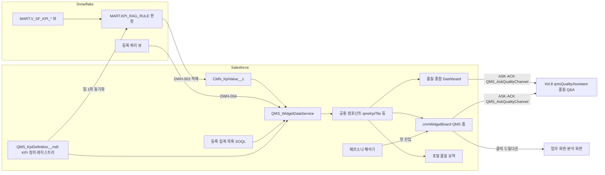

# SL QMS 워크아이템 Vol.7 — QMS-07 Dashboard

Nov 1, 2026 · @배창욱

## 1. 개요

Vol.7은 QMS RFP **Q-34 사용자별 Dashboard**의 품질 콘텐츠를 16개 워크아이템으로 내린다. 위젯을 등록·배치하고 역할별 템플릿으로 시작하게 하는 엔진은 Vol.0 CMN-00-DSH-001이 이미 정의했다. 이 Vol.은 그 엔진 위에 올라갈 (1) KPI 정의 레지스트리와 위젯 데이터 서비스, (2) 공용 차트·KPI 컴포넌트, (3) 품질 영역별 위젯 카탈로그, (4) 역할별 추천 템플릿, (5) PoC 시나리오 5의 품질 종합 Dashboard와 AI Q&A 진입점, (6) 협력사 포털 품질 요약, (7) 데이터 신선도·사용 현황 운영을 만든다.

| 기능 묶음 | WI | 핵심 |
| --- | --- | --- |
| 공용 기반 | DSH-001~004 | KPI 정의 레지스트리·RAG 규칙 단일화, 위젯 데이터 서비스(KPI·등록 쿼리·등록 집계·등록 목록, 공장 권한·캐시), 공용 차트·KPI 컴포넌트 라이브러리, 위젯 설정 폼 |
| 영역별 위젯 | DSH-005~012 | 수입검사·협력사, 공정·제품(SPC·초기유동·출하검사·EOL), 부적합·4M, 고객 품질(B2B·클레임·8D), 심사·인증·개선, 측정·교육·분석실·한도견본, 레슨런·수평전개·PPAP, AI 조기경보·정확도·Q&A 진입 |
| 템플릿·운영 | DSH-013~016 | 역할별 추천 템플릿과 페르소나 해석, 품질 종합 Dashboard(PoC 5), 협력사 포털 품질 요약, KPI 신선도·위젯 성능·사용 현황 |

**도메인 정의**

- **KPI**: 기간·차원별로 Snowflake에서 계산해 `CMN_KpiValue__c`로 적재된 숫자(DWH-003). 한 KPI는 키(`QMS_{영역}_{지표}`), 단위, 좋은 방향(높을수록 좋음 / 낮을수록 좋음), 주기, 차원, RAG 판정 규칙을 갖는다. Vol.3~6c가 각자 KPI 키를 정의했으므로, 이 Vol.은 그 정의를 한 곳(KPI 정의 레지스트리)에 모아 화면 표시와 RAG 판정 기준을 통일한다.
- **위젯**: `cmnWidgetBoard`(DSH-001)에 올라가는 LWC 한 칸. 대부분은 새 코드 없이 **공용 컴포넌트 + 설정(JSON)**으로 정의한다. 예: "수입검사 로트 합격률 타일" = `qmsKpiTile` + `{"kpiKey":"QMS_IQC_LAR"}`.
- **데이터 원천 4종**: KPI 값(CMN_KpiValue__c, 추세·통계), 등록 쿼리(DWH-004 `CMN_DwQuery__mdt`, 파레토·상세·드릴다운), 등록 집계(Salesforce SOQL 집계, 실시간 건수), 등록 목록(Salesforce SOQL 목록, 내 담당·임박 건). 위젯은 이 네 가지만 쓰고 자유 SOQL·자유 SQL을 만들지 않는다.
- **역할별 추천 템플릿**: 경영리더, 품질본부장, 공장 품질팀장, 품질 엔지니어, SQE, 현장 검사원, 개발 PM·MDT가 처음 홈에 들어왔을 때 받는 위젯 조합. 사용자는 이후 자유롭게 바꾼다(DSH-001 BR-3).

**선행 공통 WI**: DSH-001(위젯 프레임워크), DWH-003(KPI 적재), DWH-004(드릴다운 쿼리), SEC-001·002(PSG·공장 권한), I18N-001(라벨·숫자 형식), UX-001(모바일), TDO-004(QMS 홈), AI-004·005(AI 정확도 KPI·Q&A 프레임워크).

**다른 메뉴와의 경계**

| 연결 대상 | 이 Vol.이 하는 것 | 상대 메뉴가 하는 것 |
| --- | --- | --- |
| CMN-00-DSH-001 위젯 프레임워크 | 품질 위젯 메타데이터·템플릿 레코드, 공용 위젯 컴포넌트, 위젯 설정 폼 `cmnWidgetConfigForm`, 페르소나 해석기 구현 | 보드 그리드·배치 저장·갤러리·템플릿 복사 엔진 |
| CMN-00-DWH-003 KPI 적재 | KPI 정의 레지스트리를 원천으로 Snowflake `MART.KPI_RAG_RULE`을 채움(RAG 판정 기준 단일화) | KPI 값 계산·적재, Rag 판정 |
| Vol.3~6c 각 메뉴 | KPI 키·등록 쿼리 키를 위젯으로 소비, 레지스트리에 등록 | KPI 계산 뷰(MART.V_SF_KPI_*), 등록 쿼리, 업무 객체 |
| Vol.4 SPC, Vol.5 B2B | `qmsSpcChart`, `qmsB2bMisCurve` 등 업무 화면 컴포넌트를 위젯으로 등록(설정 스키마 포함) | 컴포넌트 구현(`@api config` 계약 준수) |
| Vol.6c SQM | 포털 홈 품질 요약에서 협력사 스코어카드로 연결 | 포털 스코어카드 `qmsPortalScorecard` |
| Vol.8 AI | AI 정확도 위젯, 질문 위젯과 메시지 채널 `QMS_AskQualityChannel` 정의·발행(ACK 없으면 복사 대체 경로), 여러 공장 위험 목록 위젯(QMS_EW_TOP_RISKS 사용), Vol.8 qmsRiskTopWidget 등록, 품질 종합 Dashboard 페이지에 Agent 패널 배치 | 조기경보 KPI·경보·위험 보드·qmsRiskTopWidget, 채널 구독·ACK·답변 패널 qmsQualityAssistant(AIQ-010), Q&A 에이전트(Agentforce), AI 정확도·사용량 KPI |
| QMS-03-SPP 포털 | 포털 홈에 넣을 `qmsPortalQualitySummary` | 포털 홈 배치(SPP-002 변경 요청) |
| PMS | PMS 템플릿에 넣을 수 있는 품질 위젯 세트 | PMS 대시보드 템플릿·PMS 위젯 |

**앞 Vol. 상태**: Vol.0·2·3은 검토 대기, Vol.4~6c는 작성 직후 정합 수정 중이다. KPI 키는 각 Vol. 3절 KPI 표 기준이며, 이름이 바뀌면 이 Vol.의 KPI 카탈로그(3절)와 위젯 설정만 고치면 된다(코드 변경 없음).

## 2. 업무 흐름

KPI 숫자는 Snowflake가 계산하고 RAG(초록·노랑·빨강)도 Snowflake가 판정한다. 판정 기준은 Salesforce의 KPI 정의 레지스트리 하나에서 관리하고 매일 Snowflake로 내려보낸다. 화면은 판정을 다시 계산하지 않는다. 위젯은 공용 데이터 서비스 하나를 거쳐서만 데이터를 읽으며, 이 서비스가 공장 권한·비용 권한·협력사 격리를 강제한다.

## 3. 데이터 모델 개요

**객체·메타데이터**

| 이름 | 종류 | 역할 | 정의 WI |
| --- | --- | --- | --- |
| QMS_KpiDefinition__mdt | Custom Metadata | KPI 정의 레지스트리(라벨·단위·방향·주기·차원·RAG 기준·드릴다운·민감도·포털 공개) | DSH-001 |
| MART.KPI_RAG_RULE | Snowflake 테이블 | RAG 판정 기준(레지스트리에서 일 1회 적재) | DSH-001 |
| QMS_WidgetQuery__mdt | Custom Metadata | 위젯이 쓸 수 있는 DWH-004 등록 쿼리 허용 목록(권한·캐시·포털 허용) | DSH-002 |
| QMS_WidgetCount__mdt | Custom Metadata | 등록 집계(SOQL COUNT, 선택적 GROUP BY) | DSH-002 |
| QMS_WidgetList__mdt | Custom Metadata | 등록 목록(SOQL 필드·조건·정렬·건수) | DSH-002 |
| Platform Cache 파티션 QMSDashboard | 설정 | KPI·쿼리 결과 캐시(Org 캐시 2MB 이상) | DSH-002 |
| cmnChartJs | Static Resource | Chart.js(버전 고정). Vol.4 qmsSpcChart·Vol.5 B2B 차트와 공유 | DSH-003 |
| CMN_Widget__mdt 레코드(QMS_W_*) | Custom Metadata(Vol.0) | 품질 위젯 카탈로그 | DSH-005~012 |
| CMN_Widget__mdt.ConfigSchema__c | 필드(Vol.0 변경 요청) | 위젯 설정 JSON 스키마 | DSH-004 |
| QMS_SuggestedQuestion__mdt | Custom Metadata | 역할·언어별 추천 질문 | DSH-012 |
| QMS_AskQualityChannel | Lightning Message Channel | 대시보드 질문 위젯 → Vol.8 qmsQualityAssistant 질문 전달(ASK)과 수신 확인(ACK) | DSH-012 |
| QMS_DashboardFilterChannel | Lightning Message Channel | 품질 종합 Dashboard 공통 필터 방송 | DSH-014 |
| CMN_DashboardTemplate__mdt·Item 레코드 | Custom Metadata(Vol.0) | 역할별 추천 템플릿 | DSH-013 |
| QMS_DashboardPersonaRule__mdt | Custom Metadata | PSG·결재 Role → 템플릿 매핑 규칙 | DSH-013 |
| QMS_WidgetUsageDaily__c | 업무 객체 | 위젯별·일별 로드 수·오류 수·지연(3초 초과) 수 | DSH-016 |

**제공 컴포넌트·서비스**

| 이름 | 종류 | 정의 WI | 사용처 |
| --- | --- | --- | --- |
| QMS_KpiDefinitionService | Apex | DSH-001 | 데이터 서비스, 포털, Vol.8(Q&A 단위·라벨) |
| QMS_WidgetDataService | Apex(@AuraEnabled) | DSH-002 | 모든 위젯, 포털 요약 |
| qmsWidgetBase | LWC 모듈(JS) | DSH-003 | 모든 품질 위젯(로딩·오류·지연 로딩·필터 병합·형식) |
| qmsKpiTile, qmsKpiTrend, qmsParetoChart, qmsCompareBar, qmsRagMatrix, qmsCountTile, qmsRecordListWidget | LWC | DSH-003 | 위젯 카탈로그, 업무 화면 재사용 |
| cmnWidgetConfigForm | LWC(공통) | DSH-004 | DSH-001 보드 편집 모드(QMS·PMS 공용) |
| qmsAskQualityWidget, qmsEarlyWarningWidget, qmsAiAccuracyWidget | LWC | DSH-012 | 템플릿, 품질 종합 Dashboard(공장 단위 위험 위젯은 Vol.8 qmsRiskTopWidget을 등록) |
| QMS_DashboardPersonaResolver | Apex | DSH-013 | DSH-001 BR-3 템플릿 선택(Vol.0 변경 요청의 해석기 인터페이스 구현) |
| qmsQualityOverview | LWC(앱 페이지) | DSH-014 | SL QMS 앱 "품질 종합 현황" |
| qmsPortalQualitySummary | LWC(LWR) | DSH-015 | 포털 홈(SPP-002) |
| QMS_KpiFreshnessJob, QMS_WidgetTelemetryService | Apex | DSH-016 | 운영 |

**권한 셋과 페르소나 매핑**

| Permission Set / Custom Permission | 내용 | PSG |
| --- | --- | --- |
| QMS_PS_Dashboard_Base | 데이터 서비스·공용 컴포넌트 Apex 접근, CMN_KpiValue__c Read, QMS_WidgetUsageDaily__c 생성(서비스 경유) | 모든 QMS PSG, PMS_PSG_PM·CFT·PMO(품질 위젯 사용 시) |
| Custom Permission QMS_DashboardAllPlants | KPI·쿼리 위젯에서 공장 필터 없이 전 공장 조회 | CMN_PSG_Executive, QMS_PSG_QualityAdmin, 품질본부장(QM_HEAD Role 사용자에게 개별 PS QMS_PS_Dashboard_AllPlants로 부여) |
| Custom Permission QMS_ViewCost | 비용 위젯(COPQ·클레임 비용·워런티 비용) | Vol.6a 비용 PS(QMS_PS_NcrCost_Read)에 포함, 이 Vol.은 확인만 |
| QMS_PS_Dashboard_Admin | 신선도·사용 현황 화면, 캐시 비우기, 템플릿 미리보기 | QMS_PSG_QualityAdmin, CMN_PSG_SystemAdmin |
| QMS_PS_Portal_Dashboard | 포털 품질 요약 Apex 접근 | QMS_PSG_SupplierPortal |

**KPI 카탈로그(QMS_KpiDefinition__mdt 초기 데이터)**

단위 코드: PCT(%), PPM, CNT(건·개), DAYS(일), MIN(분), RATIO(지수), R1000(대당 천 대), CUR(기업 통화), SCORE(점). 방향: UP(높을수록 좋음), DOWN(낮을수록 좋음), NONE(판정 없음). RAG 방식: TH(고정 기준, 초록 기준 / 노랑 기준), ZERO(0이면 초록, 노랑 기준 이하 노랑), TGT(KpiValue.Target__c 대비, 노랑 = 목표의 허용 비율), NONE. 기준 값은 초기 제안이며 품질경영팀이 확정한다(D7-3).

| KpiKey | 영역 | 단위 | 방향 | 주기 | 차원 | RAG(초록 / 노랑) | 소유 WI | 드릴다운 |
| --- | --- | --- | --- | --- | --- | --- | --- | --- |
| QMS_IQC_LOTS | IQC | CNT | NONE | DAY, MONTH | Plant, Supplier, Item | NONE | QMS-03-IQC-007 | qmsIqcWorkbench |
| QMS_IQC_LAR | IQC | PCT | UP | DAY, MONTH | Plant, Supplier, Item | TH 98 / 95 | QMS-03-IQC-007 | 협력사 비교 위젯 |
| QMS_IQC_HOLD_PPM | IQC | PPM | DOWN | DAY, MONTH | Plant, Supplier, Item | TH 100 / 500 | QMS-03-IQC-007 | 협력사 비교 위젯 |
| QMS_IQC_OVERDUE | IQC | CNT | DOWN | DAY, MONTH | Plant | ZERO / 3 | QMS-03-IQC-007 | qmsIqcWorkbench(기한 경과 필터) |
| QMS_COA_ONTIME | IQC | PCT | UP | MONTH | Plant, Supplier | TH 95 / 85 | QMS-03-IQC-007 | 협력사 비교 위젯 |
| QMS_PERIODIC_TEST_COMPLIANCE | PWT | PCT | UP | MONTH | Plant, Supplier | TH 95 / 85 | QMS-03-PWT-002 | qmsPeriodicTestBoard |
| QMS_PERIODIC_TEST_OVERDUE | PWT | CNT | DOWN | MONTH | Plant, Supplier | ZERO / 2 | QMS-03-PWT-002 | qmsPeriodicTestBoard |
| QMS_EFC_PPM | EFC | PPM | DOWN | DAY | Plant, Line, Item | TGT 120% | QMS-04-EFC-002 | qmsStabilizationList |
| QMS_EFC_FPY | EFC | PCT | UP | DAY | Plant, Line, Item | TGT 98% | QMS-04-EFC-002 | qmsStabilizationList |
| QMS_SPC_CPK | SPC | RATIO | UP | DAY, MONTH | Plant, Line, Item, Characteristic | TGT 1.0 하한 | QMS-04-SPC-003 | qmsSpcChart |
| QMS_SPC_PPK | SPC | RATIO | UP | DAY, MONTH | Plant, Line, Item, Characteristic | TGT 1.0 하한 | QMS-04-SPC-003 | qmsSpcChart |
| QMS_SPC_BELOW_TARGET | SPC | CNT | DOWN | DAY | Plant, Line | ZERO / 2 | QMS-04-SPC-003 | SPC 요약 위젯 |
| QMS_SPC_SIGNALS_OOS | SPC | CNT | DOWN | DAY | Plant, Line | ZERO / 1 | QMS-04-SPC-002 | SPC 알람 목록 |
| QMS_SPC_SIGNALS_OOC | SPC | CNT | DOWN | DAY | Plant, Line | ZERO / 5 | QMS-04-SPC-002 | SPC 알람 목록 |
| QMS_SPC_OCAP_ONTIME | SPC | PCT | UP | MONTH | Plant | TH 95 / 85 | QMS-04-SPC-005 | SPC 알람 목록 |
| QMS_FQC_LOTS | FQC | CNT | NONE | DAY, MONTH | Plant, Item, Customer | NONE | QMS-04-FQC-004 | 출하검사 대기열 |
| QMS_FQC_LAR | FQC | PCT | UP | DAY, MONTH | Plant, Item, Customer | TH 99.5 / 98 | QMS-04-FQC-004 | 출하검사 대기열 |
| QMS_FQC_HOLD_PPM | FQC | PPM | DOWN | DAY, MONTH | Plant, Item, Customer | TH 50 / 200 | QMS-04-FQC-004 | 출하 보류 목록 |
| QMS_EOL_FPY | EOL | PCT | UP | DAY | Plant, Line, Item | TH 98 / 95 | QMS-04-FQC-004 | 라인 비교 위젯 |
| QMS_EOL_FAIL_PPM | EOL | PPM | DOWN | DAY | Plant, Line, Item | TH 100 / 300 | QMS-04-FQC-004 | 라인 비교 위젯 |
| QMS_EOL_COVERAGE | EOL | PCT | UP | DAY | Plant, Line, Item | TH 100 / 99.5 | QMS-04-FQC-004 | 라인 비교 위젯 |
| QMS_HZD_OPEN | HZD | CNT | NONE | DAY | Plant | NONE | QMS-04-HZD-003 | 수평전개 대상 목록 |
| QMS_HZD_ONTIME | HZD | PCT | UP | MONTH | Plant | TH 90 / 80 | QMS-04-HZD-003 | 수평전개 대상 목록 |
| QMS_LELE_PUBLISHED_DEV / _MP / _FIELD | LEL | CNT | UP | MONTH | 전사 | NONE | QMS-04-LEL-001 | 레슨런 라이브러리 |
| QMS_LELE_REVIEW_RATE | LEL | PCT | UP | MONTH | Customer | TH 95 / 85 | QMS-04-LEL-005 | 반영 검토 목록 |
| QMS_LELE_APPLY_RATE | LEL | PCT | UP | MONTH | Customer | TH 80 / 60 | QMS-04-LEL-005 | 반영 검토 목록 |
| QMS_PPAP_CUST_ONTIME | RPP | PCT | UP | MONTH | Plant, Customer | TH 95 / 85 | QMS-04-RPP-004 | 고객 PPAP 목록 |
| QMS_PPAP_CUST_OPEN | RPP | CNT | NONE | DAY | Plant, Customer | NONE | QMS-04-RPP-004 | 고객 PPAP 목록 |
| QMS_PPM_CUSTOMER | B2B | PPM | DOWN | DAY, MONTH | Customer, Plant, Item | TGT 100% | QMS-05-B2B-003 | qmsCustomerQualityAnalysis |
| QMS_CUSTOMER_LINE_DEFECTS | B2B | CNT | DOWN | DAY, MONTH | Customer, Plant, Item | NONE | QMS-05-B2B-003 | qmsCustomerQualityAnalysis |
| QMS_FIELD_R1000 | B2B | R1000 | DOWN | MONTH | Customer, Vehicle, Item | TGT 100% | QMS-05-B2B-003 | qmsCustomerQualityAnalysis |
| QMS_FIELD_MIS3_R1000 / QMS_FIELD_MIS12_R1000 | B2B | R1000 | DOWN | MONTH | Customer, Item | TGT 100% | QMS-05-B2B-003 | MIS 곡선 위젯 |
| QMS_WARRANTY_COST | B2B | CUR | DOWN | MONTH | Customer, Plant, Item | NONE(민감) | QMS-05-B2B-003 | qmsCustomerQualityAnalysis |
| QMS_CUSTOMER_RETURNS | B2B | CNT | DOWN | MONTH | Customer, Plant, Item | NONE | QMS-05-B2B-003 | qmsCustomerQualityAnalysis |
| QMS_B2B_ALERTS_OPEN | B2B | CNT | DOWN | DAY | Customer, Plant | ZERO / 3 | QMS-05-B2B-005 | 경보 목록 |
| QMS_CUSTOMER_SCORE | B2B | SCORE | UP | MONTH | Customer, Plant | TGT 100% | QMS-05-B2B-007 | 고객 평가 목록 |
| QMS_CLAIM_RECEIVED | CLM | CNT | DOWN | MONTH | Customer, Plant | NONE | QMS-05-CLM-011 | 클레임 목록 |
| QMS_CLAIM_OPEN | CLM | CNT | DOWN | DAY | Customer, Plant | NONE | QMS-05-CLM-011 | 클레임 목록 |
| QMS_CLAIM_D3_ONTIME | CLM | PCT | UP | MONTH | Customer, Plant | TH 100 / 90 | QMS-05-CLM-011 | 클레임 목록 |
| QMS_CLAIM_8D_ONTIME | CLM | PCT | UP | MONTH | Customer, Plant | TH 95 / 85 | QMS-05-CLM-011 | 클레임 목록 |
| QMS_CLAIM_LEADTIME | CLM | DAYS | DOWN | MONTH | Customer, Plant | TH 45 / 60 | QMS-05-CLM-011 | 클레임 목록 |
| QMS_CLAIM_RECURRENCE | CLM | CNT | DOWN | MONTH | Customer, Plant, Item | ZERO / 1 | QMS-05-CLM-011 | 클레임 목록 |
| QMS_CLAIM_COST / QMS_CLAIM_RECOVERED | CLM | CUR | DOWN / UP | MONTH | Customer, Plant, Supplier | NONE(민감) | QMS-05-CLM-010 | 클레임 비용 목록 |
| QMS_8D_OPEN_CLAIM / _NCR_SUPPLIER / _NCR_INTERNAL | 8D | CNT | NONE | DAY | Plant, Supplier | NONE | QMS-05-CLM-003 | 8D 목록 |
| QMS_8D_OVERDUE_ACTIONS | 8D | CNT | DOWN | DAY | Plant, Supplier | ZERO / 5 | QMS-05-CLM-003 | 8D 액션 목록 |
| QMS_8D_EFFECTIVE_RATE | 8D | PCT | UP | MONTH | Plant, Supplier | TH 90 / 80 | QMS-05-CLM-003 | 8D 목록 |
| QMS_4M_OPENED | 4MC | CNT | NONE | MONTH | Plant, Supplier | NONE | QMS-06-4MC-008 | 4M 목록 |
| QMS_4M_OPEN | 4MC | CNT | NONE | DAY | Plant, Supplier | NONE | QMS-06-4MC-008 | 4M 목록 |
| QMS_4M_LEAD_COMPLIANCE | 4MC | PCT | UP | MONTH | Plant, Supplier | TH 95 / 85 | QMS-06-4MC-008 | 4M 목록 |
| QMS_4M_ONTIME_APPLY | 4MC | PCT | UP | MONTH | Plant, Supplier | TH 90 / 80 | QMS-06-4MC-008 | 4M 목록 |
| QMS_4M_CYCLE_DAYS | 4MC | DAYS | DOWN | MONTH | Plant | TH 60 / 90 | QMS-06-4MC-008 | 4M 목록 |
| QMS_4M_UNAUTHORIZED | 4MC | CNT | DOWN | MONTH | Plant, Supplier | ZERO / 1 | QMS-06-4MC-008 | 4M 목록 |
| QMS_NCR_OPENED | NCR | CNT | DOWN | DAY, MONTH | Plant, Line, Supplier, Item | NONE | QMS-06-NCR-008 | NCR 추세 위젯 |
| QMS_NCR_OPEN | NCR | CNT | DOWN | DAY | Plant, Supplier | NONE | QMS-06-NCR-008 | NCR 목록 |
| QMS_NCR_OVERDUE | NCR | CNT | DOWN | DAY | Plant, Supplier | ZERO / 5 | QMS-06-NCR-008 | NCR 목록(기한 경과) |
| QMS_NCR_CLOSE_DAYS | NCR | DAYS | DOWN | MONTH | Plant | TH 30 / 45 | QMS-06-NCR-008 | NCR 목록 |
| QMS_NCR_REPEAT_RATE | NCR | PCT | DOWN | MONTH | Plant, Supplier | TH 2 / 5 | QMS-06-NCR-008 | NCR 목록(재발) |
| QMS_NCR_DEFECT_QTY | NCR | CNT | DOWN | DAY, MONTH | Plant, Supplier, Item | NONE | QMS-06-NCR-008 | NCR 파레토 |
| QMS_LMS_CHECK_ONTIME | LMS | PCT | UP | MONTH | Plant | TH 95 / 85 | QMS-06-LMS-002 | 견본 점검 목록 |
| QMS_LMS_EXPIRED_IN_USE | LMS | CNT | DOWN | DAY | Plant | ZERO / 1 | QMS-06-LMS-002 | 견본 사본 목록 |
| QMS_LMS_COVERAGE | LMS | PCT | UP | MONTH | Plant | TH 95 / 80 | QMS-06-LMS-002 | 견본 목록 |
| QMS_TRN_PLAN_RATE | TRN | PCT | UP | MONTH | Plant | TH 90 / 75 | QMS-06-TRN-003 | 교육 계획 |
| QMS_TRN_QUAL_EXPIRING | TRN | CNT | NONE | DAY | Plant | NONE | QMS-06-TRN-003 | 자격 매트릭스 |
| QMS_TRN_QUAL_SHORTAGE | TRN | CNT | DOWN | DAY | Plant | ZERO / 2 | QMS-06-TRN-003 | 자격 매트릭스 |
| QMS_GAU_CAL_ONTIME | GAU | PCT | UP | MONTH | Plant | TH 98 / 90 | QMS-06-GAU-002 | 교정 계획 |
| QMS_GAU_OVERDUE | GAU | CNT | DOWN | DAY | Plant | ZERO / 3 | QMS-06-GAU-002 | list:QMS_Gauge__c.QMS_CalOverdue(교정 기한 경과 정지만) |
| QMS_GAU_ASFOUND_OOT_RATE | GAU | PCT | DOWN | MONTH | Plant | TH 2 / 5 | QMS-06-GAU-002 | 교정 목록 |
| QMS_MSA_ACCEPT_RATE | MSA | PCT | UP | MONTH | Plant | TH 90 / 75 | QMS-06-MSA-005 | MSA 목록 |
| QMS_MSA_COVERAGE | MSA | PCT | UP | MONTH | Plant | TH 95 / 80 | QMS-06-MSA-005 | MSA 계획 |
| QMS_MSA_OVERDUE | MSA | CNT | DOWN | DAY | Plant | ZERO / 3 | QMS-06-MSA-005 | MSA 계획 |
| QMS_LAB_TAT | LAB | DAYS | DOWN | MONTH | Plant | TH 5 / 10 | QMS-06-LAB-004 | 분석 대기열 |
| QMS_LAB_ONTIME | LAB | PCT | UP | MONTH | Plant | TH 90 / 80 | QMS-06-LAB-004 | 분석 대기열 |
| QMS_LAB_BACKLOG | LAB | CNT | NONE | DAY | Plant | NONE | QMS-06-LAB-004 | 분석 대기열 |
| QMS_AUDIT_PROGRAM_COMPLIANCE | AUD | PCT | UP | MONTH | Plant | TH 90 / 80 | QMS-06-IAU-007 | 심사 프로그램 |
| QMS_AUDIT_FINDING_OPEN_INT / _SUP / _CUS / _CER | AUD | CNT | NONE | DAY | Plant, Supplier, Customer | NONE | QMS-06-IAU-007 | 지적 목록 |
| QMS_AUDIT_FINDING_OVERDUE_INT / _SUP / _CUS / _CER | AUD | CNT | DOWN | DAY | Plant, Supplier, Customer | ZERO / 0(1건부터 빨강) | QMS-06-IAU-007 | 지적 목록(기한 경과) |
| QMS_AUDIT_FINDING_CLOSE_DAYS | AUD | DAYS | DOWN | MONTH | Plant | TH 30 / 60 | QMS-06-IAU-007 | 지적 목록 |
| QMS_AUDIT_REPEAT_RATE | AUD | PCT | DOWN | QUARTER | Plant | TH 5 / 10 | QMS-06-IAU-007 | 지적 파레토 |
| QMS_AUDIT_SCORE | AUD | PCT | UP | MONTH | Plant, Supplier, Customer | TH 90 / 80 | QMS-06-IAU-007 | 요소 추이 위젯 |
| QMS_SUPPLIER_PPM | SQM | PPM | DOWN | MONTH | Supplier, Item, Plant | TGT 100% | QMS-06-SQM-002 | qmsSupplierScorecard |
| QMS_SUPPLIER_SCORE | SQM | SCORE | UP | MONTH | Supplier | TH 85 / 70 | QMS-06-SQM-002 | qmsSupplierScorecard |
| QMS_SUPPLIER_GRADE_COUNT_A ~ _D | SQM | CNT | NONE | QUARTER | Plant | NONE | QMS-06-SQM-002 | 협력사 등급 목록 |
| QMS_SUPPLIER_TARGET_ACHIEVE | SQM | PCT | UP | MONTH | Plant | TH 90 / 75 | QMS-06-SQM-002 | 협력사 비교 위젯 |
| QMS_IMP_ACTIVE | IMP | CNT | NONE | MONTH | Plant | NONE | QMS-06-IMP-002 | 개선 과제 포트폴리오 |
| QMS_IMP_ONTIME_RATE | IMP | PCT | UP | MONTH | Plant | TH 90 / 75 | QMS-06-IMP-002 | 개선 과제 포트폴리오 |
| QMS_IMP_SAVINGS | IMP | CUR | UP | MONTH | Plant | NONE | QMS-06-IMP-002 | 개선 과제 포트폴리오 |
| QMS_EW_RISK_SCORE | EW | SCORE | DOWN | DAY | Plant, Supplier, Line, ProductGroup(대상 유형별, 공장별 상위 200개만 적재) | TH 40 / 70(Vol.8 등급 기준으로 확정) | QMS-08-AIQ-011 | page:qmsRiskBoard |
| QMS_EW_ALERTS_OPEN | EW | CNT | DOWN | DAY | Plant | ZERO / 3 | QMS-08-AIQ-012 | page:qmsRiskBoard |
| QMS_EW_PRECISION | EW | PCT | UP | MONTH | Plant | TH 50 / 30 | QMS-08-AIQ-006 | page:qmsAiOpsConsole |
| QMS_AI_CALLS_{UseCase} | AI | CNT | NONE | DAY | Plant | NONE | QMS-08-AIQ-001 | page:qmsAiOpsConsole |
| AI_HIT_TOP1_{UseCase} / AI_HIT_TOP3_{UseCase} | AI | PCT | UP | MONTH | Plant | TOP1 TH 60 / 40, TOP3 TH 80 / 60 | CMN-00-AI-004(키 규칙 QMS-08-AIQ-006) | AI 추천 리스트뷰 |
| AI_HIT_TOP5_QMS_LELE | AI | PCT | UP | MONTH | Plant | TH 85 / 70 | QMS-08-AIQ-006 | AI 추천 리스트뷰 |
| AI_ADOPT_RATE_{UseCase} | AI | PCT | UP | MONTH | Plant | TH 50 / 30 | CMN-00-AI-004(키 규칙 QMS-08-AIQ-006) | AI 추천 리스트뷰 |
| QMS_INT_FAILED | INT | CNT | DOWN | DAY | 인터페이스(키 접미사, BR 아래 주석) | ZERO / 5 | QMS-09-INT-002 | page:qmsSyncMonitor |
| QMS_INT_PENDING_AGED | INT | CNT | DOWN | DAY | 인터페이스(키 접미사) | ZERO / 10 | QMS-09-INT-002 | page:qmsSyncMonitor |
| QMS_INT_LATENCY_MIN | INT | MIN | DOWN | DAY | 원천(키 접미사) | TGT(원천별 기준, Vol.9 INT-002 BR-6) | QMS-09-INT-002 | page:qmsSyncMonitor |

비용 KPI 중 QMS_COPQ·QMS_NCR_CHARGEBACK은 Vol.6a 결정대로 CMN_KpiValue__c에 없고 등록 쿼리 QMS_COPQ_TREND로만 조회한다. `{UseCase}` 키는 Vol.8 유스케이스(QMS_RCA, QMS_CAPA, QMS_8D_DRAFT, QMS_LELE, QMS_EW, QMS_QA, QMS_4M_TEST, QMS_COA_ANOMALY, QMS_AUDIT_PREP)마다 레지스트리 레코드 1개씩 등록한다(예: AI_HIT_TOP3_QMS_RCA). 연계 KPI(QMS_INT_*)는 CMN_KpiValue__c에 인터페이스 차원이 없으므로 전체 값은 기본 키로, 인터페이스·원천별 값은 접미사 키(`QMS_INT_FAILED_IF_SAP_004`처럼 인터페이스 ID의 `-`를 `_`로 바꿈)로 적재하도록 Vol.9에 요청한다(관리자 위젯은 전체 값 기본 키를 쓴다).

**위젯 키 규칙**: CMN_Widget__mdt DeveloperName = `QMS_W_{영역}_{이름}`(40자 이내). Category__c = 영역 코드(IQC, PROCESS, NCR4M, CUSTOMER, AUDIT, RESOURCE, KNOWLEDGE, AI, OPS, OVERVIEW). TitleLabel__c·DescLabel__c = `QMS_Widget_{키}_Title`·`_Desc` Custom Label.

**성능·데이터량 가정**: CMN_KpiValue__c는 KPI 약 110개 × 차원 조합 × 13개월 보존으로 수십만~수백만 행이 될 수 있다(DWH-003 BR-1). 위젯은 반드시 KpiKey·PeriodType·PeriodStart·차원 조건으로 조회하고, 데이터 서비스는 ExternalKey 또는 (KpiKey, PeriodType, PeriodStart) 복합 인덱스(Vol.0 DWH-003 변경 요청)를 탄다. 보드당 위젯은 기본 템플릿 기준 최대 12개, 첫 화면 6개를 3초 안에 그린다(DSH-001 AC-4).

## 4. 공용 기반 (DSH-001~004)

### QMS-07-DSH-001 KPI 정의 레지스트리·RAG 규칙 단일화

추적 Q-34, Q-38 · 필수 · W1 · SF, SNOW, MULE · DM, CFG, INT, SQL · Customization · 선행 DWH-003, I18N-001, QMS-03-IQC-007 · 5 M/D

**목적**: Vol.3~6c가 각각 정의한 KPI 110여 개를 한 레지스트리에 모아 화면 라벨·단위·좋은 방향·RAG 기준을 통일한다. 같은 "PPM"이 위젯마다 다른 색 기준으로 보이면 경영 보고에서 숫자 신뢰가 무너진다. RAG 판정은 Snowflake가 하되, 기준은 이 레지스트리 하나에서 관리한다.

**범위** In: KPI 정의 Custom Metadata, 정의 조회 서비스, Snowflake `MART.KPI_RAG_RULE` 동기화, 정의 누락·미적재 점검 리포트. Out: KPI 값 계산(각 소유 WI), 위젯 표시(DSH-003), 신선도 경보(DSH-016).

**데이터 모델**

| 객체 / 필드 | 타입 | 필수 | 설명 |
| --- | --- | --- | --- |
| QMS_KpiDefinition__mdt.DeveloperName | Text(40) | Y | KpiKey와 같은 값(예: QMS_IQC_LAR) |
| QMS_KpiDefinition__mdt.KpiKey__c | Text(60) | Y | CMN_KpiValue__c.KpiKey__c와 일치. 접미사형 키(_OOS 등)는 각각 별도 레코드 |
| QMS_KpiDefinition__mdt.Area__c | Picklist (IQC, PWT, EFC, SPC, FQC, EOL, HZD, LEL, RPP, B2B, CLM, 8D, 4MC, NCR, LMS, TRN, GAU, MSA, LAB, AUD, SQM, IMP, AI, EW, INT) | Y | 위젯 갤러리 분류 |
| QMS_KpiDefinition__mdt.LabelKey__c / DescLabelKey__c | Text(80) | Y / Y | Custom Label명 `QMS_Kpi_{KpiKey}_Label`·`_Desc` |
| QMS_KpiDefinition__mdt.Unit__c | Picklist (PCT, PPM, CNT, DAYS, MIN, RATIO, R1000, CUR, SCORE) | Y | 3절 단위 코드 |
| QMS_KpiDefinition__mdt.Decimals__c | Number(1,0) | Y | 표시 소수 자릿수(PCT 1, PPM 0, RATIO 2, R1000 2, DAYS 1, CNT 0, CUR 0, SCORE 1) |
| QMS_KpiDefinition__mdt.GoodDirection__c | Picklist (UP, DOWN, NONE) | Y | 증감 화살표 색 결정 |
| QMS_KpiDefinition__mdt.PeriodTypes__c | Text(60) | Y | 적재되는 주기(쉼표: DAY, WEEK, MONTH, QUARTER) |
| QMS_KpiDefinition__mdt.DefaultPeriodType__c | Picklist (DAY, WEEK, MONTH, QUARTER) | Y | 위젯 기본 주기 |
| QMS_KpiDefinition__mdt.Dimensions__c | Text(120) | Y | 적재 차원(쉼표: Plant, Line, Item, Supplier, Customer, Characteristic, Vehicle, Department). 전사 값만 있으면 NONE |
| QMS_KpiDefinition__mdt.RagMode__c | Picklist (TH, ZERO, TGT, NONE) | Y | 3절 RAG 방식 |
| QMS_KpiDefinition__mdt.GreenLimit__c / AmberLimit__c | Number(18,4) | TH·ZERO면 Y | 방향 UP: 값 ≥ Green → 초록, ≥ Amber → 노랑 / 방향 DOWN: 값 ≤ Green → 초록, ≤ Amber → 노랑. ZERO는 Green = 0 |
| QMS_KpiDefinition__mdt.TargetAmberRatio__c | Number(6,2) | TGT면 Y | 목표 대비 노랑 허용 비율(%). DOWN 120 = 목표의 120% 이하 노랑 / UP 98 = 목표의 98% 이상 노랑 |
| QMS_KpiDefinition__mdt.FreshnessHours__c | Number(4,0) | Y | 이 시간 안에 새 값이 없으면 "데이터 지연"(DAY 30, MONTH 24 × 35) |
| QMS_KpiDefinition__mdt.SourceView__c | Text(80) | Y | 계산 뷰(예: MART.V_SF_KPI_IQC). 운영 추적용 |
| QMS_KpiDefinition__mdt.OwnerWi__c | Text(40) | Y | 소유 WI(예: QMS-03-IQC-007) |
| QMS_KpiDefinition__mdt.DrillTarget__c | Text(255) | N | 클릭 이동 대상: `page:{앱 페이지 API명}`, `list:{객체}.{리스트뷰 DeveloperName}`, `widget:{WidgetKey}`, `query:{QueryKey}` |
| QMS_KpiDefinition__mdt.IsSensitive__c | Checkbox | Y | 비용 등 민감 KPI. true면 Custom Permission QMS_ViewCost 보유자만 값 반환 |
| QMS_KpiDefinition__mdt.PortalVisible__c | Checkbox | Y | 협력사 포털에 자기 회사 값 공개 가능(Supplier 차원이 있어야 함) |
| QMS_KpiDefinition__mdt.IsActive__c | Checkbox | Y | |
| MART.KPI_RAG_RULE | Snowflake 테이블 | — | KPI_KEY, RAG_MODE, GOOD_DIRECTION, GREEN_LIMIT, AMBER_LIMIT, TARGET_AMBER_RATIO, IS_ACTIVE, _LOADED_AT |

**서비스 API (`QMS_KpiDefinitionService`)**

    QMS_KpiDefDTO get(String kpiKey)                       // 없으면 null
    Map<String, QMS_KpiDefDTO> getMany(Set<String> kpiKeys)
    List<QMS_KpiDefDTO> listByArea(String area)
    String formatValue(String kpiKey, Decimal value, String locale)  // 서버 측 형식(포털·메일용)

**비즈니스 규칙**

- BR-1: 레지스트리 = 3절 KPI 카탈로그의 모든 키(접미사형은 각각 1레코드, 예: QMS_8D_OPEN_CLAIM·_NCR_SUPPLIER·_NCR_INTERNAL)를 초기 데이터로 배포한다. 새 KPI를 만드는 WI는 같은 WI에서 레지스트리 레코드와 라벨(ko·en_US·zh_CN)을 추가해야 완료다(Vol.0 3.3 DoD에 추가 요청).

- BR-2: 정의 조회는 Custom Metadata `getAll()`을 쓰고 Platform Cache(QMSDashboard, 키 `kpidef:v{배포 해시}`)에 1시간 둔다. 메타데이터 배포 시 캐시 버전이 바뀌어 자동 무효화된다.

- BR-3: RAG 규칙 동기화 — Mule 배치(매일 02:00 KST, IF ID IF-SF-002 신규)가 Salesforce REST로 `SELECT KpiKey__c, RagMode__c, GoodDirection__c, GreenLimit__c, AmberLimit__c, TargetAmberRatio__c, IsActive__c FROM QMS_KpiDefinition__mdt`를 읽어 `MART.KPI_RAG_RULE`을 전량 교체(TRUNCATE + INSERT, 트랜잭션)한다. KPI 뷰들은 이 표를 조인해 Rag를 계산한다(DWH-003 BR-1 적재 시 Rag__c 채움).

- BR-4: RAG 계산 식(Snowflake 공통 UDF `MART.F_KPI_RAG(kpi_key, value, target)`) —
  TH·UP: value ≥ green → GREEN, value ≥ amber → AMBER, 그 외 RED.
  TH·DOWN: value ≤ green → GREEN, value ≤ amber → AMBER, 그 외 RED.
  ZERO: value = 0 → GREEN, value ≤ amber → AMBER, 그 외 RED(amber = 0이면 1건부터 RED).
  TGT: target 없으면 NULL. DOWN: value ≤ target → GREEN, value ≤ target × ratio/100 → AMBER, 그 외 RED. UP: value ≥ target → GREEN, value ≥ target × ratio/100 → AMBER, 그 외 RED.
  NONE 또는 value NULL → NULL(화면 회색).
  각 소유 Vol.이 자체 RAG 규칙(예: Vol.6c IAU-007의 MART.KPI_RAG_RULE 기본값)을 따로 두지 않고 이 UDF를 호출하도록 Vol.6c 등에 변경을 요청한다.

- BR-5: 목표값 우선순위 — CMN_KpiValue__c.Target__c(소유 Vol.이 차원별 목표를 넣은 경우: Vol.5 고객 목표, Vol.6c 협력사 목표, Vol.4 초기유동 계획 목표, 특성 TargetCpk) > 레지스트리 RagMode TH 기준. TGT인데 Target__c가 비면 RAG는 NULL이다(임의 기본 목표를 만들지 않는다).

- BR-6: 정합 점검 리포트 `qmsKpiRegistryCheck`(관리자 앱 페이지) — (a) 레지스트리에 있는데 최근 FreshnessHours × 2 동안 CMN_KpiValue__c에 한 건도 없는 키, (b) CMN_KpiValue__c에 있는데 레지스트리에 없는 키(최근 35일 DISTINCT KpiKey 집계), (c) 라벨 번역 누락 키를 표로 보여준다. (b)가 1건 이상이면 매주 월요일 CMN_PSG_SystemAdmin에게 알림 QMS_KPI_UNREGISTERED.

- BR-7: KpiKey 이름 규칙 검사 — 단위 테스트가 모든 레지스트리 레코드에 대해 `^(QMS_[A-Z0-9_]+|AI_[A-Z0-9_]+)$`, DeveloperName = KpiKey, TH·ZERO면 Green·Amber 존재, TGT면 TargetAmberRatio 존재, 방향 UP이면 Green ≥ Amber, DOWN이면 Green ≤ Amber를 확인한다(배포 차단).

- BR-8: QMS_CPK(Vol.0 DWH-003 예시 키)는 등록하지 않는다. Cpk는 QMS_SPC_CPK로 통일한다(interfaces.md 3.1).

**화면/UX**: `qmsKpiRegistryCheck`(SL Admin 앱). 레지스트리 자체 편집은 Setup의 Custom Metadata 화면 또는 배포로 한다(현업 편집 화면을 만들지 않음, 변경 이력 보존을 위해 저장소 배포 원칙).

**권한**: QMS_PS_Dashboard_Admin(점검 리포트), 정의 조회 서비스는 QMS_PS_Dashboard_Base.

**수용 기준**

- AC-1: Given QMS_IQC_LAR(TH, UP, 98/95) 값 96.4, When F_KPI_RAG 계산, Then AMBER.

- AC-2: Given QMS_NCR_OVERDUE(ZERO, amber 5) 값 0·3·6, When 계산, Then GREEN·AMBER·RED.

- AC-3: Given QMS_PPM_CUSTOMER(TGT, DOWN, 120) 목표 50, 값 55, When 계산, Then AMBER. 목표 없는 행은 NULL.

- AC-4: Given 레지스트리에서 QMS_IQC_LAR Green을 97로 바꿔 배포, When 다음 날 02:00 동기화와 KPI 적재, Then MART.KPI_RAG_RULE에 97 반영, 96.4 값이 AMBER 유지·97.2 값 GREEN.

- AC-5: Given CMN_KpiValue__c에 미등록 키 QMS_TEST_X 적재, When 주간 점검, Then 리포트 (b)에 1건, 관리자 알림 1건.

- AC-6: Given DOWN 방향인데 Green 500·Amber 100으로 잘못 넣은 레코드, When 배포 테스트, Then 실패.

**에이전트 주의**: RAG를 LWC나 Apex에서 다시 계산하지 않는다(Snowflake 판정 결과 Rag__c만 표시). 기준값을 컴포넌트 코드에 넣지 않는다. 레지스트리를 업무 객체로 만들지 않는다(Custom Metadata, 배포로 관리).

**오픈 이슈**: RAG 초기 기준값 확정(품질경영팀), KPI 레지스트리 변경 승인 절차(배포 요청서 수준인지 결재인지), Custom Metadata를 Mule이 REST로 읽는 통합 사용자 권한(View All Custom Metadata 불필요 여부 확인).

### QMS-07-DSH-002 위젯 데이터 서비스(공장 권한·비용 권한·캐시)

추적 Q-34, NFR-4.1(3초), NFR-4.2(RBAC) · 필수 · W1 · SF · APEX, DM, CFG · Customization · 선행 DSH-001, DWH-003, DWH-004, SEC-002 · 6 M/D

**목적**: 모든 품질 위젯이 하나의 Apex 서비스로 데이터를 읽게 해 공장 권한·비용 권한·협력사 격리·캐시·성능 규칙을 한 곳에서 강제한다. 위젯마다 따로 SOQL을 쓰면 해외 공장 사용자에게 다른 공장 숫자가 보이는 사고가 반드시 생긴다.

**범위** In: KPI 조회(스냅숏·시계열·차원 분해), 등록 쿼리 호출 래퍼, 등록 집계·등록 목록 실행기, 허용 목록 메타데이터 3종, 캐시, 응답 DTO 계약. Out: 차트 그리기(DSH-003), 등록 쿼리 SQL 자체(각 소유 Vol.).

**데이터 모델**

| 객체 / 필드 | 타입 | 필수 | 설명 |
| --- | --- | --- | --- |
| QMS_WidgetQuery__mdt.QueryKey__c | Text(40) | Y | CMN_DwQuery__mdt 키(예: QMS_NCR_PARETO) |
| QMS_WidgetQuery__mdt.RequiredCustomPermission__c | Text(80) | N | 예: QMS_ViewCost |
| QMS_WidgetQuery__mdt.CacheSeconds__c | Number(5,0) | Y | 기본 600, 0 = 캐시 안 함 |
| QMS_WidgetQuery__mdt.PlantParam__c | Text(40) | N | 공장 코드 목록을 넣을 파라미터명(예: plantCodes). 비면 DWH-004 BR-2 강제 필터만 |
| QMS_WidgetQuery__mdt.SupplierParam__c | Text(40) | N | 포털 호출 시 협력사 코드를 강제로 넣을 파라미터명 |
| QMS_WidgetQuery__mdt.PortalAllowed__c | Checkbox | Y | 포털 사용자 호출 허용 |
| QMS_WidgetCount__mdt.CountKey__c | Text(40) | Y | 예: NCR_MY_OPEN |
| QMS_WidgetCount__mdt.ObjectApiName__c | Text(80) | Y | |
| QMS_WidgetCount__mdt.WhereTemplate__c | Long Text(4000) | Y | 바인드 토큰만 사용(BR-6) |
| QMS_WidgetCount__mdt.GroupByField__c | Text(80) | N | 있으면 그룹별 건수(최대 20그룹) |
| QMS_WidgetCount__mdt.PlantField__c | Text(80) | N | 공장 조건을 붙일 필드(예: Plant__c) |
| QMS_WidgetCount__mdt.LinkTarget__c | Text(255) | N | 클릭 이동(리스트뷰·앱 페이지) |
| QMS_WidgetCount__mdt.AllowedParams__c / QMS_WidgetList__mdt.AllowedParams__c | Text(255) | N | `:cfg_` 토큰으로 받을 config 값(name:type 쉼표, type = string·date·id·integer) |
| QMS_WidgetList__mdt.ListKey__c | Text(40) | Y | 예: CLAIM_DUE_SOON |
| QMS_WidgetList__mdt.ObjectApiName__c | Text(80) | Y | |
| QMS_WidgetList__mdt.Fields__c | Text(1000) | Y | 쉼표 구분 필드 API명(관계 1단계까지) |
| QMS_WidgetList__mdt.WhereTemplate__c / OrderBy__c | Long Text(4000) / Text(255) | Y / Y | |
| QMS_WidgetList__mdt.MaxRows__c | Number(3,0) | Y | 최대 50 |
| QMS_WidgetList__mdt.PlantField__c | Text(80) | N | |
| QMS_WidgetList__mdt.BadgeRule__c | Text(255) | N | 행 강조 규칙 `{필드}{연산자}{필드 또는 값}:{RED 또는 AMBER}`, 세미콜론으로 여러 개, 연산자 = > < >= <= =. 값 `TODAY`는 오늘. 예: `IsOverdue__c=true:RED;DueDate__c<TODAY:AMBER` |

**서비스 API (`QMS_WidgetDataService`, 모두 `@AuraEnabled`, cacheable 여부는 BR-9)**

    QMS_KpiSnapshotDTO getKpiSnapshot(List<String> kpiKeys, String periodType, Map<String,String> dims)
    // 최신 기간 값, 직전 기간 값, 증감, Target, Rag, 기준 시각, 데이터 지연 여부
    QMS_KpiSeriesDTO getKpiSeries(List<String> kpiKeys, String periodType, Integer periods, Map<String,String> dims)
    // 최대 3개 키 × 최대 24기간
    QMS_KpiBreakdownDTO getKpiBreakdown(String kpiKey, String periodType, String breakdownDim,
                                        Map<String,String> dims, Integer top, String sort)
    // 차원별 최신 값(공장·협력사·고객·라인·품번 비교), top 최대 20
    QMS_QueryResultDTO runQuery(String queryKey, Map<String,Object> params)
    QMS_CountResultDTO runCount(String countKey, Map<String,Object> params)
    QMS_ListResultDTO runList(String listKey, Map<String,Object> params)

모든 DTO는 공통 필드 `asOf`(DateTime), `stale`(Boolean), `truncated`(Boolean), `scopeNote`(String: 예 "KR01, KR02 기준"), `errorCode`(String, 정상 시 null)를 갖는다.

**비즈니스 규칙**

- BR-1: 공장 범위 결정 `QMS_DashboardScope.resolve()` — (a) Custom Permission QMS_DashboardAllPlants 보유자 = 전 공장, (b) 그 외 = CMN_UserPlantAccess__c(User = 본인)의 공장 + User.PrimaryPlant__c, (c) 포털 사용자 = 공장 제한 없음 + 협력사 = 본인 Contact.AccountId 고정. 결과는 세션 캐시에 30분.

- BR-2: KPI 조회 공장 규칙 — CMN_KpiValue__c 중 Plant__c가 있는 행은 범위 안 공장만 반환하고, Plant__c가 비어 있는 행(전사·협력사 전체·고객 전체 값)은 내부 사용자 모두에게 반환한다. 위젯 config의 공장 필터가 범위 밖 공장이면 무시하고 scopeNote에 "권한 없는 공장 제외"를 넣는다.

- BR-3: 민감 KPI — 레지스트리 IsSensitive = true인 키는 QMS_ViewCost가 없으면 값 대신 errorCode `NO_PERMISSION`을 반환한다(위젯은 자리표시). 등록 쿼리는 QMS_WidgetQuery__mdt.RequiredCustomPermission__c를 `FeatureManagement.checkPermission`으로 검사한다.

- BR-4: 포털 호출 — 포털 사용자는 레지스트리 PortalVisible = true이고 Dimensions에 Supplier가 있는 키만, Supplier 차원 = 자기 회사로 강제해서 조회한다. 등록 쿼리는 PortalAllowed = true만, SupplierParam에 자기 협력사 코드를 덮어쓴다. 등록 집계·목록은 포털에서 호출할 수 없다(포털 화면은 각 메뉴의 포털 Apex를 쓴다).

- BR-5: 등록 쿼리 호출 — 허용 목록(QMS_WidgetQuery__mdt)에 없는 키는 `NOT_ALLOWED`. PlantParam이 있으면 범위 공장 코드 목록을 파라미터에 넣는다(사용자 입력보다 우선, 교집합). 호출은 `CMN_DwQueryService.query`(DWH-004)를 그대로 쓴다.

- BR-6: 등록 집계·목록 실행 — WhereTemplate는 바인드 토큰만 허용한다: `:userId`, `:userDeptId`(User.Department__c), `:plantIds`(범위 공장 Id 목록), `:today`, `:daysAgo_{n}`·`:daysAhead_{n}`(Date), `:now`, `:dtAgo_{n}`·`:dtAhead_{n}`(DateTime, n일), `:cfg_{name}`(위젯 config 값 — 메타데이터 AllowedParams__c(Text 255, 쉼표)에 이름과 타입(name:type)이 등록된 것만, 그 외는 거부). 문자열 리터럴은 상태값 같은 고정 코드에만 허용하고 사용자 값은 넣지 않는다. 실행은 `Database.queryWithBinds(soql, binds, AccessLevel.USER_MODE)`로 하며 문자열 연결로 값을 넣지 않는다. PlantField가 있으면 `AND {PlantField} IN :plantIds`를 서비스가 붙인다(전 공장 권한자는 생략). USER_MODE라 공유 규칙·FLS가 함께 적용된다.

- BR-7: 캐시 — Org 캐시 파티션 QMSDashboard. 키 = 메서드 + 파라미터 정렬 JSON + 범위 공장 해시의 SHA-1. TTL: KPI 30분(KPI는 하루 1~2회 적재), 등록 쿼리 CacheSeconds, 집계·목록은 캐시하지 않는다(실시간 건수). KPI 적재 완료(DWH-003 적재 배치 종료 이벤트 CMN_KpiLoaded__e — Vol.0 변경 요청)를 받으면 `kpi:` 접두 캐시를 비운다.

- BR-8: 성능 상한 — getKpiSeries는 SOQL 1회(KpiKey IN, PeriodType, PeriodStart ≥, 차원 조건)로 가져온다. 결과 행 2,000 초과 시 truncated. getKpiBreakdown은 최신 PeriodStart를 먼저 집계 쿼리로 구한 뒤 그 기간 행만 읽는다. 각 메서드 서버 처리 p95 800ms 이하(캐시 미스 기준, 개발 Org 데이터 50만 행으로 측정).

- BR-9: `cacheable=true`는 포털·내부 공통으로 쓰되, 집계·목록(runCount, runList)은 실시간이 필요하므로 `cacheable=false` + 위젯에서 "새로고침" 버튼으로만 재호출한다.

- BR-10: 데이터 지연 표시 — stale = (현재 − 해당 KPI 최신 LastModifiedDate) > 레지스트리 FreshnessHours. asOf는 KpiValue의 최신 LastModifiedDate(적재 시각).

**권한**: QMS_PS_Dashboard_Base(내부), QMS_PS_Portal_Dashboard(포털 — getKpiSnapshot·getKpiSeries·runQuery만 Apex 접근 허용하는 별도 클래스 `QMS_PortalWidgetDataService`로 분리).

**수용 기준**

- AC-1: Given KR01 권한만 있는 사용자, CMN_KpiValue__c에 QMS_IQC_LAR KR01·CN01 행과 전사(공장 없음) 행, When getKpiBreakdown(QMS_IQC_LAR, MONTH, Plant), Then KR01 행만 반환하고 scopeNote = "KR01 기준".

- AC-2: Given QMS_DashboardAllPlants 보유 경영진, When 같은 호출, Then KR01·CN01 모두 반환.

- AC-3: Given QMS_ViewCost 없는 사용자, When getKpiSnapshot([QMS_CLAIM_COST]), Then errorCode NO_PERMISSION, 값 null.

- AC-4: Given 협력사 A 포털 사용자, When getKpiSnapshot([QMS_IQC_LAR], dims {Supplier: B의 Id}), Then Supplier = A로 강제한 값 반환.

- AC-5: Given WhereTemplate에 AllowedParams에 없는 `:cfg_keyword` 토큰이 있는 메타데이터, When 배포 단위 테스트, Then 실패. 등록된 `:cfg_recordType`(string)에 값 "PART' OR Name != '"를 넣어 호출하면 바인드 값으로만 처리되어 결과 0건.

- AC-6: Given 같은 getKpiSeries 2회 호출, When 두 번째, Then SOQL 0회(캐시 적중).

- AC-7: Given 허용 목록에 없는 QMS_B2B_DETAIL 쿼리, When runQuery, Then NOT_ALLOWED.

- AC-8: Given 최신 적재가 40시간 전인 DAY 주기 KPI(FreshnessHours 30), When 조회, Then stale = true.

**에이전트 주의**: 위젯 LWC에서 `@salesforce/apex`로 각자 SOQL 클래스를 만들지 않는다(이 서비스만). `without sharing`을 쓰지 않는다. CMN_KpiValue__c가 전사 Read라는 이유로 공장 필터를 빼먹지 않는다(BR-2가 보안 규칙이다). 포털용 메서드를 내부 서비스 클래스에 같이 두지 않는다.

**오픈 이슈**: Platform Cache 용량(Org 파티션 최소 2MB, 라이선스별 기본 제공량 확인), 해외(중국) 사용자 응답 시간 실측.

### QMS-07-DSH-003 공용 차트·KPI 컴포넌트 라이브러리

추적 Q-34, Q-2(모바일) · 필수 · W1 · SF · LWC · Customization · 선행 DSH-002, CMN-00-DSH-001, UX-001 · 7 M/D

**목적**: 위젯 대부분을 새 코드 없이 "공용 컴포넌트 + 설정"으로 만들 수 있게 7개 컴포넌트와 공통 모듈을 제공한다. 위젯마다 모양·색·숫자 형식이 달라지는 것을 막고, 차트 라이브러리를 하나(Chart.js)로 통일한다.

**범위** In: 공통 JS 모듈, 7개 컴포넌트, 정적 리소스 cmnChartJs, 접근성·모바일 규칙, 단위 테스트(Jest). Out: 위젯 메타데이터 등록(DSH-005~012), 설정 폼(DSH-004).

**컴포넌트 사양**

| 컴포넌트 | config(JSON) | 표시 | 데이터 호출 |
| --- | --- | --- | --- |
| qmsKpiTile | kpiKey, periodType(기본 레지스트리), dims, compare(PREV 또는 TARGET, 기본 PREV), spark(true/false, 기본 true), sparkPeriods(기본 12) | 큰 값 + 단위, 증감 화살표(방향 색), RAG 점+문자(초록/노랑/빨강), 목표, 기준 시각, 데이터 지연 배지, 스파크라인 | getKpiSnapshot, spark면 getKpiSeries |
| qmsKpiTrend | kpiKeys(1~3, STACKED_BAR는 1~4), periodType, periods(기본 12), dims, chart(LINE, BAR, STACKED_BAR), showTarget, source(KPI 또는 QUERY), queryKey·params·xField와 yFields(넓은 형식: 열마다 계열) 또는 seriesField·yField(긴 형식: 행마다 계열 값, 최대 8계열) — source QUERY일 때 | 시계열 차트, 목표선, 범례, 마지막 값 레이블 | getKpiSeries 또는 runQuery |
| qmsParetoChart | queryKey, params, labelField, valueField, top(기본 10) | 막대(내림차순) + 누적 비율 선(오른쪽 축 %), 기타 묶음 | runQuery |
| qmsCompareBar | kpiKey, periodType, breakdownDim(Plant, Line, Item, Supplier, Customer), top(기본 10), sort(WORST, BEST) | 가로 막대, RAG 색, 목표선 | getKpiBreakdown |
| qmsRagMatrix | kpiKeys(최대 6), rowDim(Plant, Supplier, Customer), periodType, rows(최대 15) | 행 = 차원 값, 열 = KPI, 셀 = 값 + RAG 색·기호 | getKpiBreakdown(키별) |
| qmsCountTile | countKey, params, labelKey, showGroups(true면 그룹 막대) | 건수(큰 숫자), 그룹별 미니 막대, 새로고침 버튼 | runCount |
| qmsRecordListWidget | listKey 또는 queryKey(+params), columns(표시 열과 라벨 키), max(기본 10) | 표, 강조 배지, 행 클릭 레코드 이동, "모두 보기" 링크 | runList 또는 runQuery |

**비즈니스 규칙**

- BR-1: 공통 모듈 `qmsWidgetBase`(LWC 모듈, `export` 함수·믹스인) — 상태 3종(loading 스켈레톤, error 메시지·재시도 버튼, empty "데이터 없음"), Intersection Observer로 화면에 보일 때 첫 호출(DSH-001 BR-4), 보드 공통 필터(DSH-001 BR-6: 공장·기간)를 config보다 우선 병합, 오류는 위젯 내부에만 표시하고 `CustomEvent('widgeterror')`로 보드에 알림(DSH-016 수집).

- BR-2: 숫자 형식 `qmsKpiFormat.format(value, def, locale)` — 레지스트리 Unit·Decimals를 따르고 `Intl.NumberFormat`(사용자 Locale)로 천 단위 구분. PCT는 "98.4%", PPM은 "1,250 ppm", R1000은 "2.31", CUR는 기업 통화 기호와 0자리, DAYS는 "12.5일"(라벨 번역). null은 "—".

- BR-3: 증감 색 — GoodDirection UP: 증가 = 초록 화살표, 감소 = 빨강. DOWN: 반대. NONE: 회색. 증감은 직전 기간 대비 절대 차이(PCT·RATIO) 또는 비율(그 외)로 표시하고 툴팁에 두 값을 보여준다.

- BR-4: RAG 표시 — 색만으로 구분하지 않는다(접근성): 초록 원 + "정상", 노랑 삼각형 + "주의", 빨강 사각형 + "위험", 회색 대시 + "판정 없음". 라벨은 Custom Label. SLDS 토큰 색(`--slds-g-color-success` 등)을 쓴다.

- BR-5: 차트 — 정적 리소스 `cmnChartJs`(Chart.js, 버전 고정, 저장소 `force-app/main/default/staticresources/cmnChartJs`)를 `loadScript`로 한 번만 로드(모듈 수준 Promise 공유). 외부 CDN 금지. Vol.4 qmsSpcChart·Vol.5 B2B 차트도 같은 리소스를 쓰도록 변경 요청한다. 애니메이션은 끈다(성능). 데이터 포인트가 500개를 넘으면 균등 추출해 그린다.

- BR-6: 크기 대응 — `@api size`(S, M, L)에 따라: S = 타일·건수만(차트 생략 가능), M = 차트 높이 220px, L = 300px + 표. 모바일(formFactor Small)은 모두 S 레이아웃으로 그리고 스파크라인만 유지한다.

- BR-7: 드릴다운 — 타일·막대·행 클릭 시 레지스트리 DrillTarget(또는 config drillTarget)으로 `NavigationMixin` 이동. `page:` = 앱 페이지(필터를 state 파라미터 `c__plant`, `c__period`, `c__kpi`로 전달), `list:` = 리스트뷰, `widget:` = 같은 보드의 해당 위젯 강조, `query:` = 상세 표 모달(qmsRecordListWidget을 모달로 띄움).

- BR-8: 모든 텍스트는 Custom Label(I18N-001). 축·범례 라벨도 번역한다. 날짜 축은 사용자 Locale 형식.

- BR-9: 각 컴포넌트는 `targets`에 `lightning__AppPage`, `lightning__HomePage`, `lightning__RecordPage`를 포함하고, qmsKpiTile·qmsKpiTrend·qmsCompareBar는 포털 재사용(DSH-015)을 위해 `lightningCommunity__Page`, `lightningCommunity__Default`도 포함한다. 포털에서는 `@api portalMode = true`로 포털 데이터 서비스를 호출한다.

- BR-10: Jest 단위 테스트 — 컴포넌트마다 로딩·오류·빈 데이터·정상 렌더링·형식(ko, en_US)·RAG 기호 스냅숏 테스트. 커버리지 85% 이상(Vol.0 3.3).

**화면/UX**: 컴포넌트 미리보기용 앱 페이지 `QMS_Widget_Gallery_Preview`(관리자 전용)에 7개 컴포넌트를 샘플 config로 배치해 디자인 검수에 쓴다.

**권한**: QMS_PS_Dashboard_Base(Apex 접근). 컴포넌트 자체는 권한 없음.

**수용 기준**

- AC-1: Given QMS_NCR_OPEN 현재 12, 직전 15(DOWN 방향), When qmsKpiTile 표시, Then "12", 감소 화살표 초록, 툴팁 "15 → 12".

- AC-2: Given Rag RED, When 화면 판독기, Then "위험" 텍스트가 읽힌다(색만 의존하지 않음).

- AC-3: Given 파레토 데이터 14개 항목, top 10, When 표시, Then 막대 11개(상위 10 + 기타), 누적 선 마지막 100%.

- AC-4: Given 같은 보드에 차트 위젯 5개, When 로드, Then cmnChartJs 네트워크 요청 1회.

- AC-5: Given 모바일(Small), When qmsKpiTrend 표시, Then 타일형 S 레이아웃 + 스파크라인.

- AC-6: Given 한 위젯 Apex 예외, When 보드 표시, Then 그 위젯만 오류 메시지·재시도 버튼, 다른 위젯 정상.

- AC-7: Given en_US 사용자, QMS_IQC_HOLD_PPM 1250.4, When 표시, Then "1,250 ppm".

**에이전트 주의**: 컴포넌트에서 RAG를 계산하지 않는다(DTO의 rag 사용). 차트 라이브러리를 위젯마다 따로 넣지 않는다. CRM Analytics·표준 대시보드 컴포넌트로 대체하지 않는다(DSH-001 에이전트 주의). 하드코딩 색상값(#hex) 대신 SLDS 스타일 훅을 쓴다.

**오픈 이슈**: Chart.js 라이선스(MIT) 사내 오픈소스 사용 승인 절차, LWR 포털에서 `loadScript` 동작 검증(동작하지 않으면 포털용은 CSS 막대로 대체).

### QMS-07-DSH-004 위젯 설정 폼·위젯 등록 규칙

추적 Q-34 · 필수 · W1 · SF · LWC, CFG, DM · Customization · 선행 DSH-003, CMN-00-DSH-001 · 4 M/D

**목적**: 사용자가 보드 편집 모드에서 "이 타일을 KR02 공장, 월 단위로" 같은 위젯 설정을 폼으로 바꾸게 한다. JSON을 직접 고치게 하지 않으며, 위젯마다 설정 화면을 따로 만들지 않도록 JSON 스키마 기반 공통 폼을 둔다. QMS·PMS 공용이므로 이름은 cmn 접두를 쓴다.

**범위** In: CMN_Widget__mdt.ConfigSchema__c 규약(Vol.0 변경 요청), 공통 폼 `cmnWidgetConfigForm`, 스키마 검증, 위젯 등록 규칙과 체크리스트. Out: 보드 편집 모드 자체(DSH-001), 개별 위젯 메타데이터(DSH-005~012).

**데이터 모델**

| 객체 / 필드 | 타입 | 필수 | 설명 |
| --- | --- | --- | --- |
| CMN_Widget__mdt.ConfigSchema__c | Long Text(32768) | N | 설정 스키마 JSON(BR-1). 없으면 설정 버튼 숨김 |
| CMN_Widget__mdt.AvailableSystems__c | Text(40) | N | 위젯을 넣을 수 있는 보드 시스템(QMS, PMS 쉼표). 비면 System__c만 |
| CMN_Widget__mdt.MobileSupported__c | Checkbox | N | 모바일 보드 표시 여부(기본 true) |

**설정 스키마 규약(ConfigSchema__c)**

    {
      "fields": [
        {"name": "kpiKey", "type": "kpiKey", "area": "IQC", "required": true, "labelKey": "QMS_Cfg_Kpi"},
        {"name": "periodType", "type": "picklist", "options": ["DAY","MONTH"], "default": "MONTH"},
        {"name": "dims.Plant", "type": "plant", "multi": false},
        {"name": "dims.Supplier", "type": "lookup", "object": "Account", "filter": "RecordType.DeveloperName = 'CMN_Supplier'"},
        {"name": "top", "type": "integer", "min": 5, "max": 20, "default": 10},
        {"name": "planId", "type": "lookup", "object": "QMS_SpcPlan__c", "filter": "Status__c = 'ACTIVE'"}
      ]
    }

지원 type: text, integer, decimal, boolean, picklist, kpiKey(레지스트리에서 area 필터), plant(사용자 범위 공장만), customer, supplier, item, lookup(object·filter), queryKey(허용 목록에서 선택). text는 선택 속성 `pattern`(정규식 문자열)과 `patternMessageKey`(오류 문구 Custom Label, 비면 공통 "형식이 맞지 않습니다")를 지원한다. 날짜·월 값은 별도 타입을 두지 않고 text + pattern으로 표현한다(예: 월 `^[0-9]{4}-[0-9]{2}$`, 일자 `^[0-9]{4}-[0-9]{2}-[0-9]{2}$`). Vol.5 qmsB2bMisCurve의 cohortFrom·cohortTo 정의(text + pattern, "YYYY-MM")가 이 규약 그대로 동작한다.

**비즈니스 규칙**

- BR-1: `cmnWidgetConfigForm`(@api widgetKey, @api config) — ConfigSchema를 읽어 lightning-input·combobox·lightning-record-picker로 폼을 만들고 "적용" 시 config JSON을 `CustomEvent('configchange')`로 보드에 돌려준다. 보드가 CMN_UserDashboard__c.LayoutJson에 저장한다(DSH-001).

- BR-2: 검증 — required 누락, min·max 위반, text의 pattern 불일치(빈 값은 required가 아니면 통과), kpiKey가 레지스트리에 없거나 area 불일치, plant가 사용자 범위 밖이면 적용 버튼을 막고 필드 오류를 표시한다. 서버 검증 `QMS_WidgetConfigValidator.validate(widgetKey, configJson)`도 보드 저장 시 호출한다(PMS 위젯은 PMS 쪽 검증기 등록, 인터페이스 `CMN_WidgetConfigValidator`).

- BR-2a: pattern 처리 — 클라이언트는 `new RegExp(pattern)`으로 입력값 전체를 검사하고(앵커가 없으면 폼이 `^…$`로 감싼다), 서버 검증기 `QMS_WidgetConfigValidator`는 Apex `Pattern.matches(pattern, value)`로 같은 검사를 한다. 정규식이 잘못된 스키마는 배포 단위 테스트(DSH-004 BR-5)에서 실패시킨다.

- BR-3: lookup 필터 문자열은 메타데이터에만 둔다(사용자 입력 불가). record-picker의 `filter` 속성으로 변환하며 지원하지 않는 식은 배포 테스트에서 실패시킨다.

- BR-4: 위젯 등록 규칙(DSH-005~012 및 다른 Vol.이 위젯을 추가할 때 지켜야 할 체크리스트) — (1) DeveloperName `QMS_W_{영역}_{이름}`, (2) ComponentName은 공용 컴포넌트 우선, 전용 컴포넌트는 `@api config`·`@api size` 계약과 qmsWidgetBase 사용, (3) DefaultConfig·ConfigSchema 필수, (4) TitleLabel·DescLabel ko·en_US·zh_CN, (5) RequiredPermissionSet은 해당 업무 Read PS(예: QMS_PS_Iqc_Read), 비용 위젯은 QMS_PS_NcrCost_Read, (6) DrillTarget 존재 검증, (7) MobileSupported 판단.

- BR-5: 등록 검사 테스트 `QMS_WidgetRegistryTest` — 모든 QMS_W_* 레코드에 대해 ComponentName이 실제 LWC 번들에 존재(메타데이터 API로 확인하는 CI 스크립트 `scripts/ci/check-widgets.js`), DefaultConfig가 ConfigSchema로 검증 통과, 라벨 존재, RequiredPermissionSet 존재를 확인하고 실패 시 배포를 막는다.

- BR-6: 업무 화면 컴포넌트(qmsSpcChart, qmsB2bMisCurve 등)를 위젯으로 등록할 때는 그 컴포넌트가 config 키 이름을 바꾸지 않는 한 이 Vol.이 메타데이터만 추가한다. config 계약이 바뀌면 소유 Vol. WI가 ConfigSchema도 함께 고친다.

**화면/UX**: 보드 편집 모드 위젯 우측 상단 톱니 아이콘 → 패널(데스크톱 오른쪽 드로어, 모바일 전체 화면 모달)로 폼 표시. 미리보기 영역에 변경 결과를 즉시 반영(적용 전 임시 config로 위젯 재렌더).

**권한**: QMS_PS_Dashboard_Base.

**수용 기준**

- AC-1: Given qmsKpiTile 위젯, When 설정에서 kpiKey를 IQC 영역 키 목록에서 QMS_IQC_HOLD_PPM으로 바꾸고 적용, Then 위젯이 PPM 단위로 다시 그려지고 재로그인 후 유지.

- AC-2: Given KR01만 권한 있는 사용자, When plant 필드 선택 목록, Then KR01만 표시.

- AC-3: Given top = 30(max 20), When 적용, Then 차단 + 필드 오류.

- AC-4: Given ComponentName 오타가 있는 위젯 메타데이터, When CI 검사, Then 실패.

- AC-5: Given ConfigSchema가 없는 위젯, When 편집 모드, Then 설정 아이콘 숨김.

- AC-6: Given qmsB2bMisCurve 위젯의 cohortFrom(text, pattern `^[0-9]{4}-[0-9]{2}$`), When "2026-3" 입력 후 적용, Then 필드 오류로 차단. "2026-03"은 통과, 빈 값은 통과(required 아님). 서버 검증기도 같은 결과.

**에이전트 주의**: 위젯마다 별도 설정 LWC를 만들지 않는다. JSON 텍스트 편집기를 사용자에게 노출하지 않는다. 스키마에 SOQL 조각을 넣는 방식을 확장하지 않는다(lookup filter만 허용).

**오픈 이슈**: DSH-001 보드 편집 모드와의 화면 결합 방식(드로어 위치) 디자인 확정.

## 5. 영역별 위젯 카탈로그 (DSH-005~012)

이 절의 WI는 DSH-003 공용 컴포넌트에 설정을 붙여 CMN_Widget__mdt 레코드를 등록하는 일이 대부분이고, 필요한 등록 집계·목록(DSH-002 메타데이터)과 전용 컴포넌트만 추가한다. 위젯 표의 "원천"은 KPI(레지스트리 키), 집계(QMS_WidgetCount__mdt), 목록(QMS_WidgetList__mdt), 쿼리(QMS_WidgetQuery__mdt 허용 DWH-004 키) 중 하나다. 갱신 주기: KPI = 일 1~2회 적재 후 캐시 30분, 쿼리 = 허용 목록 CacheSeconds, 집계·목록 = 열 때와 새로고침 버튼.

**모든 카탈로그 WI 공통 규칙**

- 위젯마다 DSH-004 BR-4 체크리스트(키·컴포넌트·DefaultConfig·ConfigSchema·라벨 3개 언어·RequiredPermissionSet·DrillTarget·MobileSupported)를 채우고 `QMS_WidgetRegistryTest`를 통과해야 완료다.
- RequiredPermissionSet은 해당 업무 조회 PS다: IQC = QMS_PS_Iqc_Read, 안정화 = QMS_PS_Stab_Read, PPAP = QMS_PS_Ppap_Read, SPC = QMS_PS_Spc_Read, FQC·EOL = QMS_PS_Fqc_Read, 레슨런·수평전개 = QMS_PS_Lele_Read, B2B = QMS_PS_B2b_Read, 클레임 = QMS_PS_Claim_Read, 8D = QMS_PS_EightD_Read, NCR = QMS_PS_Ncr_Read, 4M = QMS_PS_FourM_Read, 비용 = QMS_PS_NcrCost_Read, 한도견본 = QMS_PS_LimitSample_Read, 교육·자격 = QMS_PS_Training_Read, 측정기 = QMS_PS_Gauge_Read, MSA = QMS_PS_Msa_Read, 분석실 = QMS_PS_Lab_Request, 심사·인증 = QMS_PS_Audit_Read, 협력사 실적 = QMS_PS_SupplierScore_Read, 개선 과제 = QMS_PS_Imp_Read.
- 각 위젯의 ConfigSchema는 DefaultConfig의 키를 모두 포함하고, 차원 필터(공장·협력사·고객·품번)는 레지스트리 Dimensions에 있는 것만 노출한다.
- 업무 화면에 이미 있는 전용 컴포넌트(qmsSpcChart, qmsB2bMisCurve, qmsB2bTrendChart)는 메타데이터만 등록한다(DSH-004 BR-6).

### QMS-07-DSH-005 수입검사·협력사 품질 위젯

추적 Q-34, Q-6, Q-7, Q-9, Q-18 · 필수 · W1 · SF · CFG, LWC · Tailoring · 선행 DSH-003, DSH-004, QMS-03-IQC-007, QMS-06-SQM-002 · 5 M/D

**목적**: SQE와 공장 품질팀장이 "오늘 검사할 로트가 몇 건, 기한 넘긴 건이 몇 건, 어느 협력사가 나쁜가"를 홈에서 바로 보게 한다. 수입검사·초기안정화·보증시험·협력사 실적을 한 영역(Category IQC)으로 묶는다.

**범위** In: 아래 위젯 14종, 등록 집계 3종·목록 1종, 리스트뷰 2개. Out: KPI 계산(QMS-03-IQC-007, PWT-002, QMS-06-SQM-002), 협력사 스코어카드 화면(QMS-06-SQM-002).

**위젯 사양**

| WidgetKey | 컴포넌트 | 원천 | 기본 config | 크기 | 드릴다운 | 갱신 |
| --- | --- | --- | --- | --- | --- | --- |
| QMS_W_IQC_LAR | qmsKpiTile | KPI QMS_IQC_LAR | `{"kpiKey":"QMS_IQC_LAR","periodType":"MONTH","compare":"PREV"}` | S | widget:QMS_W_IQC_SUPPLIER_WORST | KPI |
| QMS_W_IQC_HOLD_PPM | qmsKpiTile | KPI QMS_IQC_HOLD_PPM | `{"kpiKey":"QMS_IQC_HOLD_PPM","periodType":"MONTH"}` | S | widget:QMS_W_IQC_SUPPLIER_WORST | KPI |
| QMS_W_IQC_TREND | qmsKpiTrend | KPI QMS_IQC_LAR, QMS_IQC_HOLD_PPM | `{"kpiKeys":["QMS_IQC_LAR","QMS_IQC_HOLD_PPM"],"periodType":"MONTH","periods":12,"chart":"LINE"}` | M | page:qmsIqcWorkbench | KPI |
| QMS_W_IQC_SUPPLIER_WORST | qmsCompareBar | KPI QMS_IQC_HOLD_PPM, Supplier 분해 | `{"kpiKey":"QMS_IQC_HOLD_PPM","periodType":"MONTH","breakdownDim":"Supplier","top":10,"sort":"WORST"}` | M | 협력사 Account 레코드(qmsSupplierScorecard) | KPI |
| QMS_W_IQC_QUEUE | qmsCountTile | 집계 IQC_QUEUE | `{"countKey":"IQC_QUEUE","showGroups":true}` | S | page:qmsIqcWorkbench | 실시간 |
| QMS_W_IQC_OVERDUE_NOW | qmsCountTile | 집계 IQC_OVERDUE_NOW | `{"countKey":"IQC_OVERDUE_NOW"}` | S | page:qmsIqcWorkbench(c__overdue=true) | 실시간 |
| QMS_W_COA_ONTIME | qmsKpiTile | KPI QMS_COA_ONTIME | `{"kpiKey":"QMS_COA_ONTIME","periodType":"MONTH"}` | S | 협력사 비교(같은 키 compareBar 모달) | KPI |
| QMS_W_IQC_LEVEL_DIST | qmsCountTile | 집계 SUPPLIER_LEVEL_DIST | `{"countKey":"SUPPLIER_LEVEL_DIST","showGroups":true}` | S | list:CMN_SupplierItem__c.QMS_ByInspectionLevel | 실시간 |
| QMS_W_SUPPLIER_PPM | qmsKpiTile | KPI QMS_SUPPLIER_PPM | `{"kpiKey":"QMS_SUPPLIER_PPM","periodType":"MONTH","compare":"TARGET"}` | S | page:qmsSupplierScorecardList | KPI |
| QMS_W_SUPPLIER_SCORE_WORST | qmsCompareBar | KPI QMS_SUPPLIER_SCORE, Supplier 분해 | `{"kpiKey":"QMS_SUPPLIER_SCORE","periodType":"MONTH","breakdownDim":"Supplier","top":10,"sort":"WORST"}` | M | 협력사 Account 레코드 | KPI |
| QMS_W_SUPPLIER_GRADE_DIST | qmsKpiTrend | KPI QMS_SUPPLIER_GRADE_COUNT_A~D | `{"kpiKeys":["QMS_SUPPLIER_GRADE_COUNT_A","QMS_SUPPLIER_GRADE_COUNT_B","QMS_SUPPLIER_GRADE_COUNT_C","QMS_SUPPLIER_GRADE_COUNT_D"],"periodType":"QUARTER","periods":8,"chart":"STACKED_BAR"}` | M | page:qmsSupplierScorecardList | KPI |
| QMS_W_SUPPLIER_RAG | qmsRagMatrix | KPI 5종, Supplier 행 | `{"kpiKeys":["QMS_IQC_LAR","QMS_IQC_HOLD_PPM","QMS_SUPPLIER_PPM","QMS_COA_ONTIME","QMS_PERIODIC_TEST_COMPLIANCE"],"rowDim":"Supplier","periodType":"MONTH","rows":15}` | L | 협력사 Account 레코드 | KPI |
| QMS_W_STAB_ACTIVE_PART | qmsRecordListWidget | 목록 STAB_ACTIVE | `{"listKey":"STAB_ACTIVE","cfg":{"recordType":"PART"},"max":10}` | L | 계획 레코드(행 클릭) | 실시간 |
| QMS_W_PWT_COMPLIANCE | qmsKpiTile | KPI QMS_PERIODIC_TEST_COMPLIANCE | `{"kpiKey":"QMS_PERIODIC_TEST_COMPLIANCE","periodType":"MONTH"}` | S | page:qmsPeriodicTestBoard | KPI |

**등록 집계·목록(DSH-002 메타데이터)**

| 키 | 종류 | 객체 | 조건(WhereTemplate) | 그룹·필드·정렬 | PlantField | 링크 |
| --- | --- | --- | --- | --- | --- | --- |
| IQC_QUEUE | 집계 | QMS_IqcLot__c | `Status__c IN ('WAITING','IN_INSPECTION')` | GroupBy Status__c | Plant__c | page:qmsIqcWorkbench |
| IQC_OVERDUE_NOW | 집계 | QMS_IqcLot__c | `Status__c IN ('WAITING','IN_INSPECTION') AND DueAt__c < :now` | — | Plant__c | page:qmsIqcWorkbench |
| SUPPLIER_LEVEL_DIST | 집계 | CMN_SupplierItem__c | `Plant__c != null` | GroupBy InspectionLevel__c | Plant__c | list:CMN_SupplierItem__c.QMS_ByInspectionLevel |
| STAB_ACTIVE | 목록 | QMS_StabilizationPlan__c | `Status__c IN ('ACTIVE','EXIT_REVIEW') AND RecordType.DeveloperName = :cfg_recordType` (AllowedParams recordType:string) | 필드 RecordNo__c, Item__r.ItemNo__c, Supplier__r.Name, Line__r.LineCode__c, ElapsedDays__c, MinDays__c, ActualLots__c, MinLots__c, ActualPpm__c, TargetPpm__c, Status__c / 정렬 ActualPpm__c DESC NULLS LAST / 최대 10 / Badge `ActualPpm__c>TargetPpm__c:RED;ActualSpecialDefects__c>0:RED` | Plant__c | list:QMS_StabilizationPlan__c.QMS_Active |

리스트뷰: `CMN_SupplierItem__c.QMS_ByInspectionLevel`(InspectionLevel 정렬, 공장·품번·협력사 열), `QMS_StabilizationPlan__c.QMS_Active`(ACTIVE·EXIT_REVIEW).

**비즈니스 규칙**

- BR-1: 위 14개 위젯을 Category IQC로 등록한다. MobileSupported = true는 QMS_W_IQC_QUEUE, QMS_W_IQC_OVERDUE_NOW, QMS_W_IQC_LAR만(검사원·SQE 모바일 홈용).

- BR-2: STAB_ACTIVE 목록의 Line__r 열은 PRODUCT(초기유동) 레코드타입에서만 값이 있다. 같은 목록 키를 DSH-006 초기유동 위젯이 cfg recordType PRODUCT로 재사용한다.

- BR-3: 협력사 차원 위젯(QMS_W_IQC_SUPPLIER_WORST, QMS_W_SUPPLIER_SCORE_WORST, QMS_W_SUPPLIER_RAG)은 보드 공장 필터가 있으면 그 공장 값만으로 협력사를 비교한다(Plant + Supplier 차원 행). 공장 필터가 없고 전 공장 권한이 없으면 사용자 범위 공장 값만 쓴다(DSH-002 BR-2).

- BR-4: QMS_SUPPLIER_GRADE_COUNT_* 는 분기(QUARTER) 주기 KPI다. CMN_KpiValue__c.PeriodType__c에 QUARTER 값이 추가되기 전(Vol.0 변경 요청)에는 QMS_W_SUPPLIER_GRADE_DIST 위젯을 IsActive = false로 배포한다.

- BR-5: 검사원(Inspector) 모바일 홈에서 QMS_W_IQC_QUEUE를 누르면 qmsIqcWorkbench가 사용자 PrimaryPlant 필터로 열린다.

- BR-6: QMS_W_SUPPLIER_RAG 행 정렬은 RED 개수 많은 순 → AMBER 개수 순. 협력사명은 Account.Name, 행 클릭 시 협력사 Account 레코드.

**화면/UX**: 위젯은 보드(QMS 홈, 템플릿 DSH-013)와 품질 종합 Dashboard(DSH-014)에 배치된다. 별도 화면 없음.

**권한**: IQC 위젯 QMS_PS_Iqc_Read, 협력사 실적 위젯 QMS_PS_SupplierScore_Read, 안정화 QMS_PS_Stab_Read, 보증시험 QMS_PS_Iqc_Read.

**수용 기준**

- AC-1: Given KR01 SQE, KR01 로트 WAITING 7건·IN_INSPECTION 3건, CN01 WAITING 5건, When QMS_W_IQC_QUEUE 표시, Then 10건(WAITING 7, IN_INSPECTION 3), CN01 미포함.

- AC-2: Given 협력사 12곳의 전월 QMS_IQC_HOLD_PPM, When QMS_W_IQC_SUPPLIER_WORST, Then 값 큰 순 10개 막대, 각 막대 RAG 색.

- AC-3: Given ACTIVE 안정화 계획 3건 중 ActualPpm > TargetPpm 1건, When QMS_W_STAB_ACTIVE_PART, Then 그 행이 맨 위·빨강 배지.

- AC-4: Given 기한 경과 로트 2건, When QMS_W_IQC_OVERDUE_NOW 클릭, Then qmsIqcWorkbench가 기한 경과 필터로 열림.

- AC-5: Given QMS_PS_SupplierScore_Read 없는 검사원, When 위젯 갤러리, Then 협력사 실적 위젯 4종이 보이지 않음.

- AC-6: Given 모든 위젯 메타데이터, When QMS_WidgetRegistryTest, Then 통과.

**에이전트 주의**: 수입검사 KPI를 위젯 안에서 로트를 세어 다시 계산하지 않는다(KPI 사용, 실시간 건수만 집계). 협력사 이름 비교 순위를 포털에 노출하지 않는다(DSH-015 규칙).

**오픈 이슈**: 협력사 비교 위젯의 기본 기간(전월 vs 최근 3개월 누적) 확정.

### QMS-07-DSH-006 공정·제품 품질 위젯(SPC·초기유동·출하검사·EOL)

추적 Q-34, Q-10, Q-11, Q-12 · 필수 · W1 · SF · CFG, LWC · Tailoring · 선행 DSH-003, DSH-004, QMS-04-SPC-003, QMS-04-SPC-006, QMS-04-FQC-004, QMS-04-EFC-002 · 5 M/D

**목적**: 공장 품질팀장·공정 엔지니어가 특별특성 공정능력, 이상 신호, 출하검사 합격률, EOL 직행률, 초기유동 진행을 한 영역(Category PROCESS)에서 본다. PoC의 "Cpk 1.33 미만 → 부적합" 흐름을 화면에서 보여주는 출발점이다.

**범위** In: 위젯 15종, 등록 쿼리 허용 2종, 등록 집계 3종, 리스트뷰 3개, qmsSpcChart 위젯 등록. Out: SPC·FQC·EOL·EFC KPI와 쿼리(Vol.4), 관리도 컴포넌트(QMS-04-SPC-006).

**위젯 사양**

| WidgetKey | 컴포넌트 | 원천 | 기본 config | 크기 | 드릴다운 | 갱신 |
| --- | --- | --- | --- | --- | --- | --- |
| QMS_W_SPC_SUMMARY | qmsRecordListWidget | 쿼리 QMS_SPC_PLAN_SUMMARY | `{"queryKey":"QMS_SPC_PLAN_SUMMARY","columns":["charName","lineCode","cpk","ppk","rag","openAlarms","lastMeasuredAt"],"max":15}` | L | SPC 계획 레코드(행 클릭, planId) | 쿼리 600초 |
| QMS_W_SPC_BELOW_TARGET | qmsKpiTile | KPI QMS_SPC_BELOW_TARGET | `{"kpiKey":"QMS_SPC_BELOW_TARGET","periodType":"DAY"}` | S | widget:QMS_W_SPC_SUMMARY | KPI |
| QMS_W_SPC_SIGNALS | qmsKpiTrend | KPI QMS_SPC_SIGNALS_OOS, QMS_SPC_SIGNALS_OOC | `{"kpiKeys":["QMS_SPC_SIGNALS_OOS","QMS_SPC_SIGNALS_OOC"],"periodType":"DAY","periods":30,"chart":"STACKED_BAR"}` | M | list:QMS_SpcAlarm__c.QMS_Open | KPI |
| QMS_W_SPC_OPEN_ALARMS | qmsCountTile | 집계 SPC_OPEN_ALARMS | `{"countKey":"SPC_OPEN_ALARMS","showGroups":true}` | S | list:QMS_SpcAlarm__c.QMS_Open | 실시간 |
| QMS_W_SPC_OCAP_ONTIME | qmsKpiTile | KPI QMS_SPC_OCAP_ONTIME | `{"kpiKey":"QMS_SPC_OCAP_ONTIME","periodType":"MONTH"}` | S | list:QMS_SpcAlarm__c.QMS_Open | KPI |
| QMS_W_SPC_CHART | qmsSpcChart(Vol.4) | QMS-04-SPC-006 | `{"planId":null,"days":30}` | L | SPC 계획 레코드 | 열 때 |
| QMS_W_SPC_CPK_TREND | qmsKpiTrend | KPI QMS_SPC_CPK, QMS_SPC_PPK | `{"kpiKeys":["QMS_SPC_CPK","QMS_SPC_PPK"],"periodType":"MONTH","periods":12,"dims":{"Characteristic":null},"showTarget":true}` | M | qmsSpcChart(같은 특성) | KPI |
| QMS_W_EFC_ACTIVE | qmsRecordListWidget | 목록 STAB_ACTIVE | `{"listKey":"STAB_ACTIVE","cfg":{"recordType":"PRODUCT"},"max":10}` | L | 계획 레코드 | 실시간 |
| QMS_W_EFC_TREND | qmsKpiTrend | KPI QMS_EFC_PPM, QMS_EFC_FPY | `{"kpiKeys":["QMS_EFC_PPM","QMS_EFC_FPY"],"periodType":"DAY","periods":30,"showTarget":true}` | M | list:QMS_StabilizationPlan__c.QMS_Active | KPI |
| QMS_W_FQC_LAR | qmsKpiTile | KPI QMS_FQC_LAR | `{"kpiKey":"QMS_FQC_LAR","periodType":"MONTH"}` | S | page:qmsFqcWorkbench | KPI |
| QMS_W_FQC_HOLD_PPM | qmsKpiTile | KPI QMS_FQC_HOLD_PPM | `{"kpiKey":"QMS_FQC_HOLD_PPM","periodType":"MONTH"}` | S | list:QMS_FinalInspLot__c.QMS_Held | KPI |
| QMS_W_FQC_QUEUE | qmsCountTile | 집계 FQC_QUEUE | `{"countKey":"FQC_QUEUE","showGroups":true}` | S | page:qmsFqcWorkbench | 실시간 |
| QMS_W_FQC_ACTIVE_HOLDS | qmsCountTile | 집계 FQC_ACTIVE_HOLDS | `{"countKey":"FQC_ACTIVE_HOLDS","showGroups":true}` | S | list:QMS_FinalInspHold__c.QMS_Active | 실시간 |
| QMS_W_EOL_FPY_LINES | qmsCompareBar | KPI QMS_EOL_FPY, Line 분해 | `{"kpiKey":"QMS_EOL_FPY","periodType":"DAY","breakdownDim":"Line","top":10,"sort":"WORST"}` | M | widget:QMS_W_EOL_TREND | KPI |
| QMS_W_EOL_TREND | qmsKpiTrend | KPI QMS_EOL_FPY, QMS_EOL_FAIL_PPM | `{"kpiKeys":["QMS_EOL_FPY","QMS_EOL_FAIL_PPM"],"periodType":"DAY","periods":30}` | M | — | KPI |

**등록 쿼리 허용(QMS_WidgetQuery__mdt)**: QMS_SPC_PLAN_SUMMARY(PlantParam plantCode — 범위 공장마다 호출 후 합치지 않고, 보드 공장 필터 1개를 요구: 필터가 없으면 PrimaryPlant), QMS_SPC_CAPABILITY_SERIES(CacheSeconds 1800), QMS_FQC_EOL_SUMMARY는 위젯에 쓰지 않는다(판정용).

**등록 집계(QMS_WidgetCount__mdt)**

| 키 | 객체 | 조건 | 그룹 | PlantField | 링크 |
| --- | --- | --- | --- | --- | --- |
| SPC_OPEN_ALARMS | QMS_SpcAlarm__c | `Status__c IN ('NEW','IN_PROGRESS')` | Status__c | Plant__c | list:QMS_SpcAlarm__c.QMS_Open |
| FQC_QUEUE | QMS_FinalInspLot__c | `Status__c IN ('WAITING','IN_INSPECTION')` | Status__c | Plant__c | page:qmsFqcWorkbench |
| FQC_ACTIVE_HOLDS | QMS_FinalInspHold__c | `IsActive__c = true` | HoldType__c | Plant__c | list:QMS_FinalInspHold__c.QMS_Active |

**비즈니스 규칙**

- BR-1: 위 15개 위젯을 Category PROCESS로 등록한다. MobileSupported = true: QMS_W_SPC_OPEN_ALARMS, QMS_W_FQC_QUEUE, QMS_W_FQC_ACTIVE_HOLDS.

- BR-2: QMS_W_SPC_CHART의 ConfigSchema는 planId(lookup QMS_SpcPlan__c, Status ACTIVE, 사용자 범위 공장)와 days(picklist 7·30·90)를 둔다. planId가 없으면 위젯이 "특성 선택" 안내와 설정 버튼만 보인다. 사용자는 같은 위젯을 여러 개(특성별) 둘 수 있다.

- BR-3: QMS_W_SPC_SUMMARY는 보드 공장 필터가 여러 공장이면 첫 공장만 쓰고 scopeNote에 표시한다(쿼리가 공장 1개 단위). 행 rag 값은 쿼리 결과의 Rag 열을 그대로 쓴다.

- BR-4: QMS_W_SPC_CPK_TREND는 Characteristic 차원이 필수다. 설정에서 특성을 고르지 않으면 공장 전체 평균이 없으므로(레지스트리상 차원 필수) "특성 선택" 안내를 보인다.

- BR-5: 초기유동 위젯(QMS_W_EFC_ACTIVE, QMS_W_EFC_TREND)의 목표선은 KpiValue.Target__c(계획 목표, Vol.4 EFC-002 적재)를 쓴다.

- BR-6: 리스트뷰 `QMS_SpcAlarm__c.QMS_Open`(NEW·IN_PROGRESS, AckDueAt 오름차순), `QMS_FinalInspLot__c.QMS_Held`(ShipHoldStatus HELD), `QMS_FinalInspHold__c.QMS_Active`를 이 WI가 만든다.

**화면/UX**: 보드·품질 종합 Dashboard 배치. 별도 화면 없음.

**권한**: SPC 위젯 QMS_PS_Spc_Read, FQC·EOL QMS_PS_Fqc_Read, 초기유동 QMS_PS_Stab_Read.

**수용 기준**

- AC-1: Given KR01 ACTIVE SPC 계획 20개 중 Cpk < Target 3개, When QMS_W_SPC_BELOW_TARGET, Then 3, RAG RED(ZERO, amber 2 초과).

- AC-2: Given planId 미설정 QMS_W_SPC_CHART, When 표시, Then "특성 선택" 안내와 설정 버튼.

- AC-3: Given NEW 알람 2건·IN_PROGRESS 1건, When QMS_W_SPC_OPEN_ALARMS, Then 3(그룹 2/1).

- AC-4: Given 라인 6개의 전일 EOL FPY, When QMS_W_EOL_FPY_LINES, Then 낮은 순 6막대, 98 미만 노랑·95 미만 빨강.

- AC-5: Given 초기유동 계획 목표 PPM 500, 일별 값 620, When QMS_W_EFC_TREND, Then 목표선 500, 해당 일 점이 RAG AMBER(TGT 120% 이내).

- AC-6: Given 활성 출하검사 Hold(EFC 1, CLAIM 1), When QMS_W_FQC_ACTIVE_HOLDS, Then 2(그룹 EFC 1, CLAIM 1).

**에이전트 주의**: 관리도 점 데이터를 위젯에서 직접 Snowflake로 가져오지 않는다(qmsSpcChart가 DWH-004 쿼리로 처리). Cpk를 위젯에서 계산하지 않는다.

**오픈 이슈**: SPC 요약 위젯의 다공장 합산 표시 요구 여부(현재 공장 1개 단위).

### QMS-07-DSH-007 부적합·4M 위젯

추적 Q-34, Q-19, Q-20, Q-21, Q-22 · 필수 · W1 · SF · CFG, LWC · Tailoring · 선행 DSH-003, DSH-004, QMS-06-NCR-008, QMS-06-4MC-008 · 4 M/D

**목적**: PoC 시나리오 1(NCR)·3(4M)과 RFP 예시 질문 "최근 6개월 주요 불량"에 해당하는 위젯을 만든다. 품질팀장이 미종결·기한 경과 부적합과 적용 임박 4M을 놓치지 않게 한다.

**범위** In: 위젯 13종, 등록 쿼리 허용 3종, 등록 집계 3종·목록 2종, 리스트뷰 7개. Out: NCR·4M KPI와 쿼리(QMS-06-NCR-008, 4MC-008), 비용 데이터 보안(NCR-008 BR-4).

**위젯 사양**

| WidgetKey | 컴포넌트 | 원천 | 기본 config | 크기 | 드릴다운 | 갱신 |
| --- | --- | --- | --- | --- | --- | --- |
| QMS_W_NCR_OPEN | qmsKpiTile | KPI QMS_NCR_OPEN | `{"kpiKey":"QMS_NCR_OPEN","periodType":"DAY","compare":"PREV"}` | S | list:QMS_NCR__c.QMS_Open | KPI |
| QMS_W_NCR_OVERDUE | qmsKpiTile | KPI QMS_NCR_OVERDUE | `{"kpiKey":"QMS_NCR_OVERDUE","periodType":"DAY"}` | S | widget:QMS_W_NCR_OVERDUE_LIST | KPI |
| QMS_W_NCR_STATUS | qmsCountTile | 집계 NCR_OPEN_BY_STATUS | `{"countKey":"NCR_OPEN_BY_STATUS","showGroups":true}` | S | list:QMS_NCR__c.QMS_Open | 실시간 |
| QMS_W_NCR_MY_OPEN | qmsCountTile | 집계 NCR_MY_OPEN | `{"countKey":"NCR_MY_OPEN"}` | S | list:QMS_NCR__c.QMS_MyOpen | 실시간 |
| QMS_W_NCR_PARETO_6M | qmsParetoChart | 쿼리 QMS_NCR_PARETO | `{"queryKey":"QMS_NCR_PARETO","params":{"months":6},"labelField":"defectTypeL2","valueField":"ncrCount","top":10}` | M | query:QMS_NCR_PARETO 상세 | 쿼리 600초 |
| QMS_W_NCR_TREND | qmsKpiTrend | 쿼리 QMS_NCR_TREND | `{"source":"QUERY","queryKey":"QMS_NCR_TREND","params":{"months":12},"xField":"month","yFields":["opened","closed","openEnd"],"chart":"BAR"}` | M | list:QMS_NCR__c.QMS_Open | 쿼리 600초 |
| QMS_W_NCR_REPEAT | qmsKpiTile | KPI QMS_NCR_REPEAT_RATE | `{"kpiKey":"QMS_NCR_REPEAT_RATE","periodType":"MONTH"}` | S | list:QMS_NCR__c.QMS_Repeat | KPI |
| QMS_W_NCR_OVERDUE_LIST | qmsRecordListWidget | 목록 NCR_OVERDUE | `{"listKey":"NCR_OVERDUE","max":10}` | L | NCR 레코드 | 실시간 |
| QMS_W_COPQ_TREND | qmsKpiTrend | 쿼리 QMS_COPQ_TREND(QMS_ViewCost) | `{"source":"QUERY","queryKey":"QMS_COPQ_TREND","params":{"months":12},"xField":"month","yFields":["scrap","rework","sorting","other"],"chart":"STACKED_BAR"}` | M | — | 쿼리 1800초 |
| QMS_W_4M_OPEN | qmsCountTile | 집계 FOURM_OPEN_BY_STATUS | `{"countKey":"FOURM_OPEN_BY_STATUS","showGroups":true}` | S | list:QMS_FourMChange__c.QMS_Open | 실시간 |
| QMS_W_4M_COMPLIANCE | qmsKpiTrend | KPI QMS_4M_LEAD_COMPLIANCE, QMS_4M_ONTIME_APPLY | `{"kpiKeys":["QMS_4M_LEAD_COMPLIANCE","QMS_4M_ONTIME_APPLY"],"periodType":"MONTH","periods":12}` | M | list:QMS_FourMChange__c.QMS_Open | KPI |
| QMS_W_4M_UNAUTHORIZED | qmsKpiTile | KPI QMS_4M_UNAUTHORIZED | `{"kpiKey":"QMS_4M_UNAUTHORIZED","periodType":"MONTH"}` | S | list:QMS_NCR__c.QMS_Unauthorized4M | KPI |
| QMS_W_4M_APPLY_SOON | qmsRecordListWidget | 목록 FOURM_APPLY_SOON | `{"listKey":"FOURM_APPLY_SOON","max":10}` | L | 4M 레코드 | 실시간 |

**등록 쿼리 허용**: QMS_NCR_PARETO(PlantParam plantCodes, CacheSeconds 600), QMS_NCR_TREND(PlantParam plantCodes, 600), QMS_COPQ_TREND(PlantParam plantCodes, RequiredCustomPermission QMS_ViewCost, 1800). 쿼리 결과 열 이름(defectTypeL2, ncrCount, month, opened, closed, openEnd, scrap, rework, sorting, other)은 QMS-06-NCR-008 등록 쿼리의 실제 열 이름에 맞춘다(다르면 config만 수정).

**등록 집계·목록**

| 키 | 종류 | 객체 | 조건 | 그룹·필드·정렬 | PlantField | 링크 |
| --- | --- | --- | --- | --- | --- | --- |
| NCR_OPEN_BY_STATUS | 집계 | QMS_NCR__c | `Status__c NOT IN ('DRAFT','CLOSED','CANCELLED')` | GroupBy Status__c | Plant__c | list:QMS_NCR__c.QMS_Open |
| NCR_MY_OPEN | 집계 | QMS_NCR__c | `Status__c NOT IN ('CLOSED','CANCELLED') AND (OwnerId = :userId OR ResponsibleDept__c = :userDeptId)` | — | — | list:QMS_NCR__c.QMS_MyOpen |
| NCR_OVERDUE | 목록 | QMS_NCR__c | `IsOverdue__c = true AND Status__c NOT IN ('CLOSED','CANCELLED')` | 필드 RecordNo__c, Name, Item__r.ItemNo__c, Supplier__r.Name, ResponsibleDept__r.Name, CountermeasureDueDate__c, Status__c / 정렬 CountermeasureDueDate__c ASC / 최대 10 / Badge `IsOverdue__c=true:RED` | Plant__c | list:QMS_NCR__c.QMS_Overdue |
| FOURM_OPEN_BY_STATUS | 집계 | QMS_FourMChange__c | `Status__c NOT IN ('DRAFT','CLOSED','REJECTED','CANCELLED')` | GroupBy Status__c | Plant__c | list:QMS_FourMChange__c.QMS_Open |
| FOURM_APPLY_SOON | 목록 | QMS_FourMChange__c | `PlannedApplyDate__c >= :today AND PlannedApplyDate__c <= :daysAhead_30 AND Status__c NOT IN ('CLOSED','REJECTED','CANCELLED')` | 필드 RecordNo__c, Name, RecordType.DeveloperName, Supplier__r.Name, PlannedApplyDate__c, Status__c / 정렬 PlannedApplyDate__c ASC / 최대 10 / Badge `Status__c=VERIFYING:AMBER` | Plant__c | list:QMS_FourMChange__c.QMS_ApplySoon |

**비즈니스 규칙**

- BR-1: 위 13개 위젯을 Category NCR4M으로 등록한다. MobileSupported = true: QMS_W_NCR_MY_OPEN, QMS_W_NCR_OVERDUE, QMS_W_4M_OPEN.

- BR-2: QMS_W_COPQ_TREND는 RequiredPermissionSet = QMS_PS_NcrCost_Read로 등록해 권한 없는 사용자의 갤러리에서 숨긴다. 데이터 서비스도 QMS_ViewCost를 다시 검사한다(DSH-002 BR-3, 이중 통제).

- BR-3: QMS_W_NCR_PARETO_6M의 기본 기간은 최근 6개월(RFP 예시 질문과 PoC 시나리오 5 대응). 설정에서 3·6·12개월을 고른다.

- BR-4: NCR_MY_OPEN은 담당(Owner) 또는 귀책 부서 소속 건을 합친다. `:userDeptId`가 비면 Owner 조건만 쓴다.

- BR-5: 리스트뷰 `QMS_NCR__c.QMS_Open`·`QMS_MyOpen`·`QMS_Overdue`·`QMS_Repeat`·`QMS_Unauthorized4M`(Vol.6a NCR의 무단 4M 플래그 필드 기준), `QMS_FourMChange__c.QMS_Open`·`QMS_ApplySoon`을 이 WI가 만든다. 필드 이름은 Vol.6a 정의를 따른다.

**화면/UX**: 보드·품질 종합 Dashboard 배치.

**권한**: NCR 위젯 QMS_PS_Ncr_Read, 4M 위젯 QMS_PS_FourM_Read, 비용 위젯 QMS_PS_NcrCost_Read + QMS_ViewCost.

**수용 기준**

- AC-1: Given 최근 6개월 KR01 NCR 불량 유형 12종, When QMS_W_NCR_PARETO_6M, Then 상위 10 + 기타 막대, 누적 비율 선.

- AC-2: Given QMS_PS_NcrCost_Read 없는 사용자, When 위젯 갤러리, Then QMS_W_COPQ_TREND 미표시. API로 runQuery(QMS_COPQ_TREND) 호출 시 NO_PERMISSION.

- AC-3: Given 본인 담당 NCR 2건, 소속 부서 귀책 NCR 3건(중복 1건), When QMS_W_NCR_MY_OPEN, Then 4.

- AC-4: Given 적용 희망일이 10일 뒤인 VERIFYING 4M, When QMS_W_4M_APPLY_SOON, Then 목록에 노랑 배지로 표시.

- AC-5: Given 대책 기한 경과 NCR 12건, When QMS_W_NCR_OVERDUE_LIST, Then 기한 오래된 순 10건 + "모두 보기" 링크.

**에이전트 주의**: 비용 금액을 KPI 타일로 만들지 않는다(Vol.6a 결정: 쿼리 전용). 부적합 건수를 위젯에서 SOQL로 전 기간 세지 않는다(추세는 KPI·쿼리, 실시간 건수만 집계).

**오픈 이슈**: COPQ 위젯 비용 유형 분류(폐기·재작업·선별·기타)의 실제 쿼리 열 확정.

### QMS-07-DSH-008 고객 품질 위젯(B2B·클레임·8D)

추적 Q-34, Q-16, Q-17 · 필수 · W1 · SF · CFG, LWC · Tailoring · 선행 DSH-003, DSH-004, QMS-05-B2B-003, QMS-05-B2B-006, QMS-05-CLM-011, QMS-05-CLM-003 · 5 M/D

**목적**: BMW 대응 핵심인 고객 0km PPM·필드 R/1000 추세와, 고객 회신 기한이 임박한 클레임을 경영리더·품질본부장·고객 품질 담당이 홈에서 본다. PoC 시나리오 2(클레임·8D)의 현황 화면이다.

**범위** In: 위젯 14종, 등록 쿼리 허용 3종, 등록 집계 2종·목록 1종, Vol.5 컴포넌트 2종 위젯 등록. Out: KPI·쿼리(Vol.5), 고객 품질 분석 화면(QMS-05-B2B-006).

**위젯 사양**

| WidgetKey | 컴포넌트 | 원천 | 기본 config | 크기 | 드릴다운 | 갱신 |
| --- | --- | --- | --- | --- | --- | --- |
| QMS_W_CUST_PPM | qmsKpiTile | KPI QMS_PPM_CUSTOMER | `{"kpiKey":"QMS_PPM_CUSTOMER","periodType":"MONTH","compare":"TARGET"}` | S | page:qmsCustomerQualityAnalysis | KPI |
| QMS_W_CUST_PPM_BY_CUSTOMER | qmsCompareBar | KPI QMS_PPM_CUSTOMER, Customer 분해 | `{"kpiKey":"QMS_PPM_CUSTOMER","periodType":"MONTH","breakdownDim":"Customer","top":8,"sort":"WORST"}` | M | page:qmsCustomerQualityAnalysis(c__customer) | KPI |
| QMS_W_CUST_PPM_TREND | qmsKpiTrend | KPI QMS_PPM_CUSTOMER | `{"kpiKeys":["QMS_PPM_CUSTOMER"],"periodType":"MONTH","periods":13,"showTarget":true}` | M | page:qmsCustomerQualityAnalysis | KPI |
| QMS_W_FIELD_R1000 | qmsKpiTrend | KPI QMS_FIELD_R1000 | `{"kpiKeys":["QMS_FIELD_R1000"],"periodType":"MONTH","periods":13,"showTarget":true}` | M | page:qmsCustomerQualityAnalysis | KPI |
| QMS_W_FIELD_MIS_CURVE | qmsB2bMisCurve(Vol.5) | 쿼리 QMS_B2B_MIS_CURVE | `{"customerCodes":[],"cohortFrom":null,"cohortTo":null}` | L | page:qmsCustomerQualityAnalysis | 쿼리 1800초 |
| QMS_W_B2B_PARETO | qmsParetoChart | 쿼리 QMS_B2B_PARETO | `{"queryKey":"QMS_B2B_PARETO","params":{"months":6,"dataTypes":["LINE_0KM","FIELD"]},"labelField":"defectType","valueField":"qty","top":10}` | M | query:QMS_B2B_DETAIL | 쿼리 600초 |
| QMS_W_B2B_ALERTS | qmsCountTile | 집계 B2B_ALERT_OPEN | `{"countKey":"B2B_ALERT_OPEN","showGroups":true}` | S | list:QMS_CustomerQualityAlert__c.QMS_Open | 실시간 |
| QMS_W_CLAIM_OPEN | qmsCountTile | 집계 CLAIM_OPEN_BY_STATUS | `{"countKey":"CLAIM_OPEN_BY_STATUS","showGroups":true}` | S | list:QMS_Claim__c.QMS_Open | 실시간 |
| QMS_W_CLAIM_DUE_SOON | qmsRecordListWidget | 목록 CLAIM_DUE_SOON | `{"listKey":"CLAIM_DUE_SOON","max":10}` | L | 클레임 레코드 | 실시간 |
| QMS_W_CLAIM_ONTIME | qmsKpiTrend | KPI QMS_CLAIM_D3_ONTIME, QMS_CLAIM_8D_ONTIME | `{"kpiKeys":["QMS_CLAIM_D3_ONTIME","QMS_CLAIM_8D_ONTIME"],"periodType":"MONTH","periods":12}` | M | list:QMS_Claim__c.QMS_Open | KPI |
| QMS_W_CLAIM_RECEIVED | qmsKpiTile | KPI QMS_CLAIM_RECEIVED | `{"kpiKey":"QMS_CLAIM_RECEIVED","periodType":"MONTH","compare":"PREV"}` | S | list:QMS_Claim__c.QMS_ThisMonth | KPI |
| QMS_W_8D_OPEN | qmsKpiTrend | KPI QMS_8D_OPEN_CLAIM, _NCR_SUPPLIER, _NCR_INTERNAL | `{"kpiKeys":["QMS_8D_OPEN_CLAIM","QMS_8D_OPEN_NCR_SUPPLIER","QMS_8D_OPEN_NCR_INTERNAL"],"periodType":"DAY","periods":30,"chart":"STACKED_BAR"}` | M | list:QMS_EightD__c.QMS_Open | KPI |
| QMS_W_8D_OVERDUE_ACTIONS | qmsKpiTile | KPI QMS_8D_OVERDUE_ACTIONS | `{"kpiKey":"QMS_8D_OVERDUE_ACTIONS","periodType":"DAY"}` | S | list:QMS_EightDAction__c.QMS_Overdue | KPI |
| QMS_W_CUST_SCORE | qmsRagMatrix | KPI QMS_PPM_CUSTOMER, QMS_FIELD_R1000, QMS_CLAIM_8D_ONTIME, QMS_CUSTOMER_SCORE, Customer 행 | `{"kpiKeys":["QMS_PPM_CUSTOMER","QMS_FIELD_R1000","QMS_CLAIM_8D_ONTIME","QMS_CUSTOMER_SCORE"],"rowDim":"Customer","periodType":"MONTH","rows":8}` | L | page:qmsCustomerQualityAnalysis(c__customer) | KPI |

**등록 쿼리 허용**: QMS_B2B_MIS_CURVE(PlantParam 없음 — 고객 단위, CacheSeconds 1800), QMS_B2B_PARETO(PlantParam plantCodes, 600), QMS_B2B_DETAIL(드릴다운 모달 전용, 600, MaxRows는 DWH-004 설정 5000을 넘지 않게 화면 표시 200).

**등록 집계·목록**

| 키 | 종류 | 객체 | 조건 | 그룹·필드·정렬 | PlantField | 링크 |
| --- | --- | --- | --- | --- | --- | --- |
| B2B_ALERT_OPEN | 집계 | QMS_CustomerQualityAlert__c | `Status__c IN ('NEW','TRIAGED')` | Status__c | Plant__c | list:QMS_CustomerQualityAlert__c.QMS_Open |
| CLAIM_OPEN_BY_STATUS | 집계 | QMS_Claim__c | `Status__c NOT IN ('DRAFT','CLOSED','CANCELLED')` | Status__c | Plant__c | list:QMS_Claim__c.QMS_Open |
| CLAIM_DUE_SOON | 목록 | QMS_Claim__c | `Status__c NOT IN ('DRAFT','CLOSED','CANCELLED') AND (ContainmentDueAt__c <= :dtAhead_2 OR FinalDueDate__c <= :daysAhead_7)` | 필드 RecordNo__c, Customer__r.Name, Item__r.ItemNo__c, Status__c, ContainmentDueAt__c, RootCauseDueDate__c, FinalDueDate__c, EscalationLevel__c / 정렬 FinalDueDate__c ASC / 최대 10 / Badge `FinalDueDate__c<TODAY:RED;ContainmentDueAt__c<TODAY:RED;FinalDueDate__c>=TODAY:AMBER` | Plant__c | list:QMS_Claim__c.QMS_DueSoon |

**비즈니스 규칙**

- BR-1: 위 14개 위젯을 Category CUSTOMER로 등록한다. MobileSupported = true: QMS_W_CUST_PPM, QMS_W_CLAIM_OPEN, QMS_W_CLAIM_DUE_SOON.

- BR-2: 고객 차원 위젯은 보드 필터에 고객이 없으면 전체 고객, 있으면 그 고객만(DSH-013 BR-5 고객 필터 확장). 경영리더 템플릿은 고객 그룹(BMW, HKMC, GM, FORD, STELLANTIS)별 타일을 config dims로 따로 둘 수 있다.

- BR-3: QMS_W_FIELD_MIS_CURVE는 Vol.5 `qmsB2bMisCurve`의 `@api config` 계약(customerCodes, cohortFrom, cohortTo)을 그대로 쓰고, ConfigSchema에 customer(멀티)와 기간을 둔다.

- BR-4: 비용 KPI(QMS_WARRANTY_COST, QMS_CLAIM_COST, QMS_CLAIM_RECOVERED)는 이 카탈로그에 위젯으로 넣지 않는다. Vol.5가 비용 KPI를 Vol.6a와 같은 쿼리 전용 방식으로 바꾸면(이전 Vol. 변경 요청) QMS_PS_NcrCost_Read 위젯으로 추가한다.

- BR-5: 리스트뷰 `QMS_CustomerQualityAlert__c.QMS_Open`, `QMS_Claim__c.QMS_Open`·`QMS_DueSoon`·`QMS_ThisMonth`, `QMS_EightD__c.QMS_Open`, `QMS_EightDAction__c.QMS_Overdue`를 이 WI가 만든다.

**화면/UX**: 보드·품질 종합 Dashboard 배치.

**권한**: B2B 위젯 QMS_PS_B2b_Read, 클레임 QMS_PS_Claim_Read, 8D QMS_PS_EightD_Read.

**수용 기준**

- AC-1: Given BMW 전월 0km PPM 62, 목표 50, When QMS_W_CUST_PPM(dims Customer = BMW 그룹 대표 Account), Then 62, 목표 50, RAG RED(TGT 120% = 60 초과).

- AC-2: Given 봉쇄 회신 기한이 내일인 클레임 1건과 최종 기한 경과 클레임 1건, When QMS_W_CLAIM_DUE_SOON, Then 2건, 경과 건 빨강·임박 건 노랑.

- AC-3: Given 고객 8곳 데이터, When QMS_W_CUST_SCORE, Then 8행 × 4열, RED 많은 고객이 위.

- AC-4: Given QMS_PS_B2b_Read 없는 생산 사용자, When 갤러리, Then B2B 위젯 미표시.

- AC-5: Given 경보 NEW 2건·TRIAGED 1건, When QMS_W_B2B_ALERTS 클릭, Then 미처리 경보 리스트뷰.

**에이전트 주의**: 고객 원천 건별 데이터(VIN 해시 포함)를 위젯 목록에 노출하지 않는다(QMS_B2B_DETAIL은 드릴다운 모달에서만, 권한 PS 보유자). 클레임 기한을 위젯에서 다시 계산하지 않는다(클레임 레코드 필드 사용).

**오픈 이슈**: 경영리더 템플릿의 고객 그룹별 타일 구성(어느 OEM을 기본 노출할지).

### QMS-07-DSH-009 심사·인증·개선 과제 위젯

추적 Q-34, Q-28, Q-30, Q-31, Q-32, Q-33 · 필수 · W2 · SF · CFG, LWC · Tailoring · 선행 DSH-003, DSH-004, QMS-06-IAU-007, QMS-06-CER-001, QMS-06-IMP-002 · 4 M/D

**목적**: 고객 심사(VDA 6.3) 준비 상황과 지적 사항의 기한 경과를 품질본부장·품질경영팀이 상시로 본다. "BMW 심사 D-30에 준비 진척 40%" 같은 위험을 홈에서 먼저 알게 하는 것이 BMW 지적("계획과 기준 없이 일한다")에 대한 경영 관점 대응이다.

**범위** In: 위젯 12종, 등록 쿼리 허용 2종, 등록 목록 3종, 리스트뷰 4개. Out: 심사·지적·인증·개선 과제 KPI와 쿼리(Vol.6c).

**위젯 사양**

| WidgetKey | 컴포넌트 | 원천 | 기본 config | 크기 | 드릴다운 | 갱신 |
| --- | --- | --- | --- | --- | --- | --- |
| QMS_W_AUDIT_PROGRAM | qmsKpiTile | KPI QMS_AUDIT_PROGRAM_COMPLIANCE | `{"kpiKey":"QMS_AUDIT_PROGRAM_COMPLIANCE","periodType":"MONTH"}` | S | list:QMS_AuditProgramItem__c.QMS_ThisYear | KPI |
| QMS_W_AUDIT_FINDINGS_OPEN | qmsKpiTrend | KPI QMS_AUDIT_FINDING_OPEN_INT·_SUP·_CUS·_CER | `{"kpiKeys":["QMS_AUDIT_FINDING_OPEN_INT","QMS_AUDIT_FINDING_OPEN_SUP","QMS_AUDIT_FINDING_OPEN_CUS","QMS_AUDIT_FINDING_OPEN_CER"],"periodType":"DAY","periods":30,"chart":"STACKED_BAR"}` | M | list:QMS_AuditFinding__c.QMS_Open | KPI |
| QMS_W_AUDIT_OVERDUE_MATRIX | qmsRagMatrix | KPI QMS_AUDIT_FINDING_OVERDUE_INT·_SUP·_CUS·_CER, Plant 행 | `{"kpiKeys":["QMS_AUDIT_FINDING_OVERDUE_INT","QMS_AUDIT_FINDING_OVERDUE_SUP","QMS_AUDIT_FINDING_OVERDUE_CUS","QMS_AUDIT_FINDING_OVERDUE_CER"],"rowDim":"Plant","periodType":"DAY","rows":10}` | L | widget:QMS_W_AUDIT_OVERDUE_LIST | KPI |
| QMS_W_AUDIT_OVERDUE_LIST | qmsRecordListWidget | 목록 FINDING_OVERDUE | `{"listKey":"FINDING_OVERDUE","max":10}` | L | 지적 레코드 | 실시간 |
| QMS_W_AUDIT_PARETO | qmsParetoChart | 쿼리 QMS_AUDIT_PARETO | `{"queryKey":"QMS_AUDIT_PARETO","params":{"months":12},"labelField":"requirementRef","valueField":"findingCount","top":10}` | M | query:QMS_AUDIT_PARETO | 쿼리 1800초 |
| QMS_W_AUDIT_ELEMENT_TREND | qmsKpiTrend | 쿼리 QMS_AUDIT_ELEMENT_TREND | `{"source":"QUERY","queryKey":"QMS_AUDIT_ELEMENT_TREND","params":{"months":12,"recordType":"CUSTOMER"},"xField":"month","seriesField":"element","yField":"achievementPct"}` | M | — | 쿼리 1800초 |
| QMS_W_AUDIT_SCORE_SUPPLIER | qmsCompareBar | KPI QMS_AUDIT_SCORE, Supplier 분해 | `{"kpiKey":"QMS_AUDIT_SCORE","periodType":"MONTH","breakdownDim":"Supplier","top":10,"sort":"WORST"}` | M | 협력사 Account 레코드 | KPI |
| QMS_W_CUST_AUDIT_UPCOMING | qmsRecordListWidget | 목록 CUST_AUDIT_UPCOMING | `{"listKey":"CUST_AUDIT_UPCOMING","max":8}` | L | 심사 레코드 | 실시간 |
| QMS_W_CERT_EXPIRY | qmsRecordListWidget | 목록 CERT_EXPIRING | `{"listKey":"CERT_EXPIRING","max":8}` | M | 인증 레코드 | 실시간 |
| QMS_W_IMP_ACTIVE | qmsKpiTile | KPI QMS_IMP_ACTIVE | `{"kpiKey":"QMS_IMP_ACTIVE","periodType":"MONTH"}` | S | list:QMS_ImprovementProject__c.QMS_Active | KPI |
| QMS_W_IMP_ONTIME | qmsKpiTile | KPI QMS_IMP_ONTIME_RATE | `{"kpiKey":"QMS_IMP_ONTIME_RATE","periodType":"MONTH"}` | S | list:QMS_ImprovementProject__c.QMS_Active | KPI |
| QMS_W_IMP_SAVINGS | qmsKpiTrend | KPI QMS_IMP_SAVINGS | `{"kpiKeys":["QMS_IMP_SAVINGS"],"periodType":"MONTH","periods":12,"chart":"BAR"}` | M | list:QMS_ImprovementProject__c.QMS_Closed | KPI |

**등록 쿼리 허용**: QMS_AUDIT_PARETO(PlantParam plantCodes, 1800), QMS_AUDIT_ELEMENT_TREND(PlantParam plantCodes, 1800). ELEMENT_TREND는 긴 형식(month, element, achievementPct)을 전제로 하며 열 이름이 다르면 config만 고친다.

**등록 목록**

| 키 | 객체 | 조건 | 필드·정렬·배지 | PlantField | 링크 |
| --- | --- | --- | --- | --- | --- |
| FINDING_OVERDUE | QMS_AuditFinding__c | `IsOverdue__c = true AND Status__c NOT IN ('CLOSED','CANCELLED')` | RecordNo__c, Classification__c, Audit__r.RecordType.DeveloperName, ResponsibleDept__r.Name, ResponseDue__c, Status__c / ResponseDue__c ASC / 최대 10 / `Classification__c=MAJOR:RED;IsOverdue__c=true:AMBER` | Plant__c | list:QMS_AuditFinding__c.QMS_Overdue |
| CUST_AUDIT_UPCOMING | QMS_Audit__c | `RecordType.DeveloperName = 'CUSTOMER' AND PlannedStart__c >= :today AND PlannedStart__c <= :daysAhead_90 AND Status__c IN ('PLANNED','PREPARING')` | RecordNo__c, Name, PlannedStart__c, PrepProgress__c, ReadinessScore__c, Status__c / PlannedStart__c ASC / 최대 8 / `PrepProgress__c<50:AMBER` | Plant__c | list:QMS_Audit__c.QMS_CustomerUpcoming |
| CERT_EXPIRING | QMS_Certification__c | `Status__c = 'ACTIVE' AND (ValidTo__c <= :daysAhead_180 OR NextAuditDue__c <= :daysAhead_60)` | RecordNo__c, Standard__c, Plant__r.PlantCode__c, CertBody__c, ValidTo__c, NextAuditType__c, NextAuditDue__c / NextAuditDue__c ASC NULLS LAST / 최대 8 / `ValidTo__c<TODAY:RED` | Plant__c | list:QMS_Certification__c.QMS_Expiring |

**비즈니스 규칙**

- BR-1: 위 12개 위젯을 Category AUDIT로 등록한다. MobileSupported = true: QMS_W_AUDIT_OVERDUE_LIST, QMS_W_CUST_AUDIT_UPCOMING.

- BR-2: QMS_W_CUST_AUDIT_UPCOMING 행에 D-day(PlannedStart − 오늘)를 계산 열로 보여준다(클라이언트 계산, 날짜 차이만). D-14 이내이고 PrepProgress < 80이면 빨강 배지를 추가로 붙인다(배지 규칙 2개를 컴포넌트 옵션 `ddayRule`로 둠: `{"days":14,"field":"PrepProgress__c","below":80}`).

- BR-3: QMS_W_AUDIT_ELEMENT_TREND는 기본 고객 심사(VDA 6.3 자체 평가 포함) 요소 추이다. 설정에서 recordType(INTERNAL, SUPPLIER, CUSTOMER)을 바꾼다. 요소 이름(P2~P7 등)은 쿼리 결과 값을 그대로 쓰고 번역하지 않는다(질문지 번호 체계).

- BR-4: QMS_IMP_SAVINGS는 통화 KPI지만 민감 KPI(IsSensitive)로 지정하지 않는다(개선 성과 공유 목적). 품질경영팀이 민감으로 바꾸면 레지스트리 값만 변경한다.

- BR-5: 리스트뷰 `QMS_AuditProgramItem__c.QMS_ThisYear`, `QMS_AuditFinding__c.QMS_Open`·`QMS_Overdue`, `QMS_Audit__c.QMS_CustomerUpcoming`, `QMS_Certification__c.QMS_Expiring`, `QMS_ImprovementProject__c.QMS_Active`·`QMS_Closed`를 이 WI가 만든다.

**화면/UX**: 보드 배치. 품질본부장 템플릿(DSH-013)의 아래쪽 영역.

**권한**: 심사·인증 위젯 QMS_PS_Audit_Read, 협력사 심사 점수 비교 QMS_PS_Audit_Read + QMS_PS_SupplierScore_Read(둘 다 필요 — RequiredPermissionSet은 Audit_Read, 서비스에서 SupplierScore_Read 추가 검사), 개선 과제 QMS_PS_Imp_Read.

**수용 기준**

- AC-1: Given 고객 심사 2건(D-10 준비 60%, D-45 준비 20%), When QMS_W_CUST_AUDIT_UPCOMING, Then 2행, 첫 행 빨강(D-14 이내·80 미만), 둘째 행 노랑(50 미만).

- AC-2: Given 공장 3곳의 기한 경과 지적(KR01 내부 2·고객 1, CN01 0), When QMS_W_AUDIT_OVERDUE_MATRIX, Then KR01 행 내부·고객 칸 빨강, CN01 행 초록.

- AC-3: Given 만료 120일 남은 IATF 인증, When QMS_W_CERT_EXPIRY, Then 목록에 표시. 만료일 지난 ACTIVE 인증이 있으면 빨강.

- AC-4: Given QMS_AUDIT_ELEMENT_TREND 결과 6요소 × 12개월, When 위젯, Then 6개 선.

- AC-5: Given QMS_PS_Audit_Read 없는 사용자, When 갤러리, Then 심사 위젯 미표시.

**에이전트 주의**: VDA 6.3 질문 원문을 위젯에 표시하지 않는다(라이선스, Vol.6c D6C-2). 심사 점수를 위젯에서 다시 계산하지 않는다.

**오픈 이슈**: 고객 심사 준비 진척(PrepProgress)과 준비도 점수(ReadinessScore) 중 경영 화면 기준 지표 확정.

### QMS-07-DSH-010 측정·교육·분석실·한도견본 위젯

추적 Q-34, Q-23, Q-24, Q-25, Q-26, Q-27 · 필수 · W2 · SF · CFG · Tailoring · 선행 DSH-003, DSH-004, QMS-06-GAU-002, QMS-06-MSA-005, QMS-06-TRN-003, QMS-06-LAB-004, QMS-06-LMS-002 · 3 M/D

**목적**: 고객 심사에서 단골 지적인 "교정 기한 경과 측정기 사용", "MSA 미실시", "무자격 검사원", "만료 한도견본 사용"을 공장별로 한 눈에 본다. 품질 기반 자원(측정·사람·견본·분석실)의 건전성 영역(Category RESOURCE)이다.

**범위** In: 위젯 13종, 등록 집계 2종, 리스트뷰 2개. Out: KPI(Vol.6b).

**위젯 사양**

| WidgetKey | 컴포넌트 | 원천 | 기본 config | 크기 | 드릴다운 | 갱신 |
| --- | --- | --- | --- | --- | --- | --- |
| QMS_W_RES_HEALTH | qmsRagMatrix | KPI 6종, Plant 행 | `{"kpiKeys":["QMS_GAU_OVERDUE","QMS_GAU_CAL_ONTIME","QMS_MSA_COVERAGE","QMS_TRN_QUAL_SHORTAGE","QMS_LMS_EXPIRED_IN_USE","QMS_LAB_ONTIME"],"rowDim":"Plant","periodType":"MONTH","rows":10}` | L | 각 셀 KPI의 DrillTarget | KPI |
| QMS_W_GAU_OVERDUE | qmsKpiTile | KPI QMS_GAU_OVERDUE(교정 기한 경과로 정지된 측정기, SuspendReason CAL_OVERDUE만) | `{"kpiKey":"QMS_GAU_OVERDUE","periodType":"DAY"}` | S | list:QMS_Gauge__c.QMS_CalOverdue | KPI |
| QMS_W_GAU_SUSPENDED_NOW | qmsCountTile | 집계 GAUGE_SUSPENDED(사유와 관계없이 사용 정지된 측정기 전체) | `{"countKey":"GAUGE_SUSPENDED","showGroups":true}` | S | list:QMS_Gauge__c.QMS_Suspended | 실시간 |
| QMS_W_GAU_CAL_TREND | qmsKpiTrend | KPI QMS_GAU_CAL_ONTIME, QMS_GAU_ASFOUND_OOT_RATE | `{"kpiKeys":["QMS_GAU_CAL_ONTIME","QMS_GAU_ASFOUND_OOT_RATE"],"periodType":"MONTH","periods":12}` | M | 교정 계획 화면(GAU-002) | KPI |
| QMS_W_MSA_COVERAGE | qmsKpiTile | KPI QMS_MSA_COVERAGE | `{"kpiKey":"QMS_MSA_COVERAGE","periodType":"MONTH"}` | S | MSA 계획 화면(MSA-001) | KPI |
| QMS_W_MSA_OVERDUE | qmsKpiTile | KPI QMS_MSA_OVERDUE | `{"kpiKey":"QMS_MSA_OVERDUE","periodType":"DAY"}` | S | MSA 계획 화면 | KPI |
| QMS_W_TRN_SHORTAGE | qmsKpiTile | KPI QMS_TRN_QUAL_SHORTAGE | `{"kpiKey":"QMS_TRN_QUAL_SHORTAGE","periodType":"DAY"}` | S | 자격 매트릭스(TRN-003) | KPI |
| QMS_W_TRN_EXPIRING | qmsKpiTile | KPI QMS_TRN_QUAL_EXPIRING | `{"kpiKey":"QMS_TRN_QUAL_EXPIRING","periodType":"DAY"}` | S | 자격 매트릭스 | KPI |
| QMS_W_TRN_PLAN_RATE | qmsKpiTile | KPI QMS_TRN_PLAN_RATE | `{"kpiKey":"QMS_TRN_PLAN_RATE","periodType":"MONTH"}` | S | 교육 계획(TRN-001) | KPI |
| QMS_W_LAB_BACKLOG | qmsCountTile | 집계 LAB_BACKLOG_BY_STATUS | `{"countKey":"LAB_BACKLOG_BY_STATUS","showGroups":true}` | S | 분석 대기열(LAB-003) | 실시간 |
| QMS_W_LAB_TAT_TREND | qmsKpiTrend | KPI QMS_LAB_TAT, QMS_LAB_ONTIME | `{"kpiKeys":["QMS_LAB_TAT","QMS_LAB_ONTIME"],"periodType":"MONTH","periods":12}` | M | 분석 대기열 | KPI |
| QMS_W_LMS_EXPIRED | qmsKpiTile | KPI QMS_LMS_EXPIRED_IN_USE | `{"kpiKey":"QMS_LMS_EXPIRED_IN_USE","periodType":"DAY"}` | S | 견본 사본 목록(LMS-002) | KPI |
| QMS_W_LMS_COVERAGE | qmsKpiTile | KPI QMS_LMS_COVERAGE | `{"kpiKey":"QMS_LMS_COVERAGE","periodType":"MONTH"}` | S | 견본 목록(LMS-001) | KPI |

**등록 집계**

| 키 | 객체 | 조건 | 그룹 | PlantField | 링크 |
| --- | --- | --- | --- | --- | --- |
| GAUGE_SUSPENDED | QMS_Gauge__c | `Status__c = 'SUSPENDED'` | SuspendReason__c | Plant__c | list:QMS_Gauge__c.QMS_Suspended |
| LAB_BACKLOG_BY_STATUS | QMS_LabRequest__c | `Status__c IN ('ACCEPTED','IN_ANALYSIS','RESULT_REVIEW')` | Status__c | Plant__c | 분석 대기열 앱 페이지 |

**비즈니스 규칙**

- BR-1: 위 13개 위젯을 Category RESOURCE로 등록한다. MobileSupported = true: QMS_W_GAU_SUSPENDED_NOW, QMS_W_LMS_EXPIRED.

- BR-1a: 측정기 위젯 2종은 서로 다른 지표다. QMS_W_GAU_OVERDUE는 Vol.6b 정의대로 교정 기한 경과로 정지된 측정기(Status SUSPENDED, SuspendReason CAL_OVERDUE)만 세는 KPI(일 1회 적재)이고, QMS_W_GAU_SUSPENDED_NOW는 사유(CAL_OVERDUE, CAL_FAILED, DAMAGED, MSA_FAILED, OTHER)와 관계없이 지금 사용 정지된 측정기 전체를 사유별로 나눠 세는 실시간 집계다. 타일 라벨도 "교정 기한 경과 정지"와 "사용 정지 전체(사유별)"로 구분하고, 두 값을 차이·비교로 표시하지 않는다.

- BR-2: QMS_W_RES_HEALTH는 DAY·MONTH 주기가 섞인 KPI를 한 표에 놓으므로 키마다 레지스트리 DefaultPeriodType의 최신 값을 쓴다(config periodType은 기본값일 뿐, 키에 그 주기가 없으면 DefaultPeriodType으로 대체). 열 머리에 주기를 작게 표시한다.

- BR-3: QMS_TRN_PLAN_RATE는 Vol.6b 정의상 Department 차원이 있으나 CMN_KpiValue__c에 Department 차원이 생기기 전(Vol.0 변경 요청)에는 공장 단위로만 표시한다.

- BR-4: 업무 화면 드릴다운 대상(교정 계획, MSA 계획, 자격 매트릭스, 분석 대기열, 견본 목록)은 Vol.6b가 정한 앱 페이지·탭 API명을 레지스트리 DrillTarget에 넣는다(이 WI는 이름 확인 후 등록).

- BR-5: 리스트뷰 `QMS_Gauge__c.QMS_Suspended`(사용 정지 전체, 공장·측정기 번호·유형·위치·사용 정지 사유·교정 기한)를 이 WI가 만든다. 교정 기한 경과만 보는 `QMS_Gauge__c.QMS_CalOverdue`는 Vol.6b GAU-001이 만든 것을 쓴다.

**화면/UX**: 보드 배치. 공장 품질팀장 템플릿 아래쪽.

**권한**: 측정기 QMS_PS_Gauge_Read, MSA QMS_PS_Msa_Read, 교육·자격 QMS_PS_Training_Read, 분석실 QMS_PS_Lab_Request, 한도견본 QMS_PS_LimitSample_Read. QMS_W_RES_HEALTH는 QMS_PS_Gauge_Read로 등록하고 다른 PS가 없는 열은 서비스가 NO_PERMISSION 셀로 표시한다.

**수용 기준**

- AC-1: Given KR01 사용 정지 측정기 5대(SuspendReason CAL_OVERDUE 3, DAMAGED 1, MSA_FAILED 1)와 어제 적재된 QMS_GAU_OVERDUE 값 3, When 두 위젯 표시, Then QMS_W_GAU_SUSPENDED_NOW = 5(그룹 CAL_OVERDUE 3·DAMAGED 1·MSA_FAILED 1), QMS_W_GAU_OVERDUE = 3. 오늘 교정 기한 경과로 1대가 더 정지되면 SUSPENDED_NOW는 즉시 6, GAU_OVERDUE는 다음 KPI 적재 후 4.

- AC-2: Given 공장 3곳 자원 KPI, When QMS_W_RES_HEALTH, Then 3행 × 6열, 각 셀 RAG 기호 표시.

- AC-3: Given QMS_PS_Training_Read 없는 측정 담당자, When QMS_W_RES_HEALTH, Then 자격 부족 열 셀이 "권한 없음" 표시, 나머지 정상.

- AC-4: Given 분석 의뢰 ACCEPTED 5·IN_ANALYSIS 3, When QMS_W_LAB_BACKLOG, Then 8(그룹 5/3).

**에이전트 주의**: 측정기 상태를 위젯에서 교정 일자로 다시 판정하지 않는다(GAU 서비스가 Status를 관리).

**오픈 이슈**: 자원 건전성 표의 기본 KPI 6종 구성 확정(품질경영팀).

### QMS-07-DSH-011 레슨런·수평전개·PPAP 위젯

추적 Q-34, Q-8, Q-13, Q-14, Q-15, Q-40 · 필수 · W2 · SF · CFG · Tailoring · 선행 DSH-003, DSH-004, QMS-04-LEL-005, QMS-04-HZD-003, QMS-04-RPP-004, QMS-03-PPA-004 · 3 M/D

**목적**: 레슨런이 쌓이고(게시), 후속 모델에 반영되는지(반영률), 수평전개가 기한 안에 끝나는지, PPAP 잠정 승인이 만료되지 않는지를 본다. PMS와 공유하는 위젯(레슨런 반영 검토)을 포함한다(AvailableSystems QMS, PMS).

**범위** In: 위젯 11종, 등록 집계 2종·목록 3종, 리스트뷰 2개. Out: KPI(Vol.4, Vol.3), 레슨런 라이브러리·반영 화면(QMS-04-LEL-002·005).

**위젯 사양**

| WidgetKey | 컴포넌트 | 원천 | 기본 config | 크기 | 드릴다운 | 갱신 |
| --- | --- | --- | --- | --- | --- | --- |
| QMS_W_LELE_PUBLISHED | qmsKpiTrend | KPI QMS_LELE_PUBLISHED_DEV·_MP·_FIELD | `{"kpiKeys":["QMS_LELE_PUBLISHED_DEV","QMS_LELE_PUBLISHED_MP","QMS_LELE_PUBLISHED_FIELD"],"periodType":"MONTH","periods":12,"chart":"STACKED_BAR"}` | M | list:QMS_LessonLearned__c.QMS_Published | KPI |
| QMS_W_LELE_RATES | qmsKpiTrend | KPI QMS_LELE_REVIEW_RATE, QMS_LELE_APPLY_RATE | `{"kpiKeys":["QMS_LELE_REVIEW_RATE","QMS_LELE_APPLY_RATE"],"periodType":"MONTH","periods":12}` | M | 반영 검토 목록(LEL-005) | KPI |
| QMS_W_LELE_RECENT | qmsRecordListWidget | 목록 LELE_RECENT | `{"listKey":"LELE_RECENT","max":8}` | M | 레슨런 레코드 | 실시간 |
| QMS_W_LELE_MY_REVIEW | qmsCountTile | 집계 LELE_MY_REVIEW | `{"countKey":"LELE_MY_REVIEW"}` | S | 반영 검토 목록(내 담당) | 실시간 |
| QMS_W_HZD_OPEN | qmsKpiTile | KPI QMS_HZD_OPEN | `{"kpiKey":"QMS_HZD_OPEN","periodType":"DAY"}` | S | list:QMS_HorizontalDeployTarget__c.QMS_Open | KPI |
| QMS_W_HZD_ONTIME | qmsKpiTile | KPI QMS_HZD_ONTIME | `{"kpiKey":"QMS_HZD_ONTIME","periodType":"MONTH"}` | S | list:QMS_HorizontalDeployTarget__c.QMS_Open | KPI |
| QMS_W_HZD_MY_TARGETS | qmsRecordListWidget | 목록 HZD_MY_TARGETS | `{"listKey":"HZD_MY_TARGETS","max":10}` | L | 수평전개 대상 레코드 | 실시간 |
| QMS_W_PPAP_CUST_OPEN | qmsKpiTile | KPI QMS_PPAP_CUST_OPEN | `{"kpiKey":"QMS_PPAP_CUST_OPEN","periodType":"DAY"}` | S | 고객 PPAP 목록(RPP-004) | KPI |
| QMS_W_PPAP_CUST_ONTIME | qmsKpiTile | KPI QMS_PPAP_CUST_ONTIME | `{"kpiKey":"QMS_PPAP_CUST_ONTIME","periodType":"MONTH"}` | S | 고객 PPAP 목록 | KPI |
| QMS_W_PPAP_SUPPLIER_OPEN | qmsCountTile | 집계 PPAP_SUPPLIER_OPEN | `{"countKey":"PPAP_SUPPLIER_OPEN","showGroups":true}` | S | list:QMS_Ppap__c.QMS_SupplierOpen | 실시간 |
| QMS_W_PPAP_INTERIM_EXPIRING | qmsRecordListWidget | 목록 PPAP_INTERIM_EXPIRING | `{"listKey":"PPAP_INTERIM_EXPIRING","max":10}` | M | PPAP 레코드 | 실시간 |

**등록 집계·목록**

| 키 | 종류 | 객체 | 조건 | 그룹·필드·정렬 | PlantField | 링크 |
| --- | --- | --- | --- | --- | --- | --- |
| LELE_RECENT | 목록 | QMS_LessonLearned__c | `Status__c = 'PUBLISHED' AND PublishedAt__c >= :dtAgo_90` | RecordNo__c, Name, TitleEn__c, PublishedAt__c / PublishedAt__c DESC / 최대 8 | — (전사 공개) | list:QMS_LessonLearned__c.QMS_Published |
| LELE_MY_REVIEW | 집계 | QMS_LeleApplication__c | `Status__c IN ('PROPOSED','UNDER_REVIEW') AND OwnerId = :userId` | — | — | 반영 검토 목록 |
| HZD_MY_TARGETS | 목록 | QMS_HorizontalDeployTarget__c | `Assignee__c = :userId AND Status__c IN ('ASSIGNED','IN_PROGRESS','RETURNED')` | Deploy__r.RecordNo__c, Deploy__r.Name, TargetType__c, TargetPlant__r.PlantCode__c, TargetItem__r.ItemNo__c, DueDate__c, Status__c / DueDate__c ASC / 최대 10 / `DueDate__c<TODAY:RED;Status__c=RETURNED:AMBER` | — | list:QMS_HorizontalDeployTarget__c.QMS_MyOpen |
| PPAP_SUPPLIER_OPEN | 집계 | QMS_Ppap__c | `RecordType.DeveloperName = 'SUPPLIER' AND Status__c IN ('REQUESTED','SUBMITTED','IN_REVIEW','RETURNED','APPROVAL')` | GroupBy Status__c | Plant__c | list:QMS_Ppap__c.QMS_SupplierOpen |
| PPAP_INTERIM_EXPIRING | 목록 | QMS_Ppap__c | `Result__c = 'INTERIM' AND InterimExpiry__c <= :daysAhead_30` | RecordNo__c, RecordType.DeveloperName, Supplier__r.Name, Customer__r.Name, Item__r.ItemNo__c, InterimExpiry__c / InterimExpiry__c ASC / 최대 10 / `InterimExpiry__c<TODAY:RED` | Plant__c | list:QMS_Ppap__c.QMS_InterimExpiring |

**비즈니스 규칙**

- BR-1: 위 11개 위젯을 Category KNOWLEDGE로 등록한다. AvailableSystems = QMS,PMS: QMS_W_LELE_RECENT, QMS_W_LELE_MY_REVIEW, QMS_W_LELE_RATES, QMS_W_PPAP_CUST_OPEN. MobileSupported = true: QMS_W_HZD_MY_TARGETS, QMS_W_LELE_MY_REVIEW.

- BR-2: 레슨런·수평전개는 전사 공개 지식 객체(interfaces.md 1절, Vol.0 D-9 권고)이므로 LELE_RECENT에 PlantField를 두지 않는다. QMS_HZD_OPEN·ONTIME KPI는 대상 공장 차원이라 공장 권한 규칙(DSH-002 BR-2)을 그대로 적용한다.

- BR-3: QMS_W_LELE_RECENT의 제목 열은 사용자 언어가 ko면 Name, 그 외면 TitleEn__c(비면 Name)를 보여준다(컴포넌트 옵션 `localizedTitle: {"ko":"Name","default":"TitleEn__c"}`).

- BR-4: 반영 검토 목록 드릴다운은 Vol.4 LEL-005 화면 이름을 레지스트리·위젯 DrillTarget에 넣는다.

- BR-5: 리스트뷰 `QMS_LessonLearned__c.QMS_Published`, `QMS_HorizontalDeployTarget__c.QMS_Open`·`QMS_MyOpen`, `QMS_Ppap__c.QMS_SupplierOpen`·`QMS_InterimExpiring`을 이 WI가 만든다.

**화면/UX**: 보드 배치, PMS 보드(PMS Vol. 템플릿)에서도 선택 가능.

**권한**: 레슨런·수평전개 QMS_PS_Lele_Read(수평전개 내 대상은 QMS_PS_Hzd_Execute 보유자에게만 의미 — RequiredPermissionSet QMS_PS_Hzd_Execute), PPAP QMS_PS_Ppap_Read.

**수용 기준**

- AC-1: Given 최근 90일 게시 레슨런 11건, When QMS_W_LELE_RECENT, Then 최신 8건, 영어 사용자는 영문 제목.

- AC-2: Given 내게 배정된 수평전개 대상 3건(1건 기한 경과, 1건 RETURNED), When QMS_W_HZD_MY_TARGETS, Then 3행, 경과 건 빨강, 반려 건 노랑.

- AC-3: Given 잠정 승인 만료 20일 남은 PPAP 1건·만료 지난 1건, When QMS_W_PPAP_INTERIM_EXPIRING, Then 2행, 만료 지난 건 빨강.

- AC-4: Given PMS 보드 편집 모드, When 갤러리, Then QMS_W_LELE_MY_REVIEW 등 4종만 품질 위젯으로 보임.

**에이전트 주의**: 레슨런 본문(원인·대책)을 위젯 목록에 노출하지 않는다(제목·번호만, 상세는 레코드).

**오픈 이슈**: PMS 보드에 노출할 품질 위젯 범위(PMS Vol.과 협의).

### QMS-07-DSH-012 AI 조기경보·AI 정확도·품질 질문 위젯

추적 Q-34, Q-36, Q-38, Q-39 · 권장 · W1 · SF, AF · LWC, APEX, CFG · Customization · 선행 DSH-003, CMN-00-AI-004, QMS-08-AIQ-011, QMS-08-AIQ-012, QMS-08-AIQ-016 · 5 M/D

**목적**: PoC 시나리오 5의 "Dashboard를 보다가 자연어로 묻는다"를 쉽게 시작하게 하고, Vol.8 조기경보 위험 상위 목록과 AI 추천 정확도를 홈에 놓는다. 공장 1곳 단위 위험 상위 목록은 Vol.8이 만든 `qmsRiskTopWidget`을 등록만 하고, 여러 공장을 함께 보는 경영 화면용 위험 목록(`qmsEarlyWarningWidget`, Vol.8 등록 쿼리 QMS_EW_TOP_RISKS 사용)과 질문 시작·정확도 위젯은 이 Vol.이 만든다.

**범위** In: 전용 컴포넌트 3종(qmsAskQualityWidget, qmsEarlyWarningWidget, qmsAiAccuracyWidget), Lightning Message Channel QMS_AskQualityChannel 정의(이 WI 소유), 추천 질문 메타데이터, Vol.8 위젯 등록(qmsRiskTopWidget), 위젯 8종. Out: 질의응답 에이전트·답변과 채널 구독 측 qmsQualityAssistant(Vol.8 AIQ-009·010), 위험 점수·경보·위험 보드(Vol.8 AIQ-011·012), AI 사용량 콘솔(Vol.8 AIQ-016 qmsAiOpsConsole).

**데이터 모델**

| 객체 / 필드 | 타입 | 필수 | 설명 |
| --- | --- | --- | --- |
| QMS_AskQualityChannel | Lightning Message Channel(`force-app/main/default/messageChannels/QMS_AskQualityChannel.messageChannel-meta.xml`, isExposed false) | — | 필드(BR-1a): type, requestId, question, plantCodes, customerIds, customerCode, periodMonths, periodFrom, periodTo, language, sourceWidget |
| QMS_SuggestedQuestion__mdt.Persona__c | Picklist (ALL, EXECUTIVE, QM_HEAD, QUALITY_MANAGER, QUALITY_ENGINEER, SUPPLIER_QUALITY, INSPECTOR, VIEWER, SYSTEM_ADMIN) | Y | |
| QMS_SuggestedQuestion__mdt.Language__c | Picklist (ko, en_US, zh_CN) | Y | |
| QMS_SuggestedQuestion__mdt.QuestionText__c | Text(255) | Y | 질문 문장. `{PLANT}`, `{PERIOD}` 토큰 허용(BR-1) |
| QMS_SuggestedQuestion__mdt.Sort__c / IsPoc__c / IsActive__c | Number(3,0) / Checkbox / Checkbox | Y | IsPoc = 품질 종합 Dashboard 기본 노출 |

**컴포넌트 사양**

| 컴포넌트 | 소유 | config | 동작 |
| --- | --- | --- | --- |
| qmsAskQualityWidget | 이 WI | maxSuggestions(기본 4), persona(비면 DSH-013 해석 페르소나), ackTimeoutMs(기본 1500) | 추천 질문 칩 + 자유 입력창(300자). 질문하면 QMS_AskQualityChannel에 ASK를 발행하고 1.5초 동안 같은 requestId의 ACK를 기다린다. ACK가 오면 "품질 도우미에서 답변 중" 안내만 띄우고(답변은 Vol.8 qmsQualityAssistant 패널), ACK가 없으면(Vol.8 미배포) 대체 경로로 필터 범위를 넣은 질문 문장을 클립보드에 복사하고 Agent 패널 안내를 보인다 |
| qmsRiskTopWidget | Vol.8 AIQ-012 | entityType(SUPPLIER, LINE, PRODUCT_GROUP), plantCode, topN | 공장 1곳의 위험 점수 상위 N개(QMS_EW_RISK_SCORE)와 미처리 경보 수. 행 클릭 시 위험 보드 qmsRiskBoard. 공장 단위 템플릿용 |
| qmsEarlyWarningWidget | 이 WI | riskDomain(SUPPLIER, LINE, PROCESS — Vol.8 AIQ-011 BR-8이 지원하는 값만), top(1~50, 기본 10) | 보드·종합 Dashboard 공장 필터(여러 공장)의 위험 상위 목록: 대상명·공장·위험 점수 막대(0~100)·RAG·주요 요인(BR-6)·경보 링크. 경영·종합 화면용 |
| qmsAiAccuracyWidget | 이 WI | useCase(QMS_RCA, QMS_CAPA, QMS_8D_DRAFT, QMS_LELE, QMS_EW, QMS_4M_TEST, QMS_COA_ANOMALY, QMS_AUDIT_PREP), periods(기본 6) | 유스케이스별 적중률·채택률 추이. QMS_EW는 적중률 대신 QMS_EW_PRECISION, QMS_LELE는 Top-5 적중률(AI_HIT_TOP5_QMS_LELE) 추가 표시 |

**Vol.8과의 데이터 계약**

| 항목 | 계약 |
| --- | --- |
| 위험 상위 목록(공장 1곳) | Vol.8 `qmsRiskTopWidget`(AIQ-012 BR-7)을 CMN_Widget__mdt로 등록만 한다. 데이터는 CMN_KpiValue__c QMS_EW_RISK_SCORE(공장별 상위 200개 대상만 적재, AIQ-011)와 미처리 경보 수 |
| 위험 상위 목록(여러 공장) | Vol.8이 AIQ-011 BR-8에서 CMN_DwQuery__mdt `QMS_EW_TOP_RISKS`와 이 Vol.의 QMS_WidgetQuery__mdt 허용 레코드(CacheSeconds 1800, PlantParam plantCodes, PortalAllowed false)를 등록한다. 파라미터 riskDomain(이 Vol.은 SUPPLIER, LINE, PROCESS만 보냄 — PROCESS는 Vol.8에서 OPERATION으로 매핑, ITEM은 미지원으로 빈 결과 + 경고 ITEM_NOT_SUPPORTED), top(1~50), plantCodes. 결과 열(이름·순서 고정): entityType, entityId, entityName, plantCode, riskScore, rag, topFactor(피처 코드), recommendationId. 정렬 riskScore 내림차순, LOW_DATA 대상 제외. 열 계약은 이 WI 초안과 같다 |
| 조기경보 KPI | QMS_EW_RISK_SCORE, QMS_EW_ALERTS_OPEN, QMS_EW_PRECISION(3절 카탈로그). 정의 소유는 Vol.8 3절 |
| AI 정확도 KPI | 키 규칙 `AI_HIT_TOP1_{UseCase}`, `AI_HIT_TOP3_{UseCase}`, `AI_ADOPT_RATE_{UseCase}`(월, Plant), QMS_LELE는 `AI_HIT_TOP5_QMS_LELE` 추가(Vol.8 AIQ-006 BR-5) |
| AI 사용량 KPI | `QMS_AI_CALLS_{UseCase}`(일, Plant, Vol.8 AIQ-001 BR-9). 관리자 위젯용 |
| 질문 | 이 WI가 QMS_AskQualityChannel을 정의하고 발행한다. Vol.8 유틸리티 바 LWC `qmsQualityAssistant`(AIQ-010 BR-9)가 구독해 ASK를 받으면 서버 호출 전에 같은 requestId로 ACK를 발행하고 패널을 연 뒤 `QMS_QualityAssistantController.ask(question, plantCodes, customerIds, periodMonths, language, requestId)`를 호출한다. 같은 requestId 재수신 시 ACK만 보내고 서버는 1회만 호출한다(AIQ-010 AC-10). 공장 권한은 AIQ-010 BR-1·BR-10이 강제한다 |

**위젯 사양**

| WidgetKey | 컴포넌트 | 원천 | 기본 config | 크기 | 드릴다운 | 갱신 |
| --- | --- | --- | --- | --- | --- | --- |
| QMS_W_AI_ASK | qmsAskQualityWidget | QMS_SuggestedQuestion__mdt | `{"maxSuggestions":4}` | M | Agentforce 패널(같은 페이지) | — |
| QMS_W_EW_RISK_SUPPLIER | qmsRiskTopWidget(Vol.8) | KPI QMS_EW_RISK_SCORE, 미처리 경보 | `{"entityType":"SUPPLIER","plantCode":null,"topN":10}` | M | page:qmsRiskBoard | KPI |
| QMS_W_EW_RISK_LINE | qmsRiskTopWidget(Vol.8) | 위와 같음 | `{"entityType":"LINE","plantCode":null,"topN":10}` | M | page:qmsRiskBoard | KPI |
| QMS_W_EW_TOP_SUPPLIER | qmsEarlyWarningWidget | 쿼리 QMS_EW_TOP_RISKS | `{"riskDomain":"SUPPLIER","top":10}` | M | 협력사 Account 또는 경보 추천 레코드 | 쿼리 1800초 |
| QMS_W_EW_TOP_PROCESS | qmsEarlyWarningWidget | 쿼리 QMS_EW_TOP_RISKS | `{"riskDomain":"PROCESS","top":10}` | M | 라인 레코드 또는 경보 추천 레코드 | 쿼리 1800초 |
| QMS_W_EW_ALERTS_OPEN | qmsKpiTile | KPI QMS_EW_ALERTS_OPEN | `{"kpiKey":"QMS_EW_ALERTS_OPEN","periodType":"DAY"}` | S | page:qmsRiskBoard | KPI |
| QMS_W_AI_ACCURACY | qmsAiAccuracyWidget | KPI AI_HIT_TOP1·TOP3·ADOPT_RATE_{UseCase}, QMS_EW_PRECISION | `{"useCase":"QMS_RCA","periods":6}` | M | AI 추천 리스트뷰(UseCase 필터) | KPI |
| QMS_W_AI_USAGE | qmsKpiTrend | KPI QMS_AI_CALLS_{UseCase} | `{"kpiKeys":["QMS_AI_CALLS_QMS_RCA","QMS_AI_CALLS_QMS_8D_DRAFT","QMS_AI_CALLS_QMS_QA","QMS_AI_CALLS_QMS_LELE"],"periodType":"DAY","periods":30,"chart":"STACKED_BAR"}` | M | page:qmsAiOpsConsole | KPI |

**비즈니스 규칙**

- BR-1: qmsAskQualityWidget 질문 흐름 — (a) 질문 공백·300자 초과는 발행 전에 막는다. (b) requestId = `crypto.randomUUID()`로 만들고 ASK 메시지(BR-1a 필드)를 발행한 뒤 `ackTimeoutMs`(1,500ms) 동안 같은 requestId의 ACK를 기다린다(다른 requestId의 ACK·자기 ASK는 무시). (c) ACK가 오면 "품질 도우미에서 답변 중입니다" 안내만 띄우고 위젯은 답을 그리지 않는다. (d) ACK가 없으면 Vol.8이 배포되지 않았거나 유틸리티 바에 qmsQualityAssistant가 없는 경우이므로 대체 경로로 칩·입력 질문의 `{PLANT}`·`{PERIOD}` 토큰(없으면 문장 끝에 덧붙임)을 현재 보드(또는 종합 Dashboard) 필터의 공장 이름·기간으로 바꾼 문장을 `navigator.clipboard.writeText`로 복사하고 "복사됨 — Agent 패널에 붙여 넣으세요" 토스트와 Agent 패널 위치 안내(같은 페이지에 없으면 유틸리티 바 Agentforce 패널 여는 방법)를 보인다. (e) 질문 문장을 서버에 저장하지 않는다(Vol.8 AIQ-010 BR-11).

- BR-1a: 채널 필드 — type(ASK 또는 ACK), requestId(UUID 문자열), question(300자 이하, 토큰을 치환한 최종 문장), plantCodes(공장 코드 배열, 필터 없으면 빈 배열), customerIds(Account Id 배열, Vol.8 컨트롤러 입력), customerCode(단일 고객 필터일 때 표시용 코드, 다중이면 null), periodMonths(1·3·6·12, Vol.8 컨트롤러 입력), periodFrom·periodTo(ISO 날짜 YYYY-MM-DD, periodMonths로 계산한 표시·감사용), language(사용자 LanguageLocaleKey), sourceWidget(발행 위치 WidgetKey 또는 OVERVIEW_S5). ACK 메시지는 type = ACK와 requestId만 채운다. 필드를 바꾸면 Vol.8 AIQ-010 BR-9와 함께 바꾼다.

- BR-2: 추천 질문 — QMS_SuggestedQuestion__mdt에서 Persona = 사용자 페르소나(DSH-013 resolvePersona) 또는 ALL, Language = 사용자 언어(없으면 en_US)인 IsActive 레코드를 Sort 순으로 maxSuggestions개. 초기 질문(ko): "{PLANT} 지난 6개월 불량 유형 상위 5개는?", "{PLANT} 이번 달 수입검사 불합격이 많은 협력사는?", "고객별 0km PPM 추세는?", "{PLANT} 기한이 지난 부적합은 몇 건인가?", "다음 달 고객 심사 준비 상황은?". en_US·zh_CN 번역 레코드 포함. 질문은 Vol.8 AIQ-009(업무 현황)·AIQ-010(추세·통계)이 답할 수 있는 범위로 고르고, Vol.8 골든 질문과 겹치게 유지한다.

- BR-3: qmsRiskTopWidget 등록 — Vol.8 컴포넌트의 config 키(entityType, plantCode, topN)를 ConfigSchema로 정의한다(plantCode는 사용자 범위 공장 선택, 비면 보드 공장 필터의 첫 공장, 그것도 없으면 PrimaryPlant). 컴포넌트가 배포되기 전에는 IsActive = false로 둔다.

- BR-4: qmsAiAccuracyWidget — useCase 값에 맞는 레지스트리 키(`AI_HIT_TOP1_{UseCase}` 등)가 없으면 설정 폼에서 그 값을 고를 수 없게 한다(ConfigSchema enum을 레지스트리에서 동적으로 채움). 값이 없는 달은 선을 끊어 그린다.

- BR-5: 위 8개 위젯을 Category AI로 등록한다. QMS_W_AI_ASK는 MobileSupported = true(모바일은 칩만). QMS_W_AI_USAGE는 RequiredPermissionSet = QMS_PS_Dashboard_Admin(관리자 템플릿 전용). 공장 단위 템플릿(품질팀장·SQE)에는 qmsRiskTopWidget 위젯(QMS_W_EW_RISK_*), 경영·품질 종합 Dashboard에는 qmsEarlyWarningWidget 위젯(QMS_W_EW_TOP_*)을 쓴다.

- BR-6: qmsEarlyWarningWidget — (a) ConfigSchema의 riskDomain 선택지는 SUPPLIER, LINE, PROCESS 세 값만 둔다(Vol.8 AIQ-011 BR-8 지원 값). ITEM은 두지 않고, 제품군(PRODUCT_GROUP) 단위가 필요하면 Vol.8에 쿼리 지원을 요청한다(검토 요청 표). (b) 응답 warnings에 ITEM_NOT_SUPPORTED 같은 경고가 오면 오류가 아니라 "이 범위는 아직 계산하지 않음" 안내를 보인다. (c) topFactor는 피처 코드로 오므로 Custom Label `QMS_EwFactor_{코드}`(Vol.8 AIQ-011이 ko·en·zh 제공)를 `System.Label.get`으로 찾아(서버 측 DTO 변환에서 처리) 표시하고, 라벨이 없으면 코드를 그대로 보여준다. (d) runQuery가 NOT_ALLOWED(쿼리 미등록, Vol.8 배포 전)면 "조기경보 준비 중" 자리표시. (e) 행 클릭 시 recommendationId가 있으면 CMN_AiRecommendation__c 레코드, 없으면 entityId 레코드(PROCESS는 소속 라인)로 이동. (f) plantCodes는 보드·종합 Dashboard 필터 공장을 넘기고, 사용자 범위와의 교집합은 데이터 서비스와 DWH-004가 강제한다.

**권한**: QMS_W_AI_ASK·QMS_W_AI_ACCURACY는 Vol.8 AI 사용 PS(QMS_PS_Ai_User — AIQ-001 BR-8), 위험 위젯은 Vol.8 위험 보드 조회 권한(AIQ-012 정의), 사용량 위젯은 QMS_PS_Dashboard_Admin.

**수용 기준**

- AC-1: Given 유틸리티 바에 qmsQualityAssistant가 없음(Vol.8 미배포), 보드 필터 KR01·6개월, When "{PLANT} 지난 6개월 불량 유형 상위 5개는?" 칩 클릭, Then ASK 1건 발행, 1.5초 후 ACK 없음 → 클립보드에 "KR01 지난 6개월 불량 유형 상위 5개는?" 복사, 안내 토스트 1건, 오류 없음.

- AC-2: Given qmsQualityAssistant 배포(Vol.8 AIQ-010 AC-8과 짝), When 질문 위젯이 ASK(requestId R1, plantCodes [KR01], periodMonths 6) 발행, Then 1.5초 안에 requestId R1 ACK 수신, 위젯은 "품질 도우미에서 답변 중" 안내만 표시, 클립보드 복사 없음.

- AC-3: Given 351자 질문, When 질문 버튼, Then 발행 없이 차단(300자 제한 안내).

- AC-4: Given QMS_PS_Ai_User 없는 사용자, When 위젯 갤러리, Then QMS_W_AI_ASK·QMS_W_AI_ACCURACY 미표시.

- AC-5: Given 레지스트리에 AI_HIT_TOP3_QMS_RCA만 있고 QMS_CAPA 키 없음, When 설정 폼 useCase 목록, Then QMS_RCA만 선택 가능.

- AC-6: Given useCase QMS_EW, When 위젯 표시, Then QMS_EW_PRECISION 선과 채택률 선.

- AC-7: Given 중국어 사용자(QM_HEAD), When 추천 질문, Then zh_CN 질문 4개.

- AC-8: Given riskDomain SUPPLIER, plantCodes [KR01, CN01], When QMS_W_EW_TOP_SUPPLIER, Then 위험 점수 내림차순 10행 이하, topFactor IQC_HOLD_PPM은 라벨 `QMS_EwFactor_IQC_HOLD_PPM` 값으로 표시, 라벨이 없는 코드 NEW_FACTOR_X는 "NEW_FACTOR_X" 그대로 표시.

- AC-9: Given 설정 폼, When riskDomain 선택 목록, Then SUPPLIER·LINE·PROCESS 3개만(ITEM 없음). API로 ITEM을 강제로 넣어 호출하면 빈 결과와 "아직 계산하지 않음" 안내, 오류 없음.

- AC-10: Given QMS_EW_TOP_RISKS 미등록, When QMS_W_EW_TOP_SUPPLIER, Then "조기경보 준비 중" 자리표시.

**에이전트 주의**: 이 Vol.에서 LLM·Agent API를 호출하지 않는다(질문 전달까지). 위험 점수·정확도를 위젯에서 계산하지 않는다. Agentforce 표준 패널에 질문을 프로그램으로 밀어 넣는 비공개 방식을 쓰지 않는다(채널 → Vol.8 qmsQualityAssistant, 없으면 복사 대체 경로). ACK 대기 중 버튼을 비활성화해 같은 질문을 중복 발행하지 않는다. 피처 코드 표시명을 컴포넌트 코드에 하드코딩하지 않는다(Custom Label).

**오픈 이슈**: 추천 질문 최종 문안, 모바일 앱에서 유틸리티 바 대신 쓸 질문 진입(Vol.8 AIQ-010 화면 표: 대시보드 탭 상단 버튼)과의 연결 확인.

## 6. 템플릿·종합 Dashboard·포털·운영 (DSH-013~016)

### QMS-07-DSH-013 역할별 추천 템플릿·페르소나 해석

추적 Q-34, Q-41 · 필수 · W1 · SF · CFG, APEX · Tailoring · 선행 DSH-005, DSH-006, DSH-007, DSH-008, CMN-00-DSH-001, CMN-00-TDO-004 · 4 M/D

**목적**: RFP가 요구한 "경영리더·PM·MDT 등 사용자 수준에 맞는 추천 템플릿"을 품질 쪽에서 채운다. 처음 QMS 홈에 들어온 사람이 아무 설정 없이도 자기 역할에 맞는 화면을 받게 하고, 공장 담당자는 자기 공장으로 필터된 상태로 시작하게 한다.

**범위** In: 템플릿 9종(CMN_DashboardTemplate__mdt·Item 레코드, 관리자 템플릿 포함), 페르소나 해석 규칙 메타데이터와 해석기, 템플릿 config 토큰, PMS 템플릿용 품질 위젯 권고. Out: 템플릿 복사·초기화 엔진(DSH-001), PMS 템플릿(PMS Vol.).

**데이터 모델**

| 객체 / 필드 | 타입 | 필수 | 설명 |
| --- | --- | --- | --- |
| QMS_DashboardPersonaRule__mdt.Priority__c | Number(3,0) | Y | 낮을수록 먼저 평가 |
| QMS_DashboardPersonaRule__mdt.PsgDeveloperName__c | Text(80) | N | 사용자에게 할당된 PSG 이름(비면 PSG 조건 없음) |
| QMS_DashboardPersonaRule__mdt.ApprovalRoleCode__c | Text(40) | N | CMN_RoleAssignment__c 유효 Role 코드(비면 조건 없음) |
| QMS_DashboardPersonaRule__mdt.TemplateKey__c | Text(40) | Y | CMN_DashboardTemplate__mdt DeveloperName |
| QMS_DashboardPersonaRule__mdt.Persona__c | Text(40) | Y | 추천 질문(DSH-012) 등에 쓰는 페르소나 코드 |
| QMS_DashboardPersonaRule__mdt.IsActive__c | Checkbox | Y | |

**페르소나 규칙(초기 데이터)**

| Priority | 조건 | 템플릿 | Persona |
| --- | --- | --- | --- |
| 10 | PSG CMN_PSG_Executive | QMS_TPL_EXECUTIVE | EXECUTIVE |
| 15 | PSG CMN_PSG_SystemAdmin | QMS_TPL_ADMIN | SYSTEM_ADMIN |
| 20 | Role QM_HEAD | QMS_TPL_QM_HEAD | QM_HEAD |
| 30 | PSG QMS_PSG_QualityManager | QMS_TPL_QUALITY_MANAGER | QUALITY_MANAGER |
| 40 | PSG QMS_PSG_SupplierQuality | QMS_TPL_SQE | SUPPLIER_QUALITY |
| 50 | PSG QMS_PSG_QualityEngineer | QMS_TPL_QUALITY_ENGINEER | QUALITY_ENGINEER |
| 55 | PSG QMS_PSG_Auditor | QMS_TPL_QUALITY_ENGINEER | QUALITY_ENGINEER |
| 60 | PSG QMS_PSG_Inspector | QMS_TPL_INSPECTOR | INSPECTOR |
| 90 | (조건 없음) | QMS_TPL_VIEWER | VIEWER |

**템플릿 구성**(순서·위젯·크기. 토큰 `{PRIMARY_PLANT}`은 복사 시 사용자 PrimaryPlant의 공장 코드로 바뀐다. W2 위젯은 배포 전이면 건너뛴다 — BR-4)

| 템플릿 | 위젯(순서대로, 괄호는 크기) | 보드 기본 필터 |
| --- | --- | --- |
| QMS_TPL_EXECUTIVE | QMS_W_CUST_SCORE(L), QMS_W_CUST_PPM(S), QMS_W_CLAIM_OPEN(S), QMS_W_NCR_OPEN(S), QMS_W_SUPPLIER_PPM(S), QMS_W_FIELD_R1000(M), QMS_W_NCR_PARETO_6M(M), QMS_W_SUPPLIER_RAG(L), QMS_W_AUDIT_OVERDUE_MATRIX(L), QMS_W_EW_TOP_SUPPLIER(M), QMS_W_AI_ASK(M) | 공장 없음(전 공장), 기간 6개월 |
| QMS_TPL_QM_HEAD | QMS_W_CUST_SCORE(L), QMS_W_CLAIM_DUE_SOON(L), QMS_W_NCR_OVERDUE(S), QMS_W_SPC_BELOW_TARGET(S), QMS_W_IQC_LAR(S), QMS_W_FQC_LAR(S), QMS_W_NCR_PARETO_6M(M), QMS_W_CUST_PPM_TREND(M), QMS_W_SUPPLIER_RAG(L), QMS_W_CUST_AUDIT_UPCOMING(L), QMS_W_RES_HEALTH(L), QMS_W_AI_ASK(M) | 전 공장, 6개월 |
| QMS_TPL_QUALITY_MANAGER | QMS_W_NCR_STATUS(S), QMS_W_NCR_OVERDUE(S), QMS_W_CLAIM_OPEN(S), QMS_W_FQC_ACTIVE_HOLDS(S), QMS_W_NCR_OVERDUE_LIST(L), QMS_W_CLAIM_DUE_SOON(L), QMS_W_SPC_SUMMARY(L), QMS_W_NCR_PARETO_6M(M), QMS_W_4M_APPLY_SOON(M), QMS_W_IQC_QUEUE(S), QMS_W_EW_RISK_LINE(M), QMS_W_AUDIT_OVERDUE_LIST(L), QMS_W_RES_HEALTH(L) | 공장 {PRIMARY_PLANT}, 3개월 |
| QMS_TPL_SQE | QMS_W_IQC_QUEUE(S), QMS_W_IQC_OVERDUE_NOW(S), QMS_W_IQC_LAR(S), QMS_W_COA_ONTIME(S), QMS_W_IQC_SUPPLIER_WORST(M), QMS_W_SUPPLIER_SCORE_WORST(M), QMS_W_STAB_ACTIVE_PART(L), QMS_W_PPAP_SUPPLIER_OPEN(S), QMS_W_PPAP_INTERIM_EXPIRING(M), QMS_W_EW_RISK_SUPPLIER(M), QMS_W_SUPPLIER_RAG(L) | 공장 {PRIMARY_PLANT}, 3개월 |
| QMS_TPL_QUALITY_ENGINEER | QMS_W_NCR_MY_OPEN(S), QMS_W_SPC_OPEN_ALARMS(S), QMS_W_8D_OVERDUE_ACTIONS(S), QMS_W_LELE_MY_REVIEW(S), QMS_W_HZD_MY_TARGETS(L), QMS_W_SPC_CHART(L), QMS_W_NCR_PARETO_6M(M), QMS_W_LELE_RECENT(M) | 공장 {PRIMARY_PLANT}, 3개월 |
| QMS_TPL_INSPECTOR | QMS_W_IQC_QUEUE(S), QMS_W_IQC_OVERDUE_NOW(S), QMS_W_FQC_QUEUE(S), QMS_W_SPC_OPEN_ALARMS(S), QMS_W_NCR_MY_OPEN(S), QMS_W_GAU_SUSPENDED_NOW(S) | 공장 {PRIMARY_PLANT}, 1개월 |
| QMS_TPL_VIEWER | QMS_W_CUST_PPM(S), QMS_W_NCR_OPEN(S), QMS_W_IQC_LAR(S), QMS_W_LELE_RECENT(M), QMS_W_AI_ASK(M) | 공장 {PRIMARY_PLANT}, 6개월 |
| QMS_TPL_ADMIN | QMS_W_INT_FAILED(S), QMS_W_INT_PENDING_AGED(S), QMS_W_INT_LATENCY(S), QMS_W_INT_FAILED_TREND(M), QMS_W_KPI_STALE(S), QMS_W_AI_USAGE(M), QMS_W_EW_ALERTS_OPEN(S) | 공장 없음, 1개월 |

**PMS 템플릿에 넣을 품질 위젯 권고**(PMS Vol.이 PMS_PSG_PM·MDT 템플릿에 반영): QMS_W_LELE_MY_REVIEW, QMS_W_LELE_RATES, QMS_W_PPAP_CUST_OPEN, QMS_W_CUST_PPM_BY_CUSTOMER(설정: 프로젝트 고객), QMS_W_LELE_RECENT.

**서비스 API (`QMS_DashboardPersonaResolver implements CMN_DashboardTemplateResolver`)**

    String resolveTemplate(Id userId, String system)      // 'QMS'만 처리, 그 외 null
    String resolvePersona(Id userId)                       // 추천 질문용
    String resolveConfigTokens(String configJson, Id userId)  // {PRIMARY_PLANT}, {USER_DEPT} 치환

**비즈니스 규칙**

- BR-1: 해석 순서 — IsActive 규칙을 Priority 오름차순으로 평가해 처음 맞는 규칙의 템플릿을 고른다. PSG 조건은 PermissionSetAssignment(PermissionSetGroup.DeveloperName)로, Role 조건은 CMN_RoleAssignment__c(오늘이 ValidFrom~ValidTo 안)로 확인한다. 두 조건이 다 있으면 둘 다 맞아야 한다.

- BR-2: DSH-001 BR-3(사용자 레이아웃이 없을 때 템플릿 복사)과 "템플릿으로 초기화"는 Custom Metadata `CMN_DashboardResolver__mdt`(Vol.0 변경 요청)에 등록된 이 해석기를 호출한다. 해석기가 null을 돌려주면 DSH-001 기본 방식(PSG 이름 → Persona)으로 돌아간다.

- BR-3: 템플릿 Item Config의 토큰은 복사 시점에 `resolveConfigTokens`로 바꾼다. PrimaryPlant가 비어 있으면 `{PRIMARY_PLANT}`를 지우고(공장 없음 = 범위 전체) 사용자에게 "기본 공장 미지정" 안내를 1회 표시한다.

- BR-4: 템플릿 Item의 위젯이 없거나 IsActive = false이거나 사용자에게 RequiredPermissionSet이 없으면 복사에서 건너뛴다(자리표시도 만들지 않음). 이후 위젯이 배포되면 "템플릿으로 초기화" 또는 갤러리에서 추가한다(DSH-001 BR-3 확장 요청).

- BR-5: QMS 보드 공통 필터에 고객 필터(선택)를 추가하는 것을 Vol.0 DSH-001에 요청한다. 추가되면 고객 차원이 있는 위젯에 dims.Customer로 전달된다(DSH-003 BR-1). 추가 전에는 위젯 config로만 고객을 정한다.

- BR-6: 모바일(INSPECTOR 템플릿 및 다른 템플릿의 모바일 보기)은 DSH-001 BR-1대로 12열로 쌓이며, MobileSupported = false 위젯은 모바일에서 숨긴다(QMS 홈 모바일은 TDO-004 BR-3대로 To-Do 탭과 대시보드 탭 분리).

- BR-7: 템플릿 구성 변경은 메타데이터 배포로만 한다. 배포 후 기존 사용자 레이아웃은 바뀌지 않는다(사용자가 초기화할 때만 반영).

**화면/UX**: 관리자용 "템플릿 미리보기"(qmsDashboardOps 탭, DSH-016) — 사용자 1명을 골라 해석 결과 템플릿·토큰 치환 결과를 보여준다(실제 레이아웃은 바꾸지 않음).

**권한**: 해석기는 시스템 동작(QMS_PS_Dashboard_Base로 실행), 미리보기는 QMS_PS_Dashboard_Admin.

**수용 기준**

- AC-1: Given QMS_PSG_QualityManager, PrimaryPlant KR01인 신규 사용자, When QMS 홈 첫 진입, Then QMS_TPL_QUALITY_MANAGER 구성, 보드 공장 필터 KR01.

- AC-2: Given CMN_PSG_Executive와 QMS_PSG_QualityManager를 모두 가진 사용자, When 해석, Then QMS_TPL_EXECUTIVE(우선순위 10).

- AC-3: Given QM_HEAD Role(유효 기간 내)이 있고 PSG는 QualityManager인 사용자, When 해석, Then QMS_TPL_QM_HEAD.

- AC-4: Given W2 위젯(QMS_W_RES_HEALTH) 미배포, When QM_HEAD 템플릿 복사, Then 그 위젯 없이 나머지 11개 배치.

- AC-5: Given PrimaryPlant 없는 품질 엔지니어, When 복사, Then 공장 필터 없음 + 안내 1회.

- AC-6: Given 검사원 모바일 앱, When 대시보드 탭, Then S 크기 위젯 6개가 세로로 표시.

- AC-7: Given CMN_PSG_SystemAdmin만 가진 IT 운영자, When QMS 홈 첫 진입, Then QMS_TPL_ADMIN(연계 상태·KPI 지연·AI 사용량 위젯).

**에이전트 주의**: 템플릿 선택을 Profile로 하지 않는다(SEC-001 BR-1: Profile 2개만). PSG 이름을 Apex에 하드코딩하지 않는다(규칙 메타데이터).

**오픈 이슈**: 역할별 템플릿 위젯 구성 확정(품질경영팀 워크숍), PMS 템플릿 반영 방식(PMS Vol.과 협의).

### QMS-07-DSH-014 품질 종합 Dashboard(PoC 시나리오 5)

추적 Q-34, Q-39, Q-16, Q-21 · 필수 · W1 · SF · LWC, CFG · Customization · 선행 DSH-005, DSH-006, DSH-007, DSH-008, DSH-012 · 5 M/D

**목적**: 경영 보고와 PoC 시연에 쓰는 고정 구성의 "품질 종합 현황" 화면을 만든다. 고객 품질 → 사내 부적합 → 협력사 → 공정 순으로 한 화면에서 내려가며 보고, 같은 화면에서 자연어로 질문한다. 개인 홈 보드와 달리 구성을 품질경영팀이 정하고 사용자는 필터만 바꾼다(D7-5).

**범위** In: 앱 페이지 `QMS_Quality_Overview`(왼쪽 대시보드 + 오른쪽 Agentforce 패널), 컨테이너 `qmsQualityOverview`, 필터 바 `qmsOverviewFilterBar`, 필터 채널 QMS_DashboardFilterChannel, 섹션 구성(섹션 5 질문은 DSH-012 QMS_AskQualityChannel), PoC 데모 데이터 생성 스크립트. Out: 개별 위젯 컴포넌트(DSH-003), Q&A 에이전트·답변·채널 구독 qmsQualityAssistant(Vol.8 AIQ-009·010), 위험 상위 위젯(Vol.8 AIQ-012).

**데이터 모델**

| 객체 / 필드 | 타입 | 필수 | 설명 |
| --- | --- | --- | --- |
| QMS_DashboardFilterChannel | Lightning Message Channel | — | plantCodes(배열), customerIds(배열), periodMonths(1, 3, 6, 12), sourceId |
| QMS_OverviewSection__mdt | Custom Metadata | — | SectionKey, Sequence__c, TitleLabel__c, WidgetKeys__c(쉼표, 순서), Sizes__c(쉼표 S/M/L), LazyLoad__c |

**화면 구성(QMS_OverviewSection__mdt 초기 데이터)**

| 순서 | 섹션 | 위젯 | 로드 |
| --- | --- | --- | --- |
| 1 | 품질 요약 | QMS_W_CUST_PPM, QMS_W_FIELD_R1000(타일 모드), QMS_W_CLAIM_OPEN, QMS_W_NCR_OPEN, QMS_W_NCR_OVERDUE, QMS_W_IQC_LAR, QMS_W_SUPPLIER_PPM, QMS_W_SPC_BELOW_TARGET | 즉시 |
| 2 | 고객 품질 추세 | QMS_W_CUST_PPM_TREND, QMS_W_CUST_PPM_BY_CUSTOMER | 화면 진입 시 |
| 3 | 주요 불량 | QMS_W_NCR_PARETO_6M, QMS_W_B2B_PARETO | 화면 진입 시 |
| 4 | 협력사·공정 위험 | QMS_W_SUPPLIER_RAG, QMS_W_EOL_FPY_LINES, QMS_W_EW_TOP_SUPPLIER | 화면 진입 시 |
| 5 | 품질에 대해 묻기 | QMS_W_AI_ASK(추천 질문 IsPoc) | 즉시 |

**비즈니스 규칙**

- BR-1: 필터 바 — 기간(1·3·6·12개월, 기본 6), 공장(사용자 범위 내 다중, 기본 = 전 공장 권한자는 전체, 그 외 PrimaryPlant), 고객(다중, 고객 그룹 묶음 선택 가능). "적용"을 누르면 QMS_DashboardFilterChannel에 발행하고 URL state(`c__plants`, `c__customers`, `c__months`)를 바꿔 링크 공유·새로고침에도 유지한다.

- BR-2: 섹션 위젯은 DSH-003 공용 컴포넌트를 `@api listenFilterChannel = true`로 배치해 채널 값을 config보다 우선 적용한다. 기간 → KPI 위젯은 periods(월 수), 쿼리 위젯은 params.months로 바꾼다. 고객 필터는 고객 차원이 있는 KPI·쿼리에만 적용하고, 적용되지 않은 위젯에는 "고객 필터 미적용" 작은 표시를 붙인다.

- BR-3: 성능 — 섹션 1과 5를 첫 화면에 3초 안에 그린다(타일 8개 = getKpiSnapshot 1회 일괄 호출로 묶음: 컨테이너가 섹션 1 키를 모아 한 번에 요청하고 결과를 자식에 넘김). 섹션 2~4는 화면에 들어올 때 로드.

- BR-4: 권한 없는 위젯은 섹션 안에서 "권한 없음" 자리표시로 남겨 화면 구성이 사용자마다 달라 보이지 않게 한다(경영 보고 일관성). 예외: 비용 위젯은 섹션에 넣지 않는다.

- BR-5: 각 타일·막대 클릭은 DSH-003 BR-7 드릴다운을 따른다. 상단에 "기준 시각: 가장 오래된 KPI 적재 시각"을 표시해 숫자 기준을 명확히 한다.

- BR-6: 페이지 배치(Vol.8 PoC 시나리오 5 요구) — Lightning App Page 2열 템플릿: 왼쪽 9/12 = 필터 바와 섹션 1~5, 오른쪽 3/12 = Agentforce 표준 패널 컴포넌트(Vol.8 AIQ-001 품질 어시스턴트, AIQ-009 업무 현황·AIQ-010 추세·통계 Action). 사용자는 대시보드 숫자를 보면서 같은 화면에서 질문한다. 섹션 5의 추천 질문 칩과 입력창은 DSH-012 BR-1대로 현재 필터(공장·고객·기간)를 실은 ASK를 QMS_AskQualityChannel로 발행해 Vol.8 유틸리티 바 qmsQualityAssistant에 전달하고(ACK 수신 시 "품질 도우미에서 답변 중" 안내, 답변은 유틸리티 패널), ACK가 없을 때만 질문 문장을 복사해 오른쪽 Agentforce 패널에 붙여 넣게 안내한다. 오른쪽 Agentforce 패널 배치는 Vol.8 PoC 시나리오 5 요구대로 유지한다(자유 대화용). Vol.8 Q&A 답변의 상세 링크(AIQ-010 BR-4)가 이 페이지를 가리키면 같은 필터 URL state로 열린다(BR-1). QMS_PS_Ai_User가 없는 사용자에게는 패널 영역 대신 "AI 사용 권한 없음" 안내를 보인다. PoC 기본 추천 질문은 IsPoc = true 레코드.

- BR-7: PoC 데모 데이터 — PoC 전용 Org·Snowflake 데모 스키마에서만 쓴다. `scripts/demo/gen_quality_demo.py`가 합성 데이터를 만든다: 공장 2곳(DEMO1, DEMO2), 고객 3곳(데모 고객 코드), 협력사 8곳, 13개월. 이야기 규칙: 고객 0km PPM은 전반적으로 하락하되 고객 1곳은 최근 3개월 상승, 부적합 1위 불량 유형은 "렌즈 흐림"(PoC 시나리오 1과 연결), 협력사 1곳의 보류 PPM 급증, EOL 직행률은 라인 1곳이 목표 미달. 출력은 (a) CMN_KpiValue__c upsert CSV(ExternalKey 포함), (b) Snowflake 데모 CORE 테이블 INSERT SQL. RFP·SL 실제 자료의 수치·문장을 쓰지 않는다. 운영 Org에서는 스크립트 결과를 적재하지 않는다(ExternalKey 접두 `DEMO-`로 구분, 운영 배포 검사에서 DEMO- 키 존재 시 실패).

**화면/UX**: SL QMS 앱 탭 "품질 종합 현황"(App Page, 왼쪽 대시보드·오른쪽 Agent 패널), 데스크톱 우선. 모바일은 섹션 1과 추천 질문만 표시하고 Agent는 모바일 앱 표준 패널을 쓴다. 인쇄·PDF 내보내기는 범위 밖(오픈 이슈).

**권한**: QMS_PS_Dashboard_Base(페이지·컨테이너), 각 위젯은 자기 RequiredPermissionSet.

**수용 기준**

- AC-1: Given 전 공장 권한 경영진, When 페이지 진입, Then 필터 = 전체 공장·6개월, 섹션 1 타일 8개가 3초 안에 표시(UAT, 해외 공장 포함 측정).

- AC-2: Given 필터를 KR01·3개월로 적용, When 섹션 3, Then NCR 파레토가 months = 3, plantCodes = [KR01]로 다시 조회.

- AC-3: Given 필터 적용 후 URL 복사, When 다른 사용자(같은 권한)가 열기, Then 같은 필터로 표시.

- AC-4: Given QMS_PS_B2b_Read 없는 사용자, When 섹션 3, Then B2B 파레토 자리에 "권한 없음" 자리표시, NCR 파레토 정상.

- AC-5: Given qmsQualityAssistant 배포, 필터 KR01·6개월, When 섹션 5 추천 질문 칩 클릭, Then ASK(sourceWidget OVERVIEW_S5, plantCodes [KR01], periodMonths 6) 1건 발행, 1.5초 안에 같은 requestId ACK 수신(Vol.8 AIQ-010 AC-8과 짝), "품질 도우미에서 답변 중" 안내, 유틸리티 패널에 KR01 범위 답변. qmsQualityAssistant가 없으면 같은 클릭에서 질문 문장 복사와 오른쪽 Agentforce 패널 안내로 대체되고, 페이지에는 Agentforce 패널이 배치되어 있다.

- AC-6: Given 데모 생성 스크립트 실행, When 결과 CSV 검사, Then 모든 ExternalKey가 DEMO-로 시작하고 고객 1곳의 최근 3개월 PPM이 증가.

**에이전트 주의**: 종합 Dashboard를 사용자 편집 보드(cmnWidgetBoard)로 만들지 않는다(고정 구성). 섹션마다 데이터를 따로 여러 번 부르지 않는다(섹션 1 일괄 호출). 데모 데이터에 실제 고객사·협력사 실명과 RFP 내용을 넣지 않는다.

**오픈 이슈**: 경영 보고용 PDF 내보내기 필요 여부, PoC 데모 고객을 실명 OEM으로 보여줄지(영업 판단).

### QMS-07-DSH-015 협력사 포털 품질 요약

추적 Q-34, Q-6, Q-18, NFR-4.2(협력사 격리) · 권장 · W2 · EXP, SF · LWC, APEX · Customization · 선행 DSH-002, DSH-003, QMS-03-SPP-002, QMS-06-SQM-003 · 3 M/D

**목적**: 협력사가 포털에 로그인하면 자기 회사의 수입검사 합격률·PPM·등급·처리할 부적합·PPAP를 요약으로 보고 상세 화면(스코어카드 등)으로 간다. 협력사가 SL이 보는 숫자를 같이 보게 하는 것이 개선 활동의 출발점이다.

**범위** In: 포털 홈 요약 컴포넌트, 포털 전용 집계 Apex, 포털 공개 KPI 지정. Out: 포털 스코어카드(QMS-06-SQM-003), 포털 홈 배치(QMS-03-SPP-002 변경 요청), 포털 NCR·PPAP 화면(각 메뉴).

**화면/UX — `qmsPortalQualitySummary`(LWR, 포털 홈 상단)**

| 영역 | 내용 | 원천 |
| --- | --- | --- |
| KPI 타일 4개 | 수입검사 로트 합격률(최근 완료 월 + 6개월 스파크), 보류 PPM, 확정 불량 PPM(QMS_SUPPLIER_PPM), 성적서 제출률 | QMS_PortalWidgetDataService.getKpiSnapshot·getKpiSeries(Supplier = 자기 회사 강제) |
| 등급 카드 | 최근 공개된 분기 등급·종합 점수, "스코어카드 보기" 링크 | QMS_SupplierScorecard__c 중 PublishedToSupplier = true 최신 1건(QMS-06-SQM-003 포털 공개 규칙) |
| 할 일 건수 | 회신이 필요한 부적합, 제출이 필요한 PPAP, 진행 중 초기안정화, 제출 기한 임박 성적서 | QMS_PortalQualityCountService(BR-3) |

**서비스 API (`QMS_PortalQualityCountService`, with sharing, 포털 전용)**

    QMS_PortalCountsDTO getCounts()
    // ncrAwaitingResponse, ppapToSubmit, stabilizationActive, coaDueSoon, asOf

**비즈니스 규칙**

- BR-1: 공개 KPI — 레지스트리 PortalVisible = true인 키만: QMS_IQC_LAR, QMS_IQC_HOLD_PPM, QMS_SUPPLIER_PPM, QMS_COA_ONTIME, QMS_SUPPLIER_SCORE, QMS_PERIODIC_TEST_COMPLIANCE. 값은 완료된 월(전월까지)만 보여준다(진행 중인 달 값 비공개).

- BR-2: 협력사 격리 — 포털 서비스는 Supplier 차원을 사용자 Contact.AccountId로 강제하고 config·파라미터의 다른 협력사 값은 무시한다(DSH-002 BR-4). 다른 협력사 이름·순위·평균은 표시하지 않는다(CMN 설정 QMS_SQM_SHOW_RANK = false와 일관).

- BR-3: 할 일 건수(모두 `WITH USER_MODE`, 포털 사용자 공유로 자연 격리) — ncrAwaitingResponse = 협력사에 공유된(SupplierShareTo 기준) NCR 중 협력사 회신 대기 상태 건수(Vol.6a 상태 정의 기준), ppapToSubmit = QMS_PpapSubmission__c DRAFT 건수, stabilizationActive = QMS_StabilizationPlan__c ACTIVE 건수, coaDueSoon = 협력사 성적서 미제출 알림 대상(Vol.3 IQC-006 기준, 정의 확정 전에는 0으로 숨김). 각 건수 클릭 시 QMS_PortalRoute__mdt 경로의 목록 화면.

- BR-4: 등급 카드는 QMS-06-SQM-003의 공개 규칙(PublishedToSupplier)만 따른다. 공개된 스코어카드가 없으면 카드 숨김.

- BR-5: 언어·형식은 포털 사용자 언어(DSH-003 BR-2). 차트는 cmnChartJs를 쓰고 LWR에서 로드 실패 시 CSS 막대로 대체(DSH-003 오픈 이슈).

- BR-6: 포털 홈 배치는 SPP-002 `qmsPortalHome`에 요약 영역 슬롯을 두는 변경으로 한다(이 WI는 컴포넌트만 제공).

**권한**: QMS_PS_Portal_Dashboard(포털 Apex 2종 접근), 데이터는 포털 사용자 공유.

**수용 기준**

- AC-1: Given 협력사 A 사용자, When 포털 홈, Then A의 전월 QMS_IQC_LAR와 6개월 스파크.

- AC-2: Given 협력사 A 사용자가 Apex를 직접 호출하며 Supplier = B 전달, When getKpiSnapshot, Then A 값 반환.

- AC-3: Given 레지스트리 PortalVisible = false인 QMS_NCR_OPEN, When 포털 호출, Then NOT_ALLOWED.

- AC-4: Given 통보서 승인 전 NCR(SupplierShareTo 없음) 2건과 통보 후 회신 대기 1건, When getCounts, Then ncrAwaitingResponse = 1.

- AC-5: Given 공개되지 않은 이번 분기 등급만 있음, When 등급 카드, Then 이전 공개 분기 등급 표시(없으면 숨김).

**에이전트 주의**: 포털에서 내부 위젯 데이터 서비스(QMS_WidgetDataService)를 부르지 않는다(포털 전용 클래스). 협력사 비교 위젯을 포털에 두지 않는다.

**오픈 이슈**: 포털 공개 KPI 범위 확정(D7-7), 성적서 제출 임박 정의(Vol.3 IQC-006과 협의).

### QMS-07-DSH-016 KPI 신선도·위젯 성능·사용 현황·연계 상태 위젯

추적 Q-34, NFR-4.1(3초), Q-42 · 권장 · W2 · SF · APEX, LWC, DM, CFG · Customization · 선행 DSH-001, DSH-002, DSH-003, DSH-013, QMS-09-INT-002 · 4 M/D

**목적**: "대시보드 숫자가 어제 것이 맞나", "어느 위젯이 느리고 자주 깨지나", "실제로 쓰이는 위젯은 무엇인가"를 운영자가 알게 한다. KPI 적재가 멈춘 것을 사용자가 먼저 발견하는 일을 막고, 템플릿을 사용 데이터로 다듬는다.

**범위** In: KPI 신선도 점검 잡과 결과 객체, 위젯 원격 측정 이벤트와 일별 집계 객체, 운영 화면, 캐시 비우기, 관리자 템플릿(QMS_TPL_ADMIN)에 들어갈 연계 상태·KPI 지연 위젯 5종. Out: KPI 적재 자체(DWH-003), 연계 모니터 화면과 재전송(QMS-09-INT-002 qmsSyncMonitor), 연계 KPI 계산(QMS-09-INT-002 BR-7).

**데이터 모델**

| 객체 / 필드 | 타입 | 필수 | 설명 |
| --- | --- | --- | --- |
| QMS_WidgetTelemetry__e | Platform Event(High Volume) | — | WidgetKey__c, PlantCode__c, LoadMs__c, IsError__c, ErrorCode__c, Surface__c(BOARD, OVERVIEW, PORTAL), FormFactor__c |
| QMS_WidgetUsageDaily__c.ExternalKey__c | Text(120), External ID, Unique | Y | `{WidgetKey}-{yyyyMMdd}-{PlantCode 또는 ALL}-{Surface}` |
| QMS_WidgetUsageDaily__c.WidgetKey__c / UsageDate__c / PlantCode__c / Surface__c | Text(40) / Date / Text(10) / Text(10) | Y | |
| QMS_WidgetUsageDaily__c.LoadCount__c / ErrorCount__c / SlowCount__c / TotalMs__c / MaxMs__c | Number(10,0) | Y | SlowCount = 3,000ms 초과 |
| QMS_KpiFreshness__c.KpiKey__c | Text(60), External ID, Unique | Y | 레지스트리 키 1개당 1행 |
| QMS_KpiFreshness__c.LastLoadedAt__c / CheckedAt__c | DateTime | N / Y | 최신 적재 시각(없으면 공란) / 점검 시각 |
| QMS_KpiFreshness__c.IsStale__c / OwnerWi__c | Checkbox / Text(40) | Y / Y | FreshnessHours 초과 여부, 소유 WI |

**관리자 위젯(관리자 템플릿 QMS_TPL_ADMIN, DSH-013)**

| WidgetKey | 컴포넌트 | 원천 | 기본 config | 크기 | 드릴다운 | 갱신 |
| --- | --- | --- | --- | --- | --- | --- |
| QMS_W_INT_FAILED | qmsKpiTile | KPI QMS_INT_FAILED(전체) | `{"kpiKey":"QMS_INT_FAILED","periodType":"DAY","compare":"PREV"}` | S | page:qmsSyncMonitor | KPI |
| QMS_W_INT_PENDING_AGED | qmsKpiTile | KPI QMS_INT_PENDING_AGED(전체) | `{"kpiKey":"QMS_INT_PENDING_AGED","periodType":"DAY"}` | S | page:qmsSyncMonitor | KPI |
| QMS_W_INT_LATENCY | qmsKpiTile | KPI QMS_INT_LATENCY_MIN(전체 = 원천별 최대) | `{"kpiKey":"QMS_INT_LATENCY_MIN","periodType":"DAY"}` | S | page:qmsSyncMonitor | KPI |
| QMS_W_INT_FAILED_TREND | qmsKpiTrend | KPI QMS_INT_FAILED, QMS_INT_PENDING_AGED | `{"kpiKeys":["QMS_INT_FAILED","QMS_INT_PENDING_AGED"],"periodType":"DAY","periods":30,"chart":"BAR"}` | M | page:qmsSyncMonitor | KPI |
| QMS_W_KPI_STALE | qmsCountTile | 집계 KPI_STALE(QMS_KpiFreshness__c, `IsStale__c = true`) | `{"countKey":"KPI_STALE"}` | S | page:qmsDashboardOps | 실시간 |

**비즈니스 규칙**

- BR-1: 신선도 점검 `QMS_KpiFreshnessJob`(매일 06:30 KST, DWH-003 적재 후) — 레지스트리 IsActive 키마다 CMN_KpiValue__c 최신 LastModifiedDate를 `SELECT KpiKey__c, MAX(LastModifiedDate) FROM CMN_KpiValue__c WHERE LastModifiedDate = LAST_N_DAYS:40 GROUP BY KpiKey__c`로 구하고, FreshnessHours를 넘긴 키를 모아 CMN_PSG_SystemAdmin과 키 소유 메뉴 담당(CMN 설정 QMS_KPI_OWNER_{영역} 사용자)에게 알림 QMS_KPI_STALE 1건(키 목록 포함)을 보낸다.

- BR-2: 원격 측정 — qmsWidgetBase가 데이터 요청 시작부터 렌더 완료까지 시간을 재서 30초마다 또는 페이지 숨김 시 묶어 `QMS_WidgetTelemetryService.record(List<Sample>)`로 보내고, 서버가 QMS_WidgetTelemetry__e를 발행한다. 표본 비율: 오류는 100%, 정상은 CMN 설정 QMS_WIDGET_TELEMETRY_RATE(기본 20%). 사용자 Id는 보내지 않는다.

- BR-3: 이벤트 구독 트리거가 배치(최대 2,000건)마다 ExternalKey별로 합산해 QMS_WidgetUsageDaily__c에 upsert한다(같은 행 경합을 줄이기 위해 행 단위 증가가 아니라 배치 합산). 표본 비율로 나누어 LoadCount를 추정치로 저장하지 않는다(표본 수 그대로, 화면에 표본 비율 표시).

- BR-4: 운영 화면 `qmsDashboardOps`(SL Admin 앱) — 탭 4개: (a) 지연 KPI 목록(키, 소유 WI, 마지막 적재, 기준 시간), (b) 위젯 오류율 상위 10(최근 7일), (c) 느린 위젯(SlowCount/LoadCount 상위 10, 평균·최대 ms), (d) 위젯 사용 순위(최근 30일, 템플릿 포함 여부 표시), 그리고 "캐시 비우기"(QMSDashboard 파티션의 kpi:·query: 접두 키 삭제)와 "템플릿 미리보기"(DSH-013).

- BR-5: 보존 — QMS_WidgetUsageDaily__c는 DWH-002 일 1회 복제 후 400일 지난 행을 삭제 배치가 지운다.

- BR-6: 신선도 결과 저장 — BR-1 잡은 레지스트리 키마다 QMS_KpiFreshness__c를 ExternalKey(KpiKey) upsert(LastLoadedAt, IsStale, CheckedAt, OwnerWi)한다. 운영 화면 (a) 탭과 QMS_W_KPI_STALE 위젯이 이 객체를 읽는다.

- BR-7: 연계 상태 위젯 — 위 관리자 위젯 5종을 Category OPS로 등록한다. 연계 위젯 3종·추세 1종의 RequiredPermissionSet은 Vol.9 QMS_PS_Integration_Monitor, QMS_W_KPI_STALE은 QMS_PS_Dashboard_Admin. 연계 KPI는 전체 값 기본 키만 쓴다(인터페이스별 접미사 키는 qmsSyncMonitor에서 본다). QMS_INT_LATENCY_MIN의 RAG는 원천별 기준이 KpiValue.Target__c로 들어오는 TGT 방식이며, 전체 값은 원천별 지연 중 최대값으로 적재되도록 Vol.9에 요청한다. 관리자 템플릿 구성은 DSH-013 표를 따른다.

- BR-8: 등록 집계 `KPI_STALE`(QMS_WidgetCount__mdt): 객체 QMS_KpiFreshness__c, 조건 `IsStale__c = true`, 그룹 없음, PlantField 없음, 링크 page:qmsDashboardOps.

**권한**: QMS_PS_Dashboard_Admin(운영 화면·캐시 비우기), 원격 측정 기록은 QMS_PS_Dashboard_Base(서비스 경유, 객체 직접 권한 없음).

**수용 기준**

- AC-1: Given QMS_IQC_LAR 최신 적재 40시간 전(FreshnessHours 30), When 06:30 잡, Then 알림 1건에 QMS_IQC_LAR 포함, 운영 화면 지연 목록에 표시.

- AC-2: Given 같은 위젯·공장·날짜 이벤트 500건(오류 5, 3초 초과 12), When 트리거 처리, Then 일별 행 1개, LoadCount 500, ErrorCount 5, SlowCount 12.

- AC-3: Given 캐시 비우기 실행, When 다음 getKpiSeries 호출, Then 캐시 미스(SOQL 1회).

- AC-4: Given 표본 비율 20%, When 정상 로드 100회, Then 이벤트 약 20건(±10), 오류 로드는 모두 전송.

- AC-5: Given 어제 QMS_INT_FAILED 7(전날 2), When QMS_W_INT_FAILED, Then 7, 증가 화살표 빨강(DOWN 방향), RAG RED(ZERO, amber 5 초과), 클릭 시 qmsSyncMonitor.

- AC-6: Given 지연 KPI 2개, When 06:30 잡 후 QMS_W_KPI_STALE, Then 2, 클릭 시 운영 화면 지연 탭.

- AC-7: Given QMS_PS_Integration_Monitor 없는 품질 사용자, When 위젯 갤러리, Then 연계 위젯 4종 미표시.

**에이전트 주의**: 위젯 로드마다 레코드를 직접 insert하지 않는다(이벤트 + 배치 합산). 원격 측정에 사용자 식별 정보를 넣지 않는다.

**오픈 이슈**: High Volume Platform Event 일일 한도 확인(사용자 500명 기준 일 수천 건 예상), 운영 화면 접근 대상(IT 운영 vs 품질경영팀), 품질 사용자용 공장별 연계 상태 위젯 필요 여부(Vol.9 qmsSyncMonitor 공장 필터 버전으로 충분한지).

## 7. 검토 요청

Vol.7은 **16개 워크아이템, 약 72 M/D**다. W1 11개(DSH-001~008, DSH-012~014, 55 M/D)가 공용 기반·핵심 영역 위젯·역할 템플릿·PoC 시나리오 5 종합 Dashboard이고, W2 5개(17 M/D)는 심사·자원·지식 위젯, 포털 요약, 운영 모니터링·연계 상태다. 카탈로그 위젯 105종 중 새로 코딩하는 전용 컴포넌트는 질문 시작·조기경보 목록·AI 정확도 3종뿐이고(업무 화면 컴포넌트 재등록 3종 — qmsSpcChart, qmsB2bMisCurve, Vol.8 qmsRiskTopWidget — 별도) 나머지는 공용 컴포넌트 7종의 설정이다.

| WI | 제목 | Wave | 공수(M/D) |
| --- | --- | --- | --- |
| QMS-07-DSH-001 | KPI 정의 레지스트리·RAG 규칙 단일화 | W1 | 5 |
| QMS-07-DSH-002 | 위젯 데이터 서비스(공장 권한·비용 권한·캐시) | W1 | 6 |
| QMS-07-DSH-003 | 공용 차트·KPI 컴포넌트 라이브러리 | W1 | 7 |
| QMS-07-DSH-004 | 위젯 설정 폼·위젯 등록 규칙 | W1 | 4 |
| QMS-07-DSH-005 | 수입검사·협력사 품질 위젯 | W1 | 5 |
| QMS-07-DSH-006 | 공정·제품 품질 위젯(SPC·초기유동·출하검사·EOL) | W1 | 5 |
| QMS-07-DSH-007 | 부적합·4M 위젯 | W1 | 4 |
| QMS-07-DSH-008 | 고객 품질 위젯(B2B·클레임·8D) | W1 | 5 |
| QMS-07-DSH-009 | 심사·인증·개선 과제 위젯 | W2 | 4 |
| QMS-07-DSH-010 | 측정·교육·분석실·한도견본 위젯 | W2 | 3 |
| QMS-07-DSH-011 | 레슨런·수평전개·PPAP 위젯 | W2 | 3 |
| QMS-07-DSH-012 | AI 조기경보·AI 정확도·품질 질문 위젯 | W1 | 5 |
| QMS-07-DSH-013 | 역할별 추천 템플릿·페르소나 해석 | W1 | 4 |
| QMS-07-DSH-014 | 품질 종합 Dashboard(PoC 시나리오 5) | W1 | 5 |
| QMS-07-DSH-015 | 협력사 포털 품질 요약 | W2 | 3 |
| QMS-07-DSH-016 | KPI 신선도·위젯 성능·사용 현황·연계 상태 위젯 | W2 | 4 |

**결정이 필요한 항목**

- [ ] D7-1 RAG 판정 기준 단일화 — QMS_KpiDefinition__mdt를 원천으로 Snowflake MART.KPI_RAG_RULE과 공통 UDF가 모든 KPI의 RAG를 판정하고, 각 Vol.의 개별 RAG 규칙(예: Vol.6c IAU-007)은 이 방식으로 통합

- [ ] D7-2 KPI 위젯 공장 권한 — CMN_KpiValue__c는 내부 전사 Read이지만 위젯 서비스가 사용자 공장으로 필터하고, 전 공장 조회는 Custom Permission QMS_DashboardAllPlants(경영진·품질경영팀·품질본부장)만 허용

- [ ] D7-3 3절 KPI 카탈로그의 RAG 초기 기준값(초록·노랑) 확정 — 품질경영팀 검토

- [ ] D7-4 비용 정보(COPQ·클레임 비용·워런티 비용)는 KPI 레코드에 두지 않고 QMS_ViewCost 보유자만 쿼리로 조회하는 Vol.6a 방식으로 통일(Vol.5 비용 KPI 변경 필요)

- [ ] D7-5 품질 종합 Dashboard는 품질경영팀이 정한 고정 구성(필터만 변경), 개인 홈 보드는 자유 편집

- [ ] D7-6 역할별 기본 템플릿 9종 구성과 페르소나 우선순위(경영진 > IT 관리자 > 품질본부장 > 품질팀장 > SQE > 엔지니어 > 검사원 > 조회자)

- [ ] D7-7 협력사 포털 공개 KPI 6종(수입검사 합격률·보류 PPM·확정 불량 PPM·성적서 제출률·스코어·보증시험 준수율), 완료 월만 공개, 타사 순위 비공개

- [ ] D7-8 PoC 데모 데이터는 합성 데이터만 쓰고 PoC Org에 한정(DEMO- 키 운영 배포 차단)

**Vol.0에 반영이 필요한 변경**

| 대상 WI | 변경 내용 | 근거 |
| --- | --- | --- |
| CMN-00-DSH-001 | CMN_Widget__mdt에 ConfigSchema__c·AvailableSystems__c·MobileSupported__c 추가. 보드 편집 모드에서 `cmnWidgetConfigForm` 호출, 설정 검증 인터페이스 CMN_WidgetConfigValidator. Persona 값 QM_HEAD·VIEWER·SYSTEM_ADMIN 추가. 템플릿 해석기 인터페이스 CMN_DashboardTemplateResolver + 등록 메타 CMN_DashboardResolver__mdt(템플릿 선택·config 토큰 치환). 템플릿 복사 시 미배포·비활성·권한 없는 위젯 건너뛰기. QMS 보드 고객 필터(선택) | DSH-004, DSH-013 |
| CMN-00-DWH-003 | CMN_KpiValue__c.PeriodType__c에 QUARTER 추가, 차원 Department__c·Vehicle__c·ProductGroup__c 추가(Vol.5·Vol.8 요청과 같음), (KpiKey, PeriodType, PeriodStart) 조회 인덱스 요청, 내부 OWD Public Read Only·외부 Private 명시. 공통 RAG UDF MART.F_KPI_RAG와 MART.KPI_RAG_RULE을 DWH 공통 자산으로. 적재 완료 이벤트 CMN_KpiLoaded__e. 예시 키 QMS_CPK → QMS_SPC_CPK | DSH-001, DSH-002, DSH-005 BR-4, DSH-010 BR-3 |
| CMN-00-DWH-004 | 포털 사용자 호출 시 공장 필터 대신 협력사 필터 강제 모드(파라미터명은 QMS_WidgetQuery__mdt.SupplierParam) | DSH-002 BR-4 |
| CMN-00-INT-001 | 인터페이스 IF-SF-002(Salesforce KPI 정의 → Snowflake MART.KPI_RAG_RULE, 일 1회) 카탈로그 추가 | DSH-001 BR-3 |
| CMN-00-AI-004 | Vol.8이 정한 UseCase별 키 규칙(AI_HIT_TOP1·TOP3·ADOPT_RATE_{UseCase}, AI_HIT_TOP5_QMS_LELE) 반영 — Vol.8 변경 요청과 같음, 이 Vol.은 레지스트리 등록만 | DSH-012 |
| CMN-00-SEC-001 | Custom Permission QMS_DashboardAllPlants(CMN_PSG_Executive, QMS_PSG_QualityAdmin 포함, 품질본부장은 PS QMS_PS_Dashboard_AllPlants 개별 부여), 모든 QMS PSG에 QMS_PS_Dashboard_Base | DSH-002 BR-1 |
| 3.3 DoD | 새 KPI를 만드는 WI는 QMS_KpiDefinition__mdt 레코드와 라벨 3개 언어를 같은 WI에서 추가 | DSH-001 BR-1 |

**이전 Vol.에 반영이 필요한 변경**

| 대상 | 변경 내용 | 근거 |
| --- | --- | --- |
| QMS-03-SPP-002 | 포털 홈 `qmsPortalHome`에 품질 요약 슬롯(qmsPortalQualitySummary) 추가 | DSH-015 BR-6 |
| QMS-03-IQC-007, QMS-03-PWT-002 | KPI 뷰의 Rag를 공통 UDF MART.F_KPI_RAG로 계산 | DSH-001 BR-4 |
| QMS-04-SPC-006 | 정적 리소스 이름 `chartjs` → `cmnChartJs`(Vol.5와 통일). qmsSpcChart ConfigSchema(planId, days) 제공 | DSH-003 BR-5, DSH-006 BR-2 |
| QMS-04 KPI 뷰 전체 | Rag 계산을 공통 UDF로. QMS_SPC_PLAN_SUMMARY 결과 열 이름(charName, lineCode, cpk, ppk, rag, openAlarms, lastMeasuredAt) 확정 | DSH-001, DSH-006 |
| QMS-05-B2B-003, CLM-010 | 비용 KPI(QMS_WARRANTY_COST, QMS_CLAIM_COST, QMS_CLAIM_RECOVERED)를 CMN_KpiValue__c에서 빼고 QMS_ViewCost 검사 쿼리로 전환(Vol.6a NCR-008 방식) | D7-4 |
| QMS-05 B2B 화면 컴포넌트 | qmsB2bMisCurve·qmsB2bTrendChart에 ConfigSchema 제공 | DSH-008 BR-3 |
| QMS-06-NCR-008 | QMS_NCR_PARETO·QMS_NCR_TREND·QMS_COPQ_TREND 결과 열 이름 확정(위젯 config 기준: defectTypeL2, ncrCount, month, opened, closed, openEnd, scrap, rework, sorting, other) | DSH-007 |
| QMS-06-TRN-003 | QMS_TRN_PLAN_RATE의 Department 차원은 DWH-003 차원 추가 후 적재, 그 전에는 Plant만 | DSH-010 BR-3 |
| QMS-06-IAU-007 | 자체 RAG 기본값 대신 공통 UDF 사용, MART.KPI_RAG_RULE 소유를 공통(DSH-001 동기화)으로 이전. QMS_AUDIT_ELEMENT_TREND를 긴 형식(month, element, achievementPct)으로 | DSH-001 BR-4, DSH-009 |
| QMS-06-SQM-002·003 | QMS_SUPPLIER_GRADE_COUNT_*의 QUARTER 주기는 DWH-003 변경 후 적재. 포털 공개 KPI 목록(D7-7)과 스코어카드 공개 규칙 일치 | DSH-005 BR-4, DSH-015 |
| QMS-08(Vol.8) | QMS_EW_TOP_RISKS에 제품군 단위(riskDomain PRODUCT_GROUP) 지원 추가 — 경영 화면에서 제품군 위험 목록이 필요할 때(현재 이 Vol.은 SUPPLIER·LINE·PROCESS만 사용). qmsRiskTopWidget의 config 키(entityType, plantCode, topN) 고정과 ConfigSchema 제공, 위험 보드 조회 PS 이름 확정. QMS_EW_RISK_SCORE의 ProductGroup 차원은 DWH-003 변경 후 적재. Q&A 골든 질문과 이 Vol. 추천 질문(DSH-012 BR-2)을 맞춤 질문 채널: Vol.7이 정의·발행하는 QMS_AskQualityChannel(BR-1a 필드)을 유틸리티 바 qmsQualityAssistant가 구독하고 같은 requestId로 1.5초 안에 ACK(AIQ-010 BR-9·AC-8, Vol.7 DSH-012 AC-2·DSH-014 AC-5와 짝). 컨트롤러 입력은 채널의 customerIds·periodMonths를 쓰고 customerCode·periodFrom·periodTo는 표시용으로 둔다 | DSH-012, DSH-014 |
| QMS-09(Vol.9) | QMS_INT_FAILED·QMS_INT_PENDING_AGED·QMS_INT_LATENCY_MIN의 인터페이스·원천 차원을 키 접미사(`_{IF ID, - → _}`)로 적재하고 전체 값은 기본 키로 적재(FAILED·PENDING_AGED = 합계, LATENCY_MIN = 원천별 최대). QMS_INT_LATENCY_MIN 목표(원천별 기준)는 KpiValue.Target__c에 적재 | 3절 카탈로그, DSH-016 BR-7 |
| 각 메뉴 | 업무 화면 이름(교정 계획, MSA 계획, 자격 매트릭스, 분석 대기열, 반영 검토 목록, 고객 PPAP 목록, 출하검사 대기열 qmsFqcWorkbench, 협력사 스코어카드 목록 qmsSupplierScorecardList)을 레지스트리 DrillTarget에 넣을 수 있게 확정 | DSH-005~011 |

**SL 확인이 필요한 사실 정보**: 현행 경영·공장 품질 보고 양식과 지표 목록, KPI별 RAG 기준과 공장·고객별 목표, 역할별 대시보드 요구(경영리더·MDT가 실제로 보는 화면), 경영리더 화면에 기본 노출할 OEM, 협력사에 공개할 지표 범위, 해외 공장(특히 중국) 접속 속도, Platform Cache 보유 용량.

**다음 순서**: 검토 의견을 반영해 Vol.7 승인분을 마스터 워크아이템에 넣는다. 위젯 config의 쿼리 결과 열 이름과 업무 화면 이름은 각 소유 Vol.이 확정하면 메타데이터만 수정한다.
