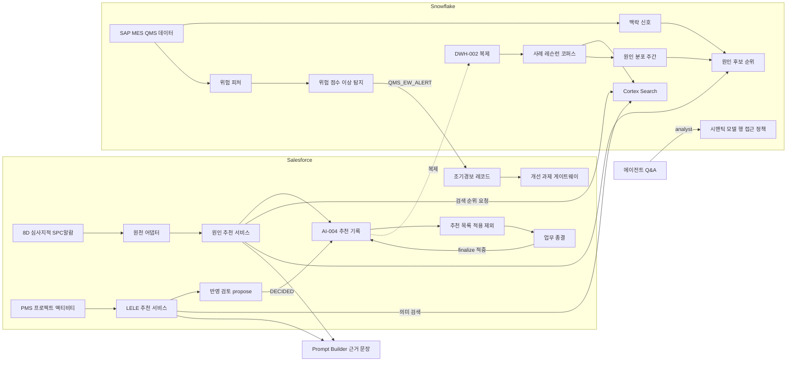
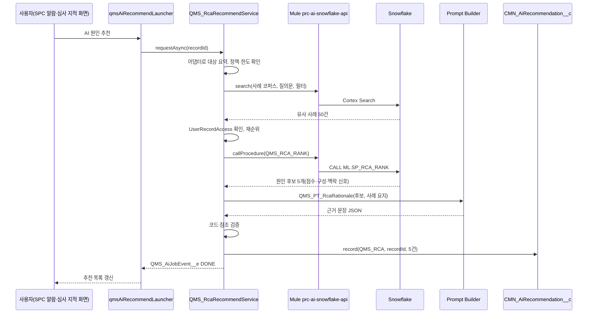
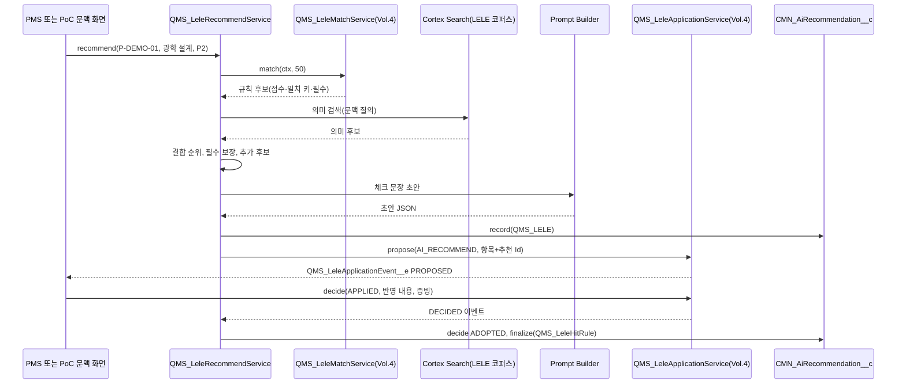

# SL QMS 워크아이템 Vol.8 — QMS-08 AI

Nov 1, 2026 · @배창욱

## 1. 개요

Vol.8은 QMS RFP AI 모듈(Q-35~40)의 **품질 도메인 유스케이스**를 16개 워크아이템(QMS-08-AIQ-001~016)으로 내린다. Agentforce·Trust Layer 설정(AI-001), 문서 색인·검색(AI-002), 버전 비교(AI-003), 추천 기록·정확도(AI-004), 자연어 Q&A 엔진(AI-005)은 Vol.0 공통에 있고, 이 Vol.은 그 위에 "무엇을 근거로 무엇을 추천하고, 어디에 보여주고, 어떻게 맞았는지 재는가"를 만든다.

| RFP | 요구 | 우선순위 | 이 Vol.의 WI | 비고 |
| --- | --- | --- | --- | --- |
| Q-35 | 문서 검색·요약·리비전 비교 | 권장 | AIQ-013 | 엔진은 AI-002·003, 이 Vol.은 품질 범위 설정 |
| Q-36 | Root Cause 추천(NCR·Complaint·Audit Finding), 통합 데이터 분석, 추천 vs 확정 비교 | 권장 | AIQ-002·003·004·005·006 | PoC 시나리오 1. NCR·클레임 원인은 연결된 8D D4에서 추천 |
| Q-37 | 8D 초안·D4 지원·D5/D6 대책 추천 | 권장 | AIQ-005 | PoC 시나리오 2 |
| Q-38 | 제품군·라인·공정·협력사 위험도 Dashboard, Early Warning | 권장 | AIQ-011·012 | |
| Q-39 | 품질 데이터 자연어 Q&A | 권장 | AIQ-009·010 | PoC 시나리오 5 |
| Q-40 | PMS 연계 LELE 추천 | **필수** | AIQ-007·008(+002·006) | PoC 시나리오 6(아키텍처·데이터 연계 검증 수준) |
| (확장) | 4M 변경 기반 필요 시험 추천, 고객 심사 대비 예상 지적 | 권장 | AIQ-014·015 | W3 |
| (공통) | 에이전트 골격·사용 정책, 평가·가드레일 | — | AIQ-001·016 | |

**원칙**(Vol.0 13절을 품질 유스케이스에 적용한 규칙)

1. **AI는 추천·초안만 만든다.** 업무 필드에 자동으로 값을 넣지 않는다. 사용자가 "적용"을 눌러야 입력란에 복사되고(소유 Vol. 화면 규칙), 확정은 업무 결재·종결이다.
2. **모든 추천은 `CMN_AiRecommendation__c`(AI-004)에 남긴다.** 채택·수정 채택·제외(사유)와 업무 확정 결과를 비교해 적중률을 잰다.
3. **"학습" = 확정 사례의 재사용이다**(Vol.0 D-10 권고). 모델을 재학습하지 않는다. 효과가 확인된 사례의 가중을 높이고(원인 분포·유사 사례 가중), 사용자가 제외한 추천은 같은 문맥에서 억제한다.
4. **코드·숫자는 결정적 로직이 정하고 LLM은 문장만 쓴다.** 원인 코드 후보, 위험 점수, 추천 순위는 Snowflake·Apex의 재현 가능한 계산 결과다. LLM 출력에 후보 목록 밖의 코드나 입력에 없는 숫자가 있으면 버린다.
5. **사용자가 볼 수 없는 데이터는 AI 근거로도 쓰지 않는다.** 유사 사례·문서 결과는 Apex가 `UserRecordAccess`로 최종 확인한 뒤에만 LLM과 화면에 넘긴다(AI-002 BR-2 패턴). 자연어 통계 질의는 Snowflake 행 접근 정책으로 사용자 공장 범위를 강제한다.

**용어**

| 용어 | 뜻 |
| --- | --- |
| 사례 코퍼스 | NCR·8D·SPC 알람·심사 지적·클레임·레슨런을 "현상·원인·대책" 형태로 한 줄씩 모은 Snowflake 테이블. 의미 검색과 원인 통계의 원천 |
| 확정 사례 | 원인이 확정되고 효과 검증까지 끝난 사례(예: NCR CLOSED + VerificationResult EFFECTIVE). 순위 가중이 1.5배 |
| 의미 검색 | 문장 의미(임베딩) + 키워드를 섞은 하이브리드 검색. Snowflake Cortex Search 사용(D8-1) |
| 맥락 신호 | 발생 시점·위치 주변의 SAP·MES·QMS 데이터 변화(최근 4M, SPC 신호, 수입검사 불합격, 교정 이상 등). Q-36 "SAP/MES/PMS/QMS 통합 분석"의 실체 |
| 적중 | AI-004 `IsHit`. 추천이 업무 확정 결과와 일치(유스케이스별 적중 규칙) |
| 시맨틱 모델 | Cortex Analyst가 자연어를 SQL로 바꿀 때 쓰는 YAML(테이블·측정값·차원·동의어·검증 질의) |

**플랫폼 배치**

| 기능 | Salesforce | Snowflake | MuleSoft | Agentforce·Prompt Builder |
| --- | --- | --- | --- | --- |
| 유사 사례 검색 | 원천 어댑터, 접근 확인, 재순위 | 코퍼스, Cortex Search | prc-ai-snowflake-api(search) | — |
| 원인 후보 순위 | 추천 기록·화면 | 원인 분포, 맥락 신호, 순위 프로시저 | DWH-004 경로 | 근거 문장 생성 |
| 8D 초안 | QMS_EightDAssist 구현 | 확정 대책 사례 | 위와 같음 | D2·D4·D5 초안 생성 |
| LELE 추천 | 규칙 매칭(Vol.4) + 결합 순위 + propose | 레슨런 코퍼스 의미 검색 | 다른 Org PMS 중계 | 체크 문장 초안 |
| 자연어 Q&A | 업무 현황 Action, 답변 서술 | 시맨틱 모델, 행 접근 정책 | prc-ai-snowflake-api(analyst) | 토픽 라우팅·답변 |
| 조기경보 | 경보 레코드·처리·화면 | 피처·점수·이상 탐지 | DWH-003 경로 | 위험 설명 |

LLM 생성은 모두 Salesforce Prompt Builder(Einstein Trust Layer)를 거친다. Snowflake Cortex는 검색·Analyst·ML 함수에만 쓰고 COMPLETE(LLM 생성)는 쓰지 않는다(D8-2: 생성 경로를 하나로 두어 마스킹·감사 로그·비용을 한 곳에서 관리).

**선행 공통 WI**: AI-001~005, ARC-002, SEC-001·002, I18N-001, DOC-001, DSH-001, TDO-001, NTF-001, DWH-001~004, INT-001. 이전 Vol. 선행: QMS-02-DVQ-002, QMS-03-IQC-007, QMS-04-SPC-002·003·005, QMS-04-FQC-004, QMS-04-LEL-001·003·004·005, QMS-05-B2B-003, QMS-05-CLM-001·002·004, QMS-06-4MC-003·005·008, QMS-06-NCR-005·008, QMS-06-IAU-004·005, QMS-06-CAU-001, QMS-06-SQM-002. 다른 메뉴 객체는 Lookup하지 않고 Id 텍스트·동적 SOQL(어댑터)·Snowflake 복제 테이블로 읽는다.

**다른 메뉴와의 경계**

| 연결 대상 | 이 Vol.이 하는 것 | 상대 메뉴가 하는 것 |
| --- | --- | --- |
| Vol.0 AI-001~005 | 품질 토픽·액션·프롬프트·정책·평가셋 | 에이전트 기본 설정, 색인 파이프라인, 추천 기록 객체, Q&A 엔진 규칙 |
| 부적합 NCR (QMS-06-NCR) | NCR 원인 추천은 NCR에 연결된 8D(FULL_8D·SHORT_CAPA·LINKED_8D)의 D4에서 한다(AIQ-005). NCR 데이터는 코퍼스·맥락 신호·조기경보 원천으로만 읽는다 | 8D 생성 요청, 8D D4 원인 코드 사본 보관(NCR-005). NCR 화면에는 AI 영역을 두지 않음 |
| 8D 엔진 (QMS-05-CLM) | QMS_EightDAssist 구현(D2·D4·D5 초안, UseCase QMS_8D_DRAFT·QMS_RCA·QMS_CAPA), 8D 이벤트에 따른 자동 초안 | 인터페이스·화면·적용 규칙(CLM-002 BR-3), 종결 finalize(CLM-004 BR-6, QMS_EightDRcaHitRule — NCR·클레임 원인 적중도 이 규칙) |
| 심사 (QMS-06-IAU, CAU) | 지적 원인 추천, 고객 심사 예상 지적 추천 | 추천 목록 배치, 지적 종결 finalize(QMS_AuditFindingHitRule) |
| SPC (QMS-04-SPC) | 알람 유사 사례·원인 추천, 알람 종결 시 적중 평가 | 알람 화면 영역(SPC-005 BR-11), 신호·공정능력 데이터 |
| 레슨런 (QMS-04-LEL) | 규칙 결과 위의 의미 순위·초안, propose(Origin AI_RECOMMEND), DECIDED 이벤트로 적중 평가 | 레슨런·체크포인트·규칙 매칭·반영 검토 |
| PMS | LELE 추천 REST·이벤트, 시연 흐름 | 프로젝트·WBS 속성(DEV_PHASE·DEV_ACTIVITY_TYPE), 추천 호출, 반영 상태 표시 |
| 4M (QMS-06-4MC) | 필요 시험 추천(UseCase QMS_4M_TEST) | 추천 목록 배치(4MC-003), 검증 항목 구성 |
| 개선 과제 (QMS-06-IMP) | 조기경보에서 IMPROVEMENT 게이트웨이 호출 | 과제 생성(IMP-002) |
| 대시보드 (QMS-07) | 위험 점수 KPI, 위험 위젯 컴포넌트, AI 정확도 KPI | 역할별 템플릿 배치 |
| 연계 (QMS-09) | prc-ai-snowflake-api 정의·구현(이 Vol. 소유) | 인터페이스 카탈로그·모니터링 등록, PMS 다른 Org 중계 |
| 수입검사 (QMS-03-IQC-008) | 성적서 이상 탐지 결과를 조기경보 피처로만 사용 | 규칙 기반 성적서 이상 탐지(중복 구현 금지) |

**앞 Vol. 상태**: Vol.0·2·3은 검토 대기, Vol.4~6c는 작성 완료(정합 수정 중)다. Vol.0 D-4(Data Cloud 범위)는 "Agentforce 그라운딩과 문서 RAG 최소 범위"를, D-10(AI "학습" 정의)은 "확정 사례 재사용"을 가정한다. 이름과 소유는 `interfaces.md`가 최종이다.

## 2. 업무 흐름

8D(NCR·클레임) D4는 같은 순위·근거 경로를 QMS_EightDAssistImpl이 사슬별로 호출하고, 결과는 8D 화면의 추천 영역(QMS-05-CLM-002)에 나타난다.

추천은 업무 레코드를 바꾸지 않는다. 사용자가 적용·제외한 결과와 업무 종결 시 확정 값이 AI-004로 모이고, Snowflake가 주간으로 원인 분포를 다시 계산해 다음 추천에 반영한다(D8-4).

## 3. 데이터 모델 개요

**Salesforce 객체·메타데이터**

| 객체 | 구분 | 관계 | 역할 | 정의 WI |
| --- | --- | --- | --- | --- |
| QMS_AiPlantPolicy__mdt | 설정 | — | 공장·권역별 AI 유스케이스 허용 | AIQ-001 |
| QMS_AiUsageLimit__mdt | 설정 | — | 유스케이스별 일일 호출 한도·토큰 상한 | AIQ-001 |
| QMS_AiUsageCounter__c | 운영 | Plant(Lookup) | 공장·사용자·유스케이스·일자별 호출 수 | AIQ-001 |
| QMS_AiJobEvent__e | Platform Event | — | 비동기 AI 작업 완료 알림(화면 갱신) | AIQ-001 |
| QMS_AiRankWeight__mdt | 설정 | — | 유사 사례 재순위·LELE 결합 가중치 | AIQ-002, AIQ-007 |
| QMS_AiSourceAdapter__mdt | 설정 | — | 추천 대상 객체별 어댑터 클래스·자동 실행 조건 | AIQ-004 |
| QMS_AiFinalizeConfig__mdt | 설정 | — | 원천 종료 조건·확정 필드·적중 규칙 클래스 | AIQ-006 |
| QMS_AiQueryDef__mdt | 설정 | — | 업무 현황 Action의 객체·상태·필터 정의 | AIQ-009 |
| QMS_EarlyWarning__c | 업무 | Plant, Line, Supplier(Account), ProductGroup, Item(Lookup) | 조기경보 1건 | AIQ-012 |
| QMS_AiPromptConfig__mdt | 설정 | — | 유스케이스별 프롬프트 템플릿·버전·출력 스키마 | AIQ-016 |
| QMS_AiEvalRun__c | 운영 | — | 오프라인 평가 실행 결과·출시 판정 | AIQ-016 |

**Snowflake 객체**(DB SL_QDW, 스키마 ML, schemachange로만 생성)

| 객체 | 종류 | 내용 | 정의 WI |
| --- | --- | --- | --- |
| ML.CASE_CORPUS | Dynamic Table(TARGET_LAG 30분) | 사례 1건 1행(NCR, 8D, SPC 알람, 심사 지적, 클레임) | AIQ-002 |
| ML.LELE_CORPUS | Dynamic Table(TARGET_LAG 30분) | 레슨런·체크포인트 1행 | AIQ-002 |
| ML.CSS_QMS_CASES, ML.CSS_QMS_LELE | Cortex Search Service | 하이브리드 의미 검색 | AIQ-002 |
| ML.CAUSE_PRIOR | Table(주간 Task) | 불량 유형·부품 분류·공정 유형별 확정 원인 분포 | AIQ-003 |
| ML.EIGHTD_ACTION_CORPUS | View | 효과 확인된 8D 대책 | AIQ-005 |
| ML.FN_RCA_CONTEXT | UDTF | 맥락 신호 | AIQ-003 |
| ML.SP_RCA_RANK | Stored Procedure | 원인 후보 순위 | AIQ-003 |
| ML.RCA_WEIGHT, ML.RISK_WEIGHT | Table | 순위·위험 가중치(버전) | AIQ-003, AIQ-011 |
| ML.RISK_FEATURE_DAILY, ML.RISK_SCORE_DAILY, ML.RISK_ALERT | Table | 조기경보 피처·점수·경보 | AIQ-011 |
| ML.SESSION_PLANT_SCOPE, RAP_QMS_PLANT, MART.SV_QA_* | Table, Row Access Policy, Secure View | Q&A 공장 범위 강제 | AIQ-010 |
| @ML.SEMANTIC_MODELS/qms_quality.yaml | Stage 파일 | Cortex Analyst 시맨틱 모델 | AIQ-010 |
| ML.FOURM_TEST_HISTORY, ML.DEFECT_TEST_MAP | View, Table | 과거 4M ↔ 시험 결과, 불량 유형 → 시험 분류 | AIQ-014 |
| ML.AUDIT_QUESTION_RISK | View | 질문별 과거 지적·증빙 공백 | AIQ-015 |
| ML.AI_EVAL_RESULT | Table | 오프라인 평가 결과 | AIQ-016 |

**프롬프트 템플릿**(Prompt Builder Flex 템플릿, Apex 그라운딩. 모든 템플릿 앞에 공통 지시 블록 QMS_PT_Common을 넣는다)

| API 이름 | WI | 입력 | 출력 |
| --- | --- | --- | --- |
| QMS_PT_Common | AIQ-001 | 사용자 언어, 오늘 날짜(공장 시간대) | — (공통 지시: 사용자 언어로 답, 출처 번호 표기, 입력에 없는 숫자·코드·이름 금지, 모르면 "[확인 필요]", JSON만 출력) |
| QMS_PT_RcaRationale | AIQ-004 | 대상 요약, 원인 후보 5개(코드·경로·점수 구성·맥락 신호), 유사 사례 요지 최대 8건 | 후보별 원인 문장·근거·신뢰도 JSON |
| QMS_PT_8dD2Draft | AIQ-005 | 8D·원천 레코드 필드, 첨부 목록(이름·DocClass) | 문제 정의·5W2H·Is/IsNot JSON |
| QMS_PT_8dD4Draft | AIQ-005 | 확정된 D2, 발생·유출 원인 후보, 유사 사례 Why-why | 사슬별 원인 문장·Why-why JSON |
| QMS_PT_8dD5Draft | AIQ-005 | 확정 원인, 유사 사례 효과 확인 대책 | 사슬별 대책·검증 방법·효과 기준 JSON |
| QMS_PT_LeleCheckpointDraft | AIQ-007 | 프로젝트·액티비티 문맥, 체크포인트 질문, 레슨런 요지 | 체크포인트별 "이번 프로젝트에서 확인할 일" JSON |
| QMS_PT_QaAnswer | AIQ-010 | 질문, 실행된 쿼리 설명, 결과 행(최대 100), 데이터 기준 시각 | AI-005 BR-2 형식 답변 JSON |
| QMS_PT_EwExplain | AIQ-012 | 대상, 점수, 상위 요인(값·기준·기여도) | 위험 설명 JSON |
| QMS_PT_FourMTestRationale | AIQ-014 | 4M 요약, 추천 시험·근거 사례 | 시험별 근거 문장 JSON |
| QMS_PT_AuditPrep | AIQ-015 | 심사 질문·과거 지적·증빙 공백 | 질문별 예상 지적·준비 조치 JSON |

**Agentforce 토픽·액션**(Agent `SL Quality Assistant`, AI-001 BR-1)

| 토픽 | 분류 기준(요지) | 액션(Invocable Apex) | WI |
| --- | --- | --- | --- |
| 품질 업무 현황 | 내 할 일, 건수, 기한 경과, 특정 번호 상태 | QMS_AiAction_MyQualityWork, QMS_AiAction_CountRecords, QMS_AiAction_RecordSummary | AIQ-009 |
| 품질 데이터 분석 | 기간·추세·순위·비율·협력사 수준 | QMS_AiAction_AskQualityAnalyst | AIQ-010 |
| 원인 분석 도우미 | 이 건과 비슷한 사례, 원인 후보 | QMS_AiAction_FindSimilarCases, QMS_AiAction_RecommendRootCause | AIQ-004 |
| 8D 작성 도우미 | 8D 단계 초안 | QMS_AiAction_Draft8DStep | AIQ-005 |
| 레슨런 | 레슨런 찾기, 프로젝트 추천 | QMS_AiAction_SearchLessons, QMS_AiAction_RecommendLessonsForActivity | AIQ-007 |
| 품질 위험 | 협력사·라인·제품군 위험도 | QMS_AiAction_RiskSummary | AIQ-012 |
| 품질 문서 | 문서 내용 검색·요약 | CMN_AiAction_DocSearch(AI-002, QMS 검색 범위 프리셋) | AIQ-013 |

모든 액션은 `with sharing` + `WITH USER_MODE`로 실행하고, 업무 레코드를 만들거나 바꾸지 않는다. 예외는 추천 기록(`CMN_AiRecommendation__c`)과 사용량 카운터뿐이다.

**유스케이스와 적중 규칙**

| UseCase | 대상 객체(SourceObject) | 생성 WI | 적중 규칙(소유) | finalize 호출 |
| --- | --- | --- | --- | --- |
| QMS_RCA | QMS_EightD__c(클레임·NCR·심사 지적 8D, 사슬 OCCURRENCE·ESCAPE) | AIQ-005 | QMS_EightDRcaHitRule(QMS-05-CLM-004) | 8D 종결(QMS-05-CLM-004) |
| QMS_RCA | QMS_AuditFinding__c | AIQ-004 | QMS_AuditFindingHitRule(QMS-06-IAU-004) | 지적 종결(QMS-06-IAU-004) |
| QMS_RCA | QMS_SpcAlarm__c | AIQ-004 | QMS_SpcAlarmRcaHitRule(AIQ-006) | AIQ-006 배치 |
| QMS_8D_DRAFT, QMS_CAPA | QMS_EightD__c | AIQ-005 | QMS-05-CLM-004 규칙 | 8D 종결 |
| QMS_LELE | PMS_ACTIVITY 또는 PMS_PROJECT(Id 텍스트) | AIQ-007 | QMS_LeleHitRule(AIQ-006) | 반영 검토 DECIDED 이벤트(AIQ-006) |
| QMS_EW | QMS_EarlyWarning__c | AIQ-012 | QMS_EwHitRule(AIQ-006) | AIQ-006 배치(경보 후 60일) |
| QMS_4M_TEST | QMS_FourMChange__c | AIQ-014 | QMS_FourMTestHitRule(AIQ-006) | AIQ-006 배치(4M 종료) |
| QMS_AUDIT_PREP | QMS_Audit__c(CUSTOMER) | AIQ-015 | QMS_AuditPrepHitRule(AIQ-006) | AIQ-006 배치(심사 결과 확정) |

**RCA 추천 ContentJson 표준**(QMS_RCA 공통, 8D·심사 지적·SPC 알람의 적중 규칙과 적용 화면이 이 키를 읽는다)

    {
      "chain": "OCCURRENCE",                 // 8D만 OCCURRENCE/ESCAPE, 그 외 생략
      "causeCodeId": "a0X...",               // CMN_Code__c Id (심사 지적·SPC 알람 적중 규칙이 비교)
      "causeCodeExternalKey": "CAUSE_5M1E/MACHINE/MOLD/GATE_WEAR",  // Vol.5 적용 규칙이 사용
      "causePath": "Machine > 금형 > 게이트 마모",
      "text": "원인 문장 초안",               // 적용 시 원인 서술 입력란에 복사
      "confidence": "HIGH",                  // HIGH/MEDIUM/LOW, LOW_DATA면 LOW
      "components": {"prior": 0.42, "similar": 0.61, "context": 1.0},
      "contextSignals": [{"type": "RECENT_4M", "category": "MACHINE", "detail": "...", "ref": "4M-KR01-2027-00012"}],
      "similarCases": [{"recordNo": "NCR-KR01-2027-000123", "sourceObject": "QMS_NCR__c", "sourceRecordId": "a0Y...", "similarity": 0.83, "causePath": "...", "confirmed": true}],
      "weightVersion": "RCA_W_2027_06"
    }

**권한 셋과 페르소나 매핑**

| Permission Set | 내용 | PSG |
| --- | --- | --- |
| QMS_PS_Ai_User | 에이전트 사용, 추천 요청·조회·채택·제외, 위험 보드 조회 | QualityEngineer, QualityManager, SupplierQuality, Auditor, CMN_PSG_Executive(조회·Q&A만), Viewer(Q&A만) |
| QMS_PS_Ew_Edit | 조기경보 확인·조치·무시 | QualityEngineer, QualityManager, SupplierQuality |
| QMS_PS_Ai_Admin | 정책·한도·가중치·프롬프트 설정, 평가 실행, 사용량 화면 | QualityAdmin, CMN_PSG_SystemAdmin |
| (Agentforce 사용 권한) | Agent 접근 권한 셋 라이선스 | QMS_PS_Ai_User 보유자에게 함께 할당(AI-001 라이선스 구조 확정 후) |

협력사 포털 사용자에게는 AI 기능을 제공하지 않는다(포털 PSG에 위 PS를 넣지 않는다).

**제공 서비스·이벤트**

| 이름 | 종류 | 제공 WI | 사용처 |
| --- | --- | --- | --- |
| QMS_AiGuard.check / consume | Apex | AIQ-001 | Vol.8 전체 |
| QMS_SimilarCaseService.search / findForRecord | Apex | AIQ-002 | AIQ-004·005·007, 에이전트 |
| QMS_RcaRecommendService.requestAsync / recommend / rankAndExplain | Apex | AIQ-004 | 심사 지적·SPC 알람 화면, AIQ-005(8D D4), 에이전트 |
| QMS_EightDAssistImpl(QMS_EightDAssist 구현, 바인딩 키 EIGHT_D_ASSIST) | Apex | AIQ-005 | QMS-05-CLM-002 |
| QMS_LeleRecommendService.recommend, REST `/qms/v1/lele/recommend` | Apex + REST | AIQ-007 | PMS, Vol.4 화면, 에이전트 |
| QMS_EarlyWarningService.act / dismiss | Apex | AIQ-012 | 경보 화면, 에이전트 |
| QMS_AiJobEvent__e | Platform Event | AIQ-001 | 추천 실행 컴포넌트 |
| qmsAiRecommendLauncher | LWC | AIQ-004 | 심사 지적·SPC 알람·4M·고객 심사 레코드 페이지(8D는 Vol.5 화면의 자체 버튼) |
| qmsRiskTopWidget, qmsRiskBoard | LWC | AIQ-012 | Vol.7 위젯, SL QMS 앱 |
| qmsQualityAssistant(QMS_AskQualityChannel 구독·ACK) | LWC | AIQ-010 | Vol.7 DSH-012 질문 위젯, SL QMS 앱 유틸리티 바 |
| QMS_EW_TOP_RISKS | 등록 쿼리(CMN_DwQuery__mdt + QMS_WidgetQuery__mdt) | AIQ-011 | Vol.7 qmsEarlyWarningWidget |
| prc-ai-snowflake-api(search, analyst) | Mule API | AIQ-002, AIQ-010 | Vol.8 |

**KPI 키**

| 키 | 정의 | 주기 | 차원 | 계산 위치 |
| --- | --- | --- | --- | --- |
| QMS_EW_RISK_SCORE | 위험 점수(0~100) | 일 | Plant + Supplier / Line / ProductGroup | Snowflake ML.RISK_SCORE_DAILY(AIQ-011) |
| QMS_EW_ALERTS_OPEN | 미처리(NEW·ACKNOWLEDGED) 경보 수 | 일 | Plant | Snowflake(복제된 QMS_EarlyWarning__c) |
| QMS_EW_PRECISION | 경보 후 60일 내 품질 사건 발생 비율 | 월 | Plant | Snowflake(AIQ-006 적중 결과) |
| QMS_AI_CALLS_{UseCase} | 유스케이스별 호출 수 | 일 | Plant | Snowflake(복제된 QMS_AiUsageCounter__c) |
| AI_HIT_TOP1_{UseCase}, AI_HIT_TOP3_{UseCase}, AI_ADOPT_RATE_{UseCase} | 적중·채택률(AI-004 BR-4) | 월 | Plant | Snowflake(AI-004 계산, 키 규칙은 이 Vol.이 정함) |
| QMS_AI_SNOW_CREDITS | Snowflake AI 웨어하우스 크레딧(민감) | 일 | — | Snowflake Resource Monitor |

모든 KPI 키는 Vol.7 KPI 레지스트리(QMS_KpiDefinition__mdt)에 정의 WI가 직접 등록한다(Vol.7 DSH-001 DoD): QMS_AI_CALLS_* → AIQ-001 BR-9, AI_* 유스케이스 키·QMS_EW_PRECISION → AIQ-006 BR-6, QMS_EW_RISK_SCORE → AIQ-011 BR-9, QMS_EW_ALERTS_OPEN → AIQ-012 BR-11, QMS_AI_SNOW_CREDITS → AIQ-016 BR-4.

**공통 기반 등록**: 채번 EW-{PLANT}-{YYYY}-{SEQ:6}(QMS_EarlyWarning__c), CMN_SharingConfig(QMS_EarlyWarning__c PlantField), CMN_DeleteGuard(QMS_EarlyWarning__c 삭제 불가), CMN_StatusFlow(경보), 필드 이력(Status, RiskLevel, Owner), DWH 복제(QMS_EarlyWarning__c 15분, QMS_AiUsageCounter__c·QMS_AiEvalRun__c 일 1회), 기능 스위치 키 QMS_AI_RCA, QMS_AI_8D, QMS_AI_LELE, QMS_AI_QA, QMS_AI_EW, QMS_AI_4M_TEST, QMS_AI_AUDIT_PREP(AI-001 BR-5), 번역(ko·en·zh).

**데이터량·비용 가정**: 3년 운영 후 사례 코퍼스 약 15만 행(NCR 연 2만, SPC 알람 연 2만, 8D 연 2천, 심사 지적 연 2천, 클레임 연 1천), 레슨런 코퍼스 2만 행(레슨런 5천 × 체크포인트). LLM 호출은 사용자 요청과 8D 자동 초안(D2·D4·D5)뿐이라 공장당 하루 50~150회로 가정한다(전사 하루 약 700회). Cortex Search는 WH_ML(M) 30분 갱신, 조기경보는 일 1회 20분 이내 실행을 목표로 한다. 실제 단가는 라이선스 확정 후 AIQ-016 사용량 화면으로 관리한다.

## 4. 에이전트·검색 기반

### QMS-08-AIQ-001 품질 어시스턴트 토픽·공통 지시·사용 정책

추적 Q-35, Q-36, Q-37, Q-38, Q-39, Q-40 · 권장 · W1 · AF, SF · AGENT, APEX, CFG · Tailoring · 선행 AI-001, SEC-001, I18N-001, ARC-002 · 5 M/D

**목적**: Vol.0 AI-001이 만든 `SL Quality Assistant`에 품질 토픽을 붙이고, 어느 공장에서 어떤 AI 기능을 얼마나 쓸 수 있는지를 한 곳에서 통제한다. 각 기능 WI는 이 WI의 정책 검사(QMS_AiGuard)를 거쳐야만 검색·LLM을 호출한다.

**범위** In: 토픽 7개 등록과 분류 기준·지시문, 공통 프롬프트 블록 QMS_PT_Common, 공장 정책·사용 한도·카운터, 비동기 작업 이벤트, 기능 스위치 키, PS. Out: 각 액션의 구현(AIQ-004·005·007·009·010·012·013), 에이전트 기본 설정·Trust Layer(AI-001).

**데이터 모델**

| 객체 / 필드 | 타입 | 필수 | 설명 |
| --- | --- | --- | --- |
| QMS_AiPlantPolicy__mdt.PlantCode__c | Text(10) | N | 공장 코드. 공란이면 Region 규칙 |
| QMS_AiPlantPolicy__mdt.Region__c | Picklist (KR, NA, CN, IN, EU, SA, DEFAULT) | Y | MDM-002 Region 값 + DEFAULT |
| QMS_AiPlantPolicy__mdt.UseCase__c | Text(40) | Y | QMS_RCA, QMS_8D_DRAFT, QMS_LELE, QMS_QA, QMS_EW, QMS_4M_TEST, QMS_AUDIT_PREP, ALL |
| QMS_AiPlantPolicy__mdt.IsAllowed__c | Checkbox | Y | |
| QMS_AiPlantPolicy__mdt.Note__c | Text(255) | N | 근거(법무 검토 번호 등) |
| QMS_AiUsageLimit__mdt.UseCase__c | Text(40) | Y | |
| QMS_AiUsageLimit__mdt.DailyLimitPerPlant__c / DailyLimitPerUser__c | Number(6,0) | Y | 기본 300 / 30 |
| QMS_AiUsageLimit__mdt.MaxInputChars__c / MaxOutputTokens__c | Number(7,0) | Y | 기본 24,000자 / 2,000토큰 |
| QMS_AiUsageCounter__c.ExternalKey__c | Text(120), External ID, Unique | Y | `{UseCase}/P/{PlantCode}/{yyyymmdd}` 또는 `{UseCase}/U/{UserId}/{yyyymmdd}` |
| QMS_AiUsageCounter__c.UseCase__c / Plant__c / User__c / UsageDate__c | Text(40) / Lookup(CMN_Plant__c) / Lookup(User) / Date | Y / N / N / Y | |
| QMS_AiUsageCounter__c.CallCount__c / FailCount__c / BlockedCount__c | Number(8,0) | Y | 호출·실패·한도 차단 수 |
| QMS_AiJobEvent__e | Platform Event | — | JobKey__c, RecordId__c, UseCase__c, Status__c(DONE, FAILED, BLOCKED), MessageLabel__c, UserId__c |

**서비스 API (`QMS_AiGuard`)**

    QMS_AiGuardResult check(String useCase, Id plantIdOrNull)      // 정책·기능 스위치·한도 확인(소비 없음)
    QMS_AiGuardResult consume(String useCase, Id plantIdOrNull)    // 확인 + 카운터 1 증가(FOR UPDATE)
    void recordFailure(String useCase, Id plantIdOrNull, String reason)
    // QMS_AiGuardResult: allowed(Boolean), reasonCode(POLICY/SWITCH_OFF/LIMIT_PLANT/LIMIT_USER), messageLabel

**비즈니스 규칙**

- BR-1: 토픽 — 3절 토픽 표의 7개 토픽을 `SL Quality Assistant`에 등록한다. 각 토픽은 분류 설명(ko·en 2문장, 예시 발화 5개), 범위(이 토픽이 하지 않는 일), 지시문(액션 호출 순서, 결과가 없을 때의 답)을 갖는다. 토픽 지시문에 업무 판정 규칙을 넣지 않는다(판정은 액션 Apex에).

- BR-2: 에이전트 공통 지시(AI-001 BR-4 + 품질 규칙) — 사용자 언어로 답한다. 숫자·코드·레코드 번호는 액션 결과에 있는 것만 쓴다. 액션 결과가 비면 "데이터 없음"과 조회 범위를 말한다. 레코드를 만들거나 바꾸는 요청("NCR 등록해줘", "원인 확정해줘")은 해당 화면 링크를 안내하고 실행하지 않는다. 비용·인사 정보 질문은 답하지 않는다.

- BR-3: QMS_PT_Common 블록 — 모든 품질 프롬프트 템플릿의 맨 앞에 넣는 지시: (a) 출력은 지정 JSON 스키마만, (b) 입력에 없는 숫자·날짜·코드·사람 이름을 만들지 않음, (c) 근거는 입력에 준 레코드 번호·문서명으로만 표기, (d) 알 수 없는 값은 "[확인 필요]", (e) 사용자 언어 `{!$Input:language}`로 작성, (f) 개인을 탓하는 표현 금지(역할·공정으로 서술).

- BR-4: 공장 정책 — 판정 공장은 레코드 기반 기능이면 레코드의 Plant, Q&A·레슨런이면 사용자 PrimaryPlant(없으면 DEFAULT). 해석 순서: (PlantCode 일치, UseCase 일치) → (PlantCode 일치, ALL) → (Region 일치, UseCase) → (Region, ALL) → (DEFAULT, ALL). 초기 데이터는 Region CN = 비허용, DEFAULT = 허용(D8-8). 비허용이면 검색·LLM을 호출하지 않고 라벨 `QMS_Ai_NotAllowedPlant`를 반환한다.

- BR-5: 사용 한도 — 검색·LLM을 부르는 모든 기능은 호출 전 `consume`을 부른다. 공장·사용자 카운터 중 하나라도 한도를 넘으면 차단하고 BlockedCount + 1, WARN 로그. 일자는 공장 시간대(MDM-002) 기준이다. 자동 실행(8D 자동 초안 등)은 사용자 카운터 대신 공장 카운터만 쓴다.

- BR-6: 기능 스위치 — 3절 키가 꺼져 있으면 해당 토픽 액션은 "현재 비활성" 라벨을 반환하고, 추천 실행 컴포넌트(qmsAiRecommendLauncher)는 버튼을 숨긴다.

- BR-7: 비동기 작업 알림 — 오래 걸리는 추천(원인·8D 초안·LELE)은 Queueable로 실행하고 끝나면 `QMS_AiJobEvent__e`를 발행한다. 화면 컴포넌트는 `lightning/empApi`로 자기 JobKey만 구독한다.

- BR-8: 접근 — QMS_PS_Ai_User가 없는 사용자에게 Agent 패널·추천 실행 버튼을 보이지 않는다. 포털 사용자(Experience Cloud)에는 Agent를 배치하지 않는다.

- BR-9: 사용량 집계 — QMS_AiUsageCounter__c를 DWH-002로 매일 복제하고 Snowflake가 KPI QMS_AI_CALLS_{UseCase}를 계산한다(AI-001 BR-6 보완). KPI 레지스트리 등록(Vol.7 DSH-001 DoD): QMS_AI_CALLS_{UseCase} 7개(QMS_RCA, QMS_8D_DRAFT, QMS_LELE, QMS_QA, QMS_EW, QMS_4M_TEST, QMS_AUDIT_PREP) — Area AI, Unit CNT, Decimals 0, GoodDirection NONE, PeriodTypes DAY, DefaultPeriodType DAY, Dimensions Plant, RagMode NONE, FreshnessHours 30, SourceView MART.V_SF_KPI_AI, OwnerWi QMS-08-AIQ-001, DrillTarget `page:QMS_Ai_Ops_Console`, IsSensitive false, PortalVisible false, 라벨 3개 언어.

**화면/UX**: SL QMS 앱 유틸리티 바·레코드 페이지의 Agentforce 패널(표준), 설정은 Custom Metadata 표준 화면. 사용량은 AIQ-016 `qmsAiOpsConsole`.

**권한**: QMS_PS_Ai_User(사용), QMS_PS_Ai_Admin(정책·한도 메타데이터 배포 요청 승인 — 메타데이터 변경은 배포로만).

**수용 기준**

- AC-1: Given 공장 CN01(Region CN, 비허용) SPC 알람, When "AI 원인 추천" 실행, Then 검색·LLM 호출 0회(목 카운터), 비허용 라벨 표시.

- AC-2: Given QMS_RCA 사용자 한도 3, When 같은 날 4번째 요청, Then 차단, BlockedCount = 1.

- AC-3: Given 예시 발화 70개(토픽당 10개), When Agentforce 테스트 실행, Then 기대 토픽으로 분류된 비율 90% 이상.

- AC-4: Given 사용자가 "이 NCR 원인을 확정해줘", When 질의, Then 레코드 변경 없음(DML 0건) + 해당 화면 안내.

- AC-5: Given 영어 사용자, When 한국어 데이터 기반 질의, Then 영어 답변, 출처 번호 표기.

- AC-6: Given QMS_PS_Ai_User 없는 사용자, When 심사 지적 레코드 페이지, Then 추천 실행 버튼 미표시.

**에이전트 주의**: 정책·한도 검사를 각 기능에서 따로 구현하지 않는다(QMS_AiGuard만). 프롬프트 원문·응답을 커스텀 객체에 저장하지 않는다(Trust Layer 감사 로그와 AI-004 결과만). 액션 Apex를 `without sharing`으로 만들지 않는다.

**오픈 이슈**: Agentforce 라이선스 구조(사용자 단위·크레딧 단위), 중국 공장 사용자 대상 LLM 호출 허용 여부(법무), Agentforce 테스트 도구 사용 가능 여부.

### QMS-08-AIQ-002 품질 사례·레슨런 코퍼스와 의미 검색 서비스

추적 Q-36, Q-37, Q-40, Q-42 · 필수 · W1 · SNOW, MULE, SF · SQL, INT, APEX · Customization · 선행 DWH-001, DWH-002, DWH-004, AIQ-001, QMS-06-NCR-008, QMS-05-CLM-001, QMS-04-LEL-001, QMS-04-LEL-003, QMS-04-SPC-005, QMS-06-IAU-004 · 7 M/D

**목적**: 공장·메뉴마다 흩어진 부적합·8D·SPC 조치·심사 지적·레슨런을 "현상·원인·대책" 한 형식으로 모아 뜻으로 찾을 수 있게 한다. 원인 추천(AIQ-004), 8D 초안(AIQ-005), PMS 연계 LELE 추천(AIQ-007)이 같은 검색 기반을 쓴다.

**범위** In: 코퍼스 Dynamic Table 2개, Cortex Search Service 2개, Mule 검색 API, Salesforce 검색 서비스(접근 확인·재순위), 레코드 기반 질의 생성. Out: 원인 순위(AIQ-003), 문서 파일 검색(AI-002·AIQ-013).

**데이터 모델**

ML.CASE_CORPUS 열

| 열 | 내용 |
| --- | --- |
| CASE_KEY | `{SOURCE_OBJECT}:{SOURCE_RECORD_ID}` (기본 키) |
| SOURCE_OBJECT / SOURCE_RECORD_ID / RECORD_NO | QMS_NCR__c, QMS_EightD__c, QMS_SpcAlarm__c, QMS_AuditFinding__c, QMS_Claim__c |
| CASE_TYPE | NCR_INTERNAL, NCR_SUPPLIER, EIGHT_D, SPC_ALARM, AUDIT_FINDING, CLAIM |
| PLANT_CODE / LINE_CODE / OPERATION_TYPE | 발생 위치 |
| ITEM_NO / PART_CATEGORY / PRODUCT_GROUP / CUSTOMER_GROUP / VENDOR_NO | 품번·분류·고객군·협력사 |
| DEFECT_TYPE_L1 / L2 / L3 / DEFECT_TYPE_KEY | 불량 유형(External Key `DEFECT_TYPE/...`) |
| CAUSE_KEY / CAUSE_L1 / CAUSE_L2 / CAUSE_L3 | 확정 원인(External Key `CAUSE_5M1E/...`). 8D는 발생 원인, ESCAPE_CAUSE_KEY 별도 열 |
| PHENOMENON_TEXT / CAUSE_TEXT / ACTION_TEXT | 각 최대 2,000자 |
| SEARCH_TEXT | `[{불량 유형 경로}] [{부품 분류}] [{공정 유형}] 현상: … 원인: … 대책: …` 최대 4,000자 |
| SEVERITY / SPECIAL_CLASS | NCR·8D Severity, CC·SC |
| IS_CONFIRMED / IS_EFFECTIVE | 원인 확정 여부 / 효과 검증 EFFECTIVE |
| OCCURRED_AT / CLOSED_AT / UPDATED_AT | |
| LANG | 본문 주 언어(ko, en, zh) |

ML.LELE_CORPUS 열: LELE_KEY(`{LessonLearnedId}:{CheckpointId 또는 0}`), LESSON_ID, CHECKPOINT_ID, RECORD_NO, VERSION, SEVERITY, IS_VERIFIED, CUSTOMER_GROUPS(배열), PRODUCT_GROUP, PART_CATEGORIES(배열), OPERATION_TYPES(배열), DEV_PHASE_CODE, ACTIVITY_TYPE_CODE, IS_MANDATORY, APPLICATION_COUNT, APPLIED_COUNT, SEARCH_TEXT(`제목 · 현상 · 원인 · 대책 · 학습 포인트 · 체크포인트 질문 · SummaryEn`), PUBLISHED_AT.

Cortex Search Service

| 서비스 | ON | ATTRIBUTES | 설정 |
| --- | --- | --- | --- |
| ML.CSS_QMS_CASES | SEARCH_TEXT | CASE_TYPE, PLANT_CODE, PART_CATEGORY, PRODUCT_GROUP, DEFECT_TYPE_L1, DEFECT_TYPE_L2, OPERATION_TYPE, CUSTOMER_GROUP, IS_CONFIRMED | WAREHOUSE WH_ML, TARGET_LAG '30 minutes', 다국어 임베딩 모델(리전 지원 목록에서 확정, 예: snowflake-arctic-embed-l-v2.0) |
| ML.CSS_QMS_LELE | SEARCH_TEXT | PRODUCT_GROUP, DEV_PHASE_CODE, ACTIVITY_TYPE_CODE, SEVERITY, IS_MANDATORY | 위와 같음 |

Salesforce DTO

| DTO | 필드 |
| --- | --- |
| QMS_SimilarCaseQuery | corpus(CASES, LELE), queryText, filters(Map: caseTypes, plantCodes, partCategory, defectTypeL1 등), limit(기본 50), excludeKeys |
| QMS_SimilarCaseDTO | caseKey, sourceObject, sourceRecordId, recordNo, caseType, similarity(0~1, 정규화), finalScore, plantCode, partCategory, defectTypePath, causeKey, causePath, isConfirmed, isEffective, phenomenonSnippet(300자), causeSnippet, actionSnippet, closedAt |

**서비스 API**

    List<QMS_SimilarCaseDTO> search(QMS_SimilarCaseQuery q)
    List<QMS_SimilarCaseDTO> findForRecord(Id recordId, Integer topN)   // AIQ-004 어댑터로 질의 생성
    // Mule: POST /prc-ai-snowflake-api/v1/search
    //   {service, query, filter(Cortex Search 필터 JSON), columns, limit} → {results:[{...열, @score}]}

**비즈니스 규칙**

- BR-1: 원천 매핑 — 코퍼스는 DWH-002 복제 테이블(CORE.SF_QMS_NCR, CORE.NCR_DEFECT, CORE.SF_QMS_EIGHTD, CORE.SF_QMS_EIGHTDACTION, CORE.SF_QMS_SPCALARM, CORE.SF_QMS_AUDITFINDING, CORE.SF_QMS_CLAIM, CORE.SF_QMS_LESSONLEARNED, CORE.SF_QMS_LELECHECKPOINT)과 CORE.SF_CMN_CODE(코드 경로)로만 만든다. 원천별 본문 필드: 8D = ProblemStatement / OccurrenceCause·EscapeCause / PermanentActionSummary(위치·분류는 원천 NCR·클레임 행에서 보충: CORE.NCR_DEFECT의 LINE_CODE·OPERATION_TYPE 등), NCR = Description / 8D 원인 코드 사본(RootCausePath), SPC 알람 = 신호 구분·규칙 + ActionDescription / CauseCode 경로, 심사 지적 = Description / RootCause / Correction, 클레임 = 현상 설명(QMS-05-CLM-007 정의 필드) / 연결 8D 원인. NCR 대책은 모두 8D로 작성되므로(QMS-06-NCR-005) 8D가 연결된 NCR(EIGHT_D_ID 있음)은 NCR 행을 따로 넣지 않고 8D 행 하나로 대표한다(중복 사례 방지). 8D가 없는 NCR(생성 전·취소)만 NCR 행으로 넣는다.

- BR-2: 포함 조건 — NCR은 OPEN 이후(DRAFT·CANCELLED 제외)이고 8D가 연결되지 않은 건만(BR-1), 8D·클레임은 CANCELLED 제외, 심사 지적은 IsReleased = true, SPC 알람은 ACTION_DONE 이후, 레슨런은 PUBLISHED이고 LatestVersion. 확정 여부: NCR CLOSED이고 VerificationResult EFFECTIVE, 8D CLOSED이고 EffectivenessResult EFFECTIVE, 심사 지적 CLOSED, SPC 알람 CLOSED이고 Outcome이 ASSIGNABLE_CAUSE_FIXED 또는 NCR_RAISED.

- BR-3: 제외 정보 — 내부 메모(InternalNote), 비용 필드, VIN, 사람 이름 필드(DetectedBy, Owner 등)는 코퍼스에 넣지 않는다. 본문 안의 이메일·전화번호 패턴은 `[삭제]`로 바꾼다(정규식 UDF ML.FN_REDACT).

- BR-4: 검색 호출 — Salesforce는 Named Credential `CMN_Mule_DW`로 Mule `prc-ai-snowflake-api`의 search를 호출하고, Mule은 Snowflake Cortex Search REST(서비스 query 엔드포인트)를 key-pair 인증의 ROLE_AI_SERVICE로 호출한다. ROLE_AI_SERVICE는 두 검색 서비스 USAGE와 ML 스키마 SELECT·프로시저 USAGE만 갖는다. 타임아웃 10초, 실패 시 빈 목록 + `CMN_Logger` WARN, 업무 화면은 "검색 실패" 안내만.

- BR-5: 1차 필터 — CASES 검색은 사용자가 접근 가능한 공장 목록(CMN_UserPlantAccess__c, View All PSG면 생략)을 PLANT_CODE 필터로 넣는다. 지식 성격 사례(CASE_TYPE EIGHT_D이고 CLOSED, D5-4)와 LELE 코퍼스는 공장 필터를 넣지 않는다.

- BR-6: 최종 접근 확인 — 결과의 SOURCE_RECORD_ID를 `UserRecordAccess`(HasReadAccess)로 확인하고 읽을 수 없는 행은 버린다. 원천 객체가 Org에 없으면(미배포) 해당 CASE_TYPE을 검색 필터에서 뺀다(Schema describe 확인).

- BR-7: 재순위 — finalScore = Wsim·similarity + Wpart·(부품 분류 일치) + Wdef·(불량 유형 L2 일치) + Wconf·(IsConfirmed) + Weff·(IsEffective). 기본 가중치(QMS_AiRankWeight__mdt): 0.70 / 0.08 / 0.08 / 0.07 / 0.07. similarity는 Cortex Search 점수를 결과 집합 안에서 0~1로 정규화한 값이다. 동점이면 ClosedAt 내림차순.

- BR-8: 레코드 기반 질의 — findForRecord는 AIQ-004 어댑터의 `describe`로 대상 요약(불량 유형 경로, 부품 분류, 공정 유형, 현상 문장 앞 1,000자)을 받아 SEARCH_TEXT와 같은 형식의 질의문을 만들고, 자기 자신(CASE_KEY)을 excludeKeys에 넣는다.

- BR-9: 갱신 — 원천 레코드가 수정되면 DWH-002(15분) + Dynamic Table(30분) + 검색 서비스 TARGET_LAG(30분)로 최대 75분 안에 반영된다. 즉시성이 필요한 기능은 없다(진행 중 사례는 비교 대상일 뿐 확정 근거가 아님).

- BR-10: 성능 — search p95 3초 이하(검색 1회 + 접근 확인 SOQL 1회). 응답 행은 최대 50, 본문 스니펫은 300자로 잘라 LLM 입력 크기를 제한한다.

**권한**: QMS_PS_Ai_User 보유자 호출. 통합: Mule Client ID + OAuth(INT-001), Snowflake ROLE_AI_SERVICE.

**수용 기준**

- AC-1: Given NCR 원천 8D가 CLOSED·EFFECTIVE로 종결, When 75분 경과, Then CASE_CORPUS에 그 8D 행 1건(NCR 라인·공정 보충, IS_CONFIRMED = TRUE)이 있고 같은 NCR 행은 없으며 검색 결과에 나타남.

- AC-2: Given 사람이 관련 사례를 표시한 질의 50개, When findForRecord(topN 10), Then 관련 사례 포함률(Recall@10) 70% 이상.

- AC-3: Given 사용자가 읽을 수 없는 KR02 NCR이 검색 상위에 있음, When search, Then 결과에서 제외되고 LLM 입력에도 없음.

- AC-4: Given 한국어 질의와 영어로만 작성된 레슨런 10쌍, When LELE 검색, Then 8쌍 이상에서 해당 레슨런이 상위 10위 안.

- AC-5: Given DRAFT NCR, When 코퍼스 갱신, Then 코퍼스에 없음.

- AC-6: Given 연속 100회 검색, When 측정, Then p95 3초 이하.

- AC-7: Given 본문에 전화번호 010-1234-5678, When 코퍼스 생성, Then SEARCH_TEXT에 `[삭제]`.

**에이전트 주의**: 임베딩을 Salesforce에 저장하지 않는다. 코퍼스를 Salesforce 객체로 만들지 않는다. 검색 결과의 본문을 그대로 LLM에 넘기지 말고 스니펫·상위 8건으로 제한한다. Cortex Search 서비스 정의·권한은 schemachange 스크립트로만 바꾼다.

**오픈 이슈**: SL Snowflake 리전에서 다국어 임베딩 모델·Cortex Search 지원 여부(DWH-001 리전 결정), Cortex Search 비용, Data Cloud 벡터 검색을 택할 경우의 전환 범위(D8-1).

## 5. Root Cause 추천·8D 초안

Q-36은 "과거 사례 기반 예상 원인 추천 + SAP/MES/PMS/QMS 통합 분석으로 우선순위 + 추천과 확정 비교로 정확도 향상"을 요구한다. 이 절은 이를 세 층으로 나눈다: (1) Snowflake의 결정적 순위 엔진(AIQ-003), (2) Salesforce의 원천별 어댑터·추천 기록·화면 연결(AIQ-004), (3) 8D 단계 초안(AIQ-005). 맞았는지 재는 일은 AIQ-006이 모은다.

### QMS-08-AIQ-003 원인 후보 순위 엔진(원인 분포·유사 사례·맥락 신호)

추적 Q-36, Q-37 · 권장 · W1 · SNOW · SQL, SNOWPARK · Customization · 선행 AIQ-002, DWH-004, QMS-06-NCR-008, QMS-04-SPC-002, QMS-06-4MC-008, QMS-03-IQC-007 · 6 M/D

**목적**: "이 불량은 어떤 원인일 가능성이 높은가"를 설명 가능한 점수로 계산한다. LLM이 원인을 고르지 않게 하고(D8-3), 같은 입력이면 같은 결과가 나오게 해서 감사·재현이 가능하게 한다.

**범위** In: 원인 분포 테이블과 주간 재계산, 맥락 신호 UDTF, 순위 프로시저, 가중치 테이블. Out: 근거 문장(AIQ-004), 화면(AIQ-004), 가중치 튜닝 실행(AIQ-016).

**데이터 모델**

| 객체 / 열 | 타입 | 설명 |
| --- | --- | --- |
| ML.CAUSE_PRIOR.DEFECT_KEY / PART_CATEGORY / OPERATION_TYPE | VARCHAR | 조건(불량 유형은 L3, L2, L1 세 수준 행을 모두 둔다. 미지정은 '*') |
| ML.CAUSE_PRIOR.DEFECT_LEVEL | NUMBER(1) | 1~3 |
| ML.CAUSE_PRIOR.CHAIN | VARCHAR | OCCURRENCE, ESCAPE |
| ML.CAUSE_PRIOR.CAUSE_KEY / CAUSE_L1 | VARCHAR | 원인 리프 External Key, 5M1E 대분류 |
| ML.CAUSE_PRIOR.N_CASES / N_CONFIRMED / SHARE | NUMBER | 건수, 확정 건수, 평활 비율 |
| ML.CAUSE_PRIOR.COMPUTED_AT | TIMESTAMP_NTZ | |
| ML.RCA_WEIGHT.VERSION / KEY / VALUE / ACTIVE | VARCHAR / VARCHAR / FLOAT / BOOLEAN | 기본 키 W_PRIOR 0.3, W_SIMILAR 0.5, W_CONTEXT 0.2, VERIFIED_BOOST 1.5, PRIOR_MIN_N 10, SIM_TOPK 30 |
| ML.FN_RCA_CONTEXT(plant, line, operation_type, item_no, characteristic_id, vendor_no, occurred_at) | UDTF | 반환: SIGNAL_TYPE, CATEGORY_5M1E, STRENGTH(0~1), DETAIL, EVIDENCE_REF(레코드 번호), OBSERVED_AT |
| ML.SP_RCA_RANK(target VARIANT) | Procedure | 입력 대상 JSON, 반환 JSON(후보 배열) |

**맥락 신호**(ML.FN_RCA_CONTEXT, 발생 시각은 공장 시간대)

| SIGNAL_TYPE | 원천 | 조건 | CATEGORY_5M1E | STRENGTH |
| --- | --- | --- | --- | --- |
| RECENT_4M | CORE.FOURM_CHANGE | 같은 품번(또는 같은 라인, 같은 협력사 품번)의 4M 적용일이 발생 전 90일 안 | 4M 대분류 | 30일 안 1.0, 90일 안 0.6 |
| SPC_SIGNAL | CORE.SPC_SIGNAL | 같은 라인·관련 특성의 OOS·OOC 신호가 발생 전 14일 안 | MACHINE, METHOD | OOS 0.8, OOC 0.5 |
| IQC_REJECT | CORE.SF_QMS_IQCLOT, CORE.SAP_BOM | 같은 품번 또는 BOM 1레벨 하위 부품의 수입검사 불합격이 30일 안 | MATERIAL | 0.8 |
| GAUGE_OOT | CORE.SF_QMS_CALIBRATION | 대상 공정에서 쓰는 측정기의 교정 결과가 허용 범위 밖(as-found OOT)인 기록이 90일 안 | MEASUREMENT | 0.7 |
| MATERIAL_LOT_CHANGE | CORE.LOT_TRACE | 발생 로트의 원자재 로트가 직전 생산 로트와 다름 | MATERIAL | 0.4 |
| NEW_QUALIFICATION | CORE.SF_QMS_QUALIFICATION | 같은 라인에서 30일 안 신규 자격 취득자(작업·검사) | MAN | 0.3 |
| EOL_FPY_DROP | CORE.EOL_TEST_RESULT | 같은 라인·품번 FPY 급락(QMS-04-FQC-004 BR-5 조건)이 7일 안 | MACHINE, METHOD | 0.5 |

원천 테이블이 아직 없거나(해당 메뉴 미배포) 비어 있으면 그 신호는 생략한다(UDTF는 존재하는 테이블만 조회하는 동적 SQL을 쓰지 않고, 신호별 뷰 `ML.V_CTX_*`를 두어 원천 미배포 시 빈 뷰로 배포한다). ENVIRONMENT(온습도)와 PMS 개발 문제점은 원천이 없어 오픈 이슈로 둔다.

**대상 JSON(입력)**

    {"sourceObject":"QMS_EightD__c","recordNo":"8D-KR01-2027-00321","chain":"OCCURRENCE",
     "plantCode":"KR01","lineCode":"L03","operationType":"MOLDING","itemNo":"92101-XX000",
     "partCategory":"LENS","vendorNo":null,"defectKey":"DEFECT_TYPE/APPEARANCE/WELDLINE/LENS_INNER",
     "characteristicId":null,"occurredAt":"2027-06-12T09:30:00","similarCases":[{"caseKey":"...","similarity":0.83}]}

similarCases는 Salesforce가 접근 확인을 마친 목록이다(AIQ-002 BR-6). 프로시저는 이 목록 밖의 사례를 근거로 쓰지 않는다.

**비즈니스 규칙**

- BR-1: 원인 분포 — 매주 일요일 02:00 KST Task가 CASE_CORPUS의 확정 사례(IS_CONFIRMED)로 CAUSE_PRIOR를 다시 만든다. SHARE = (해당 원인 건수 + 1) / (조건 전체 건수 + 해당 조건의 원인 종류 수)(라플라스 평활). 조건별로 최근 3년 사례만 쓰고, 효과 확인 사례(IS_EFFECTIVE)는 1.5건으로 센다(VERIFIED_BOOST). 이것이 "확정 사례 재사용" 학습이다(D8-4).

- BR-2: 원인 분포 선택(백오프) — (불량 L3, 부품 분류, 공정 유형) 조건의 N_CONFIRMED가 PRIOR_MIN_N(10) 이상이면 그 행을 쓰고, 부족하면 (L3, 부품 분류, *) → (L2, *, *) → (L1, *, *) 순으로 넓힌다. 사용한 수준을 결과 `priorLevel`에 남긴다.

- BR-3: 유사 사례 득표 — 입력 similarCases 상위 SIM_TOPK(30)개 중 확정 원인이 있는 사례로 similar(c) = Σ(similarity × 가중) / Σ similarity를 계산한다. 가중 = IS_EFFECTIVE면 1.5, 확정이면 1.0. chain이 ESCAPE면 ESCAPE_CAUSE_KEY를 쓴다.

- BR-4: 맥락 점수 — context(L1) = 그 5M1E 대분류에 해당하는 신호 STRENGTH의 최댓값. 원인 리프 c의 맥락 점수 = context(c의 L1). chain이 ESCAPE면 MEASUREMENT 신호만 반영한다(유출은 검출 문제).

- BR-5: 종합 — score(c) = W_PRIOR × prior(c) + W_SIMILAR × similar(c) + W_CONTEXT × context(c). 후보 집합 = prior 상위 20 ∪ similar가 0보다 큰 원인. 상위 5개를 고르되 같은 L2 원인은 최대 2개(다양성). 동점이면 CAUSE_KEY 오름차순(결정성).

- BR-6: 신뢰도 — 사용 사례 수(prior N_CONFIRMED + 확정 유사 사례 수)가 5 미만이면 결과 전체에 `lowData = true`, 후보 confidence = LOW. 그 외 1위 점수가 2위보다 0.15 이상 높으면 1위 HIGH, 나머지는 MEDIUM.

- BR-7: 반환 JSON — `{weightVersion, priorLevel, lowData, candidates:[{causeKey, causePath, score, components:{prior, similar, context}, contextSignals:[{type, category, detail, ref, strength}], supportingCases:[caseKey...]}]}`. 후보가 없으면 빈 배열.

- BR-8: 호출 경로 — Salesforce `CMN_DwQueryService`의 프로시저 모드(DWH-004 변경 요청, Vol.6b와 같은 요청)로 QueryKey QMS_RCA_RANK를 등록해 호출한다. 실행 시간 목표 5초 이하(WH_ML).

- BR-9: 가중치 버전 — ML.RCA_WEIGHT에서 ACTIVE 버전 하나만 쓴다. 버전 교체는 AIQ-016 평가 통과 후 QMS_PS_Ai_Admin 승인으로 한다(스크립트 실행 이력 남김).

**권한**: Snowflake ROLE_AI_SERVICE(프로시저 USAGE), ROLE_TRANSFORM(Task).

**수용 기준**

- AC-1: Given 확정 사례 100건(불량 X, LENS, MOLDING) 중 60건 원인 = 금형 게이트 마모, When 같은 조건 대상 순위, Then 1위 = 게이트 마모, priorLevel = 3.

- AC-2: Given 대상 발생 20일 전 같은 품번 MACHINE 계열 4M 적용, When 순위, Then MACHINE 계열 후보의 context = 1.0, RECENT_4M 신호에 4M 번호.

- AC-3: Given 같은 입력 2회, When 실행, Then 결과 JSON 동일.

- AC-4: Given 조건에 맞는 확정 사례 3건뿐, When 순위, Then lowData = true, 모든 후보 confidence LOW.

- AC-5: Given 같은 L2 원인이 상위 4개를 차지할 점수, When 상위 5개 선택, Then 그 L2는 2개만 포함.

- AC-6: Given 백테스트(AIQ-016)용 확정 사례 200건(시간 분할 홀드아웃), When 순위, Then Top-3 적중률 50% 이상이고 원인 분포만 쓴 기준선보다 10%p 이상 높음.

**에이전트 주의**: 순위에 LLM·임베딩 생성 함수를 쓰지 않는다. 가중치·기간 숫자를 프로시저 코드에 박지 않는다(ML.RCA_WEIGHT). 입력 similarCases 밖의 사례를 SQL로 다시 찾아 근거로 쓰지 않는다(접근 확인 우회 방지). 시간 창 계산은 공장 시간대로 한다.

**오픈 이슈**: 과거 NCR 원인 이력의 CAUSE_5M1E 코드 이관 가능 여부(초기 원인 분포 품질), MES 설비 정지·보전 이력과 공장 환경(온습도) 데이터 존재 여부, PMS 개발 문제점의 맥락 신호 활용(PMS Vol.).

### QMS-08-AIQ-004 원인 추천 서비스·원천 어댑터·화면 연결

추적 Q-36 · 권장 · W1 · SF, AF · APEX, LWC, AGENT · Customization · 선행 AIQ-001, AIQ-002, AIQ-003, AI-004, QMS-06-IAU-004, QMS-04-SPC-005 · 6 M/D

**목적**: 심사 지적·SPC 알람 화면에서 "AI 원인 추천"을 누르면 원인 후보 5개가 근거와 함께 추천 목록에 나타나게 한다. NCR·클레임의 원인은 연결된 8D의 D4에서 추천하므로(AIQ-005) 같은 순위·근거 파이프라인과 8D 어댑터를 이 WI가 제공한다. 메뉴마다 따로 만들지 않고 어댑터 하나만 추가하면 새 대상에 붙도록 한다.

**범위** In: 추천 서비스(공용 파이프라인), 어댑터 인터페이스와 구현 3종(8D, 심사 지적, SPC 알람), 근거 문장 프롬프트, 응답 검증, 추천 실행 컴포넌트, 에이전트 액션 2개. Out: 추천 목록 배치·적용 동작(각 소유 Vol.), 8D 단계 초안과 8D 자동 실행(AIQ-005), 적중 평가(소유 Vol. 규칙 + AIQ-006). NCR 레코드는 추천 대상이 아니다(QMS-06-NCR-005: NCR 대책은 모두 8D).

**데이터 모델**

| 객체 / 필드 | 타입 | 필수 | 설명 |
| --- | --- | --- | --- |
| QMS_AiSourceAdapter__mdt.SourceObject__c | Text(80) | Y | QMS_EightD__c, QMS_AuditFinding__c, QMS_SpcAlarm__c(4M·고객 심사는 AIQ-014·015 어댑터) |
| QMS_AiSourceAdapter__mdt.AdapterClass__c | Text(80) | Y | QMS_RcaAdapterNcr 등 |
| QMS_AiSourceAdapter__mdt.UseCases__c | Text(255) | Y | QMS_RCA 등(쉼표) |
| QMS_AiSourceAdapter__mdt.AutoTriggerCondition__c | Text(255) | N | 자동 실행 조건 설명 키(예: EIGHTD_D2_SUBMITTED, AIQ-005) |
| QMS_AiSourceAdapter__mdt.IsActive__c | Checkbox | Y | |

어댑터가 반환하는 대상 요약 `QMS_AiTarget`: sourceObject, recordId, recordNo, plantId, plantCode, lineCode, operationType, itemNo, partCategory, vendorNo, defectKey, defectPath, characteristicId, occurredAt, phenomenonText(최대 2,000자), language.

| 어댑터 | 읽는 필드(동적 SOQL) |
| --- | --- |
| QMS_RcaAdapterEightD | QMS_EightD__c: RecordNo, Plant, Item.ItemNo·PartCategory, Supplier.SapVendorNo, DefectType(External Key·경로), ProblemStatement·D2 5W2H. 원천이 QMS_NCR__c면 SourceRecordId로 2차 조회해 Line, Operation.OperationType, Characteristic, DetectedAt, Description을 보충하고, QMS_Claim__c면 클레임의 차종·발생 장소·현상 설명을 보충(원천 객체가 없으면 생략) |
| QMS_RcaAdapterAuditFinding | QMS_AuditFinding__c: RecordNo, Plant, Supplier, QuestionNo, Description, ObjectiveEvidence(불량 유형 없음 → defectKey 공란, 질문 번호를 질의문에 포함) |
| QMS_RcaAdapterSpcAlarm | QMS_SpcAlarm__c: RecordNo, Plant, Line, Operation, Item, Characteristic, SignalTypes·RuleCodes, FirstSignalAt(불량 유형 대신 "특성 경로 + 신호 규칙"을 질의문으로) |

**서비스 API (`QMS_RcaRecommendService`)**

    String requestAsync(Id recordId)                 // JobKey 반환, Queueable(AllowsCallouts)
    List<Id> recommend(Id recordId)                  // 동기(에이전트 액션, 20초 이내일 때)
    List<QMS_RcaCandidate> rankAndExplain(QMS_AiTarget target, String chain)
    // 공용 파이프라인(검색 → 순위 → 근거 문장 → 검증). 기록은 호출자가 한다(AIQ-005가 8D D4에 재사용)
    // 내부: adapter.describe → QMS_AiGuard.consume → QMS_SimilarCaseService.findForRecord(50)
    //       → CMN_DwQueryService(QMS_RCA_RANK) → Prompt QMS_PT_RcaRationale → 검증 → AI-004 record

    public interface QMS_AiSourceAdapter {
        Boolean isDeployed();                        // Schema describe로 원천 객체 존재 확인
        QMS_AiTarget describe(Id recordId);          // 동적 SOQL(Database.queryWithBinds, USER_MODE)
    }

**프롬프트 QMS_PT_RcaRationale 요지**

- 입력 변수: language, target(QMS_AiTarget 요약), candidates(AIQ-003 결과 5개: causeKey, causePath, score 구성, contextSignals), cases(접근 확인된 유사 사례 최대 8건: recordNo, causePath, 현상·원인·대책 스니펫).
- 지시: 후보마다 "이 대상에서 그 원인이 의심되는 이유"를 2~3문장으로 쓰고 근거 레코드 번호를 붙인다. 후보 순서와 코드는 바꾸지 않는다. 근거가 없으면 "유사 사례 근거 부족"이라고 쓴다.
- 출력 스키마: `{"items":[{"causeKey":"string","text":"string(최대 300자)","rationale":"string(최대 500자)","evidenceRefs":["recordNo"]}]}`
- 금지: 후보 밖 원인 제시, 입력에 없는 숫자·날짜·사람 이름, 단정 표현("원인이다" 대신 "가능성이 높다").

**비즈니스 규칙**

- BR-1: 실행 흐름 — (1) 어댑터 describe, (2) QMS_AiGuard.consume(QMS_RCA, plant), (3) 유사 사례 50건 검색·접근 확인(AIQ-002), (4) 순위 프로시저(AIQ-003)에 접근 확인된 상위 30건을 넘김, (5) 후보가 1개 이상이면 근거 문장 생성(LLM 1회), (6) 응답 검증, (7) `CMN_AiRecommendationService.record('QMS_RCA', recordId, recs)`, (8) QMS_AiJobEvent__e DONE.

- BR-2: 응답 검증(`QMS_AiJsonValidator`) — JSON 스키마 불일치면 1회 재시도, 다시 실패하면 근거 문장 없이 순위 결과만 기록(text = causePath, rationale = "근거 문장 생성 실패")하고 FailCount + 1. items의 causeKey가 후보 목록에 없으면 그 항목을 버린다. evidenceRefs 중 입력 cases에 없는 번호는 지운다. text·rationale에 입력에 없는 숫자(정규식 `\d+(\.\d+)?`로 추출해 입력 문자열에 있는지 대조)가 있으면 그 문장을 버리고 "근거 문장 검증 실패"로 대체한다.

- BR-3: 기록 형식 — 후보마다 추천 1건(Rank 1~5, Score = 종합 점수, ContentJson = 3절 RCA 표준, SourceRefs = 근거 사례 Id 목록, PromptVersion = QMS_AiPromptConfig__mdt 활성 버전, ModelInfo = 응답 모델명 + `RCA_RANK:{weightVersion}`). causeCodeId는 causeKey를 CMN_Code__c.ExternalKey__c로 조회해 넣는다.

- BR-4: 재요청 — 같은 레코드에 다시 요청하면 이전 PROPOSED는 EXPIRED(AI-004 BR-2). 같은 레코드는 하루 3회까지(카운터 키 `{UseCase}/R/{RecordId}/{yyyymmdd}`).

- BR-5: 실행 시점 — 이 WI의 대상(심사 지적, SPC 알람)은 사용자 요청으로만 실행한다. 8D의 자동 초안(NCR·클레임 원인 포함)은 AIQ-005 BR-9가 8D 이벤트로 실행한다. 공용 파이프라인 메서드 `rankAndExplain(QMS_AiTarget target, String chain)`을 AIQ-005가 재사용한다.

- BR-6: 추천 실행 컴포넌트 `qmsAiRecommendLauncher`(속성 recordId, useCase) — 버튼 "AI 원인 추천", 실행 중 표시, JobKey 구독으로 끝나면 같은 페이지의 `cmnAiRecommendationList`를 새로 고친다(`lightning/refresh` 이벤트). 기능 스위치 꺼짐·정책 비허용·PS 없음·원천 미배포면 숨긴다. 이 WI는 심사 지적(IAU-004 화면), SPC 알람(SPC-005 BR-11 영역) 레코드 페이지에 이 컴포넌트를 배치하는 FlexiPage 변경을 포함한다(소유 Vol. 페이지에 컴포넌트만 추가, 기존 배치 변경 금지). NCR 화면에는 배치하지 않는다(8D 화면에서 추천, QMS-06-NCR-005 BR-6). 8D 화면은 Vol.5 CLM-002의 "AI 초안 요청" 버튼을 쓴다.

- BR-7: 표시 정보 — 추천 목록 카드에는 원인 경로, 원인 문장, 신뢰도 배지(LOW면 "근거 부족"), 점수 구성 막대(사례·분포·맥락), 맥락 신호 칩(예: "4M 금형 수정 20일 전 4M-KR01-2027-00012"), 유사 사례 링크 3건을 보인다(cmnAiRecommendationList의 ContentJson 렌더러 확장 `qmsRcaContentRenderer`를 등록).

- BR-8: 에이전트 액션 — `QMS_AiAction_FindSimilarCases(recordId 또는 queryText, topN ≤ 10)`는 유사 사례 목록(번호·요약·원인 경로·링크)만 반환하고 기록하지 않는다. `QMS_AiAction_RecommendRootCause(recordId)`는 recommend를 실행하고 20초 안에 끝나지 않으면 "실행 중, 화면에서 확인" 응답과 JobKey를 반환한다.

- BR-9: 다국어 — 근거 문장은 요청 사용자 언어로 만든다. 자동 실행(AIQ-005)은 레코드 공장의 DefaultLanguage로 만들고, 다른 언어 사용자는 "다시 추천"으로 자기 언어 결과를 받는다.

**화면/UX**

| 컴포넌트 | 위치 | 기능 |
| --- | --- | --- |
| qmsAiRecommendLauncher | 심사 지적 레코드 페이지, SPC 알람 레코드 페이지 | 추천 실행·진행 표시·완료 시 목록 새로 고침 |
| qmsRcaContentRenderer | cmnAiRecommendationList 내부 | RCA ContentJson 카드 표시 |

**권한**: QMS_PS_Ai_User(실행·조회). 채택·제외는 AI-004 공통 컴포넌트 규칙.

**수용 기준**

- AC-1: Given CRITICAL SPC 알람 레코드에서 "AI 원인 추천", When 실행, Then 60초 안에 QMS_RCA 추천 5건 이하 PROPOSED(SourceObject QMS_SpcAlarm__c), ContentJson이 3절 스키마를 만족.

- AC-2: Given LLM 응답에 후보 밖 원인 코드 1건, When 검증, Then 그 항목은 버려지고 나머지 기록, WARN 로그 1건.

- AC-3: Given 근거 문장에 입력에 없는 숫자 "37%", When 검증, Then 그 문장은 "근거 문장 검증 실패"로 대체.

- AC-4: Given 사용자가 읽을 수 없는 유사 사례, When 추천, Then similarCases·SourceRefs·근거 문장 어디에도 없음.

- AC-5: Given QMS_AuditFinding__c가 없는 Org(심사 미배포), When 페이지 로드, Then 심사 어댑터 isDeployed = false, 버튼 미표시, 다른 대상은 정상.

- AC-6: Given 같은 심사 지적 재요청, When 처리, Then 이전 PROPOSED 5건 EXPIRED, 새 5건 PROPOSED. 4번째 재요청은 차단.

- AC-8: Given NCR 레코드 페이지, When 로드, Then qmsAiRecommendLauncher 없음(원인 추천은 연결 8D 화면).

- AC-7: Given 영어 사용자 요청, When 추천, Then 원인 문장·근거가 영어.

**에이전트 주의**: 어댑터에서 원천 객체 클래스를 정적으로 참조하지 않는다(동적 SOQL, 원천 미배포에도 컴파일). 후보마다 LLM을 따로 부르지 않는다(1회). 추천 결과로 원천 레코드 필드를 바꾸지 않는다. Queueable 안에서 콜아웃 전에 DML을 하지 않는다(카운터 증가는 별도 트랜잭션 또는 콜아웃 후).

**오픈 이슈**: SPC 알람 원인 추천을 CRITICAL·HIGH 알람에 자동 실행할지, 사진 첨부 이미지 분석 요구 여부(현재 범위 밖).

### QMS-08-AIQ-005 8D 초안 지원(QMS_EightDAssist 구현)

추적 Q-37, Q-36 · 권장 · W1 · AF, SF · APEX, AGENT · Customization · 선행 AIQ-004, QMS-05-CLM-001, QMS-05-CLM-002, QMS-05-CLM-003 · 7 M/D

**목적**: 8D 작성자가 빈 화면에서 시작하지 않도록 D2 문제 정의, D4 원인(발생·유출)과 Why-why, D5 대책·검증 방법을 유사 사례 근거와 함께 초안으로 받게 한다. NCR 대책은 모두 8D(FULL_8D·SHORT_CAPA·LINKED_8D)로 작성되므로(QMS-06-NCR-005) 고객 클레임·사내 부적합·협력사 부적합의 원인 추천(Q-36)과 8D 초안(Q-37)이 모두 이 WI로 모인다. Vol.5 CLM-002가 정의한 인터페이스 `QMS_EightDAssist`를 구현하고 바인딩 키 EIGHT_D_ASSIST(interfaces.md 5절, 기본 구현 isAvailable = false)로 등록한다.

**범위** In: QMS_EightDAssist 구현체·바인딩 등록, D2·D4·D5 초안 생성, 8D 이벤트에 따른 자동 초안, 효과 확인 대책 사례 뷰, 에이전트 액션. Out: 8D 화면·추천 영역 배치·적용 동작(QMS-05-CLM-002 BR-3), 적중 판정(QMS-05-CLM-004 BR-6의 QMS_EightDRcaHitRule·QMS_EightDCapaHitRule), 협력사 포털 8D(AI 미제공).

**데이터 모델**

| 객체 / 필드 | 타입 | 필수 | 설명 |
| --- | --- | --- | --- |
| QMS_GatewayBinding__mdt 레코드 EIGHT_D_ASSIST | 데이터 | — | Interface__c = QMS_EightDAssist, ImplClass__c = QMS_EightDAssistImpl, IsActive__c = true |
| ML.EIGHTD_ACTION_CORPUS | View | — | CORE.SF_QMS_EIGHTDACTION 중 ActionType CORRECTIVE, Selected = true, VerificationResult EFFECTIVE인 대책 + 8D 원인 키·불량 유형·부품 분류 |

**서비스 API (Vol.5 정의 인터페이스 구현)**

    public class QMS_EightDAssistImpl implements QMS_EightDAssist {
        Boolean isAvailable(String recordTypeName);
        // CUSTOMER_CLAIM, NCR_INTERNAL, AUDIT_FINDING → true(기능 스위치 QMS_AI_8D 켜짐 + 정책 허용 + QMS_PS_Ai_User)
        // NCR_SUPPLIER → false(협력사가 포털에서 작성, SQE 화면은 읽기 전용)
        void requestDraft(Id eightDId, Set<String> stepNos);   // stepNos ⊂ {D2, D4, D5}, Queueable
    }

**출력 ContentJson**(Vol.5 CLM-002 BR-3 적용 규칙이 읽는 키 포함)

| UseCase | 단계 | 추천 수 | ContentJson 키 |
| --- | --- | --- | --- |
| QMS_8D_DRAFT | D2 | 1 | step "D2", problemStatement, d2What, d2Where, d2When, d2Who, d2Why, d2How, d2HowMany, isIsNot[{dimension, is, isNot, distinction}], missingInfo[] |
| QMS_RCA | D4 | 사슬별 최대 3 | 3절 RCA 표준 + chain(OCCURRENCE/ESCAPE), whyWhy[{level, question, answer}] |
| QMS_CAPA | D5 | 사슬별 최대 3 | step "D5", chain, causeCodeExternalKey(대상 원인), actionText, actionType "CORRECTIVE", validationMethod, effectivenessSuggestion{method(KPI/RECURRENCE/MANUAL), criteria, periodDays}, similarCases[{recordNo, actionText, effective}] |

**프롬프트 요지**

| 템플릿 | 입력 | 지시·금지 |
| --- | --- | --- |
| QMS_PT_8dD2Draft | 8D 필드(불량 유형·수량·발생일), 원천(클레임 고객·차종·발생 장소, NCR 현상·발견 경로·수량), 첨부 이름 목록 | 5W2H 각 항목을 원천 값으로만 채우고, 없으면 "[확인 필요]"와 missingInfo에 추가. 수량·날짜는 입력 값 그대로. Is/IsNot은 입력에서 확인 가능한 차원만 |
| QMS_PT_8dD4Draft | 확정 또는 제출된 D2, AIQ-003 사슬별 후보 3개, 유사 8D의 Why-why 요지 | 후보 코드별로 원인 문장과 Why 3단계(FULL_8D) 또는 2단계(SHORT_CAPA)를 쓴다. 후보 밖 원인 금지 |
| QMS_PT_8dD5Draft | 확정 원인(사슬별), ML.EIGHTD_ACTION_CORPUS의 유사 효과 확인 대책 최대 6건 | 대책 문장, 도입 전 검증 방법, 효과 확인 기준·기간 제안. 근거 대책 번호 표기. 일정·담당자 이름 금지 |

**비즈니스 규칙**

- BR-1: 단계 조건 — D2 초안은 언제든 요청 가능. D4 초안은 D2가 SUBMITTED 이상일 때만(문제 정의가 없으면 원인 추천 품질이 낮음). D5 초안은 D4 원인 코드(OccurrenceCauseCode, FULL이면 EscapeCauseCode도)가 입력되어 있을 때만. 조건이 안 맞으면 해당 단계는 건너뛰고 QMS_AiJobEvent__e MessageLabel에 이유를 담는다.

- BR-2: D4 순위 — AIQ-004와 같은 경로(QMS_RcaAdapterEightD → 유사 사례 → AIQ-003)를 사슬별로 2회 호출한다(OCCURRENCE, ESCAPE. SHORT_CAPA는 OCCURRENCE만). LLM은 두 사슬을 한 번에 1회 호출한다.

- BR-3: D5 근거 — 대상 원인 키와 같은 원인(리프, 없으면 L2)을 가진 효과 확인 대책을 유사도 순으로 최대 6건 넘긴다. 근거 대책이 0건이면 LLM은 "유사 대책 사례 없음"과 일반 원칙 수준의 제안만 쓰고 confidence LOW.

- BR-4: 보고서 언어 — 기본은 요청 사용자 언어. 8D Form이 영어 양식(BMW_8D, GM_PRR, FORD_GSDB 등 QMS_EightDFormat__mdt Language = en)이면 화면에서 "영문 초안" 선택 시 영어로 생성한다(입력 language 변수만 바꿈).

- BR-5: 기록·적용 — 결과는 AI-004 record로만 남긴다. 적용(입력란 복사, decide ADOPTED/MODIFIED, CAPA 적용 시 CORRECTIVE 액션 생성과 AiRecommendationId 기록)은 Vol.5 CLM-002 BR-3이 한다. 이 WI는 8D 필드를 바꾸지 않는다.

- BR-6: 적중 — 8D 종결 시 Vol.5 CLM-004 BR-6이 finalize를 호출한다(QMS_EightDRcaHitRule, QMS_EightDCapaHitRule, QMS_8D_DRAFT 규칙). 이 WI는 규칙을 다시 구현하지 않는다.

- BR-7: 개인정보 — 클레임 원천의 VIN은 해시만 존재하므로 프롬프트에 넣지 않는다. 팀원·담당자 이름은 넣지 않고 역할만 넘긴다.

- BR-8: 에이전트 액션 `QMS_AiAction_Draft8DStep(eightDId, step)` — requestDraft를 호출하고 "초안 생성 중, 8D 화면의 추천 영역에서 확인"을 답한다. 초안 내용을 대화창에 길게 출력하지 않는다(요약 3줄 + 링크).

- BR-9: 자동 초안 — `QMS_EightDEvent__e`를 구독한다(Vol.5 CLM-001 BR-8 이벤트). (a) CREATED이고 isAvailable(RecordTypeName) = true면 requestDraft({D2}), (b) STEP_SUBMITTED이고 StepNo = D2면 requestDraft({D4}), (c) STEP_APPROVED이고 StepNo = D4면 requestDraft({D5}). 자동 실행 단계는 CMN 설정 QMS_AI_8D_AUTO_STEPS(기본 "D2,D4,D5")로 줄일 수 있고, 공장 카운터만 소모한다(AIQ-001 BR-5). 결과 언어는 8D 공장의 DefaultLanguage. NCR 원천 8D는 이 자동 초안이 NCR 원인 추천의 기본 경로다.

- BR-10: 어댑터 — D4는 AIQ-004의 QMS_RcaAdapterEightD로 대상 요약을 만들고(원천 NCR의 라인·공정·특성, 클레임의 차종·현상 보충), 공용 파이프라인 `rankAndExplain(target, chain)`을 사슬별로 쓴다.

**권한**: QMS_PS_Ai_User + 8D 편집 권한(QMS_PS_EightD_Edit) 보유자만 requestDraft 가능(구현체가 FLS·레코드 Edit 접근을 확인).

**수용 기준**

- AC-1: Given 클레임 원천 수량 120, 발생일 2027-05-03, When D2 초안, Then d2HowMany = 120, d2When에 2027-05-03, 원천에 없는 "누가" 항목은 "[확인 필요]"와 missingInfo 1건.

- AC-2: Given FULL_8D이고 D2 SUBMITTED, When D4 초안, Then OCCURRENCE·ESCAPE 각 3건 이하 QMS_RCA 추천, 각 whyWhy 3단계 이상.

- AC-3: Given D4 원인 코드 미입력, When D5 요청, Then D5 건너뜀, 이벤트 MessageLabel = 원인 미입력 안내.

- AC-4: Given NCR_SUPPLIER 8D, When isAvailable, Then false(화면 버튼 없음, Vol.5 AC-4와 일치).

- AC-5: Given 바인딩 EIGHT_D_ASSIST 비활성, When 8D 화면, Then 기본 구현(isAvailable = false)으로 버튼 없음.

- AC-6: Given 평가 샘플 30건(AIQ-016 루브릭), When 품질경영팀 평가, Then 평균 3.5점 이상, 입력에 없는 수치 0건.

- AC-7: Given BMW_8D 양식에서 "영문 초안", When D2 초안, Then 영어 문장, 수량·날짜 값은 동일.

- AC-8: Given NCR(NCR_INTERNAL, SHORT_CAPA)에서 8D CREATED 이벤트, When 처리, Then D2 초안 1건 자동 기록, D2 SUBMITTED 이벤트 후 OCCURRENCE 사슬 D4 후보 3건 이하(SHORT_CAPA는 ESCAPE 없음).

- AC-9: Given 8D 종결로 D4 발생 원인 = 2위 추천 코드, When Vol.5 finalize(QMS_EightDRcaHitRule), Then 2위 IsHit = true(이 WI는 규칙 미구현, 결과만 확인).

**에이전트 주의**: 인터페이스 시그니처를 바꾸지 않는다(Vol.5 소유). 8D 필드·액션을 직접 만들거나 고치지 않는다. 협력사 포털 컴포넌트에 AI 버튼을 넣지 않는다. 적중 규칙 클래스를 새로 만들지 않는다.

**오픈 이슈**: 고객별 8D 양식의 문체 요구(BMW 영어 표현 등) 샘플 확보, 사진 기반 D2 보조(이미지 분석) 요구 여부.

### QMS-08-AIQ-006 추천 확정·적중 평가 자동화와 확정 사례 반영

추적 Q-36, Q-37, Q-38, Q-40 · 필수 · W1 · SF, SNOW · APEX, SQL, CFG · Customization · 선행 AI-004, AIQ-004, QMS-04-LEL-005, QMS-07-DSH-001 · 5 M/D

**목적**: "추천과 확정 결과 비교로 정확도 향상"이 실제로 돌게 한다. 소유 Vol.이 finalize를 부르는 대상(8D — NCR·클레임 원인 포함, 심사 지적)은 그대로 두고, 이 Vol.이 직접 만든 유스케이스(SPC 알람, LELE, 조기경보, 4M 시험, 심사 대비)의 확정과 적중 판정을 자동화한다. Q-40이 필수이므로 LELE 적중 측정을 포함해 이 WI를 필수로 둔다.

**범위** In: 확정 설정 메타데이터, 일 배치, LELE 결정 이벤트 구독, 이 Vol. 소유 적중 규칙 5종, 제외 피드백 억제 규칙, AI 정확도 KPI 키 규칙. Out: 8D·심사 지적의 finalize 호출과 규칙(QMS-05-CLM-004 QMS_EightDRcaHitRule·QMS_EightDCapaHitRule, QMS-06-IAU-004 QMS_AuditFindingHitRule), 원인 분포 재계산(AIQ-003 BR-1).

**데이터 모델**

| 객체 / 필드 | 타입 | 필수 | 설명 |
| --- | --- | --- | --- |
| QMS_AiFinalizeConfig__mdt.UseCase__c / SourceObject__c | Text(40) / Text(80) | Y | |
| QMS_AiFinalizeConfig__mdt.ClosedCondition__c | Text(255) | Y | 동적 SOQL WHERE 조각(바인드 없는 상수 조건만, 예: `Status__c = 'CLOSED'`) |
| QMS_AiFinalizeConfig__mdt.OutcomeFields__c | Text(255) | Y | 확정 값으로 읽을 필드(쉼표) |
| QMS_AiFinalizeConfig__mdt.HitRuleClass__c | Text(80) | Y | CMN_AiHitRule 구현 |
| QMS_AiFinalizeConfig__mdt.DelayDays__c | Number(3,0) | Y | 종료 후 판정까지 대기(조기경보 60) |
| QMS_AiFinalizeConfig__mdt.OwnerFinalizes__c | Checkbox | Y | 소유 Vol.이 finalize를 부르면 true(배치는 7일 지연 안전망만) |
| CMN_AiRecommendation__c.FinalizedAt__c | DateTime | N | finalize 완료 시각(Vol.0 AI-004 변경 요청, 배치 멱등 기준) |

**적중 규칙(이 Vol. 소유)**

| 클래스 | UseCase | 적중 조건 |
| --- | --- | --- |
| QMS_SpcAlarmRcaHitRule | QMS_RCA(SPC 알람) | 알람 CLOSED, Outcome이 ASSIGNABLE_CAUSE_FIXED 또는 NCR_RAISED, 추천 causeCodeId = 알람 CauseCode(리프). L2만 같으면 outcome에 partial = true |
| QMS_LeleHitRule | QMS_LELE | 연결 반영 검토(QMS_LeleApplication__c.AiRecommendationId = 추천 Id)의 Status가 APPLIED 또는 VERIFIED |
| QMS_EwHitRule | QMS_EW | 경보일부터 60일 안에 같은 대상(협력사·라인·제품군)에 Severity A·B NCR, 고객 클레임, 또는 경보 조치로 생성된 개선 과제가 있음(CORE 테이블 조회 결과를 경보 레코드에 기록한 값으로 판정) |
| QMS_FourMTestHitRule | QMS_4M_TEST | 추천 시험 코드가 4M에 연결된 인정시험 계획의 최종 라인(CANCELLED·WAIVED 제외)에 있음 |
| QMS_AuditPrepHitRule | QMS_AUDIT_PREP | 추천 질문 번호에 그 고객 심사에서 지적(MAJOR·MINOR)이 등록됨 |

**비즈니스 규칙**

- BR-1: 일 배치 `QMS_AiFinalizeBatch`(매일 03:30 KST) — 활성 설정마다 FinalizedAt이 비어 있고 Status가 PROPOSED·ADOPTED·MODIFIED·EXCLUDED·EXPIRED인 추천의 원천 레코드를 동적 SOQL로 읽어 ClosedCondition을 만족하고 종료 후 DelayDays가 지났으면 `finalize(sourceId, useCase, outcomeJson, rule)`를 호출하고 FinalizedAt을 채운다. 배치 크기 200, 같은 원천 Id는 한 번만.

- BR-2: 안전망 — OwnerFinalizes = true인 설정(QMS_EightD__c: QMS_RCA·QMS_CAPA·QMS_8D_DRAFT, QMS_AuditFinding__c: QMS_RCA)은 원천 종료 후 7일이 지나도 FinalizedAt이 비어 있을 때만 배치가 소유 Vol.의 규칙 클래스로 finalize하고 WARN 로그(소유 Vol. 호출 누락 탐지)를 남긴다. NCR은 추천 대상이 아니므로 설정을 두지 않는다.

- BR-3: LELE 즉시 반영 — `QMS_LeleApplicationEvent__e` EventType DECIDED·VERIFIED를 구독한다. 반영 검토 레코드를 Id로 읽어 Origin = AI_RECOMMEND이고 AiRecommendationId가 있으면: APPLIED → decide(ADOPTED), NOT_APPLICABLE → decide(EXCLUDED, 사유 매핑: NOT_RELEVANT → AI_EXCLUDE_REASON "관련 없음", ALREADY_REFLECTED → "이미 검토됨", DIFFERENT_DESIGN → "적용 대상 아님", OTHER → "기타"), DEFERRED → 변경 없음. DECIDED(APPLIED·NOT_APPLICABLE)와 VERIFIED에서 finalize(QMS_LeleHitRule). (Vol.4 이벤트 필드 목록에 AiRecommendationId가 없으므로 레코드를 다시 읽는다.)

- BR-4: 제외 피드백 억제 — LELE 추천이 "관련 없음"으로 제외되면 (레슨런 Id, 액티비티 유형 코드) 쌍을 180일 동안 의미 검색 추가 후보에서 뺀다(AIQ-007 BR-4가 ML 뷰 `ML.LELE_SUPPRESSION`으로 조회). RCA 추천의 제외는 억제하지 않는다(원인 분포가 이미 확정 결과로 갱신됨).

- BR-5: 정확도 KPI 키 — AI-004 BR-4 계산 결과를 유스케이스별 키 `AI_HIT_TOP1_{UseCase}`, `AI_HIT_TOP3_{UseCase}`, `AI_ADOPT_RATE_{UseCase}`(월, Plant 차원)로 적재한다. QMS_LELE는 Top-5 기준 적중률 `AI_HIT_TOP5_QMS_LELE`를 추가한다. 조기경보는 `QMS_EW_PRECISION`(3절).

- BR-6: KPI 레지스트리 등록(Vol.7 DSH-001 DoD) — 이 WI가 QMS_KpiDefinition__mdt 레코드와 Custom Label `QMS_Kpi_{KpiKey}_Label`·`_Desc`(ko·en·zh)를 함께 추가한다. 대상 UseCase는 Vol.8이 만드는 7개(QMS_RCA, QMS_CAPA, QMS_8D_DRAFT, QMS_LELE, QMS_EW, QMS_4M_TEST, QMS_AUDIT_PREP)다.

| KpiKey | Area | Unit·Decimals | GoodDirection | 주기 | Dimensions | RAG | DrillTarget |
| --- | --- | --- | --- | --- | --- | --- | --- |
| AI_HIT_TOP1_{UseCase} (7개) | AI | PCT·1 | UP | MONTH | Plant | TH 60 / 40 | list:CMN_AiRecommendation__c.QMS_Ai_All |
| AI_HIT_TOP3_{UseCase} (7개) | AI | PCT·1 | UP | MONTH | Plant | TH 80 / 60 | 위와 같음 |
| AI_ADOPT_RATE_{UseCase} (7개) | AI | PCT·1 | UP | MONTH | Plant | TH 60 / 40 | 위와 같음 |
| AI_HIT_TOP5_QMS_LELE | AI | PCT·1 | UP | MONTH | Plant | TH 60 / 40 | 위와 같음 |
| QMS_EW_PRECISION | EW | PCT·1 | UP | MONTH | Plant | TH 40 / 30 | page:QMS_Risk_Board |

  공통 값: PeriodTypes MONTH, FreshnessHours 840(24 × 35), SourceView MART.V_SF_KPI_AI(AI_*) 또는 MART.V_SF_KPI_EW(QMS_EW_PRECISION), OwnerWi QMS-08-AIQ-006, IsSensitive false, PortalVisible false. 전사 키(AI_HIT_TOP1 등, UseCase 없음)는 Vol.7 카탈로그(CMN-00-AI-004 소유) 레코드를 그대로 둔다. 리스트뷰 QMS_Ai_All(CMN_AiRecommendation__c, UseCase·Status 열)은 이 WI가 만든다.

- BR-7: 조기경보 판정 값 — QMS_EwHitRule이 쓰는 "60일 안 품질 사건" 값은 Snowflake가 매일 계산해 경보 레코드 `FollowUpEventCount__c`에 적재한다(AIQ-012 BR-8). 규칙 클래스는 이 필드와 ActionType만 본다(Apex에서 대량 조회 안 함).

**권한**: 배치·구독은 시스템 컨텍스트(추천 객체 쓰기만). 설정은 QMS_PS_Ai_Admin.

**수용 기준**

- AC-1: Given SPC 알람 추천 3건(2위 원인 = 확정 원인), When 알람 CLOSED 다음 날 배치, Then 2위 IsHit = true, 나머지 false, 3건 FinalizedAt 채워짐.

- AC-2: Given AI_RECOMMEND 반영 검토가 APPLIED로 결정, When 이벤트 처리, Then 연결 추천 ADOPTED, IsHit = true.

- AC-3: Given NOT_APPLICABLE(NOT_RELEVANT), When 이벤트 처리, Then 추천 EXCLUDED(사유 "관련 없음"), IsHit = false, 억제 쌍 1건.

- AC-4: Given 배치 2회 실행, When 같은 날, Then finalize 호출 수 변화 없음(멱등).

- AC-5: Given 8D 종결 후 7일 동안 소유 Vol. finalize 누락, When 배치, Then 배치가 QMS_EightDRcaHitRule로 finalize + WARN 1건.

- AC-6: Given 조기경보 후 45일째 같은 협력사 Severity A NCR, When 60일 뒤 배치, Then 경보 추천 IsHit = true.

**에이전트 주의**: 소유 Vol.의 적중 규칙을 복제하지 않는다(설정에서 그 클래스 이름을 쓴다). ClosedCondition에 사용자 입력을 넣지 않는다(메타데이터 상수만). 배치에서 원천 레코드를 수정하지 않는다.

**오픈 이슈**: 조기경보 적중 정의(60일, 사건 범위)의 현업 합의, LELE DEFERRED 건의 최종 판정 시점.

## 6. PMS 연계 LELE 추천 (Q-40, 필수)

Vol.4 LEL은 레슨런·체크포인트·규칙 매칭(QMS_LeleMatchService)·반영 검토(QMS_LeleApplicationService)를 이미 만들었다. 이 절은 그 위에 (1) 규칙으로 못 찾는 비슷한 사례를 뜻으로 찾아 순위를 다시 매기고, (2) 액티비티 담당자가 바로 확인할 수 있는 "이번 프로젝트에서 확인할 일" 초안을 붙이고, (3) PMS가 프로젝트·WBS를 만들 때 자동으로 추천을 받고 결과를 돌려받는 흐름과 PoC 시연을 만든다. 규칙 결과는 줄이지 않고(필수 체크포인트는 항상 포함) AI는 순위와 추가 후보만 더한다.

### QMS-08-AIQ-007 LELE 추천 서비스(규칙 후보 + 의미 순위 + 반영 초안)

추적 Q-40, Q-14, Q-42 · 필수 · W1 · SF, SNOW, AF · APEX, SQL, AGENT · Customization · 선행 QMS-04-LEL-004, QMS-04-LEL-005, AIQ-001, AIQ-002, AI-004 · 7 M/D

**목적**: PMS 프로젝트 기준정보(고객·차종·제품군·부품 분류)와 WBS 액티비티 속성(개발 단계·액티비티 유형)을 받으면, 과거 품질 실패 사례에서 이 액티비티가 확인해야 할 체크포인트를 순위대로 추천하고 반영 검토 레코드까지 만든다. RFP Q-40의 "과거차 반영 활동을 통한 선제적 추천·매핑"의 실체다.

**범위** In: 추천 서비스·REST, 결합 순위, 의미 추가 후보, 체크 문장 초안 프롬프트, AI-004 기록, propose 호출, 추천 화면 컴포넌트, 에이전트 액션 2개, 제외 억제 조회. Out: 규칙 매칭·반영 검토 객체·결정 화면(QMS-04-LEL-004·005), 적중 평가(AIQ-006), PMS 측 호출 시점 구현(AIQ-008, PMS Vol.).

**데이터 모델**

| 객체 / 필드 | 타입 | 필수 | 설명 |
| --- | --- | --- | --- |
| QMS_AiRankWeight__mdt(LELE 키) | Custom Metadata | — | LELE_W_RULE 0.6, LELE_W_SEMANTIC 0.4, LELE_VERIFIED_BONUS 0.05, LELE_APPLIED_BONUS 0.05, LELE_EXTRA_MIN_SIM 0.75, LELE_EXTRA_MAX 5, LELE_TOPN 10 |
| ML.LELE_SUPPRESSION | View | — | AIQ-006 BR-4: (LESSON_ID, ACTIVITY_TYPE_CODE, SUPPRESS_UNTIL) |

DTO

| DTO | 필드 |
| --- | --- |
| QMS_LeleRecommendOptions | topN(기본 10, 최대 30), includeSemanticExtras(기본 true), draftLanguage(기본 요청 사용자 언어), propose(기본 true), force(24시간 재사용 무시) |
| QMS_LeleRecommendItem | lessonLearnedId, recordNo, checkpointId, checkpointQuestion, origin(RULE, SEMANTIC_EXTRA), ruleScore(0~100), semanticScore(0~1), finalScore(0~1), isMandatory, matchedKeys(규칙 설명), draftText, whyRelevant, applicationId, recommendationId |
| QMS_LeleRecommendResult | items, ruleCandidateCount, semanticCandidateCount, lowData(Boolean), jobKey(비동기일 때) |

QMS_LeleContext·QMS_LeleProjectRef는 Vol.4 LEL-004·005 정의를 그대로 쓴다.

**서비스 API (`QMS_LeleRecommendService`)**

    QMS_LeleRecommendResult recommend(QMS_LeleContext ctx, QMS_LeleProjectRef proj, QMS_LeleRecommendOptions opt)
    String recommendAsync(QMS_LeleContext ctx, QMS_LeleProjectRef proj, QMS_LeleRecommendOptions opt)
    // REST: POST /services/apexrest/qms/v1/lele/recommend  {context, project, options} → QMS_LeleRecommendResult JSON
    //       (QMS_LeleRecommendRest, PMS 통합 사용자 또는 사내 사용자 세션)

**프롬프트 QMS_PT_LeleCheckpointDraft 요지**

- 입력 변수: language, project(고객군·차종·제품군·부품 분류·개발 단계), activity(이름·유형 코드·설명 최대 1,000자), items(최대 15: recordNo, checkpointQuestion, 레슨런 현상·원인·대책·학습 포인트 요지 각 300자, matchedKeys).
- 지시: 항목마다 "이번 프로젝트의 이 액티비티에서 확인할 일"을 1~2문장(최대 300자)으로, 왜 관련 있는지를 1문장(최대 200자)으로 쓴다. 레슨런 번호를 그대로 표기한다. 체크포인트 질문의 의도를 바꾸지 않는다.
- 출력 스키마: `{"items":[{"recordNo":"string","checkpointId":"string 또는 null","draftText":"string","whyRelevant":"string"}]}`
- 금지: 입력에 없는 수치·규격값·일정, 항목 추가·삭제, 순서 변경.

**비즈니스 규칙**

- BR-1: 규칙 후보 — `QMS_LeleMatchService.match(ctx, 50)`을 호출한다. 결과의 체크포인트 단위 항목을 그대로 후보로 쓰고 ruleScore = 레슨런 점수. Vol.4 BR-3(범위 배제) 결과를 뒤집지 않는다.

- BR-2: 의미 검색 — 질의문 = "고객군 {g} 제품군 {pg} 부품 {pc} 개발 단계 {phase} 액티비티 {activityName} {activityDescription}". ML.CSS_QMS_LELE에서 상위 50건을 검색한다. 필터: 체크포인트 ACTIVITY_TYPE_CODE ∈ ctx.activityTypeCodes(없으면 DEV_PHASE_CODE = ctx.devPhaseCode). semanticScore = 결과 집합 안 정규화 점수.

- BR-3: 결합 점수 — finalScore = LELE_W_RULE × (ruleScore / 100) + LELE_W_SEMANTIC × semanticScore + (IsVerified면 VERIFIED_BONUS) + (ApplicationCount ≥ 5이고 AppliedCount / ApplicationCount ≥ 0.5면 APPLIED_BONUS). 규칙 후보인데 의미 검색 결과에 없으면 semanticScore = 0. 정렬: finalScore 내림차순 → Severity → recordNo.

- BR-4: 의미 추가 후보 — 규칙 후보에 없고 semanticScore ≥ LELE_EXTRA_MIN_SIM인 항목을 최대 LELE_EXTRA_MAX개 더한다(origin SEMANTIC_EXTRA). 단 (a) Vol.4 LEL-004 BR-3과 같은 범위 배제(고객군·부품 분류)를 코퍼스 열로 다시 적용, (b) ML.LELE_SUPPRESSION에 있는 (레슨런, 액티비티 유형) 쌍 제외, (c) OBSOLETE·이전 버전 제외.

- BR-5: 필수 보장 — 규칙 후보 중 isMandatory = true인 체크포인트는 topN 밖이어도 결과에 넣는다(순위 표시는 유지, "필수" 배지). AI가 필수 항목을 빼는 경로는 없다.

- BR-6: 초안 — 최종 항목(최대 topN + 필수 + 추가 후보, 상한 30)에 대해 LLM을 1회 호출한다(15건씩 나눠 최대 2회). 검증: recordNo가 입력 항목에 없으면 버림, 숫자 검사(AIQ-004 BR-2와 같은 규칙). 실패 시 draftText = 체크포인트 질문 원문, whyRelevant = matchedKeys 요약(LLM 없이도 결과는 나간다).

- BR-7: 기록 — 항목마다 AI-004 record(UseCase QMS_LELE, SourceRecordId = proj.activityId가 있으면 그 Id, 없으면 proj.projectId, SourceObject = 'PMS_ACTIVITY' 또는 'PMS_PROJECT', Rank = 순위, Score = finalScore, ContentJson = QMS_LeleRecommendItem 필드). 같은 대상 재추천 시 이전 PROPOSED는 EXPIRED(AI-004 BR-2).

- BR-8: 반영 검토 생성 — opt.propose = true면 `QMS_LeleApplicationService.propose(ctx, proj, 'AI_RECOMMEND', matches)`를 호출한다. matches의 각 항목에 aiRecommendationId·draftText를 담는다(Vol.4 QMS_LeleMatch DTO 필드 추가 요청). Vol.4 변경 전에는 propose 후 반환 Id의 QMS_LeleApplication__c.AiRecommendationId__c를 ExternalKey로 찾아 채운다(대체 경로, 같은 트랜잭션). 이미 PROPOSED·UNDER_REVIEW인 반영 검토는 Vol.4 BR-1에 따라 상태를 유지한다.

- BR-9: 재사용 — 같은 (projectId, activityId) 요청이 24시간 안에 다시 오면 force가 아닌 한 직전 결과(AI-004 PROPOSED 기록)를 그대로 돌려주고 LLM을 부르지 않는다.

- BR-10: 정책·한도 — 판정 공장은 ctx에 공장이 있으면 그 공장, 없으면 요청 사용자 PrimaryPlant. PMS 통합 사용자 호출은 공장 카운터만 소모. 비허용 공장이면 규칙 후보만 반환(origin RULE, draftText = 체크포인트 질문, AI 기록 없음)하고 propose는 Origin RULE_MATCH로 한다(Q-40 필수 기능은 AI 없이도 동작).

- BR-11: 성능 — 동기 recommend는 20초 이내(규칙 1초, 검색 3초, LLM 10초 목표). 20초를 넘길 수 있는 대량 요청(액티비티 10개 이상 일괄)은 recommendAsync로 처리하고 QMS_AiJobEvent__e로 알린다.

- BR-12: 에이전트 액션 — `QMS_AiAction_SearchLessons(queryText, productGroup, partCategory)`는 레슨런 검색 결과(번호·제목·학습 포인트·링크) 10건을 반환하고 기록하지 않는다. `QMS_AiAction_RecommendLessonsForActivity(projectId, activityId)`는 PMS 액티비티 문맥을 PMS 조회 Action(PMS Vol. 제공, 없으면 사용자에게 문맥 질문)으로 받아 recommend(propose = false)를 호출하고 상위 5건을 요약한다.

**화면/UX**

| 컴포넌트 | 위치 | 기능 |
| --- | --- | --- |
| qmsLeleAiRecommend | Vol.4 qmsLelePocContext 화면, 프로젝트 반영 보드(LEL-005), PMS 액티비티 페이지(PMS Vol. 배치) | "AI 추천" 버튼, 결과 표(순위·필수 배지·출처 RULE/AI 배지·초안·관련 이유·일치 키), 항목 선택 후 "반영 검토 요청"(propose) |

**권한**: QMS_PS_Ai_User + QMS_PS_Lele_Read(Vol.4). PMS 통합 사용자는 QMS_PS_Lele_Read + REST 권한 + QMS_PS_Ai_User(통합 전용 할당).

**수용 기준**

- AC-1: Given 규칙 후보 중 필수 체크포인트 1건이 결합 점수 15위, When recommend(topN 10), Then 결과에 그 항목 포함, "필수" 표시.

- AC-2: Given HKMC 전용 레슨런이 의미 점수 0.9, ctx 고객군 BMW, When recommend, Then 추가 후보에 없음.

- AC-3: Given 같은 검색 결과·가중치, When 2회 실행(force), Then 순위 동일(초안 문장만 다를 수 있음).

- AC-4: Given 품질경영팀이 관련성을 표시한 문맥 20개, When 상위 5건 평가, Then Precision@5 60% 이상이고 규칙 단독 순위보다 높거나 같음(AIQ-016).

- AC-5: Given 비허용 공장 문맥, When recommend, Then LLM 호출 0회, 규칙 결과만, propose Origin RULE_MATCH.

- AC-6: Given PMS 통합 사용자, When REST POST, Then 같은 결과 JSON, 반영 검토 레코드 Origin AI_RECOMMEND·AiRecommendationId 채워짐.

- AC-7: Given 24시간 안 같은 액티비티 재요청, When force 없이 호출, Then LLM 호출 0회, 직전 결과 반환.

- AC-8: Given 초안 응답에 입력 밖 레슨런 번호, When 검증, Then 그 항목 초안은 체크포인트 질문 원문으로 대체.

**에이전트 주의**: Vol.4 규칙 서비스를 복제하지 않는다(호출만). 필수 체크포인트를 점수로 거르지 않는다. 결과를 별도 캐시 객체에 저장하지 않는다(AI-004 기록이 곧 이력). PMS 객체를 Lookup하지 않는다(Id 텍스트).

**오픈 이슈**: PMS 액티비티 설명 텍스트 제공 여부, 차종 후속 모델 관계(차종 계보) 데이터, 레슨런 영문 요약 품질(다국어 검색 정확도에 영향).

### QMS-08-AIQ-008 PMS 연계 흐름·PoC 시나리오 6 시연

추적 Q-40, Q-42, PoC 시나리오 6 · 필수 · W1 · SF, MULE · APEX, INT, DOC · Customization · 선행 AIQ-007, QMS-04-LEL-005 · 5 M/D

**목적**: PMS가 언제 추천을 요청하고, 결과가 어디에 남고, 반영 여부가 어떻게 PMS로 돌아가는지를 같은 Org·다른 Org 두 경우로 정의한다. PoC에서는 PMS가 없어도 같은 데이터 흐름을 시연해 "아키텍처와 데이터 연계 로직"을 평가받는다.

**범위** In: 호출 시점 계약, 같은 Org 호출 경로, 다른 Org 중계(Mule Experience API), 결과 전달, 두 가지 반영 방식(액티비티별·과거차 반영 액티비티), PoC 데모 데이터·스크립트·시퀀스, 성공 기준. Out: PMS 화면·WBS 엔진(PMS Vol.), Mule 런타임 운영(QMS-09 카탈로그 등록).

**호출 시점(PMS → QMS)**

| 시점 | 호출 | 문맥 | 비고 |
| --- | --- | --- | --- |
| 프로젝트 생성·표준 WBS 확정 | recommendAsync(액티비티별 일괄) | 프로젝트 기준정보 + 각 액티비티 DEV_PHASE·DEV_ACTIVITY_TYPE | 액티비티 50개면 50개 문맥, 비동기 |
| 액티비티 착수(상태 진행 중) | recommend(force = false) | 해당 액티비티 | 24시간 재사용(AIQ-007 BR-9) |
| 과거차 반영 액티비티 시작 | recommend(ctx.activityTypeCodes = 프로젝트 전체 유형) | 과거차 반영 검토 액티비티 1개 | 반영 방식 B |
| 사용자 수동 | qmsLeleAiRecommend | 화면 | |

**반영 방식**

| 방식 | 내용 | 결과 위치 |
| --- | --- | --- |
| A 액티비티별(기본) | 각 WBS 액티비티에 그 유형 체크포인트를 추천·반영 검토 | QMS_LeleApplication__c.ActivityRecordId = 각 액티비티 |
| B 과거차 반영 액티비티 | 표준 WBS의 "과거차 문제점 반영 검토" 액티비티(DEV_ACTIVITY_TYPE = PAST_ISSUE_REVIEW 가정) 하나에 프로젝트 전체 체크포인트를 모아 검토 | ActivityRecordId = 그 액티비티, 체크포인트의 원래 유형은 ActivityTypeCode 스냅숏 |

방식은 PMS 프로젝트 템플릿 속성으로 고르고(PMS Vol.), QMS는 두 방식을 같은 서비스로 처리한다.

**연계 경로**

| 경우 | 요청 | 결과 전달 |
| --- | --- | --- |
| 같은 Org(D-1 가정) | PMS Apex가 QMS_LeleRecommendService를 직접 호출(인터페이스 클래스 의존만, 객체 Lookup 없음) | QMS_LeleApplicationEvent__e(PROPOSED, DECIDED, VERIFIED, CANCELLED)를 PMS 트리거가 구독, PMS 완료 조건은 `hasOpenMandatory(activityId)`(Vol.4) |
| 다른 Org | PMS → Mule `exp-pms-lele-api` POST /recommendations → QMS REST `/qms/v1/lele/recommend` | QMS 이벤트 → Mule `prc-lele-sync-api`가 구독(Pub/Sub API) → PMS REST 수신 API 호출. 실패 시 INT-001 BR-3 재시도·DLQ |

**PoC 데모 데이터**(전부 가상 데이터, RFP 문서 내용을 쓰지 않는다)

| 데이터 | 규모·내용 |
| --- | --- |
| 고객군·차종 | BMW·HKMC·GM 3개 고객군, 고객군별 가상 차종 2개 |
| 제품군·부품 분류 | 헤드램프 1개 제품군, 부품 분류 LENS, HOUSING, LED_MODULE, REFLECTOR, CONNECTOR |
| 개발 단계·액티비티 유형 | DEV_PHASE P1~P4, DEV_ACTIVITY_TYPE 6종(광학 설계, 금형 설계, 방수 설계, 전장 설계, 신뢰성 시험 계획, 과거차 반영 검토) |
| 레슨런 | 15건(LL-DEMO-001~015): 렌즈 흐림(결로), 습기 유입(실링), LED 점등 불량(커넥터), 하우징 치수, 리플렉터 증착 불량 등. 체크포인트 30개, 필수 4개, 고객군 지정 5건 |
| 확정 사례 | 8D 20건, NCR 50건(코퍼스·원인 분포용) |
| 데모 프로젝트 | P-DEMO-01(BMW, 헤드램프, P2, 액티비티 6개), P-DEMO-02(HKMC, 같은 제품군, P1) |

적재는 저장소 `scripts/poc/lele/`의 CSV와 Apex 익명 스크립트(`load_lele_demo.apex`), Snowflake 적재 SQL로 한다(가상 데이터 생성 규칙 포함, 실명·실제 품번 금지).

**시연 시퀀스**

**비즈니스 규칙**

- BR-1: 시연 스크립트 `docs/ai/poc/scenario6.md` — 단계, 화면, 기대 결과, 설명 포인트(데이터 모델: 레슨런 ↔ 체크포인트 ↔ 반영 검토 ↔ PMS 액티비티, 매칭 키 DEV_PHASE·DEV_ACTIVITY_TYPE, AI 기록과 적중 측정)를 담는다. 발표용 아키텍처 그림은 이 문서 2절 그림을 재사용한다.

- BR-2: 기대 결과 고정 — P-DEMO-01 광학 설계(P2) 문맥에서 상위 3건에 LL-DEMO-003(렌즈 결로), LL-DEMO-007(리플렉터 증착)이 들어가도록 데모 데이터 태그를 설계하고, 필수 체크포인트 1건(LL-DEMO-001 방수 설계 연계)이 항상 포함됨을 보인다. 이 기대 결과를 Apex 테스트(데모 데이터 기준)로 고정한다.

- BR-3: 다른 Org 시연 — PoC에서는 Mule 대신 Postman 컬렉션(`docs/ai/poc/lele_api.postman.json`)으로 REST 요청·응답을 보여준다. 실제 PMS 연동은 본 계약 이후 검증한다(RFP 평가 기준과 같음).

- BR-4: 다른 Org 계약 — `exp-pms-lele-api` 요청 `{projectId, projectNo, projectName, customerCode, customerGroup, vehicleCode, productGroupCode, partCategories[], activities:[{activityId, activityName, devPhaseCode, activityTypeCode, startDate, reviewerEmployeeNo}]}`, 응답 = 액티비티별 QMS_LeleRecommendResult. 사용자 매칭은 사번(FederationIdentifier). PMS 사용자가 QMS에 없으면 Reviewer는 프로젝트 품질 담당 기본값(CMN 설정 QMS_LELE_DEFAULT_REVIEWER).

- BR-5: 반영 결과 전달 — `prc-lele-sync-api`는 QMS_LeleApplicationEvent__e를 받아 `{applicationId, projectId, activityId, lessonRecordNo, status, isMandatory, decidedAt}`로 PMS에 PUT한다. PMS 완료 조건 판단은 PMS가 `hasOpenMandatory` REST(Vol.4)로 다시 확인한다(이벤트 유실 대비).

- BR-6: 감사 추적 — 추천(AI-004) → 반영 검토(LEL-005) → PMS 액티비티 결과가 같은 프로젝트·액티비티 Id로 이어진다. 시연에서 이 세 레코드를 한 화면(프로젝트 반영 보드)에서 보인다.

**권한**: QMS_PS_Ai_User, QMS_PS_Lele_Read. Mule 통합 사용자 권한은 AIQ-007과 같다.

**수용 기준**

- AC-1: Given 데모 데이터 적재, When P-DEMO-01 광학 설계 문맥으로 recommend, Then 상위 3건에 LL-DEMO-003·007 포함, 필수 LL-DEMO-001 포함.

- AC-2: Given 시연 스크립트 전 단계, When 실행, Then 문맥 입력부터 반영 결정·적중 기록까지 2분 이내.

- AC-3: Given 반영 방식 B(과거차 반영 액티비티), When recommend, Then 프로젝트 전체 유형의 체크포인트가 한 액티비티 Id로 PROPOSED, ActivityTypeCode 스냅숏 유지.

- AC-4: Given Mule 모의 엔드포인트(다른 Org), When 반영 결정 이벤트, Then PMS 수신 API 모의에 PUT 1회.

- AC-5: Given 데모 데이터 생성 스크립트, When 검사, Then 실존 회사 품번·사람 이름 없음(정규식 검사 목록 통과).

**에이전트 주의**: 데모 데이터에 고객 RFP·회사표준 문구를 넣지 않는다. PMS 객체가 없는 상태에서도 시연이 되도록 PMS 의존 코드를 넣지 않는다(문맥은 화면 입력·REST로만). 시연용 기대 결과를 위해 운영 가중치를 바꾸지 않는다(데모 데이터 태그로 맞춘다).

**오픈 이슈**: PMS 표준 WBS에 과거차 반영 검토 액티비티가 있는지(방식 A·B 선택), PMS가 다른 플랫폼이 될 경우 이벤트 수신 방식(Webhook·폴링).

## 7. 품질 데이터 Q&A (Q-39)

AI-005가 두 경로를 정했다: 업무 현황(건수·내 할 일)은 Salesforce 파라미터형 Action, 추세·통계는 Snowflake Cortex Analyst + 시맨틱 모델. 이 절은 품질 범위의 Action·시맨틱 모델·평가셋과 공장 권한 강제 방법을 만든다. PoC 시나리오 5의 "최근 6개월 주요 불량 현황" 질의가 여기에 해당한다.

### QMS-08-AIQ-009 품질 Q&A — 업무 현황 Action

추적 Q-39, Q-41 · 권장 · W1 · AF, SF · AGENT, APEX · Customization · 선행 AI-005, AIQ-001 · 5 M/D

**목적**: "내가 처리할 부적합이 몇 건이야?", "KR01에서 기한 지난 8D 액션 보여줘" 같은 질문에 Salesforce 레코드 기준으로 정확한 숫자와 목록을 답한다. LLM이 SOQL을 만들지 않고, 미리 정의한 조회 정의에 파라미터만 채운다.

**범위** In: 조회 정의 메타데이터, Action 3개, 답변 형식, 골든 질문 중 업무 현황 20개. Out: 추세·통계(AIQ-010), 레코드 변경(금지).

**데이터 모델**

| 객체 / 필드 | 타입 | 필수 | 설명 |
| --- | --- | --- | --- |
| QMS_AiQueryDef__mdt.ObjectKey__c | Text(40) | Y | NCR, CLAIM, EIGHT_D, EIGHT_D_ACTION, FOUR_M, AUDIT_FINDING, SPC_ALARM, IQC_LOT, PPAP, STAB_PLAN, LAB_REQUEST, GAUGE, EARLY_WARNING |
| QMS_AiQueryDef__mdt.SObjectApiName__c | Text(80) | Y | 예: QMS_NCR__c |
| QMS_AiQueryDef__mdt.StatusField__c / OpenValues__c / OverdueField__c | Text(80) / Text(255) / Text(80) | Y / Y / N | 진행 중 상태 목록, 기한 경과 수식 필드 |
| QMS_AiQueryDef__mdt.DateField__c / PlantField__c / SupplierField__c / ItemField__c / OwnerField__c | Text(80) | Y / Y / N / N / N | 기간·공장·협력사·품번·담당 필터에 쓸 필드 |
| QMS_AiQueryDef__mdt.DisplayFields__c | Text(255) | Y | 목록에 보일 필드(최대 6) |
| QMS_AiQueryDef__mdt.ListViewApiName__c | Text(80) | N | 상세 보기 링크 |
| QMS_AiQueryDef__mdt.SynonymsKo__c / SynonymsEn__c / SynonymsZh__c | Text(255) | N | 토픽 지시문에 넣을 동의어(예: 부적합, 불량 보고서) |

**액션**

| 액션 | 입력 | 출력 |
| --- | --- | --- |
| QMS_AiAction_MyQualityWork | category(TASK, APPROVAL, ALL), system(QMS 기본) | CMN_Todo__c 본인 OPEN 건수(업무·결재·기한 경과), 기한 순 10건(제목·번호·기한·링크) |
| QMS_AiAction_CountRecords | objectKey, plantCode, statusGroup(OPEN, CLOSED, ALL), periodFrom/To, supplierName 또는 vendorNo, itemNo, overdueOnly, mineOnly | 건수, 상위 10건 목록(DisplayFields), 리스트뷰 링크, 적용 필터 설명 |
| QMS_AiAction_RecordSummary | recordNo | 레코드 유형·상태·담당·기한·다음 단계(StatusFlow 다음 값)·링크 |

**비즈니스 규칙**

- BR-1: 조회 — `QMS_AiQueryService`가 정의 메타데이터로 SOQL을 조립한다. 필드명은 메타데이터 값만 쓰고 값은 모두 바인드 변수(`Database.queryWithBinds`, AccessLevel.USER_MODE). 정의 밖 필터 요청은 무시하고 답변에 "지원하지 않는 조건"으로 밝힌다.

- BR-2: 원천 미배포 — SObjectApiName이 Org에 없으면 "해당 기능은 아직 제공되지 않음"을 답한다.

- BR-3: 협력사 이름 해석 — supplierName은 Account(협력사 RT) 이름 부분 일치로 찾고 2건 이상이면 후보 5개를 되묻는다(에이전트 지시문).

- BR-4: 답변 형식(AI-005 BR-2) — 결론 1문장 + 표(최대 10행) + "기준: {조회 시각, 공장 시간대}" + 상세 보기 링크. 건수가 10건을 넘으면 "외 n건"과 리스트뷰 링크.

- BR-5: 금지 — DML 없음, 비용 필드(QMS_ViewCost 권한 대상)·내부 메모는 DisplayFields에 넣지 않는다.

- BR-6: 골든 질문(업무 현황 20개) — `docs/ai/eval/qms/qa_golden.yaml`에 질문(ko 14, en 4, zh 2), 기대 Action·파라미터, 기대 값(테스트 데이터 기준)을 둔다. 예: "내가 처리할 부적합 몇 건이야?", "KR01 기한 지난 8D 액션", "이번 주 교정 예정 측정기", "NCR-KR01-2027-000321 지금 어디까지 됐어?".

**권한**: QMS_PS_Ai_User. 결과는 사용자 권한으로 보이는 레코드만.

**수용 기준**

- AC-1: Given 사용자가 볼 수 있는 OPEN NCR 7건(다른 공장 3건은 권한 없음), When "진행 중 부적합 몇 건?", Then 7건.

- AC-2: Given "비용 많이 든 부적합 알려줘", When 질의, Then 비용 정보 제공 불가 안내.

- AC-3: Given 중국어 질문, When 질의, Then 중국어 답변, 표 머리글 중국어 라벨.

- AC-4: Given 모든 Action 단위 테스트, When 실행, Then Limits.getDmlStatements() = 0.

- AC-5: Given 업무 현황 골든 질문 20개, When 평가, Then 기대 Action·값 일치 18개 이상(90%).

**에이전트 주의**: LLM이 만든 SOQL·필드명을 실행하지 않는다. 조회 정의를 Apex 상수로 두지 않는다(메타데이터). 결과를 요약하면서 숫자를 다시 계산하게 하지 않는다(Action이 준 숫자 그대로).

**오픈 이슈**: PMS 업무(내 액티비티)를 같은 에이전트에서 답할지(SL Project Assistant와 역할 구분).

### QMS-08-AIQ-010 품질 Q&A — 추세·통계(Cortex Analyst 시맨틱 모델·공장 권한)

추적 Q-39, Q-38, PoC 시나리오 5 · 권장 · W1 · SNOW, MULE, AF, SF · SQL, INT, AGENT, APEX, LWC · Customization · 선행 AI-005, AIQ-001, AIQ-002, QMS-06-NCR-008, QMS-05-B2B-003, QMS-03-IQC-007, QMS-06-SQM-002, QMS-04-SPC-003, QMS-07-DSH-012 · 8 M/D

**목적**: "최근 6개월간 주요 불량은?", "A 제품의 주요 불량 유형은?", "협력사 B의 품질 수준은?"처럼 기간·추세·순위 질문에 Snowflake 데이터로 답한다. 생성된 SQL에도 사용자 공장 권한이 반드시 적용되게 한다.

**범위** In: Q&A 전용 보안 뷰 8개, 시맨틱 모델 YAML, 세션 공장 범위 + 행 접근 정책, Mule analyst 연산, 답변 프롬프트, 골든 질문 30개, 에이전트 액션, 대시보드 질문 채널(QMS_AskQualityChannel) 구독·ACK와 품질 도우미 패널. Out: 업무 현황 Action(AIQ-009), 질문 입력 위젯·채널 정의(QMS-07-DSH-012).

**시맨틱 모델 `qms_quality.yaml`**(논리 테이블 → 보안 뷰)

| 논리 테이블 | 보안 뷰(원천) | 주요 차원 | 주요 측정값 |
| --- | --- | --- | --- |
| ncr | MART.SV_QA_NCR(CORE.NCR_DEFECT) | 월, 공장, 라인, 공정 유형, 품번, 부품 분류, 제품군, 협력사, 불량 유형 L1~L3, 원인 L1~L3, 귀책, 심각도, 원천 | 건수, 확정 불량 수량, 반복 건수 |
| customer_quality | MART.SV_QA_CUSTOMER_QUALITY(CORE.CUSTOMER_QUALITY_EVENT) | 월, 고객, 차종, 품번, 공장, 불량 유형, 유형(라인·필드·반품) | 불량 수량, 고객 PPM(KPI 뷰 결합) |
| inspection_lot | MART.SV_QA_INSPECTION_LOT(복제 수입·출하검사 로트) | 월, 공장, 구분(IQC, FQC), 협력사, 품번 | 판정 로트 수, 합격 로트 수, 합격률, 보류 수량 |
| supplier_monthly | MART.SV_QA_SUPPLIER_MONTHLY(QMS-06-SQM 월간 스코어카드) | 월, 협력사, 공장 | 점수, 등급, 협력사 PPM, 로트 합격률 |
| spc_capability | MART.SV_QA_SPC_CAPABILITY(CORE.SPC_CAPABILITY) | 일·월, 공장, 라인, 품번, 특성, 특별특성 | Cpk, Ppk, 목표 미달 여부 |
| claim | MART.SV_QA_CLAIM(복제 클레임) | 월, 고객, 차종, 품번, 공장, 클레임 유형, 귀책 | 건수, 수량 |
| audit_finding | MART.SV_QA_AUDIT_FINDING(복제 심사 지적) | 월, 심사 유형, 공장, 협력사, 분류 | 건수, 미종결 건수 |
| four_m | MART.SV_QA_FOURM(CORE.FOURM_CHANGE) | 월, 공장, 협력사, 변경 유형 L1~L2, 무단 여부 | 건수 |

- 동의어: 차원·측정값마다 ko·en·zh 동의어(예: 불량 유형 = defect type = 缺陷类型, 부적합 = NCR = 不合格).
- 시간 규칙: "최근 6개월" = 이번 달을 제외한 직전 6개 완료 월, "올해" = 1월 1일~어제, 주는 월요일 시작. 모델 설명(description)에 적고 검증 질의로 고정한다.
- 검증 질의(verified queries) 20개 이상: RFP 예시 3유형과 그 변형(공장·기간·언어별).
- 제외: 비용·임율 열, 개인 이름 열은 보안 뷰에 넣지 않는다.

**공장 권한 강제**

| 구성 | 내용 |
| --- | --- |
| ML.SESSION_PLANT_SCOPE | SESSION_ID(NUMBER), PLANT_CODE(VARCHAR, '*'는 전체), CREATED_AT |
| RAP_QMS_PLANT(plant_code) | `IS_ROLE_IN_SESSION('ROLE_DW_ADMIN') OR EXISTS (SELECT 1 FROM ML.SESSION_PLANT_SCOPE s WHERE s.SESSION_ID = CURRENT_SESSION() AND (s.PLANT_CODE = plant_code OR s.PLANT_CODE = '*'))` |
| 적용 | 8개 보안 뷰의 PLANT_CODE 열에 RAP_QMS_PLANT 부착 |
| 실행 | Mule analyst 연산이 SQL API 다중 문(MULTI_STATEMENT_COUNT 3)으로 한 세션에서 (1) 범위 INSERT, (2) 생성 SQL 실행, (3) 범위 DELETE |

**서비스 API**

    QMS_QaAnswer QMS_QaAnalystService.ask(String question, String language)
    // Apex → Mule POST /prc-ai-snowflake-api/v1/analyst
    //   {question, semanticModel:"@ML.SEMANTIC_MODELS/qms_quality.yaml", plantCodes:[...] 또는 ["*"], maxRows:1000}
    //   ← {sql, sqlExplanation, rows(최대 1000), rowCount, dataAsOf, warnings}
    // QMS_QaAnswer: conclusion, table(최대 10행), dataAsOf, scopeNote, detailUrl, refused(Boolean), refuseReason

**프롬프트 QMS_PT_QaAnswer 요지**

- 입력: language, question, sqlExplanation(Analyst 설명), rows(최대 100), dataAsOf, scopeNote(예: "KR01·KR02 공장 데이터만 포함").
- 지시: 결론 1문장 → 표(최대 10행, 행 값은 rows 그대로) → 기준 시각 → 범위 설명. 순위·비율은 rows에 있는 값만 쓴다.
- 출력 스키마: `{"conclusion":"string","columns":["string"],"rows":[["string"]],"note":"string"}`
- 금지: rows에 없는 수치 계산(합계·비율 새로 계산 금지), 원인 추정, 권장 조치.

**비즈니스 규칙**

- BR-1: 공장 범위 — Apex가 사용자의 접근 공장(CMN_UserPlantAccess__c, View All PSG면 '*')을 계산해 Mule에 넘긴다. 사용자가 질문에 공장을 지정해도 범위 밖이면 범위 안 데이터로만 답하고 scopeNote에 밝힌다(AI-005 AC-2).

- BR-2: SQL 검증(Mule) — Analyst가 만든 SQL은 SELECT 하나여야 하고, 참조 객체는 MART.SV_QA_* 8개뿐이어야 한다(SQL 파서로 확인, 실패 시 실행하지 않고 refused). 실행 제한: 결과 1,000행, 타임아웃 20초, WH_BI.

- BR-3: 답변 서술 — 결과 행이 0이면 LLM 없이 "조건에 맞는 데이터 없음 + 적용 범위"를 답한다. 그 외 QMS_PT_QaAnswer로 서술하고, 숫자 검사(답변 숫자 ⊂ rows 값)를 통과하지 못하면 표만 보여주고 결론 문장은 "결과 표 참조"로 대체한다.

- BR-4: 상세 링크 — 논리 테이블별 대시보드·리포트 링크(QMS-07 대시보드 페이지 또는 리포트 API명)를 답변 끝에 붙인다.

- BR-5: 범위 밖 — 비용·인사·개인 질문, 예측("다음 달 불량 몇 건?"), 데이터 변경 요청은 refused(이유 라벨). 예측성 질문은 "조기경보(품질 위험) 토픽" 안내로 넘긴다.

- BR-6: 골든 질문(추세·통계 30개) — `docs/ai/eval/qms/qa_golden.yaml`에 질문, 기대 SQL(참고), 기대 값(테스트 데이터셋 기준)을 둔다. 필수 포함: "최근 6개월간 주요 불량은?"(불량 유형 L2 Pareto 상위 5), "{품번}의 주요 불량 유형은?", "{협력사}의 품질 수준은?"(최근 월 등급·점수·PPM·로트 합격률), 각각 ko·en·zh 변형.

- BR-7: 에이전트 액션 `QMS_AiAction_AskQualityAnalyst(question)` — ask를 호출하고 QMS_QaAnswer를 AI-005 형식으로 답한다. 한도는 UseCase QMS_QA.

- BR-8: 시맨틱 모델 배포 — YAML은 저장소 `snowflake/semantic/qms_quality.yaml`에 두고 schemachange로 스테이지에 올린다. 변경 시 AIQ-016 골든 평가를 통과해야 배포한다.

- BR-9: 대시보드 질문 채널 구독(Vol.7 DSH-012 계약) — 유틸리티 바 LWC `qmsQualityAssistant`(SL QMS 앱 전 페이지에 상주, Agentforce 표준 패널은 사용자 정의 메시지 채널을 구독할 수 없어 이 컴포넌트가 구독 주체)가 `lightning/messageService`로 QMS_AskQualityChannel을 구독한다. type = ASK 메시지를 받으면 (a) 서버 호출 전에 즉시 같은 requestId로 type = ACK를 발행한다(1.5초 대기 안에 도착하도록 처리 순서 고정), (b) `lightning/platformUtilityBarApi`로 패널을 열고 질문 문장과 범위(공장·고객·기간)를 표시, (c) Apex `QMS_QualityAssistantController.ask(question, plantCodes, customerIds, periodMonths, language, requestId)`를 호출한다. 같은 requestId를 두 번 받으면 두 번째는 ACK만 보내고 무시한다. 질문이 비었거나 300자를 넘으면 ACK 후 오류 안내만 표시한다.

- BR-10: 범위 적용 — 컨트롤러는 (a) plantCodes를 사용자 접근 공장과 교집합해 세션 공장 범위(BR-1)를 더 좁히고, 교집합이 비면 "선택한 공장에 권한 없음"으로 답한다, (b) customerIds는 고객 코드로 바꿔 질문 앞에 조건 문장("조건: 고객 BMW, 기간 최근 6개월")으로 붙이고 시맨틱 모델 필터 힌트로 쓴다, (c) periodMonths는 같은 조건 문장의 기간으로 넣는다(BR 시간 규칙 "최근 n개월"과 같은 정의). 처리 경로: Agentforce Agent API로 `SL Quality Assistant` 세션(사용자당 1개, 30분 유지)에 조건 문장 + 질문을 보내 토픽 라우팅(업무 현황 → AIQ-009, 추세·통계 → 이 WI)을 따른다. Agent API를 쓸 수 없는 환경(라이선스·기능 미활성)에서는 ask(BR 서비스 API)를 직접 호출하는 대체 경로로 추세·통계 질문만 답한다.

- BR-11: 대화 이력 정책 — 질문 문장·답변은 커스텀 객체에 저장하지 않는다. 대화 기록은 Agentforce 세션·Trust Layer 감사 로그 보존 정책을 따르고, 사용량은 QMS_AiUsageCounter__c(UseCase QMS_QA)에만 남긴다. 패널의 화면 대화 내용은 브라우저 세션 동안만 보인다.

**화면/UX**

| 컴포넌트 | 위치 | 기능 |
| --- | --- | --- |
| qmsQualityAssistant | SL QMS 앱 유틸리티 바(모바일은 대시보드 탭 상단 버튼) | QMS_AskQualityChannel 구독·ACK, 질문·범위 표시, 답변(결론·표·기준 시각·범위 설명·상세 링크), 이어 묻기 입력창 |

**권한**: QMS_PS_Ai_User. Snowflake ROLE_AI_SERVICE: Cortex Analyst 사용 권한(SNOWFLAKE.CORTEX_USER), 보안 뷰 SELECT, SESSION_PLANT_SCOPE INSERT·DELETE.

**수용 기준**

- AC-1: Given 추세·통계 골든 질문 30개 + 업무 현황 20개(AIQ-009), When 배포 전 평가, Then 전체 정답률 85% 이상(AI-005 AC-1).

- AC-2: Given KR01만 권한 있는 사용자, When "전사 최근 6개월 주요 불량", Then KR01 데이터만 집계, scopeNote에 범위 표시.

- AC-3: Given Analyst가 CORE.NCR_DEFECT를 직접 참조한 SQL, When Mule 검증, Then 실행 없이 refused.

- AC-4: Given "다음 달 불량 예측해줘", When 질의, Then refused + 품질 위험 토픽 안내.

- AC-5: Given 답변 결론에 결과에 없는 비율 "12%", When 숫자 검사, Then 결론 문장 대체, 표만 표시.

- AC-6: Given 질문 20회 연속, When 측정, Then 응답 p90 15초 이하.

- AC-7: Given 다중 문 실행 후, When SESSION_PLANT_SCOPE 조회, Then 해당 세션 행 0건(정리 완료).

- AC-8: Given 대시보드 질문 위젯이 ASK(requestId R1) 발행, When qmsQualityAssistant 수신, Then 1.5초 안에 requestId R1 ACK 1건, 유틸리티 패널 열림(Vol.7 DSH-012 AC-2와 짝).

- AC-9: Given ASK의 plantCodes [KR01, CN01], 사용자 권한 KR01만, periodMonths 6, When 처리, Then KR01 데이터만으로 최근 6개 완료 월 기준 답변, scopeNote에 CN01 제외 표시.

- AC-10: Given 같은 requestId ASK 2회, When 수신, Then ACK 2회, 서버 호출 1회.

- AC-11: Given Agent API 비활성 환경, When 추세 질문 ASK, Then 대체 경로(ask 직접 호출)로 답변, 업무 현황 질문은 "에이전트 미활성" 안내.

**에이전트 주의**: Analyst SQL을 사용자 권한 확인 없이 실행하지 않는다(RAP + 세션 범위). 보안 뷰 대신 CORE 테이블을 시맨틱 모델에 넣지 않는다. 결과 행 전체를 LLM에 넘기지 않는다(최대 100행). 시맨틱 모델 YAML을 화면에서 편집하게 하지 않는다(저장소·배포만).

**오픈 이슈**: SL 리전의 Cortex Analyst 지원 여부, 질문 언어별 정확도(중국어 동의어 보강 필요), SQL API 다중 문 세션 정책과 Mule 커넥터 지원 여부, Agentforce Agent API(사내 Apex 호출) 사용 가능 여부와 라이선스 조건.

## 8. 품질 위험 조기경보 (Q-38)

조기경보는 "어디가 나빠지고 있는가"를 매일 점수로 보여주고, 평소보다 급히 나빠진 대상만 담당자에게 알린다. 1차 버전은 사람이 읽을 수 있는 가중 점수(피처별 기여도)로 만들고, Snowflake Cortex 이상 탐지는 보조 신호로 쓴다(D8-6). 점수가 경보를 만들 뿐 업무 레코드를 자동 생성하지 않으며, 담당자가 개선 과제·감시·무시를 고른다.

### QMS-08-AIQ-011 위험 점수 계산(피처·점수·이상 탐지, Snowflake)

추적 Q-38 · 권장 · W2 · SNOW · SQL, SNOWPARK · Customization · 선행 DWH-001, DWH-003, QMS-06-NCR-008, QMS-03-IQC-007, QMS-04-SPC-003, QMS-04-FQC-004, QMS-05-B2B-003, QMS-06-4MC-008, QMS-06-SQM-002 · 7 M/D

**목적**: 협력사·생산 라인·공정·제품군 단위로 여러 메뉴의 품질 신호를 한 점수로 모아, 사람이 매일 여러 화면을 보지 않아도 위험한 곳을 알게 한다. RFP의 "SAP/MES/PMS/QMS 데이터 통합 분석 → 위험도 Dashboard → 이상 패턴 시 조기 경고"를 Snowflake 안에서 계산한다.

**범위** In: 대상 정의, 일별 피처 테이블, 정규화·점수·등급, 이상 탐지 모델 학습·적용, 경보 규칙과 송출, KPI 뷰, 백테스트용 뷰. Out: 경보 레코드·처리·화면(AIQ-012), 적중 판정(AIQ-006), 평가 실행(AIQ-016).

**대상**

| ENTITY_TYPE | 키 | 비고 |
| --- | --- | --- |
| SUPPLIER | VENDOR_NO + PLANT_CODE(납품 공장) | 협력사 × 공장 |
| LINE | PLANT_CODE + LINE_CODE | |
| OPERATION | PLANT_CODE + LINE_CODE + OPERATION_TYPE | 공정 |
| PRODUCT_GROUP | PRODUCT_GROUP_CODE + PLANT_CODE | 제품군 × 생산 공장 |

**피처**(일별, ML.RISK_FEATURE_DAILY: AS_OF_DATE, ENTITY_TYPE, ENTITY_KEY, FEATURE, VALUE, BASELINE_MEDIAN, BASELINE_MAD, Z, RISK, SOURCE_REF)

| 대상 | 피처 | 원천 | 창 | 방향 |
| --- | --- | --- | --- | --- |
| SUPPLIER | IQC_LAR(로트 합격률) | MART.V_SF_KPI_IQC | 30일 | 낮을수록 위험 |
| SUPPLIER | IQC_HOLD_PPM | MART.V_SF_KPI_IQC | 30일 | 높을수록 |
| SUPPLIER | NCR_DEFECT_PPM(확정 불량) | MART.V_NCR_SUPPLIER_DEFECT | 90일 | 높을수록 |
| SUPPLIER | NCR_REPEAT(반복 NCR 건수) | CORE.NCR_DEFECT | 90일 | 높을수록 |
| SUPPLIER | COA_ANOMALY(성적서 이상 징후 채택 건수) | CORE.SF_CMN_AIRECOMMENDATION(QMS_COA_ANOMALY, ADOPTED) | 180일 | 높을수록 |
| SUPPLIER | FOURM_UNAUTHORIZED(미신고 4M) | CORE.FOURM_CHANGE | 365일 | 높을수록 |
| SUPPLIER | SCORECARD_SCORE | MART.V_SQM_METRIC_MONTHLY | 최근 월 | 낮을수록 |
| SUPPLIER | AUDIT_MAJOR_OPEN(미종결 중대 지적) | MART.V_SUPPLIER_AUDIT_LATEST | 현재 | 높을수록 |
| LINE | NCR_COUNT(사내 NCR) | CORE.NCR_DEFECT | 30일 | 높을수록 |
| LINE | SPC_OOS·SPC_OOC(신호 수) | CORE.SPC_SIGNAL | 7일 | 높을수록 |
| LINE | CPK_BELOW(목표 미달 특성 수) | CORE.SPC_CAPABILITY | 최근 | 높을수록 |
| LINE | EOL_FPY(직행률) | CORE.EOL_TEST_RESULT | 7일 | 낮을수록 |
| LINE | FQC_HOLD_PPM | MART.V_SF_KPI_FQC | 30일 | 높을수록 |
| LINE | FOURM_RECENT(적용 4M 건수) | CORE.FOURM_CHANGE | 30일 | 높을수록 |
| OPERATION | SPC_SIGNALS, NCR_COUNT, CPK_BELOW | 위와 같음(공정 유형 기준) | 위와 같음 | |
| PRODUCT_GROUP | CUSTOMER_PPM | MART.V_SF_KPI_B2B(QMS_PPM_CUSTOMER) | 3개월 | 높을수록 |
| PRODUCT_GROUP | FIELD_R1000_MIS3 | CORE.CUSTOMER_QUALITY_EVENT | MIS 3 | 높을수록 |
| PRODUCT_GROUP | CLAIM_COUNT | 복제 클레임 | 90일 | 높을수록 |
| PRODUCT_GROUP | B2B_ALERTS_OPEN | 복제 고객 품질 경보 | 현재 | 높을수록 |
| PRODUCT_GROUP | NCR_SEVERITY_AB | CORE.NCR_DEFECT | 30일 | 높을수록 |

원천이 없는 피처(메뉴 미배포, 데이터 없음)는 행을 만들지 않는다. PMS 프로젝트 리스크는 PMS 데이터 모델 확정 후 PRODUCT_GROUP 피처로 추가한다(오픈 이슈).

**점수**

| 단계 | 규칙 |
| --- | --- |
| 정규화 | 대상 자기 이력 180일의 중앙값·MAD로 로버스트 z = (값 − 중앙값) / (1.4826 × MAD). MAD = 0이면 같은 ENTITY_TYPE·공장 집단의 MAD 사용. 방향이 "낮을수록 위험"이면 부호 반전 |
| 피처 위험 | RISK = min(max(z, 0), 4) / 4 (0~1) |
| 대상 점수 | SCORE = 100 × Σ(w_f × RISK_f) / Σ(w_f), 존재하는 피처만으로 정규화. 가중치 ML.RISK_WEIGHT(ENTITY_TYPE, FEATURE, WEIGHT, VERSION) |
| 이상 탐지 보정 | 대상 유형별 핵심 시계열(협력사 IQC_HOLD_PPM, 라인 NCR_COUNT, 제품군 CUSTOMER_PPM)에 SNOWFLAKE.ML.ANOMALY_DETECTION을 적용해 당일 이상이면 +10(상한 100) |
| 데이터 부족 | 존재 피처 가중치 합이 전체의 50% 미만이면 LOW_DATA = TRUE, 경보 대상 아님 |
| 등급 | HIGH ≥ 70, MEDIUM 50~69, LOW < 50 |
| 상위 요인 | 기여도(w_f × RISK_f / Σw) 상위 3개 피처를 TOP_FACTORS(JSON: feature, value, baseline, contribution, sourceRef, evidenceQueryKey)로 저장 |

**비즈니스 규칙**

- BR-1: 실행 — 매일 05:00 KST Task 체인: 피처 적재(원천 MART·CORE 갱신 후) → 점수 → 이상 탐지 → 경보 → KPI 뷰. 2,000개 대상 기준 20분 이내(WH_ML). 이상 탐지 모델은 매주 일요일 최근 365일로 다시 학습한다(모델 객체 이름에 주차 포함, 직전 모델 1개 보관).

- BR-2: 경보 규칙 — 등급 HIGH이고 (최근 7일 평균 대비 +15점 이상 또는 전날 HIGH가 아니었음)이고 LOW_DATA가 아니며 같은 대상의 미처리 경보가 최근 14일 안에 없으면 ML.RISK_ALERT에 1행을 쓰고 SHARE.OUTBOUND_EVENT에 EVENT_TYPE 'QMS_EW_ALERT'를 기록한다. payload: `{alertId, entityType, entityKey, plantCode, lineCode, operationType, vendorNo, productGroupCode, score, prevAvg7, level, anomaly, topFactors[], asOfDate, weightVersion}`. 임계값(70, +15, 14일)은 ML.RISK_WEIGHT 파라미터 행으로 관리한다.

- BR-3: KPI — `MART.V_SF_KPI_EW`가 QMS_EW_RISK_SCORE(일, SUPPLIER = Supplier+Plant, LINE = Line, PRODUCT_GROUP = ProductGroup+Plant 차원)를 공장별 점수 상위 200개 대상만 DWH-003으로 보낸다(Salesforce 저장량 제한). OPERATION 점수는 Snowflake에만 두고 드릴다운으로 본다.

- BR-4: 드릴다운 쿼리 — CMN_DwQuery__mdt에 QMS_EW_SCORE_TREND(대상 8주 점수), QMS_EW_FACTORS(대상·날짜 피처 표), QMS_EW_ENTITY_LIST(공장·유형별 점수 목록)를 등록한다. 공장 권한 필터는 DWH-004 BR-2.

- BR-5: 사건 판정 값 — 매일 ML.RISK_ALERT의 경보마다 경보일 이후 60일 안의 품질 사건 수(같은 대상의 Severity A·B NCR, 고객 클레임, 경보 조치로 생성된 개선 과제)를 계산해 `FOLLOW_UP_EVENT_COUNT`로 갱신하고, OUTBOUND_EVENT 'QMS_EW_FOLLOWUP'(alertId, count)로 Salesforce 경보 레코드에 반영한다(AIQ-006 QMS_EwHitRule 입력).

- BR-6: 백테스트 뷰 — `ML.V_EW_BACKTEST`는 과거 12개월을 같은 규칙으로 재계산한 경보와 60일 사건 여부를 보여준다(AIQ-016 평가 원천). 가중치 버전별로 실행할 수 있어야 한다.

- BR-7: 결정성 — 같은 날짜·같은 가중치 버전으로 다시 계산하면 같은 점수가 나온다(이상 탐지 결과도 그날 모델 버전으로 고정 저장).

- BR-8: 대시보드 위험 목록 쿼리 `QMS_EW_TOP_RISKS`(Vol.7 DSH-012 데이터 계약) — CMN_DwQuery__mdt에 등록하고 Vol.7 QMS_WidgetQuery__mdt 허용 목록 레코드(QueryKey QMS_EW_TOP_RISKS, CacheSeconds 1800, PlantParam plantCodes, PortalAllowed false, RequiredCustomPermission 없음)를 이 WI에서 추가한다. 파라미터: riskDomain(SUPPLIER, LINE, PROCESS, ITEM), top(1~50, 기본 10), plantCodes(배열). 대상 매핑: SUPPLIER → ENTITY_TYPE SUPPLIER, LINE → LINE, PROCESS → OPERATION, ITEM → 1차 버전 미계산이라 빈 결과 + 경고(warnings에 `ITEM_NOT_SUPPORTED`, 제품군 단위는 PRODUCT_GROUP으로 Vol.7에 추가 요청). 결과 열(이름·순서 고정):

| 열 | 내용 |
| --- | --- |
| entityType | SUPPLIER, LINE, PROCESS(= OPERATION) |
| entityId | Salesforce 레코드 Id(협력사 Account Id, CMN_Line__c Id. PROCESS는 소속 라인 Id) — DWH-002 복제 마스터(CORE.SF_ACCOUNT, CORE.SF_CMN_LINE)에서 조인 |
| entityName | 표시명(협력사명, 라인 코드·이름, 라인 + 공정 유형) |
| plantCode | 공장 코드 |
| riskScore | 최근 AS_OF_DATE 점수(0~100, 소수 1자리) |
| rag | HIGH → RED, MEDIUM → AMBER, LOW → GREEN |
| topFactor | 기여도 1위 피처 코드(예: IQC_HOLD_PPM). 화면 표시명은 Custom Label `QMS_EwFactor_{피처 코드}`(ko·en·zh, 이 WI가 3절 피처 전부에 대해 제공) |
| recommendationId | 같은 대상의 미처리(NEW·ACKNOWLEDGED·WATCHING) 경보의 AI 추천 Id(복제된 QMS_EarlyWarning__c.AiRecommendationId__c), 없으면 NULL |

  정렬: riskScore 내림차순 → entityName. LOW_DATA 대상은 제외한다. 공장 권한 필터는 DWH-004 BR-2(plantCodes와 사용자 접근 공장의 교집합).

- BR-9: KPI 레지스트리 등록(Vol.7 DSH-001 DoD) — QMS_KpiDefinition__mdt 레코드 QMS_EW_RISK_SCORE(Area EW, Unit SCORE, Decimals 1, GoodDirection DOWN, PeriodTypes DAY, DefaultPeriodType DAY, Dimensions Plant,Supplier,Line, RagMode TH, GreenLimit 49, AmberLimit 69, FreshnessHours 30, SourceView MART.V_SF_KPI_EW, OwnerWi QMS-08-AIQ-011, DrillTarget `widget:QMS_W_EW_SUPPLIER`, IsSensitive false, PortalVisible false, IsActive true)와 Custom Label `QMS_Kpi_QMS_EW_RISK_SCORE_Label`·`_Desc`(ko·en·zh)를 이 WI에서 추가한다. ProductGroup 차원은 Vol.0 DWH-003 변경(ProductGroup__c 차원) 확정 후 Dimensions에 더한다.

**권한**: Snowflake ROLE_TRANSFORM(Task), ROLE_AI_SERVICE(조회), ROLE_QMS_ANALYST(MART·ML 결과 조회).

**수용 기준**

- AC-1: Given 협력사 X의 IQC_HOLD_PPM이 이력 중앙값의 5배, 다른 피처 정상, When 점수 계산, Then 점수 ≥ 70, HIGH, 상위 요인 1위 IQC_HOLD_PPM, 경보 1건.

- AC-2: Given 다음 날 같은 대상 여전히 HIGH, When 경보 규칙, Then 새 경보 없음(14일 중복 방지).

- AC-3: Given 피처 원천 중 EOL 데이터 없음, When 라인 점수, Then EOL 피처 제외하고 나머지 가중치로 정규화, 존재 가중치 50% 미만이면 LOW_DATA.

- AC-4: Given 같은 날짜 재실행, When 비교, Then 점수·경보 동일.

- AC-5: Given 대상 2,000개, When 일 실행, Then 20분 이내 완료.

- AC-6: Given 12개월 백테스트, When 평가(AIQ-016), Then 경보 정밀도(60일 안 사건 발생 비율) 40% 이상, 공장당 월 경보 30건 이하.

- AC-7: Given riskDomain SUPPLIER, top 10, plantCodes [KR01], When runQuery(QMS_EW_TOP_RISKS), Then 열 8개가 BR-8 이름·순서로 반환, 행 10개 이하, riskScore 내림차순, 미처리 경보가 있는 대상은 recommendationId 채워짐.

- AC-8: Given riskDomain ITEM, When runQuery, Then 빈 결과 + 경고 ITEM_NOT_SUPPORTED, 오류 없음.

**에이전트 주의**: 점수 계산에 LLM을 쓰지 않는다. 가중치·임계값을 코드에 박지 않는다. 원천 메뉴 테이블이 없을 때 실패하지 않게 피처별 뷰를 분리한다(원천 미배포 시 빈 뷰). Salesforce에 피처 원본을 보내지 않는다(점수·상위 요인만).

**오픈 이슈**: 피처 가중치 초기값의 현업 합의, PMS 리스크 데이터 반영 시점, 해외 공장 데이터 품질 차이로 공장별 기준선이 필요한지.

### QMS-08-AIQ-012 조기경보 처리·위험 화면·후속 조치

추적 Q-38, Q-34 · 권장 · W2 · SF, AF · DM, APEX, LWC, AGENT · Customization · 선행 AIQ-011, AIQ-001, AI-004, DWH-003, DWH-004, TDO-001, NTF-001 · 5 M/D

**목적**: Snowflake 경보를 담당자가 확인·조치하는 업무로 바꾸고, 위험 현황을 한 화면과 대시보드 위젯으로 보여준다. 경보마다 "왜 위험한가"를 숫자 근거와 짧은 설명으로 준다.

**범위** In: 경보 객체·수신 핸들러, 담당자 해석, 설명 생성, 조치(개선 과제·감시·무시), 만료, 위험 보드·위젯, 에이전트 액션. Out: 점수 계산(AIQ-011), 개선 과제 생성(QMS-06-IMP, IMPROVEMENT 게이트웨이).

**데이터 모델**

| 객체 / 필드 | 타입 | 필수 | 설명 |
| --- | --- | --- | --- |
| QMS_EarlyWarning__c.RecordNo__c | Text(40), Unique | Y | EW-{PLANT}-{YYYY}-{SEQ:6} |
| QMS_EarlyWarning__c.ExternalKey__c | Text(64), External ID, Unique | Y | Snowflake alertId |
| QMS_EarlyWarning__c.EntityType__c | Picklist (SUPPLIER, LINE, OPERATION, PRODUCT_GROUP) | Y | |
| QMS_EarlyWarning__c.Plant__c / Line__c / Supplier__c / ProductGroup__c | Lookup | Plant Y, 나머지 유형별 Y | |
| QMS_EarlyWarning__c.OperationType__c | Text(40) | OPERATION이면 Y | |
| QMS_EarlyWarning__c.EntityLabel__c | Text(255) | Y | 화면 표시명(예: "협력사 A / KR01") |
| QMS_EarlyWarning__c.RiskScore__c / PrevAvgScore__c | Number(5,1) | Y | |
| QMS_EarlyWarning__c.RiskLevel__c | Picklist (HIGH, MEDIUM) | Y | |
| QMS_EarlyWarning__c.AnomalyFlag__c | Checkbox | Y | 이상 탐지 보정 여부 |
| QMS_EarlyWarning__c.TopFactorsJson__c | Long Text(32768) | Y | 상위 요인 3개 |
| QMS_EarlyWarning__c.Explanation__c | Long Text(4000) | N | AI 설명(작성 후 채움) |
| QMS_EarlyWarning__c.AsOfDate__c | Date | Y | |
| QMS_EarlyWarning__c.Status__c | Picklist (NEW, ACKNOWLEDGED, ACTION_TAKEN, WATCHING, DISMISSED, EXPIRED) | Y | |
| QMS_EarlyWarning__c.OwnerId | Lookup(User) | Y | BR-2 |
| QMS_EarlyWarning__c.AckDueDate__c | Date | Y | 경보일 + 3일 |
| QMS_EarlyWarning__c.ActionType__c | Picklist (IMPROVEMENT 개선 과제, WATCH 감시, OTHER 기타 조치) | ACTION_TAKEN·WATCHING이면 Y | |
| QMS_EarlyWarning__c.ActionRecordId__c / ActionRecordNo__c / ActionNote__c | Text(18) / Text(40) / Long Text(2000) | 조치에 따라 Y | |
| QMS_EarlyWarning__c.WatchUntil__c | Date | WATCHING이면 Y | 기본 14일 후 |
| QMS_EarlyWarning__c.DismissReason__c / DismissComment__c | Lookup(CMN_Code__c, AI_EXCLUDE_REASON) / Text(1000) | DISMISSED면 Y | |
| QMS_EarlyWarning__c.AiRecommendationId__c | Text(18) | Y | AI-004 기록 |
| QMS_EarlyWarning__c.FollowUpEventCount__c | Number(4,0) | N | AIQ-011 BR-5 |

**서비스 API (`QMS_EarlyWarningService`)**

    void acknowledge(Id ewId)
    Id act(Id ewId, String actionType, String note)   // IMPROVEMENT면 게이트웨이 호출 후 반환 Id 기록
    void dismiss(Id ewId, Id reasonCodeId, String comment)
    QMS_RiskSummaryDTO getRiskSummary(String entityType, String entityKeyOrName, Id plantId)

**비즈니스 규칙**

- BR-1: 수신 — `QMS_EwAlertHandler`(CMN_InboundHandler, EVENT_TYPE QMS_EW_ALERT)가 ExternalKey upsert로 경보를 만든다(중복 수신 1건). Lookup은 코드로 찾는다(CMN_Plant__c.PlantCode, Account.SapVendorNo, CMN_Line__c.ExternalKey, CMN_ProductGroup__c.GroupCode).

- BR-2: 담당자 — SUPPLIER: 협력사 Account Owner(주관 SQE), 없으면 공장 SUPPLIER_QUALITY Role. LINE·OPERATION: 공장 QUALITY_MANAGER Role. PRODUCT_GROUP: 공장 QUALITY_MANAGER Role. 담당자에게 To-Do "품질 조기경보 확인: {EntityLabel} {RiskScore}점"(SourceType QMS_EW_ALERT, 기한 AckDueDate)과 알림 QMS_EW_ALERT.

- BR-3: AI 기록·설명 — 수신 시 AI-004 record(UseCase QMS_EW, SourceRecordId = 경보 Id, Rank 1, Score = RiskScore/100, ContentJson = {entityType, entityLabel, score, level, topFactors}). 이어서 Queueable로 QMS_PT_EwExplain(입력: 대상, 점수, 상위 요인의 값·기준·기여도)을 호출해 Explanation에 3~5문장 설명을 쓴다. 숫자 검사(AIQ-004 BR-2) 실패 시 설명 없이 요인 표만 보인다. 정책 비허용 공장은 설명을 만들지 않는다.

- BR-4: 조치 — "확인"(ACKNOWLEDGED, To-Do 종료). "개선 과제 생성"(IMPROVEMENT 게이트웨이 request: sourceId = 경보 Id, sourceObject = 'QMS_EarlyWarning__c', title = "{EntityLabel} 품질 위험 개선", plantId, supplierId, payloadJson = {kpiKey: 상위 요인 KPI, dims, score}) → ACTION_TAKEN, ActionRecordId·No 기록. "감시"(WATCHING, WatchUntil에 To-Do "조기경보 재확인"). "기타 조치"(ACTION_TAKEN, ActionNote 필수). "무시"(DISMISSED, 사유 코드·코멘트 필수). 조치·감시 → AI-004 decide(ADOPTED), 무시 → decide(EXCLUDED, 사유).

- BR-5: 만료 — NEW·ACKNOWLEDGED 상태로 30일이 지나면 EXPIRED(AI-004 decide EXPIRED). WATCHING은 WatchUntil 다음 날 담당자가 다시 조치를 고르지 않으면 ACTION_TAKEN(ActionType WATCH)으로 닫는다.

- BR-6: 위험 보드 `qmsRiskBoard`(SL QMS 앱 페이지 "품질 위험") — 탭(협력사, 라인, 공정, 제품군), 필터(공장, 등급), 표(대상, 오늘 점수, 7일 평균, 8주 추이 스파크라인(QMS_EW_SCORE_TREND), 상위 요인, 미처리 경보 링크). 행을 누르면 요인 표(QMS_EW_FACTORS)와 요인별 근거 링크(예: 협력사 NCR 목록 리스트뷰, SPC 신호 화면)를 연다. 200행 3초 이내.

- BR-7: 위젯 `qmsRiskTopWidget`(DSH-001 위젯 계약: `@api config` {entityType, plantCode, topN}, `@api size}`) — 공장의 점수 상위 N개(CMN_KpiValue QMS_EW_RISK_SCORE)와 미처리 경보 수. Vol.7 역할 템플릿에 배치된다.

- BR-8: 사건 값 반영 — `QMS_EwFollowUpHandler`(EVENT_TYPE QMS_EW_FOLLOWUP)가 FollowUpEventCount를 갱신한다(AIQ-006 QMS_EwHitRule 입력).

- BR-9: 에이전트 액션 `QMS_AiAction_RiskSummary(entityType, nameOrCode, plantCode)` — getRiskSummary로 현재 점수·등급·상위 요인 3개·미처리 경보를 답한다. 예측 질문("다음 달 위험해질 협력사")은 "현재 위험 점수 기준"임을 밝혀 답한다.

- BR-10: 공통 기반 — 채번, SharingConfig(Plant), DeleteGuard(삭제 불가), StatusFlow, 필드 이력(Status, OwnerId, ActionType), DWH 복제 15분, 번역.

- BR-11: KPI 레지스트리 등록(Vol.7 DSH-001 DoD) — QMS_KpiDefinition__mdt 레코드 QMS_EW_ALERTS_OPEN(Area EW, Unit CNT, Decimals 0, GoodDirection DOWN, PeriodTypes DAY, DefaultPeriodType DAY, Dimensions Plant, RagMode ZERO, GreenLimit 0, AmberLimit 5, FreshnessHours 30, SourceView MART.V_SF_KPI_EW, OwnerWi QMS-08-AIQ-012, DrillTarget `list:QMS_EarlyWarning__c.QMS_Open`, IsSensitive false, PortalVisible false)와 라벨 3개 언어를 추가하고, 리스트뷰 QMS_Open(Status NEW·ACKNOWLEDGED·WATCHING)을 만든다. Vol.7 조기경보 위젯(QMS_W_EW_SUPPLIER·LINE)의 RequiredPermissionSet은 QMS_PS_Ai_User로 한다.

**화면/UX**

| 컴포넌트 | 위치 | 기능 |
| --- | --- | --- |
| qmsRiskBoard | SL QMS 앱 "품질 위험" | 유형별 점수 표·추이·요인 |
| qmsEarlyWarningPanel | 경보 레코드 페이지 | 점수·요인 표·AI 설명·조치 버튼(확인, 개선 과제, 감시, 기타, 무시) |
| qmsRiskTopWidget | 대시보드(QMS-07) | 상위 위험 대상 |

**권한**: QMS_PS_Ai_User(조회), QMS_PS_Ew_Edit(조치). 경보 담당자는 레코드 Owner.

**수용 기준**

- AC-1: Given QMS_EW_ALERT 이벤트, When 처리, Then 경보 1건, 담당자 To-Do 1건, AI 기록 1건. 같은 이벤트 재수신 시 추가 없음.

- AC-2: Given "개선 과제 생성", When IMPROVEMENT 바인딩 구현 미배포, Then 게이트웨이 기본 구현 To-Do 1건, 경보 ACTION_TAKEN, ActionRecordId 공란.

- AC-3: Given 사유 없이 무시, When 저장, Then 차단.

- AC-4: Given NEW 상태 31일, When 일 배치, Then EXPIRED, AI 기록 EXPIRED.

- AC-5: Given 설명에 요인 값에 없는 숫자, When 검증, Then Explanation 비움, 요인 표만 표시.

- AC-6: Given 보드 200행, When 로드, Then 3초 이내.

**에이전트 주의**: 경보로 NCR·심사·개선 과제를 자동 생성하지 않는다(사람이 조치 선택). Snowflake 피처를 Salesforce로 복제하지 않는다. 개선 과제 객체를 Lookup하지 않는다(게이트웨이·Id 텍스트).

**오픈 이슈**: 경보 담당자 규칙(라인 경보를 생산팀장에게도 보낼지), 경영진 요약 메일(주간) 필요 여부.

## 9. 문서 검색·4M 시험 추천·고객 심사 대비

### QMS-08-AIQ-013 품질 문서 검색 범위·QMS 검색 구성·리비전 비교 사용처

추적 Q-35 · 권장 · W2 · DC, AF, SF · CFG, LWC, AGENT · Tailoring · 선행 AI-002, AI-003, DOC-001, AIQ-001 · 4 M/D

**목적**: 8D 보고서·PPAP 문서·시험 성적서·관리계획서·심사 보고서 등 품질 문서를 내용으로 찾고 요약받게 한다. 엔진(색인·권한 필터·통합 검색 화면)은 AI-002가 만들었으므로 이 WI는 "무엇을 색인하고, 품질 사용자에게 어떤 검색 범위를 주고, 버전 비교를 어디서 쓰는가"를 정한다.

**범위** In: 품질 DocClass 색인 범위표, 검색 프리셋, cmnUnifiedSearch 품질 탭 구성, 에이전트 문서 토픽 설정, 리비전 비교 버튼 배치. Out: 색인 파이프라인·검색 엔진(AI-002), 비교 로직(AI-003), 레슨런 레코드 검색(AIQ-007 액션).

**색인 범위**(DOC_CLASS 코드 Attribute2 = INDEX_SCOPE 값으로 관리, Vol.0 MDM-007 변경 요청)

| 묶음 | DocClass(예) | 색인 | 비고 |
| --- | --- | --- | --- |
| 문제 해결 | EIGHTD_REPORT, EIGHTD_EVIDENCE, NCR 통보서·처분 문서 | 예 | 8D 원문은 사례 코퍼스(AIQ-002)와 별도로 파일 검색 |
| 개발·승인 | DVPR, TEST_REPORT, PPAP 하위 요소 문서, PPAP_APPROVAL_NOTICE, CONTROL_PLAN, PFMEA | 예 | |
| 심사·인증 | 심사 보고서·지적 증빙(Vol.6c DocClass), 인증서 | 예 | |
| 표준·지식 | COMPANY_STANDARD, DESIGN_GUIDE, WORK_INSTRUCTION, LELE_APPLY_EVIDENCE | 예 | |
| 제외 | 비용 증빙(CLAIM_COST_EVIDENCE 등), 교육 개인 성적, 협력사 원본 성적서(SUPPLIER_COA), 사진(IQC_PHOTO, TEST_PHOTO) | 아니오 | 개인정보·비용·대량 이미지 |

**검색 프리셋**(QMS_AiSearchPreset__mdt: PresetKey, LabelKey, DocClassCodes, DefaultFilters, SortOrder)

| 프리셋 | DocClass 묶음 | 기본 필터 |
| --- | --- | --- |
| 8D·대책 | 문제 해결 | 최근 3년 |
| PPAP·관리계획서 | 개발·승인 중 PPAP·CONTROL_PLAN·PFMEA | 현재 RELEASED만 |
| 시험 성적서 | DVPR, TEST_REPORT | — |
| 심사·인증 | 심사·인증 | — |
| 회사표준·설계 기준 | 표준·지식 | 현재 RELEASED만 |

**비즈니스 규칙**

- BR-1: 색인 대상 판정 — AI-002 BR-1 파이프라인은 리비전 DocClass의 INDEX_SCOPE가 NONE이면 IndexStatus = EXCLUDED로 둔다. 초기값은 위 표.

- BR-2: 품질 탭 — `cmnUnifiedSearch`의 SL QMS 앱 인스턴스에 프리셋 칩을 보이고, 프리셋을 고르면 DocClass 필터와 메타데이터 필터(고객, 품번, 공장, DocClass)를 채운다. 결과 카드에 부모 레코드 번호(NCR·8D·PPAP·계획)를 표시한다.

- BR-3: 에이전트 토픽 "품질 문서" — CMN_AiAction_DocSearch를 쓰고, 질문에 "8D", "PPAP", "성적서" 같은 단어가 있으면 해당 프리셋을 먼저 적용하도록 토픽 지시문에 매핑을 둔다. 답변은 상위 5건 근거 요약 + 링크(AI-002 BR-3).

- BR-4: 리비전 비교 사용처 — AI-003 비교 버튼을 다음 화면의 문서 패널에서 기본 노출한다: 4M 변경(QMS-06-4MC: 변경 전·후 PFMEA·관리계획서), PPAP 검토(QMS-03-PPA-003·QMS-04-RPP: 재제출 요소 문서), 회사표준(COMPANY_STANDARD). 다른 화면은 기존 cmnDocumentPanel 설정을 따른다(DOC-001).

- BR-5: Q-35의 "동일 문서 등록 시 리비전 관리"는 DOC-001 BR-1로 충족됨을 검토 근거로 남긴다(이 WI에서 새로 구현하지 않음).

- BR-6: 엔진 결정 연동 — Vol.0 D-4에서 Data Cloud를 쓰지 않기로 하면 같은 색인 범위·프리셋으로 Snowflake Cortex Search(PARSE_DOCUMENT) 경로를 쓴다(D8-1). 이 WI의 설정 데이터는 엔진과 무관하게 유지된다.

**화면/UX**: cmnUnifiedSearch(품질 탭·프리셋 칩), 4M·PPAP 화면 문서 패널의 비교 버튼.

**권한**: 검색은 AI-002 권한 규칙(부모 레코드 접근), 프리셋 메타데이터는 QMS_PS_Ai_Admin 배포.

**수용 기준**

- AC-1: Given 품질 문서 30건과 질문 20개 정답셋(8D 대책·PPAP·성적서 포함), When 검색, Then 상위 5건 내 정답 포함률 80% 이상(AI-002 AC-1 기준).

- AC-2: Given CLAIM_COST_EVIDENCE 리비전 RELEASED, When 색인, Then EXCLUDED.

- AC-3: Given "BMW 렌즈 결로 8D 대책" 질문, When 에이전트, Then 8D·대책 프리셋 적용 결과 + 근거 링크.

- AC-4: Given 4M 화면의 PFMEA Rev1·Rev2, When 비교, Then AI-003 비교 결과 표시.

**에이전트 주의**: 색인 파이프라인을 다시 만들지 않는다(AI-002). DocClass 목록을 Apex 상수로 두지 않는다. 검색 결과 권한 확인을 생략하지 않는다.

**오픈 이슈**: 스캔 PDF OCR 필요 여부(AI-002 오픈 이슈와 같음), 고객 제출 문서(영문) 검색 언어 혼합 품질.

### QMS-08-AIQ-014 4M 변경 기반 필요 시험 추천

추적 Q-36, Q-19, Q-20, Q-4 · 권장 · W3 · SNOW, SF, AF · SQL, APEX · Customization · 선행 QMS-06-4MC-003, QMS-06-4MC-005, QMS-02-DVQ-002, AIQ-002, AIQ-006 · 5 M/D

**목적**: 4M 변경을 검토할 때 기준표(변경 유형별 필수 시험, DVQ-002)에 없지만 과거 비슷한 변경에서 불합격이 났거나 나중에 추가된 시험을 추천해, 검증 누락으로 양산 후 부적합이 생기는 일을 줄인다.

**범위** In: 과거 4M ↔ 시험 이력 뷰, 불량 유형 → 시험 분류 매핑, 추천 계산, 근거 문장, 추천 기록, 4M 화면 실행 컴포넌트 배치, 적중 판정 설정. Out: 기준표 기반 필수 시험(DVQ-002·4MC-005 자동 구성), 시험 계획 라인 추가(DVQ-004 화면에서 사람이).

**데이터 모델**

| 객체 / 열 | 타입 | 설명 |
| --- | --- | --- |
| ML.FOURM_TEST_HISTORY | View | 4M(유형 L1~L3, 부품 분류, 품번, 공장) × 연결 인정시험 계획 라인(시험 코드, 출처 STANDARD·MANUAL_ADDED, 결과 PASS·FAIL·CONDITIONAL) + 적용 후 90일 NCR 불량 유형(MART.V_FOURM_AFTER_NCR) |
| ML.DEFECT_TEST_MAP | Table | DEFECT_TYPE L2 → 시험 분류(QMS_TestItem__c.Category: ENVIRONMENTAL, SEALING, OPTICAL 등) 매핑. QualityAdmin이 CSV로 관리 |
| QMS_AiSourceAdapter__mdt 레코드 QMS_FourMChange__c | 데이터 | 어댑터 QMS_TestRecAdapterFourM(4M 유형 코드, 부품 분류, 품번, 변경 전·후 설명 앞 1,000자) |

**계산(ML.SP_FOURM_TEST_REC)**

| 근거 | 점수 |
| --- | --- |
| 과거 유사 4M(같은 유형 L2 + 같은 부품 분류, 또는 의미 검색 유사도 ≥ 0.75)에서 그 시험이 FAIL | 1.0 × 유사도 |
| 과거 유사 4M에서 그 시험이 기준표 밖에서 수동 추가(MANUAL_ADDED) | 0.6 × 유사도 |
| 과거 유사 4M 적용 후 90일 안 NCR 불량 유형이 그 시험 분류와 매핑 | 0.5 × 유사도 |

시험별 점수 합 상위 5개 중 이번 4M의 기준표 시험(4MC-005가 구성한 QUAL_TEST 계획 라인 또는 DVQ-002 선택 결과)에 이미 있는 시험은 뺀다.

**비즈니스 규칙**

- BR-1: 실행 시점 — 4M 신청 화면(4MC-003)의 `qmsAiRecommendLauncher`(UseCase QMS_4M_TEST) 수동 실행 + QMS_FourMEvent__e SUBMITTED 수신 시 자동 1회. 자동 실행 단계는 CMN 설정 QMS_AI_4M_TEST_AUTO(기본 true).

- BR-2: 기록 — 시험마다 AI-004 record(UseCase QMS_4M_TEST, SourceRecordId = 4M Id, ContentJson = {testCode, testName, category, score, reasons:[{type: PAST_FAIL·PAST_ADDED·AFTER_NCR, fourMNo, planNo, result, similarity}], text}). 근거 문장은 QMS_PT_FourMTestRationale로 1회 생성(검증 규칙 AIQ-004 BR-2).

- BR-3: 채택 — 사용자가 추천을 채택하면(cmnAiRecommendationList) 4M의 QUAL_TEST 검증 항목 담당자(연결 계획 Owner, 없으면 4M Owner)에게 To-Do "AI 추천 시험 추가 검토: {testCode} {testName}"(SourceType QMS_4M_TEST_REC)을 연다. 시험 라인 추가는 사람이 DVQ-004 그리드에서 한다(이 WI는 계획을 수정하지 않는다).

- BR-4: 적중 — QMS_AiFinalizeConfig(QMS_4M_TEST, QMS_FourMChange__c, ClosedCondition = 상태가 APPLYING·STABILIZING·CLOSED 중 하나, HitRule QMS_FourMTestHitRule). 규칙: 4M 검증 항목(VerificationType QUAL_TEST)의 LinkedRecordId 계획 라인 중 CANCELLED·WAIVED가 아닌 라인의 시험 코드에 추천 시험이 있으면 적중. 4M이 REJECTED·CANCELLED면 추천을 EXPIRED로 두고 finalize하지 않는다.

- BR-5: 이벤트 값 — 4M 이벤트 EventType은 Vol.6a 정의(SUBMITTED, PLAN_APPROVED, APPLY_APPROVED, APPLIED, STABILIZING, CLOSED, REJECTED, CANCELLED, UNAUTHORIZED_REGISTERED)를 쓴다. UNAUTHORIZED_REGISTERED(미신고 4M 사후 등록)도 자동 실행 대상이다(사후 검증 누락 확인).

**권한**: QMS_PS_Ai_User. 채택 To-Do 처리는 계획 담당자.

**수용 기준**

- AC-1: Given 과거 유사 금형 수정 4M 3건 중 2건에서 열충격 시험 FAIL, 이번 기준표에 열충격 없음, When 추천, Then 열충격이 1위, 근거에 두 4M 번호.

- AC-2: Given 추천 시험이 이미 기준표 라인에 있음, When 추천, Then 결과에서 제외.

- AC-3: Given 추천 채택, When 처리, Then 계획 담당자 To-Do 1건, 계획 라인 변화 없음.

- AC-4: Given 4M APPLYING 전환 후 배치, When 추천 시험이 계획 라인에 있음, Then IsHit = true.

- AC-5: Given 홀드아웃 4M 50건, When 백테스트, Then 실제 FAIL 시험 재현율(상위 5) 60% 이상(AIQ-016, W3 목표).

**에이전트 주의**: DVQ 계획·라인을 직접 만들거나 고치지 않는다. 기준표 시험을 추천으로 중복 제시하지 않는다. 4M·DVQ 객체를 Lookup하지 않는다(동적 SOQL·Id 텍스트).

**오픈 이슈**: 불량 유형 ↔ 시험 분류 매핑의 초기 작성 주체, 과거 4M·시험 이력의 시스템 이관 범위(이력이 없으면 운영 1년 후 효과).

### QMS-08-AIQ-015 고객 심사 대비 예상 지적 추천

추적 Q-32, Q-36 · 권장 · W3 · SNOW, SF, AF · SQL, APEX · Customization · 선행 QMS-06-CAU-001, QMS-06-IAU-005, AIQ-002, AIQ-006 · 4 M/D

**목적**: 고객 심사(특히 VDA 6.3) 전에 "이 질문에서 지적받을 가능성이 높다"를 과거 지적·자체 평가·증빙 공백으로 계산해 준비 우선순위를 준다.

**범위** In: 질문별 위험 뷰, 추천 계산·기록, 근거 문장, 고객 심사 화면 실행 컴포넌트, 적중 판정 설정. Out: 준비 과제·자체 평가·콕핏(QMS-06-CAU-001), 증빙 조회(IAU-005), 점수 계산(CAU-002).

**계산(ML.AUDIT_QUESTION_RISK)**

| 요인 | 원천 | 점수 |
| --- | --- | --- |
| 과거 지적 | 같은 질문 번호(ExternalKey 기준)의 지적(MAJOR 1.0, MINOR 0.6) — 같은 고객 최근 3년, 같은 질문지의 다른 고객·내부 자체 평가 최근 2년(×0.5) | 합(상한 2.0) |
| 자체 평가 저점 | PRE_ASSESSMENT(CAU-001) 결과 항목 Points가 MaxPoints의 60% 이하 | 1.0 |
| 증빙 공백 | 질문 EvidenceKeys 증빙 조회 결과가 없음·만료(IAU-005 스냅숏) | 0.8 |
| 관련 KPI 악화 | 질문 요소별 매핑 KPI(예: P7 고객 지원 ↔ QMS_CLAIM_8D_ONTIME, P6 ↔ QMS_SPC_BELOW_TARGET)가 최근 3개월 목표 미달 | 0.5 |

질문별 합계 상위 10개를 추천한다. 매핑 KPI는 ML.AUDIT_ELEMENT_KPI_MAP(QualityAdmin 관리)로 둔다.

**비즈니스 규칙**

- BR-1: 실행 — QMS_Audit__c(CUSTOMER, AuditType CUSTOMER_AUDIT)가 PREPARING일 때 고객 심사 화면(CAU-001 콕핏)의 `qmsAiRecommendLauncher`(UseCase QMS_AUDIT_PREP)로 실행. 자체 평가가 REPORTING 이후가 되면 다시 실행하도록 콕핏에 안내.

- BR-2: 기록 — 질문마다 AI-004 record(SourceRecordId = 고객 심사 Id, ContentJson = {questionNo, element, riskScore, factors:[{type, detail, ref}], expectedFinding, preparation}). expectedFinding·preparation은 QMS_PT_AuditPrep로 생성(질문 원문은 라이선스 범위에서만 입력, D6C-2 — 원문을 저장하지 않는 경우 질문 번호와 SL 자체 문구만 입력).

- BR-3: 채택 — 채택하면 CAU-001 준비 과제 생성 서비스(있으면, 동적 호출) 또는 심사 주관자 To-Do "예상 지적 준비: {questionNo}"를 연다.

- BR-4: 적중 — QMS_AiFinalizeConfig(QMS_AUDIT_PREP, QMS_Audit__c, ClosedCondition = 상태 FOLLOW_UP·CLOSED, HitRule QMS_AuditPrepHitRule). 그 고객 심사의 지적(MAJOR·MINOR) QuestionNo에 추천 질문이 있으면 적중.

**권한**: QMS_PS_Ai_User + 심사 조회 권한.

**수용 기준**

- AC-1: Given 같은 고객의 지난 심사에서 질문 6.2.3 MINOR, 자체 평가 6.2.3 4점/10점, When 추천, Then 6.2.3이 상위 3위 안, 근거 2개.

- AC-2: Given 질문 원문 저장 불가 설정, When 프롬프트 입력, Then 질문 번호·SL 문구만 포함.

- AC-3: Given 심사 결과에 추천 질문 2건 지적, When 배치, Then 그 2건 IsHit = true.

**에이전트 주의**: VDA 질문 원문을 라이선스 확인 없이 프롬프트·코퍼스에 넣지 않는다. 점수 계산을 LLM에 맡기지 않는다.

**오픈 이슈**: 요소별 KPI 매핑의 현업 합의, 고객사 내부 심사 기준(CSR) 반영 방식.

## 10. 평가·가드레일 운영

### QMS-08-AIQ-016 AI 평가·출시 기준·프롬프트 버전·사용량 운영

추적 Q-36, Q-37, Q-38, Q-39, Q-40, NFR-4.2 · 권장 · W2 · SF, SNOW, AF · APEX, SQL, DOC, CFG · Customization · 선행 AIQ-001, AIQ-003, AIQ-004, AIQ-007, AIQ-010, AIQ-011 · 5 M/D

**목적**: AI 기능을 "써 보니 괜찮다"가 아니라 숫자로 출시·변경을 결정하게 한다. 평가셋·출시 기준·프롬프트 버전·가중치 버전·사용량·비용을 한 곳에서 관리하고, 기준 미달 변경은 배포하지 못하게 한다. RFP의 "추천 vs 확정 비교로 정확도 향상" 요구를 운영 절차로 만든다.

**범위** In: 평가셋 저장 규칙, 평가 실행기(Snowflake·Apex), 평가 결과 객체, 출시 기준표, 프롬프트 설정 메타데이터·버전 교체 절차, JSON 검증 공통 클래스, 운영 콘솔(사용량·실패·지연·적중), 비용 상한 대응. Out: 각 기능의 로직(해당 WI), AI-004 KPI 계산(Vol.0).

**데이터 모델**

| 객체 / 필드 | 타입 | 필수 | 설명 |
| --- | --- | --- | --- |
| QMS_AiPromptConfig__mdt.UseCase__c / Step__c | Text(40) / Text(20) | Y / N | 예: QMS_8D_DRAFT / D2 |
| QMS_AiPromptConfig__mdt.TemplateApiName__c / Version__c | Text(80) / Text(20) | Y | Prompt Builder 템플릿, 버전(예: v3) |
| QMS_AiPromptConfig__mdt.OutputSchemaJson__c | Long Text(32768) | Y | 출력 JSON 스키마 |
| QMS_AiPromptConfig__mdt.EvalRunId__c | Text(18) | Y | 이 버전을 통과시킨 평가 실행 |
| QMS_AiPromptConfig__mdt.IsActive__c | Checkbox | Y | 유스케이스·단계당 1개 |
| QMS_AiEvalRun__c.UseCase__c / Target__c | Text(40) / Picklist (PROMPT, WEIGHT, SEMANTIC_MODEL, MODEL) | Y | |
| QMS_AiEvalRun__c.CandidateVersion__c / BaselineVersion__c | Text(40) | Y | |
| QMS_AiEvalRun__c.DatasetVersion__c | Text(40) | Y | 평가셋 버전(저장소 커밋 태그) |
| QMS_AiEvalRun__c.MetricsJson__c | Long Text(32768) | Y | 지표 값 |
| QMS_AiEvalRun__c.Passed__c / GateDetail__c | Checkbox / Long Text(4000) | Y | 출시 기준 통과 여부·사유 |
| QMS_AiEvalRun__c.RunAt__c / RunBy__c | DateTime / Lookup(User) | Y | |
| ML.AI_EVAL_RESULT | Table | — | Snowflake 평가 상세(사례별 예측·정답) |

**평가셋**(저장소 `docs/ai/eval/qms/`, 개인정보 제거·가상화 후 커밋, 데이터는 테스트 Org·Snowflake DEV에 적재)

| 파일 | 내용 | 규모 |
| --- | --- | --- |
| rca_holdout.csv | 시간 분할 홀드아웃 확정 사례(사례 키, 확정 원인 키) | 200건 이상 |
| similar_pairs.csv | 질의 사례 ↔ 관련 사례(품질 엔지니어 표시) | 50 질의 |
| eightd_rubric.md, eightd_samples.csv | 8D 초안 평가 기준(정확성·완결성·근거·문장 5점 척도)과 표본 | 30건 |
| lele_labels.csv | 프로젝트·액티비티 문맥 ↔ 관련 레슨런(품질경영팀 표시) | 20 문맥 |
| qa_golden.yaml | 업무 현황 20 + 추세·통계 30 질문, 기대 값 | 50개 |
| ew_backtest.yaml | 백테스트 기간·사건 정의 | 12개월 |
| fourm_holdout.csv | 4M ↔ 실제 FAIL 시험 | 50건(W3) |

**출시 기준**

| 유스케이스 | 지표 | 기준 |
| --- | --- | --- |
| 원인 추천(QMS_RCA) | 홀드아웃 Top-3 적중률 / 원인 분포 단독 대비 | 50% 이상 / +10%p 이상 |
| 유사 사례 검색 | Recall@10 | 70% 이상 |
| 8D 초안 | 루브릭 평균 / 입력에 없는 수치 | 3.5 이상 / 0건 |
| LELE 추천 | Precision@5 / 필수 체크포인트 포함률 / 규칙 단독 대비 | 60% 이상 / 100% / 같거나 높음 |
| 자연어 Q&A | 골든 50 정답률 / 권한 테스트 | 85% 이상 / 100% |
| 조기경보 | 백테스트 정밀도(60일) / 공장당 월 경보 | 40% 이상 / 30건 이하 |
| 4M 시험 추천(W3) | 실제 FAIL 시험 재현율(상위 5) | 60% 이상 |
| 공통 | JSON 스키마 실패율 / p95 응답 | 2% 이하 / 기능별 목표(각 WI) |

**비즈니스 규칙**

- BR-1: 평가 실행 — RCA·유사 사례·LELE·조기경보·4M은 Snowflake 프로시저 `ML.SP_AI_EVAL(useCase, candidateVersion, datasetVersion)`가 계산해 ML.AI_EVAL_RESULT와 요약 JSON을 만든다. 8D 초안·Q&A는 Apex 실행기 `QMS_AiEvalRunner`(테스트 Org, 배치)가 프롬프트를 실제 호출해 결과를 저장하고, 8D는 품질경영팀이 루브릭 점수를 입력한다. 결과는 QMS_AiEvalRun__c 1건.

- BR-2: 출시 판정 — 출시 기준표로 Passed를 계산한다. 프롬프트 버전 교체(QMS_AiPromptConfig__mdt IsActive 변경), 가중치 버전 교체(ML.RCA_WEIGHT·ML.RISK_WEIGHT ACTIVE), 시맨틱 모델 변경은 Passed = true인 EvalRunId가 있어야 배포 파이프라인(ARC-001)이 통과한다(배포 검사 스크립트가 메타데이터의 EvalRunId 상태를 확인).

- BR-3: 공통 검증 클래스 `QMS_AiJsonValidator` — (a) 스키마 검사, (b) 허용 코드 목록 검사, (c) 참조 번호 ⊂ 입력 번호, (d) 숫자 ⊂ 입력 문자열의 숫자, (e) 금지어(사람 이름 패턴, "위조" 등 단정 표현) 검사. 모든 Vol.8 기능이 이 클래스를 쓴다.

- BR-4: 운영 콘솔 `qmsAiOpsConsole`(SL Admin 앱) — 유스케이스·공장별 일 호출·차단·실패 수(QMS_AiUsageCounter__c), 실패 로그(CMN_Log__c 필터), AI-004 적중·채택 KPI 추이, 활성 프롬프트·가중치 버전과 평가 결과, Snowflake WH_ML 크레딧(DWH-001 Resource Monitor 값, CMN_KpiValue QMS_AI_SNOW_CREDITS)을 한 화면에 보인다. QMS_AI_SNOW_CREDITS는 KPI 레지스트리에 등록한다(Vol.7 DSH-001 DoD: Area AI, Unit CNT, Decimals 0, GoodDirection DOWN, PeriodTypes DAY, Dimensions NONE, RagMode NONE, FreshnessHours 30, SourceView MART.V_SF_KPI_AI, OwnerWi QMS-08-AIQ-016, IsSensitive true(비용 성격, QMS_ViewCost 보유자만), 라벨 3개 언어).

- BR-5: 비용 상한 — Snowflake Resource Monitor가 WH_ML 월 한도 100%에 도달하면 Cortex Search·조기경보 Task가 멈추고(DWH-001), Salesforce 쪽은 검색 실패 시 BR-6(우아한 실패)로 동작한다. Salesforce 생성 크레딧은 공장·사용자 한도(AIQ-001)로 제어하고, 월 사용량이 예산의 80%면 QMS_PS_Ai_Admin에게 알림.

- BR-6: 우아한 실패 — 검색·순위·LLM 중 하나가 실패해도 업무 화면은 멈추지 않는다: 검색 실패 → "유사 사례 없음", 순위 실패 → 추천 없음 안내, LLM 실패 → 근거 문장 없이 순위만. 실패는 FailCount + CMN_Logger ERROR.

- BR-7: 사고 대응 — 품질경영팀이 잘못된 추천 패턴을 신고하면 QMS_PS_Ai_Admin이 해당 기능 스위치를 끄고(AI-001 BR-5), 원인 분석 후 평가셋에 사례를 추가해 재평가한 뒤 다시 켠다. 이 절차를 `docs/ai/runbook.md`에 둔다.

- BR-8: 기록 보존 — 프롬프트 원문·응답은 Trust Layer 감사 로그 정책을 따르고 커스텀 객체에 저장하지 않는다. AI-004 기록에는 결과 JSON과 버전만 남긴다.

**화면/UX**: qmsAiOpsConsole(SL Admin 앱 페이지), 평가 실행은 콘솔의 "평가 실행" 버튼(테스트 Org에서만 활성).

**권한**: QMS_PS_Ai_Admin(콘솔·평가 실행·버전 교체 요청), 루브릭 입력은 품질경영팀(QMS_PSG_QualityAdmin).

**수용 기준**

- AC-1: Given 새 RCA 가중치 후보, When 평가 실행, Then QMS_AiEvalRun__c 1건(Top-1·Top-3·기준선 대비 값), 기준 미달이면 Passed false.

- AC-2: Given Passed false 평가를 참조한 프롬프트 버전 활성화 배포, When 배포 검사, Then 배포 차단.

- AC-3: Given LLM 응답 JSON 스키마 불일치 2회 연속, When 처리, Then 근거 없이 순위만 기록, FailCount + 1, 화면 정상.

- AC-4: Given 월 생성 사용량 80% 도달, When 일 점검, Then 관리자 알림 1건.

- AC-5: Given 콘솔 로드, When 최근 30일, Then 유스케이스별 호출·실패·적중 추이가 3초 이내 표시.

**에이전트 주의**: 평가셋에 실제 고객명·실명·VIN을 넣지 않는다(가상화). 평가 없이 운영 프롬프트·가중치를 바꾸는 경로를 만들지 않는다. 검증 클래스를 기능마다 따로 만들지 않는다.

**오픈 이슈**: 평가셋 정답 표시에 투입할 품질 엔지니어 공수, 라이선스 확정 후 월 예산 값.

## 11. 검토 요청

Vol.8은 **16개 워크아이템, 약 91 M/D**다. W1 10개(61 M/D)는 PoC 시나리오 1·2·5·6에 필요한 검색 기반·원인 추천·8D 초안·LELE 추천·Q&A다. W2 4개(21 M/D)는 조기경보·문서 검색 범위·평가 운영, W3 2개(9 M/D)는 4M 필요 시험 추천과 고객 심사 대비다. 필수(Q-40)는 AIQ-002·006·007·008 4개이고, 나머지는 RFP 우선순위대로 권장이다.

| WI | 제목 | 우선순위 | Wave | 공수(M/D) |
| --- | --- | --- | --- | --- |
| QMS-08-AIQ-001 | 품질 어시스턴트 토픽·공통 지시·사용 정책 | 권장 | W1 | 5 |
| QMS-08-AIQ-002 | 품질 사례·레슨런 코퍼스와 의미 검색 서비스 | 필수 | W1 | 7 |
| QMS-08-AIQ-003 | 원인 후보 순위 엔진(원인 분포·유사 사례·맥락 신호) | 권장 | W1 | 6 |
| QMS-08-AIQ-004 | 원인 추천 서비스·원천 어댑터·화면 연결 | 권장 | W1 | 6 |
| QMS-08-AIQ-005 | 8D 초안 지원(QMS_EightDAssist 구현) | 권장 | W1 | 7 |
| QMS-08-AIQ-006 | 추천 확정·적중 평가 자동화와 확정 사례 반영 | 필수 | W1 | 5 |
| QMS-08-AIQ-007 | LELE 추천 서비스(규칙 후보 + 의미 순위 + 반영 초안) | 필수 | W1 | 7 |
| QMS-08-AIQ-008 | PMS 연계 흐름·PoC 시나리오 6 시연 | 필수 | W1 | 5 |
| QMS-08-AIQ-009 | 품질 Q&A — 업무 현황 Action | 권장 | W1 | 5 |
| QMS-08-AIQ-010 | 품질 Q&A — 추세·통계(Cortex Analyst·공장 권한) | 권장 | W1 | 8 |
| QMS-08-AIQ-011 | 위험 점수 계산(피처·점수·이상 탐지) | 권장 | W2 | 7 |
| QMS-08-AIQ-012 | 조기경보 처리·위험 화면·후속 조치 | 권장 | W2 | 5 |
| QMS-08-AIQ-013 | 품질 문서 검색 범위·QMS 검색 구성·리비전 비교 사용처 | 권장 | W2 | 4 |
| QMS-08-AIQ-014 | 4M 변경 기반 필요 시험 추천 | 권장 | W3 | 5 |
| QMS-08-AIQ-015 | 고객 심사 대비 예상 지적 추천 | 권장 | W3 | 4 |
| QMS-08-AIQ-016 | AI 평가·출시 기준·프롬프트 버전·사용량 운영 | 권장 | W2 | 5 |

**결정이 필요한 항목**

- [ ] D8-1 유사 사례·레슨런 의미 검색 엔진 = Snowflake Cortex Search(품질 데이터가 SAP·MES 데이터와 함께 Snowflake에 있어 결합 분석이 쉬움). 문서 파일 검색(AI-002)은 Vol.0 D-4 결과를 따르고, Data Cloud를 쓰지 않으면 문서도 Cortex Search로 통일

- [ ] D8-2 LLM 생성은 Salesforce Prompt Builder(Trust Layer)로만 하고 Snowflake Cortex COMPLETE는 쓰지 않음(마스킹·감사·비용 관리 단일화). Cortex는 검색·Analyst·ML 함수만

- [ ] D8-3 원인 코드·위험 점수·추천 순위는 결정적 로직이 정하고 LLM은 근거 문장만 작성. 후보 밖 코드·입력에 없는 숫자는 자동 폐기

- [ ] D8-4 "학습" = 확정 사례 재사용(주간 원인 분포 재계산, 효과 확인 사례 1.5배 가중, 제외 피드백 180일 억제). 모델 재학습 없음(Vol.0 D-10과 같은 정의)

- [ ] D8-5 자연어 통계 질의의 공장 권한 = Snowflake 세션 공장 범위 표 + 행 접근 정책(생성 SQL에도 강제), 보안 뷰 8개만 질의 허용

- [ ] D8-6 조기경보 1차 = 설명 가능한 가중 점수(로버스트 z) + Cortex 이상 탐지 보정. 경보 기준 HIGH 70점 이상이고 7일 평균 대비 +15점 또는 신규 HIGH, 같은 대상 14일 중복 방지

- [ ] D8-7 LELE 추천 결합 = 규칙 0.6 + 의미 0.4, 필수 체크포인트는 순위와 무관하게 항상 포함, 의미 검색만으로 찾은 추가 후보는 유사도 0.75 이상 최대 5건

- [ ] D8-8 중국 공장 사용자 AI 기능은 법무 확인 전까지 비활성(공장 정책 메타데이터로 공장 단위 활성화)

- [ ] D8-9 AI 사용 한도 초기값 — 유스케이스별 공장 일 300회, 사용자 일 30회, 입력 24,000자, 출력 2,000토큰

- [ ] D8-10 PoC 시나리오 6은 PMS 없이 문맥 입력 화면 + 가상 데모 데이터로 시연하고, 실제 PMS 연동은 본 계약 이후 검증

- [ ] D8-11 원인 추천 대상 = 8D D4(클레임·NCR·심사 지적 8D, 자동 초안), 심사 지적·SPC 알람(사용자 요청). NCR 화면에는 AI 영역을 두지 않음(QMS-06-NCR-005와 일치)

**Vol.0에 반영이 필요한 변경**

| 대상 WI | 변경 내용 | 근거 |
| --- | --- | --- |
| CMN-00-AI-004 | UseCase 값 QMS_AUDIT_PREP 추가(QMS_4M_TEST·QMS_COA_ANOMALY 요청과 함께 확정), CMN_AiRecommendation__c.FinalizedAt__c(DateTime) 추가, 정확도 KPI 키 규칙 `AI_HIT_TOP1_{UseCase}`·`AI_HIT_TOP3_{UseCase}`·`AI_ADOPT_RATE_{UseCase}` 명시(QMS_LELE는 TOP5 추가) | AIQ-006, AIQ-015 |
| CMN-00-AI-001 | SL Quality Assistant 토픽 목록은 Vol.8 AIQ-001이 정의, 기능 스위치 키 QMS_AI_RCA·QMS_AI_8D·QMS_AI_LELE·QMS_AI_QA·QMS_AI_EW·QMS_AI_4M_TEST·QMS_AI_AUDIT_PREP 등록 | AIQ-001 |
| CMN-00-AI-005 | BR-1(b) 공장 권한 강제 방식을 세션 공장 범위 표 + 행 접근 정책으로 구체화, 품질 골든 평가셋 위치 `docs/ai/eval/qms/` | AIQ-010 |
| CMN-00-AI-002 | DocClass INDEX_SCOPE가 NONE이면 색인 제외(EXCLUDED) | AIQ-013 |
| CMN-00-DWH-004 | Mule API에 SEARCH(Cortex Search)·ANALYST(Cortex Analyst) 연산 추가(prc-ai-snowflake-api), PROCEDURE 모드(Vol.6b 요청과 동일)로 QMS_RCA_RANK 호출 | AIQ-002, AIQ-003, AIQ-010 |
| CMN-00-DWH-001 | ML 스키마 객체(코퍼스·검색 서비스·위험 테이블), 역할 ROLE_AI_SERVICE, SNOWFLAKE.CORTEX_USER 권한, Resource Monitor 대상에 Cortex 사용량 포함 | AIQ-002, AIQ-011 |
| CMN-00-DWH-003 | CMN_KpiValue__c에 ProductGroup__c 차원 추가(제품군 위험 점수, Vol.5 Vehicle__c 요청과 함께) | AIQ-011 |
| CMN-00-MDM-007 | DOC_CLASS Attribute2 = INDEX_SCOPE(QMS_KNOWLEDGE, NONE) 규칙, AI_EXCLUDE_REASON 값 "적용 대상 아님"·"기타" 추가 | AIQ-006, AIQ-013 |
| CMN-00-SEC-001 | QMS_PS_Ai_User·QMS_PS_Ew_Edit·QMS_PS_Ai_Admin을 PSG에 추가, Agentforce 사용 권한 셋 라이선스 할당 규칙 | 3절 |

**이전 Vol.에 반영이 필요한 변경**

| 대상 WI | 변경 내용 | 근거 |
| --- | --- | --- |
| QMS-04-LEL-004·005 | QMS_LeleMatch DTO에 aiRecommendationId·draftText 추가(propose가 Origin AI_RECOMMEND 레코드에 AiRecommendationId__c를 채움). QMS_LeleApplicationEvent__e 필드 목록에 AiRecommendationId__c 명시(LEL-005 BR-9와 필드 표 불일치) | AIQ-007 BR-8, AIQ-006 BR-3 |
| QMS-04-LEL(코드) | DEV_ACTIVITY_TYPE 값에 PAST_ISSUE_REVIEW(과거차 반영 검토) 포함 | AIQ-008 반영 방식 B |
| QMS-04-SPC-005 | 알람 레코드 페이지에 cmnAiRecommendationList(UseCase QMS_RCA)와 qmsAiRecommendLauncher 배치 위치 명시(BR-11 "QMS-08이 같은 영역에 추가"의 구체화) | AIQ-004 BR-6 |
| QMS-06-4MC-003 | 기존 cmnAiRecommendationList(QMS_4M_TEST) 자리 옆에 qmsAiRecommendLauncher 배치 | AIQ-014 BR-1 |
| QMS-06-CAU-001 | 고객 심사 콕핏에 qmsAiRecommendLauncher·cmnAiRecommendationList(QMS_AUDIT_PREP) 자리, 준비 과제 생성 공개 메서드 이름 제공(AIQ-015 동적 호출) | AIQ-015 |
| QMS-05-CLM-002 | 변경 없음. 확인: 적용 규칙이 읽는 ContentJson 키(causeCodeExternalKey, text, actionText)를 AIQ-005가 그대로 제공, NCR_SUPPLIER는 isAvailable false | AIQ-005 |

**다른 Vol.에 대한 요구**

| 대상 | 요구 |
| --- | --- |
| Vol.7 DSH | qmsEarlyWarningWidget riskDomain ITEM은 1차 미지원(빈 결과 + ITEM_NOT_SUPPORTED) — PRODUCT_GROUP 값 추가 검토, topFactor는 피처 코드이므로 Custom Label `QMS_EwFactor_{코드}`로 표시. qmsRiskTopWidget(이 Vol. 제공)을 품질팀장·SQE·경영진 템플릿에 배치. AI 정확도 위젯(AI_HIT_TOP3_{UseCase}, AI_ADOPT_RATE_{UseCase}, QMS_EW_PRECISION). PoC 시나리오 5는 대시보드와 Agent 패널을 같은 앱 페이지에 둔다. KPI 키: QMS_EW_RISK_SCORE, QMS_EW_ALERTS_OPEN, QMS_EW_PRECISION, QMS_AI_CALLS_{UseCase}, AI_HIT_TOP1·TOP3·TOP5·ADOPT_RATE_{UseCase} |
| Vol.9 INT | 인터페이스 카탈로그 등록·모니터링: IF-AI-001 prc-ai-snowflake-api search(SF → Mule → Snowflake Cortex Search, 요청 시), IF-AI-002 analyst(요청 시), IF-AI-003 exp-pms-lele-api(PMS → QMS, 다른 Org일 때), IF-AI-004 prc-lele-sync-api(QMS 이벤트 → PMS, 다른 Org일 때). prc-ai-snowflake-api 구현은 Vol.8(AIQ-002·010), PMS 중계 2개는 계약(AIQ-008 BR-4·5)대로 Vol.9가 구현 |
| PMS Vol. | 표준 WBS 액티비티에 DEV_PHASE·DEV_ACTIVITY_TYPE 속성, 프로젝트 생성·WBS 확정·액티비티 착수 시 recommend 호출, 반영 이벤트 구독, 액티비티 문맥 조회 Action(에이전트용) |

**interfaces.md 등록 요청**: QMS_AiGuard, QMS_SimilarCaseService, QMS_RcaRecommendService(rankAndExplain), QMS_EightDAssistImpl(바인딩 EIGHT_D_ASSIST), QMS_LeleRecommendService·REST `/qms/v1/lele/recommend`, QMS_EarlyWarningService·QMS_EarlyWarning__c, QMS_AiJobEvent__e, qmsAiRecommendLauncher·qmsRiskTopWidget, EVENT_TYPE QMS_EW_ALERT·QMS_EW_FOLLOWUP, Mule prc-ai-snowflake-api.

**SL 확인이 필요한 사실 정보**: Agentforce·Data Cloud 라이선스 구조와 월 예산, SL Snowflake 리전의 Cortex Search·Cortex Analyst·다국어 임베딩 모델 지원, 중국 공장 사용자 대상 LLM 사용 가능 여부(법무), 과거 NCR·8D 원인 이력의 코드 이관 가능 범위, 평가셋 정답 표시에 투입할 품질 엔지니어 공수, PMS 표준 WBS의 액티비티 유형과 과거차 반영 검토 액티비티 존재 여부, VDA 6.3 질문 원문 라이선스, MES 설비 보전·공장 환경 데이터 존재 여부.

**다음 순서**: Vol.0~9 검토 의견을 반영해 승인분을 마스터 워크아이템 xlsx로 옮긴다. PoC 준비는 AIQ-002·003·004·005·007·008·009·010과 평가셋(AIQ-016의 데이터 부분)을 먼저 착수하고, 데모 데이터(AIQ-008)는 Vol.4 LEL·Vol.5 CLM·Vol.6a NCR 데모 데이터와 같은 가상 기준정보를 공유한다.
