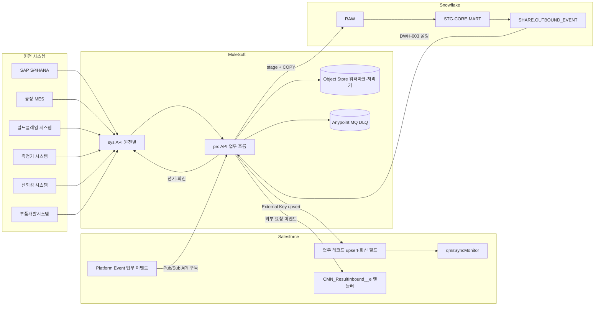

# SL QMS 워크아이템 Vol.9 — QMS-09 연계

Nov 1, 2026 · @배창욱

## 1. 개요

Vol.9는 QMS RFP **Q-42 기간 시스템 연계** 중 QMS 고유 인터페이스를 21개 워크아이템(QMS-09-INT-001~021)으로 내린다. HR·SAP 기준정보·포탈 SSO/To-Do·Snowflake 복제와 KPI 전달 같은 공통 연계는 Vol.0(CMN-00-INT, DWH, TDO)이 이미 정의했다. 이 Vol.은 업무 Vol.(2~6c)이 정의한 **Salesforce·Snowflake 수신 계약을 MuleSoft와 원천 시스템 쪽에서 구현**한다.

**역할 분담 원칙**

| 구분 | 업무 Vol.(2~6c)이 정한 것 | 이 Vol.이 만드는 것 |
| --- | --- | --- |
| 원천 → Salesforce | 수신 객체·External Key·필드·통합 사용자 PS·수신 후 업무 규칙 | Mule sys·prc API, 원천 추출·변환·upsert, 재시도·로그·재처리 |
| Salesforce → 원천 | 발행 이벤트(Platform Event)와 회신 필드(SapSyncStatus 등) | 이벤트 구독, 원천 전기(SAP 이동·사용결정·전표), 회신 upsert, 멱등 |
| 원천 → Snowflake | STG 변환·CORE MERGE·KPI(업무 Vol. 소유 CORE 테이블) | RAW 적재(원천 추출·형식 표준), 공용 CORE 테이블(SAP·로트 계보) 정의 |
| 외부 요청 → 업무 서비스 | 업무 서비스(createFromSource 등) | 외부 이벤트 수신 핸들러(Apex, CMN_ResultInbound__e 라우팅) |

**대상 시스템**

| 시스템 | 역할 | 연계 수단(기본안) | 이 Vol. 인터페이스 |
| --- | --- | --- | --- |
| SAP S/4HANA | 입고·재고·납품·회계, (사용 시) QM 검사 로트 | S/4HANA 표준 OData·SOAP API, 불가 시 BAPI/RFC. 이벤트는 Event Mesh 또는 15분 폴링(D9-1) | IF-SAP-002~009 |
| MES(공장별) | SPC 측정, 생산·불량 실적, EOL 시험, 로트 계보 | MES DB 뷰 폴링 또는 MES API(D9-3), 공장별 어댑터 | IF-MES-001~005 |
| 필드클레임 시스템 | 고객 B2B 불량·워런티 데이터, 고객 클레임 통보 | API 또는 DB 뷰(SL 확인) | IF-FC-001·002 |
| 측정기 관리 시스템 | 측정기·교정 이력(일부 공장) | API 또는 파일(SL 확인) | IF-GAU-001 |
| 신뢰성 시스템 | 시험 실행·결과(SL 시험실) | API(SL 확인) | IF-REL-001·002 |
| 부품개발시스템 | 협력사 부품 개발·신규 부품 승인 | API(SL 확인) | IF-PDS-001~003 |
| Snowflake | 품질 DW(QDW) | Mule Snowflake 커넥터(stage + COPY), SQL API(DWH-004) | IF-DW-001 및 RAW 적재 전반 |
| PMS(다른 Org일 때만) | 프로젝트·WBS·리스크 | Salesforce REST + Mule exp API | IF-AI-003·004, IF-PMS-002 |

**선행 공통 WI**: CMN-00-INT-001(연계 표준·카탈로그·로그·재시도·DLQ), INT-003(SAP 기준정보 매핑), DWH-001(스키마·역할), DWH-002(SF → Snowflake 복제), DWH-003(KPI·알람·CMN_ResultInbound__e 라우팅), DWH-004(드릴다운 쿼리), SEC-004(Mule 인증·Snowflake 네트워크), ARC-001(저장소·CI/CD).

**다른 메뉴와의 경계**

| 연결 대상 | 이 Vol.이 하는 것 | 상대 메뉴가 하는 것 |
| --- | --- | --- |
| QMS-02 DVQ(신뢰성 시스템) | QMS_QualLineRequested__e 구독 → 신뢰성 시스템 의뢰, 상태·결과 수신 핸들러 | 이벤트 발행, 외부 결과 반영 서비스(Vol.2 변경 요청), 판정 규칙 |
| QMS-03 IQC | SAP 입고 → 로트 upsert, 판정 이벤트 → SAP 사용결정·재고 이동, SapSyncStatus 회신 | 로트 초기화·검사·판정·이벤트 발행 |
| QMS-03 PPA | 부품개발시스템 신규 부품 PPAP 요청 수신 → createFromSource, PPAP 결과 회신 | PPAP 서비스·이벤트 |
| QMS-04 SPC·EFC·FQC | MES 측정·생산·불량·EOL RAW 적재, SAP 납품 → 출하검사 로트, 출하 판정 → SAP 출하 차단·해제 | STG·CORE·계산·알람, 출하검사 로트·판정 |
| QMS-04 LEL | PMS가 다른 Org일 때 LELE REST 중계 | REST 리소스(/qms/v1/lele/*) |
| QMS-05 B2B·CLM | 필드클레임 원천 RAW 적재·표준 열 매핑, 클레임 통보 → QMS_Claim__c upsert, 업로드 파일 처리, (선택) 봉쇄 재고 보류 | 표준 열 계약·검증 프로시저·KPI·클레임 업무 |
| QMS-06a 4MC·NCR | SAP 재고·로트 계보 적재, NCR 처분 재고 이동·구상 전표, (선택) 4M 적용 허가 MES 통보 | 쿼리 키·첫 로트 감지·처분·구상 업무 |
| QMS-06b GAU·MSA | IF-GAU-001 동기화, DWH-004 프로시저 모드 Mule 구현 | 수신 계약(GAU-005), MSA 계산 프로시저 |
| QMS-06c SQM | (선택) 협력사 등급 → 부품개발시스템·SAP 전달 | 등급 산정·QMS_SupplierGradeEvent__e |
| QMS-07 | 연계 상태 KPI 제공(INT-002) | 위젯 |
| QMS-08 AIQ | IF-AI-001·002(Cortex Search·Analyst 호출) 카탈로그 등록·모니터링과 DWH-004 모드 공통 규약(INT-020), PMS 다른 Org일 때 LELE 추천 중계·반영 결과 전달(INT-021) | prc-ai-snowflake-api 구현(AIQ-002·010), LELE 추천 서비스·REST(AIQ-007·008) |

**앞 Vol. 상태**: Vol.0·2~6c 모두 검토 대기다. Vol.4~6c는 Vol. 간 정합 수정이 진행 중이므로 이름은 `interfaces.md`를 최종으로 따른다. Vol.0 D-1(단일 Org) 권고를 가정해 PMS 연계(INT-021)는 조건부로 둔다.

## 2. 연계 아키텍처

데이터는 네 방향으로만 흐른다. (1) 원천 → Mule → Salesforce 업무 레코드(External Key upsert), (2) Salesforce Platform Event → Mule → 원천 전기 → Salesforce 회신 필드, (3) 원천 → Mule → Snowflake RAW → 업무 Vol.의 STG·CORE, (4) 원천의 "업무 요청"(신규 부품 PPAP, 신뢰성 결과)은 Mule이 `CMN_ResultInbound__e`를 발행하고 Salesforce 핸들러가 업무 서비스를 호출한다. Apex에서 원천 시스템을 직접 호출하지 않는다(CMN-00-INT-001 BR-1).

## 3. 인터페이스 카탈로그

**번호 표기**: 이 Vol. 안에서 `INT-nnn`은 QMS-09-INT-nnn을 뜻한다. Vol.0 공통 연계 WI는 혼동을 막기 위해 항상 `CMN-00-INT-nnn`으로 쓰고, 메타 라인의 선행 WI도 같은 규칙을 따른다(이 Vol. WI는 `QMS-09-INT-nnn`으로 적는다).

**인터페이스 목록**(CMN_Interface__mdt에 등록, INT-001)

| ID | 원천 → 대상 | 데이터 | 방식·주기 | 업무 Vol. 수신 계약 | 구현 WI |
| --- | --- | --- | --- | --- | --- |
| IF-SAP-002 | SAP → SF | 입고(GR)·입고 취소 → 수입검사 로트 | 이벤트 또는 15분 폴링, 지연 15분 이내 | QMS-03-IQC-002 BR-1 | INT-004 |
| IF-SAP-004 | SF → SAP → SF | 수입검사 판정 → 사용결정·재고 이동, 회신 | 이벤트, 5분 이내 | QMS-03-IQC-004 BR-1·6 | INT-005 |
| IF-SAP-005 | SAP → SF | 고객 납품 생성 → 출하검사 로트(DELIVERY) | 이벤트 또는 15분 폴링 | QMS-04-FQC-002 BR-1(b) | INT-006 |
| IF-SAP-006 | SF → SAP → SF | 출하 판정·보류·해제 → 출하 차단·해제, 회신 | 이벤트, 5분 이내 | QMS-04-FQC-003 BR-1 | INT-006 |
| IF-SAP-007 | SF → SAP → SF | NCR 처분 재고 이동, 회신 | 이벤트, 15분 이내 | QMS-06-NCR-003 BR-7 | INT-007 |
| IF-SAP-008 | SF → SAP → SF | 협력사 구상 차변 메모, 회신 | 이벤트, 1시간 이내 | QMS-06-NCR-007 BR-7 | INT-007 |
| IF-SAP-003 | SAP → Snowflake | 재고·출하·환율·표준가·BOM·배치 | 일 1회 + 재고·출하 1시간 증분 | QMS-05-B2B-003, CLM-008, QMS-06-4MC-007, NCR-003·007 | INT-008 |
| IF-SAP-009 | SF → SAP | 클레임 봉쇄 의심 재고 보류(선택) | 이벤트 | QMS-05-CLM-008 BR-4 | INT-009 |
| IF-MES-001 | MES → Snowflake | SPC 측정값 | 5분 마이크로배치 | QMS-04-SPC-002 BR-1 | INT-010 |
| IF-MES-002 | MES → Snowflake | 생산·불량 실적 | 1시간 | QMS-04-EFC-002 BR-1, QMS-05-CLM-008 | INT-011 |
| IF-MES-003 | MES → Snowflake | EOL 시험 결과 | 1시간 | QMS-04-FQC-004 BR-1 | INT-011 |
| IF-MES-004 | MES·SAP → Snowflake | 로트 계보(부품 로트 → 생산 로트 → 출하) | 1시간 | QMS-06-4MC-007 BR-4·6, NCR-003 BR-2 | INT-012 |
| IF-MES-005 | SF → MES | 4M 적용 허가 통보(선택) | 이벤트 | QMS-06-4MC-006 BR-8 | INT-013 |
| IF-FC-001 | 필드클레임 → Snowflake | 고객 라인 불량·필드·워런티·반품·차량 대수 | 일 1회 | QMS-05-B2B-001 BR-2 | INT-014 |
| IF-FC-002 | 필드클레임 → SF | 고객 클레임 통보 → QMS_Claim__c | 15분 이내 | QMS-05-CLM-007 BR-10 | INT-015 |
| IF-B2B-001 | SF → Mule → Snowflake → SF | 고객 데이터 업로드 파일 처리 | 이벤트, 10분 이내 | QMS-05-B2B-002 BR-4·7 | INT-016 |
| IF-GAU-001 | 측정기 시스템 → SF | 측정기·교정 이력(LEGACY 공장) | 일 1회 + 수동 | QMS-06-GAU-005 BR-2·3 | INT-017 |
| IF-REL-001 | SF → 신뢰성 시스템 | 시험 의뢰 | 이벤트, 15분 이내 | QMS-02-DVQ-006 BR-7 | INT-018 |
| IF-REL-002 | 신뢰성 시스템 → SF | 접수·착수·완료·결과·성적서 | 30분 폴링 또는 콜백 | QMS-02-DVQ-006·007(외부 반영 서비스, Vol.2 변경 요청) | INT-018 |
| IF-PDS-001 | 부품개발시스템 → SF | 신규 부품 PPAP 요청 | 이벤트 또는 1시간 폴링 | QMS-03-PPA-002 BR-1 | INT-019 |
| IF-PDS-002 | SF → 부품개발시스템 | PPAP 진행·판정 결과 | 이벤트 | QMS-03-PPA-002 BR-6 | INT-019 |
| IF-PDS-003 | SF → 부품개발시스템·SAP | 협력사 품질 등급(선택) | 이벤트 | QMS-06-SQM-003 BR-3 | INT-019 |
| IF-DW-001 | SF → Mule → Snowflake | 등록 프로시저 호출(프로시저 모드) | 요청 시, 60초 이내 | QMS-06-MSA-003 BR-1, Vol.0 DWH-004 변경 요청 | INT-020 |
| IF-AI-001 | SF → Mule → Snowflake | Cortex Search 유사 사례·레슨런 검색(search 모드) | 요청 시, 10초 이내 | QMS-08-AIQ-002 BR-4, Vol.0 DWH-004 변경 요청 | QMS-08-AIQ-002(구현), INT-020(모드 공통 규약·모니터링) |
| IF-AI-002 | SF → Mule → Snowflake | Cortex Analyst 자연어 통계 질의(analyst 모드) | 요청 시, 30초 이내 | QMS-08-AIQ-010 | QMS-08-AIQ-010(구현), INT-020(모드 공통 규약·모니터링) |
| IF-AI-003 | PMS Org → QMS Org | LELE 추천 요청·매칭·반영 조회 중계, 리스크 레슨런 후보(exp-pms-lele-api) | 호출 시 | QMS-08-AIQ-008 BR-4, QMS-04-LEL-004·005 | INT-021 |
| IF-AI-004 | QMS Org → PMS Org | LELE 반영 결과 전달(prc-lele-sync-api) | 이벤트, 5분 이내 | QMS-08-AIQ-008 BR-5 | INT-021 |
| IF-PMS-002 | QMS Org → PMS Org | 클레임·NCR·4M·레슨런 게시 이벤트(디지털 스레드, prc-pms-thread-api) | 이벤트, 5분 이내 | QMS-05-CLM-007, QMS-06a, QMS-04-LEL | INT-021 |

**Mule API 목록**(명명은 Vol.0 3.2절 `{계층}-{대상}-api`)

| API | 계층 | 역할 | 사용 WI |
| --- | --- | --- | --- |
| sys-salesforce-qms-api | sys | Salesforce REST·Composite·Bulk 2.0 upsert, Pub/Sub API 구독, ContentVersion 내려받기 | 전 WI |
| sys-snowflake-qdw-api | sys | RAW 적재(stage + COPY), 등록 프로시저 호출, OUTBOUND_EVENT 상태 갱신 | INT-008·010·011·012·014·016·020 |
| sys-sap-material-document-api | sys | 자재 문서(입고·취소) 조회·이벤트 수신 | INT-004 |
| sys-sap-quality-api | sys | 검사 로트 조회, 사용결정 기록(SAP QM 사용 공장) | INT-005 |
| sys-sap-inventory-api | sys | 재고 이동 전기, 재고·배치 조회 | INT-005·007·008·009 |
| sys-sap-delivery-api | sys | 고객 납품 조회·출하 차단·해제 | INT-006 |
| sys-sap-finance-api | sys | 분개(차변 메모) 전기 | INT-007 |
| sys-sap-material-api | sys | 표준가·BOM·환율(Vol.0 INT-003 확장) | INT-008 |
| sys-mes-{공장군}-api | sys | 공장별 MES 측정·실적·EOL·계보 추출(공장 MES 제품마다 1개) | INT-010·011·012·013 |
| sys-fieldclaim-api | sys | 필드클레임 데이터·클레임 통보 | INT-014·015 |
| sys-gauge-api | sys | 측정기 시스템 | INT-017 |
| sys-reliability-api | sys | 신뢰성 시스템 | INT-018 |
| sys-pds-api | sys | 부품개발시스템 | INT-019 |
| prc-iqc-sap-sync-api | prc | 입고 → 로트, 판정 → SAP | INT-004·005 |
| prc-fqc-sap-sync-api | prc | 납품 → 로트, 판정 → 출하 차단 | INT-006 |
| prc-ncr-sap-posting-api | prc | 처분 이동·구상 전표 | INT-007 |
| prc-sap-dw-load-api | prc | SAP → Snowflake 공용 데이터 | INT-008 |
| prc-mes-dw-load-api | prc | MES → Snowflake | INT-010·011·012 |
| prc-customer-quality-api | prc | 필드클레임·업로드 | INT-014·015·016 |
| prc-gauge-sync-api | prc | 측정기 동기화 | INT-017 |
| prc-reliability-test-api | prc | 신뢰성 의뢰·결과 | INT-018 |
| prc-pds-ppap-api | prc | 부품개발시스템 PPAP·등급 | INT-019 |
| prc-dw-query-api | prc | DWH-004 쿼리·프로시저(기존 API 확장) | INT-020 |
| prc-ai-snowflake-api | prc | Cortex Search(search)·Cortex Analyst(analyst). 구현은 Vol.8, 공통 규약·모니터링은 이 Vol. | QMS-08-AIQ-002·010, INT-020 |
| exp-pms-lele-api | exp | 다른 Org PMS → QMS LELE 추천·매칭·반영 조회·리스크 후보(조건부) | INT-021 |
| prc-lele-sync-api | prc | QMS LELE 반영 이벤트 → PMS(조건부) | INT-021 |
| prc-pms-thread-api | prc | QMS 클레임·NCR·4M·레슨런 게시 이벤트 → PMS(조건부) | INT-021 |

**통합 사용자 권한 셋**(업무 Vol.이 정의, 이 Vol.이 Mule 연결에 사용)

| PS | 정의 WI | 쓰는 인터페이스 |
| --- | --- | --- |
| QMS_PS_Iqc_Integration | QMS-03-IQC-002 BR-7 | IF-SAP-002·004 |
| QMS_PS_Fqc_Integration | QMS-04-FQC-002 | IF-SAP-005·006 |
| QMS_PS_Ncr_Integration | QMS-06-NCR(3절) | IF-SAP-007·008 |
| QMS_PS_Claim_Integration | QMS-05-CLM-007 | IF-FC-002 |
| QMS_PS_B2b_Integration | Vol.5 변경 요청(B2B-002) | IF-B2B-001 |
| QMS_PS_Gauge_Integration | QMS-06-GAU-005 | IF-GAU-001 |
| QMS_PS_Lele_Read + REST | QMS-04-LEL-004, QMS-08-AIQ-008 | IF-AI-003 |
| QMS_PS_Integration_Monitor | INT-002(이 Vol.) | 모니터·재전송, CMN_ResultInbound__e 발행, 회신 필드 조회 |

**이 Vol.이 소유하는 Snowflake 객체**(업무 Vol.은 이 CORE 테이블을 쿼리 키로 읽기만 한다)

| 객체 | 정의 WI | 내용 |
| --- | --- | --- |
| RAW.SAP_* (STOCK, SHIPMENT, FX_RATE, MATERIAL_PRICE, BOM, BATCH) | INT-008 | SAP 추출 원본 |
| CORE.SAP_STOCK, CORE.SAP_STOCK_HIST, CORE.SAP_SHIPMENT, CORE.SAP_FX_RATE, CORE.SAP_MATERIAL_PRICE, CORE.SAP_BOM, CORE.SAP_BATCH | INT-008 | 공용 SAP 데이터 |
| RAW.MES_SPC_MEASUREMENT, RAW.MES_PRODUCTION, RAW.MES_DEFECT, RAW.MES_EOL_RESULT, RAW.MES_LOT_GENEALOGY | INT-010·011·012 | MES 추출 원본(STG·CORE는 Vol.4·6a 소유, LOT_TRACE만 이 Vol.) |
| CORE.LOT_TRACE | INT-012 | 로트 계보 |
| RAW.FC_CUSTOMER_QUALITY 적재, STG.V_FC_TO_STD | INT-014 | 필드클레임 원본과 표준 열 매핑 뷰(테이블 정의는 Vol.5 B2B-001) |
| MART.V_INTERFACE_LATENCY | INT-002 | 원천별 마지막 적재 시각·지연 |

**공통 기반 등록(INT-001에서 일괄)**: CMN_Interface__mdt 등록(위 ID 전부), CMN_InterfaceLog__c 기록 규칙, `QMS_ExternalCodeMap__mdt`(원천 코드 ↔ QMS 코드 매핑), `QMS_SapPostingRule__mdt`(INT-005·007), Anypoint MQ 큐 이름 규칙 `qms.{if-id}.main` / `qms.{if-id}.dlq`, Object Store 키 규칙 `{if-id}:{원천 키}:{버전}`.

**데이터량 가정**(SL 확인 전): 입고 라인 하루 200~400건, 고객 납품 라인 하루 500~1,500건, SPC 측정 연 2억~3억 건(5분 배치당 평균 2,000~3,000행), 생산 실적 시간당 공장별 수백 행, EOL 시리얼 하루 수만 건, 필드클레임 일 수천 행, 측정기 수천 대.

## 4. 공통 프레임 (INT-001~003)

### QMS-09-INT-001 QMS 연계 공통 프레임·카탈로그·코드 매핑

추적 Q-42, NFR-4.3(API 제공) · 필수 · W1 · MULE, SF, SNOW · INT, DM, CFG · Customization · 선행 CMN-00-INT-001, CMN-00-SEC-004, CMN-00-DWH-001, CMN-00-ARC-001 · 6 M/D

**목적**: QMS 인터페이스 28개가 같은 방식으로 이벤트를 받고, 원천 코드를 바꾸고, 실패를 기록·재처리하게 한다. 인터페이스마다 다른 방식으로 만들면 운영 중 장애 원인을 찾을 수 없고, AI 개발 에이전트가 같은 실수를 반복한다.

**범위** In: Mule 공통 라이브러리 `qms-integration-commons`, Salesforce 이벤트 구독 템플릿, 원천 → Salesforce upsert 템플릿, Snowflake RAW 적재 템플릿, 멱등·워터마크 규칙, 오류 분류·재시도·DLQ, 코드 매핑 메타데이터, 카탈로그 등록, 환경 매핑. Out: 개별 인터페이스(INT-004~021), 모니터 화면(INT-002), 테스트 목(INT-003).

**데이터 모델**

| 객체 / 필드 | 타입 | 필수 | 설명 |
| --- | --- | --- | --- |
| CMN_Interface__mdt(레코드 추가) | Custom Metadata | — | 3절 ID 28건. Pattern__c(BATCH, REALTIME, EVENT), Schedule__c, OwnerTeam__c, IsActive__c |
| QMS_ExternalCodeMap__mdt.InterfaceId__c | Text(20) | Y | 예: IF-FC-002 |
| QMS_ExternalCodeMap__mdt.CodeSet__c | Text(40) | Y | 예: CLAIM_TYPE, SAP_STOCK_TYPE, MES_SHIFT |
| QMS_ExternalCodeMap__mdt.PlantCode__c | Text(10) | N | 공란 = 전 공장 공통 |
| QMS_ExternalCodeMap__mdt.SourceValue__c | Text(80) | Y | 원천 코드 값 |
| QMS_ExternalCodeMap__mdt.TargetValue__c | Text(80) | Y | QMS 값(Picklist API 값 또는 CMN_Code ExternalKey) |
| QMS_ExternalCodeMap__mdt.IsActive__c | Checkbox | Y | |
| Snowflake RAW 표준 테이블 | 테이블 | — | PAYLOAD VARIANT, `_SOURCE`(원천 시스템·공장), `_SOURCE_KEY`(원천 레코드 키), `_BATCH_ID`, `_LOADED_AT`. CMN-00-DWH-001 RAW 규칙에 `_SOURCE_KEY` 추가 |
| Mule Object Store `qms-os` | 설정 | — | 키 `{if-id}:replay`, `{if-id}:watermark`, `{if-id}:done:{원천 키}:{버전}`(TTL 30일) |

**공통 흐름 규격**

| 패턴 | 처리 순서 | 사용 WI |
| --- | --- | --- |
| E1 Salesforce 이벤트 → 원천 전기 → 회신 | Pub/Sub API 구독 → 처리 키 확인 → 원천 전기(sys) → 회신 upsert(External Key, 상태·문서 번호·메시지) → 처리 키 저장 → replay ID 커밋 | INT-005·006·007·009·013·018·019 |
| E2 원천 변경 → Salesforce upsert | 원천 이벤트 수신 또는 워터마크 폴링 → 코드 매핑 → Composite(200건 이하) 또는 Bulk 2.0 upsert → 행별 결과 집계 → 워터마크 갱신 | INT-004·006·015·017 |
| E3 원천 → Snowflake RAW | 워터마크 추출 → NDJSON gzip → stage `@RAW.MULE_STAGE/{if-id}/{yyyy}/{mm}/{dd}/{batchId}` → `COPY INTO RAW.x`(ON_ERROR CONTINUE) → 적재 행·오류 행 기록 → 워터마크 갱신 | INT-008·010·011·012·014 |
| E4 원천 업무 요청 → Salesforce 서비스 | 원천 이벤트·폴링 → `CMN_ResultInbound__e` 발행(EventType, ExternalEventId, PayloadJson) → Salesforce 핸들러(INT-002 규약)가 업무 서비스 호출 | INT-018·019 |
| E5 Snowflake 프로시저·AI 호출 | Salesforce 콜아웃 → prc-dw-query-api(PROCEDURE) 또는 prc-ai-snowflake-api(SEARCH, ANALYST) → 결과 VARIANT·JSON 반환 | INT-020, QMS-08-AIQ-002·010 |

**비즈니스 규칙**

- BR-1: 구조 — Mule 애플리케이션은 API 단위(3절 목록)로 만들고, 로깅·상관 Id·오류 처리·재시도·DLQ·멱등·워터마크·Salesforce/Snowflake 연결은 Exchange 라이브러리 `qms-integration-commons`(버전 고정)로만 구현한다. 인터페이스마다 오류 처리 흐름을 따로 만들지 않는다.

- BR-2: 이벤트 구독 — Salesforce Pub/Sub API(gRPC)로 구독하고, 처리가 끝난 이벤트의 replay ID를 Object Store `{if-id}:replay`에 저장한다. 재시작하면 저장된 replay ID 다음부터 받는다. Platform Event 보존 기간(72시간)을 넘는 중단은 INT-002 재동기화로 복구한다.

- BR-3: 멱등 — 처리 키 `{if-id}:done:{원천 키}:{버전}`가 있으면 원천 전기를 생략하고 저장된 결과로 회신만 다시 보낸다. SAP 전기 시 참조 필드(자재 문서 헤더 텍스트, 분개 참조 등)에 QMS 키를 넣어, Object Store가 지워진 뒤에도 SAP 조회로 중복을 확인할 수 있게 한다.

- BR-4: 오류 분류 — (a) 일시 오류(타임아웃, HTTP 5xx, SAP 잠금, Salesforce UNABLE_TO_LOCK_ROW)는 CMN-00-INT-001 BR-3대로 지수 백오프 3회(1분, 4분, 16분) 후 DLQ `qms.{if-id}.dlq`. (b) 업무 오류(코드 매핑 없음, 마스터 없음, SAP 재고 부족, 필수값 누락)는 재시도하지 않고 즉시 회신 필드 FAILED + 메시지(255자)로 돌려준다. (c) 분류는 공통 라이브러리의 오류 코드 표(`errors.yaml`)로 정한다.

- BR-5: 로그 — 배치형은 실행 1회에 CMN_InterfaceLog__c 1건. 이벤트형은 건별 로그를 만들지 않고 인터페이스별 1분 묶음 로그 1건(처리·실패 건수, 실패 키 최대 100개)을 남긴다(이벤트 볼륨이 하루 수천 건이라 건별 로그는 Salesforce 저장 공간을 소모함). CorrelationId = Salesforce replay ID 또는 원천 키.

- BR-6: Snowflake 적재 — RAW 테이블은 위 표준 열을 갖는다. 같은 `_BATCH_ID`를 다시 COPY하면 COPY 이력으로 건너뛴다. 워터마크는 원천 변경 시각 기준이고 추출 시 5분 겹침을 둔다(중복은 업무 Vol. STG의 원천 키 기준 중복 제거가 처리).

- BR-7: 코드 매핑 — 원천 코드 → QMS 값 변환은 `QMS_ExternalCodeMap__mdt`(Mule이 SOQL로 읽어 1시간 캐시)만 쓴다. DataWeave에 코드 값을 넣지 않는다. 공장 지정 행이 공통 행보다 우선한다. 매핑이 없으면 BR-4(b) 업무 오류.

- BR-8: 인증 — Mule → Salesforce는 OAuth 2.0 JWT Bearer, 통합 사용자는 도메인별 3개(SAP 연계, MES·DW 연계, 외부 시스템 연계)로 나누고 각 사용자에 업무 Vol. 통합 PS를 필요한 것만 준다. Mule → Snowflake는 Key-pair(SEC-004), 역할 ROLE_INGEST(RAW 적재)·ROLE_TRANSFORM(프로시저). Mule → SAP는 인터페이스군별 기술 사용자와 최소 권한 역할. 모든 비밀은 Anypoint Secrets Manager.

- BR-9: 환경 — DEV·SIT·UAT·PROD 대응표(Salesforce 샌드박스, Mule 환경, Snowflake DB `SL_QDW_DEV`·`SL_QDW_TEST`·`SL_QDW`, 원천 시스템 테스트계)를 저장소 `integration/environments.md`에 두고, Mule 속성 파일은 환경별로 분리한다. 하위 환경에서 운영 원천에 연결하는 설정은 CI가 차단한다.

- BR-10: 카탈로그 — 3절 인터페이스 28건을 CMN_Interface__mdt에 등록하고, 저장소 `integration/catalog.md`는 메타데이터에서 생성한다(수동 편집 금지).

**화면/UX**: 신규 화면 없음. CMN_Interface__mdt·QMS_ExternalCodeMap__mdt는 Setup Custom Metadata 화면과 리스트뷰로 관리한다(INT-002 모니터에서 링크).

**권한**: 코드 매핑 편집은 CMN_PSG_SystemAdmin, 조회는 QMS_PS_Integration_Monitor.

**수용 기준**

- AC-1: Given 이벤트 1,000건 처리 중 Mule 재시작, When 재기동, Then 유실 0건·중복 전기 0건(처리 키 확인 로그로 검증).

- AC-2: Given SAP 타임아웃이 계속되는 이벤트, When 처리, Then 1·4·16분 재시도 후 DLQ 적재, 묶음 로그에 FAILED 1건.

- AC-3: Given 매핑 없는 원천 코드 "Z9", When 처리, Then 재시도 없이 회신 FAILED, 메시지에 CodeSet과 값 포함.

- AC-4: Given 같은 배치 파일 2회 COPY, When 적재, Then RAW 행 수 변화 없음.

- AC-5: Given 공장 KR01 지정 행과 공통 행이 같은 SourceValue, When KR01 데이터 변환, Then 공장 지정 값 사용.

- AC-6: Given SIT 환경 설정에 운영 SAP 호스트, When CI 빌드, Then 실패.

**에이전트 주의**: 인터페이스별로 HTTP 재시도·로그 코드를 복사해 넣지 않는다(공통 라이브러리). 건별 CMN_InterfaceLog__c를 만들지 않는다. Salesforce Streaming API(CometD)·PushTopic을 새로 쓰지 않는다(Pub/Sub API).

**오픈 이슈**: Mule 런타임 위치(CloudHub 2.0 + 공장 VPN 또는 공장 내 하이브리드 런타임, D9-4), Anypoint vCore·MQ 라이선스 수량, SL이 진행 중인 뮬소프트 프로젝트의 공통 라이브러리·SAP sys API 재사용 범위.

### QMS-09-INT-002 외부 요청 수신 규약·동기화 상태 모니터·재전송

추적 Q-42, NFR-4.1(가용성) · 필수 · W1 · SF, MULE, SNOW · APEX, LWC, DM, SQL · Customization · 선행 QMS-09-INT-001, CMN-00-DWH-003, CMN-00-NTF-001 · 5 M/D

**목적**: SAP 회신이 오지 않거나 실패한 수입검사 로트·처분·전표를 운영자가 한 화면에서 찾아 다시 보내게 한다. 연계 장애 중에도 업무는 계속되고(RFP 가용성), 복구 후 빠짐없이 맞춰져야 한다. 원천 시스템이 Salesforce 업무를 시작시키는 경로(E4)의 공통 규약도 여기서 정한다.

**범위** In: 동기화 모니터 설정 메타데이터, 재전송 인터페이스와 구현체, 자동 재동기화 잡, 모니터 화면, 수동 완료 처리, 외부 요청 이벤트 규약과 핸들러 기반 클래스, 원천 적재 지연 감시(Snowflake). Out: 각 인터페이스의 실제 전기(INT-005~019).

**데이터 모델**

| 객체 / 필드 | 타입 | 필수 | 설명 |
| --- | --- | --- | --- |
| QMS_SyncMonitorConfig__mdt.InterfaceId__c | Text(20) | Y | |
| QMS_SyncMonitorConfig__mdt.ObjectApiName__c / StatusField__c | Text(80) | Y | 예: QMS_IqcLot__c / SapSyncStatus__c |
| QMS_SyncMonitorConfig__mdt.PendingValues__c / FailedValues__c / DoneValues__c | Text(255) | Y | 쉼표 구분 상태 값 |
| QMS_SyncMonitorConfig__mdt.MessageField__c / DocNoField__c | Text(80) | N | 실패 메시지·원천 문서 번호 필드 |
| QMS_SyncMonitorConfig__mdt.ResendClass__c | Text(80) | Y | `QMS_SyncResender` 구현체 |
| QMS_SyncMonitorConfig__mdt.AgeAlertMinutes__c | Number(5,0) | Y | 이 시간 넘게 PENDING이면 경고 |
| QMS_SyncMonitorConfig__mdt.AutoResendMax__c | Number(1,0) | Y | 자동 재전송 최대 횟수(기본 3) |
| QMS_SyncResendLog__c.RecordIdText__c / ObjectApiName__c / InterfaceId__c | Text(18) / Text(80) / Text(20) | Y | |
| QMS_SyncResendLog__c.Mode__c | Picklist (AUTO, MANUAL, MANUAL_DONE) | Y | |
| QMS_SyncResendLog__c.Reason__c | Text(255) | MANUAL·MANUAL_DONE이면 Y | |
| QMS_SyncResendLog__c.ManualDocNo__c | Text(30) | MANUAL_DONE이면 Y | SAP에서 직접 처리한 문서 번호 |
| QMS_SyncResendLog__c.Result__c | Picklist (REPUBLISHED, SKIPPED, ERROR) | Y | |

**초기 모니터 설정**

| InterfaceId | 객체.상태 필드 | PENDING / FAILED / DONE | 경고(분) |
| --- | --- | --- | --- |
| IF-SAP-004 | QMS_IqcLot__c.SapSyncStatus__c | PENDING, SENT / FAILED / CONFIRMED, NOT_REQUIRED | 30 |
| IF-SAP-006 | QMS_FinalInspLot__c.SapSyncStatus__c | PENDING, SENT / FAILED / CONFIRMED, NOT_REQUIRED | 15 |
| IF-SAP-007 | QMS_NcrDisposition__c.SapMovementStatus__c | PENDING, SENT / FAILED / CONFIRMED, NOT_REQUIRED | 60 |
| IF-SAP-008 | QMS_NcrChargeback__c.PostingStatus__c | PENDING / FAILED / POSTED | 240 |
| IF-B2B-001 | QMS_B2bUpload__c.Status__c | UPLOADED, PROCESSING / FAILED / LOADED, PARTIAL | 30 |
| IF-REL-001 | QMS_QualPlanLine__c.ExternalSyncStatus__c(Vol.2 변경 요청) | PENDING, SENT / FAILED / ACCEPTED | 60 |
| IF-PDS-002 | QMS_Ppap__c.PdsSyncStatus__c(Vol.3 변경 요청, 선택) | PENDING / FAILED / CONFIRMED | 240 |

**서비스 API**

    public interface QMS_SyncResender {
        // 레코드 현재 값으로 원래 업무 이벤트를 다시 발행한다(EventType은 최초 발행과 같은 값)
        Integer resend(Set<Id> recordIds);
    }
    public abstract class QMS_InboundHandlerBase implements CMN_InboundHandler {
        protected abstract Set<String> requiredKeys();      // PayloadJson 필수 키
        protected abstract Id handlePayload(Map<String, Object> payload); // 업무 서비스 호출, 결과 레코드 Id 반환
    }

**비즈니스 규칙**

- BR-1: 재전송 구현체 — 인터페이스마다 `QMS_SyncResender`를 구현해 레코드 필드에서 원래 이벤트를 다시 만든다(예: `QMS_IqcDecisionResender`는 로트의 Decision·수량·4M 필드로 QMS_IqcDecision__e EventType DECIDED를 발행). 재전송 전 상태를 PENDING으로 되돌리고 QMS_SyncResendLog__c를 남긴다. Mule은 INT-001 BR-3 처리 키로 이미 전기된 건을 확인하고 회신만 다시 보낸다.

- BR-2: 자동 재동기화 `QMS_SyncReconcileJob`(매시 15분) — 설정별로 PENDING 값이면서 LastModifiedDate가 AgeAlertMinutes × 2를 넘은 레코드를 찾아, 자동 재전송 횟수가 AutoResendMax 미만이면 재전송한다. 한도를 넘은 레코드는 다시 보내지 않고 CMN_PSG_SystemAdmin에게 알림 QMS_INT_SYNC_STUCK(인터페이스·건수·가장 오래된 레코드). 72시간 넘는 Mule 중단도 이 잡으로 복구된다.

- BR-3: 모니터 화면 `qmsSyncMonitor`(SL Admin 앱 "연계 모니터", 품질 사용자는 SL QMS 앱 공장 필터 고정 버전) — 인터페이스별 타일(PENDING 건수, FAILED 건수, 가장 오래된 PENDING 경과 시간, 최근 24시간 처리 건수), 목록(업무 번호 링크, 공장, 상태, 메시지, 원천 문서 번호, 마지막 갱신, 재전송 이력), 일괄 재전송, 수동 완료, CMN_InterfaceLog__c 링크.

- BR-4: 수동 완료 — SAP에서 직접 처리한 경우 CMN_PSG_SystemAdmin이 "수동 완료"(사유·SAP 문서 번호 필수)로 상태를 DONE 값(첫 번째 값, 예: CONFIRMED)으로 바꾼다. 업무 Vol.의 회신 필드 편집 권한은 통합 사용자에게만 있으므로 수동 완료는 이 WI의 without sharing 서비스 `QMS_SyncManualDoneService`가 PS 검사(Custom Permission QMS_IntegrationManualDone) 후 수행하고 로그를 남긴다.

- BR-5: 외부 요청 이벤트 규약(E4) — EventType은 `QMS_{인터페이스 약어}_{사건}`(예: QMS_REL_LINE_UPDATE, QMS_PDS_PPAP_REQUEST), ExternalEventId는 `{IF-ID}:{원천 키}:{원천 버전 또는 변경 시각 yyyyMMddHHmmss}`, PayloadJson 최상위에 `schemaVersion`(정수) 필수. 핸들러는 `QMS_InboundHandlerBase`를 상속하고 CMN_InboundRoute__mdt에 등록한다. 필수 키가 없거나 schemaVersion을 모르면 Receipt FAILED + 메시지(재처리 버튼은 DWH-003 BR-4). 이 규약으로 DWH-003의 `CMN_ResultInbound__e`를 Snowflake 외 원천에도 쓴다(Vol.0 변경 요청).

- BR-6: 원천 적재 지연 감시 — Snowflake 뷰 `MART.V_INTERFACE_LATENCY`(RAW 테이블별 MAX(_LOADED_AT), 원천 최신 시각, 지연 분)를 두고, 기준(IF-MES-001 30분, IF-MES-002·003·004 3시간, IF-SAP-003 재고 3시간·일 배치 26시간, IF-FC-001 30시간) 초과 시 Snowflake Alert가 EVENT_TYPE 'QMS_INT_STALE'을 보낸다. 핸들러 `QMS_IntStaleHandler`가 CMN_PSG_SystemAdmin과 해당 업무 담당 Role(SPC면 공장 QUALITY_MANAGER)에게 알린다(같은 인터페이스 하루 1회).

- BR-7: KPI — QMS_INT_FAILED(인터페이스·일, FAILED 건수), QMS_INT_PENDING_AGED(경고 시간 초과 PENDING 건수), QMS_INT_LATENCY_MIN(원천별 지연 분)을 DWH-003으로 적재한다(Vol.7 운영 위젯).

**화면/UX**: `qmsSyncMonitor`(위), 레코드 페이지용 소형 컴포넌트 `qmsSyncBadge`(속성 interfaceId: 상태·메시지·재전송 버튼, 업무 레코드 페이지 상단에 배치 — 각 업무 Vol. 레코드 페이지 구성 시 추가).

**권한**: QMS_PS_Integration_Monitor(조회·재전송), Custom Permission QMS_IntegrationManualDone(수동 완료, CMN_PSG_SystemAdmin에만).

**수용 기준**

- AC-1: Given 수입검사 로트 3건 FAILED, When 모니터에서 일괄 재전송, Then QMS_IqcDecision__e 3건 재발행, 상태 PENDING, 재전송 로그 3건.

- AC-2: Given SAP에 이미 전기된 로트를 재전송, When Mule 처리, Then SAP 전기 0건, 회신만 CONFIRMED로 다시 반영.

- AC-3: Given PENDING 상태로 61분 지난 로트(경고 30분), When 매시 잡, Then 자동 재전송 1회. 4번째 실행에서는 재전송 없이 관리자 알림.

- AC-4: Given 필수 키 없는 QMS_PDS_PPAP_REQUEST 이벤트, When 핸들러 실행, Then Receipt FAILED + 누락 키 메시지, 업무 레코드 미생성.

- AC-5: Given SPC RAW 적재가 45분 멈춤, When Alert 실행, Then 관리자·공장 품질팀장 알림 각 1건(같은 날 재발해도 추가 알림 없음).

- AC-6: Given 일반 품질 사용자, When 수동 완료 시도, Then 권한 없음.

**에이전트 주의**: 재전송을 위해 업무 레코드를 복사하거나 새 레코드를 만들지 않는다(같은 이벤트 재발행). 회신 필드를 사용자 화면에서 직접 편집 가능하게 열지 않는다(수동 완료 서비스만).

**오픈 이슈**: 연계 장애 시 현장 수동 처리 절차(SAP 수기 처리 후 수동 완료) 승인 주체, 모니터를 공장 품질 사용자에게도 열지.

### QMS-09-INT-003 연계 테스트 환경·목(mock)·PoC 데이터 주입

추적 Q-42, Q-6, Q-11, Q-16 · 필수 · W1 · MULE, SNOW, SF · INT, SQL, DOC · Customization · 선행 QMS-09-INT-001 · 4 M/D

**목적**: SAP·MES·필드클레임 연결 전에도 각 업무 Vol.을 끝까지 시험하고, PoC(10~12월)에서 실 연계 없이 시나리오를 시연한다. RFP PoC 시나리오 6처럼 아키텍처 수준 시연이 허용된 항목도 데이터 흐름은 실제처럼 보여야 한다.

**범위** In: 원천 시스템 목 API, 합성 데이터 생성 프로시저, 인터페이스 계약 테스트(JSON Schema), PoC 시나리오 주입 스크립트, 목 데이터 격리. Out: 실제 원천 연결(각 INT WI), 업무 화면 시연 대본(PoC 계획서).

**구성**

| 구성 요소 | 내용 |
| --- | --- |
| `mock-source-systems`(Mule 앱) | sys API와 같은 경로·스키마로 응답하는 목(SAP 자재 문서·납품·재고 이동·분개, MES 측정·실적·EOL, 필드클레임, 측정기, 신뢰성, 부품개발시스템). 고정 응답 JSON은 `integration/mocks/{system}/` |
| `ML.SP_GEN_DEMO_DATA(scenario VARCHAR, params VARIANT)` | Snowpark Python 합성 데이터 생성(RAW에 `_SOURCE = 'MOCK'`로 적재) |
| 계약 스키마 `integration/contracts/{if-id}.schema.json` | 인터페이스별 원천 페이로드·Salesforce upsert 본문·이벤트 페이로드 JSON Schema |
| PoC 주입 스크립트 `integration/poc/run_scenario.sh {번호}` | 목 이벤트 발행·합성 데이터 생성 순서 실행 |

**합성 데이터 시나리오**

| 시나리오 | 생성 내용 | 확인 대상 |
| --- | --- | --- |
| SPC_DRIFT | 측정 포인트 3개, 30일 정상 + 마지막 3일 평균 이동(공정능력이 1.33 아래로 떨어지게) | SPC 신호·알람·NCR(PoC 1·5) |
| IQC_REJECT | 협력사 입고 5건, 1건은 규격 밖 측정값 | 수입검사 불합격 → NCR(PoC 1) |
| FOURM_FIRST_LOT | 4M 번호가 찍힌 성적서·입고, 생산 로트 | 첫 적용 로트·안정화(PoC 3) |
| FIELD_TREND | 고객 2개, 24개월 필드 불량, 최근 3개월 특정 결함 증가 | B2B 경보·클레임(PoC 2·5) |
| EOL_DROP | 라인 1개 EOL 직행률 급락 | 조기경보 입력(Vol.8) |
| GAUGE_OOT | 교정 불합격 측정기와 그 측정기로 판정한 로트 | 영향 분석(Vol.6b) |

**비즈니스 규칙**

- BR-1: 목 응답은 계약 스키마로 검증된 JSON만 쓴다. 실제 원천 페이로드를 받으면 같은 스키마로 검증해 차이를 CI 리포트로 남긴다.

- BR-2: 계약 테스트 — CI에서 (a) 목 페이로드 → DataWeave 변환 → Salesforce upsert 본문이 업무 Vol. 수신 계약 스키마를 만족하는지, (b) 업무 이벤트 샘플 → 원천 전기 요청이 원천 스키마를 만족하는지 검사한다. 실패하면 배포를 막는다.

- BR-3: 격리 — 합성 데이터는 `_SOURCE = 'MOCK'`, 공장 코드 'ZZ01'·'ZZ02', 협력사·고객 코드 'ZZ' 접두어를 쓴다. PROD 환경 Mule은 `mock` 프로파일을 불러올 수 없고, PROD Snowflake에는 `_SOURCE = 'MOCK'` 행 적재를 막는 정책(COPY 전 검사)을 둔다.

- BR-4: 데모 데이터에 RFP·SL 내부 자료의 실제 문장·수치·고객 정보를 쓰지 않는다(CLAUDE.md 8절). 품번·결함명은 일반적인 헤드램프 부품 명칭으로 만든다.

- BR-5: 시나리오 스크립트는 다시 실행해도 같은 키로 upsert되어 데이터가 늘지 않는다(`--reset` 옵션은 MOCK 행만 지움).

**권한**: 실행은 DEV·SIT·UAT 환경의 통합 개발자, Snowflake ROLE_DW_ADMIN(합성 데이터 생성 프로시저).

**수용 기준**

- AC-1: Given SPC_DRIFT 실행, When Snowflake Task 주기 경과, Then 공정능력 미달 신호 1건 이상이 Salesforce 알람으로 도착.

- AC-2: Given IQC_REJECT 실행, When 목 SAP 입고 이벤트 처리, Then 수입검사 로트 5건, 검사 후 1건 REJECT 판정 시 목 SAP에 사용결정 요청 기록.

- AC-3: Given 계약 스키마와 다른 필드명을 내보내는 DataWeave, When CI, Then 실패.

- AC-4: Given PROD 환경, When MOCK 데이터 적재 시도, Then 거부.

- AC-5: Given 같은 시나리오 2회 실행, When 완료, Then 레코드·행 수 변화 없음.

**에이전트 주의**: 목 앱을 업무 코드 안(Apex 테스트 목 등)과 섞지 않는다(Apex 단위 테스트는 HttpCalloutMock으로 따로). 합성 데이터 생성 로직을 운영 Task 그래프에 넣지 않는다.

## 5. SAP 연계 (INT-004~009)

SAP 쪽 값(이동 유형, 사용결정 코드, 재고 유형, 납품 차단 코드, 회계 문서 유형)은 SL SAP 설정에 따라 다르므로 Mule 코드에 넣지 않고 `QMS_SapPostingRule__mdt`(INT-005에서 정의)와 `QMS_ExternalCodeMap__mdt`로 둔다. 아래 표의 이동 유형 번호는 SAP 표준 예시이며 SL 확인 후 확정한다. SAP API 이름도 S/4HANA 표준 API 기준 예시이며, SL 버전에서 쓸 수 없으면 같은 기능의 BAPI/RFC로 바꾼다(sys API 안에서만 바뀌고 prc API·Salesforce 계약은 그대로).

### QMS-09-INT-004 SAP 입고 → 수입검사 로트 생성(IF-SAP-002)

추적 Q-6, Q-42 · 필수 · W1 · MULE, SF · INT · Customization · 선행 QMS-09-INT-001, QMS-03-IQC-002, CMN-00-INT-003 · 6 M/D

**목적**: 협력사 부품이 SAP에 입고되면 15분 안에 QMS 검사 대기열에 로트가 나타나게 한다. 사람이 입고 목록을 보고 검사 건을 만드는 일을 없앤다.

**범위** In: 입고 감지(이벤트 또는 폴링), 대상 필터, SAP → QMS 필드 매핑, 로트 upsert, 입고 취소 반영, 마스터 누락 시 기준정보 즉시 동기화 요청, 재처리. Out: 로트 초기화·검사(QMS-03-IQC-002·003), 판정 회신(INT-005).

**방식**

| 항목 | 내용 |
| --- | --- |
| 기본안(A) | S/4HANA 비즈니스 이벤트(자재 문서 생성)를 SAP Event Mesh로 받아 Mule이 자재 문서 항목을 조회(sys-sap-material-document-api) |
| 대안(B) | 15분 폴링: 자재 문서 조회 API(예: Material Document OData)에서 생성 일시 > 워터마크 − 5분 조건으로 조회 |
| 지연 목표 | 입고 전기 후 15분 이내 Salesforce 로트 생성(A는 2분 이내 목표) |
| API | sys-sap-material-document-api → prc-iqc-sap-sync-api → sys-salesforce-qms-api |
| Salesforce 계약 | QMS-03-IQC-002 BR-1, 통합 사용자 PS QMS_PS_Iqc_Integration |

**필드 매핑**

| SAP(자재 문서) | QMS_IqcLot__c | 변환 |
| --- | --- | --- |
| 자재 문서 연도·번호·항목 + 플랜트 | ExternalKey__c | `{PlantCode}-{연도}-{번호}-{항목 3자리}` |
| 플랜트 | Plant__r.PlantCode__c | 그대로(External ID 참조) |
| 자재 | Item__r.ItemNo__c | 앞자리 0 제거 규칙은 CMN-00-INT-003과 같게 |
| 공급업체 | Supplier__r.SapVendorNo__c | 그대로 |
| 전기일 | GrDate__c | Date |
| 생성 일자·시각 | GrPostedAt__c | 공장 시간대(CMN_Plant__c.TimeZone__c) → UTC. 필드 추가는 Vol.3 변경 요청(IQC-002 DueAt 계산 근거) |
| 입력 단위 수량 / 입력 단위 | GrQty__c / Uom__c | 단위는 CodeSet SAP_UOM |
| 배치의 공급업체 배치 | SupplierLotNo__c | 없으면 공란 |
| 헤더 참조 문서(납품서) | DeliveryNoteNo__c | 공백 제거 |
| 구매 오더 | PoNo__c | |
| 검사 로트(SAP QM 사용 공장) | SapInspLotNo__c | 검사 로트가 입고 후 생성되면 1분 뒤 재조회 1회 |
| 이동 유형이 취소 유형이거나 취소된 원 문서 | CancelFlag__c | 원 문서 항목의 ExternalKey로 upsert(BR-3) |

**비즈니스 규칙**

- BR-1: 대상 필터 — (a) 공장: CodeSet SAP_GR_PLANTS에 활성 행이 있는 공장만(공장별 순차 도입), (b) 이동 유형: CodeSet SAP_GR_MOVEMENT(예: 101 구매 입고, 취소 102), (c) 자재 유형: CodeSet SAP_GR_MATERIAL_TYPE(구매부품·원재료, SL 확인), (d) SAP QM 사용 공장은 품질검사 재고로 들어간 항목만. 그 밖의 항목은 읽고 버리며 묶음 로그에 건수만 남긴다.

- BR-2: upsert — 1회 처리분이 200건 이하면 Composite upsert, 초과(장애 복구 백로그)면 Bulk API 2.0 upsert. Salesforce 트리거가 200건 단위로 초기화하므로 Mule이 묶음을 나누지 않는다. 행 단위 결과를 모아 실패 키·사유를 로그 ErrorSummary에 남긴다.

- BR-3: 입고 취소 — 취소 문서는 원 문서 연도·번호·항목을 참조해 원 로트의 ExternalKey로 CancelFlag = true만 upsert한다(다른 필드는 보내지 않음). 원 로트가 Salesforce에 없으면(대상 외였던 입고) 무시하고 로그에 남긴다. 로트 상태별 처리는 IQC-002 BR-4가 한다.

- BR-4: 마스터 누락 — 품번·공급업체 참조가 없어서 실패하면 Mule이 CMN-00-INT-003 SAP 기준정보 연계의 단건 동기화(해당 자재·공급업체·구매정보레코드)를 호출하고 10분 뒤 한 번 다시 upsert한다. 그래도 실패하면 업무 오류로 로그 FAILED, 이후 처리는 INT-002 모니터(로트 미생성 건은 CMN_InterfaceLog__c 기준으로 표시).

- BR-5: 멱등 — 처리 키 `IF-SAP-002:{ExternalKey}:{이동 유형}`. 같은 문서를 이벤트와 폴링으로 두 번 받아도 upsert 결과는 같다(IQC-002 BR-1: WAITING일 때만 수량 갱신).

- BR-6: 워터마크(대안 B) — 마지막 성공 조회의 최대 생성 일시를 저장하고, 다음 조회는 그 값 − 5분부터. 조회 한 번에 1,000건을 넘으면 페이지 단위로 나눠 처리하고 마지막 페이지가 끝난 뒤에만 워터마크를 갱신한다.

- BR-7: 단위·수량 — 입력 단위를 CodeSet SAP_UOM으로 QMS 단위로 바꾼다. 매핑이 없으면 SAP 단위를 그대로 넣고 WARN(검사 시료 수 계산은 수량만 사용).

**원천 측 준비(SL 범위)**: Event Mesh 구성 또는 자재 문서 OData 서비스 활성화, 기술 사용자 조회 권한, 협력사 배치·납품서 번호 입력 운영(입고 시 필수 입력 여부), SAP QM 사용 공장과 검사 유형 설정 확인.

**테스트·PoC**: INT-003 목의 IQC_REJECT 시나리오(입고 5건)로 대체한다.

**권한**: SAP 연계 통합 사용자에게 QMS_PS_Iqc_Integration.

**수용 기준**

- AC-1: Given 대상 공장 101 입고 1건, When 전기, Then 15분 이내(이벤트 방식은 2분 이내) Salesforce 로트 1건, ExternalKey `{PlantCode}-{연도}-{번호}-{항목}`.

- AC-2: Given 같은 자재 문서를 이벤트와 폴링으로 모두 수신, When 처리, Then 로트 1건.

- AC-3: Given WAITING 로트의 원 입고를 102로 취소, When 처리, Then 로트 CancelFlag = true → IQC-002가 CANCELLED.

- AC-4: Given Salesforce에 없는 신규 자재 입고, When 처리, Then 기준정보 단건 동기화 호출 후 재시도로 로트 생성(10분 이내).

- AC-5: Given 장애 복구로 입고 1,500건 백로그, When 처리, Then Bulk upsert로 30분 이내 반영, 중복 0건.

- AC-6: Given 대상 외 이동 유형(예: 재고 이전), When 수신, Then 로트 미생성, 묶음 로그 건수만 증가.

**에이전트 주의**: Salesforce 쪽에서 SupplierItem·기준서·검사 수준을 판단하지 않는다(로트 초기화는 IQC-002 트리거). 입고 취소를 별도 레코드로 만들지 않는다. SAP 자재 번호 앞자리 0 처리 규칙을 인터페이스마다 다르게 하지 않는다.

**오픈 이슈**: SAP QM 사용 여부와 공장별 차이(D3-2), Event Mesh 보유 여부(D9-1), 입고 시 협력사 배치·납품서 번호 입력률.

### QMS-09-INT-005 수입검사 판정 → SAP 사용결정·재고 이동(IF-SAP-004)

추적 Q-6, Q-42 · 필수 · W1 · MULE, SF · INT, DM, CFG · Customization · 선행 QMS-09-INT-004, QMS-03-IQC-004 · 5 M/D

**목적**: QMS에서 합격·불합격을 판정하면 SAP 재고가 곧바로 사용 가능 또는 보류 상태가 되게 한다. 판정과 재고 상태가 어긋나면 불합격 부품이 라인에 투입된다.

**범위** In: SAP 반영 규칙 메타데이터(공용), QMS_IqcDecision__e 구독, 사용결정 또는 재고 이동 전기, 정정(CORRECTED) 보정 전기, SapSyncStatus 회신, 설정 정합성 점검. Out: 판정 업무(QMS-03-IQC-003·004), 모니터·재전송(INT-002).

**데이터 모델**

| 객체 / 필드 | 타입 | 필수 | 설명 |
| --- | --- | --- | --- |
| QMS_SapPostingRule__mdt.InterfaceId__c | Text(20) | Y | IF-SAP-004, IF-SAP-006, IF-SAP-007, IF-SAP-009 공용 |
| QMS_SapPostingRule__mdt.PlantCode__c | Text(10) | N | 공란 = 전 공장 기본 |
| QMS_SapPostingRule__mdt.BusinessKey__c | Text(40) | Y | 예: IQC:ACCEPT, IQC:REJECT, IQC:CORRECT_TO_REJECT, IQC:CORRECT_TO_ACCEPT |
| QMS_SapPostingRule__mdt.Method__c | Picklist (QM_USAGE_DECISION, STOCK_TRANSFER, BATCH_STATUS, DELIVERY_BLOCK, FI_POSTING, NONE) | Y | |
| QMS_SapPostingRule__mdt.MovementType__c | Text(3) | STOCK_TRANSFER면 Y | 예: 321(품질검사 → 가용), 350(품질검사 → 보류), 343(보류 → 가용), 344(가용 → 보류) |
| QMS_SapPostingRule__mdt.UdCodeGroup__c / UdCode__c | Text(8) / Text(4) | QM_USAGE_DECISION이면 Y | SL QM 설정 값 |
| QMS_SapPostingRule__mdt.StockPostingTarget__c | Picklist (UNRESTRICTED, BLOCKED, SCRAP, RETURN) | N | 사용결정 시 재고 전기 대상 |
| QMS_SapPostingRule__mdt.ExtraParamsJson__c | Long Text(4000) | N | 납품 차단 코드, 문서 유형, 계정 등 방법별 추가 값 |
| QMS_SapPostingRule__mdt.IsActive__c | Checkbox | Y | |

**규칙 기본안**(SL 확인 후 값 확정)

| 공장 유형 | IQC:ACCEPT | IQC:REJECT | IQC:CORRECT_TO_REJECT | IQC:CORRECT_TO_ACCEPT |
| --- | --- | --- | --- | --- |
| SAP QM 사용 | QM_USAGE_DECISION, 합격 코드, 가용 전기 | QM_USAGE_DECISION, 불합격 코드, 보류 전기 | STOCK_TRANSFER 344 | STOCK_TRANSFER 343 |
| QM 미사용·품질검사 재고 사용 | STOCK_TRANSFER 321 | STOCK_TRANSFER 350 | STOCK_TRANSFER 344 | STOCK_TRANSFER 343 |
| 가용 재고로 바로 입고 | NONE | STOCK_TRANSFER 344 | STOCK_TRANSFER 344 | STOCK_TRANSFER 343 |

**비즈니스 규칙**

- BR-1: 구독 — QMS_IqcDecision__e의 DECIDED·CORRECTED를 처리한다. REOPENED는 SAP에 아무것도 하지 않고 로그만 남긴다(재판정 CORRECTED에서 보정).

- BR-2: 처리 순서 — (1) 공장·BusinessKey로 규칙 조회(공장 행 우선), 규칙이 없거나 NONE이면 SapSyncStatus = CONFIRMED, 메시지 "SAP 반영 불필요(규칙 NONE)" 회신. (2) LotExternalKey로 SapSyncStatus = SENT upsert. (3) 원 입고 항목(ExternalKey의 자재 문서)에서 저장위치·배치를 조회. (4) Method대로 전기: QM_USAGE_DECISION은 검사 로트(SapInspLotNo)에 사용결정 + 재고 전기(AcceptQty → 가용, RejectQty → 보류), STOCK_TRANSFER는 수량(ACCEPT면 AcceptQty, REJECT면 RejectQty)으로 이동 전기. (5) 성공 시 CONFIRMED + SapSyncMessage = "{방법} {문서 번호}", 실패 시 FAILED + SAP 메시지.

- BR-3: 무검사 자동 합격(AutoAccepted) 로트도 같은 IQC:ACCEPT 규칙으로 반영한다.

- BR-4: 정정 — CORRECTED에서 Decision이 REJECT면 IQC:CORRECT_TO_REJECT, ACCEPT면 IQC:CORRECT_TO_ACCEPT 규칙으로 이전 판정과 반대 방향 이동을 전기한다. 이동할 수량이 현재 해당 배치 재고보다 많으면(이미 출고·사용) 가능한 수량만 전기하고 FAILED + "재고 부족: 요청 {n}, 전기 {m} — 사용분 확인 필요"로 회신한다(INT-002 모니터와 NCR로 후속).

- BR-5: SAP에 사용결정이 이미 있으면(현장이 SAP에서 직접 처리) 업무 오류 FAILED + "SAP 사용결정 이미 존재 {코드}". 운영자는 INT-002 수동 완료로 맞춘다.

- BR-6: 멱등 — 처리 키 `IF-SAP-004:{LotExternalKey}:{EventType}:{Decision}`. 같은 판정 이벤트를 다시 받으면 SAP 전기 없이 저장된 결과로 회신만 한다. SAP 이동 전기의 헤더 텍스트에 `QMS {LotRecordNo}`를 넣어 처리 키가 지워진 뒤에도 중복을 조회할 수 있게 한다.

- BR-7: 설정 정합성 — 매일 06:00 Mule이 Salesforce CMN 설정 QMS_IQC_SAP_SYNC_PLANTS와 규칙이 있는 공장 목록을 비교해, 설정에는 있는데 규칙이 없는 공장(PENDING이 영원히 남음)을 CMN_PSG_SystemAdmin에게 알린다.

- BR-8: 지연 목표 — 판정 이벤트 후 5분 이내 CONFIRMED(SAP 정상 시). 5분 안에 SAP 응답이 없으면 SENT 상태로 두고 재시도(INT-001 BR-4).

**원천 측 준비(SL 범위)**: 사용결정 코드·재고 전기 방식, 이동 유형과 이동 사유, 기술 사용자의 전기 권한, 배치 관리 여부.

**권한**: QMS_PS_Iqc_Integration(SapSyncStatus·SapSyncMessage 편집).

**수용 기준**

- AC-1: Given QM 미사용 공장, ACCEPT 판정 100개, When 이벤트 처리, Then SAP 321 이동 100개 전기, 5분 이내 SapSyncStatus = CONFIRMED + 문서 번호 메시지.

- AC-2: Given SAP QM 사용 공장 REJECT, When 처리, Then 검사 로트에 불합격 사용결정 + 보류 재고 전기, CONFIRMED.

- AC-3: Given 같은 DECIDED 이벤트 2회(재전송), When 처리, Then SAP 전기 1회.

- AC-4: Given ACCEPT 후 재판정 REJECT, 이미 60개 사용·40개 남음, When CORRECTED 처리, Then 344 40개 전기, FAILED + 재고 부족 메시지.

- AC-5: Given 규칙 NONE 공장, When 판정, Then SAP 호출 없이 CONFIRMED.

- AC-6: Given 설정 목록에 KR03이 있으나 규칙 없음, When 06:00 점검, Then 관리자 알림 1건.

**에이전트 주의**: 이동 유형·사용결정 코드를 DataWeave에 넣지 않는다(규칙 메타데이터). 판정을 SAP 쪽에서 다시 계산하지 않는다(QMS 판정이 원천). 회신 시 SapSyncStatus 외 로트 필드를 바꾸지 않는다.

**오픈 이슈**: SAP QM 사용결정과 재고 이동 중 기본 방식(D9-2), 부분 합격(선별 후 일부 사용)을 SAP에서 어떻게 처리하는지(QMS는 NCR 처분 INT-007로 처리).

### QMS-09-INT-006 SAP 납품 → 출하검사 로트, 출하 판정 → 출하 차단·해제(IF-SAP-005·006)

추적 Q-12, Q-42 · 필수 · W2 · MULE, SF · INT · Customization · 선행 QMS-09-INT-005, QMS-04-FQC-002, QMS-04-FQC-003 · 6 M/D

**목적**: 고객 납품 단위로 출하검사를 하는 공장에서 납품이 생기면 검사 로트를 만들고, 검사 보류·불합격이면 SAP에서 출고(출하 전기)가 되지 않게 막는다. 보류된 제품이 실수로 나가는 것을 시스템으로 막는 것이 목적이다.

**범위** In: 납품 생성·변경·삭제 감지, 출하검사 로트 upsert(LotUnit DELIVERY), QMS_FinalInspDecision__e 구독, 출하 차단·해제 전기, SapSyncStatus 회신, 이미 출고된 납품 경보. Out: 생산 로트 기준 출하검사 로트 생성(Snowflake, QMS-04-FQC-002 BR-1(a)), 판정 업무(FQC-002·003).

**필드 매핑(IF-SAP-005)**

| SAP(고객 납품) | QMS_FinalInspLot__c | 변환 |
| --- | --- | --- |
| 납품 번호 + 품목의 자재 + 플랜트 | ExternalKey__c | `{PlantCode}-{DeliveryNo}-{ItemNo}`(같은 자재 여러 항목은 수량 합산) |
| 출하 플랜트 | Plant__r.PlantCode__c | |
| 자재 | Item__r.ItemNo__c | |
| 판매처 | Customer__r.SapCustomerNo__c | Vol.4 계약은 OemCode 참조 → SapCustomerNo 참조 허용 변경 요청 |
| 납품 번호 | DeliveryNo__c | |
| 납품 수량 합 / 단위 | LotQty__c / Uom__c | |
| 출고 예정일 | 출하 예정일 필드(Vol.4 FQC-002 정의 필드) | |
| 납품 삭제 | 취소 표시(Vol.4 변경 요청: 계약에 취소 필드 없음) | |

**비즈니스 규칙**

- BR-1: 대상 — CodeSet FQC_DELIVERY_SCOPE에 (공장, 고객 그룹)이 등록된 조합만 로트를 만든다(출하검사 기준서가 DELIVERY 단위인 조합, 품질경영팀이 FQC-001 기준서와 맞춰 관리). 그 외 납품은 버린다(Vol.4 핸들러의 "기준서 없음 → CANCELLED"까지 가지 않게 Mule에서 거른다).

- BR-2: 감지 — 기본안은 납품 생성·변경 비즈니스 이벤트, 대안은 10분 폴링(변경 일시 기준). 출고 예정일 이전에 검사가 끝나야 하므로 지연 목표는 생성 후 10분 이내.

- BR-3: 변경 — 출고 전 납품 수량이 바뀌면 같은 키로 수량 upsert(Vol.4 BR: WAITING일 때만 반영). 납품이 삭제되면 취소 upsert. 출고가 끝난 납품의 변경은 무시한다.

- BR-4: 판정 이벤트 구독(IF-SAP-006) — QMS_FinalInspDecision__e EventType별 BusinessKey: HOLD·DECIDED(REJECT) → FQC:HOLD, RELEASE·DECIDED(ACCEPT) → FQC:RELEASE, CORRECTED는 Decision 기준 같은 키. Method는 DELIVERY_BLOCK(납품 출고 차단 설정·해제, 차단 코드는 ExtraParamsJson), BATCH_STATUS(배치 제한 상태 설정·해제), STOCK_TRANSFER(가용 ↔ 보류) 중 공장 규칙을 따른다. 생산 로트 기준 로트(DeliveryNo 없음)는 MesLotNos를 SAP 배치로 바꿔(CodeSet MES_LOT_TO_BATCH 규칙 또는 동일 번호) BATCH_STATUS·STOCK_TRANSFER만 쓴다.

- BR-5: 회신 — 처리 시작 SENT, 성공 CONFIRMED + 메시지, 실패 FAILED. 로트 ExternalKey로 SapSyncStatus·SapSyncMessage만 upsert한다(QMS_PS_Fqc_Integration).

- BR-6: 이미 출고 — HOLD 처리 시 납품이 이미 출고 전기되었으면 차단할 수 없으므로 FAILED + "이미 출고됨 {출고 일시}"로 회신하고, 같은 공장 QUALITY_MANAGER와 CMN_PSG_SystemAdmin에게 긴급 알림 QMS_INT_SHIPPED_ON_HOLD(납품 번호, 고객, 수량)를 보내도록 Salesforce에 `CMN_ResultInbound__e`(EventType QMS_FQC_SHIPPED_ON_HOLD)를 발행한다. 핸들러 `QMS_FqcShippedOnHoldHandler`(이 WI)가 알림을 보내고 로트에 UX-003 코멘트를 남긴다.

- BR-7: 멱등 — 처리 키 `IF-SAP-006:{LotExternalKey}:{EventType}:{Decision}:{HoldQty}`. 해제 후 다시 보류되는 경우는 EventType이 달라 새로 처리한다.

**원천 측 준비(SL 범위)**: 출하 차단 방법(납품 차단 코드, 배치 제한, 보류 재고) 선택, 납품 이벤트 또는 변경 조회 API, MES 로트와 SAP 배치의 대응 규칙.

**권한**: QMS_PS_Fqc_Integration.

**수용 기준**

- AC-1: Given FQC_DELIVERY_SCOPE 대상 고객 납품 생성, When 감지, Then 10분 이내 출하검사 로트 1건(LotUnit DELIVERY).

- AC-2: Given 대상 외 고객 납품, When 감지, Then 로트 미생성.

- AC-3: Given REJECT 판정 이벤트, When 처리, Then 납품 출고 차단 설정, 5분 이내 CONFIRMED.

- AC-4: Given 보류 후 RELEASE, When 처리, Then 차단 해제, CONFIRMED.

- AC-5: Given 이미 출고된 납품에 HOLD, When 처리, Then FAILED + 품질팀장·관리자 긴급 알림 각 1건, 로트 코멘트 1건.

- AC-6: Given 같은 HOLD 이벤트 2회, When 처리, Then SAP 차단 1회.

**에이전트 주의**: 출하검사 판정·보류 수량을 Mule에서 바꾸지 않는다. 출고된 납품을 SAP에서 취소하지 않는다(경보만).

**오픈 이슈**: SL 출하 차단 방식(D9-2와 함께 결정), 고객별 출하검사 단위(납품·생산 로트), 해외 공장 SAP 출하 처리 시점.

### QMS-09-INT-007 NCR 처분 재고 이동·협력사 구상 차변 메모(IF-SAP-007·008)

추적 Q-21, Q-22, Q-42 · 필수 · W1 · MULE, SF · INT, CFG · Customization · 선행 QMS-09-INT-005, QMS-06-NCR-003, QMS-06-NCR-007 · 5 M/D

**목적**: 부적합 처분(폐기·반품·선별·특채)이 결정되면 SAP 재고에 그대로 반영하고, 협력사와 합의한 구상 금액을 SAP 차변 메모로 전기해 미지급금에서 차감한다. 현장이 SAP에 다시 입력하는 이중 작업과 누락을 없앤다.

**범위** In: QMS_NcrEvent__e DISPOSITION_DONE·CHARGEBACK_AGREED 구독, 처분별 재고 이동 전기, 여러 배치 수량 배분, 회계 전기, 회신. Out: 처분·구상 업무(QMS-06-NCR-003·007).

**처분 규칙 기본안**(BusinessKey `NCR:{처분}`, SL 확인)

| 처분 | 전기 | 수량 |
| --- | --- | --- |
| SCRAP | 보류 재고 폐기(예: 555) | qty |
| RETURN | 협력사 반품(예: 보류 재고에서 반품 이동) | qty |
| SORT | 양품 보류 → 가용(예: 343), 불량 NCR:SORT_NG 규칙(기본 폐기) | goodQty / ngQty |
| CONCESSION, USE_AS_IS_OK | 보류 → 가용(예: 343) | qty |
| REWORK | NONE(재작업 후 별도 판정, SL 확인) | — |

**비즈니스 규칙**

- BR-1: 처분 이동 — DISPOSITION_DONE의 PayloadJson 배열 항목마다(dispositionExternalKey, disposition, qty, goodQty, ngQty, uom, plantCode, itemNo, vendorNo, lotNos, storageLocation, fromStock) 규칙을 찾아 전기한다. 시작 시 해당 QMS_NcrDisposition__c(ExternalKey)의 SapMovementStatus = SENT, 끝나면 CONFIRMED + SapDocNo(여러 문서면 쉼표, 30자 넘으면 첫 문서 + 메시지에 전체) 또는 FAILED + SapMessage.

- BR-2: 배치 배분 — lotNos가 1개면 그 배치로 전기. 여러 개면 sys-sap-inventory-api로 각 배치의 fromStock 재고를 조회해 목록 순서대로 수량을 채운다. 합계가 모자라면 가능한 만큼 전기하고 FAILED + "보류 재고 부족: 요청 {n}, 전기 {m}". 배분 결과(배치별 수량)를 SapMessage에 남긴다.

- BR-3: 구상 전표 — CHARGEBACK_AGREED(PayloadJson: chargebackRecordNo, vendorNo, plantCode, amount, currency, ncrRecordNo)를 받아 공장 → 회사 코드(Salesforce CMN_Plant__c → CMN_Company__c.CompanyCode__c, Mule 1시간 캐시)를 찾고, CodeSet FI_CHARGEBACK(문서 유형, 계정, 세금 코드, SL 회계 확인)으로 공급업체 차변 메모를 분개 생성 API 또는 BAPI로 전기한다. 참조 = chargebackRecordNo, 적요 = `QMS NCR {ncrRecordNo}`.

- BR-4: 구상 회신 — QMS_NcrChargeback__c를 RecordNo__c(External ID)로 upsert: 성공 PostingStatus = POSTED + SapDocNo, 실패 FAILED + PostingMessage. 처리 중에는 PENDING을 유지한다(SENT 값 없음).

- BR-5: 멱등 — 처분: `IF-SAP-007:{dispositionExternalKey}`, 구상: `IF-SAP-008:{chargebackRecordNo}`. SAP 문서 참조 필드로 이중 전기를 확인한다(BR-3 참조 값).

- BR-6: 금액·통화 — 금액은 문서 통화 그대로 전기하고 환산하지 않는다(SAP가 회사 통화 환산). 소수 자릿수는 통화별 SAP 규칙.

- BR-7: 지연 목표 — 처분 15분, 구상 1시간 이내.

**원천 측 준비(SL 범위)**: 처분별 이동 유형·이동 사유, 반품 처리 방식(반품 오더 여부), 구상 회계 처리(문서 유형·계정·세금), 기술 사용자 회계 전기 권한.

**권한**: QMS_PS_Ncr_Integration(SapMovementStatus·SapDocNo·SapMessage, PostingStatus·SapDocNo·PostingMessage 편집).

**수용 기준**

- AC-1: Given SCRAP 처분 50개(배치 1개), When DISPOSITION_DONE 처리, Then SAP 폐기 전기 1건, 15분 이내 CONFIRMED + 문서 번호.

- AC-2: Given SORT 처분 양품 90·불량 10, When 처리, Then 가용 이동 90 + 폐기 10 전기, CONFIRMED(문서 2개).

- AC-3: Given 배치 2개(보류 재고 30, 40)에 60개 SCRAP, When 처리, Then 첫 배치 30 + 둘째 배치 30 전기, 메시지에 배분 기록.

- AC-4: Given 보류 재고 20뿐인데 50개 RETURN, When 처리, Then 20 전기 + FAILED 재고 부족 메시지.

- AC-5: Given 구상 합의 1,500,000 KRW, When 처리, Then 차변 메모 1건, 1시간 이내 PostingStatus POSTED + 문서 번호.

- AC-6: Given 같은 CHARGEBACK_AGREED 2회, When 처리, Then 회계 전기 1회.

**에이전트 주의**: 처분·구상 금액을 Mule에서 다시 계산하지 않는다. 처분 이동을 NCR 객체에서 직접 SAP로 호출하지 않는다(이벤트 경유, D6A-8). 회계 계정을 코드에 넣지 않는다.

**오픈 이슈**: 반품 시 SAP 반품 오더·반품 납품 사용 여부, 구상 전표 승인 절차(SAP 쪽 2단계 승인 필요 시 회신 시점), 해외 법인 회사 코드별 차이.

### QMS-09-INT-008 SAP → Snowflake 공용 데이터(재고·출하·환율·표준가·BOM·배치, IF-SAP-003)

추적 Q-42, Q-16, Q-20, Q-21 · 필수 · W1 · MULE, SNOW · INT, SQL · Customization · 선행 QMS-09-INT-001, CMN-00-INT-003, CMN-00-DWH-001 · 6 M/D

**목적**: 고객 PPM 분모(출하), 클레임 의심 재고, 4M 구 재고, NCR 재고 확인, 부적합 비용(표준가), 수평전개 대상(BOM)이 같은 SAP 사본을 쓰게 한다. 여러 Vol.이 각자 SAP를 조회하지 않게 공용 CORE 테이블을 이 WI가 소유한다.

**범위** In: SAP 추출(sys-sap-inventory-api, sys-sap-delivery-api, sys-sap-material-api), RAW 적재, STG·CORE 정의와 MERGE, 데이터 품질 뷰, 비용 열 마스킹. Out: 업무 쿼리 키(QMS_4M_OLD_STOCK, QMS_NCR_STOCK_CHECK, QMS_CLM_SUSPECT_STOCK, QMS_BOM_WHERE_USED, QMS_ITEM_STD_PRICE 등 — 각 업무 Vol.), KPI 계산(업무 Vol.).

**CORE 테이블(이 WI 소유)**

| 테이블 | 컬럼 | 키·보존 |
| --- | --- | --- |
| CORE.SAP_STOCK | PLANT_CODE, STORAGE_LOCATION, ITEM_NO, BATCH, STOCK_TYPE(UNRESTRICTED, QUALITY, BLOCKED, RESTRICTED, IN_TRANSIT), SPECIAL_STOCK, VENDOR_NO, QTY, UOM, BATCH_PROD_DATE, VENDOR_BATCH, LAST_MOVEMENT_TS, SNAPSHOT_TS | (PLANT_CODE, STORAGE_LOCATION, ITEM_NO, BATCH, STOCK_TYPE, SPECIAL_STOCK, VENDOR_NO). 현재 상태 |
| CORE.SAP_STOCK_HIST | CORE.SAP_STOCK 컬럼 + SNAPSHOT_DATE | 일 스냅숏, 13개월 |
| CORE.SAP_SHIPMENT | DELIVERY_NO, DELIVERY_ITEM, PLANT_CODE, ITEM_NO, CUSTOMER_NO, OEM_CODE, SHIP_TO, PGI_DATE, PGI_TS, QTY, UOM, BATCH, BATCH_PROD_DATE, MES_LOT_NO | (DELIVERY_NO, DELIVERY_ITEM, BATCH). 출고 전기된 납품만 |
| CORE.SAP_FX_RATE | RATE_TYPE, FROM_CCY, TO_CCY, VALID_FROM, RATE | 월 평균(RATE_TYPE 'M')과 일 기준(SL 확인) |
| CORE.SAP_MATERIAL_PRICE | PLANT_CODE, ITEM_NO, PRICE_CONTROL, PRICE, PRICE_UNIT, CURRENCY, VALID_FROM | PRICE에 마스킹 정책(ROLE_FINANCE_READ·ROLE_QMS_COST만 원문) |
| CORE.SAP_BOM | PLANT_CODE, PARENT_ITEM_NO, COMPONENT_ITEM_NO, COMPONENT_QTY, UOM, BOM_USAGE, ALT_BOM, VALID_FROM, VALID_TO | 1단계 행만 저장(다단계는 업무 쿼리에서 재귀) |
| CORE.SAP_BATCH | PLANT_CODE, ITEM_NO, BATCH, VENDOR_NO, VENDOR_BATCH, PROD_DATE, SLED, IS_RESTRICTED | (PLANT_CODE, ITEM_NO, BATCH) |
| MART.V_SAP_DQ | 음수 재고, OEM_CODE 미매핑 출하, 공장별 마지막 적재 시각 | 데이터 품질 |

**적재 주기**

| 데이터 | 방식 | 주기 |
| --- | --- | --- |
| 재고 | 전체 스냅숏 + 변경분(자재 문서 기준 재계산 대신 재고 조회 API 변경분) | 전체 매일 01:00 KST, 변경분 매시 |
| 출하 | 출고 전기 일시 워터마크 | 매시 |
| 배치 | 변경 일시 워터마크 | 매시 |
| 표준가·BOM | 변경 일시 워터마크 | 매일 02:00 KST |
| 환율 | 전체 | 매일 03:00 KST |

**비즈니스 규칙**

- BR-1: 적재는 INT-001 E3 패턴(RAW.SAP_STOCK, RAW.SAP_SHIPMENT, RAW.SAP_FX_RATE, RAW.SAP_MATERIAL_PRICE, RAW.SAP_BOM, RAW.SAP_BATCH)으로 하고, Snowflake Task가 STG 형변환 → CORE MERGE를 한다. 이 WI의 schemachange 스크립트가 RAW·STG·CORE를 모두 만든다.

- BR-2: 재고 현재 상태 — 매일 전체 스냅숏이 들어오면 CORE.SAP_STOCK을 그 스냅숏으로 교체(스냅숏에 없는 키는 삭제)하고 SAP_STOCK_HIST에 하루치를 추가한다. 매시 변경분은 MERGE만 한다(삭제 없음). SNAPSHOT_TS로 기준 시각을 남겨 업무 화면이 "재고 기준 시각"을 표시하게 한다.

- BR-3: OEM_CODE — 출하의 판매처(CUSTOMER_NO)를 복제된 Account(CORE.SF_ACCOUNT, SapCustomerNo__c → OemCode__c)로 바꾼다. 없으면 NULL + MART.V_SAP_DQ에 표시(고객 PPM 분모 누락 원인 추적, QMS-05-B2B-003).

- BR-4: MES_LOT_NO — 배치와 MES 로트가 같은 번호면 그대로, 다르면 CodeSet MES_LOT_TO_BATCH 규칙 또는 RAW.MES_LOT_GENEALOGY(INT-012)의 대응으로 채운다. 못 찾으면 NULL.

- BR-5: 범위 — 활성 공장(CMN_Plant__c 복제본)만, 자재는 CMN_Item__c 복제본에 있는 품번 + 그 BOM 구성품. 전 자재 적재가 필요하면 CMN-00-INT-003의 RAW.SAP_* 원본을 쓴다.

- BR-6: 비용 열 보호 — CORE.SAP_MATERIAL_PRICE.PRICE와 환율 테이블 외 금액 열에 SEC-004 마스킹 정책을 건다. 업무 쿼리 키 QMS_ITEM_STD_PRICE는 Salesforce 쪽 QMS_ViewCost 검사(QMS-06-NCR-007) 후에만 호출된다.

- BR-7: 품질 점검 — 적재 후 공장별 행 수가 전일 대비 50% 넘게 줄면 적재 결과를 반영하지 않고(재고 전체 교체 중단) QMS_INT_STALE 경보(INT-002 BR-6)를 보낸다.

**원천 측 준비(SL 범위)**: 재고·출하·배치·표준가·BOM·환율 조회 API 또는 CDS 뷰, 해외 법인 SAP 단일 인스턴스 여부, 배치 관리 대상 자재 범위.

**권한**: Snowflake ROLE_INGEST(RAW), ROLE_TRANSFORM(Task), ROLE_QMS_ANALYST(CORE 조회, 가격 마스킹).

**수용 기준**

- AC-1: Given 매일 01:00 전체 스냅숏, When Task 완료, Then CORE.SAP_STOCK 행 수 = 스냅숏 키 수, SAP_STOCK_HIST에 당일 행 추가.

- AC-2: Given 매시 변경분(재고 이동 30건), When 적재, Then 해당 키만 갱신, SNAPSHOT_TS 갱신.

- AC-3: Given 판매처가 Account에 없는 출하, When MERGE, Then OEM_CODE NULL, MART.V_SAP_DQ 1행.

- AC-4: Given 전날 50,000행 → 오늘 20,000행 스냅숏, When 점검, Then 교체 중단 + QMS_INT_STALE 경보.

- AC-5: Given ROLE_QMS_ANALYST, When SAP_MATERIAL_PRICE 조회, Then PRICE 마스킹 값.

**에이전트 주의**: 업무 Vol.의 쿼리 키 SQL을 이 WI에서 만들지 않는다(테이블만). CORE 컬럼 이름을 바꾸면 쿼리 키를 가진 Vol.(5, 6a)에 변경 요청을 낸다. BOM 다단계를 미리 펼쳐 저장하지 않는다(용량·정합성).

**오픈 이슈**: 재고 변경분 조회에 쓸 SAP API, 해외 공장 재고 반영 지연, 운송 중 재고 표현(고객 재고 추정은 QMS-05 쿼리가 담당).

### QMS-09-INT-009 클레임 봉쇄 의심 재고 SAP 보류(선택, IF-SAP-009)

추적 Q-17, Q-42 · 권장 · W3 · MULE, SF · INT, APEX · Customization · 선행 QMS-09-INT-008, QMS-05-CLM-008 · 3 M/D

**목적**: 고객 클레임 봉쇄를 시작하면 의심 생산 기간의 SL 창고 완제품 재고를 SAP에서 바로 보류해 추가 출하를 막는다. 1차는 수동 보류가 기본(D5-6)이며, SL이 원하면 이 WI로 자동화한다.

**범위** In: QMS_ClaimEvent__e CONTAINMENT_STARTED 구독, 의심 배치 선정, 보류 전기, 결과를 클레임 코멘트·알림으로 회신. Out: 봉쇄 계획·액션(QMS-05-CLM-008), 보류 해제(NCR 처분 또는 수동).

**비즈니스 규칙**

- BR-1: 사용 여부 — CMN 설정 QMS_CLM_SAP_HOLD_PLANTS에 있는 공장만 처리한다(기본 빈 값 = 꺼짐).

- BR-2: 의심 배치 — PayloadJson(itemNo, plantCode, prodFrom, prodTo, lotInfo, locations)로 CORE.SAP_BATCH·CORE.SAP_STOCK에서 PROD_DATE가 기간 안이고 STOCK_TYPE UNRESTRICTED인 배치·수량을 찾는다(locations가 있으면 그 저장위치만). lotInfo에 배치 번호가 있으면 그 배치를 우선한다.

- BR-3: 보류 — 규칙 CLM:BLOCK(기본 STOCK_TRANSFER 가용 → 보류 또는 BATCH_STATUS 제한)으로 배치별 전기. 건별 실패는 계속 진행하고 결과를 모은다.

- BR-4: 회신 — 결과 요약(배치 수, 보류 수량, 실패 배치와 사유)을 `CMN_ResultInbound__e`(EventType QMS_CLM_SAP_HOLD_RESULT, ExternalEventId `IF-SAP-009:{ClaimId}:{replayId}`)로 보내고, 핸들러 `QMS_ClaimSapHoldResultHandler`(이 WI)가 클레임에 UX-003 코멘트를 남기고 클레임 Owner에게 알림 QMS_CLM_SAP_HOLD_DONE을 보낸다. QMS_Claim__c 필드는 바꾸지 않는다.

- BR-5: 해제 — 자동 해제하지 않는다. 코멘트에 "의심 재고 해제는 선별 결과에 따라 NCR 처분 또는 SAP 수동 처리"를 안내한다.

**권한**: 핸들러는 시스템 컨텍스트, 코멘트 작성자는 통합 사용자.

**수용 기준**

- AC-1: Given 대상 공장, 의심 기간 배치 3개(가용 재고), When CONTAINMENT_STARTED, Then 보류 전기 3건, 클레임 코멘트 1건(배치·수량), Owner 알림 1건.

- AC-2: Given 대상 아닌 공장, When 이벤트, Then SAP 호출 없음.

- AC-3: Given 배치 1개 전기 실패(재고 잠금), When 처리, Then 나머지 2건 전기 + 코멘트에 실패 배치·사유.

**에이전트 주의**: 클레임 업무 필드를 바꾸지 않는다(코멘트·알림만). 운송 중·고객 재고는 SAP 보류 대상이 아니다.

## 6. MES 연계 (INT-010~013)

SL은 공장마다 MES 제품·버전이 다를 수 있다. Mule은 공장군(MES 제품)마다 sys API 하나(`sys-mes-{공장군}-api`)를 두고, 모든 sys API가 같은 표준 형식(canonical)으로 내보내게 한다. prc API와 Snowflake RAW 형식은 공장과 무관하게 하나다. MES 사이트·라인 코드는 CMN-00-MDM-002의 `CMN_Plant__c.MesSiteCode__c`, `CMN_Line__c.MesLineCode__c`로 QMS 코드로 바꾸고(Mule이 Salesforce 마스터를 1시간 캐시), 공정 코드는 CodeSet MES_OP, 교대는 CodeSet MES_SHIFT로 바꾼다.

### QMS-09-INT-010 MES → Snowflake SPC 측정값(IF-MES-001)

추적 Q-11, Q-42 · 필수 · W1 · MULE, SNOW · INT, SQL · Customization · 선행 QMS-09-INT-001, QMS-04-SPC-002, CMN-00-MDM-002 · 5 M/D

**목적**: 특별특성 측정값을 5분 안에 Snowflake로 옮겨 SPC 계산(Vol.4)이 실시간에 가깝게 돌게 한다. 측정값 한 건 한 건은 Salesforce로 가지 않는다(CLAUDE.md 5절).

**범위** In: 공장별 MES 추출 어댑터, 표준 형식 변환, RAW.MES_SPC_MEASUREMENT 적재, 과거 데이터 초기 적재, 장애 후 따라잡기. Out: STG 형변환·중복 제거·CORE.SPC_MEASUREMENT MERGE·부분군·신호(QMS-04-SPC-002).

**표준 형식(RAW.MES_SPC_MEASUREMENT.PAYLOAD)** — 키 이름은 QMS-04-SPC-002 CORE.SPC_MEASUREMENT 컬럼과 같다.

| 키 | 타입 | 필수 | MES 원천·변환 |
| --- | --- | --- | --- |
| MEAS_ID | 문자열 | Y | MES 측정 레코드 고유 키. 없으면 SHA-256(사이트, 측정 포인트, 측정 시각, 순번) |
| PLANT_CODE | 문자열 | Y | MesSiteCode → PlantCode |
| LINE_CODE | 문자열 | Y | MesLineCode → LineCode. 매핑 없으면 MES 코드 그대로 + MAP_WARN |
| OP_CODE | 문자열 | Y | CodeSet MES_OP. 매핑 없으면 MES 코드 그대로 + MAP_WARN |
| MES_POINT_CODE | 문자열 | Y | MES 측정 포인트(특성) 코드 그대로(SPC 계획 MesMeasurePointCode와 매칭) |
| ITEM_NO | 문자열 | Y | 생산 품번 |
| MEAS_TS | 문자열(ISO 8601, 오프셋 포함) | Y | 공장 시간대 오프셋을 붙인다 |
| VALUE | 숫자 | 계량형 Y | |
| SAMPLE_N / DEFECT_COUNT | 정수 | 계수형 Y | |
| MES_SUBGROUP_ID / MES_LOT_NO | 문자열 | N | |
| OPERATOR_ID / GAUGE_NO | 문자열 | N | 사번, 측정기 번호(Vol.6b 영향 분석) |
| MAP_WARN | 문자열 | N | 코드 매핑 실패 항목 |

**비즈니스 규칙**

- BR-1: 추출 — 기본안은 Mule이 MES DB 읽기 전용 뷰를 5분마다 조회(측정 등록 시각 > 워터마크 − 5분). MES가 푸시 API를 제공하면 Mule HTTP 수신(prc-mes-dw-load-api, 묶음 최대 5,000행)으로 바꾼다(D9-3). 어느 방식이든 RAW 적재 형식은 같다.

- BR-2: 적재 — INT-001 E3 패턴, `_SOURCE = 'MES-{PlantCode}'`, `_SOURCE_KEY = MEAS_ID`. 한 주기 행 수가 0이면 적재하지 않지만 워터마크와 마지막 조회 시각은 기록한다(INT-002 BR-6 지연 감시는 MES 최신 측정 시각과 비교).

- BR-3: 지연 목표 — 측정 등록 후 RAW 적재까지 5분 + 처리 2분. Vol.4 Task(목표 5분)와 합쳐 신호가 Salesforce에 도착하기까지 15분 이내.

- BR-4: 늦게 온 데이터 — MES에 늦게 등록된 측정도 등록 시각 워터마크로 잡히므로 그대로 적재한다(측정 시각 순서는 Vol.4가 정렬). 같은 MEAS_ID가 다시 오면 Vol.4 STG가 마지막 `_LOADED_AT` 기준으로 중복을 지운다.

- BR-5: 장애 후 따라잡기 — MES 접속 장애가 끝나면 워터마크부터 30분 구간씩 나눠 연속 적재한다. MES 측 보존 기간(SL 확인, 최소 7일 요구)을 넘는 장애는 데이터 손실로 기록하고 INT-002 경보를 보낸다.

- BR-6: 초기 적재 — SPC 계획 가동 전 공장별로 최근 90일 측정(관리 한계 산출용)을 일괄 적재하는 1회성 배치를 제공한다(같은 RAW 형식, `_BATCH_ID` 접두어 INIT).

- BR-7: 대상 범위 — SPC 계획에 등록된 측정 포인트만 가져오도록 Snowflake 복제본(CORE.SF_QMS_SPCPLAN)의 활성 (공장, MES_POINT_CODE) 목록을 Mule이 1시간마다 읽어 MES 조회 조건에 넣는다. 계획 없는 포인트까지 받으려면 공장별 설정 `MES_SPC_ALL_POINTS = true`(미매핑 점검용, Vol.4 MART.V_SPC_UNMAPPED_POINTS).

**원천 측 준비(SL 범위)**: MES 제품·버전, 측정 테이블 구조, 읽기 전용 뷰와 계정, 측정 데이터 보존 기간, 측정 포인트 코드 체계, 해외 공장 네트워크 경로.

**테스트·PoC**: INT-003 SPC_DRIFT 시나리오.

**권한**: Snowflake ROLE_INGEST, MES 읽기 전용 계정.

**수용 기준**

- AC-1: Given MES에 측정 2,500건 등록, When 5분 주기 실행, Then RAW 2,500행, 다음 주기 시작 전 적재 완료.

- AC-2: Given 같은 측정이 겹침 구간으로 두 번 적재, When Vol.4 STG 처리, Then CORE 1행.

- AC-3: Given MES 2시간 장애 후 복구, When 따라잡기, Then 30분 이내 백로그 적재, 누락 0건(MEAS_ID 수 대조).

- AC-4: Given MesLineCode 매핑 없는 라인, When 적재, Then 행은 적재되고 MAP_WARN에 LINE_CODE 표시.

- AC-5: Given SPC 계획에 없는 측정 포인트(기본 설정), When 조회, Then 적재되지 않음.

**에이전트 주의**: 측정값을 Salesforce로 보내지 않는다. Mule에서 평균·관리 한계를 계산하지 않는다(Snowflake). 공장 MES 차이를 prc·RAW 형식으로 새지 않게 sys API 안에서 흡수한다.

**오픈 이슈**: 공장별 MES 제품·DB 접근 가능 여부(D9-3), MES에 SPC 기능이 이미 있으면 측정값 대신 MES 계산 결과 수신으로 바꿀지(Vol.4 D4-1).

### QMS-09-INT-011 MES → Snowflake 생산·불량 실적과 EOL 시험(IF-MES-002·003)

추적 Q-10, Q-12, Q-42 · 필수 · W1 · MULE, SNOW · INT, SQL · Customization · 선행 QMS-09-INT-001, QMS-04-EFC-002, QMS-04-FQC-004 · 6 M/D

**목적**: 초기유동 PPM·직행률(Vol.4 EFC), 출하검사 로트 생성과 EOL 판정(FQC), 클레임 의심 생산 범위(Vol.5 CLM-008)가 같은 MES 실적을 쓰게 한다.

**범위** In: 생산 실적·불량 실적·EOL 시험 결과 추출과 RAW 적재, 실적 정정 반영, 로트 마감 상태 전달. Out: STG·CORE MERGE·불량 코드 매핑·집계(QMS-04-EFC-002, FQC-004).

**표준 형식**

| RAW 테이블 | PAYLOAD 키 | `_SOURCE_KEY` |
| --- | --- | --- |
| RAW.MES_PRODUCTION | PLANT_CODE, LINE_CODE, ITEM_NO, PROD_DATE(공장 기준 생산일), SHIFT, MES_LOT_NO, INPUT_QTY, GOOD_QTY, FIRST_PASS_QTY, REWORK_QTY, SCRAP_QTY, LOT_STATUS(OPEN, CLOSED), LOT_CLOSED_TS, FOURM_RECORD_NO, SPEC_VERSION, CHANGED_TS | `{PlantCode}-{MesLotNo}-{Shift}` |
| RAW.MES_DEFECT | MES_DEFECT_ID, PLANT_CODE, LINE_CODE, OP_CODE, ITEM_NO, PROD_DATE, SHIFT, MES_LOT_NO, MES_DEFECT_CODE, QTY, CHAR_NO, IS_SPECIAL_CHAR, DETECTED_TS, CHANGED_TS | `{PlantCode}-{MesDefectId}` |
| RAW.MES_EOL_RESULT | SERIAL_NO, PLANT_CODE, LINE_CODE, ITEM_NO, MES_LOT_NO, TEST_STATION, TEST_TS, TEST_SEQ, RESULT(PASS, FAIL), FAIL_CODE, TEST_ITEMS(배열: 항목 코드·측정값·판정), DISPOSITION(SHIPPABLE, SCRAPPED, REWORK) | `{PlantCode}-{SerialNo}-{TestSeq}` |

FOURM_RECORD_NO·SPEC_VERSION은 Vol.6a 4M 첫 생산 로트 감지(INT-012)에 필요한 값으로, Vol.4 CORE.MES_PRODUCTION 컬럼 추가를 변경 요청한다.

**비즈니스 규칙**

- BR-1: 주기 — 생산·불량은 매시 5분, EOL은 매시 10분에 변경 시각 워터마크로 추출한다. 로트가 마감되면(LOT_STATUS CLOSED) 다음 주기에 반드시 포함되도록 마감 시각도 워터마크 조건에 넣는다(Vol.4 출하검사 로트 생성 Task가 마감 로트를 기준으로 동작).

- BR-2: 정정 — MES에서 실적 수량을 고치면 CHANGED_TS가 바뀌어 다시 적재되고, Vol.4 MERGE가 같은 키를 최신 값으로 덮는다. MES에서 실적을 삭제하면 같은 키로 `DELETED = true`를 넣어 보낸다(MES가 삭제 이력을 주지 못하면 최근 7일 키 대조를 매일 03:00에 실행해 사라진 키를 삭제 표시).

- BR-3: EOL 용량 — TEST_ITEMS는 배열 그대로 VARIANT에 넣고 Mule에서 펼치지 않는다. 한 주기 행이 50,000을 넘으면 파일을 10,000행 단위로 나눠 stage에 올린다.

- BR-4: 코드 — 불량 코드는 MES 코드 그대로 보낸다(DEFECT_TYPE 매핑은 Vol.4 QMS_MesDefectMap__c). 교대는 CodeSet MES_SHIFT로 A·B·C·DAY 중 하나로 바꾼다.

- BR-5: 생산일 — PROD_DATE는 MES의 생산일(교대 기준 업무일)을 그대로 쓴다. MES에 없으면 공장 교대 달력(CodeSet MES_SHIFT의 시작 시각)으로 계산한다.

- BR-6: 지연 목표 — 생산·불량 1시간 15분, EOL 1시간 20분 이내 RAW 적재.

**원천 측 준비(SL 범위)**: 생산·불량 실적 테이블, 불량 코드 체계, EOL 시험 데이터 구조·재시험 기록 방식·보존 기간, 4M 번호 또는 사양 버전 기록 여부, 교대 달력.

**권한**: Snowflake ROLE_INGEST, MES 읽기 전용 계정.

**수용 기준**

- AC-1: Given 공장 KR01 1시간 생산 실적 120행, When 매시 5분 실행, Then RAW.MES_PRODUCTION 120행.

- AC-2: Given 마감된 로트 수량 정정, When 다음 주기, Then 같은 키로 재적재, Vol.4 CORE 값 갱신.

- AC-3: Given EOL 시리얼 60,000건/시간, When 적재, Then 파일 6개로 나눠 적재, 오류 0.

- AC-4: Given MES에서 삭제된 실적(삭제 이력 없음), When 03:00 키 대조, Then 해당 키 DELETED = true 행 적재.

- AC-5: Given 4M 번호가 기록된 생산 로트, When 적재, Then PAYLOAD.FOURM_RECORD_NO에 값.

**에이전트 주의**: 불량률·직행률을 Mule에서 계산하지 않는다. EOL 항목 배열을 행으로 펼쳐 RAW에 넣지 않는다(용량).

**오픈 이슈**: MES 실적 삭제·정정 이력 제공 여부, 해외 공장 MES의 EOL 데이터 보유 여부.

### QMS-09-INT-012 로트 계보(CORE.LOT_TRACE)·4M 첫 생산 로트 감지(IF-MES-004)

추적 Q-20, Q-21, Q-42 · 필수 · W1 · MULE, SNOW · INT, SQL · Customization · 선행 QMS-09-INT-008, QMS-09-INT-011, QMS-06-4MC-007 · 5 M/D

**목적**: "이 부품 로트가 어느 생산 로트에 들어가 어느 고객에게 나갔나"를 한 테이블로 추적해, 4M 적용 시점 관리(Q-20)와 부적합 봉쇄 범위(Q-21) 판단에 쓴다. 4M 번호가 찍힌 첫 생산 로트를 찾아 Vol.6a로 알린다.

**범위** In: MES 부품 투입 계보 추출, SAP 입고·출하 연결, CORE.LOT_TRACE 정의와 갱신, 계보 조회 함수, 4M 첫 생산 로트 감지 Task. Out: 업무 쿼리 키(QMS_4M_LOT_TRACE, QMS_NCR_LOT_TRACE — Vol.6a), 첫 로트 처리 핸들러(QMS_FourMFirstLotHandler — Vol.6a).

**데이터 모델**

| 객체 | 컬럼 | 설명 |
| --- | --- | --- |
| RAW.MES_LOT_GENEALOGY | PAYLOAD: PLANT_CODE, PARENT_LOT_NO, PARENT_ITEM_NO, CHILD_LOT_NO, CHILD_ITEM_NO, CHILD_LOT_TYPE(SUPPLIER_LOT, SAP_BATCH, MES_LOT), CONSUMED_QTY, CONSUMED_TS, OP_CODE | MES 투입(스캔) 기록 |
| CORE.LOT_TRACE | PLANT_CODE, FROM_LOT_TYPE, FROM_LOT_NO, FROM_ITEM_NO, TO_LOT_TYPE(MES_LOT, DELIVERY), TO_LOT_NO, TO_ITEM_NO, QTY, LINK_TS, LINK_SOURCE(MES_CONSUME, SAP_DELIVERY), CUSTOMER_CODE, SHIP_DATE, _UPDATED_AT | 계보 간선. 키 (PLANT_CODE, FROM_LOT_TYPE, FROM_LOT_NO, TO_LOT_TYPE, TO_LOT_NO) |
| CORE.F_LOT_DESCENDANTS(plant VARCHAR, lotType VARCHAR, lotNo VARCHAR, maxDepth NUMBER) | UDTF | 아래 방향(사용처) 재귀 결과: 깊이, 간선 컬럼 |
| CORE.F_LOT_ANCESTORS(plant, lotType, lotNo, maxDepth) | UDTF | 위 방향(구성 로트) 재귀 결과 |
| CORE.FOURM_FIRST_LOT_SENT | FOURM_RECORD_NO, PLANT_CODE, ITEM_NO, LOT_NO, SENT_AT | 감지 이벤트 중복 방지 |

**비즈니스 규칙**

- BR-1: 계보 간선 만들기 — (a) MES 투입: RAW.MES_LOT_GENEALOGY의 CHILD → PARENT를 간선(LINK_SOURCE MES_CONSUME)으로 넣는다. CHILD_LOT_TYPE이 SUPPLIER_LOT이면 FROM_LOT_NO = 협력사 로트, SAP_BATCH면 SAP 배치. (b) 출하: CORE.SAP_SHIPMENT(INT-008)의 배치(MES_LOT_NO가 있으면 그 값) → 납품을 간선(LINK_SOURCE SAP_DELIVERY, CUSTOMER_CODE = OEM_CODE, SHIP_DATE = PGI_DATE)으로 넣는다. (c) 협력사 로트와 SAP 배치가 다르면 CORE.SAP_BATCH의 VENDOR_BATCH로 SUPPLIER_LOT ↔ SAP_BATCH 간선을 추가한다.

- BR-2: 갱신 — MES 계보는 매시 15분 추출(변경 시각 워터마크), Task가 매시 30분 CORE.LOT_TRACE를 MERGE한다. 보존은 5년(IATF 기록 보존, 부품 활성 기간 + 1년보다 길게 SL 확인).

- BR-3: 조회 함수 — 재귀 로직은 UDTF 두 개에만 두고, 업무 쿼리 키(Vol.6a)는 이 함수를 호출한다. maxDepth 기본 5, 결과 5,000행 제한은 쿼리 키(DWH-004 MaxRows)가 건다.

- BR-4: 4M 첫 생산 로트 감지(Vol.6a 4MC-007 BR-4(a) 계약 그대로) — 매시 40분 Task가 CORE.MES_PRODUCTION(Vol.4, FOURM_RECORD_NO 컬럼 추가 요청)에서 FOURM_RECORD_NO가 있는 로트 중 (FOURM_RECORD_NO, PLANT_CODE, ITEM_NO)별 가장 이른 로트를 찾는다. 대상은 복제본 CORE.SF_QMS_FOURMCHANGE에서 상태가 적용 진행(APPLYING)인 4M만이다. CORE.FOURM_FIRST_LOT_SENT에 없으면 `SHARE.OUTBOUND_EVENT`에 EVENT_TYPE 'QMS_4M_FIRST_LOT'(payload: fourMRecordNo, plantCode, itemNo, lotNo, producedAt)를 기록하고 SENT 테이블에 남긴다. 이후 Vol.6a 핸들러가 첫 적용 로트를 등록하고 QMS_FourMEvent__e APPLIED를 발행한다.

- BR-5: 사양 버전 방식 — MES가 4M 번호 대신 사양 버전만 남기면, 4M 레코드에 "적용 사양 버전" 값이 있어야 감지할 수 있다. Vol.6a 4M 객체에 해당 필드가 없으므로 사양 버전 방식은 Vol.6a 변경 요청 후 활성화한다(그 전에는 BR-4만 동작, 나머지는 Vol.6a 수동 등록 경로).

- BR-6: 계보 공백 표시 — MES가 투입 스캔을 하지 않는 공정·공장은 계보가 끊긴다. MART.V_LOT_TRACE_COVERAGE(공장·라인별 생산 로트 중 투입 간선이 있는 비율)를 두어 업무 화면이 "계보 정보 불완전"을 표시할 수 있게 한다.

**원천 측 준비(SL 범위)**: MES 부품 투입 스캔(로트 계보) 운영 범위, 협력사 로트·SAP 배치·MES 로트 번호 관계, 4M 번호의 MES 기록 방법.

**권한**: Snowflake ROLE_INGEST·ROLE_TRANSFORM, 업무 쿼리는 ROLE_SF_READER(DWH-004 경로).

**수용 기준**

- AC-1: Given 협력사 로트 L1이 생산 로트 P1·P2에 투입, P1이 납품 D1(고객 BMW)로 출하, When F_LOT_DESCENDANTS('KR01','SUPPLIER_LOT','L1',5), Then P1·P2·D1 3행(D1에 고객·출하일).

- AC-2: Given 같은 투입 기록 2회 적재, When MERGE, Then 간선 1행.

- AC-3: Given APPLYING 4M의 번호가 찍힌 생산 로트 3개, When 매시 40분 Task, Then QMS_4M_FIRST_LOT 이벤트 1건(가장 이른 로트), 다음 시간 재실행 시 추가 이벤트 없음.

- AC-4: Given CLOSED 4M 번호가 찍힌 로트, When Task, Then 이벤트 없음.

- AC-5: Given 투입 스캔이 없는 라인, When 커버리지 뷰 조회, Then 그 라인 비율 0%.

**에이전트 주의**: 계보 재귀를 업무 쿼리마다 복사하지 않는다(UDTF). 첫 로트 감지에서 Salesforce 4M 레코드를 직접 갱신하지 않는다(OUTBOUND_EVENT → Vol.6a 핸들러).

**오픈 이슈**: MES 계보 데이터 보유 공장, 계보 보존 기간, 사양 버전 방식 필요 여부.

### QMS-09-INT-013 4M 적용 허가 → MES 통보(선택, IF-MES-005)

추적 Q-19, Q-20, Q-42 · 권장 · W3 · MULE, SF · INT, APEX · Customization · 선행 QMS-09-INT-001, QMS-06-4MC-006 · 3 M/D

**목적**: 사내 4M 적용이 승인되면 MES에 4M 번호를 등록해, 그 이후 생산 로트에 4M 번호가 자동으로 찍히게 한다(INT-012 첫 로트 감지가 사람 입력 없이 동작). SL이 원하면 승인 전 변경 사양 생산을 MES에서 막는 연동(인터록)까지 확장한다.

**범위** In: QMS_FourMEvent__e 구독, MES 4M 등록·해제 API 호출, 결과 회신(코멘트·알림). Out: 4M 업무(QMS-06-4MC), MES 측 인터록 개발(SL 범위).

**비즈니스 규칙**

- BR-1: 구독 — QMS_FourMEvent__e 중 RecordType INTERNAL의 APPLY_APPROVED(등록), CANCELLED·REJECTED(등록 해제), CLOSED(적용 종료 표시)를 처리한다. APPLIED·STABILIZING·UNAUTHORIZED_REGISTERED는 처리하지 않는다.

- BR-2: 등록 내용 — 공장(PlantCode), 라인(LineIds → CMN_Line__c.MesLineCode__c, Mule이 Salesforce 마스터 캐시로 변환), 품번(ItemNos), 4M 번호(RecordNo), 적용 예정일(PlannedApplyDate). MES가 라인 단위 등록을 지원하지 않으면 공장·품번 단위.

- BR-3: 사용 공장 — CMN 설정 QMS_4M_MES_NOTICE_PLANTS에 있는 공장만(기본 비어 있음 = 꺼짐).

- BR-4: 회신 — 성공·실패를 `CMN_ResultInbound__e`(EventType QMS_4M_MES_NOTICE_RESULT)로 보내고, 핸들러 `QMS_FourMMesNoticeResultHandler`(이 WI)가 4M 레코드에 UX-003 코멘트를 남긴다. 실패면 4M Owner에게 알림 QMS_4M_MES_NOTICE_FAILED. 4M 레코드 필드는 바꾸지 않는다.

- BR-5: 멱등 — 처리 키 `IF-MES-005:{RecordNo}:{EventType}`.

**원천 측 준비(SL 범위)**: MES 4M 번호 등록 기능·API, 인터록 사용 여부.

**권한**: 외부 시스템 연계 통합 사용자(CMN_ResultInbound__e 발행), 핸들러 시스템 컨텍스트.

**수용 기준**

- AC-1: Given 대상 공장 사내 4M APPLY_APPROVED, When 처리, Then MES 등록 1건, 4M 코멘트 "MES 4M 번호 등록 완료".

- AC-2: Given MES 등록 실패, When 처리, Then 4M 코멘트 + Owner 알림 1건.

- AC-3: Given 협력사 4M(SUPPLIER) 이벤트, When 수신, Then MES 호출 없음.

- AC-4: Given CANCELLED, When 처리, Then MES 등록 해제 1건.

**에이전트 주의**: MES 인터록 결과로 4M 상태를 바꾸지 않는다. 협력사 4M을 MES에 등록하지 않는다(첫 적용은 수입검사 로트로 판단).

## 7. 필드클레임·고객 데이터 연계 (INT-014~016)

### QMS-09-INT-014 필드클레임 → Snowflake 고객 품질 원천(IF-FC-001)

추적 Q-16, Q-42 · 필수 · W1 · MULE, SNOW · INT, SQL · Customization · 선행 QMS-09-INT-001, QMS-05-B2B-001 · 6 M/D

**목적**: OEM이 주는 라인 불량(0km), 필드 클레임·워런티, 반품, 차량 대수를 매일 Snowflake로 모아, 고객 품질 KPI와 Trend Monitoring(Vol.5)이 사람 손을 거치지 않고 돌게 한다. BMW 대응 핵심 요구다.

**범위** In: 필드클레임 시스템 추출, RAW.FC_CUSTOMER_QUALITY 적재, 원천 형식 → 표준 열 매핑 테이블과 Task, 월 전체 재동기화. Out: 표준 열 이후 매핑·KPI·경보(QMS-05-B2B-001~005), 연계 없는 고객의 파일 업로드(INT-016).

**데이터 모델**

| 객체 | 컬럼 | 설명 |
| --- | --- | --- |
| RAW.FC_CUSTOMER_QUALITY | PAYLOAD VARIANT, `_SOURCE`(예: FC-HKMC, FC-BMW), `_SOURCE_KEY`, `_BATCH_ID`, `_LOADED_AT` | 테이블 정의는 Vol.5 B2B-001. `_SOURCE_KEY` 추가는 INT-001 표준(Vol.5 변경 요청) |
| STG.FC_FIELD_MAP | SOURCE, STD_KEY, JSON_PATH, TRANSFORM(NONE, DATE, NUMBER, UPPER, TRIM, CODEMAP), TRANSFORM_PARAM, IS_ACTIVE | 원천 형식별 PAYLOAD 경로 → 표준 키. 이 WI 소유 |
| STG.V_FC_TO_STD | 뷰 | STG.FC_FIELD_MAP을 적용해 RAW 행을 표준 키(B2B-001 BR-2)로 바꾼 결과 |

**비즈니스 규칙**

- BR-1: 추출 — 필드클레임 시스템이 매일 밤 집계를 끝내는 시각 이후(기본 04:00 KST) 변경 시각 워터마크로 추출한다. 원천 API가 없으면 DB 뷰 또는 SFTP 파일(CSV)을 Mule이 읽는다. 행 단위 PAYLOAD는 원천 형식 그대로 둔다.

- BR-2: 표준 열 변환 — Task(05:00 KST)가 STG.V_FC_TO_STD 결과를 STG.CUSTOMER_QUALITY_STD에 SOURCE 'FC'로 MERGE한다. EVENT_KEY = SHA-256(SOURCE, CUSTOMER_CODE, DATA_TYPE, CUSTOMER_REF_NO, LINE_NO)(B2B-001 정의). 새 OEM 형식은 STG.FC_FIELD_MAP 행 추가로만 대응하고 코드를 바꾸지 않는다.

- BR-3: 필수 키 누락 — 필수 키(CUSTOMER_CODE, DATA_TYPE, CUSTOMER_REF_NO, EVENT_DATE, CUSTOMER_PART_NO, QTY)가 없는 행은 STG에 넣지 않고 STG.FC_LOAD_ERROR(원천 키, 누락 키)에 남긴다. 오류율이 5%를 넘으면 QMS_INT_STALE과 같은 경로로 관리자·고객 품질 담당에게 알린다.

- BR-4: 정정 재동기화 — OEM이 과거 데이터를 고치는 경우가 많으므로 매월 1일 최근 24개월 전체를 다시 추출해 같은 EVENT_KEY로 MERGE한다.

- BR-5: 개인 정보 — VIN 원문은 RAW에만 둔다(STG에서 해시, Vol.5 D5-9). 차량 소유자 이름·주소·연락처는 원천에 있어도 Mule이 추출하지 않는다(조회 열 목록을 명시).

- BR-6: 차량 대수 — 원천이 판매·생산 대수를 주면 DATA_TYPE VOLUME으로 같은 경로에 넣고, B2B-001 처리가 CORE.CUSTOMER_VOLUME으로 보낸다.

**원천 측 준비(SL 범위)**: 필드클레임 시스템 데이터 항목·제공 방식(API, DB, 파일), OEM별 형식, 갱신 주기.

**테스트·PoC**: INT-003 FIELD_TREND 시나리오.

**권한**: Snowflake ROLE_INGEST(RAW), ROLE_TRANSFORM(Task).

**수용 기준**

- AC-1: Given 필드클레임 시스템 변경 행 3,000건, When 04:00 추출과 05:00 Task, Then STG.CUSTOMER_QUALITY_STD에 SOURCE 'FC' 3,000행.

- AC-2: Given 같은 원천 행 재추출, When MERGE, Then 행 수 변화 없음(EVENT_KEY).

- AC-3: Given 새 OEM 형식, When STG.FC_FIELD_MAP에 행 추가, Then 코드 배포 없이 다음 날 변환.

- AC-4: Given QTY 없는 행 200건(전체 2,000건), When 변환, Then 오류 테이블 200행 + 오류율 10% 경보.

- AC-5: Given 원천에 차량 소유자 이름 열, When 추출, Then RAW에 해당 키 없음.

**에이전트 주의**: 결함 코드·품번 매핑을 Mule에서 하지 않는다(Vol.5 Snowflake 매핑). 원천 형식별 DataWeave를 따로 만들지 않는다(매핑 테이블).

**오픈 이슈**: 필드클레임 시스템이 OEM 원본 형식을 그대로 보관하는지, 이미 사내 표준으로 바꿔 두는지.

### QMS-09-INT-015 고객 클레임 통보 → QMS_Claim__c(IF-FC-002)

추적 Q-17, Q-42 · 필수 · W1 · MULE, SF · INT · Customization · 선행 QMS-09-INT-001, QMS-05-CLM-007 · 4 M/D

**목적**: OEM이 클레임을 통보하면 15분 안에 QMS에 DRAFT 클레임이 생기게 해, 고객 봉쇄 기한(보통 24시간) 시계를 놓치지 않게 한다.

**범위** In: 클레임 통보 추출, 매핑, QMS_Claim__c upsert, 첨부 파일 전달 방식(변경 요청), 재처리. Out: 클레임 접수 확정·기한 계산·업무(QMS-05-CLM-007~011).

**필드 매핑**(QMS-05-CLM-007 BR-10 계약)

| 원천 | QMS_Claim__c | 변환 |
| --- | --- | --- |
| OEM 코드 + 고객 클레임 번호 | ExternalKey__c | `{OemCode}-{CustomerClaimNo}` |
| OEM 코드 | Customer__r.OemCode__c | 원천 고객 코드 → CodeSet FC_CUSTOMER |
| 고객 클레임 번호 | CustomerClaimNo__c | |
| 고객 품번 | CustomerPartNo__c | |
| 클레임 유형 | ClaimType__c | CodeSet CLAIM_TYPE |
| 접수 일시 | ReceivedAt__c | UTC |
| 발생일 / 발생 장소 / 국가 | OccurredDate__c / OccurrenceLocation__c / Country__c | 국가는 ISO 3166 |
| 현상·고객 결함 코드 | DefectDescription__c / CustomerDefectCode__c | 설명 32,000자 초과분 자름 |
| 수량 | ClaimQty__c | |
| 차종 | Vehicle__r.ExternalKey__c | `{OemCode}-{VehicleCode}`. 없으면 보내지 않음 + WARN |
| — | SourceChannel__c | INTERFACE 고정 |

**비즈니스 규칙**

- BR-1: 수집 — 15분 폴링(통보 등록 시각 워터마크). 필드클레임 시스템이 웹훅을 지원하면 Mule HTTP 수신으로 바꾼다. 지연 목표 15분.

- BR-2: upsert — 통합 사용자(QMS_PS_Claim_Integration)로 ExternalKey upsert. Salesforce가 DRAFT가 아닌 클레임에 대한 재수신을 값 변경 없이 알림으로 처리하므로(CLM-007 BR-10) Mule은 변경 감지 없이 그대로 보낸다.

- BR-3: 업무 오류 — 고객 코드 매핑이 없으면 FAILED(로그) + 고객 품질 담당 Role(CQ_MANAGER, Vol.5 요청 Role) 알림을 위해 `CMN_ResultInbound__e`(EventType QMS_FC_CLAIM_UNMAPPED)를 발행하고, 핸들러 `QMS_FcClaimUnmappedHandler`(이 WI)가 알림한다.

- BR-4: 첨부 — 원천 첨부(사진·고객 보고서)는 Vol.5 수신 계약에 없다. 1차는 원천 시스템 링크를 DefectDescription 끝에 "[원천 첨부: URL]"로 덧붙인다. 파일 자체 전달은 Vol.5 변경 요청(DOC-001 문서 생성 수신 API) 후 확장한다.

- BR-5: 멱등 — 처리 키 `IF-FC-002:{ExternalKey}:{원천 변경 시각}`.

**원천 측 준비(SL 범위)**: 클레임 통보 데이터 항목, 등록 시각, 첨부 보관 위치와 접근 방법.

**권한**: QMS_PS_Claim_Integration.

**수용 기준**

- AC-1: Given 필드클레임 시스템에 신규 클레임 1건, When 폴링, Then 15분 이내 QMS DRAFT 클레임 1건(SourceChannel INTERFACE).

- AC-2: Given 같은 클레임 2회 수신, When upsert, Then 클레임 1건.

- AC-3: Given 매핑 없는 고객 코드, When 처리, Then 클레임 미생성, 고객 품질 담당 알림 1건.

- AC-4: Given 차종 매핑 없음, When 처리, Then 차종 공란으로 생성 + WARN.

**에이전트 주의**: 클레임 기한·심각도를 Mule에서 정하지 않는다(Salesforce 트리거). DRAFT 이후 클레임 값을 덮어쓰려 하지 않는다.

**오픈 이슈**: 클레임 통보 연계 가능 여부, 첨부 파일 전달 필요성.

### QMS-09-INT-016 고객 데이터 업로드 파일 처리(IF-B2B-001)

추적 Q-16, Q-42 · 필수 · W1 · MULE, SNOW, SF · INT · Customization · 선행 QMS-09-INT-001, QMS-05-B2B-002 · 4 M/D

**목적**: 연계가 없는 고객의 엑셀·CSV 실적 파일을 사용자가 Salesforce에 올리면, Mule이 형식대로 읽어 Snowflake 검증 프로시저까지 넘긴다. 검증 규칙은 Snowflake 한 곳에만 둔다(Vol.5 B2B-002 BR-4).

**범위** In: QMS_B2bUploadRequested__e 구독, 상태 갱신, 파일 내려받기·해석, RAW.B2B_UPLOAD_ROW 적재, 검증·취소 프로시저 호출, 해석 실패 처리. Out: 업로드 화면·결과 수신 핸들러·검증 프로시저(QMS-05-B2B-002).

**비즈니스 규칙**

- BR-1: LOAD 처리 — (1) QMS_B2bUpload__c(Id = UploadId) Status = PROCESSING 갱신, (2) ContentVersion VersionData 내려받기(sys-salesforce-qms-api), (3) QMS_B2bFormat__mdt(FormatKey) 읽기: FileType, SheetName, HeaderRow, ColumnMapJson, DateFormat, DecimalSeparator, (4) 행마다 ColumnMapJson으로 원본 열 → 표준 키 JSON 생성(값 변환 없이 문자열 그대로, 판단은 Snowflake), (5) RAW.B2B_UPLOAD_ROW(UPLOAD_ID, ROW_NO, PAYLOAD) 적재, (6) `CALL STG.SP_B2B_UPLOAD_LOAD(UPLOAD_ID)`(ROLE_TRANSFORM). 결과는 Snowflake가 OUTBOUND_EVENT로 보내고 Vol.5 핸들러가 받는다.

- BR-2: REVOKE 처리 — `CALL STG.SP_B2B_UPLOAD_REVOKE(UPLOAD_ID)`만 호출한다.

- BR-3: 해석 실패 — 파일 형식 불일치(시트·헤더 행 없음, 필수 열 이름 없음)나 크기 초과(50MB, 200,000행)는 Snowflake까지 가지 않으므로 Mule이 직접 QMS_B2bUpload__c Status = FAILED, ErrorSummary__c = 사유를 갱신한다. 이를 위해 통합 PS QMS_PS_B2b_Integration(Status·ErrorSummary 편집, ContentVersion 읽기)이 필요하다(Vol.5 변경 요청).

- BR-4: 열 이름 비교 — 원본 열 이름은 앞뒤 공백·대소문자를 무시하고 비교한다. ColumnMapJson에 있는데 파일에 없는 열이 필수 키면 BR-3, 선택 키면 빈 값.

- BR-5: 지연 목표 — 업로드 이벤트 후 10,000행 기준 5분 이내 프로시저 호출.

**권한**: QMS_PS_B2b_Integration(Vol.5 변경 요청), Snowflake ROLE_INGEST·ROLE_TRANSFORM.

**수용 기준**

- AC-1: Given 형식에 맞는 XLSX 8,000행, When LOAD, Then PROCESSING → RAW 8,000행 → 프로시저 호출, 5분 이내.

- AC-2: Given 헤더 행 위치가 다른 파일, When LOAD, Then Status FAILED + "헤더 행에서 필수 열 'Claim No' 없음".

- AC-3: Given REVOKE, When 처리, Then 취소 프로시저 1회 호출.

- AC-4: Given 같은 LOAD 이벤트 2회, When 처리, Then RAW 적재·프로시저 호출 각 1회.

**에이전트 주의**: 행 검증(필수값·날짜 형식)을 Mule에 넣지 않는다. 업로드 파일을 Mule 저장소에 남기지 않는다(처리 후 메모리에서 제거).

## 8. 측정기·신뢰성·부품개발·Snowflake 프로시저 (INT-017~020)

### QMS-09-INT-017 측정기 시스템 → 측정기·교정 동기화(IF-GAU-001)

추적 Q-25, Q-42 · 필수 · W2 · MULE, SF · INT · Customization · 선행 QMS-09-INT-001, QMS-06-GAU-005 · 5 M/D

**목적**: 기존 측정기 관리 시스템을 계속 쓰는 공장(MasterSource LEGACY)에서도 QMS가 교정 기한 경과 측정기 사용을 막고(GAU-003 훅) 교정 불합격 영향을 분석(GAU-004)할 수 있게, 측정기·교정 이력을 매일 맞춘다.

**범위** In: 측정기·교정 이력 추출, 순서 보장 upsert(측정기 → 교정), 공장 범위 판단, 수동 즉시 실행, 이관 완료 공장 중단. Out: 수신 계약·상태 매핑·편집 잠금·영향 분석 생성(QMS-06-GAU-005).

**필드 매핑**(QMS-06-GAU-005 BR-2 계약)

| 원천 | Salesforce | 변환 |
| --- | --- | --- |
| 측정기 키 | QMS_Gauge__c.LegacySystemId__c | upsert 키 |
| 관리 번호 / 명칭 | GaugeNo__c / Name | 관리 번호는 현행 유지(새로 발행 금지) |
| 측정기 종류 | GaugeType(CMN_Code ExternalKey `GAUGE_TYPE/{Code}`) | CodeSet GAUGE_TYPE으로 원천 코드 → QMS 코드 |
| 공장 / 부서 / 위치 | Plant(PlantCode) / Department(DeptCode) / Location | |
| 관리 책임자 | Custodian(EmployeeNo) | |
| 교정 구분 / 주기(월) | CalibrationType / CalIntervalMonths | CodeSet GAUGE_CAL_TYPE |
| 최근 교정일 / 차기 교정일 | LastCalDate / NextCalDueDate | |
| 상태 | LegacyStatus(원값) | 상태 변환은 Salesforce QMS_GaugeStatusMap__mdt(GAU-005 BR-3) |
| 교정 이력 키 | QMS_Calibration__c.LegacySystemId__c | upsert 키 |
| 측정기 키 | Gauge(측정기 LegacySystemId 참조) | |
| 교정 종류 / 실시일 / 교정 기관 / 성적서 번호 | CalType / PerformedDate / Vendor / CertificateNo | |
| 교정 전·후 판정 | AsFoundResult / AsLeftResult | CodeSet GAUGE_CAL_RESULT |
| 성적서 파일 위치 | 성적서 URL 필드(GAU-005 계약) | 원천 파일 서버 URL. Salesforce가 DOC-001 리비전(StorageType URL)으로 등록 |

**비즈니스 규칙**

- BR-1: 범위 — Salesforce QMS_GaugeSourceSetting__mdt에서 MasterSource = LEGACY인 공장만 추출한다(Mule이 시작 시·매일 읽음). 공장이 QMS로 바뀌면 다음 실행부터 그 공장을 건너뛴다.

- BR-2: 순서 — 한 실행에서 측정기 upsert를 모두 끝낸 뒤 교정 이력을 upsert한다. 교정 이력의 측정기가 아직 없으면 그 행만 실패로 기록하고 다음 실행에서 다시 보낸다(워터마크를 그 행 이전으로 남기지 않고 실패 키 목록을 Object Store에 보관해 재시도).

- BR-3: 주기 — 매일 02:30 KST 변경 시각 워터마크. 수동 즉시 실행은 INT-002 모니터의 "지금 실행" 버튼이 Named Credential로 `POST prc-gauge-sync-api/runs`(공장 지정 가능)를 부른다(Apex가 원천 시스템이 아닌 Mule을 호출하므로 CMN-00-INT-001 BR-1 위반 아님).

- BR-4: 대량 — 200건 이하 Composite, 초과 Bulk API 2.0(CMN-00-INT-001 BR-2). 첫 동기화(수천 대)는 Bulk.

- BR-5: 교정 불합격 — AsFoundResult가 OUT_OF_TOL인 교정을 받으면 Salesforce 쪽이 영향 분석을 만든다(GAU-005 BR-3). Mule은 별도 처리를 하지 않는다.

**원천 측 준비(SL 범위)**: 기존 측정기 시스템 제품·운영 공장, 조회 API 또는 DB 뷰, 성적서 파일 보관 위치와 사내 접근 URL.

**권한**: QMS_PS_Gauge_Integration.

**수용 기준**

- AC-1: Given LEGACY 공장 측정기 3,000대 첫 동기화, When 실행, Then Bulk upsert로 측정기 3,000건, 실패 0.

- AC-2: Given 같은 측정기 재수신, When upsert, Then 레코드 1건, 변경 필드만 갱신.

- AC-3: Given 측정기보다 먼저 들어온 교정 이력 1건, When 실행, Then 그 행만 실패 → 다음 실행에서 성공.

- AC-4: Given 공장 설정을 QMS로 전환, When 다음 실행, Then 그 공장 추출 0건.

- AC-5: Given 모니터 "지금 실행"(KR02), When 호출, Then 5분 이내 KR02만 동기화, 로그 1건.

**에이전트 주의**: 상태 매핑을 Mule에서 하지 않는다(Salesforce 메타데이터). QMS 원천 공장의 측정기를 원천 시스템 값으로 덮어쓰지 않는다.

**오픈 이슈**: 측정기 시스템 API 유무, 성적서 파일 접근(사내망 URL이 Salesforce 사용자에게 열리는지).

### QMS-09-INT-018 신뢰성 시스템 시험 의뢰·상태·결과 연계(IF-REL-001·002)

추적 Q-4, Q-5, Q-42 · 필수 · W2 · MULE, SF · INT, APEX · Customization · 선행 QMS-09-INT-002, QMS-02-DVQ-006, QMS-02-DVQ-007 · 6 M/D

**목적**: 인정시험 라인 중 신뢰성 시스템에서 실행하는 시험(ExecutionSystem = RELIABILITY_SYS)을 이중 입력 없이 의뢰하고, 진행 상태와 결과를 QMS 판정에 그대로 쓴다(Vol.2 D2-1 결정에 따라 대상 범위가 정해짐).

**범위** In: QMS_QualLineRequested__e 구독과 의뢰 전송, 의뢰 번호·접수 회신, 상태·결과 폴링(또는 콜백), 외부 결과 수신 핸들러, 의뢰 취소·일정 변경 전달. Out: 결과 반영 규칙(상태 전이·시료 결과·DONE 조건·불합격 처리 — Vol.2 외부 반영 서비스, 변경 요청), 판정(QMS-02-DVQ-008).

**이벤트 페이로드 제안**(Vol.2가 QMS_QualLineRequested__e 필드를 정의하지 않았으므로 변경 요청)

| 필드 | 설명 |
| --- | --- |
| LineId__c, PlanId__c, PlanRecordNo__c, Sequence__c | 대상 라인 |
| EventType__c | REQUESTED, CANCELLED, RESCHEDULED |
| TestCode__c, TestItemRevision__c, TestName__c, MethodStandard__c, Condition__c, Criteria__c | 스냅숏 |
| SampleQty__c, PlannedStart__c, PlannedEnd__c | |
| ExecutorDeptCode__c, PlantCode__c, ItemNo__c, CustomerCode__c, RequestedByEmployeeNo__c | |

**외부 결과 페이로드**(CMN_ResultInbound__e EventType QMS_REL_LINE_UPDATE, INT-002 BR-5 규약)

    {
      "schemaVersion": 1,
      "lineId": "a0X...", "labRequestNo": "REL-2027-01234",
      "status": "RECEIVED | IN_PROGRESS | DONE | CANCELLED",
      "statusAt": "2027-03-02T09:10:00+09:00",
      "receivedDate": "2027-03-02", "testerEmployeeNo": "S12345",
      "actualStart": "2027-03-03", "actualEnd": "2027-03-20",
      "samples": [ { "sampleNo": "1", "value": 0.42, "visualResult": null, "remark": "" } ],
      "proposedResult": "PASS",
      "reportUrl": "https://rel.sl.local/reports/REL-2027-01234.pdf"
    }

**비즈니스 규칙**

- BR-1: 의뢰 — REQUESTED 이벤트를 받으면 신뢰성 시스템에 의뢰를 만들고, 받은 의뢰 번호를 라인 Id로 LabRequestNo__c와 ExternalSyncStatus__c = ACCEPTED(실패면 FAILED + ExternalSyncMessage__c)로 회신한다(필드·통합 PS QMS_PS_Qual_Integration은 Vol.2 변경 요청). 지연 목표 15분.

- BR-2: 취소·일정 변경 — CANCELLED는 신뢰성 시스템 의뢰 취소, RESCHEDULED는 계획 일자 갱신을 보낸다. 신뢰성 시스템이 이미 착수해 취소를 거부하면 FAILED + 메시지로 회신한다.

- BR-3: 상태·결과 수신 — 30분마다 열린 의뢰(신뢰성 시스템 기준 미완료)의 상태 변경을 조회하거나, 신뢰성 시스템이 콜백을 지원하면 Mule HTTP 수신으로 받는다. 변경마다 위 페이로드로 `CMN_ResultInbound__e`를 발행한다. ExternalEventId = `IF-REL-002:{labRequestNo}:{status}:{statusAt}`.

- BR-4: 핸들러 — `QMS_ReliabilityLineUpdateHandler`(이 WI, QMS_InboundHandlerBase 상속)는 페이로드를 DTO로 바꿔 Vol.2 외부 반영 서비스 `QMS_QualLineExternalService.applyUpdate(dto)`(Vol.2 변경 요청)만 호출한다. 라인 필드·시료 결과를 핸들러가 직접 쓰지 않는다. 서비스가 규칙 위반(예: 성적서 없이 DONE)으로 거부하면 Receipt FAILED + 사유, 라인 담당자에게 알림 QMS_REL_UPDATE_REJECTED.

- BR-5: 순서 — 같은 의뢰의 이벤트가 순서가 바뀌어 오면(DONE이 RECEIVED보다 먼저) 서비스가 현재 상태보다 앞선 상태만 반영하고 뒤늦은 이전 상태는 무시한다(Receipt PROCESSED + "이전 상태 무시" 메모).

- BR-6: 성적서 — reportUrl은 DOC-001 리비전 StorageType URL(DocClass TEST_REPORT)로 등록되도록 DTO에 담는다. 파일 내려받기는 하지 않는다(신뢰성 시스템이 원본 보관).

**원천 측 준비(SL 범위)**: 신뢰성 시스템 의뢰·조회 API, 시험 코드 체계와 QMS 시험 항목 코드 대응(QMS_ExternalCodeMap__mdt CodeSet REL_TEST_CODE), 성적서 URL 접근 권한.

**권한**: 외부 시스템 연계 통합 사용자(CMN_ResultInbound__e 발행, QMS_PS_Qual_Integration).

**수용 기준**

- AC-1: Given RELIABILITY_SYS 라인 의뢰, When REQUESTED 처리, Then 15분 이내 LabRequestNo 회신, ExternalSyncStatus ACCEPTED.

- AC-2: Given 신뢰성 시스템 DONE(시료 5, 성적서 URL), When 수신, Then 외부 반영 서비스 1회 호출, 라인 DONE·시료 결과 5건·성적서 리비전(Vol.2 규칙 결과).

- AC-3: Given 같은 상태 변경 2회 수신, When 처리, Then 서비스 호출 1회(Receipt 중복 차단).

- AC-4: Given DONE 이후 늦게 온 RECEIVED, When 처리, Then 라인 상태 변화 없음.

- AC-5: Given 착수된 의뢰 취소, When CANCELLED 처리, Then FAILED + "신뢰성 시스템 취소 거부" 회신.

**에이전트 주의**: 판정(PASS·FAIL)을 핸들러나 Mule에서 정하지 않는다(proposedResult는 참고 값, 최종은 Vol.2 규칙). 신뢰성 시스템 시험 코드를 QMS 시험 코드로 바꿀 때 CodeSet 없이 문자열 가공을 하지 않는다.

**오픈 이슈**: 신뢰성 시스템 API 유무와 콜백 지원, 시료 단위 결과 제공 여부(D2-1, D2-2와 함께 결정).

### QMS-09-INT-019 부품개발시스템 연계(신규 부품 PPAP 요청·PPAP 결과·협력사 등급, IF-PDS-001~003)

추적 Q-8, Q-18, Q-42, P-28 · 필수 · W2 · MULE, SF · INT, APEX · Customization · 선행 QMS-09-INT-002, QMS-03-PPA-002, QMS-06-SQM-003 · 5 M/D

**목적**: 협력사 부품 개발을 관리하는 부품개발시스템과 QMS가 같은 부품의 PPAP 진행을 서로 보게 한다. 신규 부품 PPAP를 QMS에서 다루기로 하면(Vol.3 D3-6) 부품개발시스템 요청으로 PPAP 건이 자동 생성되고, 판정 결과가 부품개발시스템 일정(PMS P-28과 연결)에 돌아간다.

**범위** In: 신규 부품 PPAP 요청 수신 핸들러, PPAP 이벤트 → 부품개발시스템 상태 전달, (선택) 협력사 등급 전달. Out: PPAP 업무(QMS-03-PPA), 협력사 부품개발 일정(PMS Vol.), 등급 산정(QMS-06-SQM).

**비즈니스 규칙**

- BR-1: 신규 부품 PPAP 요청(IF-PDS-001) — 부품개발시스템 이벤트 또는 1시간 폴링으로 받은 요청을 `CMN_ResultInbound__e`(EventType QMS_PDS_PPAP_REQUEST, payload: schemaVersion, pdsPartId, pdsProjectNo, vendorNo, itemNo, plantCode, dueDate, requiredByDate, sqeEmployeeNo)로 발행한다.

- BR-2: 핸들러 `QMS_PdsPpapRequestHandler` — (a) CMN 설정 QMS_PPAP_ENABLED_TRIGGERS에 NEW_PART가 없으면 Receipt PROCESSED + 메모 "NEW_PART 비활성"으로 끝낸다. (b) SupplierItem을 `{vendorNo}-{itemNo}-{plantCode}`로 찾고, 없으면 Receipt FAILED + 해당 공장 SUPPLIER_QUALITY Role에게 To-Do "부품개발시스템 PPAP 요청: 협력사 품번 미등록 {itemNo}"(SAP 구매정보레코드 생성 후 DWH-003 재처리 버튼으로 다시 실행). (c) 같은 pdsPartId로 만든 PPAP(SourceObject 'PDS', SourceRecordNo = pdsPartId, CANCELLED·REJECTED 제외)가 있으면 새로 만들지 않는다. (d) 없으면 `QMS_PpapService.createFromSource`(scope SUPPLIER, trigger NEW_PART, sourceId = Receipt Id, sourceObject 'PDS', sourceNo = pdsPartId, dueDate, requiredByDate, sqeId = sqeEmployeeNo의 User, 없으면 공장 SUPPLIER_QUALITY Role 사용자).

- BR-3: PPAP 결과 전달(IF-PDS-002) — QMS_PpapEvent__e 중 RecordType SUPPLIER이고 CMN 설정 QMS_PDS_SYNC_SCOPE(기본 PDS = 부품개발시스템에서 온 PPAP만, ALL = 모든 협력사 PPAP)에 맞는 건의 REQUESTED·SUBMITTED·APPROVED·INTERIM·REJECTED·CANCELLED·INTERIM_EXPIRED를 부품개발시스템에 상태·일자·판정·잠정 만료일과 함께 보낸다. 회신은 (선택) QMS_Ppap__c.PdsSyncStatus__c·PdsSyncMessage__c(Vol.3 변경 요청), 필드가 없으면 로그만.

- BR-4: 협력사 등급 전달(IF-PDS-003, 선택) — QMS_SupplierGradeEvent__e를 CMN 설정 QMS_GRADE_EXPORT_TARGETS(PDS, SAP 중 선택, 기본 빈 값)에 따라 부품개발시스템 협력사 평가 또는 SAP 공급업체 평가 점수로 보낸다. SAP 공급업체 평가 반영 방식은 SL 구매 확인 후 확정한다.

- BR-5: 멱등 — IF-PDS-001은 Receipt ExternalEventId `IF-PDS-001:{pdsPartId}:{요청 버전}`, IF-PDS-002는 처리 키 `{PpapId}:{EventType}`.

**원천 측 준비(SL 범위)**: 부품개발시스템 API, 신규 부품 PPAP를 부품개발시스템이 직접 관리하는지(관리한다면 IF-PDS-001은 쓰지 않고 IF-PDS-002만), 협력사 평가 반영 화면.

**권한**: 외부 시스템 연계 통합 사용자, 핸들러 시스템 컨텍스트.

**수용 기준**

- AC-1: Given NEW_PART 활성, 등록된 SupplierItem, When 요청 수신, Then PPAP 1건(Trigger NEW_PART, SourceObject PDS), 같은 요청 재수신 시 추가 없음.

- AC-2: Given 미등록 SupplierItem, When 수신, Then Receipt FAILED + SQE To-Do 1건, 품번 등록 후 재처리로 PPAP 생성.

- AC-3: Given NEW_PART 비활성, When 수신, Then PPAP 미생성, Receipt PROCESSED + 메모.

- AC-4: Given 부품개발시스템 요청으로 생성된 PPAP APPROVED, When 이벤트, Then 부품개발시스템에 상태 APPROVED·승인일 전송 1회.

- AC-5: Given 등급 전달 대상 빈 값, When 등급 이벤트, Then 외부 전송 없음.

**에이전트 주의**: PPAP 요소·레벨을 핸들러에서 정하지 않는다(PPA 서비스). 부품개발시스템 일정(P-28)을 QMS에 저장하지 않는다(PMS 범위).

**오픈 이슈**: 부품개발시스템의 PPAP·협력사 4M 관리 범위(D3-6, Vol.6a 오픈 이슈), API 제공 여부.

### QMS-09-INT-020 Snowflake 프로시저 호출 모드 구현·AI 호출 모드 운영 규약(IF-DW-001, IF-AI-001·002)

추적 Q-26, Q-36, Q-39, Q-42 · 필수 · W2 · MULE, SNOW · INT, SQL · Customization · 선행 CMN-00-DWH-004, QMS-09-INT-001, QMS-09-INT-002 · 4 M/D

**목적**: Salesforce가 Snowflake를 "요청 시" 호출하는 경로를 네 모드(QUERY, PROCEDURE, SEARCH, ANALYST)로 정리한다. MSA Gage R&R처럼 저장 프로시저(Snowpark Python)로 계산하고 결과를 화면에 바로 보여주는 PROCEDURE 모드는 이 WI가 prc-dw-query-api에 구현한다(Vol.6b 요청). Cortex Search(SEARCH)·Cortex Analyst(ANALYST) 모드는 Vol.8이 prc-ai-snowflake-api에 구현하고(AIQ-002·010), 이 WI는 네 모드가 같은 등록·한도·로그·모니터링 규약을 따르게 한다(Vol.0 DWH-004 변경 요청).

**범위** In: prc-dw-query-api 프로시저 엔드포인트, 모드 공통 규약(등록 확인·실행 역할·웨어하우스·타임아웃·동시 실행 한도·로그·오류 코드), IF-DW-001·IF-AI-001·IF-AI-002 카탈로그 등록과 지연·실패 모니터링. Out: Salesforce `CMN_DwQueryService.callProcedure`(Vol.0 DWH-004 변경), 프로시저 본문(QMS-06-MSA-003·004, QMS-08-AIQ-003), prc-ai-snowflake-api search·analyst 구현(QMS-08-AIQ-002·010), 시맨틱 모델·검색 서비스 정의(Vol.8).

**모드 공통 규약**

| 모드 | Mule API·연산 | 등록 위치 | 실행 역할·웨어하우스 | 타임아웃 | 동시 한도(키별) | 구현 |
| --- | --- | --- | --- | --- | --- | --- |
| QUERY | prc-dw-query-api `POST /v1/queries/{queryKey}` | CMN_DwQuery__mdt(Mode QUERY) | ROLE_SF_READER, WH_BI | 30초 | 20 | Vol.0 DWH-004 |
| PROCEDURE | prc-dw-query-api `POST /v1/procedures/{queryKey}` | CMN_DwQuery__mdt(Mode PROCEDURE) | ROLE_TRANSFORM, 메타데이터 Warehouse__c(기본 WH_ML) | 60초 | 5 | 이 WI |
| SEARCH | prc-ai-snowflake-api `POST /v1/search` | 검색 서비스 이름 허용 목록(Vol.8 ML.CSS_QMS_CASES, ML.CSS_QMS_LELE) | ROLE_AI_SERVICE, 서비스 지정 WH_ML | 10초 | 20 | QMS-08-AIQ-002 |
| ANALYST | prc-ai-snowflake-api `POST /v1/analyst` | 시맨틱 모델 파일 허용 목록(@ML.SEMANTIC_MODELS/qms_quality.yaml) | ROLE_AI_SERVICE, WH_ML | 30초 | 10 | QMS-08-AIQ-010 |

**프로시저 API**

    POST /prc-dw-query-api/v1/procedures/{queryKey}
    요청: { "params": { "studyId": "a1B...", "plantCode": "KR01" }, "requestedBy": "S12345" }
    응답 200: { "status": "OK", "durationMs": 8200, "result": { ... VARIANT ... } }
    응답 404: 등록되지 않은 queryKey 또는 Mode가 PROCEDURE가 아님
    응답 400: AllowedParams에 없는 파라미터
    응답 429: 동시 실행 한도 초과
    응답 504: 타임아웃 초과

**비즈니스 규칙**

- BR-1: 등록 확인 — Mule은 CMN_DwQuery__mdt(QueryKey, Mode__c, SqlTemplate__c = `CALL ML.SP_...(:p1, :p2)`, AllowedParams__c, 추가 요청 Warehouse__c)를 SOQL로 읽어 1시간 캐시한다. PROCEDURE 엔드포인트는 Mode가 PROCEDURE인 키만 실행한다. SEARCH·ANALYST는 등록 키 대신 허용 목록(검색 서비스·시맨틱 모델 이름)으로 검사하며, 허용 목록은 같은 메타데이터의 Mode SEARCH·ANALYST 행으로 관리한다(QueryKey = 서비스·모델 별칭, SqlTemplate__c = 실제 서비스 이름 또는 스테이지 경로). 자유 SQL·임의 서비스 이름은 받지 않는다.

- BR-2: 실행 — PROCEDURE는 바인드 변수만 쓰고 문자열 결합을 하지 않는다. 연결은 Key-pair, 역할·웨어하우스·타임아웃은 위 표. 응답 크기는 1MB(PROCEDURE·QUERY) 또는 256KB(SEARCH·ANALYST 결과 JSON)를 넘으면 500 + "결과 크기 초과".

- BR-3: 동시 실행 — 모드·키별 Object Store 세마포어로 위 표의 한도를 지킨다. 초과 요청은 429로 돌려주고 Salesforce가 화면에 "계산·검색 대기 중, 잠시 후 다시"를 표시한다(MSA-003 BR-1 재계산 버튼, AIQ-002 BR-4 우아한 실패).

- BR-4: 오류 코드 통일 — 네 모드 모두 404(미등록), 400(파라미터·허용 목록 위반), 429(한도), 504(타임아웃), 502(Snowflake 오류) 다섯 가지로만 응답하고, 본문 `{status, errorCode, message}` 형식을 같게 한다. Salesforce `CMN_DwQueryService`가 이 형식으로 예외를 만든다.

- BR-5: 감사·로그 — 호출마다 mode·queryKey(또는 서비스·모델 별칭)·requestedBy·durationMs·결과 크기·오류 코드를 Mule 로그에 남기고, CMN_InterfaceLog__c는 인터페이스별 1분 묶음(INT-001 BR-5). ANALYST는 생성 SQL 본문을 로그에 남기지 않고 해시만 남긴다(질문 내용 노출 방지, 원문 감사는 Vol.8 AI-004 기록).

- BR-6: 권한 경계 — 공장 권한 필터는 Salesforce Apex가 파라미터에 강제한다(DWH-004 BR-2). ANALYST의 공장 범위는 Vol.8 AIQ-010이 세션 범위 테이블과 행 접근 정책으로 강제한다(같은 세션 다중 문). Mule은 파라미터 이름과 허용 목록만 검사하고 범위를 넓히지 않는다.

- BR-7: 모니터링 — IF-DW-001·IF-AI-001·IF-AI-002를 CMN_Interface__mdt에 등록하고(Pattern REALTIME), 1분 묶음 로그로 INT-002 KPI QMS_INT_FAILED·QMS_INT_LATENCY_MIN에 포함한다. 15분 동안 SEARCH 실패율이 20%를 넘거나 ANALYST p95가 30초를 넘으면 INT-002 BR-6 경로(QMS_INT_STALE)로 CMN_PSG_SystemAdmin과 QMS_PS_Ai_Admin 보유자에게 알린다.

**권한**: Salesforce Named Credential(`CMN_Mule_DW`), Snowflake ROLE_TRANSFORM(PROCEDURE), ROLE_AI_SERVICE(SEARCH·ANALYST, Vol.8 정의).

**수용 기준**

- AC-1: Given 등록된 QMS_MSA_CALC, When 프로시저 호출, Then 60초 이내 200 + 결과 VARIANT.

- AC-2: Given Mode QUERY인 키로 프로시저 호출, When 요청, Then 404 + 공통 오류 본문.

- AC-3: Given 같은 프로시저 키 동시 6건, When 요청, Then 6번째 429.

- AC-4: Given 허용 목록에 없는 검색 서비스 이름, When SEARCH 요청, Then 400.

- AC-5: Given ANALYST 호출, When 로그 확인, Then 생성 SQL 원문 없이 해시만 기록.

- AC-6: Given 15분간 SEARCH 실패율 25%, When 감시, Then 관리자·AI 관리자 알림 1건.

**에이전트 주의**: 자유 SQL·임의 프로시저·서비스 이름을 받지 않는다. 프로시저·검색 결과를 Mule에서 가공하지 않는다. prc-ai-snowflake-api의 search·analyst 로직을 이 WI에서 다시 만들지 않는다(Vol.8 소유, 이 WI는 규약·모니터링).

## 9. PMS 별도 Org 연계 (INT-021)

### QMS-09-INT-021 PMS 별도 Org 디지털 스레드(조건부, IF-AI-003·004, IF-PMS-002)

추적 Q-40, Q-42, P-49, P-64 · 권장 · W3 · MULE, SF · INT, APEX · Customization · 선행 QMS-09-INT-001, QMS-04-LEL-004, QMS-04-LEL-005, QMS-08-AIQ-007, QMS-08-AIQ-008 · 7 M/D

**목적**: Vol.0 D-1(PMS·QMS 단일 Org)이 받아들여지지 않아 PMS가 다른 Org(또는 다른 제품)가 될 때도, PMS 프로젝트 액티비티에 대한 LELE 추천·반영(Q-40, PoC 시나리오 6)과 클레임·NCR·4M·레슨런·리스크의 양방향 디지털 스레드(Q-42)가 끊기지 않게 한다. **같은 Org로 결정되면 이 WI는 개발하지 않는다**(QMS-08-AIQ-008 같은 Org 경로: 서비스 직접 호출과 이벤트 구독).

**범위** In: `exp-pms-lele-api`(PMS → QMS LELE 추천·매칭·반영 조회·필수 체크포인트 확인·리스크 레슨런 후보), `prc-lele-sync-api`(QMS LELE 반영 이벤트 → PMS), `prc-pms-thread-api`(QMS 클레임·NCR·4M·레슨런 게시 이벤트 → PMS), 기준정보 외부 키 변환, 사번 기반 사용자 매칭. Out: PMS 측 화면·수신 API·이벤트 정의(PMS Vol.), LELE 추천 서비스(QMS-08-AIQ-007)·반영 서비스(QMS-04-LEL-005).

**exp-pms-lele-api**(IF-AI-003)

| 메서드·경로 | 중계 대상(QMS Org Apex REST) | 비고 |
| --- | --- | --- |
| POST /v1/recommendations | /services/apexrest/qms/v1/lele/recommend | 요청 본문은 AIQ-008 BR-4 계약 그대로(BR-2), 응답 = 액티비티별 QMS_LeleRecommendResult |
| POST /v1/lele/match | /services/apexrest/qms/v1/lele/match | Vol.4 규칙 기반 매칭(LEL-004) |
| POST /v1/lele/applications | /services/apexrest/qms/v1/lele/applications(POST propose) | 프로젝트·액티비티는 PMS Org Id를 텍스트로 그대로 저장 |
| PATCH /v1/lele/applications/{id} | 같은 리소스(PATCH decide) | |
| GET /v1/lele/applications?projectId= | 같은 리소스(GET) | |
| GET /v1/lele/open-mandatory?activityId= | 신규 리소스 필요(Vol.4 변경 요청) | PMS 액티비티 완료 전 필수 체크포인트 미결 확인(AIQ-008 BR-5 이벤트 유실 대비) |
| POST /v1/risks/lesson-candidates | Mule이 CMN_ResultInbound__e(EventType QMS_PMS_RISK_EVENT) 발행 | 리스크 → 레슨런 후보(BR-6) |

**비즈니스 규칙**

- BR-1: 인증 — PMS Org는 Named Credential(OAuth 2.0 Client Credentials)로 exp API를 부르고, Mule은 QMS Org에 PMS 통합 사용자(QMS_PS_Lele_Read + REST, Vol.4 LEL-004 BR-6·Vol.8 AIQ-007 REST 권한)로 접속한다. PMS 쪽 수신 API는 Mule이 PMS Org 통합 사용자로 호출한다.

- BR-2: 추천 요청 변환(AIQ-008 BR-4) — 요청 `{projectId, projectNo, projectName, customerCode, customerGroup, vehicleCode, productGroupCode, partCategories[], activities:[{activityId, activityName, devPhaseCode, activityTypeCode, startDate, reviewerEmployeeNo}]}`을 받아 (a) customerCode → Account(OemCode__c), vehicleCode → CMN_Vehicle__c(`{OemCode}-{VehicleCode}`), productGroupCode → CMN_ProductGroup__c(GroupCode__c)로 QMS Org Id를 찾고(1시간 캐시), (b) reviewerEmployeeNo → QMS User(FederationIdentifier), 없으면 CMN 설정 QMS_LELE_DEFAULT_REVIEWER, (c) projectId·activityId는 PMS Org Id 텍스트 그대로 넘긴다. QMS 응답의 레슨런·체크포인트 Id는 RecordNo(외부 키)를 함께 실어 돌려준다. 기준정보를 못 찾으면 400 + 누락 키 목록.

- BR-3: 키 변환 일반 — 두 Org의 레코드 Id가 다르므로 기준정보는 외부 키로만 주고받는다. 다른 exp 경로(match, applications)도 BR-2와 같은 변환 모듈을 쓴다.

- BR-4: 반영 결과 전달(IF-AI-004, AIQ-008 BR-5) — `prc-lele-sync-api`가 QMS_LeleApplicationEvent__e를 Pub/Sub API로 구독해(INT-001 BR-2) `{applicationId, projectId, activityId, lessonRecordNo, status, isMandatory, decidedAt}`로 PMS 수신 API에 PUT한다. 처리 키 `IF-AI-004:{applicationId}:{status}:{decidedAt}`, 실패는 INT-001 BR-4 재시도·DLQ. PMS의 완료 조건 판단은 PMS가 open-mandatory 경로로 다시 확인한다(이벤트 유실 대비).

- BR-5: QMS → PMS 디지털 스레드(IF-PMS-002) — `prc-pms-thread-api`가 QMS_ClaimEvent__e(RECEIVED, RESPONSIBILITY_DECIDED, CLOSED), QMS_NcrEvent__e(CREATED·CLOSED 중 고객 영향 건), QMS_FourMEvent__e(APPLY_APPROVED, APPLIED, UNAUTHORIZED_REGISTERED), QMS_LessonLearnedEvent__e(PUBLISHED)를 구독해 외부 키로 바꾼 뒤 PMS Org의 수신 이벤트(PMS Vol.에서 정의, 예: PMS_QmsThreadEvent__e)로 발행한다.

- BR-6: PMS → QMS 리스크(양방향 스레드) — PMS 리스크·문제점이 "레슨런 후보"로 종료되면 PMS가 `POST /v1/risks/lesson-candidates`로 보내고, Mule이 `CMN_ResultInbound__e`(EventType QMS_PMS_RISK_EVENT)를 발행한다. 핸들러 `QMS_PmsRiskEventHandler`는 `QMS_GatewayFactory.get('LESSON_LEARNED')`로 레슨런 생성을 요청한다(QMS_FollowUpRequest: sourceObject 'PMS_RISK', sourceNo = PMS 리스크 번호, payloadJson = 현상·원인·대책 요약).

- BR-7: 지연 목표 — 추천 중계 p95는 QMS 처리(AIQ-007 목표) + 1초, 매칭·반영 조회 p95 3초 이하, 이벤트 전달 5분 이내.

- BR-8: PoC — PoC 단계는 QMS-08-AIQ-008 BR-3대로 Postman 컬렉션으로 QMS REST를 직접 시연하고, 이 WI의 Mule 중계는 본 계약 이후 PMS 구성이 정해지면 개발한다.

**원천 측 준비(PMS 범위)**: PMS Org 수신 API(LELE 반영 결과 PUT)·수신 이벤트 정의, Named Credential, 리스크 종료 시 레슨런 후보 전송, PMS 사용자 사번 보유.

**권한**: PMS 통합 사용자(QMS Org), 외부 시스템 연계 통합 사용자(CMN_ResultInbound__e 발행), PMS Org 통합 사용자(PMS 수신 API).

**수용 기준**

- AC-1: Given PMS가 고객 코드 BMW·차종 외부 키·액티비티 3개로 추천 요청, When 중계, Then 액티비티별 QMS_LeleRecommendResult 3건(레슨런 RecordNo 포함) 반환.

- AC-2: Given QMS에 없는 reviewerEmployeeNo, When 추천 요청, Then 기본 검토자(QMS_LELE_DEFAULT_REVIEWER)로 처리.

- AC-3: Given 존재하지 않는 차종 외부 키, When 요청, Then 400 + 누락 키.

- AC-4: Given QMS 반영 검토 DECIDED 이벤트, When prc-lele-sync-api 처리, Then PMS에 PUT 1회(applicationId·status·isMandatory 포함), 같은 이벤트 재수신 시 추가 PUT 없음.

- AC-5: Given QMS 클레임 CLOSED, When 이벤트, Then PMS Org 수신 이벤트 1건(외부 키 포함).

- AC-6: Given PMS 리스크 레슨런 후보 1건, When 수신, Then 레슨런 게이트웨이 요청 1회(QMS-04-LEL 배포 전이면 기본 구현 To-Do).

**에이전트 주의**: 같은 Org 구성에서 이 WI를 만들지 않는다. 두 Org 사이에 Id를 그대로 주고받지 않는다(외부 키). 추천 순위·필수 여부를 Mule에서 바꾸지 않는다(Vol.8·Vol.4 결과 그대로).

**오픈 이슈**: Vol.0 D-1 결과, PMS가 다른 제품(타사 일정 관리 모듈)일 때의 API 형식, PMS 수신 API 제공 주체.

## 10. 검토 요청

Vol.9는 **21개 워크아이템, 약 106 M/D**다. W1 13개(67 M/D)는 공통 프레임·SAP 수입검사·NCR 처분·SAP/MES/필드클레임 데이터 적재로 W1 업무 Vol.(IQC, SPC, NCR, 4M, B2B, CLM)이 실데이터로 돌기 위한 전제다. W2 5개(26 M/D)는 출하검사·측정기·신뢰성·부품개발·Snowflake 호출 모드(프로시저·AI 규약), W3 3개(13 M/D)는 선택·조건부 연계다. 원천 시스템 측 개발(API·뷰·이벤트 구성)은 SL 범위로 공수에 포함하지 않았다.

| WI | 제목 | Wave | 공수(M/D) |
| --- | --- | --- | --- |
| QMS-09-INT-001 | QMS 연계 공통 프레임·카탈로그·코드 매핑 | W1 | 6 |
| QMS-09-INT-002 | 외부 요청 수신 규약·동기화 상태 모니터·재전송 | W1 | 5 |
| QMS-09-INT-003 | 연계 테스트 환경·목·PoC 데이터 주입 | W1 | 4 |
| QMS-09-INT-004 | SAP 입고 → 수입검사 로트 생성 | W1 | 6 |
| QMS-09-INT-005 | 수입검사 판정 → SAP 사용결정·재고 이동 | W1 | 5 |
| QMS-09-INT-006 | SAP 납품 → 출하검사 로트, 출하 판정 → 출하 차단·해제 | W2 | 6 |
| QMS-09-INT-007 | NCR 처분 재고 이동·협력사 구상 차변 메모 | W1 | 5 |
| QMS-09-INT-008 | SAP → Snowflake 공용 데이터 | W1 | 6 |
| QMS-09-INT-009 | 클레임 봉쇄 의심 재고 SAP 보류(선택) | W3 | 3 |
| QMS-09-INT-010 | MES → Snowflake SPC 측정값 | W1 | 5 |
| QMS-09-INT-011 | MES → Snowflake 생산·불량 실적과 EOL 시험 | W1 | 6 |
| QMS-09-INT-012 | 로트 계보·4M 첫 생산 로트 감지 | W1 | 5 |
| QMS-09-INT-013 | 4M 적용 허가 → MES 통보(선택) | W3 | 3 |
| QMS-09-INT-014 | 필드클레임 → Snowflake 고객 품질 원천 | W1 | 6 |
| QMS-09-INT-015 | 고객 클레임 통보 → QMS_Claim__c | W1 | 4 |
| QMS-09-INT-016 | 고객 데이터 업로드 파일 처리 | W1 | 4 |
| QMS-09-INT-017 | 측정기 시스템 → 측정기·교정 동기화 | W2 | 5 |
| QMS-09-INT-018 | 신뢰성 시스템 시험 의뢰·상태·결과 연계 | W2 | 6 |
| QMS-09-INT-019 | 부품개발시스템 연계 | W2 | 5 |
| QMS-09-INT-020 | Snowflake 프로시저 호출 모드 구현·AI 호출 모드 운영 규약 | W2 | 4 |
| QMS-09-INT-021 | PMS 별도 Org 디지털 스레드(조건부, LELE 추천 중계 포함) | W3 | 7 |

**결정이 필요한 항목**

- [ ] D9-1 SAP 이벤트 수신 방식 — S/4HANA 비즈니스 이벤트(Event Mesh) 우선, 없으면 15분 폴링(입고·납품 지연 목표가 2분 또는 15분으로 달라짐)

- [ ] D9-2 SAP 반영 방식 — SAP QM 사용결정 또는 재고 이동, 출하 차단은 납품 차단·배치 제한·보류 재고 중 무엇으로 할지(공장별 규칙 메타데이터로 둘 다 지원, 기본값 결정 필요, Vol.3 D3-2와 연동)

- [ ] D9-3 MES 수집 방식 — MES DB 읽기 전용 뷰 폴링(기본) 또는 MES 푸시 API, 공장군별 sys API 분리 승인

- [ ] D9-4 Mule 런타임 위치 — CloudHub 2.0 + 공장 VPN 또는 공장 내 하이브리드 런타임(해외 공장 MES·측정기 시스템 접근, 중국 공장 데이터 국외 이전 이슈와 함께 결정)

- [ ] D9-5 Snowflake 적재 방식 — Mule stage + COPY(기본, 5분 지연) 승인. SPC 지연을 1분 이하로 요구하면 Snowpipe Streaming으로 전환

- [ ] D9-6 PMS 별도 Org 연계(INT-021)는 Vol.0 D-1 결과에 따라 착수 여부 결정(단일 Org면 폐기)

- [ ] D9-7 선택 연계(클레임 봉쇄 재고 SAP 보류 INT-009, 4M MES 통보 INT-013, 협력사 등급 전달 IF-PDS-003)는 W3 권장으로 두고 SL 요청 시 착수

- [ ] D9-8 공용 SAP·로트 계보 CORE 테이블(CORE.SAP_*, CORE.LOT_TRACE)의 정의 소유를 QMS-09로 확정(업무 Vol.은 쿼리 키만 소유)

**Vol.0에 반영이 필요한 변경**

| 대상 WI | 변경 내용 | 근거 |
| --- | --- | --- |
| CMN-00-INT-001 | 카탈로그에 3절 인터페이스 28건 등록, 통합 사용자를 도메인별 3개(SAP·MES/DW·외부 시스템)로 분리, 이벤트형 인터페이스 로그를 1분 묶음으로 남기는 규칙 추가 | INT-001 BR-5·8 |
| CMN-00-INT-003 | 자재·공급업체·구매정보레코드 단건 즉시 동기화 API(Mule prc) 제공 | INT-004 BR-4 |
| CMN-00-DWH-001 | RAW 표준 열에 `_SOURCE_KEY` 추가, 공용 SAP·MES·로트 계보 RAW·CORE 테이블 목록과 소유(QMS-09) 기재 | INT-001 BR-6, INT-008·012 |
| CMN-00-DWH-003 | CMN_ResultInbound__e를 Snowflake 외 원천(Mule 발행)에도 사용, EventType 명명·ExternalEventId·schemaVersion 규약 명시 | INT-002 BR-5 |
| CMN-00-DWH-004 | Mode__c 값 QUERY·PROCEDURE·SEARCH·ANALYST(Vol.6b·8 요청), callProcedure, Warehouse__c, 모드·키별 동시 실행 한도, 공통 오류 응답 형식 | INT-020 BR-1·3·4 |
| CMN-00-SEC-004 | Mule 통합 사용자 3개와 권한 범위, Snowflake ROLE_INGEST의 RAW 개인정보(VIN) 접근 제한 재확인 | INT-001 BR-8, INT-014 BR-5 |

**이전 Vol.에 반영이 필요한 변경**

| 대상 WI | 변경 내용 | 근거 |
| --- | --- | --- |
| QMS-02-DVQ-006 | QMS_QualLineRequested__e 필드 정의(INT-018 표), EventType REQUESTED·CANCELLED·RESCHEDULED. QMS_QualPlanLine__c에 ExternalSyncStatus__c(PENDING, SENT, ACCEPTED, FAILED)·ExternalSyncMessage__c, 통합 PS QMS_PS_Qual_Integration | INT-018 BR-1 |
| QMS-02-DVQ-007 | 외부 결과 반영 서비스 `QMS_QualLineExternalService.applyUpdate(dto)` — 화면 입력과 같은 상태 전이·시료 결과·DONE 조건·불합격 처리, 앞선 상태만 반영 | INT-018 BR-4·5 |
| QMS-03-IQC-002 | 수신 필드 GrPostedAt__c(DateTime, 입고 전기 시각) 추가 — DueAt 계산 근거, QMS_PS_Iqc_Integration 편집 대상 포함 | INT-004 매핑 |
| QMS-03-PPA-002 | (선택) QMS_Ppap__c.PdsSyncStatus__c·PdsSyncMessage__c, SourceObject 'PDS'(원천 Id 없음 → Receipt Id 사용) 허용 명시 | INT-019 BR-2·3 |
| QMS-04-EFC-002 | CORE.MES_PRODUCTION에 LOT_STATUS, LOT_CLOSED_TS, FOURM_RECORD_NO, SPEC_VERSION, DELETED 컬럼 추가(RAW 표준 형식에 있음) | INT-011, INT-012 BR-4 |
| QMS-04-FQC-002 | DELIVERY 로트 수신 계약에 Customer 참조로 Account.SapCustomerNo__c 허용, 납품 삭제 시 취소 필드(CancelFlag__c) 추가 | INT-006 매핑·BR-3 |
| QMS-04-LEL-005 | PMS 별도 Org일 때만: 필수 체크포인트 미결 확인 REST 리소스(hasOpenMandatory) 추가 | INT-021 API |
| QMS-05-B2B-001 | RAW.FC_CUSTOMER_QUALITY에 `_SOURCE_KEY` 열 추가 | INT-014 |
| QMS-05-B2B-002 | 통합 PS QMS_PS_B2b_Integration(QMS_B2bUpload__c Status·ErrorSummary 편집, ContentVersion·QMS_B2bFormat__mdt 읽기) | INT-016 BR-3 |
| QMS-05-CLM-007 | (선택) 원천 첨부 파일 수신 계약(DOC-001 문서 생성 수신 API 또는 첨부 URL 필드) | INT-015 BR-4 |
| QMS-06-4MC-007 | 사양 버전 방식 감지를 쓰려면 4M 객체에 "적용 사양 버전" 필드 추가. 첫 생산 로트 감지 Task는 QMS-09-INT-012가 구현(QMS_4M_FIRST_LOT 계약 유지) | INT-012 BR-4·5 |
| QMS-06-GAU-005 | 성적서 URL 수신 필드 이름 확정, 수동 즉시 동기화를 INT-002 모니터 "지금 실행"으로 제공 | INT-017 BR-3 |
| QMS-05·06a 쿼리 키 | CORE.SAP_STOCK·SAP_SHIPMENT·SAP_BATCH·LOT_TRACE 컬럼은 INT-008·012 정의를 따르고, 계보 재귀는 CORE.F_LOT_DESCENDANTS·F_LOT_ANCESTORS 사용 | INT-008, INT-012 BR-3 |
| interfaces.md | 3.1 표의 CORE.LOT_TRACE·CORE.SAP_STOCK 소유를 Vol.9(INT-008·012)로 정정. Vol.9 추가 이름 등록: QMS_SapPostingRule__mdt, QMS_ExternalCodeMap__mdt, QMS_SyncMonitorConfig__mdt, QMS_SyncResender, QMS_InboundHandlerBase, 핸들러 8종(QMS_IntStaleHandler, QMS_FqcShippedOnHoldHandler, QMS_ClaimSapHoldResultHandler, QMS_FourMMesNoticeResultHandler, QMS_FcClaimUnmappedHandler, QMS_ReliabilityLineUpdateHandler, QMS_PdsPpapRequestHandler, QMS_PmsRiskEventHandler), CORE.F_LOT_DESCENDANTS·F_LOT_ANCESTORS, Mule exp-pms-lele-api·prc-lele-sync-api·prc-pms-thread-api(INT-021), 인터페이스 ID IF-AI-001~004 | 3절 |

**Vol.7에 제공하는 KPI 키**: QMS_INT_FAILED(인터페이스·일 FAILED 건수), QMS_INT_PENDING_AGED(경고 시간 초과 PENDING 건수), QMS_INT_LATENCY_MIN(원천별 적재 지연 분). 모두 INT-002 BR-7, Snowflake 계산.

**SL 확인이 필요한 사실 정보**: S/4HANA 버전·Event Mesh 보유 여부·사용 가능한 표준 API, SAP QM 사용 공장과 사용결정 코드, 이동 유형·이동 사유(입고·품질검사 해제·보류·폐기·반품), 출하 차단 방식, 구상 회계 처리(문서 유형·계정·세금), SL 뮬소프트 프로젝트의 기존 SAP sys API·공통 라이브러리 재사용 범위, Mule 런타임 위치와 해외 공장 네트워크, 공장별 MES 제품·DB 접근·측정·실적·EOL·계보 데이터 구조와 보존 기간, MES의 4M 번호 기록 가능 여부, 필드클레임 시스템 데이터 항목·제공 방식·클레임 통보 연계 가능 여부, 측정기 시스템 API와 성적서 파일 위치, 신뢰성 시스템 API·콜백·시료 결과 제공 여부, 부품개발시스템 API와 PPAP 관리 범위, PMS 구성(단일 Org 여부).

**다음 순서**: 검토 의견을 반영해 Vol.9 승인분을 마스터 워크아이템 xlsx로 정리한다. 개발은 INT-001~003을 W1 초반에 끝내고, 업무 Vol.의 W1 WI 배포 시점에 맞춰 INT-004·005(수입검사), INT-008·010·011·012(Snowflake 공용·MES), INT-014~016(고객 품질), INT-007(NCR 처분)을 붙인다. 원천 연결이 늦어지는 인터페이스는 INT-003 목으로 업무 시험을 먼저 진행한다.
