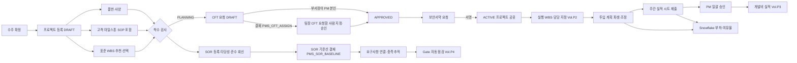

# SL PMS 워크아이템 Vol.P1 — PMS-02 프로젝트 정보·PMS-03 자원

Nov 6, 2026 · @배창욱

## 1. 개요

Vol.P1은 PMS 요구 중 **프로젝트 정보 관리(P-4~6)**와 **자원 관리(P-7~14)**를 11개 워크아이템(PMS-02-PRJ-001~003, PMS-02-SOR-001~002, PMS-03-CFT-001~003, PMS-03-EFF-001~003)으로 내린다. 메뉴·WI 번호·객체 이름·상태값·이벤트는 `pms-architecture.md`(이하 "PMS 계약")를 따르고, 계약에 없는 객체·필드·값을 더할 때는 `(제안)`으로 표시해 8절 계약 변경 요청에 올렸다.

이 Vol.은 PMS의 출발점이다. 프로젝트 레코드와 그 공유 모델(CFT 구성원 Apex 공유, 생산처 공장 격리)이 여기서 정해지고, Vol.P2~P6의 업무 객체는 모두 이 프로젝트의 Master-Detail 하위로 붙어 같은 공유를 물려받는다.

| 기능코드 | 기능 | RFP | WI | 핵심 |
| --- | --- | --- | --- | --- |
| PRJ | 프로젝트 기준정보 | P-4, P-5 | 3 | 수주 확정 후 프로젝트 등록, 유형(신차종·연식·F/L·파생·유용), SOP·EOP·보존 기준, 표준 WBS 추천, 상태 서비스·이벤트, 품번·사양(개발처·생산처), 고객 마일스톤 |
| SOR | 고객 요구사항 | P-6, P-37 | 2 | 요구사항 1건의 버전 1행, 타당성·준수 회신, 기준선 결재, 산출물·시험·도면·ALM 연결, 충족률 |
| CFT | CFT 구성 | P-8, P-9, P-12~14 | 3 | 조직도 기반 후보·여유율, 프로젝트 역할, 팀장 승인·지정, 교체·해제, 보안서약(TISAX), 프로젝트 Apex 공유 |
| EFF | 투입 기여도 | P-8, P-10, P-11 | 3 | 주 단위 계획(액티비티 투입율 파생 + 기본 투입률 + 수동 조정), 일 8시간·주 52시간 상한, 주간 실적 시트·PM 일괄 승인, Snowflake 부하·여유율 |

P-7(조직·사용자 정보 연계)은 Vol.0 MDM-001·INT-002가 이미 덮는다. 이 Vol.은 그 데이터(CMN_Department__c, CMN_Employee__c, User)를 CFT 후보 검색과 팀장 결재자 해석에 쓰기만 하고 연계를 다시 만들지 않는다.

**도메인 정의**

- **프로젝트(신차 개발 과제)**: 고객(OEM)이 한 차종의 램프 개발을 SL에 맡기기로 확정(수주, nomination)한 뒤 SOP까지 SL이 수행하는 개발 단위다. 같은 차종이라도 헤드램프와 리어램프를 따로 수주하면 프로젝트도 따로 만든다. SL은 OEM에 완제품을 공급하는 Tier 1이고, 렌즈·LED 모듈·하우징 같은 부품은 Tier 2 협력사가 SL에 공급한다.
- **RFQ·수주**: 고객 견적 요청(RFQ) → 견적 제출 → 수주 확정 순서다. PMS 범위는 수주 확정부터이고, 그 앞 단계는 번호·날짜·견적 참조만 기록한다.
- **프로젝트 유형**:
  - NEW_MODEL 신차종: 새 차종용 신규 개발.
  - MODEL_YEAR 연식 변경(MY): 같은 차종의 연식 사양 변경. 설계 변경이므로 QMS에서는 재인정시험·Re-PPAP 대상이 된다.
  - FACELIFT 부분 변경(F/L): 외관·광원 등 부분 변경.
  - DERIVATIVE 파생 차종: 같은 플랫폼의 다른 바디·시장 사양.
  - CARRY_OVER 유용: 기존 품번을 다른 차종에 그대로 쓰는 경우. 검증 범위가 가장 작다.
- **SOP/EOP**: 양산 시작(Start of Production)과 양산 종료(End of Production)다. SOP는 개발 일정의 최종 기준점이고, EOP는 기록 보존의 기산점이다(IATF 16949는 제품 활성 기간 + 1년 이상, 고객 요구가 더 길면 그 기간).
- **고객 마일스톤**: 고객 일정표의 빌드·제출·승인 이벤트다(시험차 빌드, 파일럿 빌드, PPAP 제출, 양산 승인, SOP 등). 고객 그룹마다 이름과 개수가 다르다. 표준 WBS 액티비티는 이 마일스톤을 기준일(앵커)로 삼아 일정이 자동으로 짜인다(Vol.P2 WBS-003).
- **SOR(Statement of Requirements)**: 고객이 주는 요구사항 명세다. 기능, 성능(광도·배광), 법규(ECE·FMVSS·GB 등), 신뢰성·내구, 환경(방수·방진 등급 등), 전기·EMC, 소프트웨어, 치수·중량·외관, 재료·물질 규제 요구가 수백 건이다. 요구 1건이 어떤 산출물로 충족됐는지를 추적해야 한다. 예: 방수 등급 요구 → 실링 구조 도면 → 방수 시험 합격 → 고객 승인.
- **CFT(Cross-Functional Team)**: 프로젝트 기능 횡단 팀이다. PM과 제품 설계(PE)·전장(ELE)·광학(OPT)·생산기술(ME)·품질(QE)·협력사 품질(SQE)·구매(PUR)·원가(CST) 담당으로 구성된다. 구성원은 소속 팀장의 승인으로 배정되고, 팀장은 팀원의 업무 부하를 보고 사람을 지정한다.
- **주/보조 담당**: 액티비티마다 주담당 1명(필수)과 보조담당 n명을 둔다. 두 사람 모두 산출물 등록과 완료 처리를 할 수 있다(Vol.P2 ACT-001). 이 Vol.은 담당이 될 수 있는 사람(ACTIVE CFT 구성원)과 역할별 기본 담당을 정한다.
- **PM / EDIT / VIEWER**: 프로젝트 안의 권한 수준이다. PM은 프로젝트 관리 전체, EDIT는 담당 업무 수행, VIEWER는 조회만 한다.
- **투입 기여도**: 사람이 프로젝트에 쓰는 시간이다. 계획은 사람 × 프로젝트 × 주 단위 시간, 실적은 주간 시트에 요일별 시간으로 남긴다. 사람별 전 프로젝트 합계가 일 8시간·주 52시간(국내 기준, 해외 공장은 정책 메타데이터로 다르게)을 넘지 않게 하고, 실적은 PM 승인으로 확정해 개발비(ED&D) 실적의 원천으로 쓴다(Vol.P3 CST-002).
- **보안서약서(TISAX)**: TISAX는 독일 자동차 업계의 정보보안 평가 체계다. 고객 기밀 도면·시험 데이터를 다루는 인원의 비밀유지 서약을 요구한다. 이 Vol.은 CFT 구성원이 프로젝트별 서약을 마친 뒤에만 프로젝트 데이터에 접근하게 한다.

**선행 공통 WI**: ARC-002·003, MDM-001·002·003·004·005·007, INT-002, SEC-001·002·003, I18N-001, UX-001·003·004·005·006·007, APV-001·002·003·004, TDO-001·004, NTF-001, DOC-001, DSH-001, DWH-002·003·004.

**다른 PMS Vol. 선행**: PMS-04-WBS-001(표준 WBS, PRJ-001·003), PMS-04-WBS-003과 PMS-07-ACT-001(실행 액티비티, CFT-002·EFF-001·SOR-002), PMS-06-DLV-001(산출물, SOR-002), PMS-12-APV-001(PROJECT_ROLE 결재선, SOR-001).

**다른 메뉴와의 경계**

| 연결 대상 | 이 Vol.이 하는 것 | 상대 메뉴가 하는 것 |
| --- | --- | --- |
| 일정 WBS (PMS-04, Vol.P2) | 표준 WBS 추천·선택(StandardWbs__c), 시작일, 고객 마일스톤 원장과 날짜 변경 이벤트(MILESTONE_CHANGED), 역할별 담당 해석 서비스, 프로젝트 상태 전이 API | 실행 WBS 생성(마일스톤 기준일 → CPM), PMS_CustomerMilestone__c.Activity__c 필드 생성·연결, 기준선 확정 시 IN_PROGRESS 전환 호출, 과제 종료 결재 |
| 액티비티 (PMS-07, Vol.P2) | 담당 가능 판정(ACTIVE CFT), 투입율 필드와 투입 계획 파생, 해제 시 미완료 담당 검사 | 주/보조 담당 지정 화면, 담당 일괄 변경(교체 이관), 날짜 변경 이벤트 DATES_CHANGED |
| 비용 (PMS-05, Vol.P3) | 계획 시간(PMS_EffortPlan__c)과 확정 실적(PMS_EffortActual__c APPROVED) 제공 | 직급 평균 임율 × 시간 = 개발비 계획·실적, 월 마감 |
| 산출물 (PMS-06, Vol.P3) | SOR 연결 대상 유형 PMS_DELIVERABLE, 충족 상태 갱신 API | 산출물 등록·결재, 디지털 스레드 화면에 SOR 연결 표시 |
| Gate (PMS-09, Vol.P4) | 자동 점검용 조회 API(SOR 충족률, 보안서약 이행, 필수 역할 충족), SOP 확정 API와 이벤트 | Gate 평가·결재, 양산 이관 Gate에서 QMS 초기유동 생성(PRJ-002 완제품 품번·생산처 사용) |
| 대시보드·AI (PMS-10·11, Vol.P5) | 위젯 데이터 원천(충족률·서약·부하 KPI), SOR 요구사항 DRAFT 생성 API | PMO 보드, SOR 문서 분해 초안(AIP-005), 리소스 조기경보(AIP-003) |
| 연계·결재 (PMS-12, Vol.P6) | 프로젝트 문맥 DTO(LELE 매칭 키), 역할 보유자 조회, SOR 연결 해석기 계약 | PROJECT_ROLE 결재선 해석, QMS·PDM·ALM 연결 해석기 구현, HR 임율 |
| QMS(같은 Org, D-P9) | PMS_ProjectEvent__e 발행, 프로젝트 문맥(고객 그룹·제품군·부품 분류·차종) 제공 | LELE 매칭은 QMS 서비스, 호출 시점은 PMS-12-INT-005. QMS는 PMS 객체를 Lookup하지 않는다 |

**앞 Vol. 상태**: Vol.0과 QMS Vol.은 검토 대기다. Vol.0 D-1(같은 Org), D-8(임직원 전원 CMN_Employee__c 동기화), D-9(공장 격리) 권고안과 PMS 계약 D-P1~P9를 가정한다. 결정이 바뀌면 해당 BR을 함께 고친다.

## 2. 업무 흐름

프로젝트는 PMO 또는 PM이 수주 확정 후 DRAFT로 등록하고, 품번·고객 마일스톤·표준 WBS가 갖춰지면 PM이 "착수"해 PLANNING이 된다. CFT 구성원은 팀장 승인과 보안서약 서명을 모두 마쳐야 ACTIVE가 되고, ACTIVE가 되는 순간 프로젝트 공유를 받는다(DP1-2). 투입 계획은 사람이 주별로 입력하지 않고 액티비티 일정·투입율에서 파생하며, PM은 주별 예외만 조정한다(DP1-7). 실적은 사람 × 주 시트에 모든 프로젝트를 한 번에 입력하고, 프로젝트 PM이 자기 프로젝트 행만 일괄 승인한다(DP1-6). 조직 전체 부하·여유율과 과부하 경보는 Snowflake가 계산한다(EFF-003). 다른 메뉴에는 이벤트(PMS_ProjectEvent__e)로 사실만 알리고, 같은 PMS 안의 다른 Vol.은 이 Vol.이 공개한 서비스 API를 호출한다.

## 3. 데이터 모델 개요

**객체**

| 객체 | 구분 | 관계 | 역할 | 정의 WI |
| --- | --- | --- | --- | --- |
| PMS_Project__c | 업무 | Customer(Account), Vehicle, ProductGroup, DevSite·ProdPlant(CMN_Plant__c), StandardWbs(PMS_WbsTemplate__c), BaseProject(self) | 프로젝트 1건, 공유 기준 | PRJ-001 |
| PMS_ProjectEvent__e | Platform Event | — | 프로젝트 상태 사실 통지 | PRJ-001 |
| PMS_ProjectPart__c | 업무 | Project(MD), Item(Lookup), ParentPart(self), Supplier(Account) | 완제품 사양·주요 구성 부품 | PRJ-002 |
| PMS_CustomerMilestone__c | 업무 | Project(MD), MilestoneCode(CMN_Code__c), Activity(Lookup, WBS-003이 생성) | 고객 마일스톤 | PRJ-003 |
| PMS_Requirement__c | 업무 | Project(MD), PreviousVersion(self), Baseline(Lookup), SourceDocument(CMN_Document__c), Category(CMN_Code__c) | 요구사항 1건의 버전 1개 | SOR-001 |
| PMS_RequirementBaseline__c (제안) | 업무 | Project(MD) | SOR 기준선(결재 대상) | SOR-001 |
| PMS_RequirementLink__c | 업무 | Requirement(MD) | 요구사항 ↔ 충족 대상 연결 | SOR-002 |
| PMS_TraceTargetType__mdt (제안) | 설정 | — | 연결 대상 유형·상태 해석기 등록 | SOR-002 |
| PMS_CftMember__c | 업무 | Project(MD), Employee, User, Department, ProjectRole(CMN_Code__c), ReplacesMember(self) | CFT 구성원 | CFT-001 |
| PMS_WorkHourPolicy__mdt (제안) | 설정 | — | 공장별 근무 시간 기준(일·주 상한, 표준 시간) | CFT-001 |
| PMS_SecurityPledge__c | 업무 | Project(Lookup, 제안: 계약은 MD), CftMember(Lookup), Document(CMN_Document__c) | 프로젝트별 보안서약 | CFT-003 |
| PMS_EffortPlan__c | 업무 | Project(MD), CftMember(Lookup), Activity(Lookup, 대표 액티비티) | 사람 × 프로젝트 × 주 투입 계획 | EFF-001 |
| PMS_EffortSheet__c (제안) | 업무 | User(Lookup), 소유자 = 본인 | 사람 × 주 실적 시트(그리드 부모) | EFF-002 |
| PMS_EffortActual__c | 업무 | Project(MD), CftMember·Sheet(Lookup) | 사람 × 프로젝트 × 주 투입 실적 | EFF-002 |

다른 Vol. 객체에 이 Vol.이 더하는 필드: `PMS_Activity__c.OwnerContributionPct__c`, `PMS_ActivityAssignee__c.ContributionPct__c`(EFF-001이 생성, 제안). `PMS_CustomerMilestone__c.Activity__c`는 반대로 Vol.P2 WBS-003이 이 Vol. 객체에 더한다(8절 계약 변경 요청 6).

**상태값**

| 대상 | 값(순서) |
| --- | --- |
| PMS_Project__c.Status__c | DRAFT → PLANNING → IN_PROGRESS → CLOSING → CLOSED · ON_HOLD(보류, 보류 전 상태로 복귀) · CANCELLED(취소) |
| PMS_Requirement__c.Status__c | DRAFT → ACTIVE → SUPERSEDED(새 버전으로 대체) · WITHDRAWN(고객이 삭제) |
| PMS_Requirement__c.TraceStatus__c | NOT_LINKED · PLANNED · PARTIAL · VERIFIED · FAILED · EXCLUDED(해당 없음·승인된 이탈) |
| PMS_RequirementBaseline__c.Status__c | DRAFT → IN_APPROVAL → APPROVED · REJECTED(수정 후 재상신) · SUPERSEDED(다음 기준선 승인) |
| PMS_RequirementLink__c.Status__c | PLANNED → VERIFIED / FAILED |
| PMS_CftMember__c.Status__c | DRAFT(제안) → REQUESTED → APPROVED → ACTIVE → RELEASED · REJECTED(수정 후 재요청) |
| PMS_SecurityPledge__c.Status__c | REQUESTED → SUBMITTED(서면 양식만) → SIGNED · CANCELLED · SUPERSEDED |
| PMS_EffortActual__c.Status__c | DRAFT → SUBMITTED → APPROVED · RETURNED(수정 후 재제출) |

**권한 셋과 페르소나 매핑**(각 WI가 PS를 만들고 Vol.0 SEC-001 BR-2에 따라 PSG에 추가)

| Permission Set | 내용 | PSG |
| --- | --- | --- |
| PMS_PS_Project_Read | 프로젝트·품번·고객 마일스톤 조회 | PM, CFT, TeamLead, PMO, Finance, CMN_PSG_Executive |
| PMS_PS_Project_Edit | 프로젝트 등록·편집, 품번·마일스톤 편집, 착수 | PM, PMO |
| PMS_PS_Project_Admin | 보류·취소·PM 변경, 모든 프로젝트 조회(View All) | PMO |
| PMS_PS_Sor_Read / PMS_PS_Sor_Edit | 요구사항·연결 조회 / 작성·연결·수동 검증 | 조회: 전체 PMS PSG, Executive · 작성: PM, CFT |
| PMS_PS_Sor_Baseline | 기준선 상신(PM 수준 구성원만 서버에서 허용) | PM |
| PMS_PS_Cft_Read | CFT 구성 조회 | 전체 PMS PSG |
| PMS_PS_Cft_Manage | CFT 요청·해제·교체 요청, 투입 계획 조정 | PM |
| PMS_PS_Cft_Approve | 팀장 CFT 요청함, 사람 지정·승인, 부서 참여 현황 | TeamLead |
| PMS_PS_Pledge_Sign | 본인 보안서약 조회·서명·서면 제출 | CFT, PM, TeamLead, PMO |
| PMS_PS_Pledge_Admin | 서약 전체 조회(View All), 서면 서약 확인, 양식 관리 | PMO(정보보안 담당은 이 PS만 별도 할당) |
| PMS_PS_Effort_Entry | 본인 주간 실적 입력·제출 | CFT, PM |
| PMS_PS_Effort_Approve | 자기 프로젝트 실적 승인·반려·재개 | PM |
| PMS_PS_Resource_View | 부서·전사 부하 히트맵(Snowflake) | TeamLead, PMO |

PSG 이름은 PMS 계약 10절(`PMS_PSG_PM`, `PMS_PSG_CFT`, `PMS_PSG_TeamLead`, `PMS_PSG_PMO`, `PMS_PSG_Finance`, `CMN_PSG_Executive`)을 그대로 쓴다. PSG 자체와 SL PMS 앱 할당은 이 Vol.의 첫 WI(PRJ-001)가 만든다(Vol.0 SEC-001은 이름만 예약했다). 표의 PSG 이름은 접두어를 생략했다.

**Custom Permission**(UX-005 BR-7 명명): PMS_PRJ_Hold, PMS_PRJ_Cancel, PMS_PRJ_ChangePm, PMS_PRJ_AdminOverride(PMO가 PM 대신 편집), PMS_SOR_ManualVerify, PMS_CFT_ViewAllLoad(PMO 부하 전체 조회), PMS_PLG_Verify(서면 서약 확인), PMS_EFF_Reopen(기한 지난 실적 재개), PMS_RES_ViewOrg(부서 부하 조회), PMS_RES_ViewAll(전 부서 부하 조회).

**프로젝트 안 역할 판정**: 같은 PSG라도 "이 프로젝트의 PM인가"는 프로젝트마다 다르다. 서버는 `PMS_ProjectAccessService.isProjectManager(projectId, userId)`로 판정한다(PRJ-001 BR-9). 화면 가시성은 수식 필드 `PMS_Project__c.IsCurrentUserPm__c`(UX-005 ExtraCondition)로 맞추되 서버 판정을 대신하지 않는다.

**다른 WI·메뉴가 쓰는 서비스와 이벤트**

| 이름 | 종류 | 제공 WI | 사용처 |
| --- | --- | --- | --- |
| PMS_ProjectService.changeStatus / transitionByService / confirmSop / changePm / setCurrentPhase / setRag | Apex | PRJ-001 | WBS-005·009(상태), GAT-004·006(단계·SOP), WBS-007·CST·DSH(RAG) |
| PMS_ProjectAccessService.isProjectManager / isMember | Apex | PRJ-001(CFT-001 확장) | 모든 PMS 업무 서비스 |
| PMS_WbsTemplateRecommender.recommend | Apex | PRJ-001 | 프로젝트 등록 화면, ACT-003(복사) |
| PMS_ProjectEvent__e(CREATED, STATUS_CHANGED, SOP_CONFIRMED, CLOSED, MILESTONE_CHANGED 제안) | Platform Event | PRJ-001, PRJ-003 | WBS-004(마일스톤 변경 재계산), PMS-12-INT-005, QMS(필요 시) |
| PMS_ProjectContextService.getContext | Apex | PRJ-002 | PMS-12-INT-005(LELE 매칭 키), GAT-006(초기유동 품번·공장), DVQ 의뢰(INT-005) |
| PMS_CustomerMilestoneService.getMilestones / captureBaseline | Apex | PRJ-003 | WBS-003(기준일), WBS-005(기준선), WBS-008(마일스톤 보기) |
| PMS_RequirementService.createDrafts / revise / submitBaseline | Apex | SOR-001 | AIP-005(SOR 분해 초안 채택), SOR 화면 |
| PMS_RequirementTraceService.applyTargetResult / refresh / getFulfillment | Apex | SOR-002 | DLV-002(산출물 결재), INT-004·005(외부·QMS 결과), GAT-003(자동 점검), DSH |
| PMS_TraceTargetResolver(인터페이스) | Apex | SOR-002 | INT-004(PDM·ALM), INT-005(QMS 인정시험) 구현 |
| PMS_CftService.getRoleHolders / isAssignable / missingRoles / activate | Apex | CFT-001 | WBS-003(역할별 주담당 자동 지정), ACT-001·005(담당 검증), PMS-12-APV-001(PROJECT_ROLE 해석), GAT-003, INT-005(품질 담당) |
| PMS_ResourceLoadProvider(인터페이스), PMS_ResourceLoadService.weeklyLoad | Apex | CFT-001(EFF-001 구현 교체) | CFT 후보 화면, EFF-001·002 상한 검사, AIP-003 |
| PMS_WorkHourPolicyService.forUsers | Apex | CFT-001 | EFF-001·002·003 |
| PMS_SecurityPledgeService.getCompliance | Apex | CFT-003 | GAT-003, DSH |
| PMS_EffortPlanService.requestRegenerate / captureBaseline | Apex | EFF-001 | ACT-001·005(담당·투입율 변경), WBS-005(기준선), CST-001 |
| PMS_EffortActual__c(APPROVED) | 데이터 | EFF-002 | CST-002(개발비 실적), PRF-001·002(성과·수평평가 대상) |
| MART.V_PMS_RESOURCE_WEEKLY, KPI PMS_RES_* | Snowflake | EFF-003 | DSH(Vol.P5), AIP-003 |

**결재 유형·To-Do·알림 코드**

| 구분 | 코드 | WI | 내용 |
| --- | --- | --- | --- |
| 결재 유형 | PMS_CFT_ASSIGN | CFT-002 | CFT 구성원 할당 승인(구성원 1명당 1건, 결재자 = 요청 부서장) |
| 결재 유형 | PMS_SOR_BASELINE | SOR-001 | SOR 기준선 확정(품질·설계 합의 → PM 소속 팀장 승인) |
| To-Do | PMS_PROJECT_SETUP | PRJ-001 | PMO가 등록한 프로젝트의 PM에게 "기준정보 확인·착수" |
| To-Do | PMS_MILESTONE_ACTUAL | PRJ-003 | 계획일이 지난 고객 마일스톤 실적일 입력(PM) |
| To-Do | PMS_SOR_REVIEW | SOR-001 | 요구사항 타당성·준수 회신 입력(요구사항 책임자) |
| To-Do | PMS_SOR_REVERIFY | SOR-002 | 요구사항 개정으로 다시 검증할 연결(연결 담당) |
| To-Do | PMS_CFT_HANDOVER | CFT-002 | 교체 승인 후 담당 이관(PM) |
| To-Do | PMS_CFT_TL_PROPOSAL | CFT-002 | 팀장이 제안한 교체 검토(PM) |
| To-Do | PMS_PLEDGE_SIGN | CFT-003 | 보안서약 서명(구성원) |
| To-Do | PMS_PLEDGE_VERIFY | CFT-003 | 서면 서약 확인(PM 수준 구성원) |
| To-Do | PMS_EFFORT_ENTRY | EFF-002 | 주간 실적 입력·제출(구성원) |
| To-Do | PMS_EFFORT_APPROVAL | EFF-002 | 투입 실적 승인(프로젝트별 승인자 1건) |
| 알림 | PMS_PROJECT_CREATED, PMS_PROJECT_STATUS_CHANGED, PMS_PROJECT_PM_CHANGED | PRJ-001 | PM·CFT 통지 |
| 알림 | PMS_MILESTONE_CHANGED | PRJ-003 | 고객 사유 마일스톤 변경(PM·ACTIVE CFT) |
| 알림 | PMS_SOR_BASELINE_APPROVED, PMS_SOR_REQ_REVISED, PMS_SOR_LINK_FAILED | SOR-001·002 | 기준선 승인, 개정, 검증 실패 |
| 알림 | PMS_CFT_APPROVED, PMS_CFT_REJECTED, PMS_CFT_ACTIVATED, PMS_CFT_RELEASED | CFT-002 | 요청 결과·활성·해제 |
| 알림 | PMS_PLEDGE_REMINDER, PMS_PLEDGE_OVERDUE | CFT-003 | 서명 독촉, PM 에스컬레이션 |
| 알림 | PMS_EFFORT_RETURNED, PMS_EFFORT_MISSING, PMS_EFFORT_APPROVAL_PENDING, PMS_PLAN_OVERCAP | EFF-001·002 | 반려, 미제출 요약, 승인 지연, 계획 상한 초과 |
| 알림 | PMS_RES_OVERLOAD | EFF-003 | 부서 과부하 예측(팀장·PMO) |

모든 알림 문구는 Custom Label(NTF-001 규칙)이고 3개 언어로 번역한다. To-Do는 `CMN_TodoSpec.systemCode = 'PMS'`로 연다(기본값이 QMS이므로 반드시 지정).

**KPI 키**(interfaces.md 1절 KPI 규칙을 PMS에 적용: `PMS_{영역}_{지표}`)

| KpiKey | 정의 | 주기 | 차원 | 계산 위치 |
| --- | --- | --- | --- | --- |
| PMS_RES_UTIL_PLAN | 부서 계획 가동률 % = 부서원 계획 시간 합 ÷ 부서원 표준 시간 합 | 주 | Plant, Department(제안 차원) | Snowflake(EFF-003) |
| PMS_RES_UTIL_ACTUAL | 부서 실적 가동률 % = 승인·제출 실적 시간 합 ÷ 표준 시간 합 | 주 | Plant, Department | Snowflake |
| PMS_RES_VACANCY | 부서 평균 여유율 % = 1 − 계획 가동률(0 미만은 0) | 주 | Plant, Department | Snowflake |
| PMS_RES_OVERLOAD_PERSONS | 향후 8주 중 주 상한 초과 계획이 있는 인원 수 | 주 | Plant, Department | Snowflake |
| PMS_EFF_SUBMIT_RATE | 실적 기한 내 제출률 % | 주 | Plant, Department | Snowflake |

프로젝트 단위 지표(SOR 충족률, 서약 이행률)는 Salesforce 집계 SOQL로 실시간 계산한다(CMN_KpiValue__c에 프로젝트 차원이 없고, 건수가 작다).

**공통 기반 등록(각 업무 객체 WI에서 수행)**

- 채번(ARC-003): PRJ-{YYYY}-{SEQ:5}(프로젝트, 계약), SRB-{YYYY}-{SEQ:5}(SOR 기준선), SPL-{YYYY}-{SEQ:6}(보안서약). 업무 번호는 "문서로 쓰이는 객체"에만 둔다. CFT 구성원·마일스톤·투입 행처럼 프로젝트 하위 명세 행은 RecordNo__c 없이 ExternalKey__c(멱등 키)만 둔다(8절 해석 요청).
- 공유: PMS_Project__c만 CMN_SharingConfig__mdt(PlantField = ProdPlant__c)에 등록하고 CFT Apex 공유를 더한다(CFT-001). 하위 MD 객체는 등록하지 않는다(마스터 공유 상속). Lookup 객체(PMS_SecurityPledge__c, PMS_EffortSheet__c)는 각 WI의 공유 규칙을 따른다.
- 삭제 통제(SEC-003 CMN_DeleteGuard__mdt): PMS_Project__c(DRAFT), PMS_Requirement__c(DRAFT), PMS_RequirementBaseline__c(DRAFT), PMS_CftMember__c(DRAFT, REJECTED), PMS_EffortActual__c(DRAFT), PMS_ProjectPart__c·PMS_CustomerMilestone__c(부모 상태 DRAFT일 때만, 각 WI 트리거 검사).
- 진행 단계(UX-003 CMN_StatusFlow__mdt, UX-004 T1 레코드 페이지 대상): PMS_Project__c, PMS_Requirement__c, PMS_RequirementBaseline__c, PMS_SecurityPledge__c.
- 필드 이력: 각 WI 데이터 모델 표의 "이력" 표시 필드(객체당 20개 이하).
- DWH 복제(DWH-002 CMN_DwhSyncConfig__mdt): 이 Vol.의 업무 객체 전부 15분, PMS_SecurityPledge__c는 일 1회.
- 번역: ko·en_US·zh_CN(I18N-001 BR-6).

**데이터량 가정**(SL 실적 미확인, 비기능 요구의 프로젝트 200개·프로젝트당 액티비티 600개 기준)

| 객체 | 연간 건수 | 근거 |
| --- | --- | --- |
| PMS_Project__c | 동시 진행 200, 연 신규 60~100 | 비기능 요구 |
| PMS_ProjectPart__c | 프로젝트당 4~30 | 좌우·시장·광원 사양 + 주요 구성 부품 |
| PMS_CustomerMilestone__c | 프로젝트당 5~15 | 고객 그룹별 일정표 |
| PMS_Requirement__c | 프로젝트당 100~800(버전 포함) | SOR 수백 건 |
| PMS_RequirementLink__c | 요구사항당 1~4 | 설계·검증·승인 |
| PMS_CftMember__c | 프로젝트당 10~30 | 역할 11종 + 교체 이력 |
| PMS_EffortPlan__c | 연 약 16만(사람 500 × 프로젝트 3 × 104주 범위) | 사람·프로젝트·주 1행(DP1-7) |
| PMS_EffortActual__c | 연 약 8만(사람 500 × 프로젝트 3 × 52주) | D-P4 |
| PMS_EffortSheet__c | 연 약 2.6만(사람 500 × 52주) | 사람·주 1행 |

투입 계획을 액티비티 × 주 행으로 만들면 연 150만 행을 넘어 저장 용량·재계산 시간이 감당되지 않는다. 그래서 사람 × 프로젝트 × 주 1행에 액티비티 내역을 JSON으로 둔다(DP1-7).

## 4. 프로젝트 정보: 기준정보·품번·고객 마일스톤 (PRJ-001~003)

### PMS-02-PRJ-001 프로젝트 기준정보·유형·수명주기(수주·SOP·EOP·연식)

추적 P-4, NFR-4.2(공장별 데이터 분리) · 필수 · W1 · SF · DM, APEX, LWC, CFG · Customization · 선행 ARC-003, MDM-002, MDM-003, MDM-004, MDM-007, SEC-001, SEC-002, SEC-003, UX-003, UX-004, UX-005, UX-007, TDO-001, NTF-001, PMS-04-WBS-001 · 6 M/D

**목적**: 수주가 확정된 신차 개발 과제를 PMS의 기준 레코드로 등록하고, 유형(신차종·연식·F/L·파생·유용)과 수명주기 날짜(수주 확정·시작·SOP·EOP)를 한 곳에서 관리한다. 이 레코드가 PMS 전체의 공유 기준(생산처 공장 격리, CFT 공유)이고, 상태 전이와 이벤트로 일정·Gate·QMS가 같은 사실을 본다. 고객·제품군·유형에 맞는 표준 WBS를 추천해 "고객/제품별 표준 WBS 선택 생성"의 앞 단계를 만든다.

**범위**
- In:
  - PMS_Project__c 객체·필드, 채번 규칙, 공장 공유(Apex 공유 사유 PMS_Plant), 삭제 통제, 필드 이력, DWH 등록
  - 상태 전이 서비스 PMS_ProjectService(changeStatus·transitionByService·confirmSop·changePm·setCurrentPhase·setRag)
  - 착수 검사 서비스 PMS_ProjectKickoffService, 프로젝트 PM 판정 PMS_ProjectAccessService
  - 이벤트 PMS_ProjectEvent__e 정의·발행(CREATED, STATUS_CHANGED, SOP_CONFIRMED, CLOSED)
  - 표준 WBS 추천 PMS_WbsTemplateRecommender
  - 등록 화면 pmsProjectCreate, 레코드 페이지(UX-004 생성기)·UX-005 규칙, 리스트뷰
  - PMS PSG 5개 생성과 SL PMS 앱 할당, 프로젝트 탭·메뉴 허브 그룹 PMS_02
- Out:
  - 품번·사양: PRJ-002. 고객 마일스톤과 SOP 동기화: PRJ-003
  - CFT 공유·PmUserIds 확장·PM 구성원 자동 생성: CFT-001
  - 실행 WBS 생성과 StandardWbs 잠금 검사: Vol.P2 WBS-003. PLANNING → IN_PROGRESS 호출: WBS-005. 과제 종료 결재: WBS-009
  - RAG 산정: WBS-007(일정), CST-004(비용), DSH-002(종합). 이 WI는 쓰기 API만 제공
  - 프로젝트 복사: Vol.P2 ACT-003. 이벤트 구독: 구독 측 WI

**데이터 모델**

| 객체 / 필드 | 타입 | 필수 | 설명 |
| --- | --- | --- | --- |
| PMS_Project__c.RecordNo__c | Text(40), Unique, External ID | Y | PRJ-{YYYY}-{SEQ:5}(ARC-003, ResetPolicy YEARLY, ScopeField 공란). 변경 불가 |
| PMS_Project__c.Name | Text(80) | Y | 프로젝트명. 등록 화면이 "{고객 그룹} {차종 코드} {제품군 코드} {유형 라벨}" 제안값을 채우고 사용자가 고친다 |
| PMS_Project__c.CustomerProgramCode__c | Text(40) | N | 고객 측 프로그램·프로젝트 코드 |
| PMS_Project__c.Customer__c | Lookup(Account, 레코드타입 CMN_Customer 필터) | Y | 이력 |
| PMS_Project__c.CustomerGroup__c | Formula(Text) | — | TEXT(Customer__r.CustomerGroup__c). 표준 WBS 추천·고객 마일스톤·서약 양식·LELE 매칭 키 |
| PMS_Project__c.Vehicle__c | Lookup(CMN_Vehicle__c, 필터 Customer = 이 레코드 Customer) | Y | 이력 |
| PMS_Project__c.ProductGroup__c | Lookup(CMN_ProductGroup__c) | Y | 예: LAMP_HL. 표준 WBS 추천 키. 이력 |
| PMS_Project__c.ProjectType__c | Picklist (NEW_MODEL 신차종, MODEL_YEAR 연식 변경, FACELIFT 부분 변경, DERIVATIVE 파생 차종, CARRY_OVER 유용) | Y | 이력 |
| PMS_Project__c.ModelYear__c | Text(4) | MODEL_YEAR면 Y | 숫자 4자리 연도(예: 2028). Validation Rule `PMS_Project_ModelYearFormat` |
| PMS_Project__c.BaseProject__c (제안) | Lookup(PMS_Project__c) | MODEL_YEAR·FACELIFT면 Y | 기반 프로젝트(이전 연식·F/L 전). 후속 모델 레슨런 매칭, 복사(ACT-003) 원천 |
| PMS_Project__c.DevSite__c | Lookup(CMN_Plant__c) | Y | 개발처(설계 주관 사업장, 연구소 포함, DP1-12) |
| PMS_Project__c.ProdPlant__c | Lookup(CMN_Plant__c) | Y | 주 생산처. 공장 격리 기준. 이력. 이름을 Plant__c로 바꾸지 않는다(에이전트 주의) |
| PMS_Project__c.PM__c | Lookup(User, 활성) | Y | PM. OwnerId와 항상 같다(BR-8). 이력 |
| PMS_Project__c.PmUserIds__c | Text(255) | — | PM 수준 ACTIVE 구성원 User Id(18자리, 쉼표). 서비스만 갱신. 이 WI는 PM__c 1명, CFT-001이 PM 수준 구성원 전체로 확장 |
| PMS_Project__c.IsCurrentUserPm__c | Formula(Checkbox) | — | CONTAINS(PmUserIds__c, CASESAFEID($User.Id)). 화면 가시성 전용(BR-9) |
| PMS_Project__c.RfqNo__c | Text(40) | N | 고객 RFQ 번호 |
| PMS_Project__c.RfqReceivedDate__c | Date | N | RFQ 접수일 |
| PMS_Project__c.QuoteRef__c | Text(80) | N | 견적 번호·견적 시스템 참조 |
| PMS_Project__c.OrderConfirmedDate__c | Date | Y | 수주 확정일. 이력 |
| PMS_Project__c.NominationRef__c | Text(80) | N | 고객 수주 통지(nomination letter, LOI) 번호. 원본 파일은 DOC-001 DocClass NOMINATION_LETTER |
| PMS_Project__c.StartDate__c | Date | Y | 프로젝트 시작일(실행 WBS 기준일, WBS-003 입력). 수주 확정일보다 빠를 수 있다(선행 착수) |
| PMS_Project__c.SopDate__c | Date | Y | SOP 계획일. PRJ-003 배포 후에는 SOP 고객 마일스톤의 사본(BR-6). 이력 |
| PMS_Project__c.SopActualDate__c | Date | N | SOP 실적일. confirmSop만 기록 |
| PMS_Project__c.EopDate__c | Date | N | EOP 계획일. 이력 |
| PMS_Project__c.RetentionUntil__c | Formula(Date) | — | IF(ISBLANK(EopDate__c), NULL, ADDMONTHS(EopDate__c, 12 * VALUE($CustomMetadata.CMN_Setting__mdt.PMS_RETENTION_YEARS_AFTER_EOP.Value__c))) |
| PMS_Project__c.DaysToDue__c | Formula(Number, 0) | — | SopDate__c − TODAY(). UX-004 헤더 D-day(이 객체의 기한 = SOP) |
| PMS_Project__c.PeakAnnualVolume__c | Number(9,0) | N | 연간 최대 물량(대). PMO 우선순위 참고 |
| PMS_Project__c.SapWbsElement__c | Text(40) | N | SAP 프로젝트·WBS 요소(개발비 집계 키, CST-002) |
| PMS_Project__c.StandardWbs__c | Lookup(PMS_WbsTemplate__c, Status ACTIVE 필터) | 착수 시 Y | 선택한 표준 WBS(BR-5). 이력 |
| PMS_Project__c.StandardWbsVersion__c | Number(3,0) | — | 선택 시점 표준 WBS 버전 사본 |
| PMS_Project__c.CurrentPhase__c | Lookup(CMN_Code__c, 그룹 DEV_PHASE 필터) | N | 현재 개발 단계. setCurrentPhase로만(GAT-004, WBS-007). 이력 |
| PMS_Project__c.Status__c | Picklist (DRAFT, PLANNING, IN_PROGRESS, CLOSING, CLOSED, ON_HOLD, CANCELLED) | Y | 서비스로만 변경(FLS Read). 이력 |
| PMS_Project__c.StatusReason__c | Text(255) | ON_HOLD·CANCELLED면 Y | 보류·취소 사유 |
| PMS_Project__c.HoldFromStatus__c | Text(20) | — | 보류 직전 상태(해제 시 복귀) |
| PMS_Project__c.StatusChangedAt__c | DateTime | — | 마지막 상태 변경 시각 |
| PMS_Project__c.OverallRag__c / ScheduleRag__c / CostRag__c | Picklist (GREEN, AMBER, RED) | N | setRag로만. 공란 = 미산정. 이력 |
| PMS_Project__c.PledgeRequired__c | Checkbox | Y | 기본 true. CFT 보안서약 필요 여부(CFT-003). false로 바꾸려면 PMS_PRJ_AdminOverride와 사유(코멘트 자동 기록) |
| PMS_Project__c.Description__c | Long Text(4000) | N | 개요·특이사항 |
| PMS_Project__c.ClosedAt__c / CancelledAt__c | DateTime | — | 종료·취소 시각 |
| Apex Sharing Reason PMS_Plant, PMS_Cft | PMS_Project__c | — | 공장 공유(이 WI), CFT 공유(CFT-001) |
| PMS_ProjectEvent__e.ProjectId__c | Text(18) | Y | Publish Behavior = Publish After Commit |
| PMS_ProjectEvent__e.RecordNo__c | Text(40) | Y | |
| PMS_ProjectEvent__e.EventType__c | Text(40) | Y | CREATED, STATUS_CHANGED, SOP_CONFIRMED, CLOSED(이 WI), MILESTONE_CHANGED(PRJ-003, 제안) |
| PMS_ProjectEvent__e.FromStatus__c / ToStatus__c | Text(20) | N | STATUS_CHANGED·CLOSED에서 채움 |
| PMS_ProjectEvent__e.CustomerId__c / VehicleId__c / ProductGroupId__c / ProdPlantId__c | Text(18) | Y | 구독 측 필터용 |
| PMS_ProjectEvent__e.ProjectType__c | Text(20) | Y | |
| PMS_ProjectEvent__e.SopDate__c | Date | N | |
| PMS_ProjectEvent__e.SourceRecordId__c / SourceObject__c | Text(18) / Text(80) | N | 상태 변경을 일으킨 원천(예: SOP Gate 평가 Id, WBS 기준선 Id) |
| PMS_ProjectEvent__e.PayloadJson__c | Long Text(32768) | N | 유형별 추가 값 |
| CMN_Setting__mdt | 설정 | — | PMS_RETENTION_YEARS_AFTER_EOP = 15, PMS_PROJECT_SOP_MAX_YEARS = 10, PMS_PROJECT_SETUP_DUE_DAYS = 5 |

**비즈니스 규칙**

- BR-1: 등록. PMS_PS_Project_Edit 보유자(PM, PMO)가 `pmsProjectCreate`(객체 New 버튼 오버라이드)로 등록한다. 저장 시 검증은 다음과 같다(서버 서비스 `PMS_ProjectService.create`와 트리거가 같은 규칙을 쓴다).
  - (a) Vehicle__r.Customer__c = Customer__c.
  - (b) OrderConfirmedDate ≤ SopDate, StartDate < SopDate, EopDate(있으면) > SopDate, SopDate ≤ 오늘 + PMS_PROJECT_SOP_MAX_YEARS년.
  - (c) MODEL_YEAR는 ModelYear 4자리와 BaseProject 필수, FACELIFT는 BaseProject 필수. BaseProject ≠ 자기 자신. MODEL_YEAR·FACELIFT의 BaseProject.Customer = Customer.
  - (d) PM은 활성 사용자이고 PermissionSetGroup PMS_PSG_PM이 할당돼 있어야 한다(PermissionSetAssignment 조회). 아니면 "PM 권한이 없는 사용자입니다. 시스템 관리자에게 PM 권한을 요청하세요".
  - (e) 유사 중복 경고: 같은 Customer·Vehicle·ProductGroup·ProjectType·ModelYear에 CANCELLED가 아닌 프로젝트가 있으면 저장 전 목록을 보여주고 "그래도 등록" 확인을 받는다(차단 아님).
- BR-2: 채번·소유. RecordNo는 beforeInsert에서 CMN_NumberingService.assign. OwnerId = PM__c. 상태는 DRAFT로 시작한다. 등록자가 PM이 아니면(PMO 등록) PM에게 To-Do PMS_PROJECT_SETUP(제목 "프로젝트 기준정보 확인·착수: {RecordNo}", 기한 = 등록일 + PMS_PROJECT_SETUP_DUE_DAYS, Target = 프로젝트)과 알림 PMS_PROJECT_CREATED를 보낸다. 착수(PLANNING)하면 To-Do를 닫는다.
- BR-3: 상태 전이. 아래 표 밖의 전이는 모두 거부한다. 상태 필드는 FLS Read이고 서비스가 `CMN_UiRuleService.runAsService` 안에서만 바꾼다.

| 전이 | 호출 경로 | 조건·처리 |
| --- | --- | --- |
| DRAFT → PLANNING | 액션 "착수"(PMS_Project_Kickoff) → changeStatus | 프로젝트 PM(BR-9), 착수 검사(BR-4) 통과 |
| PLANNING → IN_PROGRESS | transitionByService(callerKey WBS_BASELINE) | WBS-005 기준선 승인 콜백만 |
| IN_PROGRESS → CLOSING | transitionByService(WBS_CLOSE_SUBMIT) | WBS-009 종료 상신 |
| CLOSING → CLOSED | transitionByService(WBS_CLOSE_APPROVE) | ClosedAt 기록, STATUS_CHANGED + CLOSED 이벤트 |
| CLOSING → IN_PROGRESS | transitionByService(WBS_CLOSE_REJECT) | WBS-009 반려 |
| DRAFT·PLANNING·IN_PROGRESS → ON_HOLD | 액션 "보류"(PMS_Project_Hold) → changeStatus | Custom Permission PMS_PRJ_Hold, 사유 필수, HoldFromStatus 기록 |
| ON_HOLD → HoldFromStatus 값 | 액션 "보류 해제"(PMS_Project_Resume) | PMS_PRJ_Hold |
| DRAFT·PLANNING·IN_PROGRESS·ON_HOLD → CANCELLED | 액션 "취소"(PMS_Project_Cancel) | PMS_PRJ_Cancel, 사유 필수, CancelledAt 기록 |

- BR-3a: API. `changeStatus(Id projectId, String toStatus, String reason)`는 화면 액션 경로다. 첫 줄에서 `CMN_UiRuleService.assertCanExecute(projectId, 액션 키)`, 다음 줄에서 BR-9 판정을 한다. `transitionByService(Set<Id> projectIds, String toStatus, String callerKey)`는 다른 WI의 서비스·콜백 전용이다. callerKey는 표의 값만 허용하고 화면에 노출하지 않는다(@AuraEnabled 아님). 두 메서드 모두 StatusChangedAt을 기록하고 이벤트를 발행한다(BR-10). CLOSED·CANCELLED 진입 시 알림 PMS_PROJECT_STATUS_CHANGED를 PM에게 보낸다(CFT-001 배포 후에는 ACTIVE CFT 전원).
- BR-4: 착수 검사. `PMS_ProjectKickoffService.check(Id projectId)`는 미충족 항목 목록(Custom Label 키 + 매개변수)을 돌려준다. 이 WI의 검사는 필수 필드(StartDate, SopDate, PM, DevSite, ProdPlant, StandardWbs)와 StandardWbs가 여전히 ACTIVE인지다. PRJ-002(품번), PRJ-003(마일스톤), WBS-003(실행 WBS 여부)이 이 서비스에 자기 검사를 더한다. 화면은 "착수 준비" 섹션에 목록을 보여주고, 하나라도 있으면 착수를 막는다.
- BR-5: 표준 WBS 추천. `PMS_WbsTemplateRecommender.recommend(String customerGroup, Id productGroupId, String projectType)`.
  - 후보: Status ACTIVE인 PMS_WbsTemplate__c 중 CustomerGroup·ProductGroup·ProjectType이 일치하거나 공란(와일드카드)인 것.
  - 점수: CustomerGroup 일치 +4, ProductGroup 정확 일치 +2(템플릿 제품군이 프로젝트 제품군의 상위 제품군이면 +1), ProjectType 일치 +1. 점수 내림차순, 같은 점수면 Version 내림차순.
  - 최고점이 1개면 기본 선택, 여러 개면 사용자가 고른다. 후보가 없으면 "맞는 표준 WBS가 없습니다. PMO에 등록을 요청하세요"를 보이고 StandardWbs 없이 저장한다(착수 검사에서 막힌다).
  - 선택 시 StandardWbsVersion을 사본으로 남긴다. StandardWbs는 DRAFT·PLANNING에서만 바꿀 수 있다(UX-005 섹션 잠금). 실행 WBS가 생긴 뒤 잠그는 검사는 WBS-003이 더한다.
- BR-6: SOP·EOP. SopDate·EopDate 검증은 BR-1(b)와 같다. `confirmSop(Id projectId, Date actualDate, Id gateReviewId)`는 IN_PROGRESS·CLOSING에서만 허용하고 SopActualDate를 기록한 뒤 SOP_CONFIRMED 이벤트(SourceRecordId = gateReviewId)를 발행한다(호출은 GAT-006). PRJ-003 배포 후에는 SopDate가 SOP 마일스톤의 사본이 되고, confirmSop가 SOP 마일스톤 ActualDate도 채운다(PRJ-003이 확장). EOP는 PM·PMO가 언제든 고칠 수 있다(CLOSED 포함, 보존 기한 계산용). 리스트뷰 "EOP 미입력"은 CLOSED이면서 EopDate가 공란인 프로젝트다.
- BR-7: 공장 공유. OWD는 Private(내부·외부).
  - `PMS_ProjectSharingService.recalcPlant(Set<Id> projectIds)`가 생산처 공장의 공개 그룹 `CMN_GRP_PLANT_{PlantCode}_R`과 `_E` **둘 다에 Read** 공유 행(RowCause PMS_Plant__c)을 만든다. ProdPlant가 바뀌면 이전 공장 공유를 지운다.
  - 공유 행 쓰기는 CMN_ShareWriter.write를 쓴다. 기존 공유 행 조회는 SHARING-EXCEPTION 주석을 단 `PMS_ProjectShareSelector`(without sharing, WITH SYSTEM_MODE, 조회만)에서 한다.
  - CMN_SharingConfig__mdt에는 등록하지 않는다. 등록하면 CMN_SharingService가 편집 그룹에 Edit을 줘 같은 공장 사용자가 모든 프로젝트를 고칠 수 있게 된다(DP1-1).
  - 편집 권한은 CFT 공유(CFT-001)로만 생긴다. PMO(PMS_PS_Project_Admin)와 CMN_PSG_Executive는 객체 View All로 전 공장을 본다.
  - 품번별 추가 생산처(PRJ-002 행의 ProdPlant가 다른 공장)는 공유하지 않는다. 그 공장 담당을 CFT로 추가한다.
  - 전체 재계산 배치 `PMS_ProjectSharingRecalcBatch`(배치 200, 공장·CFT 모두)를 둔다. 데이터 이관과 공장 그룹 재구성 뒤에 쓴다.
- BR-8: PM과 소유자. 저장 시 OwnerId = PM__c를 유지한다. 소유자가 바뀌어도 Apex 공유 사유(PMS_Plant, PMS_Cft) 행은 남는다(수동 공유만 지워진다).
  - `changePm(Id projectId, Id newPmUserId, String reason)`: 현재 PM 또는 PMS_PRJ_ChangePm 보유자. 새 PM은 BR-1(d) 검증.
  - 처리: PM__c·OwnerId·PmUserIds 변경 → 코멘트 자동 기록(UX-003 CMN_Comment, "PM 변경: {이전} → {새}, 사유") → 알림 PMS_PROJECT_PM_CHANGED(이전·새 PM).
  - CFT-001이 이 메서드에 PM 구성원 행 처리를 더한다.
- BR-9: 프로젝트 PM 판정. `PMS_ProjectAccessService.isProjectManager(Id projectId, Id userId)`는 다음 중 하나면 true다.
  - PM__c = userId
  - PmUserIds__c에 userId 포함
  - 사용자가 Custom Permission PMS_PRJ_AdminOverride 보유(PMO)
  - `isMember(projectId, userId)`는 이 WI에서 isProjectManager와 같고 CFT-001이 ACTIVE 구성원으로 넓힌다. 모든 PMS 업무 액션 Apex는 assertCanExecute 다음 줄에서 이 판정을 다시 한다. IsCurrentUserPm__c 수식은 Dynamic Forms·Dynamic Actions 가시성(UX-005 ExtraCondition `IsCurrentUserPm__c=true`)에만 쓴다.
- BR-10: 이벤트. CREATED(insert), STATUS_CHANGED(모든 상태 변경), CLOSED(CLOSED 진입 시 STATUS_CHANGED와 별도 1건), SOP_CONFIRMED(confirmSop). 한 트랜잭션의 여러 건은 `EventBus.publish` 1회로 모아 보낸다(발행 지점은 `PMS_ProjectEventPublisher` 한 클래스). 구독은 이 WI가 구현하지 않는다.
- BR-11: 단계·RAG 쓰기. `setCurrentPhase(Id projectId, Id devPhaseCodeId)`는 DEV_PHASE 코드만 받는다. 이전 단계로 돌아가는 것도 허용하되 코멘트를 자동 기록한다. `setRag(Map<Id, PMS_ProjectRag> values)`(PMS_ProjectRag: overall, schedule, cost, 공란은 변경 없음)는 호출 WI만 쓰고 화면에는 읽기로만 보인다. 두 메서드 모두 runAsService로 쓴다.
- BR-12: 잠금·삭제.
  - DRAFT만 삭제한다(SEC-003 CMN_DeleteGuard, StatusField Status__c, DeletableValues DRAFT).
  - CLOSED·CANCELLED는 EopDate·Description·PledgeRequired 외 모든 필드가 잠긴다(UX-005 섹션 규칙 + 트리거 lockedFieldViolations).
  - CLOSING은 기본정보 섹션이 잠긴다.
- BR-13: 권한 구성(이 WI에서 함께 배포).
  - PSG `PMS_PSG_PM`, `PMS_PSG_CFT`, `PMS_PSG_TeamLead`, `PMS_PSG_PMO`, `PMS_PSG_Finance`를 만든다(CMN_PSG_Executive는 배포됨). 3절 PS 매핑 중 이 WI의 PS(PMS_PS_Project_Read·Edit·Admin)를 넣는다.
  - 다섯 PMS PSG와 CMN_PSG_Executive에 앱 권한 세트 `CMN_PS_AppPms_Read`(배포됨)를 넣는다.
  - Custom Permission PMS_PRJ_Hold·PMS_PRJ_Cancel·PMS_PRJ_ChangePm·PMS_PRJ_AdminOverride를 만들어 PMS_PS_Project_Admin에 넣는다.
  - SL PMS 앱에 PMS_Project__c 탭을 더하고, 메뉴 허브 그룹 `PMS_02`(CMN_AppMenu__mdt, Apps__c = SL_PMS)와 타일(프로젝트, 표준 WBS 보기)을 등록한다.

**화면/UX**: 화면 유형 T1(UX-004 업무 레코드 표준, UX-005 상태 규칙, UX-003 진행 단계). 공통 부품 외 신규 LWC는 등록 화면 `pmsProjectCreate`, 표준 WBS 추천 `pmsWbsTemplatePicker`, 착수 준비 목록 `pmsKickoffChecklist` 3개다.
- 등록 화면 `pmsProjectCreate`(3단계, 데스크톱·태블릿):
  - 1단계: 고객 → 차종(고객 필터) → 제품군 → 유형 → 연식·기반 프로젝트(유형별 표시).
  - 2단계: 수주 확정일·RFQ·견적 참조, 시작일·SOP·EOP, 개발처·생산처, PM.
  - 3단계: 추천 표준 WBS 목록(점수·일치 항목 표시) 선택, 이름 제안값 확인, 유사 중복 경고 확인 → 저장 → 레코드 페이지로 이동.
- 레코드 페이지(정의 파일 `meta-src/record-pages/PMS_Project__c.json`):
  - 헤더 7개: RecordNo, Name, Status, Customer, Vehicle(품번 자리 대체: 프로젝트는 품번이 여럿이라 차종을 둔다, 정의 파일에 사유), ProdPlant, DaysToDue(SOP D-day).
  - 탭: 현재 단계 → 구성(PRJ-002 품번·PRJ-003 고객 마일스톤) → 요구사항(SOR-001·002) → CFT·투입(CFT·EFF) → (Vol.P2~P4가 일정·산출물·비용·리스크·Gate 탭을 더함) → 상세 → 관련 → 이력. 업무 영역 탭은 허브 객체 예외다(DP1-15).
  - 현재 단계 탭(UX-005 섹션 규칙):
    - DRAFT: 기본정보·일정·사업장 편집 섹션, `pmsWbsTemplatePicker`, `pmsKickoffChecklist`.
    - PLANNING·IN_PROGRESS: 진행 요약 섹션(현재 단계, RAG 3종, SOP, 상태 변경 시각, 읽기). 각 Vol.이 단계 전용 LWC를 더한다(첫 탭 컴포넌트 10개 이하 유지).
    - ON_HOLD·CANCELLED: 사유 섹션(읽기).
  - 액션(Dynamic Actions, UX-005 ACTION 규칙): 착수, 보류, 보류 해제, 취소, PM 변경. 가시성은 상태 + IsCurrentUserPm__c 또는 Custom Permission.
  - 결정 지원 레일: AI(AIP 배포 전 비활성), TODO, COMMENT, DOCUMENT(config allowedDocClasses NOMINATION_LETTER, CUSTOMER_SCHEDULE, SOR_DOCUMENT, COMPLIANCE_MATRIX), CONTEXT_PMS_SOR(SOR-002), CONTEXT_PMS_PLEDGE(CFT-003). APPROVAL 패널은 프로젝트 자체 결재가 없으므로 객체 행에서 비활성으로 둔다.
- 휴대폰 페이지: 헤더(번호·상태·차종·SOP D-day) → 진행 단계 → 진행 요약 → 레일(TODO·COMMENT).
- 리스트뷰: 내가 PM인 프로젝트(PM__c = 나), 공장별 진행 중, SOP 90일 이내, 보류, EOP 미입력, 착수 대기(DRAFT 14일 경과).

**권한**
- PMS_PS_Project_Read: PMS_Project__c Read(PM, CFT, TeamLead, PMO, Finance, Executive).
- PMS_PS_Project_Edit: Create·Edit, pmsProjectCreate·PMS_ProjectController Apex(PM, PMO).
- PMS_PS_Project_Admin: View All, 보류·취소·PM 변경 Custom Permission(PMO).
- 필드 권한: Status·RAG 3종·CurrentPhase·PmUserIds·SopActualDate·StandardWbsVersion·ClosedAt·CancelledAt은 모든 PS에서 Read만.
- 공유는 BR-7(공장 Read) + CFT-001(구성원)로만 생긴다.

**수용 기준**

- AC-1: Given 고객 A의 차종을 고객 B 프로젝트에 선택, When 저장, Then 차단되고 "차종의 고객이 프로젝트 고객과 다릅니다" 메시지.
- AC-2: Given ProjectType MODEL_YEAR, ModelYear 공란, When 저장, Then 차단.
- AC-3: Given 2027년에 이미 2건 등록, When 세 번째 등록, Then RecordNo PRJ-2027-00003, OwnerId = PM, Status DRAFT, CREATED 이벤트 1건.
- AC-4: Given 표준 WBS 3개(HKMC·LAMP_HL·NEW_MODEL / 공란·LAMP_HL·공란 / HKMC·LAMP_RCL·NEW_MODEL), When HKMC·LAMP_HL·NEW_MODEL로 추천, Then 첫째(7점)가 1순위, 둘째(2점)가 2순위, 셋째는 제외.
- AC-5: Given StandardWbs 공란인 DRAFT, When 착수, Then 차단되고 미충족 목록에 "표준 WBS"가 보인다.
- AC-6: Given IN_PROGRESS 프로젝트, When 사용자가 API로 Status를 CLOSED로 수정, Then 차단(서비스 밖 변경).
- AC-7: Given 사용자 U가 KR01 Read 그룹 소속이고 CFT가 아님, When KR01 프로젝트 조회·편집, Then 조회만 되고 편집은 권한 없음. CN01 프로젝트는 리스트뷰·검색·리포트에 없다.
- AC-8: Given ProdPlant KR01 → KR02 변경, When 저장, Then KR01 그룹 2개의 PMS_Plant 공유가 지워지고 KR02 R·E 그룹에 Read 공유가 생긴다.
- AC-9: Given PLANNING 프로젝트를 사유와 함께 보류, When 보류 해제, Then Status PLANNING, STATUS_CHANGED 이벤트 2건.
- AC-10: Given 프로젝트 200건 일괄 insert, When 저장, Then 채번·공장 공유·이벤트가 거버너 한도 안에서 처리되고 EventBus.publish 호출은 1회다.
- AC-11: Given PMO가 등록하고 PM은 다른 사용자, When 저장, Then PM에게 To-Do PMS_PROJECT_SETUP 1건과 알림 1건. 착수하면 To-Do DONE.
- AC-12: Given EopDate 2035-06-30, PMS_RETENTION_YEARS_AFTER_EOP = 15, When 조회, Then RetentionUntil = 2050-06-30.
- AC-13: Given 프로젝트 PM이 아닌 EDIT 사용자, When 착수 Apex를 직접 호출, Then CMN_ValidationException, 상태 변화 없음.
- AC-14: Given WBS-005 대신 임의 callerKey로 transitionByService 호출, When 실행, Then 예외.

**에이전트 주의**
- 표준 Opportunity·Project·Work 객체를 쓰지 않는다. 업무 번호를 Name에 넣지 않는다.
- 생산처 필드 이름을 Plant__c로 바꾸지 않는다. DOC-001은 부모의 Plant__c를 문서에 복사해 공장 그룹에 공유하므로, 이름이 Plant__c가 되면 프로젝트 문서가 같은 공장 전원에게 열린다.
- PMS_Project__c를 CMN_SharingConfig__mdt에 등록하지 않는다(BR-7).
- IsCurrentUserPm__c를 서버 권한 판정에 쓰지 않는다. 트리거 문맥의 수식 값은 실행 사용자 기준이 보장되지 않는다.
- 이벤트 메타데이터는 플랫폼 이벤트 한도 때문에 Enterprise 에디션 Scratch(D-P8, 2026-11-22 교체)에서만 배포된다. 교체 전 착수하지 않는다.
- RAG·단계 값을 이 WI에서 계산하지 않는다.

**오픈 이슈**: 프로젝트 등록 주체(PMO·영업·PM 중 누구인가), 프로젝트명 규칙, 개발처 단위(연구소를 사업장으로 등록하는지), 고객 CSR 기록 보존 연한(15년 가정), SAP 프로젝트·WBS 요소 사용 여부, 수주 정보를 영업·견적 시스템에서 받아야 하는지.

### PMS-02-PRJ-002 프로젝트 품번·사양 구성(개발처·생산처)

추적 P-4 · 필수 · W1 · SF · DM, APEX, CFG · Tailoring · 선행 PRJ-001, MDM-004, MDM-005, UX-006 · 3 M/D

**목적**: 프로젝트가 만드는 완제품 사양(좌우·시장·광원 등)과 주요 구성 부품을 품번 단위로 등록한다. QMS 인정시험 의뢰·양산 이관 초기유동, 레슨런 매칭(부품 분류), 협력사 부품개발 일정(WBS-010), 개발비 집계가 모두 이 목록을 기준으로 한다. 사내 품번은 개발 후반에 SAP에 생성되는 경우가 많으므로 가품번으로 시작해 나중에 SAP 품번을 연결할 수 있어야 한다.

**범위** In: PMS_ProjectPart__c, 그리드(UX-006 gridKey PMS_ProjectPart)와 Provider, 착수 검사 추가, SAP 품번 후보 표시, 프로젝트 문맥 서비스 PMS_ProjectContextService. Out: 협력사 부품개발 일정(Vol.P2 WBS-010), BOM(Salesforce에 저장하지 않음, MDM-004 BR-2), QMS 생성 서비스 호출(PMS-12-INT-005, PMS-09-GAT-006), SAP 품번 생성(SAP 업무).

**데이터 모델**

| 객체 / 필드 | 타입 | 필수 | 설명 |
| --- | --- | --- | --- |
| PMS_ProjectPart__c.Project__c | Master-Detail(PMS_Project__c) | Y | |
| PMS_ProjectPart__c.LineNo__c | Number(4,0) | Y | 프로젝트 안 순번(그리드 정렬) |
| PMS_ProjectPart__c.PartRole__c | Picklist (FG 완제품 사양, COMPONENT 주요 구성 부품) | Y | |
| PMS_ProjectPart__c.ParentPart__c | Lookup(PMS_ProjectPart__c) | N | COMPONENT가 속한 완제품 행(공용 부품이면 공란). 같은 프로젝트 FG만 |
| PMS_ProjectPart__c.Item__c | Lookup(CMN_Item__c) | TempPartNo 공란이면 Y | 사내 품번(SAP). 이력 |
| PMS_ProjectPart__c.TempPartNo__c | Text(40) | Item 공란이면 Y | 가품번(개발 품번) |
| PMS_ProjectPart__c.CustomerPartNo__c | Text(40) | FG면 Y | 고객 품번. Item 연결 시 Item 값이 공란을 채운다 |
| PMS_ProjectPart__c.PartName__c | Text(120) | Y | 품명. Item 연결 시 Item 이름이 공란을 채운다 |
| PMS_ProjectPart__c.Variant__c | Text(120) | FG면 Y | 사양 설명(예: 광원·기능·시장 사양) |
| PMS_ProjectPart__c.Side__c | Picklist (LH, RH, CENTER, NA) | Y | 좌우 |
| PMS_ProjectPart__c.TargetMarkets__c | Multi-Select Picklist (KR, NA, EU, CN, IN, SA, ME, GLOBAL) | N | 출시 시장(법규 요구 범위 판단) |
| PMS_ProjectPart__c.PartCategory__c | Picklist (MDM-004 CMN_Item__c.PartCategory__c와 같은 값) | COMPONENT면 Y | 레슨런 매칭 키. Item 연결 시 Item 값이 공란을 채운다 |
| PMS_ProjectPart__c.IsNewDevelopment__c | Checkbox | Y | 신규 개발(true) / 유용(false) |
| PMS_ProjectPart__c.Supplier__c | Lookup(Account, 레코드타입 CMN_Supplier 필터) | N | 구매 구성 부품의 협력사 |
| PMS_ProjectPart__c.IsLeadPart__c | Checkbox | — | 대표 완제품(ACTIVE FG 중 1개) |
| PMS_ProjectPart__c.ProdPlant__c | Lookup(CMN_Plant__c) | Y | 생산처. 기본 = 프로젝트 ProdPlant |
| PMS_ProjectPart__c.Status__c | Picklist (ACTIVE, DROPPED) | Y | 사양 취소는 삭제 대신 DROPPED. 이력 |
| PMS_ProjectPart__c.ItemLinkedAt__c | DateTime | — | 가품번 → SAP 품번 연결 시각 |
| PMS_ProjectPart__c.ExternalKey__c | Text(60), Unique | Y | {ProjectId}-{LineNo} |

**비즈니스 규칙**

- BR-1: 그리드 설정(UX-006).
  - CMN_GridDefinition__mdt `PMS_ProjectPart`: ParentField Project__c, OrderField LineNo__c, MaxRows 200, AllowAdd·AllowDelete·AllowPaste true, ProviderClass PMS_ProjectPartGridProvider, EditRuleKey PMS_ProjectPartGrid.
  - 열(순서): 순번, 역할, 상위 완제품, 사내 품번(LOOKUP), 가품번, 고객 품번, 품명, 사양, 좌우, 시장, 부품 분류, 신규 개발, 협력사(LOOKUP, 협력사 레코드타입 필터), 대표, 생산처, 상태.
  - 휴대폰 카드(ShowOnPhone): 역할, 사내 품번, 사양, 좌우.
  - 편집 규칙(UX-005 COMPONENT `PMS_ProjectPartGrid`): 프로젝트 상태 DRAFT·PLANNING·IN_PROGRESS + ExtraCondition IsCurrentUserPm__c=true. Provider validate가 PRJ-001 BR-9 서버 판정(isProjectManager)을 다시 한다.
- BR-2: 품번 규칙.
  - Item과 TempPartNo 중 하나는 있어야 한다.
  - FG의 Item은 ItemType FG 또는 SFG, COMPONENT의 Item은 PART 또는 SFG.
  - FG의 Item.Customer__c는 프로젝트 Customer와 같아야 한다("다른 고객의 품번입니다").
  - Item을 연결하면 PartName·CustomerPartNo·PartCategory 중 공란인 값을 Item에서 채우고 ItemLinkedAt을 기록한다(Provider afterSave가 아니라 트리거 beforeSave에서, API 경로도 같게).
- BR-3: 대표 품번. ACTIVE FG 중 IsLeadPart는 많아야 1개다(2개 이상이면 그리드 오류). ACTIVE FG가 1개뿐이면 저장 시 자동 true. 대표 품번은 DROPPED로 바꿀 수 없다(먼저 다른 행을 대표로).
- BR-4: 중복. 같은 프로젝트 ACTIVE 행에서 (Item 또는 TempPartNo) + Side + Variant가 같으면 오류.
- BR-5: 생산처·SAP 후보(Provider rowMeta 경고, 차단 아님).
  - 행 ProdPlant ≠ 프로젝트 ProdPlant: "추가 생산처입니다. 이 공장 담당을 CFT에 추가하세요"(공유는 하지 않는다, PRJ-001 BR-7).
  - Item이 있고 CMN_ItemPlant__c(Item, ProdPlant)가 없으면: "이 공장에 등록되지 않은 품번".
  - Item 공란이고 CMN_Item__c 중 Customer = 프로젝트 고객, CustomerPartNo 일치인 품번이 정확히 1건이면: "SAP 품번 후보: {ItemNo}". rowMeta에서 전체 행을 SOQL 1회로 조회한다.
- BR-6: 삭제·취소. 프로젝트 DRAFT에서는 행 삭제를 허용한다. PLANNING 이후는 rowMeta deletable = false, 안내 "상태를 취소(DROPPED)로 바꾸세요". 서버 트리거도 PLANNING 이후 삭제를 막는다.
- BR-7: 착수 검사 추가(PRJ-001 BR-4): ACTIVE FG 1개 이상, 대표 품번 1개.
- BR-8: 프로젝트 문맥 서비스 `PMS_ProjectContextService.getContext(Id projectId)` → DTO `PMS_ProjectContext`. 호출자 권한으로 조회한다(USER_MODE, SOQL 3회 이하). 쓰는 곳은 PMS-12-INT-005(QMS_LeleContext의 customerId·customerGroup·vehicleId·productGroupId·partCategories, 인정시험 의뢰의 itemId·plantId·customerId), PMS-09-GAT-006(양산 이관 초기유동: fgParts의 품번·생산처별 호출), Vol.P2 WBS-010(협력사 부품)이다. DTO 필드는 아래와 같다.

| 필드 | 값 |
| --- | --- |
| projectId, recordNo, name, status, projectType, modelYear | 프로젝트 |
| customerId, customerGroup, vehicleId, productGroupId, devSiteId, prodPlantId, sopDate, baseProjectId | 프로젝트 |
| leadItemId, fgItemIds | ACTIVE FG 중 Item이 있는 것 |
| fgParts | ACTIVE FG 목록 {partId, itemId, tempPartNo, customerPartNo, side, variant, prodPlantId} |
| partCategories | ACTIVE 행의 PartCategory(COMPONENT 값 + FG Item의 PartCategory), 중복 제거·정렬 |
| supplierIds | ACTIVE COMPONENT의 Supplier, 중복 제거 |

- BR-9: 공유는 Master-Detail로 프로젝트를 따른다. DWH-002 복제 15분. 필드 이력: Item, Status, ProdPlant, IsLeadPart.

**화면/UX**: 화면 유형 T2(UX-006 그리드), 프로젝트 레코드 페이지 "구성" 탭 위쪽. 메뉴 전용 LWC는 만들지 않는다. 휴대폰은 읽기 카드.

**권한**: PMS_PS_Project_Edit에 객체 Create·Edit·Delete와 Provider 클래스, PMS_PS_Project_Read에 Read를 더한다. 실제 편집 가능 여부는 프로젝트 공유(CFT 편집)와 BR-1 편집 규칙으로 정한다.

**수용 기준**

- AC-1: Given ItemType PART인 품번을 FG 행에 지정, When 저장, Then 오류.
- AC-2: Given 다른 고객의 FG 품번, When 저장, Then 차단.
- AC-3: Given ACTIVE FG 2행 모두 대표, When 저장, Then 그리드 오류, 아무 행도 저장되지 않음.
- AC-4: Given 가품번 행과 같은 고객·같은 고객 품번의 SAP 품번 1건, When 그리드 로드, Then 그 행에 "SAP 품번 후보" 경고.
- AC-5: Given PLANNING 프로젝트, When 행 삭제, Then 차단되고 취소 상태 안내.
- AC-6: Given ACTIVE FG 3(대표 1), COMPONENT 4(LENS, HOUSING, LED_MODULE, LENS), When getContext, Then fgParts 3, partCategories = [HOUSING, LED_MODULE, LENS], SOQL 3회 이하.
- AC-7: Given 행 60개, When 그리드 로드, Then 2초 이내 표시.
- AC-8: Given 가품번 행에 SAP 품번 연결, When 저장, Then 공란이던 품명·부품 분류가 채워지고 ItemLinkedAt 기록.

**에이전트 주의**: BOM을 저장하지 않는다. 가품번으로 CMN_Item__c를 만들지 않는다(SAP 마스터는 INT-003 원천). QMS 객체를 Lookup하지 않는다. 메뉴 전용 품번 편집 LWC를 만들지 않는다.

**오픈 이슈**: SAP 개발 품번(가품번) 체계 존재 여부, 사양 구분 표준(광원·기능 코드), 시장 코드 목록, 구성 부품을 어디까지 등록할지(신규 개발 부품만 / 전체 주요 부품).

### PMS-02-PRJ-003 고객 마일스톤·액티비티 매핑

추적 P-5 · 필수 · W1 · SF · DM, APEX, CFG · Customization · 선행 PRJ-001, MDM-007, UX-006, TDO-001, NTF-001, PMS-04-WBS-001 · 4 M/D

**목적**: 고객 일정표의 빌드·제출·승인·SOP 이벤트를 프로젝트마다 DB로 관리하고, 표준 WBS 액티비티가 기준일로 삼을 수 있게 한다. 고객이 일정을 바꾸면 그 사실이 이벤트로 일정 엔진에 전달돼 Critical Path가 다시 계산되고(WBS-004), 변경 출처·사유가 남아 고객 감사에서 "누가 왜 일정을 바꿨나"를 보여준다.

**범위** In: 코드 그룹 CUSTOMER_MILESTONE 규칙, PMS_CustomerMilestone__c, 프로젝트 생성 시 자동 생성, 그리드(UX-006), SOP 단일 원천 동기화, 날짜 변경 통제·이력·이벤트(MILESTONE_CHANGED, 제안)·알림, 실적 입력 To-Do, 기준선 사본 API, 표준 WBS 앵커 매핑 점검. Out: `Activity__c` Lookup 필드의 생성과 실행 WBS 생성 시 연결·변경(Vol.P2 WBS-003, 8절 계약 변경 요청 6), 일정 재계산(WBS-004), 마일스톤 Gantt 표시(WBS-008), 마일스톤-Gate 통합 표시(GAT-001).

**데이터 모델**

| 객체 / 필드 | 타입 | 필수 | 설명 |
| --- | --- | --- | --- |
| CMN_Code__c(그룹 CUSTOMER_MILESTONE, MaxLevel 1) | 코드 | — | Code 예: HKMC_PROTO, HKMC_P1, BMW_PPAP. 다국어 이름, SortOrder = 표시 순서 |
| CMN_Code__c.Attribute1__c | Text | N | 고객 그룹(MDM-003 CustomerGroup 값). 공란 = 공통 |
| CMN_Code__c.Attribute2__c | Text | Y | 유형: BUILD 빌드, SUBMISSION 고객 제출, APPROVAL 고객 승인, SOP, EOP, OTHER |
| CMN_Code__c.Attribute3__c | Text | N | SOP 기준 기본 오프셋(주, 정수, 예: −40). 계획일 제안값 |
| PMS_CustomerMilestone__c.Project__c | Master-Detail(PMS_Project__c) | Y | |
| PMS_CustomerMilestone__c.MilestoneCode__c | Lookup(CMN_Code__c, 그룹 CUSTOMER_MILESTONE 필터) | Y | |
| PMS_CustomerMilestone__c.Kind__c | Text(20) | — | 코드 Attribute2 사본(저장 시) |
| PMS_CustomerMilestone__c.Name | Text(80) | Y | 생성 시 코드 표시명(등록자 언어). 고객 명칭으로 고칠 수 있다 |
| PMS_CustomerMilestone__c.CustomerRef__c | Text(80) | N | 고객 일정표상 명칭·번호 |
| PMS_CustomerMilestone__c.Sequence__c | Number(3,0) | Y | 표시 순서 |
| PMS_CustomerMilestone__c.IsApplicable__c | Checkbox | Y | 기본 true. 이 프로젝트에 없는 이벤트는 false |
| PMS_CustomerMilestone__c.PlannedDate__c | Date | 착수 시 해당 행 Y | 계획일. 이력 |
| PMS_CustomerMilestone__c.ActualDate__c | Date | N | 실적일(오늘 이후 불가). 이력 |
| PMS_CustomerMilestone__c.BaselineDate__c | Date | — | 일정 기준선 시점 계획일(captureBaseline) |
| PMS_CustomerMilestone__c.VarianceDays__c | Formula(Number, 0) | — | PlannedDate__c − BaselineDate__c(기준선 없으면 공란) |
| PMS_CustomerMilestone__c.MilestoneState__c | Formula(Text) | — | IsApplicable false면 NA, ActualDate 있으면 DONE, PlannedDate < TODAY()면 OVERDUE, 그 외 PLANNED |
| PMS_CustomerMilestone__c.DateChangeSource__c | Picklist (CUSTOMER 고객 일정 변경, INTERNAL 사내 사정, CORRECTION 오입력 정정) | 기준선 후 계획일 변경 시 Y | |
| PMS_CustomerMilestone__c.DateChangeReason__c | Text(255) | 기준선 후 계획일 변경 시 Y | |
| PMS_CustomerMilestone__c.LastDateChangedAt__c | DateTime | — | |
| PMS_CustomerMilestone__c.Activity__c | Lookup(PMS_Activity__c) | N | 기준 액티비티. **WBS-003이 생성·설정한다**(이 WI는 만들지 않는다) |
| PMS_CustomerMilestone__c.ExternalKey__c | Text(60), Unique | Y | {ProjectId}-{Sequence} |

**비즈니스 규칙**

- BR-1: 코드 유지. CUSTOMER_MILESTONE 코드는 PMO가 MDM-007 공통 코드 화면에서 관리한다. 고객 그룹(공통 포함)마다 Kind SOP 코드는 1개여야 한다. 위반 시 생성 서비스는 SortOrder가 가장 작은 SOP 코드를 쓰고 CMN_Logger WARN을 남긴다. 코드 값·이름을 Apex에 쓰지 않는다(데이터).
- BR-2: 자동 생성. 이 WI가 PMS_ProjectTriggerHandler afterInsert에 처리를 더한다.
  - 대상 코드: IsActive이고 Attribute1 = 프로젝트 CustomerGroup인 코드. 없으면 Attribute1 공란(공통) 코드.
  - Sequence = SortOrder 순서. PlannedDate = SopDate + Attribute3 × 7일(Attribute3이 정수일 때), 아니면 공란. Kind SOP 행 = SopDate.
  - DRAFT에서 Customer가 바뀌면 실적 없는 기존 행을 지우고 새 고객 그룹으로 다시 만든다(확인 대화상자).
- BR-3: 그리드 설정(UX-006).
  - CMN_GridDefinition__mdt `PMS_CustomerMilestone`: ParentField Project__c, OrderField Sequence__c, MaxRows 60, AllowAdd·AllowPaste true, AllowDelete true(BR-11 제한), ScheduleStartField·ScheduleEndField = PlannedDate__c(일정 보기에서 점으로 표시), ProviderClass PMS_CustomerMilestoneGridProvider, EditRuleKey PMS_CustomerMilestoneGrid.
  - 열: 순번, 마일스톤(CODE, 그룹 CUSTOMER_MILESTONE), 명칭, 고객 명칭, 해당 여부, 계획일, 실적일, 기준선일(읽기), 편차(읽기), 상태(읽기), 변경 출처, 변경 사유.
  - 휴대폰 카드: 명칭, 계획일, 실적일, 상태.
  - 편집 규칙: 프로젝트 상태 DRAFT·PLANNING·IN_PROGRESS·ON_HOLD + IsCurrentUserPm__c=true.
  - Provider validate: 추가 행의 코드 Attribute1이 공란이거나 프로젝트 CustomerGroup과 같아야 한다. BR-4·5 규칙.
  - 고객 일정표(엑셀)의 명칭·계획일 범위를 붙여넣기로 받는다.
- BR-4: SOP 단일 원천(DP1-11).
  - Kind SOP 행은 프로젝트당 정확히 1개이고 IsApplicable = true다. 삭제·해당 없음 처리는 막는다.
  - SOP 행 PlannedDate가 바뀌면 같은 트랜잭션에서 Project.SopDate를 같은 값으로 바꾼다(`PMS_ProjectService` 내부 메서드, runAsService). PRJ-001 BR-1(b) 날짜 검증을 다시 탄다.
  - 이 WI 배포 후 프로젝트의 SopDate는 UX-005 섹션에서 읽기 전용이다. 등록 화면에서 넣은 SopDate는 BR-2가 SOP 행으로 옮긴다.
  - SOP 행 ActualDate는 그리드에서 잠긴다(rowMeta lockedFields). PRJ-001 confirmSop가 이 WI 확장으로 SOP 행 ActualDate와 Project.SopActualDate를 함께 채운다.
- BR-5: 날짜 변경 통제.
  - 기준선 전(BaselineDate 공란): 자유롭게 고친다.
  - 기준선 후: PlannedDate나 IsApplicable을 바꾸면 DateChangeSource·DateChangeReason이 필수(그리드 오류)다. LastDateChangedAt을 기록하고 코멘트를 자동으로 남긴다(UX-003, "{명칭} 계획일 {이전} → {새} ({출처}): {사유}").
  - 순서 경고(차단 아님): 해당 행 계획일이 Sequence 순으로 줄어들면 행 경고. SOP·EOP 외 행의 계획일이 SOP보다 늦으면 행 경고. EOP 행은 SOP보다 늦어야 한다(오류).
  - ActualDate는 오늘(사용자 시간대 일 단위) 이후일 수 없다.
- BR-6: 이벤트·알림.
  - 그리드 afterSave와 트리거 afterUpdate에서 PlannedDate·IsApplicable이 바뀐 행이 있으면 프로젝트당 1건 PMS_ProjectEvent__e(EventType MILESTONE_CHANGED, 제안)를 발행한다.
  - PayloadJson = [{milestoneId, code, kind, oldDate, newDate, oldApplicable, newApplicable, source}].
  - 구독(재계산)은 WBS-004가 한다.
  - 출처가 CUSTOMER인 변경이 있으면 알림 PMS_MILESTONE_CHANGED를 PM과 ACTIVE CFT에게 보낸다(CFT-001 배포 전에는 PM만).
- BR-7: 실적 입력 To-Do. 매일 07:00(KST) 배치 `PMS_MilestoneActualJob`.
  - 대상: 프로젝트 PLANNING·IN_PROGRESS, IsApplicable, Kind ≠ SOP, ActualDate 공란, PlannedDate < 오늘.
  - PM에게 To-Do PMS_MILESTONE_ACTUAL(SourceRecordId = 마일스톤, Target = 프로젝트, 기한 = 오늘 + 3일). ActualDate가 들어오거나 해당 없음이 되면 닫는다.
- BR-8: 서비스 API(`PMS_CustomerMilestoneService`).
  - `List<PMS_MilestoneDTO> getMilestones(Id projectId)`: {id, code, kind, name, sequence, plannedDate, actualDate, baselineDate, isApplicable}. WBS-003·008이 쓴다.
  - `void captureBaseline(Id projectId)`: 해당 행 BaselineDate = PlannedDate. WBS-005가 일정 기준선 승인 때 호출한다.
- BR-9: 표준 WBS 앵커 점검 `PMS_MilestoneAnchorCheck.check(Id projectId)`. 프로젝트 StandardWbs의 PMS_WbsTemplateActivity__c 중 AnchorMilestoneCode가 있는 액티비티를 읽어 비교한다.
  - (a) 앵커 코드가 프로젝트 마일스톤에 없거나 해당 없음이거나 계획일이 공란: 오류 "WBS 기준일 없음: {코드} ← {액티비티 코드 목록}". 착수 검사(PRJ-001 BR-4)에 더해 착수를 막는다.
  - (b) 해당 마일스톤인데 앵커 액티비티가 없음: 그리드 행 정보 경고 "WBS 연결 액티비티 없음(일정 기준으로 쓰이지 않음)".
- BR-10: 착수 검사 추가: SOP 행 계획일 존재, BR-9(a) 없음, 해당 행 계획일 모두 입력.
- BR-11: 삭제 제한. 프로젝트 DRAFT에서만 행 삭제를 허용하고(rowMeta + 트리거), SOP 행은 언제나 삭제할 수 없다. PLANNING 이후 필요 없는 행은 해당 없음으로 처리한다.
- BR-12: 공유는 Master-Detail. DWH-002 복제 15분. 필드 이력: PlannedDate, ActualDate, IsApplicable.

**화면/UX**: 화면 유형 T2(UX-006 그리드 + 일정 보기), 프로젝트 레코드 페이지 "구성" 탭 아래쪽. 메뉴 전용 타임라인 LWC를 만들지 않는다. 마일스톤 Gantt는 WBS-008이다. 휴대폰은 읽기 카드.

**권한**: PMS_PS_Project_Edit에 Create·Edit·Delete와 Provider, PMS_PS_Project_Read에 Read. CUSTOMER_MILESTONE 코드 편집은 MDM-007 코드 관리 권한을 PMS_PSG_PMO에도 준다(Vol.0 MDM-007 권한 셋 할당).

**수용 기준**

- AC-1: Given 고객 그룹 HKMC 코드 5개(SOP 오프셋 0, P1 오프셋 −40), SOP 2028-03-06, When 프로젝트 생성, Then 마일스톤 5행, P1 계획일 2027-05-31, SOP 행 2028-03-06.
- AC-2: Given SOP 행 계획일 변경, When 저장, Then Project.SopDate가 같은 값, MILESTONE_CHANGED 이벤트 1건.
- AC-3: Given 기준선이 있는 행의 계획일 변경 + 출처 공란, When 저장, Then 그리드 오류, 아무 행도 저장되지 않음.
- AC-4: Given 고객 사유 변경 2행을 한 번에 저장, When 저장, Then 이벤트 1건(Payload 2개), PM과 ACTIVE CFT에게 알림 각 1건.
- AC-5: Given 계획일이 어제이고 실적 공란, When 일 배치, Then PM To-Do 1건, 실적 입력 후 DONE, 재실행 시 중복 없음.
- AC-6: Given 표준 WBS 앵커 코드 HKMC_PPAP가 있고 프로젝트 PPAP 행이 해당 없음, When 착수, Then 차단되고 "WBS 기준일 없음" 표시.
- AC-7: Given SOP 행, When 삭제 또는 해당 없음 처리, Then 차단.
- AC-8: Given SOP 행 실적일을 그리드에서 입력 시도, When 편집, Then 셀 잠김. confirmSop 호출 후에는 실적일이 채워진다.
- AC-9: Given 내일 날짜를 실적일로 입력, When 저장, Then 오류.

**에이전트 주의**: `Activity__c` 필드를 이 WI에서 만들지 않는다(PMS_Activity__c는 WBS-003이 만든다). 일정 재계산을 이 WI에서 하지 않는다(이벤트 발행까지). 마일스톤 코드를 Apex·테스트 상수로 하드코딩하지 않는다(테스트는 테스트 전용 코드 데이터를 만든다). 날짜 계산은 일 단위로 하고 시간대 변환을 하지 않는다.

**오픈 이슈**: 고객 그룹별 마일스톤 목록·명칭·기본 오프셋(SL 현행 개발현황계획 양식), 고객 일정표 수신 형식(엑셀·포털), 고객 사유 변경 시 PM 외 통지 대상.

## 5. 고객 요구사항: SOR 등록·버전·충족 추적 (SOR-001~002)

### PMS-02-SOR-001 고객 요구사항(SOR) 등록·버전

추적 P-6 · 필수 · W1 · SF · DM, APEX, LWC, CFG · Customization · 선행 PRJ-001, CFT-001, MDM-007, DOC-001, UX-004, UX-005, UX-006, APV-001, APV-002, APV-003, TDO-001, NTF-001, PMS-12-APV-001 · 6 M/D

**목적**: 고객 SOR을 요구사항 단위로 DB에 등록해 디지털 스레드의 출발점을 만든다. 각 요구에 대해 SL이 만들 수 있는지(타당성)와 고객에게 무엇이라 회신했는지(준수 회신: 수용·의견부 수용·이탈 요청·해당 없음)를 남기고, 품질·설계 합의와 팀장 승인으로 "SOR 기준선"을 확정한다. IATF 16949의 제품 요구사항 검토 기록이자, 고객이 SOR을 개정했을 때 무엇이 바뀌었고 무엇을 다시 검증해야 하는지 보여주는 이력이다.

**범위**
- In:
  - PMS_Requirement__c(요구 1건의 버전 1행), PMS_RequirementBaseline__c(제안, 결재 대상)
  - 코드 그룹 SOR_CATEGORY, DOC_CLASS 값 SOR_DOCUMENT·COMPLIANCE_MATRIX
  - 요구사항 그리드(UX-006)와 Provider, 개정·철회 서비스, SOR 개정 비교 화면
  - 검토 To-Do, 기준선 상신·결재 콜백(PMS_SOR_BASELINE), 준수 회신 내려받기(SheetJS)
  - 다른 경로의 초안 생성 API(createDrafts)
- Out:
  - 충족 연결·충족률: SOR-002
  - SOR 문서를 AI로 요구사항 분해: PMS-11-AIP-005(이 WI의 createDrafts 사용)
  - ALM(Codebeamer) 동기화: PMS-12-INT-004
  - SOR 원본 파일 보관: DOC-001(프로젝트 문서 DocClass SOR_DOCUMENT)

**데이터 모델**

| 객체 / 필드 | 타입 | 필수 | 설명 |
| --- | --- | --- | --- |
| PMS_Requirement__c.Project__c | Master-Detail(PMS_Project__c) | Y | |
| PMS_Requirement__c.RequirementNo__c | Text(60) | Y | 고객 요구 번호(고객 문서 번호 또는 SL 부여 번호) |
| PMS_Requirement__c.Version__c | Number(3,0) | Y | 1부터 |
| PMS_Requirement__c.Name | Text(80) | Y | 요구 제목(요약) |
| PMS_Requirement__c.Text__c | Long Text(32768) | Y | 요구 원문(고객 언어 그대로) |
| PMS_Requirement__c.TranslatedText__c | Long Text(32768) | N | 사내 참고 번역(사람이 입력) |
| PMS_Requirement__c.SectionRef__c | Text(80) | N | 원문 장·절·페이지 |
| PMS_Requirement__c.SortOrder__c | Number(6,0) | Y | 원문 순서(그리드 정렬) |
| PMS_Requirement__c.Category__c | Lookup(CMN_Code__c, 그룹 SOR_CATEGORY 필터) | Y | 2레벨 리프 |
| PMS_Requirement__c.Obligation__c | Picklist (SHALL 필수, SHOULD 권장, INFO 참고) | Y | 기본 SHALL |
| PMS_Requirement__c.TargetValue__c / Unit__c | Text(80) / Text(20) | N | 정량 목표(예: 광도 값, 방수 등급) |
| PMS_Requirement__c.AcceptanceCriteria__c | Long Text(4000) | N | 판정 기준 |
| PMS_Requirement__c.VerificationMethod__c | Multi-Select Picklist (TEST 시험, ANALYSIS 해석·시뮬레이션, INSPECTION 검사·측정, DEMONSTRATION 시연, REVIEW 설계 검토·문서 확인) | 상신 시 Y(NOT_APPLICABLE 제외) | 기본값 = 범주 Attribute1 |
| PMS_Requirement__c.IsSafety__c / IsRegulatory__c | Checkbox | Y | 안전 관련 / 법규 요구 |
| PMS_Requirement__c.RegulationRef__c | Text(120) | IsRegulatory면 Y | 규정 번호(시장별 등화 규정 등) |
| PMS_Requirement__c.ResponsibleRole__c | Lookup(CMN_Code__c, 그룹 PROJECT_ROLE 필터) | Y | 충족 책임 역할. 기본값 = 범주 Attribute2 |
| PMS_Requirement__c.ResponsibleUser__c | Lookup(User) | 상신 시 Y | 책임자. 기본값 = 역할 대표(CFT-001 getRoleHolders). ACTIVE 구성원만(Provider 검증). 이력 |
| PMS_Requirement__c.Feasibility__c | Picklist (FEASIBLE 가능, FEASIBLE_WITH_CHANGE 조건부 가능, NOT_FEASIBLE 불가, TBD 검토 중) | Y | 기본 TBD. 이력 |
| PMS_Requirement__c.FeasibilityNote__c | Text(1000) | FEASIBLE 외 Y | |
| PMS_Requirement__c.ComplianceStatement__c | Picklist (ACCEPTED 수용, ACCEPTED_WITH_COMMENT 의견부 수용, DEVIATION 이탈 요청, NOT_APPLICABLE 해당 없음) | 상신 시 Y | 고객 회신. 이력 |
| PMS_Requirement__c.ComplianceComment__c | Long Text(4000) | ACCEPTED 외 Y | 고객에게 보내는 의견 |
| PMS_Requirement__c.DeviationStatus__c | Picklist (REQUESTED, APPROVED, REJECTED) | DEVIATION이면 Y | 고객 이탈 승인 상태. ACTIVE에서도 고칠 수 있다. 이력 |
| PMS_Requirement__c.DeviationRef__c | Text(80) | APPROVED면 Y | 고객 승인 문서 번호 |
| PMS_Requirement__c.Status__c | Picklist (DRAFT, ACTIVE, SUPERSEDED, WITHDRAWN) | Y | 서비스로만. 이력 |
| PMS_Requirement__c.IsCurrent__c | Checkbox | — | 같은 요구 번호의 최신 버전(DRAFT 포함). 서비스가 유지 |
| PMS_Requirement__c.CurrentKey__c | Text(100), Unique | — | IsCurrent이면 {ProjectId}-{RequirementNo}, 아니면 공란(최신 버전 중복 방지) |
| PMS_Requirement__c.ActiveKey__c | Text(100), Unique | — | Status ACTIVE이면 {ProjectId}-{RequirementNo}, 아니면 공란(유효 버전 1개 보장) |
| PMS_Requirement__c.PreviousVersion__c | Lookup(PMS_Requirement__c) | Version > 1이면 Y | |
| PMS_Requirement__c.ChangeType__c | Picklist (NEW, MODIFIED, UNCHANGED, WITHDRAWN) | Y | 직전 유효 버전 대비. 신규는 NEW |
| PMS_Requirement__c.ChangeNote__c | Text(1000) | MODIFIED·WITHDRAWN이면 Y | |
| PMS_Requirement__c.ReverifyRequired__c | Checkbox | — | 개정 시 "다시 검증 필요" 선택(SOR-002가 연결을 PLANNED로 되돌림) |
| PMS_Requirement__c.SourceDocument__c / SourceRevisionNo__c | Lookup(CMN_Document__c) / Number(4,0) | N | SOR 원본 문서와 그 리비전 |
| PMS_Requirement__c.AlmRef__c | Text(120) | 범주 SOFTWARE면 Y | ALM 항목 키(원본은 ALM, DP1-14) |
| PMS_Requirement__c.Baseline__c | Lookup(PMS_RequirementBaseline__c) | — | 이 버전을 ACTIVE로 만든 기준선 |
| PMS_Requirement__c.Origin__c | Picklist (MANUAL, IMPORT, AI_DRAFT, ALM_SYNC) | Y | 생성 경로 |
| PMS_Requirement__c.ExternalKey__c | Text(120), Unique | Y | {ProjectId}-{RequirementNo}-V{Version} |
| PMS_RequirementBaseline__c.Project__c (제안 객체) | Master-Detail(PMS_Project__c) | Y | |
| PMS_RequirementBaseline__c.RecordNo__c | Text(40), Unique | Y | SRB-{YYYY}-{SEQ:5} |
| PMS_RequirementBaseline__c.Name | Text(80) | Y | 예: "SOR 기준선 2 — 고객 SOR 개정 반영" |
| PMS_RequirementBaseline__c.BaselineNo__c | Number(3,0) | Y | 프로젝트 안 1부터 |
| PMS_RequirementBaseline__c.Status__c | Picklist (DRAFT, IN_APPROVAL, APPROVED, REJECTED, SUPERSEDED) | Y | 서비스로만. 이력 |
| PMS_RequirementBaseline__c.SourceDocument__c / SourceRevisionNo__c | Lookup(CMN_Document__c) / Number(4,0) | N | 반영한 SOR 문서 리비전 |
| PMS_RequirementBaseline__c.ReviewDueDate__c | Date | N | 검토 기한(검토 To-Do 기한) |
| PMS_RequirementBaseline__c.DaysToDue__c | Formula(Number, 0) | — | ReviewDueDate__c − TODAY() |
| PMS_RequirementBaseline__c.RequirementCount__c / NewCount__c / ModifiedCount__c / WithdrawnCount__c / DeviationCount__c / NotFeasibleCount__c | Number(5,0) | — | 상신 시 계산 |
| PMS_RequirementBaseline__c.SnapshotJson__c | Long Text(131072) | — | 상신 시 포함 요구 [{id, no, version, changeType, compliance, feasibility}] |
| PMS_RequirementBaseline__c.SubmittedAt__c / ApprovedAt__c | DateTime | — | |
| CMN_Code__c(그룹 SOR_CATEGORY, MaxLevel 2) | 코드 | — | L1: FUNCTION 기능, PERFORMANCE 성능·광학, REGULATION 법규, RELIABILITY 신뢰성·내구, ENVIRONMENT 환경(방수·방진·온습도), ELECTRICAL 전기·EMC, SOFTWARE 소프트웨어, DIMENSION 치수·중량·외관, MATERIAL 재료·물질 규제, PACKAGING 포장·물류, QUALITY 품질 요구(PPAP·CSR), PROJECT 일정·납품 조건, OTHER. Attribute1 = 기본 검증 방법(쉼표), Attribute2 = 기본 책임 역할 코드. 값은 SL이 바꿀 수 있다 |

**비즈니스 규칙**

- BR-1: 버전 규칙.
  - DRAFT는 PMS_PS_Sor_Edit 보유 ACTIVE 구성원(PM·EDIT)이 고친다.
  - ACTIVE의 내용 필드(Name, Text, TranslatedText, SectionRef, Category, Obligation, TargetValue, Unit, AcceptanceCriteria, VerificationMethod, IsSafety, IsRegulatory, RegulationRef, Feasibility, ComplianceStatement, ComplianceComment, AlmRef)는 잠긴다(UX-005 섹션 + 트리거 lockedFieldViolations). 바꾸려면 개정(BR-3)한다.
  - ACTIVE에서 바로 고칠 수 있는 필드는 ResponsibleUser, DeviationStatus, DeviationRef, SortOrder뿐이다.
  - 같은 RequirementNo의 최신 버전은 1개(CurrentKey), 유효(ACTIVE) 버전도 1개(ActiveKey)다.
- BR-2: 그리드 설정(UX-006).
  - CMN_GridDefinition__mdt `PMS_Requirement`: ParentField Project__c, Filter `IsCurrent__c=true`, OrderField SortOrder__c, MaxRows 500, AllowAdd·AllowPaste true, AllowDelete true(DRAFT만, rowMeta), ProviderClass PMS_RequirementGridProvider, EditRuleKey PMS_RequirementGrid.
  - 열: 번호, 버전(읽기), 제목, 원문, 범주(CODE SOR_CATEGORY), 의무, 목표값, 단위, 검증 방법, 안전, 법규, 규정 번호, 책임 역할(CODE PROJECT_ROLE), 책임자(LOOKUP User), 타당성, 타당성 의견, 준수 회신, 회신 의견, 이탈 상태, 상태(읽기), 변경 구분(읽기), 충족 상태(읽기, SOR-002).
  - 휴대폰 카드: 번호, 제목, 준수 회신, 충족 상태.
  - 편집 규칙(UX-005 COMPONENT `PMS_RequirementGrid`): 프로젝트 상태 DRAFT·PLANNING·IN_PROGRESS. ExtraCondition은 두지 않는다. 편집 가능 여부는 프로젝트 Edit 공유(PM·EDIT 구성원)로 갈리고 VIEWER는 읽기만 한다(UX-006 BR-1). 준비 중 기준선이 IN_APPROVAL이면 Provider rowMeta가 DRAFT 행을 잠그고 validate가 다시 막는다(UX-005 조건으로 표현할 수 없는 조건).
  - Provider:
    - defaults: Status DRAFT, Version 1, ChangeType NEW, Origin MANUAL, Obligation SHALL, Feasibility TBD, SortOrder = 최대 + 10.
    - rowMeta: ACTIVE 행은 BR-1 잠금 열을 잠그고 deletable = false("개정 또는 철회로 바꾸세요"). 경고는 TBD, NOT_FEASIBLE, 미승인 DEVIATION, 책임자 공란.
    - validate: 최신 버전 번호 중복, IsRegulatory면 RegulationRef, SOFTWARE면 AlmRef, ResponsibleUser는 ACTIVE 구성원(PMS_CftService.isMember), 의견 필수 규칙, NOT_FEASIBLE이면 ComplianceStatement가 DEVIATION·NOT_APPLICABLE·공란 중 하나.
    - afterSave: VerificationMethod·ResponsibleRole 공란이면 범주 기본값, ResponsibleUser 공란이면 역할 대표로 채우고 검토 To-Do를 갱신(BR-5).
  - 붙여넣기는 한 번에 200행(UX-006)이다. 최신 버전이 500건을 넘는 프로젝트는 그리드가 잘림 표시를 하고, 나머지는 SOR-002 추적 매트릭스(페이지 단위)와 리스트뷰로 편집한다(Vol.0 UX-006 실행 필터 요청).
- BR-3: 개정·철회(`PMS_RequirementService`).
  - `Id revise(Id requirementId, PMS_RequirementRevision rev)`: rev = 바꿀 내용 필드 값, changeNote(필수), reverifyRequired(Boolean, 필수 선택), sourceDocumentId·sourceRevisionNo. ACTIVE 버전에서 Version + 1 DRAFT를 만든다(PreviousVersion = 원본, ChangeType MODIFIED, IsCurrent 이동). 원본은 기준선 승인 전까지 ACTIVE로 남아 추적·충족 계산에 쓰인다.
  - `Id withdraw(Id requirementId, String reason)`: DRAFT이고 Version 1이면 삭제한다. ACTIVE면 ChangeType WITHDRAWN인 DRAFT 새 버전을 만든다(승인 시 WITHDRAWN 상태).
  - DRAFT 개정 행을 지우면(개정 취소) 이전 버전이 다시 IsCurrent가 된다(afterDelete).
  - 개정마다 코멘트를 자동 기록한다("V1 → V2: {변경 메모}").
- BR-4: SOR 개정 비교 `pmsSorRevisionCompare`(요구사항 탭 버튼, 모달).
  - 1단계: 새 SOR 리비전 문서를 고르고(같은 DocClass SOR_DOCUMENT의 새 리비전), 고객 요구 목록(번호, 제목, 원문, 목표값, 단위, 범주)을 붙여넣는다(최대 1,000행).
  - 2단계: 서버 `compareRevision(projectId, rows)`가 현재 ACTIVE 버전과 번호로 대조한다. 원문·목표값은 공백·줄바꿈을 정규화해 비교한다.
    - NEW: 기존에 없는 번호.
    - MODIFIED: 원문·목표값·단위가 다름.
    - UNCHANGED: 같음.
    - MISSING: 기존 ACTIVE에 있는데 새 목록에 없음(철회 후보).
  - 3단계: 사용자가 행별 적용 여부와 MODIFIED의 "다시 검증 필요"를 고른다.
  - 4단계: 적용 `applyRevision(projectId, decisions)`이 NEW는 DRAFT 신규, MODIFIED는 revise, MISSING 중 선택된 것은 withdraw로 만든다. 200행을 넘으면 Queueable로 나눠 처리하고 끝나면 알림을 보낸다. 같은 결정을 두 번 적용해도 결과가 같다(번호·버전 기준 멱등).
- BR-5: 검토 To-Do.
  - 준비 중 기준선(DRAFT 또는 REJECTED, 프로젝트당 많아야 1개)은 첫 DRAFT 요구사항이 생길 때 자동으로 만든다(BaselineNo = 직전 + 1).
  - DRAFT 요구사항 중 ResponsibleUser가 있고 Feasibility TBD이거나 ComplianceStatement 공란인 것이 있으면 그 사용자에게 To-Do PMS_SOR_REVIEW 1건을 연다(SourceRecordId = 준비 중 기준선, Target = 프로젝트, 기한 = ReviewDueDate 또는 오늘 + 10일).
  - 남은 건수가 0이 되면 닫는다. 그리드 afterSave와 매일 06:00 배치가 갱신한다.
- BR-6: 기준선 상신 `submitBaseline(Id baselineId, String comment)`.
  - 호출자: 프로젝트 PM(isProjectManager) + PMS_PS_Sor_Baseline.
  - 검사:
    - (a) DRAFT 요구사항 1건 이상.
    - (b) 모든 DRAFT의 Feasibility ≠ TBD, ComplianceStatement 있음, ResponsibleUser 있음, VerificationMethod 있음(NOT_APPLICABLE 제외).
    - (c) NOT_FEASIBLE은 DEVIATION 또는 NOT_APPLICABLE이어야 한다.
    - (d) 안전(IsSafety)·SHALL 요구의 DEVIATION은 허용하되 결재 Summary에 별도 목록으로 싣는다.
  - 처리: 건수·SnapshotJson 계산 → CMN_ApprovalService.submit(TypeCode PMS_SOR_BASELINE). 결재선은 템플릿을 CMN_ApprovalLineResolver로 해석한다.
  - 결재선 템플릿(SYSTEM, IsDefault):
    - StepNo 1: AGREE ResolverType PROJECT_ROLE(QE) + AGREE PROJECT_ROLE(PE), 병렬. 해석은 PMS-12-APV-001.
    - StepNo 2: APPROVE DRAFTER_MANAGER(상신 PM의 부서장).
    - AllowUserEdit true. 2단계는 IsMandatory.
  - 결재 유형 CMN_ApprovalType__mdt PMS_SOR_BASELINE: TargetObject PMS_RequirementBaseline__c, CallbackClass PMS_SorBaselineApprovalCallback, LockOnSubmit true, KeepLockedAfterApproval true, TargetShareMode TOP_MASTER(Vol.0 APV-001 변경 요청: 결재자에게 프로젝트 Read 공유).
- BR-7: 결재 콜백 `PMS_SorBaselineApprovalCallback`.
  - canSubmit: 기준선 DRAFT·REJECTED이고 BR-6 검사 통과.
  - onSubmitted: IN_APPROVAL, SubmittedAt.
  - onApproved: 기준선 APPROVED, ApprovedAt, 직전 APPROVED 기준선은 SUPERSEDED. SnapshotJson의 DRAFT 요구사항을 처리한다.
    - ChangeType NEW·MODIFIED: ACTIVE, Baseline = 이 기준선. 그 PreviousVersion은 SUPERSEDED.
    - ChangeType WITHDRAWN: WITHDRAWN, 그 PreviousVersion은 SUPERSEDED.
  - 이어서 SOR-002가 더하는 연결 이전 처리를 부르고, 알림 PMS_SOR_BASELINE_APPROVED를 ACTIVE CFT에게 보낸다.
  - onRejected·onRecalled: 기준선 REJECTED(회수는 DRAFT), 요구사항은 DRAFT로 남아 다시 고칠 수 있다. 상신자에게 반려 의견을 알린다.
  - 결재 중(IN_APPROVAL)에는 스냅숏에 든 DRAFT 요구사항을 고칠 수 없다(그리드 편집 규칙과 트리거).
- BR-8: 준수 회신 내려받기(요구사항 탭 버튼 "준수 회신 내려받기").
  - 정적 리소스 SheetJS(승인 목록. 다른 WI가 먼저 등록했으면 그 이름, 없으면 이 WI가 `cmnSheetJs`로 등록)로 xlsx를 만들어 내려받는다(저장하지 않음).
  - 범위: 현재 유효 버전 또는 선택한 승인 기준선의 스냅숏.
  - 열: 요구 번호, 버전, 제목, 원문, 목표값, 단위, 준수 회신, 회신 의견, 이탈 상태·승인 번호, 검증 방법, 책임 역할. SOR-002가 충족 상태·검증 증빙 열을 더한다.
  - 머리글은 사용자 언어 라벨이다. 고객에게 낸 파일은 사용자가 DOC-001 DocClass COMPLIANCE_MATRIX로 올려 보관한다.
- BR-9: 다른 경로의 초안 `List<Id> createDrafts(Id projectId, List<PMS_RequirementDraft> drafts, String origin)`.
  - origin: IMPORT, AI_DRAFT, ALM_SYNC.
  - (프로젝트, RequirementNo)에 최신 버전이 없으면 Version 1 DRAFT, ACTIVE가 있으면 revise와 같은 DRAFT 개정(내용이 같으면 건너뜀)을 만든다. 같은 입력을 다시 보내도 결과가 같다.
  - PMS-11-AIP-005(사용자가 채택한 AI 분해 초안)와 PMS-12-INT-004(ALM)가 호출한다. 이 WI는 AI를 부르지 않는다.
- BR-10: 소프트웨어 요구사항(DP1-14). 범주 SOFTWARE는 참조 행이다. AlmRef가 필수이고, 원문에는 요약만 둔다. 상세 요구·변경 관리는 ALM이 원본이다.
- BR-11: 공통 기반.
  - 공유: 두 객체 모두 Master-Detail로 프로젝트를 따른다.
  - 삭제 통제: 요구사항 DRAFT, 기준선 DRAFT.
  - 진행 단계(UX-003): 기준선, 요구사항(SOR-002 요구사항 레코드 페이지가 T1).
  - 채번: 기준선 SRB-.
  - 필드 이력: 데이터 모델 표의 "이력" 필드.
  - DWH-002 복제 15분.

**화면/UX**: 화면 유형 T2(UX-006 요구사항 그리드) + T1(UX-004 기준선 레코드 페이지, 결재 레일). 신규 LWC는 개정 비교 `pmsSorRevisionCompare`와 기준선 요약 `pmsSorBaselineSummary` 2개다.
- 프로젝트 "요구사항" 탭 위쪽 요약 줄: 현재 기준선 번호·상태, 유효 요구사항 수, 검토 대기 수(TBD·회신 공란), 미승인 이탈 수.
- 탭 버튼: 기준선 상신, SOR 개정 비교, 준수 회신 내려받기.
- 그리드는 요약 줄 아래에 둔다.
- 기준선 레코드 페이지:
  - 헤더: RecordNo, Name, Status, 고객(수식 Project__r.Customer__c), 품번 자리 대체 = 프로젝트 번호, 공장 = 프로젝트 생산처(수식), DaysToDue.
  - 현재 단계: `pmsSorBaselineSummary`(건수, 신규·변경·철회 목록, 안전 요구 이탈 목록).
  - 레일: APPROVAL, COMMENT, DOCUMENT(SOR_DOCUMENT).
- 휴대폰: 기준선 결재(레일 APPROVAL)와 요약만 지원한다.

**권한**: PMS_PS_Sor_Read(Read: 두 객체), PMS_PS_Sor_Edit(Create·Edit·Delete: 요구사항, Provider·서비스 Apex), PMS_PS_Sor_Baseline(기준선 Create·Edit, 상신 Apex). 결재자는 APV-001 공유와 TOP_MASTER 공유로 기준선·프로젝트를 읽는다.

**수용 기준**

- AC-1: Given ACTIVE 요구사항, When 그리드나 API로 원문 수정, Then 차단되고 "개정으로 바꾸세요" 안내.
- AC-2: Given ACTIVE V1, When revise(다시 검증 필요), Then V2 DRAFT(PreviousVersion V1, ChangeType MODIFIED, ReverifyRequired true). V1은 ACTIVE로 남고 그리드는 V2를 보인다.
- AC-3: Given V2를 포함한 기준선 승인, When 콜백, Then V2 ACTIVE, V1 SUPERSEDED, 직전 기준선 SUPERSEDED, ACTIVE CFT 알림.
- AC-4: Given DRAFT 요구사항 1건의 Feasibility TBD, When 상신, Then 차단되고 미충족 목록 표시.
- AC-5: Given NOT_FEASIBLE + ACCEPTED, When 그리드 저장, Then 오류.
- AC-6: Given 개정 비교에 기존 3건 중 1건 원문 변경·1건 누락·신규 2건, When 비교, Then MODIFIED 1, MISSING 1, NEW 2, UNCHANGED 1. 적용하면 DRAFT 4건(신규 2, 개정 1, 철회 1)이 생기고 다시 적용해도 그대로다.
- AC-7: Given 같은 요구 번호의 최신 버전이 이미 있음, When 신규 행 저장, Then 중복 오류.
- AC-8: Given QE·PE 역할 대표와 PM의 부서장이 있음, When 상신, Then 1단계에 QE·PE 병렬 합의, 2단계에 PM 부서장 승인.
- AC-9: Given 기준선 반려, When 콜백, Then 기준선 REJECTED, DRAFT 요구사항 편집 가능, 상신자 알림.
- AC-10: Given 유효 요구사항 300건, When 준수 회신 내려받기, Then 300행 xlsx(사용자 언어 머리글), 서버 호출 1회.
- AC-11: Given createDrafts로 같은 초안 목록을 두 번 호출, When 실행, Then 두 번째는 아무것도 만들지 않는다.

**에이전트 주의**
- 개정을 기존 행 덮어쓰기로 구현하지 않는다(버전마다 행).
- 충족 상태를 이 WI에서 계산하지 않는다(SOR-002).
- AI·ALM을 이 WI에서 호출하지 않는다.
- 실제 고객 SOR 문장을 테스트·데모 데이터에 넣지 않는다. 가상 문장을 쓴다.
- 결재를 표준 Approval Process로 만들지 않는다.

**오픈 이슈**: SOR 수신 형식(고객별 문서·엑셀·고객 포털·ALM), 고객별 준수 회신 양식, 요구 번호 체계(고객 번호가 없는 문서), 소프트웨어 요구를 PMS에 어디까지 둘지, 기준선 결재선(품질·설계 합의 + PM 팀장 승인) 확정.

### PMS-02-SOR-002 요구사항 충족 추적·충족률

추적 P-6, P-37 · 필수 · W2 · SF · DM, APEX, LWC, CFG · Customization · 선행 SOR-001, PMS-04-WBS-003, PMS-06-DLV-001, DOC-001, UX-004, UX-006, DSH-001 · 5 M/D

**목적**: 요구사항 하나하나가 어떤 설계 산출물로 반영되고, 어떤 시험·검사로 검증되고, 고객 승인을 받았는지를 연결로 남겨 충족률을 보여준다. 예를 들어 방수 등급 요구 → 실링 구조 도면(설계 반영) → 방수 시험 합격(검증) → 고객 승인(승인)이다. Gate 평가와 고객 감사에서 "모든 안전·법규 요구가 검증됐는가"를 데이터로 답하는 근거이며, 입력(고객 요구)과 출력(도면·시험 결과)을 잇는 디지털 스레드의 앞쪽 절반이다.

**범위**
- In:
  - PMS_RequirementLink__c, 요구사항 충족 필드(TraceStatus·건수)
  - 연결 대상 유형 등록 PMS_TraceTargetType__mdt(제안)와 해석기 인터페이스 PMS_TraceTargetResolver
  - PMS 내부 해석기 3종(액티비티, 산출물, 문서), 연결 등록·수동 확인
  - 상태 갱신(야간·요청 시·외부 호출), 충족 판정·충족률 서비스
  - 기준선 승인 시 연결 이전, 추적 매트릭스, 레일 패널·위젯, 준수 회신 내보내기 열 추가
- Out:
  - QMS 인정시험(QMS_QUAL_PLAN, QMS_QUAL_PLAN_LINE) 해석기: PMS-12-INT-005
  - 도면(PDM_DRAWING)·ALM 항목(ALM_ITEM) 해석기: PMS-12-INT-004
  - 산출물 사이 입력/출력 연결: Vol.P3 DLV-003(이 WI의 getTrace를 표시에 사용)
  - Gate 자동 점검 규칙 구현: Vol.P4 GAT-003(이 WI의 getFulfillment 사용)

**데이터 모델**

| 객체 / 필드 | 타입 | 필수 | 설명 |
| --- | --- | --- | --- |
| PMS_RequirementLink__c.Requirement__c | Master-Detail(PMS_Requirement__c) | Y | |
| PMS_RequirementLink__c.LinkRole__c | Picklist (DESIGN 설계 반영, VERIFICATION 검증, APPROVAL 고객 승인) | Y | |
| PMS_RequirementLink__c.TargetType__c | Picklist (PMS_ACTIVITY, PMS_DELIVERABLE, DOCUMENT, QMS_QUAL_PLAN, QMS_QUAL_PLAN_LINE, PDM_DRAWING, ALM_ITEM, EXTERNAL_URL) | Y | 값 = PMS_TraceTargetType__mdt DeveloperName |
| PMS_RequirementLink__c.TargetRecordId__c | Text(18) | 대상이 Salesforce 레코드면 Y | 텍스트 Id(Lookup 금지) |
| PMS_RequirementLink__c.TargetRef__c | Text(255) | 외부 대상이면 Y | 도면 번호·리비전, ALM 항목 키, URL |
| PMS_RequirementLink__c.TargetLabel__c | Text(255) | Y | 표시명 사본(번호 + 제목) |
| PMS_RequirementLink__c.Status__c | Picklist (PLANNED, VERIFIED, FAILED) | Y | 이력 |
| PMS_RequirementLink__c.VerificationSource__c | Picklist (AUTO 대상 상태, MANUAL 수동 확인) | VERIFIED·FAILED면 Y | |
| PMS_RequirementLink__c.TargetState__c | Text(20) | — | 마지막 해석 결과(OPEN, DONE, PASSED, FAILED, CANCELLED, UNKNOWN, NOT_FOUND) |
| PMS_RequirementLink__c.TargetStateDetail__c | Text(255) | — | 해석기 설명(예: 강제 완료, 조건부 판정) |
| PMS_RequirementLink__c.LastResolvedAt__c | DateTime | — | |
| PMS_RequirementLink__c.EvidenceDocument__c | Lookup(CMN_Document__c) | MANUAL이면 증빙 둘 중 하나 Y | |
| PMS_RequirementLink__c.EvidenceNote__c | Text(1000) | MANUAL이면 증빙 둘 중 하나 Y | 20자 이상 |
| PMS_RequirementLink__c.VerifiedBy__c / VerifiedAt__c | Lookup(User) / DateTime | VERIFIED·FAILED면 Y | 상태를 정한 사람(AUTO는 실행 사용자)과 시각 |
| PMS_RequirementLink__c.LinkOwner__c | Lookup(User) | Y | 연결 담당. 기본 = 요구사항 책임자 |
| PMS_RequirementLink__c.DueDate__c | Date | N | 검증 목표일. 대상이 액티비티면 그 계획 종료일 기본 |
| PMS_RequirementLink__c.IsStale__c | Checkbox | — | 요구사항 개정으로 다시 검증 대기 |
| PMS_RequirementLink__c.ExternalKey__c | Text(120), Unique | Y | {RequirementId}-{LinkRole}-{TargetType}-{TargetRecordId 또는 TargetRef의 SHA-256 앞 16자} |
| PMS_Requirement__c.TraceStatus__c | Picklist (NOT_LINKED, PLANNED, PARTIAL, VERIFIED, FAILED, EXCLUDED) | — | 이 WI가 추가. 서비스가 계산(BR-5). 이력 |
| PMS_Requirement__c.LinkCount__c / VerificationLinkCount__c / VerifiedLinkCount__c / FailedLinkCount__c | Roll-up Summary(COUNT) | — | 이 WI가 추가. 전체 / LinkRole VERIFICATION / Status VERIFIED / Status FAILED |
| PMS_TraceTargetType__mdt (제안) | Custom Metadata | — | DeveloperName = TargetType. LabelKey__c, ResolverClass__c(공란 = 수동만), Mode__c(RECORD, EXTERNAL_KEY, URL), AllowedRoles__c(쉼표), AllowManualVerify__c, SearchEnabled__c, OwnerWi__c, IsActive__c |

**연결 대상 유형 등록 초기값**

| TargetType | Mode | 해석기(소유) | 허용 역할 | 수동 확인 |
| --- | --- | --- | --- | --- |
| PMS_ACTIVITY | RECORD | PMS_ActivityTraceResolver(이 WI) | DESIGN, VERIFICATION | 허용(감사 표시) |
| PMS_DELIVERABLE | RECORD | PMS_DeliverableTraceResolver(이 WI) | DESIGN, VERIFICATION, APPROVAL | 허용(감사 표시) |
| DOCUMENT | RECORD | PMS_DocumentTraceResolver(이 WI) | DESIGN, VERIFICATION, APPROVAL | 허용 |
| QMS_QUAL_PLAN | RECORD | 공란 → PMS-12-INT-005가 설정 | VERIFICATION | 허용 |
| QMS_QUAL_PLAN_LINE | RECORD | 공란 → PMS-12-INT-005가 설정 | VERIFICATION | 허용 |
| PDM_DRAWING | EXTERNAL_KEY | 공란 → PMS-12-INT-004가 설정 | DESIGN | 허용 |
| ALM_ITEM | EXTERNAL_KEY | 공란 → PMS-12-INT-004가 설정 | DESIGN, VERIFICATION | 허용 |
| EXTERNAL_URL | URL | 없음 | DESIGN, VERIFICATION, APPROVAL | 수동만 |

**해석기 계약**

    public interface PMS_TraceTargetResolver {
        // key = TargetRecordId 또는 TargetRef. 한 호출 200건 이하
        Map<String, PMS_TraceTarget.Status> resolve(Id projectId, List<PMS_TraceTarget.Ref> refs);
        // 연결 대화상자 후보 검색(SearchEnabled일 때)
        List<PMS_TraceTarget.Option> search(Id projectId, String term, Integer limitN);
    }
    // PMS_TraceTarget.Ref: targetRecordId, targetRef
    // PMS_TraceTarget.Status: state(OPEN, DONE, PASSED, FAILED, CANCELLED, UNKNOWN, NOT_FOUND), label, recordNo, url, resultDate, detail
    // PMS_TraceTarget.Option: targetRecordId, targetRef, label, recordNo, state
    // 해석기는 대상이 projectId 프로젝트에 속하지 않으면 NOT_FOUND를 돌려준다.

**비즈니스 규칙**

- BR-1: PMS 내부 해석기.
  - PMS_ACTIVITY: 상태 NOT_STARTED·IN_PROGRESS·COMPLETION_REQUESTED → OPEN, COMPLETED → PASSED(완료 조건 검증을 거쳤으므로), FORCE_COMPLETED → DONE(detail "강제 완료"), CANCELLED → CANCELLED. 검색: 같은 프로젝트 액티비티의 이름·WbsCode.
  - PMS_DELIVERABLE: APPROVED → PASSED. 결재가 필요 없는 산출물의 SUBMITTED → DONE. REJECTED → FAILED. NOT_APPLICABLE → CANCELLED. 그 외 OPEN. 검색: 같은 프로젝트 산출물 이름.
  - DOCUMENT: CMN_Document__c의 CurrentRevision이 RELEASED이면 DONE, 없으면 OPEN. ParentRecordId가 같은 프로젝트나 그 하위 레코드여야 한다. 검색: 프로젝트 문서 이름.
- BR-2: 역할별 상태 대응. 대상 상태와 연결 역할로 연결 상태를 정한다.

| 연결 역할 | VERIFIED가 되는 대상 상태 | FAILED가 되는 대상 상태 | 그 밖 |
| --- | --- | --- | --- |
| DESIGN | DONE, PASSED | FAILED | PLANNED. CANCELLED·NOT_FOUND는 PLANNED + 경고 |
| VERIFICATION | PASSED | FAILED | PLANNED. DONE은 "판정 결과 없음" 경고, CANCELLED·NOT_FOUND는 경고 |
| APPROVAL | PASSED | FAILED | PLANNED |

- BR-3: 연결 등록 `PMS_RequirementTraceService.addLinks(Id requirementId, List<PMS_TraceLinkInput> inputs)`.
  - 요구사항은 최신 버전이고 DRAFT 또는 ACTIVE여야 한다.
  - 유형이 IsActive이고 역할이 AllowedRoles에 있어야 한다.
  - 해석기가 있으면 resolve로 대상을 확인한다. NOT_FOUND면 거부("이 프로젝트의 대상이 아닙니다").
  - 같은 ExternalKey는 건너뛴다. 초기 상태는 해석 결과(BR-2)다.
  - 호출자는 요구사항 프로젝트의 ACTIVE 구성원(PMS_CftService.isMember)이어야 한다.
- BR-4: 상태 갱신.
  - (a) `refresh(Set<Id> projectIds)`: 연결을 유형별로 모아 해석기를 200건 단위로 부른다. TargetState·TargetStateDetail·LastResolvedAt을 갱신하고 BR-2로 Status를 바꾼다(AUTO).
  - (b) MANUAL로 정한 연결은 자동 결과가 FAILED일 때만 FAILED(AUTO)로 바꾸고, 그 외에는 유지한다.
  - (c) FAILED로 바뀌면 알림 PMS_SOR_LINK_FAILED를 연결 담당·요구사항 책임자·PM에게 보낸다(같은 연결은 하루 1회).
  - (d) 야간 배치 `PMS_RequirementTraceRefreshBatch`: 03:00 KST, 상태 PLANNING·IN_PROGRESS·CLOSING 프로젝트, scope 5 프로젝트.
  - (e) 요구사항 탭 "상태 새로 고침" 버튼: 연결 500건 이하면 동기, 넘으면 Queueable. 끝나면 화면에 결과 건수를 보인다.
  - (f) 외부 호출 `applyTargetResult(String targetType, Set<String> targetKeys)`: 그 대상을 가리키는 연결만 즉시 다시 해석한다(DLV-002 산출물 결재, INT-004·005 결과 수신이 호출).
- BR-5: 충족 판정(요구사항 단위). `recalcTraceStatus(Set<Id> requirementIds)`는 연결 변경 뒤에 같은 트랜잭션에서 돈다. 아래 순서로 처음 맞는 값을 쓴다(DP1-10).
  - EXCLUDED: ComplianceStatement NOT_APPLICABLE, 또는 DEVIATION이면서 DeviationStatus APPROVED.
  - NOT_LINKED: VERIFICATION 연결 0건.
  - FAILED: FAILED 연결 1건 이상.
  - VERIFIED: 모든 연결 VERIFIED이고 IsStale 없음.
  - PARTIAL: VERIFIED 연결 1건 이상.
  - PLANNED: 그 외.
- BR-6: 충족률 `PMS_TraceFulfillment getFulfillment(Id projectId, PMS_TraceFilter filter)`.
  - 대상(분모): Status ACTIVE, TraceStatus ≠ EXCLUDED, Obligation ≠ INFO.
  - fulfillmentPct = VERIFIED 수 ÷ 분모 × 100(소수 1자리).
  - coveragePct = (분모 − NOT_LINKED 수) ÷ 분모 × 100.
  - 함께 주는 값: 상태별 건수, 범주(L1)별 건수·충족률, 안전·법규 요구만의 충족률, 기한 경과 연결 수(PLANNED이고 DueDate < 오늘).
  - filter: categoryCodes, safetyOrRegulatoryOnly, obligations, responsibleUserId.
  - 집계 SOQL 3회 이하. 분모가 0이면 비율은 null("대상 없음").
  - 사용처: GAT-003 자동 점검 규칙 키 SOR_FULFILLMENT(예: 매개변수 safetyOrRegulatoryOnly = true, minPct = 100), 레일 패널, 위젯.
- BR-7: 수동 확인 `verifyManually(Id linkId, String status, Id evidenceDocumentId, String evidenceNote)`.
  - Custom Permission PMS_SOR_ManualVerify(PM, PMS_PS_Sor_Edit 중 품질 담당에게 부여) + 그 유형의 AllowManualVerify.
  - VERIFIED·FAILED만 정할 수 있고 증빙(문서 또는 20자 이상 메모)이 필요하다. VerificationSource MANUAL, VerifiedBy·VerifiedAt 기록.
  - PMS 내부 유형(PMS_ACTIVITY, PMS_DELIVERABLE)을 수동으로 정하면 매트릭스에 "수동 확인" 표시를 남긴다(감사).
- BR-8: 요구사항 개정 연동. SOR-001 BR-7 승인 콜백에 이 WI가 처리를 더한다. 새 ACTIVE 버전마다 직전 버전의 연결을 같은 역할·대상으로 복사한다.
  - ReverifyRequired true: 복사한 연결을 PLANNED, IsStale true로 두고, 연결 담당에게 To-Do PMS_SOR_REVERIFY(연결 1건당 1건, 기한 = 오늘 + 14일)와 알림 PMS_SOR_REQ_REVISED를 보낸다. 다음 갱신에서 대상이 다시 VERIFIED가 되면 IsStale을 끄고 To-Do를 닫는다. 단, 대상의 결과 일자가 개정 승인 이후일 때만 끈다.
  - ReverifyRequired false: 상태를 그대로 복사한다.
  - WITHDRAWN 버전에는 복사하지 않는다. 이전 버전 연결은 이력으로 남는다.
- BR-9: 추적 매트릭스 `pmsSorTraceMatrix`(요구사항 탭 하위 "추적" 영역).
  - 행: 현재 유효 요구사항(서버 페이지 100행).
  - 열: 번호, 제목, 범주, 안전·법규 표시, 책임자, 설계·검증·승인 연결 칩(대상 번호 + 상태 아이콘·텍스트), 충족 상태.
  - 필터: 범주, 충족 상태, 안전·법규만, 내 담당, 기한 경과.
  - 행 동작: "연결 추가" → 대화상자 `pmsTraceLinkDialog`(유형 선택 → 해석기 search로 후보 검색 또는 외부 키·URL 입력 → 역할·목표일 → addLinks), 칩 클릭 → 대상 열기(url), "수동 확인"(권한자).
  - 편집 그리드가 아니라 조회·작업 화면이다. 연결 자체의 일괄 편집은 요구사항 레코드 페이지의 그리드(BR-10)에서 한다.
- BR-10: 연결 그리드(UX-006).
  - CMN_GridDefinition__mdt `PMS_RequirementLink`: ParentField Requirement__c, MaxRows 50, AllowAdd false(추가는 대화상자), AllowDelete true(PLANNED만), ProviderClass PMS_RequirementLinkGridProvider.
  - 열: 역할, 유형, 대상(읽기), 상태(읽기), 출처(읽기), 대상 상태(읽기), 연결 담당, 목표일, 증빙 메모.
  - 요구사항 레코드 페이지(UX-004 T1) 현재 단계 탭에 둔다. 헤더는 RequirementNo(번호 자리), Name, Status, 고객(수식), 범주(품번 자리 대체), 공장(수식), 충족 상태(기한 자리 대체: 요구사항은 기한이 없다).
- BR-11: 레일·위젯.
  - 프로젝트 레일 CONTEXT_PMS_SOR 패널 `pmsSorFulfillmentPanel`(레일 패널 계약): 충족률·연결률, 안전·법규 충족률, FAILED·기한 경과 건수. railbadge = FAILED 건수(severity error).
  - DSH-001 위젯 `pmsSorFulfillmentWidget`: config {projectId 또는 "내 PM 프로젝트"}, 같은 getFulfillment 사용.
- BR-12: 준수 회신 내보내기 확장(SOR-001 BR-8): 충족 상태, 검증 연결(대상 번호·상태), 증빙 문서명 열을 더한다.
- BR-13: 조회 API `List<PMS_TraceLinkDTO> getTrace(Id requirementId)`: 연결 목록과 대상 url. DLV-003이 디지털 스레드 화면에 쓴다.
- BR-14: 공유는 Master-Detail(요구사항 → 프로젝트). DWH-002 복제 15분. 필드 이력: Status, VerificationSource.

**화면/UX**: 화면 유형 T5(추적 매트릭스) + T2(연결 그리드, UX-006) + T1(요구사항 레코드 페이지, UX-004). 신규 LWC는 `pmsSorTraceMatrix`, `pmsTraceLinkDialog`, `pmsSorFulfillmentPanel`(레일 패널 겸 위젯 본체), `pmsSorFulfillmentWidget`(DSH-001 위젯 계약 래퍼)이다. 휴대폰은 매트릭스를 카드 목록(번호·제목·충족 상태)으로 보이고 연결 추가는 숨긴다.

**권한**: PMS_PS_Sor_Read(연결 Read, 매트릭스·충족률 Apex), PMS_PS_Sor_Edit(연결 Create·Edit·Delete, 연결 추가·새로 고침 Apex), Custom Permission PMS_SOR_ManualVerify(수동 확인).

**수용 기준**

- AC-1: Given VERIFICATION 연결 1건(결재 필요 산출물)만 있는 요구사항, When 산출물 APPROVED 후 refresh, Then 연결 VERIFIED(AUTO), 요구사항 TraceStatus VERIFIED.
- AC-2: Given VERIFICATION 연결 대상 액티비티가 FORCE_COMPLETED, When refresh, Then 연결 PLANNED 유지, "판정 결과 없음" 경고.
- AC-3: Given MANUAL VERIFIED 연결의 대상이 FAILED가 됨, When refresh, Then 연결 FAILED(AUTO), 연결 담당·책임자·PM에게 알림 각 1건. 같은 날 다시 실행해도 추가 알림 없음.
- AC-4: Given ACTIVE 10건(NOT_APPLICABLE 1, INFO 1, VERIFIED 4, FAILED 1, 연결 없음 3), When getFulfillment, Then 분모 8, 충족률 50.0%, 연결률 62.5%.
- AC-5: Given 다른 프로젝트의 액티비티 Id로 연결 추가, When 저장, Then 거부.
- AC-6: Given 다시 검증 필요 개정이 승인됨, When 콜백, Then 새 버전에 연결이 복사돼 PLANNED·IsStale, 연결 담당 To-Do 1건.
- AC-7: Given 해석기가 공란인 유형(PDM_DRAWING) 연결, When refresh, Then 해석 호출 없이 수동 상태 유지.
- AC-8: Given 유효 요구사항 800건, When 추적 매트릭스 첫 페이지, Then 100행이 2초 안에 보이고 서버 SOQL 3회 이하.
- AC-9: Given 연결 1,000건, When refresh, Then 해석기를 유형별로 200건씩 나눠 부르고 거버너 오류 없음.
- AC-10: Given 증빙 없이 수동 VERIFIED, When 저장, Then 차단.

**에이전트 주의**
- QMS·PDM·ALM 객체를 Lookup하거나 이 WI에서 그 해석기를 만들지 않는다(메타데이터 행만 만들고 ResolverClass는 공란).
- 해석기를 이름으로 분기하는 switch 문을 쓰지 않는다. PMS_TraceTargetType__mdt와 Type.forName으로 부른다.
- QMS 이벤트를 이 WI에서 구독하지 않는다. 외부 결과는 applyTargetResult로 들어온다.
- 충족 판정을 LWC에서 하지 않는다.

**오픈 이슈**: 고객이 요구하는 추적 증빙 형식(요구사항별 검증 보고서 여부), 설계 단계에서 검증 계획 연결을 의무화할 시점(예: 특정 Gate 전), 인정시험 조건부 판정을 검증으로 인정할지(Vol.2 D2-4와 같은 결정).

## 6. CFT: 구성·승인·보안서약 (CFT-001~003)

### PMS-03-CFT-001 CFT 구성·프로젝트 역할·여유율 조회

추적 P-8, P-9, NFR-4.2(공장별 데이터 분리) · 필수 · W1 · SF · DM, APEX, LWC, CFG · Customization · 선행 PRJ-001, MDM-001, MDM-007, INT-002, SEC-002, UX-006 · 7 M/D

**목적**: PM이 조직도에서 사람을 찾아 프로젝트 역할(설계·전장·광학·생산기술·품질 등)과 권한(PM·EDIT·VIEWER)으로 CFT를 구성한다. 후보를 고를 때 그 사람이 이미 참여 중인 프로젝트 수와 앞으로의 여유율을 함께 보여줘 과부하 배정을 막는다. ACTIVE 구성원에게만 프로젝트 공유를 주는 것이 PMS 데이터 보호의 핵심이고, 역할 → 사람 해석 서비스가 WBS 담당 자동 지정과 PROJECT_ROLE 결재선의 기반이다.

**범위**
- In:
  - PMS_CftMember__c 핵심 필드, 코드 그룹 PROJECT_ROLE 값·속성
  - CFT 그리드(UX-006)와 Provider, 후보 선택 화면 `pmsCftCandidatePicker`
  - PM 구성원 자동 생성·PM 변경 처리, 프로젝트 CFT 공유(사유 PMS_Cft)·PmUserIds 유지
  - 역할 보유자·담당 가능·필수 역할·활성화 서비스(PMS_CftService)
  - 부하 제공자 인터페이스와 기본 구현, 근무 시간 정책(PMS_WorkHourPolicy__mdt, 제안)
- Out:
  - 승인 요청·팀장 승인·교체·해제: CFT-002
  - 보안서약: CFT-003
  - 시간 기반 부하 제공자: EFF-001
  - Snowflake 조직 부하 히트맵: EFF-003
  - 액티비티 담당 지정 화면: Vol.P2 ACT-001

**데이터 모델**

| 객체 / 필드 | 타입 | 필수 | 설명 |
| --- | --- | --- | --- |
| PMS_CftMember__c.Project__c | Master-Detail(PMS_Project__c) | Y | |
| PMS_CftMember__c.Name | Text(80) | Y | 자동 "{임직원 이름} - {역할 이름}" |
| PMS_CftMember__c.Employee__c | Lookup(CMN_Employee__c) | Y(지정 요청 행 제외, CFT-002) | |
| PMS_CftMember__c.User__c | Lookup(User) | APPROVED 이상 Y | Employee.User__c에서 채움. 이력 |
| PMS_CftMember__c.Department__c | Lookup(CMN_Department__c) | Y | 요청 부서. 기본 = Employee.Department__c. 팀장 결재자 해석 기준 |
| PMS_CftMember__c.ProjectRole__c | Lookup(CMN_Code__c, 그룹 PROJECT_ROLE 필터) | Y | 이력 |
| PMS_CftMember__c.AdditionalRoles__c | Text(255) | N | 겸임 역할 코드(쉼표) |
| PMS_CftMember__c.IsRoleLead__c | Checkbox | — | 역할 대표(프로젝트·역할당 비종료 구성원 중 1명). 이력 |
| PMS_CftMember__c.AccessLevel__c | Picklist (PM, EDIT, VIEWER) | Y | 기본 = 역할 Attribute1. 이력 |
| PMS_CftMember__c.Status__c | Picklist (DRAFT(제안), REQUESTED, APPROVED, REJECTED, ACTIVE, RELEASED) | Y | 서비스로만. 이력 |
| PMS_CftMember__c.StartDate__c / EndDate__c | Date | Y / N | 참여 기간. 기본 시작 = 프로젝트 StartDate |
| PMS_CftMember__c.BaseAllocationPct__c | Number(3,0) | N | 기본 투입률 %(0~100). 액티비티 밖 업무(관리·회의) 몫. EFF-001 계획 원천 |
| PMS_CftMember__c.SortOrder__c | Number(6,0) | — | 역할 코드 SortOrder × 100 + 순번(그리드 정렬) |
| PMS_CftMember__c.ActivatedAt__c | DateTime | — | |
| PMS_CftMember__c.ApprovalMode__c | Picklist (AUTO_PM 프로젝트 PM 자동, APV 팀장 결재, SELF_DEPT 요청자 부서, NO_APPROVAL 결재 불필요 역할, TL_PROPOSED 팀장 제안) | — | CFT-002가 채움. AUTO_PM은 이 WI |
| PMS_CftMember__c.ActiveKey__c | Text(60), Unique | — | 비종료 상태(DRAFT·REQUESTED·APPROVED·ACTIVE)면 {ProjectId}-{EmployeeId}, 종료(REJECTED·RELEASED)면 공란 |
| CMN_Code__c(그룹 PROJECT_ROLE) | 코드 | — | BR-1 표. Attribute1 = 기본 AccessLevel, Attribute2 = 팀장 승인 필요(Y/N), Attribute3 = 대응 HR 직무 코드(쉼표, 선택) |
| Apex Sharing Reason PMS_Cft | PMS_Project__c | — | PRJ-001이 정의, 이 WI가 사용 |
| PMS_WorkHourPolicy__mdt (제안) | Custom Metadata | — | 공장별 근무 시간 기준. DeveloperName 예: DEFAULT, KR01 |
| PMS_WorkHourPolicy__mdt.PlantCode__c | Text(10) | Y | `*` = 기본 |
| PMS_WorkHourPolicy__mdt.DailyMaxHours__c | Number(3,1) | Y | 기본 8 |
| PMS_WorkHourPolicy__mdt.WeeklyStdHours__c | Number(4,1) | Y | 표준(가용) 시간, 기본 40. 여유율 분모 |
| PMS_WorkHourPolicy__mdt.WeeklyMaxHours__c | Number(4,1) | Y | 기본 52 |
| PMS_WorkHourPolicy__mdt.WorkDays__c | Text(40) | Y | 기본 MON,TUE,WED,THU,FRI |
| PMS_WorkHourPolicy__mdt.DailyCapIsHard__c | Checkbox | Y | 기본 true(일 상한 초과 입력 차단, DP1-8) |
| PMS_WorkHourPolicy__mdt.IsActive__c | Checkbox | Y | |
| CMN_Setting__mdt | 설정 | — | PMS_CFT_REQUIRED_ROLES = PM,PE,QE,ME / PMS_CFT_PM_ROLE_CODE = PM / PMS_RESOURCE_LOAD_PROVIDER = PMS_CftAllocationLoadProvider / PMS_CFT_LOAD_WEEKS = 12 / PMS_CFT_MAX_PM_MEMBERS = 5 |

**비즈니스 규칙**

- BR-1: 역할 코드(초기값, 데이터라 SL이 더할 수 있다).

| Code | 이름 | 기본 권한(Attribute1) | 팀장 승인(Attribute2) |
| --- | --- | --- | --- |
| PM | 프로젝트 매니저 | PM | Y |
| PE | 제품 설계 | EDIT | Y |
| ELE | 전장 설계 | EDIT | Y |
| OPT | 광학 설계 | EDIT | Y |
| ME | 생산기술 | EDIT | Y |
| QE | 품질 | EDIT | Y |
| SQE | 협력사 품질 | EDIT | Y |
| PUR | 구매 | EDIT | Y |
| CST | 원가 | EDIT | Y |
| PMO | PMO | VIEWER | N |
| VIEWER | 조회 | VIEWER | N |

- BR-2: 구성원 규칙(트리거와 그리드 Provider가 같은 검사를 쓴다).
  - 같은 프로젝트·같은 임직원의 비종료 구성원은 1명(ActiveKey).
  - AccessLevel PM은 ProjectRole PM일 때만 허용한다. PM 수준 비종료 구성원은 PMS_CFT_MAX_PM_MEMBERS(기본 5)명 이하다(PmUserIds 길이 한도).
  - IsRoleLead는 프로젝트·역할별 비종료 구성원 중 1명.
  - Employee의 HrStatus가 RETIRED면 거부, LEAVE면 경고.
  - EndDate ≥ StartDate. BaseAllocationPct는 0~100.
  - DRAFT 외 상태에서는 Employee·Department·ProjectRole을 바꿀 수 없다(역할을 바꾸려면 해제 후 새로 요청).
- BR-3: PM 구성원 자동 생성. 이 WI가 PRJ-001의 PMS_ProjectTriggerHandler afterInsert와 changePm에 처리를 더한다.
  - 프로젝트 생성: PM__c의 CMN_Employee__c(User__c = PM)로 구성원(ProjectRole PM, AccessLevel PM, IsRoleLead true, Status ACTIVE, ApprovalMode AUTO_PM, ActivatedAt)을 만든다. 임직원 레코드가 없으면 Employee 공란으로 만들고 CMN_Logger WARN을 남긴다.
  - changePm: 새 PM이 비종료 구성원이면 ProjectRole을 PM으로 바꾸고(원래 역할은 AdditionalRoles에 더함) AccessLevel PM, IsRoleLead true로 바꾼다. 구성원이 아니면 AUTO_PM으로 새로 만든다. 이전 PM 구성원은 AccessLevel EDIT, IsRoleLead false로 바꾼다(해제는 PM이 따로 한다).
- BR-4: 프로젝트 CFT 공유. PRJ-001의 `PMS_ProjectSharingService`에 `recalcCft(Set<Id> projectIds)`를 더한다.
  - 원하는 공유: ACTIVE 구성원의 User(프로젝트 Owner 제외)마다 AccessLevel PM·EDIT → Edit, VIEWER → Read. 프로젝트가 CLOSED·CANCELLED면 모두 Read.
  - 현재 PMS_Cft__c 공유 행과 비교해 넣고 지우고 바꾼다(CMN_ShareWriter). 한 사용자에게 공유 행은 1개다.
  - 호출 시점: 구성원 insert·update(Status, AccessLevel, User)와 delete, 프로젝트 상태가 CLOSED·CANCELLED로 들어가거나 나올 때, PM 변경. 같은 트랜잭션에서 동기로 처리한다.
  - PmUserIds__c는 ACTIVE·AccessLevel PM 구성원의 User Id(18자리, 쉼표, PM__c 포함)로 같은 시점에 다시 쓴다(runAsService).
  - Master-Detail 하위 객체는 이 공유를 그대로 물려받는다. 하위 객체에 따로 공유를 만들지 않는다.
- BR-5: PRJ-001 `PMS_ProjectAccessService.isMember(projectId, userId)`를 "ACTIVE 구성원이거나 isProjectManager"로 넓힌다.
- BR-6: 서비스 API(`PMS_CftService`, with sharing).
  - `Map<String, List<Id>> getRoleHolders(Id projectId, Set<String> roleCodes)`: 역할별 사용자. 규칙은 다음 순서다.
    - (1) ACTIVE이고 ProjectRole = 역할이고 IsRoleLead인 1명.
    - (2) 없으면 ACTIVE이고 ProjectRole = 역할인 구성원 전부(1명이면 그 1명).
    - (3) 없으면 AdditionalRoles에 역할이 있는 ACTIVE 구성원.
    - 호출 측(WBS-003, PMS-12-APV-001)은 2명 이상이면 "역할 대표 지정 필요"로 처리한다.
  - `Boolean isAssignable(Id projectId, Id userId)`: ACTIVE이고 AccessLevel PM·EDIT. ACT-001 담당 지정 검증에 쓴다.
  - `List<String> missingRoles(Id projectId, Set<String> requiredRoles)`: ACTIVE 보유자가 없는 역할. requiredRoles가 null이면 PMS_CFT_REQUIRED_ROLES를 쓴다.
  - `void activate(Set<Id> memberIds)`: APPROVED → ACTIVE, ActivatedAt, BR-4 공유, 알림 PMS_CFT_ACTIVATED(구성원). CFT-002·003이 호출한다.
- BR-7: CFT 그리드 설정(UX-006).
  - CMN_GridDefinition__mdt `PMS_CftMember`: ParentField Project__c, OrderField SortOrder__c, MaxRows 200, AllowAdd true, AllowDelete true(DRAFT·REJECTED만, rowMeta), AllowPaste false, ProviderClass PMS_CftMemberGridProvider, EditRuleKey PMS_CftMemberGrid.
  - 열: 임직원(LOOKUP), 부서, 역할(CODE PROJECT_ROLE), 겸임 역할, 역할 대표, 권한, 참여 시작, 참여 종료, 기본 투입률, 상태(읽기). 서약 상태(읽기)는 CFT-003, 요청 메모는 CFT-002가 자기 필드를 만들 때 CMN_GridColumn__mdt 행으로 더한다.
  - 휴대폰 카드: 임직원, 역할, 권한, 상태.
  - 편집 규칙: 프로젝트 DRAFT·PLANNING·IN_PROGRESS·ON_HOLD + IsCurrentUserPm__c=true.
  - Provider:
    - defaults: Status DRAFT, StartDate = 프로젝트 StartDate.
    - rowMeta: DRAFT 외 행은 임직원·부서·역할 잠금, RELEASED·REJECTED 행은 전체 잠금. 경고는 휴직, Salesforce 사용자 없음(라이선스 필요), 향후 12주 중 주 최대 초과(제공자 결과).
    - validate: BR-2와 PM 판정(isProjectManager).
    - afterSave: 역할 기본 권한 채우기, SortOrder, BR-4 공유 재계산.
- BR-8: 후보 선택 화면 `pmsCftCandidatePicker`(그리드 위 "후보 찾기" 버튼, 모달). Vol.2 DVQ-004 라이브러리 선택과 같은 방식이다.
  - 왼쪽: 부서 트리(CMN_Department__c 활성, 하위는 펼칠 때 불러옴)와 검색창(이름·사번·부서명, 결과 50건 이하).
  - 오른쪽: 선택 부서(하위 부서 포함 선택)의 임직원 표. 열은 이름, 사번, 직급(JobGradeCode), 부서, 재직 상태(휴직 표시), 라이선스(사용 가능·없음), 참여 프로젝트 수, 향후 12주 주별 계획 시간 셀, 평균 여유율 %.
  - 주별 셀은 텍스트(예: "32h")와 아이콘으로 표시하고 색만으로 구분하지 않는다. 표준 시간 이하는 아이콘 없음, 표준 초과는 주의 아이콘, 최대 초과는 경고 아이콘이다.
  - 정렬: 평균 여유율 높은 순(기본), 이름순. 역할을 고르면 그 역할 Attribute3 직무 코드와 같은 임직원을 위로 올린다(HR 직무 코드가 있을 때, Vol.0 변경 요청).
  - 참여 프로젝트 수를 누르면 목록을 보인다. 열람자가 접근할 수 있는 프로젝트만 이름을 보이고 나머지는 "기타 n건"으로 합친다.
  - 여러 명을 고르고 역할·권한·기본 투입률을 정해 "추가"하면 `PMS_CftService.addCandidates(projectId, List<PMS_CftCandidateInput>)`가 DRAFT 행을 만들고 메시지 채널 CMN_GridRefresh__c를 발행한다.
  - 같은 부서 "인원 지정 요청"(사람을 정하지 않고 부서·역할만)도 이 화면에서 만든다(CFT-002 BR-1).
- BR-9: 부하 제공자.
  - 인터페이스: `PMS_ResourceLoadProvider { Map<Id, List<PMS_ResourceLoad.WeekLoad>> weeklyLoad(Set<Id> userIds, Date weekFrom, Date weekTo); }`.
  - 진입점: `PMS_ResourceLoadService.weeklyLoad(userIds, weekFrom, weekTo)`가 CMN_Setting PMS_RESOURCE_LOAD_PROVIDER의 클래스를 Type.forName으로 만들어 부른다. 한 호출은 사용자 200명 × 26주 이하다.
  - WeekLoad: weekStart, plannedHours, actualHours(없으면 null), stdHours, maxHours, vacancyPct = max(0, (stdHours − plannedHours) ÷ stdHours) × 100, isOverStd, isOverMax.
  - 기본 구현 `PMS_CftAllocationLoadProvider`: 주별 계획 = 그 주에 걸친 ACTIVE·APPROVED 구성원의 BaseAllocationPct ÷ 100 × 정책 WeeklyStdHours의 합. EFF-001이 시간 기반 제공자로 바꾼다.
  - 다른 프로젝트 행을 세려면 공유를 넘어야 하므로 집계는 SHARING-EXCEPTION 클래스 `PMS_ResourceLoadAggregator`(without sharing, WITH SYSTEM_MODE, 집계 SOQL만)에서 한다. 이 클래스는 사용자·주별 숫자만 돌려주고 프로젝트 Id·이름을 돌려주지 않는다.
  - 참여 프로젝트 수와 목록 `participation(Set<Id> userIds)`도 같은 집계 클래스가 프로젝트 Id까지만 돌려준다. 이름은 호출 측이 UserRecordAccess로 걸러 붙인다(BR-8).
- BR-10: 근무 시간 정책 `PMS_WorkHourPolicyService.forUsers(Set<Id> userIds)` → Map<Id, Policy>.
  - 해석 순서: User → CMN_Employee__c(User__c) → Department__r.Plant__r.PlantCode__c → 그 PlantCode의 활성 정책 → 없으면 PlantCode `*`(DEFAULT).
  - 메타데이터는 정적 캐시(트랜잭션당 1회)로 읽는다.
- BR-11: 프로젝트 상태 연동. 프로젝트가 CLOSED·CANCELLED가 되면 BR-4로 공유를 Read로 낮춘다. 구성원 상태는 이력으로 그대로 둔다.
- BR-12: 공통 기반.
  - 삭제 통제: DRAFT·REJECTED만 삭제.
  - 필드 이력: Status, AccessLevel, ProjectRole, User, IsRoleLead.
  - DWH-002 복제 15분.
  - 메뉴 허브 그룹 `PMS_03`(자원) 등록.

**화면/UX**: 화면 유형 T2(UX-006 CFT 그리드), 프로젝트 레코드 페이지 "CFT·투입" 탭 맨 위. 신규 LWC는 후보 선택 모달 `pmsCftCandidatePicker` 1개다(라이브러리 선택형 모달, 메뉴 전용 그리드가 아니다). 휴대폰은 읽기 카드이고 후보 선택은 숨긴다.

**권한**
- PMS_PS_Cft_Read: 구성원 Read(전체 PMS PSG).
- PMS_PS_Cft_Manage: Create·Edit·Delete, 그리드 Provider·후보 선택 Apex(PM).
- Custom Permission PMS_CFT_ViewAllLoad(PMO): 부하 조회 범위 제한 없음. 일반 PM도 후보 화면에서 임직원 부하 숫자는 본다(요구 사항). 프로젝트 이름은 BR-8 규칙으로 가린다.
- 정책 메타데이터는 배포로만 바꾼다.

**수용 기준**

- AC-1: Given PM = U1(임직원 E1)로 프로젝트 생성, When 저장, Then 구성원 1건(E1, 역할 PM, 권한 PM, ACTIVE, 역할 대표), PmUserIds = U1.
- AC-2: Given 같은 임직원의 DRAFT 행 2개, When 저장, Then 중복 오류.
- AC-3: Given ACTIVE·EDIT 구성원 U2, When 공유 재계산, Then PMS_Project__Share(U2, Edit, PMS_Cft__c) 1건. VIEWER로 바꾸면 Read, RELEASED면 공유 행이 지워진다.
- AC-4: Given 프로젝트 CLOSED, When 처리, Then 모든 PMS_Cft 공유가 Read.
- AC-5: Given QE 역할 ACTIVE 2명 중 1명이 역할 대표, When getRoleHolders(QE), Then 대표 1명. 대표가 없으면 2명 모두.
- AC-6: Given U3가 ACTIVE 프로젝트 3개(기본 투입률 50·30·20%), 기본 정책, When 기본 제공자로 weeklyLoad, Then 주별 계획 40h, 여유율 0%, isOverStd false. 30% 프로젝트를 더하면 52h로 isOverStd true·isOverMax false, 60%면 64h로 isOverMax true.
- AC-7: Given 열람자가 접근할 수 없는 프로젝트 2개를 포함해 4개에 참여하는 임직원, When 참여 목록, Then 이름 2개와 "기타 2건".
- AC-8: Given 퇴직(RETIRED) 임직원, When 후보 추가, Then 거부. 휴직(LEAVE)은 경고 후 추가된다.
- AC-9: Given 구성원 200건 일괄 insert, When 저장, Then 공유 재계산이 SOQL 5회·DML 2회 이하.
- AC-10: Given KR01 정책 행(주 최대 49)과 기본 행, When forUsers(KR01 부서 사용자, 다른 공장 사용자), Then 각각 49와 52.
- AC-11: Given 프로젝트 PM이 아닌 EDIT 구성원, When 그리드 저장 API 호출, Then 거부.

**에이전트 주의**
- 프로젝트 공유에 Manual RowCause를 쓰지 않는다(소유자 변경 시 지워진다). 소유자에게 공유 행을 만들지 않는다(오류 난다).
- Master-Detail 하위 객체에 __Share를 만들려 하지 않는다(존재하지 않는다).
- 부하 집계 클래스가 프로젝트 이름·업무 내용을 돌려주지 않게 한다. without sharing 범위는 집계 메서드뿐이다.
- 이 WI에서 Snowflake를 부르지 않는다.
- 역할 코드를 Apex 상수로 분기하지 않는다(PM 역할 판정만 코드 값 'PM'을 CMN_Setting PMS_CFT_PM_ROLE_CODE로 읽는다).

**오픈 이슈**: PROJECT_ROLE 최종 목록(소프트웨어·시험 담당 추가 여부), HR 직무 코드 제공 여부, PMO·경영진을 CFT VIEWER로 넣을지(View All로 충분한지), 프로젝트 외 업무(회의·교육·휴가)를 표준 시간에서 뺄지(HR 근태 연계 필요).

### PMS-03-CFT-002 CFT 할당 요청·팀장 승인·변경

추적 P-12, P-13 · 필수 · W1 · SF · DM, APEX, LWC, CFG · Customization · 선행 CFT-001, CFT-003, APV-001, APV-002, APV-003, APV-004, APV-005, TDO-001, NTF-001, PMS-07-ACT-001 · 6 M/D

**목적**: PM이 필요한 역할의 인원을 부서에 요청하고, 그 부서 팀장이 팀원의 업무 부하를 보고 사람을 지정·승인한다. 팀장이 모르는 사이에 팀원이 여러 프로젝트에 묶이는 일을 막는 통제다. 프로젝트 중간의 담당 교체와 구성원 해제도 같은 흐름으로 처리하고, 미완료 담당이 남은 사람은 해제하지 못하게 해 담당 공백을 막는다.

**범위**
- In:
  - 요청·승인 필드, 결재 유형 PMS_CFT_ASSIGN·결재선 템플릿·콜백
  - 승인 요청 서비스와 비동기 상신, 팀장 화면 `pmsCftRequestInbox`(승인 대기, 우리 부서 참여 현황)
  - 사람 지정 후 승인(제한된 권한 상승)
  - 교체 요청(PM·팀장), 해제(일괄 포함), 교체 후 이관 To-Do·자동 해제 배치
- Out:
  - 서약 요청과 서명 후 활성화: CFT-003(이 WI는 승인 후 CFT-003 서비스를 부름)
  - 담당 일괄 이관 화면: Vol.P2 ACT-005
  - 미제출 실적 해제 검사: EFF-002가 이 WI의 해제 검사에 더함
  - 미래 계획 행 삭제: EFF-001이 더함

**데이터 모델**(PMS_CftMember__c에 이 WI가 더하는 필드)

| 객체 / 필드 | 타입 | 필수 | 설명 |
| --- | --- | --- | --- |
| PMS_CftMember__c.RequestType__c | Picklist (NEW 신규, REPLACE 교체) | Y | 기본 NEW |
| PMS_CftMember__c.ReplacesMember__c | Lookup(PMS_CftMember__c) | REPLACE면 Y | 교체 대상 구성원 |
| PMS_CftMember__c.NeedsDesignation__c | Checkbox | — | 사람 미정 요청(팀장 지정 필요). true면 Employee 공란 허용 |
| PMS_CftMember__c.RequestNote__c | Text(1000) | N | 요청 사유·필요 역량 |
| PMS_CftMember__c.RequestedBy__c / RequestedAt__c | Lookup(User) / DateTime | REQUESTED 이후 Y | |
| PMS_CftMember__c.ApprovalRequestNo__c | Text(40) | — | 결재 요청 번호 사본(APV-001 RecordNo) |
| PMS_CftMember__c.ApprovedBy__c / ApprovedAt__c | Lookup(User) / DateTime | APPROVED 이후 Y | 결재 처리자(대결이면 대리인) |
| PMS_CftMember__c.DesignatedBy__c | Lookup(User) | N | 사람을 지정한 팀장 |
| PMS_CftMember__c.ProposedByTeamLead__c | Checkbox | — | 팀장이 제안한 교체(BR-7) |
| PMS_CftMember__c.RejectReason__c | Text(1000) | REJECTED면 Y | |
| PMS_CftMember__c.ReleasedAt__c / ReleaseReason__c | DateTime / Text(255) | RELEASED면 Y | |
| CMN_ApprovalType__mdt PMS_CFT_ASSIGN | 설정 | — | TargetObject PMS_CftMember__c, CallbackClass PMS_CftApprovalCallback, LockOnSubmit false, KeepLockedAfterApproval false, ReminderDays 2, EscalationDays 5, TargetShareMode NONE(Vol.0 APV-001 변경 요청) |
| CMN_ApprovalTemplate__c(TypeCode PMS_CFT_ASSIGN, SYSTEM, IsDefault, AllowUserEdit false) | 데이터 | — | 단계 1개: StepNo 1, APPROVE, ResolverType RECORD_FIELD, FieldPath `Department__r.Manager__c`, IsMandatory |

**비즈니스 규칙**

- BR-1: 요청 작성. CFT-001 그리드·후보 화면에서 DRAFT 행을 만든다. 사람을 정하지 못하면 "부서 인원 지정 요청"으로 Department·ProjectRole만 넣고 NeedsDesignation = true로 둔다(Employee 공란).
- BR-2: 승인 요청 `PMS_CftRequestService.submit(Set<Id> memberIds, String note)`(프로젝트 CFT 탭 "승인 요청" 버튼 → `pmsCftActionDialog` 선택 목록). 호출자는 프로젝트 PM(isProjectManager)이다.
  - 행별 검사: 상태 DRAFT·REJECTED, Department 활성·Manager__c 있음·부서장 활성, Employee(있으면) 재직·활성 User, 참여 기간. 통과하지 못한 행은 사유를 돌려주고 나머지는 진행한다.
  - 라우팅:
    - (a) 역할 Attribute2 = N(VIEWER·PMO): 바로 APPROVED(ApprovalMode NO_APPROVAL).
    - (b) Department.Manager__c = 호출자: 바로 APPROVED(SELF_DEPT, ApprovedBy = 호출자).
    - (c) ProposedByTeamLead이고 Department.Manager__c = 제안한 팀장: 바로 APPROVED(TL_PROPOSED, ApprovedBy = 그 팀장).
    - (d) 그 외: REQUESTED, RequestedBy·RequestedAt 기록 후 `PMS_CftRequestSubmitJob`(Queueable, 실행당 5행, 남으면 체인)이 행마다 `CMN_ApprovalService.submit(memberId, 'PMS_CFT_ASSIGN', CMN_ApprovalLineResolver.resolve(memberId, 'PMS_CFT_ASSIGN'), note)`를 호출한다. Queueable은 호출한 PM 권한으로 돈다.
  - 결재 Summary 스냅숏 키: projectNo, projectName, customer, vehicle, sopDate, role, accessLevel, startDate, endDate, baseAllocationPct, requestNote, proposedEmployee(이름·사번), needsDesignation, proposedLoad12w(평균 계획 시간·여유율).
  - 상신 실패(결재자 해석 실패 등)는 그 행을 DRAFT로 되돌리고 PM에게 사유 알림을 보내며 CMN_Logger에 남긴다.
  - APPROVED가 된 행은 BR-5 승인 후 처리로 넘긴다.
- BR-3: 팀장 화면 `pmsCftRequestInbox`(SL PMS 앱 페이지 "CFT 요청함". 알림 링크 `c__stepId`로 해당 건을 연다). 탭이 두 개다.
  - "승인 대기": 현재 사용자가 처리할 수 있는 PENDING 결재 단계(CMN_ApprovalStep__c, 요청 TypeCode PMS_CFT_ASSIGN). 본인이 결재자인 단계와 APV-004 유효 위임으로 대리인인 단계를 포함한다.
    - 건마다 프로젝트 요약, 역할·기간·투입률·요청 메모, 제안 인원과 부하를 보인다.
    - "담당자 지정" 선택: 단계 부서와 그 하위 부서의 재직 임직원(라이선스 있는 사람만 선택 가능, 휴직 경고). CFT-001 제공자의 12주 부하 셀을 함께 보이고 여유율 높은 순으로 정렬한다.
    - 동작: 지정(또는 제안 인원 그대로) 후 승인, 반려(사유 필수).
  - "우리 부서 참여 현황": 내가 부서장인 부서(하위 포함) 임직원의 APPROVED·ACTIVE 구성원 목록(임직원, 프로젝트 번호·이름, 역할, 기간, 기본 투입률, 12주 부하). 동작은 "교체 제안"(BR-7(b)).
  - 휴대폰: 승인 대기 목록과 승인·반려를 지원한다(지정은 목록에서 고르는 간단한 형태).
- BR-4: 지정 후 승인 `PMS_CftApprovalService.designateAndApprove(Id stepId, Id employeeId, String comment)`와 `reject(Id stepId, String reason)`.
  - 권한 확인(모두 통과해야 함):
    - (1) 단계가 PENDING이고 요청 TypeCode가 PMS_CFT_ASSIGN이며 TargetRecordId가 구성원이다(USER_MODE 조회, 결재자는 APV-001 요청 공유로 볼 수 있다).
    - (2) 단계 Approver = 현재 사용자, 또는 현재 사용자가 Approver의 유효 대리인이다(CMN_Delegation__c IsActiveNow, TypeCodes 공란 또는 PMS_CFT_ASSIGN 포함).
    - (3) employeeId가 단계 부서(구성원 Department)와 그 하위 부서 소속 재직자이고 활성 User가 있으며, 같은 프로젝트의 비종료 구성원이 아니다.
  - 처리: 구성원 Employee·User·Department(지정한 사람의 부서)·NeedsDesignation false·DesignatedBy를 쓴 뒤 `CMN_ApprovalService.approve(stepId, comment)`를 부른다(현재 사용자 권한).
  - 팀장은 프로젝트 접근 권한이 없으므로 구성원 조회·수정은 SHARING-EXCEPTION 클래스 `PMS_CftApprovalPrivileged`(without sharing)에서 한다. 이 클래스는 위 권한 확인을 통과한 그 구성원 1건의 요약 읽기와 지정 필드 쓰기만 한다.
  - 지정할 사람이 이미 정해져 있고 바꾸지 않으면 employeeId = 현재 Employee로 부른다.
- BR-5: 결재 콜백 `PMS_CftApprovalCallback`(CMN_ApprovalCallback). 상태 쓰기는 모두 runAsService다.
  - canSubmit(targetId): 상태 REQUESTED이고 진행 중 결재가 없음.
  - onSubmitted: ApprovalRequestNo 기록.
  - onApproved: Employee 또는 User가 공란이면 CMN_ValidationException(라벨 PMS_Cft_DesignationRequired, "담당자를 지정한 뒤 승인하세요. CFT 요청함에서 지정할 수 있습니다")을 던져 승인을 되돌린다. 아니면 APPROVED, ApprovedBy = 단계 처리자, ApprovedAt, ApprovalMode APV로 바꾸고 BR-6을 부른다. 알림 PMS_CFT_APPROVED를 요청 PM과 지정된 사람에게 보낸다.
  - onRejected: REJECTED, RejectReason = 단계 의견, 알림 PMS_CFT_REJECTED(요청 PM).
  - onRecalled: DRAFT.
- BR-6: 승인 후 처리 `PMS_CftActivationService.afterApproved(Set<Id> memberIds)`.
  - 프로젝트 PledgeRequired면 `PMS_SecurityPledgeService.requestFor(memberIds)`(CFT-003)를 부르고 APPROVED로 둔다. 서명이 끝나면 CFT-003이 activate를 부른다.
  - PledgeRequired가 false면 바로 `PMS_CftService.activate(memberIds)`.
  - activate 뒤 RequestType REPLACE인 구성원은 PM에게 To-Do PMS_CFT_HANDOVER(SourceRecordId = 새 구성원, Target = 프로젝트, 제목 "담당 이관: {이전} → {새}", 기한 = 오늘 + 5일)와 알림을 보낸다. 이 처리는 이 WI가 CFT-001 activate 뒤에 더한다.
- BR-7: 교체(담당자 변경 요청).
  - (a) PM 교체 요청: ACTIVE 구성원을 고르고 "교체 요청" → REPLACE DRAFT 행(ReplacesMember, 같은 역할·권한·부서·기본 투입률, IsRoleLead false, 시작일 오늘, 사람 미정이면 NeedsDesignation)을 만든다. 승인 요청은 BR-2와 같다.
  - (b) 팀장 교체 제안 `proposeReplacement(Id memberId, Id newEmployeeId, String reason)`(CFT 요청함 "우리 부서 참여 현황"): 호출자가 그 구성원 Department의 부서장(하위 부서 포함)이어야 한다. REPLACE DRAFT 행(Employee = 새 사람, ProposedByTeamLead true, RequestNote = 사유)을 SHARING-EXCEPTION 클래스에서 만들고, PM에게 To-Do PMS_CFT_TL_PROPOSAL(Target = 프로젝트)을 연다. PM이 그 행을 승인 요청하면 BR-2(c)로 바로 승인된다. PM이 행을 지우면(거절) 팀장에게 알림을 보낸다.
  - (c) 교체 완료: 새 구성원이 ACTIVE가 되면 PM이 ACT-005 일괄 변경으로 담당을 옮긴다. 매일 06:00 배치 `PMS_CftReplacementReleaseJob`이 ACTIVE 교체 구성원이 있는 이전 구성원 중 BR-8 해제 검사를 통과한 사람을 RELEASED(사유 "교체 완료")로 바꾸고 To-Do PMS_CFT_HANDOVER를 닫는다.
- BR-8: 해제 `release(Set<Id> memberIds, String reason)`(CFT 탭 "해제" → `pmsCftActionDialog` 다중 선택). 호출자는 프로젝트 PM이다.
  - 대상: ACTIVE·APPROVED 구성원.
  - 구성원별 검사:
    - (1) 프로젝트 PM__c 본인이 아님(먼저 PM 변경).
    - (2) 미완료 담당 없음: PMS_Activity__c(같은 프로젝트, 주담당 = 그 사용자, 상태가 COMPLETED·FORCE_COMPLETED·CANCELLED가 아님)와 PMS_ActivityAssignee__c(그 사용자, 액티비티가 같은 조건) 모두 0건. 주담당 필드 API명은 ACT-001 정의(계약 이름 Owner)를 따른다.
    - (3) 미제출 실적 없음(EFF-002가 이 검사를 더함).
    - (4) 필수 역할의 유일한 역할 대표면 경고(확인 체크가 있으면 허용).
  - 통과한 구성원만 RELEASED, ReleasedAt, ReleaseReason, EndDate = 오늘(공란이거나 더 늦으면)으로 바꾼다. 실패한 구성원은 사유(예: "미완료 담당 3건")를 돌려준다.
  - 이어서 공유 재계산(CFT-001)을 하고 알림 PMS_CFT_RELEASED를 구성원과 그 부서장에게 보낸다. 서약은 그대로 둔다. APPROVED(서명 전) 해제는 CFT-003이 서약을 CANCELLED로 바꾼다.
  - 물리 삭제는 DRAFT·REJECTED만 한다.
- BR-9: 일괄 처리. 승인 요청·해제·교체 요청 대화상자는 여러 행을 한 번에 받고 행별 결과를 표로 돌려준다. 기간·투입률·권한의 일괄 수정은 CFT-001 그리드에서 한다.
- BR-10: 재요청. REJECTED 행을 PM이 고친 뒤(사람·부서·메모) 다시 승인 요청하면 APV-001이 Version + 1 결재를 만든다. 상태는 REQUESTED.
- BR-11: 결재 지연은 APV-005 설정(ReminderDays 2, EscalationDays 5)을 따른다.
- BR-12: 복사 프로젝트(Vol.P2 ACT-003)에서 들어온 구성원은 DRAFT로 만들어지고 이 절차와 서약을 다시 거친다.

**화면/UX**: 화면 유형 T8(팀장 작업함 `pmsCftRequestInbox`, SL PMS 앱 페이지, 휴대폰 지원) + T2 위의 동작 대화상자 `pmsCftActionDialog`(프로젝트 CFT 탭의 승인 요청·해제·교체 요청 버튼). 결재 이력은 구성원 레코드 페이지 이력 탭의 `cmnApprovalHistory`(APV-003)에 보인다. 팀장이 결재 레코드 화면(cmnApprovalAction)에서 바로 승인하면 지정 필요 건은 BR-5가 막고 CFT 요청함으로 안내한다.

**권한**
- PMS_PS_Cft_Manage(PM): 승인 요청·해제·교체 요청 Apex, 대화상자.
- PMS_PS_Cft_Approve(TeamLead): CFT 요청함 페이지, 지정 후 승인·반려·교체 제안 Apex.
- 서버는 PS와 함께 결재자·부서장 신원을 BR-4·BR-7(b)로 다시 확인한다.

**수용 기준**

- AC-1: Given PM이 부서장인 부서에서 구성원 요청, When 승인 요청, Then 결재 없이 APPROVED(SELF_DEPT).
- AC-2: Given 서로 다른 부서 2명 요청, When 승인 요청, Then 결재 PMS_CFT_ASSIGN 2건이 상신되고 결재자는 각 부서장, 구성원 상태 REQUESTED.
- AC-3: Given 부서장이 지정되지 않은 부서의 요청을 포함한 3건, When 승인 요청, Then 그 1건은 사유와 함께 DRAFT로 남고 나머지 2건은 진행.
- AC-4: Given 사람 미정(NeedsDesignation) 요청, When 팀장이 결재 레코드 화면에서 지정 없이 승인, Then 승인 실패, 지정 필요 메시지, 결재 단계 PENDING 유지.
- AC-5: Given 팀장이 하위 부서 임직원을 지정해 승인, When 처리, Then 구성원 Employee·User·Department가 바뀌고 APPROVED. PledgeRequired면 서약 요청 1건, PM 알림 1건.
- AC-6: Given 결재자가 아닌 사용자, When designateAndApprove 호출, Then 거부, 레코드 변화 없음.
- AC-7: Given 유효 위임의 대리인, When 지정 후 승인, Then 성공, 결재 이력에 대결 표시.
- AC-8: Given 미완료 액티비티 주담당인 구성원과 담당이 없는 구성원을 함께 해제, When 처리, Then 앞 구성원은 거부(사유 "미완료 담당 n건"), 뒤 구성원은 RELEASED.
- AC-9: Given 교체 구성원이 ACTIVE가 됨, When 처리, Then PM To-Do PMS_CFT_HANDOVER 1건. 이전 구성원의 담당이 모두 옮겨지면 다음 날 배치에서 RELEASED, To-Do DONE.
- AC-10: Given 팀장이 소속 팀원 교체를 제안, When PM이 그 행을 승인 요청, Then 결재 없이 APPROVED(TL_PROPOSED).
- AC-11: Given 반려된 요청을 PM이 고쳐 다시 요청, When 처리, Then 결재 Version 2, 구성원 REQUESTED.
- AC-12: Given 12건 승인 요청, When 처리, Then Queueable 3회 체인으로 상신되고 한 실행의 SOQL·DML이 한도 안이다.

**에이전트 주의**
- 표준 Approval Process를 쓰지 않는다. 결재 상태를 구성원 필드에 직접 쓰지 말고 콜백에서만 바꾼다.
- 팀장에게 프로젝트 공유를 주지 않는다. 팀장 작업은 BR-4·BR-7(b)의 제한된 클래스로만 한다.
- 결재 상신을 for 루프 안에서 한 트랜잭션에 몰아 하지 않는다(Queueable 5건 단위).
- ACTIVE 구성원을 삭제하지 않는다(해제).

**오픈 이슈**: 승인 주체가 팀장인지 파트장·그룹장까지 내려가는지, 사람 미정 요청 허용 여부, 교체 시 담당 자동 이관 여부(현재는 PM이 ACT-005로 이관), 해외 공장 인원 배정 절차(현지 부서장 결재).

### PMS-03-CFT-003 보안서약서 관리(TISAX)

추적 P-14, NFR-4.2(감사 로그) · 필수 · W1 · SF · DM, APEX, LWC, CFG · Customization · 선행 CFT-001, DOC-001, UX-003, UX-004, UX-005, TDO-001, NTF-001 · 4 M/D

**목적**: CFT 구성원 전원이 프로젝트별 보안서약을 하고, 서약 전에는 프로젝트 데이터(도면·시험 결과·고객 요구사항)에 접근하지 못하게 한다. 누가 언제 어떤 판의 서약에 동의했는지 증빙을 남겨 TISAX 평가와 고객 감사에서 바로 보여준다.

**범위**
- In:
  - PMS_SecurityPledge__c(Project는 Lookup, 제안 — DP1-3)
  - 양식 선택 규칙(DOC_CLASS 값 SECURITY_PLEDGE·SECURITY_PLEDGE_SIGNED, CMN_DocTemplate__c)
  - 서약 요청·전자 동의 서명·서면 제출·확인, 증빙 PDF, 서명 후 구성원 활성화
  - 독촉·에스컬레이션, 취소·재서명, 서약 공유
  - 이행 현황 API와 레일 패널, 서약 대장
- Out:
  - CFT 승인: CFT-002
  - 공장·결재자·PMO의 회사 단위 보안서약(이 WI는 프로젝트 서약만)
  - 문서 저장: DOC-001

**데이터 모델**

| 객체 / 필드 | 타입 | 필수 | 설명 |
| --- | --- | --- | --- |
| PMS_SecurityPledge__c.RecordNo__c | Text(40), Unique | Y | SPL-{YYYY}-{SEQ:6} |
| PMS_SecurityPledge__c.Name | Text(80) | Y | "{서명자} 보안서약 {프로젝트 번호}" |
| PMS_SecurityPledge__c.Project__c | Lookup(PMS_Project__c) (제안: 계약은 MD) | Y | |
| PMS_SecurityPledge__c.CftMember__c | Lookup(PMS_CftMember__c) | Y | |
| PMS_SecurityPledge__c.Signer__c | Lookup(User) | Y | 서명자. OwnerId와 같다(변경 불가) |
| PMS_SecurityPledge__c.Employee__c | Lookup(CMN_Employee__c) | N | |
| PMS_SecurityPledge__c.ProjectNo__c / ProjectName__c / CustomerName__c / VehicleCode__c / ProdPlantCode__c | Text(40) / Text(80) / Text(80) / Text(20) / Text(10) | Y | 요청 시 사본(서명자가 프로젝트 접근 없이 볼 내용) |
| PMS_SecurityPledge__c.DocClass__c | Lookup(CMN_Code__c, DOC_CLASS) | Y | 서약 양식 종류 |
| PMS_SecurityPledge__c.SignMethod__c | Picklist (E_CONSENT 전자 동의, PAPER_UPLOAD 서면 업로드) | Y | DocClass Attribute1에서 정함 |
| PMS_SecurityPledge__c.Template__c | Lookup(CMN_DocTemplate__c) | Y | 요청 시 양식 |
| PMS_SecurityPledge__c.PledgeVersion__c | Number(3,0) | Y | 양식 버전 사본 |
| PMS_SecurityPledge__c.Language__c | Text(10) | Y | 양식 언어 |
| PMS_SecurityPledge__c.TemplateChecksum__c | Text(64) | SIGNED면 Y | 서명 시 양식 파일 ContentVersion.Checksum |
| PMS_SecurityPledge__c.Status__c | Picklist (REQUESTED, SUBMITTED, SIGNED, CANCELLED, SUPERSEDED) | Y | 서비스로만. 이력 |
| PMS_SecurityPledge__c.RequestedAt__c / DueDate__c | DateTime / Date | Y | 기한 = 요청일 + PMS_PLEDGE_DUE_DAYS |
| PMS_SecurityPledge__c.DaysToDue__c | Formula(Number, 0) | — | DueDate__c − TODAY() |
| PMS_SecurityPledge__c.SignedAt__c | DateTime | SIGNED·SUBMITTED면 Y | 전자 동의 시각 또는 서면 서명일(00:00) |
| PMS_SecurityPledge__c.SignerIp__c | Text(45) | N | 전자 동의 세션 IP(없으면 UNKNOWN) |
| PMS_SecurityPledge__c.TypedName__c | Text(80) | E_CONSENT SIGNED면 Y | 서명자가 입력한 이름 |
| PMS_SecurityPledge__c.Document__c | Lookup(CMN_Document__c) | SIGNED면 Y(생성 실패 시 재생성 대기) | 증빙(전자 동의 확인서 PDF 또는 서면 스캔), DocClass SECURITY_PLEDGE_SIGNED |
| PMS_SecurityPledge__c.VerifiedBy__c / VerifiedAt__c | Lookup(User) / DateTime | PAPER_UPLOAD SIGNED면 Y | 서면 확인자 |
| PMS_SecurityPledge__c.ReturnComment__c | Text(1000) | N | 서면 반려 의견 |
| PMS_SecurityPledge__c.LastReminderAt__c / EscalatedAt__c | DateTime | — | 독촉·에스컬레이션 1회 보장 |
| PMS_SecurityPledge__c.CancelReason__c | Text(255) | CANCELLED면 Y | |
| PMS_CftMember__c.PledgeStatus__c | Text(20) | — | 이 WI가 추가. NOT_REQUIRED, REQUESTED, SUBMITTED, SIGNED, OVERDUE(서비스 사본, 그리드 표시) |
| Apex Sharing Reason PMS_Cft | PMS_SecurityPledge__c | — | PM 수준 구성원 Read |
| CMN_Code__c(DOC_CLASS) SECURITY_PLEDGE | 코드 | — | SL 표준 프로젝트 서약 양식. Attribute1 = E_CONSENT |
| CMN_Code__c(DOC_CLASS) SECURITY_PLEDGE_SIGNED | 코드 | — | 서명 증빙 |
| CMN_Code__c(DOC_CLASS) SECURITY_PLEDGE_CUST_{고객 그룹} | 코드(선택) | — | 고객 지정 양식. Attribute1 = PAPER 또는 E_CONSENT |
| CMN_Setting__mdt | 설정 | — | PMS_PLEDGE_DUE_DAYS = 3, PMS_PLEDGE_ESCALATE_DAYS = 3, PMS_PLEDGE_DOCCLASSES_DEFAULT = SECURITY_PLEDGE, PMS_PLEDGE_DOCCLASSES_{고객 그룹}(선택, 쉼표), PMS_PLEDGE_RESIGN_ON_NEW_VERSION = false |
| Visualforce PMS_SecurityPledgeEvidencePdf | 페이지 | — | 전자 동의 확인서(renderAs pdf) |

**비즈니스 규칙**

- BR-1: 서약 요청 `PMS_SecurityPledgeService.requestFor(Set<Id> memberIds)`.
  - 대상: APPROVED·ACTIVE 구성원이고 프로젝트 PledgeRequired = true.
  - 필요한 양식 종류: CMN_Setting `PMS_PLEDGE_DOCCLASSES_{프로젝트 CustomerGroup}`가 있으면 그 목록, 없으면 PMS_PLEDGE_DOCCLASSES_DEFAULT.
  - 양식 종류마다 REQUESTED·SUBMITTED·SIGNED 서약이 없으면 새 서약을 만든다. Owner = Signer = 구성원 User, 사본 필드 채움, 양식 = 그 DocClass의 활성 CMN_DocTemplate__c(서명자 언어 → en_US → ko, DOC-001 BR-7), PledgeVersion·Language·SignMethod 기록.
  - 서명자에게 To-Do PMS_PLEDGE_SIGN(SourceRecordId = Target = 서약, 기한 = DueDate)과 알림을 보내고 구성원 PledgeStatus를 갱신한다.
  - 이 WI는 CFT-001의 PM 자동 구성원 생성(ACTIVE)과 프로젝트 PledgeRequired가 false → true로 바뀔 때에도 이 메서드를 부르게 처리를 더한다.
- BR-2: 전자 동의 서명 `sign(Id pledgeId, String typedName)`(서약 레코드 페이지 `pmsSecurityPledgeSign`).
  - 화면: 사본 정보(프로젝트·고객·차종·역할), 양식 미리보기(파일 미리보기 열기), "양식을 모두 읽었습니다" 체크(미리보기를 연 뒤 활성), 이름 입력, "서명" 버튼.
  - 서버 검사: 현재 사용자 = Signer, 상태 REQUESTED, SignMethod E_CONSENT, 양식 파일이 있음, typedName(앞뒤 공백 제거·대소문자 무시)이 User.Name 또는 임직원 이름과 같음.
  - 기록: SignedAt = 지금, SignerIp = `Auth.SessionManagement.getCurrentSession()`의 SourceIp(없으면 UNKNOWN), TypedName, TemplateChecksum = 양식 최신 ContentVersion.Checksum, 상태 SIGNED. To-Do를 닫는다.
  - 증빙 PDF: Queueable `PMS_PledgeEvidenceJob`이 Visualforce PMS_SecurityPledgeEvidencePdf(서명자·사번·부서, 프로젝트 사본, 양식 종류·버전·체크섬, 서명 일시·IP, 동의 문구 라벨)를 getContentAsPDF로 만들어 CMN_DocumentService로 서약에 올리고 즉시 RELEASED, Document__c를 채운다. 실패해도 서명은 SIGNED로 두고 CMN_Logger ERROR와 "증빙 다시 만들기" 버튼(PMS_PS_Pledge_Admin·PM)을 보인다.
  - 활성화: 그 구성원에게 필요한 서약이 모두 SIGNED이고 구성원이 APPROVED면 `PMS_CftService.activate`를 부른다.
- BR-3: 서면 양식.
  - 서명자가 양식을 내려받아 서명한 스캔을 서약 레코드 문서 패널(DocClass SECURITY_PLEDGE_SIGNED)에 올리고 서명일을 넣어 "제출"한다 → SUBMITTED.
  - 프로젝트 PM 수준 구성원에게 To-Do PMS_PLEDGE_VERIFY를 연다.
  - `verify(Id pledgeId, Boolean accept, String comment)`: 프로젝트 PM(isProjectManager) 또는 Custom Permission PMS_PLG_Verify. accept면 SIGNED, VerifiedBy·VerifiedAt, BR-2 활성화 규칙. 거절이면 REQUESTED, ReturnComment, 서명자 알림, To-Do 다시 열기.
- BR-4: 독촉. 매일 09:00(KST) 배치 `PMS_PledgeReminderJob`.
  - REQUESTED·SUBMITTED이고 DueDate < 오늘이면 서명자에게 알림 PMS_PLEDGE_REMINDER(하루 1회, LastReminderAt).
  - DueDate + PMS_PLEDGE_ESCALATE_DAYS < 오늘이면 PM에게 알림 PMS_PLEDGE_OVERDUE(서약당 1회, EscalatedAt).
  - 구성원 PledgeStatus를 OVERDUE로 갱신한다.
- BR-5: 취소·재서명.
  - 서명 전 구성원이 REJECTED·RELEASED가 되거나 프로젝트가 CANCELLED면 열린 서약을 CANCELLED(사유)로 바꾸고 To-Do를 취소한다. 이 처리는 이 WI가 구성원·프로젝트 트리거 핸들러에 더한다.
  - PMS_PLEDGE_RESIGN_ON_NEW_VERSION = true면 주간 배치가 PLANNING·IN_PROGRESS 프로젝트의 ACTIVE 구성원 중 SIGNED 서약 버전이 현재 양식 버전보다 낮은 사람에게 새 서약을 요청한다. 새 서약이 SIGNED되면 이전 서약은 SUPERSEDED가 된다. 재서명 기간에도 접근은 유지한다.
- BR-6: 공유·불변.
  - OWD Private. OwnerId = Signer(insert 시 고정, 변경 차단).
  - Apex 공유 PMS_Cft(Read)를 프로젝트 PM 수준 ACTIVE 구성원에게 준다. 이 WI가 CFT-001 recalcCft에 서약 공유를 더한다.
  - PMS_PS_Pledge_Admin(PMO, 정보보안 담당)은 View All.
  - SIGNED 이후 SignedAt·SignMethod·Template·PledgeVersion·TemplateChecksum·TypedName·SignerIp·Document는 누구도 바꿀 수 없다(트리거, 관리자 포함). 상태는 SUPERSEDED로만 바뀐다.
  - 삭제는 아무도 할 수 없다(CMN_DeleteGuard DeletableValues 공란).
- BR-7: 이행 현황 `PMS_PledgeCompliance getCompliance(Id projectId)`.
  - 값: requiredCount(비종료 APPROVED·ACTIVE 구성원 × 필요 양식 수), signedCount, pendingCount, overdueCount.
  - unsignedMembers(이름·역할·기한)는 PM 수준·PMO 호출자에게만 채운다.
  - 레일 CONTEXT_PMS_PLEDGE 패널 `pmsPledgeCompliancePanel`: 수치와 미서명 목록, railbadge = 기한 경과 수(severity warning).
  - GAT-003 자동 점검 규칙 키 PLEDGE_COMPLETE가 이 값을 쓴다.
- BR-8: 서약 대장. 리스트뷰 "보안서약 대장"(PMS_PS_Pledge_Admin): 프로젝트 번호, 서명자, 사번, 양식·버전, 서명 방법, 서명 일시, IP, 확인자, 증빙 문서. 리포트 유형 "PMS 보안서약"으로 내려받는다. 필드 이력: Status, VerifiedBy.
- BR-9: PM 예외. PM은 프로젝트 소유자라 서명 전에도 접근한다. 이행 현황과 대장에 "PM 서명 대기"로 표시한다(DP1-2).

**화면/UX**: 화면 유형 T1(UX-004 서약 레코드 페이지). 신규 LWC는 서명 화면 `pmsSecurityPledgeSign`과 레일 패널 `pmsPledgeCompliancePanel` 2개다.
- 서약 레코드 페이지:
  - 헤더: RecordNo, Name, Status, 고객(CustomerName 사본), 품번 자리 대체 = 프로젝트 번호 사본, 공장 = 생산처 코드 사본, DaysToDue.
  - 현재 단계: REQUESTED는 `pmsSecurityPledgeSign`(E_CONSENT) 또는 서면 제출 안내 + 문서 패널(PAPER), SUBMITTED는 확인 동작(PM), SIGNED는 서명 정보(읽기).
  - 레일: DOCUMENT(allowedDocClasses SECURITY_PLEDGE_SIGNED), COMMENT.
- 휴대폰: 전자 동의 서명을 지원한다(미리보기·이름 입력).
- 프로젝트 CFT 그리드에 서약 상태 열(CFT-001)을 둔다.

**권한**
- PMS_PS_Pledge_Sign: 서약 Read·Edit(소유분), 서명·제출 Apex(CFT, PM, TeamLead, PMO).
- PMS_PS_Pledge_Admin: View All, 확인·증빙 재생성, Custom Permission PMS_PLG_Verify.
- 서명자는 Owner라서 자기 서약만 본다.

**수용 기준**

- AC-1: Given APPROVED 구성원(PledgeRequired), When requestFor, Then 서약 REQUESTED 1건(Owner = 구성원), To-Do 1건. 구성원은 APPROVED로 남고 프로젝트 공유가 없다.
- AC-2: Given 서명 전 구성원, When 프로젝트 레코드 URL 접근, Then 권한 없음. 자기 서약 레코드는 열리고 프로젝트 번호·이름 사본이 보인다.
- AC-3: Given 입력 이름이 사용자 이름과 다름, When 서명, Then 차단.
- AC-4: Given 전자 동의 서명, When 처리, Then SIGNED, SignedAt·IP·양식 버전·체크섬 기록, 구성원 ACTIVE·프로젝트 공유 생성, To-Do DONE, 증빙 PDF 문서 1건(RELEASED).
- AC-5: Given 고객 그룹 설정이 양식 2종(SL 표준 전자, 고객 서면), When 표준만 서명, Then 구성원 APPROVED 유지. 고객 서면 제출·확인 후 ACTIVE.
- AC-6: Given SIGNED 서약, When 서명 일시 수정이나 삭제 시도(관리자 포함), Then 차단.
- AC-7: Given 기한 3일 경과, When 일 배치, Then 서명자 독촉 1건. 6일 경과 시 PM 에스컬레이션 1건. 같은 날 다시 실행해도 추가 없음.
- AC-8: Given 서명 전 구성원 해제, When 처리, Then 서약 CANCELLED, To-Do 취소.
- AC-9: Given 증빙 PDF 생성 실패, When 서명, Then 서약은 SIGNED, 오류 로그, 재생성 버튼 표시.
- AC-10: Given 대상 10·서명 7·기한 경과 1, When PM이 getCompliance, Then 수치와 미서명 3명 목록. EDIT 구성원이 부르면 수치만.

**에이전트 주의**
- 전자 동의를 법적 전자서명이라고 표시하지 않는다(동의 기록과 증빙이다).
- 서약 문구를 코드·라벨에 넣지 않는다. 양식 파일이 원본이다.
- 서명 전에 프로젝트 공유를 주지 않는다. 서약 객체를 Master-Detail로 만들지 않는다(서명자가 서약을 열 수 없게 된다).
- 비동기 문맥에서는 세션 IP를 얻을 수 없으므로 서명 동기 처리 안에서 IP를 기록한다.

**오픈 이슈**: SL 보안서약 양식과 주기(프로젝트별 서약과 연 1회 전사 서약을 함께 쓰는지), 고객별 양식 요구(고객 지정 서약서), 사내 법무의 전자 동의 인정 여부, 팀장·PMO·결재자처럼 프로젝트를 조회하는 비구성원의 서약 필요 여부, 서약 보존 기간(프로젝트 보존 기한과 같게 가정).

## 7. 투입 기여도: 계획·실적·부하 (EFF-001~003)

### PMS-03-EFF-001 투입 기여도 계획(일 8시간·주 52시간 상한)

추적 P-10, P-8 · 필수 · W1 · SF · DM, APEX, LWC, CFG · Customization · 선행 CFT-001, PMS-04-WBS-003, PMS-04-WBS-004, PMS-07-ACT-001, UX-006, NTF-001 · 6 M/D

**목적**: 사람별·주별 투입 계획을 만든다. PM이 주별 시간을 손으로 채우지 않아도 액티비티 일정과 주/보조 담당 투입율에서 계획이 자동으로 계산되고, 일정이 바뀌면 계획도 따라 바뀐다. 사람의 전 프로젝트 합계를 주 상한과 비교해 과부하를 미리 보이며, 이 계획은 개발비(ED&D) 계획(Vol.P3 CST-001)과 CFT 후보 여유율의 원천이다.

**범위**
- In:
  - PMS_EffortPlan__c(사람 × 프로젝트 × 주 1행, DP1-7)
  - 투입율 필드(Vol.P2 객체에 생성, 제안), 파생 계산 서비스와 재계산 시점(이벤트 구독·표시·야간·버튼)
  - 수동 조정 그리드(UX-006), 상한 검사 API, 프로젝트 투입 계획 보기 `pmsResourceHeatmap`(프로젝트 모드)
  - 시간 기반 부하 제공자 교체, 계획 기준선 API, 해제·종료 시 정리
- Out:
  - 실적: EFF-002
  - 조직 전체 히트맵·과부하 예측: EFF-003(이 WI의 `pmsResourceHeatmap`에 조직 모드를 더함)
  - 투입율 입력 화면 배치: Vol.P2 ACT-001(담당 섹션), 개발비 계산: Vol.P3 CST-001
  - 공휴일·휴가 반영(오픈 이슈)

**데이터 모델**

| 객체 / 필드 | 타입 | 필수 | 설명 |
| --- | --- | --- | --- |
| PMS_EffortPlan__c.Project__c | Master-Detail(PMS_Project__c) | Y | |
| PMS_EffortPlan__c.CftMember__c | Lookup(PMS_CftMember__c) | Y | |
| PMS_EffortPlan__c.User__c | Lookup(User) | Y | 집계 키 |
| PMS_EffortPlan__c.WeekStart__c | Date | Y | 월요일(Validation Rule: MOD(WeekStart__c − DATE(1900,1,1), 7) = 0) |
| PMS_EffortPlan__c.DerivedHours__c | Number(5,1) | Y | 액티비티 투입율 + 기본 투입률에서 계산(BR-1) |
| PMS_EffortPlan__c.ManualHours__c | Number(5,1) | N | PM 수동 조정. 있으면 우선 |
| PMS_EffortPlan__c.ManualReason__c | Text(255) | ManualHours 있으면 Y | |
| PMS_EffortPlan__c.PlannedHours__c | Number(5,1) | Y | 확정 계획 = ManualHours가 있으면 그 값, 없으면 DerivedHours. 집계용으로 저장한다(수식 아님) |
| PMS_EffortPlan__c.BaselineHours__c | Number(5,1) | N | 일정 기준선 시점 PlannedHours(BR-7) |
| PMS_EffortPlan__c.Activity__c | Lookup(PMS_Activity__c) | N | 그 주 파생 시간이 가장 큰 액티비티(대표, 참고) |
| PMS_EffortPlan__c.BreakdownJson__c | Long Text(32768) | N | {"base": 시간, "acts": [{"a": 액티비티 Id, "h": 시간, "r": "P" 또는 "S"}]} |
| PMS_EffortPlan__c.UserWeekTotal__c | Number(5,1) | — | 계산 시점 그 사람의 전 프로젝트 주 합계 |
| PMS_EffortPlan__c.IsOverStd__c / IsOverMax__c | Checkbox | — | UserWeekTotal과 정책 표준·최대 비교 |
| PMS_EffortPlan__c.OverMaxNotifiedAt__c | DateTime | — | 상한 초과 알림 1회 보장 |
| PMS_EffortPlan__c.LastCalculatedAt__c | DateTime | — | |
| PMS_EffortPlan__c.ExternalKey__c | Text(80), Unique | Y | {ProjectId}-{UserId}-{yyyyMMdd} |
| PMS_Activity__c.OwnerContributionPct__c (제안, 이 WI가 생성) | Number(3,0) | N | 주담당 투입율 %(0~100). 공란이면 PMS_EFFORT_DEFAULT_PRIMARY_PCT |
| PMS_ActivityAssignee__c.ContributionPct__c (제안, 이 WI가 생성) | Number(3,0) | N | 보조담당 투입율 %. 공란이면 PMS_EFFORT_DEFAULT_SECONDARY_PCT |
| PMS_Project__c.EffortPlanDirtyAt__c (이 WI가 추가) | DateTime | — | 재계산 필요 표시(BR-2) |
| PMS_CftMember__c.ProjectStatus__c (이 WI가 추가) | Formula(Text) | — | TEXT(Project__r.Status__c). 구성원 레코드 화면 규칙의 상태 필드 |
| PMS_CftMember__c.IsProjectPmView__c (이 WI가 추가) | Formula(Checkbox) | — | Project__r.IsCurrentUserPm__c. 화면 가시성 전용 |
| CMN_Setting__mdt | 설정 | — | PMS_EFFORT_DEFAULT_PRIMARY_PCT = 50, PMS_EFFORT_DEFAULT_SECONDARY_PCT = 20, PMS_EFFORT_PLAN_HORIZON_WEEKS = 104, PMS_RESOURCE_LOAD_PROVIDER = PMS_EffortPlanLoadProvider(이 WI 배포 시 값 변경) |

**비즈니스 규칙**

- BR-1: 파생 계산 `PMS_EffortPlanService.regenerate(Id projectId)`(Queueable 1실행 = 1프로젝트).
  - 범위: 프로젝트 상태 PLANNING·IN_PROGRESS·ON_HOLD. 이번 주 월요일부터 PMS_EFFORT_PLAN_HORIZON_WEEKS 주까지만 계산한다. 지난 주는 바꾸지 않는다(이력).
  - 액티비티 몫: 상태가 COMPLETED·FORCE_COMPLETED·CANCELLED가 아니고 IsMilestone이 아닌 액티비티마다 계산한다.
    - 기간: ForecastStart~ForecastEnd(둘 다 있을 때), 없으면 PlannedStart~PlannedEnd.
    - 담당: 주담당(ACT-001 Owner)은 OwnerContributionPct, 보조담당(PMS_ActivityAssignee__c)은 ContributionPct. 공란은 기본값 설정.
    - 하루 시간 = 투입율 ÷ 100 × 담당자 정책 WeeklyStdHours ÷ WorkDays 수(기본 8시간).
    - 기간 안의 정책 근무 요일만 센다. 주별로 더한다.
  - 기본 투입률 몫: APPROVED·ACTIVE 구성원의 BaseAllocationPct ÷ 100 × WeeklyStdHours × (그 주 참여 근무일 수 ÷ WorkDays 수). 참여 기간은 StartDate~EndDate(공란이면 SOP 주까지).
  - DerivedHours = 액티비티 몫 + 기본 투입률 몫, 0.5시간 단위 반올림.
  - 행 쓰기: DerivedHours > 0이거나 ManualHours가 있는 (사람, 주)를 ExternalKey로 upsert한다. 이번 주 이후 행 중 DerivedHours가 0이 되고 ManualHours가 없는 행은 지운다. PlannedHours, Activity(대표), BreakdownJson, LastCalculatedAt을 함께 쓴다.
  - 합계·표시: 바뀐 (사람, 주)에 대해 `PMS_ResourceLoadAggregator`로 전 프로젝트 PlannedHours 합계를 구해 이 프로젝트 행의 UserWeekTotal·IsOverStd·IsOverMax를 쓴다. 다른 프로젝트 행의 표시는 그 프로젝트 재계산이나 야간 작업이 갱신한다.
  - 상한 초과 알림: IsOverMax가 새로 true가 된 행마다 알림 PMS_PLAN_OVERCAP을 이 프로젝트 PM 수준 구성원과 그 사람의 부서장에게 보낸다(OverMaxNotifiedAt으로 행당 1회, 다시 false가 되면 지움).
  - 일정에서 파생된 계획은 상한을 넘어도 막지 않는다(DP1-8). 막으면 일정 변경이 부하 때문에 실패한다.
- BR-2: 재계산 시점. 모두 프로젝트에 EffortPlanDirtyAt을 표시하고, 15분 간격 스케줄 작업 `PMS_EffortPlanDirtyJob`이 표시된 프로젝트를 재계산한 뒤 표시를 지운다.
  - (a) PMS_ActivityEvent__e DATES_CHANGED 구독 트리거(이 WI가 구현, 발행은 WBS-004).
  - (b) `requestRegenerate(Set<Id> projectIds)`: ACT-001·ACT-005가 주담당·보조담당·투입율 변경 시 호출한다(Vol.P2 요청).
  - (c) 구성원 BaseAllocationPct·StartDate·EndDate·Status 변경(이 WI가 CFT-001 구성원 트리거 핸들러에 더함).
  - (d) 야간 01:00 KST 전체 재계산(PLANNING·IN_PROGRESS 프로젝트, 다른 프로젝트의 상한 표시 갱신 포함).
  - (e) "계획 다시 계산" 버튼(프로젝트 PM): 즉시 Queueable.
  - 같은 프로젝트의 이벤트가 여러 건 와도 15분 안에 1회만 계산한다.
- BR-3: 수동 조정 그리드(UX-006).
  - CMN_GridDefinition__mdt `PMS_EffortPlan_ByMember`: ParentField CftMember__c(Lookup), OrderField WeekStart__c, MaxRows 120, AllowAdd true(파생 없는 주에 수동 행 추가), AllowDelete true(DerivedHours 0이고 수동 값만 있는 행), AllowPaste true, ProviderClass PMS_EffortPlanGridProvider, EditRuleKey PMS_EffortPlanGrid.
  - 열: 주 시작(새 행만 편집), 파생 시간(읽기), 수동 시간, 사유, 계획 시간(읽기), 전 프로젝트 합계(읽기), 대표 액티비티(읽기).
  - 위치: CFT 구성원 레코드 페이지(Lightning 레코드 페이지, 그리드와 관련 목록. 구성원은 T1 객체가 아니다). CFT 그리드의 임직원 이름을 누르면 연다.
  - 편집 규칙(UX-005 COMPONENT `PMS_EffortPlanGrid`, 대상 객체 PMS_CftMember__c): StatusField = ProjectStatus__c, StatusValues PLANNING·IN_PROGRESS, ExtraCondition IsProjectPmView__c=true. 서버는 Provider validate에서 isProjectManager를 다시 확인한다.
  - Provider:
    - rowMeta: 지난 주 행 전체 잠금, IsOverStd 주의·IsOverMax 경고 표시.
    - validate:
      - ManualHours는 0 이상 정책 WeeklyMaxHours 이하, 사유 필수, WeekStart는 월요일이고 구성원 참여 기간 안.
      - 주 상한 차단: (다른 프로젝트 PlannedHours 합계 + 이 행의 새 계획) > WeeklyMaxHours면 행 오류 "주 {최대}시간 상한을 넘습니다(다른 프로젝트 {x}시간)".
      - 표준 시간 초과는 경고만 한다.
    - afterSave: PlannedHours 재계산, 상한 표시 갱신.
- BR-4: 상한 검사 API `PMS_ResourceLoadService.checkWeeklyCap(Id userId, Map<Date, Decimal> newHoursByWeek, Id projectId)`: 이 프로젝트 행을 새 값으로 바꿨을 때의 주별 합계가 최대를 넘는 주 목록 {week, total, max, std}을 돌려준다. 그리드 Provider와 EFF-002가 쓴다.
- BR-5: 프로젝트 투입 계획 보기 `pmsResourceHeatmap`(프로젝트 모드, 프로젝트 "CFT·투입" 탭).
  - 행: APPROVED·ACTIVE 구성원(역할, 이름). 열: 이번 주부터 12주(26주·52주 선택). 맨 아래 행: 프로젝트 주별 합계.
  - 셀: 이 프로젝트 PlannedHours(텍스트). 그 사람의 전 프로젝트 합계가 표준을 넘으면 주의 아이콘, 최대를 넘으면 경고 아이콘(색만으로 구분하지 않음). 수동 조정 셀은 표시를 단다.
  - 셀을 누르면 내역을 보인다: 이 프로젝트 액티비티별 시간(BreakdownJson)과 다른 프로젝트 합계(숫자만).
  - 데이터: `PMS_EffortPlanController.getProjectMatrix(projectId, weekFrom, weeks)`. 이 프로젝트 행은 USER_MODE, 다른 프로젝트 합계는 집계 클래스. CSS 셀로 그린다(외부 라이브러리 없음).
  - 휴대폰: 구성원별 다음 4주 목록.
- BR-6: 부하 제공자 교체. `PMS_EffortPlanLoadProvider implements PMS_ResourceLoadProvider`: plannedHours = 전 프로젝트 PlannedHours 합계(집계 클래스, GROUP BY User__c, WeekStart__c). actualHours는 이 WI에서 null이고 EFF-002가 채운다. 이 WI 배포에서 CMN_Setting PMS_RESOURCE_LOAD_PROVIDER 값을 이 클래스로 바꾼다. CFT-001 후보 화면이 그대로 시간 기반 여유율을 보인다.
- BR-7: 계획 기준선 `captureBaseline(Id projectId)`: 프로젝트의 이번 주 이후 행 BaselineHours = PlannedHours. Vol.P2 WBS-005가 일정 기준선 승인 때 호출한다. CST-001이 개발비 계획 기준선에 쓴다.
- BR-8: 정리(이 WI가 구성원·프로젝트 트리거 핸들러에 더함).
  - 구성원 RELEASED: 그 구성원의 다음 주 이후 행을 지운다.
  - 프로젝트 CLOSED·CANCELLED: 다음 주 이후 행을 지운다.
  - ON_HOLD: 행을 유지한다(오픈 이슈).
- BR-9: 성능 기준: 액티비티 600개 × 담당 평균 2명 × 104주 프로젝트를 한 Queueable에서 처리한다.
  - SOQL 6회 이하(액티비티, 보조담당, 구성원, 기존 행, 정책은 메타데이터 캐시, 집계 1).
  - DML 행 10,000 미만(구성원 30명 × 104주 = 3,120행).
  - 계산은 액티비티·근무일 단위 반복이며 CPU 한도 안이다.
- BR-10: 공유는 Master-Detail. 구성원은 같은 프로젝트의 계획을 볼 수 있다. DWH-002 복제 15분. 필드 이력: ManualHours.

**화면/UX**: 화면 유형 T2(UX-006 수동 조정 그리드) + T5(`pmsResourceHeatmap` 프로젝트 모드, 읽기 전용 분석 표). 투입율 입력은 Vol.P2 ACT-001 담당 화면에 필드를 둔다(이 WI는 필드와 계산만). 메뉴 전용 편집 그리드를 만들지 않는다.

**권한**
- PMS_PS_Cft_Manage(PM): EffortPlan Create·Edit·Delete, Provider·재계산 Apex, 투입율 필드 Edit.
- PMS_PS_Cft_Read: EffortPlan Read, 히트맵 Apex.
- 투입율 필드의 Read는 PMS_PS_Project_Read에 더한다.

**수용 기준**

- AC-1: Given 액티비티 A(월~금 5일, 주담당 50%, 보조 20%), 기본 정책, When 재계산, Then 주담당 그 주 20h, 보조 8h, 대표 액티비티 A, 내역 1건.
- AC-2: Given 기본 투입률 25% 구성원(참여 기간 전체), When 재계산, Then 매주 10h(base).
- AC-3: Given 수요일 시작·다음 주 화요일 종료 액티비티(주담당 100%), When 재계산, Then 첫 주 24h, 다음 주 16h.
- AC-4: Given 수동 시간 30h·사유 공란, When 저장, Then 그리드 오류.
- AC-5: Given 다른 프로젝트 계획 40h인 주(최대 52), When 수동 16h 입력, Then 차단(합계 56h). 12h는 허용되고 표준 초과 경고.
- AC-6: Given 일정 때문에 파생 합계가 60h, When 재계산, Then 행이 저장되고 IsOverMax true, PM·부서장에게 알림 각 1건. 다시 계산해도 추가 알림 없음.
- AC-7: Given 같은 프로젝트 DATES_CHANGED 이벤트 3건, When 처리, Then 재계산 표시 1회, 15분 작업에서 재계산 1회.
- AC-8: Given 지난 주 행, When 재계산·그리드 편집, Then 바뀌지 않는다.
- AC-9: Given 액티비티 600·담당 1,200·104주, When 재계산, Then 한 Queueable 안에서 SOQL 6회 이하, DML 행 10,000 미만, CPU 한도 안.
- AC-10: Given 수동 시간이 있는 주, When 재계산으로 파생 값이 바뀜, Then PlannedHours는 수동 값을 유지하고 DerivedHours만 바뀐다.
- AC-11: Given 구성원 해제, When 처리, Then 다음 주 이후 계획 행 삭제.

**에이전트 주의**
- 액티비티 × 주 행을 만들지 않는다(DP1-7). 액티비티 내역은 JSON이다.
- PlannedHours를 수식 필드로 만들지 않는다(집계 SOQL에 쓴다).
- 집계 클래스는 숫자만 돌려준다. 다른 프로젝트 이름·액티비티를 돌려주지 않는다.
- 근무 요일은 정책 메타데이터로 센다. 공휴일은 이 WI에서 반영하지 않는다(오픈 이슈).
- 부하 때문에 일정 변경을 막지 않는다.

**오픈 이슈**: 투입율 기본값(주 50%, 보조 20%)의 적정성, 공휴일·휴가 반영(공장별 휴일 캘린더와 HR 근태), 보류 프로젝트 계획 처리, 해외 공장의 주 시작 요일(월요일 통일 가정).

### PMS-03-EFF-002 투입 실적 주간 입력·PM 승인

추적 P-11 · 필수 · W1 · SF · DM, APEX, LWC, CFG · Customization · 선행 EFF-001, CFT-002, UX-006, TDO-001, NTF-001 · 6 M/D

**목적**: CFT 구성원이 매주 한 화면에서 참여 중인 모든 프로젝트의 요일별 시간을 입력·제출하고, 각 프로젝트 PM이 자기 프로젝트 행만 모아 일괄 승인한다. 승인된 실적만 개발비 실적(CST-002)과 성과 평가의 근거가 되고, 사람별 일 8시간·주 52시간 상한이 입력 단계에서 지켜진다.

**범위**
- In:
  - PMS_EffortSheet__c(제안, 사람 × 주 시트), PMS_EffortActual__c(사람 × 프로젝트 × 주, D-P4)
  - 시트 열기·제출, 주간 실적 그리드(UX-006)와 Provider, 상한 검사
  - 승인자 해석·승인 대기열 `pmsEffortApprovalQueue`(일괄 승인·반려), 승인 재개
  - 독촉·마감 작업, 행 소유 보호, 해제 검사 추가, 부하 제공자 실적 추가
- Out:
  - 개발비 계산: Vol.P3 CST-002
  - 조직 실적 집계: EFF-003
  - 근태 시스템 연계(오픈 이슈)

**데이터 모델**

| 객체 / 필드 | 타입 | 필수 | 설명 |
| --- | --- | --- | --- |
| PMS_EffortSheet__c (제안 객체).Name | Text(80) | Y | "{주 시작일} 주 투입 실적" |
| PMS_EffortSheet__c.User__c | Lookup(User) | Y | 소유자와 같다 |
| PMS_EffortSheet__c.WeekStart__c | Date | Y | 월요일 |
| PMS_EffortSheet__c.Status__c | Picklist (OPEN, PARTIAL, SUBMITTED, APPROVED) | Y | 행 상태 요약(서비스): 제출 전 OPEN, 일부 제출 PARTIAL, 전부 제출 SUBMITTED, 전부 승인 APPROVED |
| PMS_EffortSheet__c.MonTotal__c ~ SunTotal__c | Number(4,1) | — | 요일별 합계(서비스) |
| PMS_EffortSheet__c.WeekTotal__c | Number(5,1) | — | 주 합계 |
| PMS_EffortSheet__c.DueDate__c | Date | Y | 제출 기한 = WeekStart + PMS_EFFORT_SUBMIT_DUE_DAYS(기본 7, 다음 월요일) |
| PMS_EffortSheet__c.SubmittedAt__c | DateTime | — | 마지막 제출 |
| PMS_EffortSheet__c.IsMine__c | Formula(Checkbox) | — | OwnerId = $User.Id(화면 편집 규칙용) |
| PMS_EffortSheet__c.ExternalKey__c | Text(40), Unique | Y | {UserId}-{yyyyMMdd} |
| PMS_EffortActual__c.Project__c | Master-Detail(PMS_Project__c) | Y | |
| PMS_EffortActual__c.CftMember__c | Lookup(PMS_CftMember__c) | Y | |
| PMS_EffortActual__c.User__c | Lookup(User) | Y | |
| PMS_EffortActual__c.Sheet__c | Lookup(PMS_EffortSheet__c) | Y | 그리드 부모 |
| PMS_EffortActual__c.WeekStart__c | Date | Y | 월요일 |
| PMS_EffortActual__c.MonHours__c ~ SunHours__c | Number(3,1) | Y | 0~24, 0.5 단위. 기본 0 |
| PMS_EffortActual__c.TotalHours__c | Number(4,1) | Y | 일곱 칸 합(트리거가 저장, 수식 아님) |
| PMS_EffortActual__c.PlanHours__c | Number(5,1) | — | 같은 사람·프로젝트·주의 계획 시간 사본(시트 열 때·제출 때) |
| PMS_EffortActual__c.Comment__c | Text(255) | N | 작업 내용 메모 |
| PMS_EffortActual__c.Status__c | Picklist (DRAFT, SUBMITTED, APPROVED, RETURNED) | Y | 서비스로만. 이력 |
| PMS_EffortActual__c.SubmittedAt__c | DateTime | — | |
| PMS_EffortActual__c.IsLate__c | Checkbox | — | 기한 다음 날 이후 제출 |
| PMS_EffortActual__c.ApprovedBy__c / ApprovedAt__c | Lookup(User) / DateTime | APPROVED면 ApprovedAt Y | 자동 확정은 ApprovedBy 공란 |
| PMS_EffortActual__c.ApprovalMode__c | Picklist (PM, SELF_PM_AUTO) | APPROVED면 Y | |
| PMS_EffortActual__c.ReturnReason__c / ReturnedBy__c | Text(500) / Lookup(User) | RETURNED면 Y | |
| PMS_EffortActual__c.ExternalKey__c | Text(80), Unique | Y | {ProjectId}-{UserId}-{yyyyMMdd} |
| CMN_Setting__mdt | 설정 | — | PMS_EFFORT_SUBMIT_DUE_DAYS = 7, PMS_EFFORT_MAX_BACK_WEEKS = 8, PMS_EFFORT_REOPEN_MAX_DAYS = 30, PMS_EFFORT_APPROVAL_REMIND_DAYS = 3 |

**비즈니스 규칙**

- BR-1: 시트 열기 `PMS_EffortSheetService.openWeek(Date weekStart)`(현재 사용자).
  - weekStart는 월요일이어야 한다. 이번 주보다 미래는 거부한다. PMS_EFFORT_MAX_BACK_WEEKS보다 오래된 주는 RETURNED 행이 있을 때만 연다.
  - 시트가 없으면 만든다(Owner = 사용자).
  - 실적 행: 사용자가 ACTIVE이고 AccessLevel PM·EDIT인 구성원이며, 참여 기간이 그 주에 걸치고, 프로젝트 상태가 PLANNING·IN_PROGRESS·CLOSING·ON_HOLD인 프로젝트마다 DRAFT 행을 만든다(ExternalKey 멱등). PlanHours를 사본으로 채운다.
  - 행 생성은 사용자 권한(USER_MODE)이다. 구성원은 프로젝트 Edit 공유를 갖는다.
  - "지난주 복사" 버튼: 지난주 같은 프로젝트 행의 요일 값을 DRAFT 행에 복사한다(잠긴 요일 제외).
- BR-2: 주간 실적 그리드(UX-006).
  - CMN_GridDefinition__mdt `PMS_EffortActual_Sheet`: ParentField Sheet__c(Lookup), MaxRows 50, AllowAdd false, AllowDelete false, AllowPaste true, ProviderClass PMS_EffortSheetGridProvider, EditRuleKey PMS_EffortSheetGrid(Status OPEN·PARTIAL + IsMine__c=true).
  - 열: 프로젝트(읽기, 번호·이름), 역할(읽기, 구성원 역할 수식), 월~일, 합계(읽기), 계획(읽기), 메모, 상태(읽기), 반려 사유(읽기). 요일 칸의 실제 날짜는 그리드 위 시트 머리글에 보인다.
  - 휴대폰 카드: 프로젝트, 합계, 상태(읽기 전용, UX-006 BR-7).
  - Provider:
    - rowMeta: SUBMITTED·APPROVED 행은 전체 잠금. 오늘(사용자 시간대) 이후 요일과 참여 기간 밖 요일은 그 칸 잠금. RETURNED 행은 반려 사유 경고.
    - validate: 칸 값 0~24·0.5 단위. 요일별 합계(이 시트 행 + 이 시트에 보이지 않는 같은 사람·같은 주의 다른 행, 집계 클래스)가 정책 DailyMaxHours를 넘으면 DailyCapIsHard일 때 오류, 아니면 경고. 주 합계가 WeeklyMaxHours를 넘으면 오류, WeeklyStdHours를 넘으면 경고. 오류는 그리드 오류로 요일을 함께 보인다(예: "수요일 합계 9시간 — 일 8시간 상한").
    - afterSave: TotalHours, 시트 요일 합계·주 합계.
  - 시트에 보이지 않는 행은 해제(RELEASED)된 프로젝트의 같은 주 행처럼 사용자가 더 이상 볼 수 없는 행이다. 상한 계산에서 빠지지 않게 집계 클래스(본인 데이터만, 숫자만)로 더한다.
- BR-3: 제출 `submit(Id sheetId)`. 시트 소유자만 부른다.
  - 그 주의 마지막 정책 근무일(기본 금요일) 이후이거나 지난 주일 때 허용한다.
  - DRAFT 행 중 TotalHours = 0인 행은 지운다. RETURNED 행은 0이어도 제출한다(정정 기록).
  - 나머지 DRAFT·RETURNED 행은 SUBMITTED, SubmittedAt, IsLate(오늘 > DueDate), PlanHours 다시 복사.
  - 서버에서 BR-2 상한 검사를 다시 한다.
  - 시트 상태·제출 시각을 갱신하고, To-Do PMS_EFFORT_ENTRY를 닫고, BR-4 승인자 To-Do를 연다.
- BR-4: 승인자(DP1-6).
  - 행의 승인자 = 프로젝트 PmUserIds에 있는 사용자 중 행 사용자를 뺀 사람들.
  - 승인자가 없으면(행 사용자가 유일한 PM 수준 구성원) 제출 즉시 APPROVED(ApprovalMode SELF_PM_AUTO, ApprovedAt)로 확정한다. 리스트뷰 "PM 본인 자동 확정"(PMO)에 남는다.
  - 승인자마다 프로젝트당 To-Do PMS_EFFORT_APPROVAL 1건(SourceRecordId = Target = 프로젝트, 제목 "투입 실적 승인: {프로젝트 번호}", 기한 = 가장 이른 대기 행 제출일 + PMS_EFFORT_APPROVAL_REMIND_DAYS)을 연다. 그 승인자가 처리할 SUBMITTED 행이 0이 되면 닫는다.
- BR-5: 승인 대기열 `pmsEffortApprovalQueue`(SL PMS 앱 페이지 "실적 승인"과 프로젝트 "CFT·투입" 탭 섹션).
  - 목록: 현재 사용자가 PM 수준인 프로젝트의 SUBMITTED 행(행 사용자 ≠ 나). 프로젝트 → 주 순으로 묶는다.
  - 열: 이름, 역할, 주, 월~일, 합계, 계획, 차이(합계 − 계획, %), 메모, 제출 일시, 지연 표시.
  - 동작: 전체·행 선택, "승인" `PMS_EffortApprovalService.approve(Set<Id> rowIds)`, "반려" `returnRows(Set<Id> rowIds, String reason)`(사유 필수).
  - 서버: 행마다 isProjectManager(행 프로젝트, 나)이고 행 사용자 ≠ 나여야 한다. 상태 쓰기는 runAsService. 한 호출 500행 이하.
  - 반려: RETURNED, ReturnReason·ReturnedBy, 행 사용자에게 알림 PMS_EFFORT_RETURNED와 To-Do PMS_EFFORT_ENTRY(그 시트) 다시 열기.
  - 휴대폰: 카드 목록과 승인·반려.
- BR-6: 재개(정정) `reopen(Set<Id> rowIds, String reason)`.
  - APPROVED 행을 RETURNED로 되돌려 사용자가 고치게 한다.
  - 프로젝트 PM은 주 종료 후 PMS_EFFORT_REOPEN_MAX_DAYS(30일) 안에서만, 그 뒤는 Custom Permission PMS_EFF_Reopen(PMO)만 할 수 있다.
  - 월 마감 뒤 재개 금지는 CST-002가 이 서비스에 검사를 더한다.
- BR-7: 행 소유 보호. 실적 행은 프로젝트 Master-Detail이라 EDIT 구성원이 다른 사람 행을 API로 고칠 수 있다. 트리거 before update에서 막는다.
  - 요일 시간·메모는 행 User 본인만 고친다.
  - 상태·승인 필드는 서비스(runAsService)만 고친다.
  - 위반은 행 오류(라벨 PMS_Effort_NotOwner)다.
- BR-8: 독촉·마감. 매시 정각 작업 `PMS_EffortReminderJob`이 사용자 공장 시간대(정책 해석과 같은 공장의 CMN_Plant__c.TimeZone__c) 기준으로 처리한다.
  - (a) 금요일 15:00: ACTIVE·EDIT 이상 구성원이 있는 사용자 중 이번 주 시트가 SUBMITTED·APPROVED가 아닌 사람에게 시트를 만들고(시스템 문맥, Owner = 사용자) To-Do PMS_EFFORT_ENTRY(Target = 시트, 기한 = DueDate)를 연다.
  - (b) 월요일 09:00: 지난주 미제출 사용자에게 알림.
  - (c) 수요일 09:00: 프로젝트 PM에게 지난주 미제출 구성원 목록 알림 PMS_EFFORT_MISSING(프로젝트당 1건).
  - (d) 매일 09:00: 제출 후 PMS_EFFORT_APPROVAL_REMIND_DAYS일이 지난 SUBMITTED 행이 있는 승인자에게 알림 PMS_EFFORT_APPROVAL_PENDING(하루 1회).
  - 같은 날 다시 돌아도 중복을 만들지 않는다(To-Do ExternalKey, 알림 기록).
- BR-9: 해제 검사 추가. CFT-002 BR-8 (3)에 "해제일 이전 주에 시간이 있는 DRAFT·RETURNED 행이 없음"을 더한다. 교체 자동 해제 배치도 같은 검사를 쓴다.
- BR-10: 부하 제공자 확장. EFF-001 PMS_EffortPlanLoadProvider의 actualHours = 그 사람·주의 SUBMITTED·APPROVED TotalHours 합계(집계 클래스).
- BR-11: 데이터 제공.
  - CST-002는 APPROVED 행을 읽는다. 주가 두 달에 걸치면 요일 칸과 WeekStart로 날짜를 계산해 월별로 나눈다.
  - PRF-002 수평평가 대상은 실적 시간이 있는 구성원이다.
  - 이벤트는 발행하지 않는다.
- BR-12: 공유.
  - 시트는 OWD Private, 소유자만 본다.
  - 실적 행은 Master-Detail로 프로젝트 구성원이 모두 본다(같은 프로젝트 팀원의 시간이 보이는 것은 허용, 8절 결정 DP1-6 설명).
  - DWH-002 복제 15분. 삭제 통제: 실적 DRAFT. 필드 이력: 실적 Status, TotalHours.

**화면/UX**: 화면 유형 T2(UX-006 주간 실적 그리드) + T8(승인 대기열). 신규 LWC는 시트 화면 `pmsMyWeeklyEffort`와 승인 대기열 `pmsEffortApprovalQueue` 2개다.
- `pmsMyWeeklyEffort`(SL PMS 앱 페이지 "내 주간 실적"과 PMS_EffortSheet__c 레코드 페이지에 같은 컴포넌트):
  - 위: 주 선택(이전·다음·달력), 요일별 날짜·합계, 정책 상한 표시, 기한, 버튼(지난주 복사, 제출).
  - 아래: `cmnEditableGrid`(gridKey PMS_EffortActual_Sheet). 앱 페이지에서는 wrapper가 openWeek 결과 시트 Id를 그리드 `record-id`로 넘긴다.
- 휴대폰: 시트는 읽기 카드이고 "입력은 PC·태블릿에서" 안내를 보인다. 승인 대기열은 휴대폰을 지원한다(비기능 요구: 승인 모바일).

**권한**
- PMS_PS_Effort_Entry(CFT, PM): 시트 Create·Read·Edit(소유분), 실적 Create·Read·Edit, 시트·제출 Apex.
- PMS_PS_Effort_Approve(PM): 승인 대기열·승인·반려·재개 Apex.
- Custom Permission PMS_EFF_Reopen(PMO): 기간 지난 재개.
- 실제 승인 가능 여부는 BR-5 서버 검사로 정한다.

**수용 기준**

- AC-1: Given ACTIVE EDIT 프로젝트 2개와 VIEWER 프로젝트 1개, When 이번 주 시트 열기, Then 시트 1건과 DRAFT 실적 행 2건.
- AC-2: Given 월요일 두 프로젝트 합 9시간(DailyCapIsHard), When 저장, Then 오류 "월요일 합계 9시간 — 일 8시간 상한", 저장 안 됨.
- AC-3: Given 주 합계 54시간, When 저장, Then 오류 "주 52시간 상한".
- AC-4: Given 해제돼 시트에 보이지 않는 같은 주 행 10시간, When 이 시트 주 합계 45시간 저장, Then 합계 55시간으로 판정해 차단.
- AC-5: Given 오늘이 수요일, When 목요일 칸 입력, Then 칸 잠김.
- AC-6: Given 제출, When 처리, Then 0시간 DRAFT 행 삭제, 나머지 SUBMITTED, 승인자 To-Do(프로젝트별 1건), 입력 To-Do DONE.
- AC-7: Given 행 사용자가 유일한 PM 수준 구성원, When 제출, Then 그 행은 APPROVED(SELF_PM_AUTO).
- AC-8: Given PM이 3행 승인·1행 반려(사유), When 처리, Then APPROVED 3, RETURNED 1, 제출자 알림 1건. 남은 SUBMITTED가 0이면 승인 To-Do DONE.
- AC-9: Given PM 본인 행, When PM이 승인 시도, Then 거부.
- AC-10: Given APPROVED 행, When 사용자가 시간 수정, Then 차단. PM이 재개한 뒤에는 고쳐서 다시 제출할 수 있다.
- AC-11: Given 다른 구성원이 API로 남의 실적 행 시간 수정, When 저장, Then 행 오류.
- AC-12: Given 금요일 15:00(사용자 공장 시간), When 독촉 작업, Then 미제출 사용자 To-Do 1건. 다시 실행해도 중복 없음.
- AC-13: Given 500행 일괄 승인, When 처리, Then SOQL 5회·DML 3회 이하.

**에이전트 주의**
- 일별 행을 만들지 않는다(D-P4).
- 실적 승인을 APV 결재로 만들지 않는다(DP1-6).
- TotalHours를 수식으로 만들지 않는다(집계·CST가 SUM한다).
- 상한 검사를 LWC에만 두지 않는다(Provider·제출 서비스에서 다시 검사).
- 집계 클래스는 본인 데이터 합계만 돌려준다.

**오픈 이슈**: 제출 마감 요일·시각, 일 8시간을 차단으로 할지 경고로 할지(DP1-8), 소급 입력 허용 기간(8주 가정), 월 마감과 재개 기한(CST-002와 조정), 프로젝트 밖 업무 시간(회의·교육)을 기록할지.

### PMS-03-EFF-003 자원 부하·여유율 집계

추적 P-8, P-10 · 필수 · W2 · SNOW, MULE, SF · SQL, INT, APEX, LWC · Customization · 선행 EFF-001, EFF-002, DWH-002, DWH-003, DWH-004, DSH-001 · 4 M/D

**목적**: 팀장과 PMO가 부서·전사 단위로 사람별 계획·실적 부하와 여유율을 주 단위로 보고, 앞으로 과부하가 될 부서를 미리 안다. 사람 수백 명 × 주 수십 개 × 프로젝트를 매번 Salesforce에서 합산하지 않고 Snowflake가 계산해, 화면은 등록 쿼리로 상세를 보고 대시보드는 KPI로 요약을 본다.

**범위**
- In:
  - 복제 대상 등록(DWH-002), 정책 적재, Snowflake MART 뷰 3개
  - KPI 적재(DWH-003)와 과부하 경보 Task·핸들러(P4)
  - 등록 쿼리 3개(DWH-004)와 권한 범위 검사
  - `pmsResourceHeatmap` 조직 모드, DSH-001 위젯 `pmsResourceLoadWidget`, 목 데이터
- Out:
  - CFT 후보 화면 부하(Salesforce 집계, CFT-001·EFF-001)
  - AI 재배정 추천·리소스 조기경보: PMS-11-AIP-003(이 Vol.의 MART 뷰 사용)

**데이터 모델**

| 객체 / 필드 | 타입 | 필수 | 설명 |
| --- | --- | --- | --- |
| CMN_DwhSyncConfig__mdt 행 | 설정 | — | PMS_EffortPlan__c, PMS_EffortActual__c, PMS_CftMember__c, PMS_Project__c: 15MIN. CMN_Employee__c, CMN_Department__c: DAILY(이미 있으면 그대로) |
| CORE.SF_PMS_EFFORT_PLAN / SF_PMS_EFFORT_ACTUAL / SF_PMS_CFT_MEMBER / SF_PMS_PROJECT | Snowflake 테이블 | — | DWH-002 표준 복제 |
| CORE.PMS_WORK_HOUR_POLICY | Snowflake 테이블 | — | PLANT_CODE, DAILY_MAX, WEEKLY_STD, WEEKLY_MAX, WORK_DAYS, LOADED_AT. Mule이 매일 PMS_WorkHourPolicy__mdt를 REST 조회해 덮어쓴다 |
| MART.V_PMS_RESOURCE_WEEKLY | Snowflake 뷰 | — | 사람·주: USER_ID, EMPLOYEE_NO, DEPT_ID, DEPT_CODE, PLANT_CODE, WEEK_START, PLANNED_HOURS, ACTUAL_HOURS, APPROVED_HOURS, STD_HOURS, MAX_HOURS, UTIL_PLAN_PCT, UTIL_ACTUAL_PCT, VACANCY_PCT, PROJECT_COUNT, OVER_STD, OVER_MAX |
| MART.V_PMS_RESOURCE_PROJECT_WEEKLY | Snowflake 뷰 | — | 사람·프로젝트·주: USER_ID, PROJECT_ID, WEEK_START, PLANNED_HOURS, ACTUAL_HOURS |
| MART.V_SF_KPI_PMS_RESOURCE | Snowflake 뷰 | — | 3절 KPI 키 5개(PeriodType WEEK, Plant·Department 차원) |
| Task PMS_RES_OVERLOAD_TASK | Snowflake Task | — | 매주 월요일 06:00 KST. SHARE.OUTBOUND_EVENT(EVENT_TYPE PMS_RES_OVERLOAD) |
| MART.PMS_RES_OVERLOAD_SENT | Snowflake 테이블 | — | DEPT_ID, WEEK_START, PERSONS_HASH, SENT_AT(같은 내용 재발송 방지) |
| CMN_KpiValue__c.Department__c (Vol.0 DWH-003 변경 요청) | Lookup(CMN_Department__c) | N | 부서 차원 |
| CMN_InboundRoute__mdt PMS_RES_OVERLOAD | 설정 | — | HandlerClass PMS_ResourceOverloadHandler |
| CMN_DwQuery__mdt PMS_RES_DEPT_WEEKLY / PMS_RES_USER_PROJECTS / PMS_RES_DEPT_SUMMARY | 설정 | — | BR-6 |
| Custom Permission PMS_RES_ViewAll | 권한 | — | PMO: 모든 부서 조회 |

**비즈니스 규칙**

- BR-1: 복제·정책. DWH-002 설정 행을 이 WI에서 등록한다. 정책은 Mule `prc-pms-resource-api`가 매일 04:30 KST에 Salesforce REST로 PMS_WorkHourPolicy__mdt를 읽어 CORE.PMS_WORK_HOUR_POLICY를 덮어쓴다(Bulk API는 Custom Metadata를 읽지 못한다).
- BR-2: 뷰 계산(MART.V_PMS_RESOURCE_WEEKLY).
  - PLANNED_HOURS = 그 사람·주의 SF_PMS_EFFORT_PLAN.PLANNED_HOURS 합계(삭제 표시 제외).
  - ACTUAL_HOURS = SUBMITTED·APPROVED 실적 TOTAL_HOURS 합계. APPROVED_HOURS = APPROVED만.
  - STD_HOURS·MAX_HOURS = 사람의 현재 부서 공장 정책(없으면 PLANT_CODE `*`).
  - UTIL_PLAN_PCT = PLANNED ÷ STD × 100, UTIL_ACTUAL_PCT = ACTUAL ÷ STD × 100, VACANCY_PCT = GREATEST(0, 1 − PLANNED ÷ STD) × 100.
  - OVER_STD = PLANNED > STD, OVER_MAX = PLANNED > MAX.
  - PROJECT_COUNT = 그 주에 계획이나 실적이 있는 프로젝트 수.
  - 부서는 현재 부서(CMN_Employee 복제)를 쓴다. 과거 부서 이력은 반영하지 않는다(오픈 이슈).
- BR-3: KPI 적재. Mule이 매일 05:00 KST에 MART.V_SF_KPI_PMS_RESOURCE(지난 8주 + 다음 12주)를 CMN_KpiValue__c에 upsert한다(DWH-003 BR-1). KpiKey는 3절 표 5개, PeriodType WEEK, Plant·Department 차원이다.
- BR-4: 과부하 경보(P4 결과 반영).
  - Task가 매주 월요일 06:00 KST에 다음 8주를 본다. 조건: 주 계획이 MAX_HOURS를 넘는 주가 있음, 또는 STD_HOURS를 3주 연속 넘음.
  - 해당 인원이 있는 부서마다 OUTBOUND_EVENT 1건을 쓴다. PAYLOAD = {deptId, plantCode, persons: [{employeeNo, userId, weeks: [{weekStart, planned, std, max}]}]}.
  - 같은 부서·같은 인원 구성(PERSONS_HASH)은 다시 보내지 않는다.
- BR-5: 핸들러 `PMS_ResourceOverloadHandler`(CMN_InboundHandler).
  - 알림 PMS_RES_OVERLOAD를 부서장(CMN_Department__c.Manager__c)과, 해당 인원이 ACTIVE 구성원인 프로젝트들의 PM에게 보낸다(알림 본문은 인원·주·시간, 프로젝트 이름은 넣지 않는다).
  - 같은 ExternalEventId는 CMN_InboundReceipt__c로 1회만 처리한다(DWH-003 BR-3).
  - Salesforce 레코드는 만들지 않는다(알림만).
- BR-6: 등록 쿼리(CMN_DwQuery__mdt, spec-snowflake-display 2.1 필드 표준, OwnerWi PMS-03-EFF-003).

| QueryKey | 매개변수 | 결과 열 | MaxRows | 비고 |
| --- | --- | --- | --- | --- |
| PMS_RES_DEPT_WEEKLY | deptIds(ID_LIST), weekFrom(DATE), weekTo(DATE), plantCodes(PlantParam) | userId, employeeNo, deptId, weekStart, plannedHours, actualHours, stdHours, maxHours, vacancyPct, projectCount, overStd, overMax | 5,000 | 히트맵 본문. FAST, CacheSeconds 600 |
| PMS_RES_USER_PROJECTS | userId(ID), weekFrom, weekTo, plantCodes(PlantParam) | projectId, weekStart, plannedHours, actualHours | 1,000 | 사람 상세 |
| PMS_RES_DEPT_SUMMARY | deptIds, weekFrom, weekTo, plantCodes(PlantParam) | deptId, weekStart, headcount, plannedHours, stdHours, utilPlanPct, overloadPersons | 2,000 | 부서 요약 |

  - RequiredPermission = PMS_RES_ViewOrg(PMS_PS_Resource_View에 포함). FreshnessKey = SF_PMS_EFFORT_PLAN, StaleAfterMinutes = 60.
  - 목 케이스 ok, empty, truncated, error-timeout을 `data/demo/mocks/dwh/{QueryKey}/`에 둔다.
- BR-7: 조회 범위(Apex `PMS_ResourceDwController`, DWH-004 공장 필터에 더한 검사).
  - PMS_RES_ViewAll 보유자(PMO): 사용자 공장 범위 안의 모든 부서.
  - 그 외: 요청 deptIds가 모두 "내가 Manager__c인 부서와 그 하위 부서" 안이어야 한다. 아니면 FORBIDDEN_SCOPE 오류.
  - PMS_RES_USER_PROJECTS는 대상 userId가 허용 부서 소속일 때만 부른다.
  - 결과의 projectId는 UserRecordAccess로 걸러 접근 가능한 프로젝트만 이름(번호·이름)을 붙이고, 나머지는 "다른 프로젝트"로 합친다.
- BR-8: 화면.
  - `pmsResourceHeatmap` 조직 모드(SL PMS 앱 페이지 "자원 부하", TeamLead·PMO):
    - 부서 트리(기본 = 내가 관리하는 부서), 하위 부서 포함, 기간(12·26주), 지표(계획·실적·여유율).
    - 행 = 임직원, 셀 = 시간 또는 % 텍스트 + 표준 초과 주의·최대 초과 경고 아이콘. 맨 아래 부서 합계.
    - 행을 누르면 PMS_RES_USER_PROJECTS 상세.
    - 모든 영역을 `cmnDwStateFrame`으로 감싼다(LOADING·EMPTY·ERROR·READY, 기준 시각·잘림 배지).
  - DSH-001 위젯 `pmsResourceLoadWidget`: CMN_KpiValue__c(Department 차원)에서 부서 계획 가동률·여유율·과부하 인원(지난 4주 + 다음 8주)을 읽는다. Snowflake를 직접 부르지 않는다. config = {deptId(공란 = 내가 관리하는 부서)}.
- BR-9: 성능: 히트맵 첫 조회 p95 3초(FAST), 부서 200명 × 26주 = 5,200행은 MaxRows를 넘으므로 화면이 하위 부서 단위로 나눠 부르거나 잘림 배지를 보인다.

**화면/UX**: 화면 유형 T5(Snowflake 등록 쿼리 히트맵, `cmnDwStateFrame` 상태 표준) + 대시보드 위젯(DSH-001). `pmsResourceHeatmap`은 EFF-001 컴포넌트에 조직 모드를 더한 것이다(새 컴포넌트를 만들지 않는다). 휴대폰은 부서 요약(PMS_RES_DEPT_SUMMARY) 목록만 보인다.

**권한**
- PMS_PS_Resource_View(TeamLead, PMO): 히트맵 페이지, PMS_ResourceDwController, Custom Permission PMS_RES_ViewOrg.
- Custom Permission PMS_RES_ViewAll(PMO).
- Snowflake 역할은 ROLE_SF_READER(DWH-001)로 MART 뷰만 읽는다.

**수용 기준**

- AC-1: Given 같은 사람·주의 계획 행 3건(프로젝트 3개: 20·20·16h), 기본 정책, When 뷰 조회, Then PLANNED 56, OVER_MAX true, VACANCY 0.
- AC-2: Given 부서 D1만 관리하는 팀장, When D2 조회, Then FORBIDDEN_SCOPE 오류 문구.
- AC-3: Given PMO, When 공장 범위 전체 부서 12주 조회, Then 결과와 기준 시각(asOf) 표시, 5,000행 초과 시 잘림 배지.
- AC-4: Given 사람 상세에 열람자가 접근할 수 없는 프로젝트, When 표시, Then "다른 프로젝트"로 합산.
- AC-5: Given 다음 3주 연속 표준 초과 인원 2명(부서 D1), When 월요일 Task, Then OUTBOUND_EVENT 1건, 부서장 알림 1건. 같은 상태로 다음 주에 다시 돌면 알림 없음.
- AC-6: Given KPI 적재 후, When 위젯 표시, Then CMN_KpiValue__c(Department 차원)에서 값을 읽고 Snowflake 호출이 없다.
- AC-7: Given 목 케이스 error-timeout, When 히트맵 조회, Then 오류 문구와 재시도 버튼.
- AC-8: Given 같은 ExternalEventId 2회 수신, When 처리, Then 알림 1회.

**에이전트 주의**
- 위젯·히트맵에서 Snowflake를 직접 부르지 않는다(DWH-004 등록 쿼리와 KPI만).
- 결과를 Salesforce 레코드로 저장하지 않는다(KPI 제외).
- 자유 SQL·부서 Id 문자열 결합을 쓰지 않는다(바인드 매개변수).
- spec-snowflake-display의 상태 표준·목 파일 규칙을 따른다.

**오픈 이슈**: 부서 이동 이력 반영 여부, 표준 시간에서 휴가·교육을 뺄 원천(HR 근태), 과부하 기준(최대 초과·3주 연속 표준 초과) 확정, 부서 KPI 공개 범위(팀장 본인 부서만).

## 8. 검토 요청

Vol.P1은 **11개 워크아이템, 약 57 M/D**다. W1 9개(48 M/D)가 프로젝트 등록부터 CFT 구성·서약·투입 계획·실적 승인까지의 기본 사이클이고, W2 2개(9 M/D)는 SOR 충족 추적과 Snowflake 조직 부하 집계다. PMS 계약 초안(51 M/D)보다 6 M/D 늘었다. 늘어난 곳은 SOR 기준선 결재(SOR-001 +1), CFT 공유·후보 화면(CFT-001 +1), 팀장 지정 화면(CFT-002 +1), 서약 증빙 PDF(CFT-003 +1), 투입 계획 파생 엔진(EFF-001 +1), 프로젝트 레코드 페이지·PSG 구성(PRJ-001 +1)이다.

| WI | 제목 | Wave | 공수(M/D) |
| --- | --- | --- | --- |
| PMS-02-PRJ-001 | 프로젝트 기준정보·유형·수명주기(수주·SOP·EOP·연식) | W1 | 6 |
| PMS-02-PRJ-002 | 프로젝트 품번·사양 구성(개발처·생산처) | W1 | 3 |
| PMS-02-PRJ-003 | 고객 마일스톤·액티비티 매핑 | W1 | 4 |
| PMS-02-SOR-001 | 고객 요구사항(SOR) 등록·버전 | W1 | 6 |
| PMS-02-SOR-002 | 요구사항 충족 추적·충족률 | W2 | 5 |
| PMS-03-CFT-001 | CFT 구성·프로젝트 역할·여유율 조회 | W1 | 7 |
| PMS-03-CFT-002 | CFT 할당 요청·팀장 승인·변경 | W1 | 6 |
| PMS-03-CFT-003 | 보안서약서 관리(TISAX) | W1 | 4 |
| PMS-03-EFF-001 | 투입 기여도 계획(일 8시간·주 52시간 상한) | W1 | 6 |
| PMS-03-EFF-002 | 투입 실적 주간 입력·PM 승인 | W1 | 6 |
| PMS-03-EFF-003 | 자원 부하·여유율 집계 | W2 | 4 |

**개발 착수 순서**(선행 기준, Vol.P2와 섞임): WBS-001 → PRJ-001 → PRJ-002 → PRJ-003 → CFT-001 → CFT-003 → (ACT-001, WBS-003·004) → CFT-002 → PMS-12-APV-001 → SOR-001 → EFF-001 → EFF-002 → (DLV-001) → SOR-002 → EFF-003. PRJ-001은 플랫폼 이벤트 때문에 Enterprise 에디션 Scratch 교체(D-P8, 2026-11-22) 뒤에 착수한다.

**결정이 필요한 항목**(자율 진행 지시에 따라 권고안으로 본문에 반영했다)

- [ ] DP1-1 프로젝트 공유 모델 — 생산처 공장 그룹(읽기·편집 그룹 모두)에는 Read만 주고(PMS 공유 사유 PMS_Plant, CMN_SharingConfig에 등록하지 않음), 편집은 ACTIVE CFT 구성원 Apex 공유(PM·EDIT = Edit, VIEWER = Read)로만 준다. PMO·경영진은 View All. 품번별 추가 생산처 공장은 공유하지 않고 그 공장 담당을 CFT로 넣는다. 권고: 승인
- [ ] DP1-2 CFT 활성 조건 — 팀장 승인과 보안서약 서명을 모두 마쳐야 ACTIVE가 되고 그때 프로젝트 공유를 받는다. PM 본인은 프로젝트 소유자라 서명 전에도 접근하며 "PM 서명 대기"로 표시한다. 권고: 승인
- [ ] DP1-3 보안서약 객체 관계 — 계약의 Master-Detail(Project) 대신 Lookup + 소유자 = 서명자. Master-Detail이면 서약 레코드 접근이 프로젝트 공유를 따라가 서명 전 사람이 자기 서약을 열 수 없다. 권고: Lookup(계약 변경)
- [ ] DP1-4 보안서약 단위·방식 — 프로젝트별 서약. 양식 종류는 고객 그룹별 설정 목록(기본 SL 표준 전자 동의 1종). 고객 지정 서면 양식은 스캔 업로드 + PM 확인. 양식 개정 시 재서명은 설정(기본 하지 않음). 권고: 승인
- [ ] DP1-5 CFT 할당 결재 — 구성원 1명당 결재 PMS_CFT_ASSIGN 1건, 결재자 = 요청 부서의 부서장(RECORD_FIELD). 팀장은 CFT 요청함에서 하위 부서 인원을 지정한 뒤 승인한다. 부서장이 PM 본인이면 자동 승인, VIEWER·PMO 역할은 결재 없음, 팀장이 제안한 교체는 PM 수락만으로 승인. 권고: 승인
- [ ] DP1-6 투입 실적 승인 방식 — APV 결재 대신 PM 일괄 승인 화면(프로젝트·승인자당 To-Do 1건). 사람 500명 × 주 52회 결재 건수를 피한다. PM 본인 실적은 부PM(PM 수준 구성원)이 승인하고, 부PM이 없으면 제출 즉시 자동 확정(PMO 리스트뷰로 감사). 같은 프로젝트 구성원끼리 실적 시간이 보이는 것을 허용한다. 권고: 승인(계약 7절 표기 변경)
- [ ] DP1-7 투입 계획 단위·원천 — 계획도 사람 × 프로젝트 × 주 1행(D-P4 확장), 액티비티별 내역은 행의 JSON. 원천은 액티비티 주/보조 투입율(기본 50%/20%)과 구성원 기본 투입률이고, PM은 주별 예외만 수동 조정한다. 권고: 승인
- [ ] DP1-8 근무 시간 상한 — 실적은 일 8시간(사람 전 프로젝트 합계)·주 52시간 차단, 주 40시간 초과 경고. 계획은 수동 조정만 주 52시간 차단하고 일정에서 파생된 계획은 경고·알림만 한다(일정 변경을 부하 때문에 막지 않기 위해). 공장별 정책 메타데이터로 해외 법정 시간을 다르게 둔다. 일 8시간을 차단할지 경고로 할지는 정책 값(DailyCapIsHard)으로 바꿀 수 있다. 권고: 승인
- [ ] DP1-9 SOR 버전·기준선 — 요구 1건의 버전마다 1행을 두고, 기준선 결재(PMS_SOR_BASELINE: QE·PE 역할 합의 → PM 소속 팀장 승인)로 ACTIVE가 된다. 기준선 객체(PMS_RequirementBaseline__c)를 새로 둔다. 권고: 승인
- [ ] DP1-10 요구사항 충족 판정 — 검증 연결이 1개 이상이고 모든 연결이 VERIFIED면 충족. 자동 상태는 대상 유형별 해석기가 정하고, 수동 확인은 증빙 필수, 강제 완료 액티비티는 검증으로 인정하지 않는다. 충족률 분모에서 참고(INFO)·해당 없음·승인된 이탈을 뺀다. 권고: 승인
- [ ] DP1-11 SOP 단일 원천·보존 — SOP 고객 마일스톤 계획일이 원천이고 프로젝트 SopDate는 사본이다. SOP 실적은 양산 이관 Gate(confirmSop)만 기록한다. 보존 기한 = EOP + 15년(설정, 고객 CSR 확인 후 조정). 권고: 승인
- [ ] DP1-12 개발처 — 개발처를 사업장(CMN_Plant__c)으로 관리하고 연구소·테크센터도 사업장 레코드로 등록한다. 권고: 승인(SL 사업장 목록 확인 필요)
- [ ] DP1-13 업무 번호 범위 — 문서로 쓰이는 객체(프로젝트 PRJ-, SOR 기준선 SRB-, 보안서약 SPL-)만 RecordNo를 두고, CFT 구성원·마일스톤·투입 행 같은 하위 명세 행은 ExternalKey만 둔다. 권고: 승인(계약 5절 머리말 해석)
- [ ] DP1-14 소프트웨어 요구사항 — ALM(Codebeamer)이 원본이다. PMS에는 참조 행(AlmRef)과 충족 상태만 둔다. 권고: 승인
- [ ] DP1-15 프로젝트 레코드 페이지 탭 — 프로젝트는 허브 객체라 UX-004 표준 4탭(현재 단계·상세·관련·이력) 사이에 업무 영역 탭(구성, 요구사항, CFT·투입, Vol.P2~P4의 일정·산출물·비용·리스크·Gate)을 둔다. 첫 탭 컴포넌트 10개 이하·관련 목록 3개 이하 규칙은 지킨다. 권고: 승인(Vol.0 UX-004 예외)
- [ ] DP1-16 CFT 상태 DRAFT 추가 — 요청 작성과 승인 요청 발송을 구분한다(여러 명을 골라 한 번에 보내기 위해). 권고: 승인(계약 상태값 추가)

**PMS 계약(`pms-architecture.md`) 변경 요청**

| 번호 | 대상(계약 절) | 변경 | 근거 |
| --- | --- | --- | --- |
| 1 | 5절 신규 객체 | PMS_RequirementBaseline__c(SOR-001): SOR 기준선, MD Project, RecordNo SRB-{YYYY}-{SEQ:5}, Status DRAFT·IN_APPROVAL·APPROVED·REJECTED·SUPERSEDED. 결재 유형 PMS_SOR_BASELINE의 대상 | DP1-9 |
| 2 | 5절 신규 객체 | PMS_EffortSheet__c(EFF-002): 사람 × 주 실적 시트, 소유자 = 본인, 실적 행의 그리드 부모(UX-006은 부모 레코드가 필요) | EFF-002 |
| 3 | 5절 PMS_SecurityPledge__c | Project 관계 MD → Lookup(소유자 = 서명자), RecordNo SPL-{YYYY}-{SEQ:6}, Status REQUESTED·SUBMITTED·SIGNED·CANCELLED·SUPERSEDED | DP1-3 |
| 4 | 5절 PMS_CftMember__c.Status | DRAFT 추가 | DP1-16 |
| 5 | 9절 PMS_ProjectEvent__e | EventType MILESTONE_CHANGED 추가(PayloadJson = 변경 목록). WBS-004가 구독해 CPM 재계산 | PRJ-003 BR-6 |
| 6 | 5절 PMS_CustomerMilestone__c.Activity | 소유 WI는 PRJ-003으로 두되 Lookup 필드 생성·설정은 PMS_Activity__c를 만드는 WBS-003이 한다. 개발 순서 PRJ-003 → WBS-003(서로 선행이 되는 순환을 끊기 위해) | PRJ-003 범위 |
| 7 | 11절 D-P4, 5절 PMS_EffortPlan__c | 계획도 사람 × 프로젝트 × 주 1행. Activity = 대표 액티비티(참고), 액티비티별 내역은 BreakdownJson. DerivedHours·ManualHours·BaselineHours 필드 추가 | DP1-7 |
| 8 | 7절 결재 사용처 | "투입 실적 승인(PM)"을 APV 사용처에서 빼고 EFF-002 일괄 승인으로 | DP1-6 |
| 9 | 5절 PMS_Project__c | BaseProject(기반 프로젝트), PledgeRequired, PmUserIds·IsCurrentUserPm, RetentionUntil, EffortPlanDirtyAt 추가. 공장 필드 이름은 ProdPlant__c를 유지(DOC-001이 부모의 Plant__c를 문서에 복사하므로 Plant__c로 바꾸면 프로젝트 문서가 공장 전원에게 공유된다) | PRJ-001, EFF-001 |
| 10 | 5절 PMS_ProjectPart__c | PartRole(FG, COMPONENT)·ParentPart·Supplier·PartCategory·TempPartNo·CustomerPartNo·Status 추가. GAT-006·WBS-010은 PartRole로 완제품·부품을 구분 | PRJ-002 |
| 11 | 5절 신규 설정 | PMS_WorkHourPolicy__mdt(CFT-001), PMS_TraceTargetType__mdt(SOR-002) | CFT-001, SOR-002 |
| 12 | 5절 머리말 | "모든 업무 객체는 RecordNo"를 문서로 쓰이는 객체로 한정 | DP1-13 |
| 13 | 5절 Vol.P2 객체 | PMS_Activity__c.OwnerContributionPct__c, PMS_ActivityAssignee__c.ContributionPct__c(EFF-001이 생성) | DP1-7 |
| 14 | 10절 PSG | PMS PSG 5개는 PRJ-001이 만들고 PS 매핑은 이 Vol. 3절 표를 따른다 | PRJ-001 BR-13 |

**Vol.0에 반영이 필요한 변경**(Vol.0 검토 시 함께 확인)

| 대상 WI | 변경 내용 | 근거 |
| --- | --- | --- |
| CMN-00-APV-001 | (필수) __Share 객체가 없는 대상(Master-Detail 하위)에서 submit이 실패하지 않게 한다. 현재 구현은 `Schema.{객체}__Share` 타입이 없어 예외가 난다. CMN_ApprovalType__mdt.TargetShareMode__c(TARGET 기본, TOP_MASTER = 최상위 마스터에 결재자 Read 공유, NONE = 업무 WI가 접근 책임) 추가 | CFT-002(NONE), SOR-001(TOP_MASTER), Vol.P3·P4의 결재 대상 대부분 |
| CMN-00-APV-002 | ResolverType RECORD_FIELD가 Master-Detail 하위 대상(PMS_CftMember__c)의 경로 `Department__r.Manager__c`를 상신자 권한으로 해석하는지 확인 | CFT-002 |
| CMN-00-APV-003 | (선택) CMN_ApprovalType__mdt.ActionPanel__c — 결재 처리 화면에 유형별 입력 LWC를 끼우는 자리. 있으면 CFT 담당 지정을 결재 화면에서 바로 한다. 없으면 CFT 요청함으로 처리(현재 본문) | CFT-002 BR-3 |
| CMN-00-MDM-007 | 코드 그룹 추가: CUSTOMER_MILESTONE(Attribute1 고객 그룹, Attribute2 유형 BUILD·SUBMISSION·APPROVAL·SOP·EOP·OTHER, Attribute3 SOP 기준 기본 오프셋 주), PROJECT_ROLE(값 11개, Attribute1 기본 권한, Attribute2 팀장 승인 필요, Attribute3 HR 직무 코드), SOR_CATEGORY(2레벨, Attribute1 기본 검증 방법, Attribute2 기본 책임 역할). DOC_CLASS 값 추가: NOMINATION_LETTER, CUSTOMER_SCHEDULE, SOR_DOCUMENT, COMPLIANCE_MATRIX, SECURITY_PLEDGE(Attribute1 서명 방식), SECURITY_PLEDGE_SIGNED. 코드 관리 권한을 PMS_PSG_PMO에도 할당 | PRJ-001·003, SOR-001, CFT-001·003 |
| CMN-00-MDM-003 | CMN_Vehicle__c.PredecessorVehicle__c(Lookup self, 차종 계보) 추가 — Vol.4 LEL 후속 모델 매칭(오픈 이슈 해소) | PRJ-001 BaseProject와 함께 |
| CMN-00-MDM-001, INT-002 | (선택) CMN_Employee__c.JobFunctionCode__c(HR 직무 코드) — CFT 후보를 역할에 맞는 직무로 정렬 | CFT-001 BR-8 |
| CMN-00-SEC-001, UX-007 | PMS PSG 5개 내용(이 Vol. 3절)과 SL PMS 앱 할당을 UX-007 BR-1 표에 추가. SL PMS 내비게이션(8개 이내): 홈, 프로젝트, 내 주간 실적, 실적 승인, CFT 요청함, 자원 부하, 메뉴 허브. 메뉴 허브 그룹 PMS_02·PMS_03 | PRJ-001, CFT-002, EFF-002·003 |
| CMN-00-UX-004 | 허브 객체(PMS_Project__c)의 업무 영역 탭 허용과 check-record-pages.py 규칙 확인 | DP1-15 |
| CMN-00-UX-006 | (선택) 실행 시 필터 `@api filter`(허용 필드만, 고정 필터와 AND) — SOR 유효 요구사항이 500건을 넘는 프로젝트의 범주별 편집 | SOR-001 BR-2 |
| CMN-00-DWH-003 | CMN_KpiValue__c.Department__c(Lookup CMN_Department__c) 차원 추가 | EFF-003 |
| CMN-00-DOC-001 | 서약 양식 파일(CMN_DocTemplate__c, DocClass SECURITY_PLEDGE)이 모든 사내 사용자에게 미리보기·내려받기 가능한지 확인(파일 공유 방식) | CFT-003 |
| CMN-00-AI-004 | UseCase PMS_SOR_EXTRACT(계약에 이미 변경 요청 있음). 이 Vol.은 createDrafts API만 제공 | SOR-001 BR-9 |

**다른 PMS Vol.에 반영이 필요한 사항**

| 대상 WI | 요구 내용 |
| --- | --- |
| PMS-04-WBS-001 | 표준 WBS 템플릿에 CustomerGroup·ProductGroup·ProjectType·Version(추천 키)과 AnchorMilestoneCode(CUSTOMER_MILESTONE 코드 값)를 둔다 |
| PMS-04-WBS-003 | PMS_CustomerMilestone__c.Activity__c Lookup 생성, 실행 WBS 생성 시 AnchorMilestoneCode로 연결, 기준일은 PMS_CustomerMilestoneService.getMilestones, ResponsibleRole → PMS_CftService.getRoleHolders로 주담당 기본 지정(2명 이상이면 공란 + 경고), 실행 액티비티가 생기면 StandardWbs를 잠그는 검사를 PRJ-001 착수 서비스·편집 규칙에 더함 |
| PMS-04-WBS-004 | PMS_ProjectEvent__e MILESTONE_CHANGED 구독 → CPM 재계산. PMS_ActivityEvent__e DATES_CHANGED 발행(EFF-001이 구독) |
| PMS-04-WBS-005 | 기준선 승인 콜백에서 PMS_ProjectService.transitionByService(PLANNING → IN_PROGRESS, callerKey WBS_BASELINE), PMS_CustomerMilestoneService.captureBaseline, PMS_EffortPlanService.captureBaseline 호출 |
| PMS-04-WBS-009 | 종료 상신·승인·반려에서 transitionByService(WBS_CLOSE_SUBMIT·APPROVE·REJECT) |
| PMS-07-ACT-001 | 주/보조 담당은 PMS_CftService.isAssignable로 검증. 담당 섹션에 투입율 필드(EFF-001 생성) 배치. 담당·투입율 변경 시 PMS_EffortPlanService.requestRegenerate 호출. 주담당 필드 API명(계약 Owner)을 CFT-002 해제 검사가 쓴다 |
| PMS-07-ACT-003 | 복사한 CFT 구성원은 DRAFT로 만들고 CFT-002 승인과 CFT-003 서약을 다시 거친다 |
| PMS-07-ACT-005 | 교체 이관 To-Do(PMS_CFT_HANDOVER)에서 여는 일괄 변경 화면이 URL 매개변수 c__fromUserId·c__toUserId를 받는다. 변경 후 requestRegenerate 호출 |
| PMS-05-CST-001·002 | 계획 = PMS_EffortPlan__c.PlannedHours(액티비티별은 BreakdownJson, 기준선은 BaselineHours), 실적 = PMS_EffortActual__c APPROVED(요일 칸으로 월 분할). 월 마감 뒤 실적 재개 금지 검사를 EFF-002 재개 서비스에 더함 |
| PMS-06-DLV-002·003 | 산출물 결재 완료 시 PMS_RequirementTraceService.applyTargetResult('PMS_DELIVERABLE', ids) 호출(선택, 야간 갱신으로도 반영). 디지털 스레드 화면에 getTrace 결과 표시 |
| PMS-09-GAT-003·006 | 자동 점검 규칙 키 SOR_FULFILLMENT(getFulfillment), PLEDGE_COMPLETE(getCompliance), CFT_ROLES(missingRoles). 양산 이관 Gate 승인 시 confirmSop 호출, 초기유동 생성은 getContext.fgParts(품번·생산처) 기준 |
| PMS-10-DSH, PMS-11-AIP | 위젯 pmsSorFulfillmentWidget·pmsResourceLoadWidget을 역할 템플릿에 배치. AIP-005는 채택한 초안을 createDrafts(origin AI_DRAFT)로 저장. AIP-003은 MART.V_PMS_RESOURCE_WEEKLY 사용 |
| PMS-12-APV-001 | PROJECT_ROLE 해석 = getRoleHolders(1명이어야 함, 2명 이상이면 "역할 대표 지정 필요"로 상신 차단) |
| PMS-12-INT-004·005 | PMS_TraceTargetResolver 구현(PDM_DRAWING, ALM_ITEM / QMS_QUAL_PLAN, QMS_QUAL_PLAN_LINE)과 PMS_TraceTargetType__mdt.ResolverClass 설정, 외부 결과 수신 시 applyTargetResult 호출. LELE 문맥 = getContext + 품질 담당(QE 역할 대표) |
| PMS-13-PRF-002 | 수평평가 대상 = 프로젝트 실적 시간이 있는 구성원(ACTIVE·RELEASED) |

**QMS Vol.에 반영이 필요한 변경**

| 대상 WI | 변경 내용 | 근거 |
| --- | --- | --- |
| QMS-02-DVQ-005 | 조회 API 추가: `List<QMS_QualLineStatusDTO> getLineStatuses(Set<Id> lineIds)`, `List<QMS_QualLineStatusDTO> getLinesByPlan(Id planId)`(lineId, testCode, testName, lineStatus, result, actualEnd). SOR 검증 연결의 시험 라인 단위 해석(PMS-12-INT-005 해석기)에 쓴다 | SOR-002 |
| QMS-04-LEL-004 | 오픈 이슈 해소 확인: PMS가 고객 그룹·제품군·부품 분류·차종을 PMS_ProjectContextService.getContext로 제공한다. 후속 모델(차종 계보)은 CMN_Vehicle__c.PredecessorVehicle__c(Vol.0 MDM-003 변경 요청)와 PMS_Project__c.BaseProject__c로 찾는다 | PRJ-001·002 |
| QMS-08-AIQ-007·008 | 확인(변경 없음): QMS_LeleProjectRef.qualityOwnerId = PROJECT_ROLE QE 역할 대표(getRoleHolders) | CFT-001 |

**SL 확인이 필요한 사실 정보**: 프로젝트 등록 주체와 프로젝트명 규칙, 개발처 단위(연구소를 사업장으로 등록하는지), 고객 CSR 기록 보존 연한, SAP 개발 품번(가품번) 체계, 고객 그룹별 마일스톤 목록·명칭(현행 개발현황계획 양식), SOR 수신 형식과 고객별 준수 회신 양식, 프로젝트 역할 목록과 HR 직무 코드, 팀장 승인 범위(팀장·파트장), 보안서약 양식·주기·고객 지정 양식과 전자 동의 인정 여부, 해외 공장별 법정 근로시간(일·주 상한), 투입 실적 제출 마감·소급 기간·월 마감 일정, 공장별 휴일 캘린더와 근태 데이터 제공 가능 여부.

**다음 순서**: 검토 의견을 반영해 Vol.P1 승인분을 마스터 워크아이템으로 정리한다. 동시에 작성 중인 Vol.P2(일정·액티비티)와 위 "다른 PMS Vol." 표의 계약을 맞추고, 계약 변경 요청 1~14를 `pms-architecture.md`와 `interfaces.md` 6절에 반영한다.
