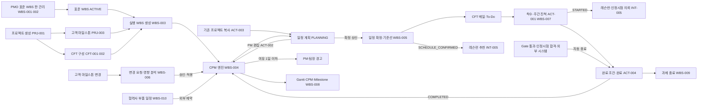
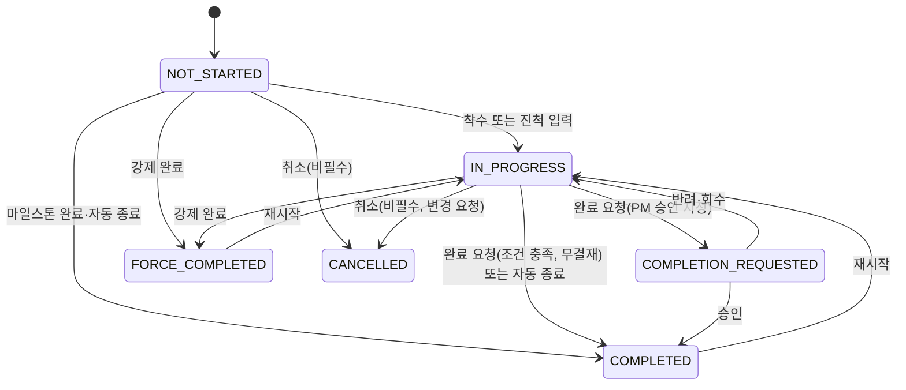
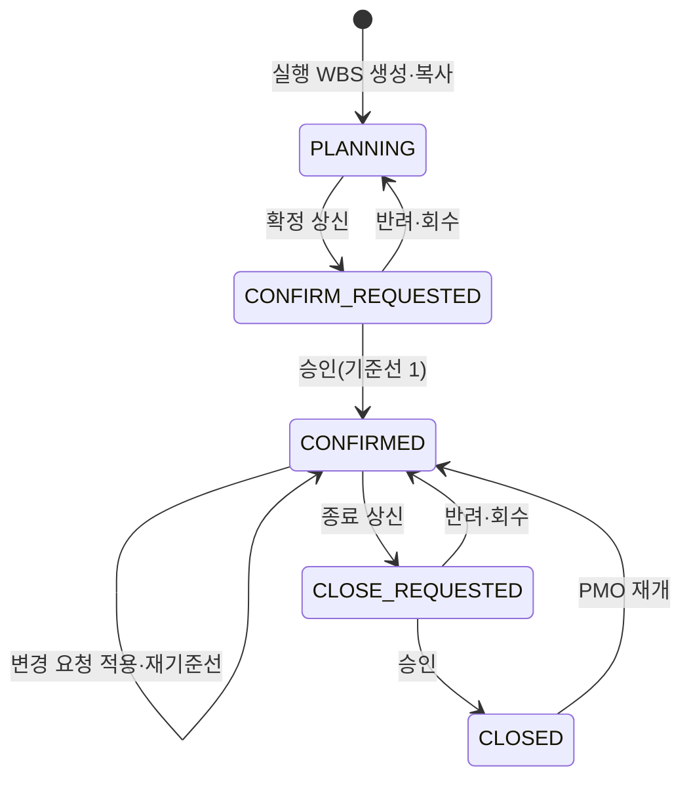

# SL PMS 워크아이템 Vol.P2 — PMS-04 일정 관리(WBS)·PMS-07 Task·Activity·Milestone(ACT)

Nov 6, 2026 · @배창욱

## 1. 개요

Vol.P2는 PMS RFP의 **일정 관리(3.4절, P-15~28)**와 **Task·Activity·Milestone 관리(3.7절, P-41~47)**를 15개 워크아이템(PMS-04-WBS-001~010, PMS-07-ACT-001~005)으로 내린다. 두 메뉴는 같은 객체 `PMS_Activity__c`를 다른 관점에서 다룬다. WBS 메뉴는 "언제, 어떤 순서로 하나"(표준 WBS, 실행 WBS 생성, 일정 엔진, 기준선, 변경, 진척, Viewer, 종료)를 맡고, ACT 메뉴는 "누가 하고, 무엇을 갖춰야 끝나나"(담당, 구조 편집, 복사, 완료 조건, 담당자 변경)를 맡는다.

Salesforce에는 Critical Path, 선후행 4종, 간트가 없어 이 메뉴가 PMS 제안의 가장 큰 기술 공백이다. 이 Vol.은 이를 (1) Apex CPM 엔진(프로젝트 단위, 메모리 계산, 비동기 실행, D-P3), (2) 공장 근무 달력, (3) 연구소 간트 자산 재사용 또는 외부 라이브러리 없는 경량 간트(D-P2)로 메운다. 또 신제품개발 회사표준 개정(26.11~27.04)이 PMS 구축 기간과 겹치므로 표준 WBS, 완료 조건, 필수 데이터 항목을 **배포 없이 설정으로 바꿀 수 있게** 설계한다. PoC 시나리오 1(표준 WBS 기반 생성·Critical Path 자동 산정)과 시나리오 2(필수 속성 검증 기반 자동 종료, 고객 일정 변경 반영, RAG 조회)가 이 Vol.의 W1 범위다.

| 기능코드 | 기능 | RFP | WI | 핵심 |
| --- | --- | --- | --- | --- |
| WBS | 일정 관리 | P-15~28 | 10 | 표준 WBS 판 관리·필수 액티비티, 산출물·완료 조건 정의, 실행 WBS 자동 생성(시작일·고객 마일스톤), Apex CPM 엔진(FS/SS/FF/SF·지연일·여유·경고), 확정·기준선·To-Do, 변경 요청·영향 분석, 진척·RAG, Gantt/CPM/Milestone Viewer, 과제 종료, 협력사 부품 일정 |
| ACT | Task·Activity·Milestone | P-9, P-21, P-41~47 | 5 | 액티비티 레코드·주/보조 담당·프로세스 속성, WBS 트리 편집(드래그 앤 드롭), 프로젝트 복사, 완료 조건 검증·자동 종료·재시작·강제 완료, 담당자 변경 |

**RFP 요구 → WI 추적**

| RFP | 요구 요지 | WI |
| --- | --- | --- |
| P-15 | 관리자 전용 표준 WBS 등록·변경, 고객/제품별, 프로세스 포탈 연계, 산출물 매핑, 변경 이력, Critical Path 확인, 필수 액티비티 삭제 불가 | WBS-001, WBS-002, WBS-004(템플릿 일정 시뮬레이션) |
| P-16 | 시작일·고객 마일스톤 지정 시 전체 일정 자동 세팅, Critical Path 반영 자동 변경 | WBS-003, WBS-004 |
| P-17 | 고객 마일스톤 변경 시 Critical Path 재산정, 여유 1일 이하 경고(PM·팀장) | WBS-004, WBS-006 |
| P-18 | 일정 계획 승인, CFT 메일 알림 | WBS-005 |
| P-19 | 포탈 업무목록(To-Do), 개인별 웹서비스, 본인 담당 필터 | WBS-005(To-Do), WBS-008(내 일정), Vol.0 TDO-003(웹서비스) |
| P-20 | 주 단위 진척 등록, 진척 산식 정의 | WBS-007 |
| P-21 | 필수 데이터 속성 검증 후에만 완료·자동 Close | WBS-002(정의), ACT-004(검증·완료) |
| P-22 | 일정 편집 화면 현황(상태·진척·CP·예상 진척·비용), 변경 시 CP 재산정, 담당 팀장 메일 | WBS-006, WBS-004 |
| P-23 | CFT 협의 일정 변경 요청·승인, 변경 완료 CFT 통보 | WBS-006 |
| P-24 | Task·단계·프로젝트·담당자별 진척, CP 여유 알림, RAG | WBS-007, WBS-004 |
| P-25 | 과제 종료 승인, 미완료 시 임의 종료(의견), SOP 초과 미종료 PM 메일 | WBS-009 |
| P-26 | 선후행 4종, CP 영향 액티비티 변경 불가 | WBS-004, WBS-006, ACT-002 |
| P-27 | 일정 Viewer(Gantt/CPM/Milestone), 본인 담당 시간순, PM 전체 조회 | WBS-008(공장·차종·연도·SOP 기준 대시보드는 PMS-10-DSH-002) |
| P-28 | 협력사 부품개발 일정 연계(권장) | WBS-010(수신 연계 구현은 PMS-12-INT-004) |
| P-41 | BPA 프로세스 → 액티비티 속성(명칭·No.·설명·주관부서), Legacy 연계 자동 종료 | WBS-001(정의), ACT-001(속성), ACT-004(자동 종료), PMS-12-INT-001(동기화) |
| P-42 | 드래그 앤 드롭 이동·Depth 조정, 필수 액티비티 삭제·이동 제한 | ACT-002 |
| P-43 | 기존 프로젝트 WBS·CFT 복사 | ACT-003 |
| P-44 | 산출물 완료율 기반 진척, 결재 필요 산출물 팀장 필수, PM/관리자 재시작·강제 완료 | WBS-007(진척), ACT-004, PMS-06-DLV-002(산출물 결재) |
| P-45 | 산출물 저장·수정·이력, PM 산출물 추가·삭제 | PMS-06-DLV-001(이 Vol. 범위 밖) |
| P-46 | PM/관리자 담당자 일괄 변경, 담당자 변경 요청 → PM 승인, 완료 액티비티 제외 | ACT-005 |
| P-47 | 액티비티 코멘트 타임라인 | ACT-001(배치), Vol.0 UX-003 |
| P-9 | 주담당(필수 1명)·보조 담당, 양쪽 모두 산출물 등록·완료 처리 | ACT-001, ACT-004 |

**도메인 정의**

- **신제품 개발 단계(DEV_PHASE)와 APQP**: 고객 APQP(Advanced Product Quality Planning)는 5단계(① 계획·정의, ② 제품 설계·개발, ③ 공정 설계·개발, ④ 제품·공정 유효성 확인, ⑤ 양산·피드백)다. SL은 회사표준 개정으로 약 10단계를 쓴다. 공통 코드 DEV_PHASE(Vol.4 LEL 정의, QMS와 같이 씀)의 Attribute1에 APQP 단계를 넣어 고객 보고에 매핑한다. 아래 값은 개정 전 가정 값이며 개정 결과로 데이터만 교체한다(D-P1).

  | DEV_PHASE | 이름 | APQP(Attribute1) | 대표 액티비티·마일스톤 |
  | --- | --- | --- | --- |
  | QUOTE | 수주·견적 | 1 | 타당성 검토(Feasibility), 견적 원가, RFQ 요구 분석 |
  | KICKOFF | 개발 착수 | 1 | 킥오프, CFT 구성, SOR 등록, 일정 확정 |
  | CONCEPT | 구조 검토 | 2 | 구조 검토, 광학 콘셉트, 설계 검토 DR1 |
  | DESIGN | 설계 | 2 | 광학·기구·전장 상세 설계, DFMEA, 도면 출도, DR2 |
  | PROTO | 시작품 | 2 | 시작품 제작, 고객 초기 빌드 대응 |
  | DV | 설계 검증 | 2 | DV 시험(인정시험 의뢰), DR3 |
  | TOOLING | 금형·설비 | 3 | 금형 발주·T0~T2, 설비·검사구, PFMEA, 관리계획서 |
  | PV | 생산 검증 | 4 | 파일럿(시양산), PV 시험, Run@Rate, PPAP 제출 |
  | LAUNCH | 양산 준비 | 4 | 고객 PPAP 승인, 양산 이관 준비, 초기유동 계획 |
  | SOP | 양산 이관 | 5 | SOP, 양산 이관(Handover) Gate, 초기유동(QMS), 성과 평가 |

- **Gate(단계 관문)**: 단계를 넘어가기 전 평가·결재하는 관문(G0~G9, `PMS_GateDefinition__c`). WBS에는 Gate마다 마일스톤 액티비티 1개(GateCode)가 있고, 그 액티비티는 Gate 결재(PMS-09-GAT-004)로만 완료된다.
- **타당성 검토(Feasibility)**: 고객 요구를 설계·공정·원가 면에서 실현할 수 있는지 CFT가 판단하고 서명하는 활동이다. QUOTE 단계 필수 액티비티다.
- **DR(Design Review, 설계 검토)**: 단계별 설계 검토 회의다. 회의는 Vol.0 MTG-001로 열고 회의록을 산출물(SYSTEM_LINK CMN_MEETING)로 건다.
- **DV/PV**: DV(Design Verification)는 설계가 사양을 만족하는지, PV(Production Validation)는 양산 공정으로 만든 제품이 사양을 만족하는지 시험으로 증명한다. 이 액티비티를 착수하면 QMS 인정시험 계획이 만들어지고(QMS-02-DVQ-005), 합격 판정이 완료 조건이 된다.
- **시작품·파일럿·Run@Rate**: 시작품은 설계 확인용 수작업·간이 금형품, 파일럿은 양산 금형·설비로 소량 생산, Run@Rate는 고객이 SOP 전에 양산 라인이 약속한 생산 속도(시간당·일당 수량)를 품질 기준대로 내는지 실측하는 평가다.
- **양산 이관(Handover)**: SOP Gate를 통과하면 개발 조직에서 양산 조직으로 넘기고 QMS 초기유동이 시작된다(PMS-09-GAT-006).
- **고객 마일스톤**: OEM이 정한 빌드·제출 일정(예: 초기 빌드, PPAP 제출, SOP)이다. 고객마다 이름과 개수가 다르다(코드 그룹 CUSTOMER_MILESTONE, Attribute1 = 고객 그룹). SL 일정은 이 날짜에 고정(앵커)되고, 앞쪽 액티비티의 여유가 이 날짜로부터 계산된다.
- **선후행 4종과 지연일**: FS(선행 종료 → 후행 시작), SS(선행 시작 → 후행 시작), FF(선행 종료 → 후행 종료), SF(선행 시작 → 후행 종료). 지연일(Lag, 양수)과 선행일(Lead, 음수 Lag)은 작업일 단위다.
- **CPM과 여유(Float)**: 순방향 계산으로 가장 이른 시작·종료(ES·EF), 역방향 계산으로 가장 늦은 시작·종료(LS·LF)를 구한다. 총 여유 TF = LF − EF. TF가 0 이하인 액티비티를 이은 것이 Critical Path이고, TF가 음수면 고객 마일스톤을 지금 계획으로는 못 맞춘다는 뜻이다.
- **기준선·예상·실적**: 기준선(Planned) = 일정 확정·재기준선 결재 때의 일정 사본(성과 비교 기준, 함부로 바뀌지 않음). 예상(Forecast) = 지금 정보로 엔진이 다시 계산한 일정. 실적(Actual) = 실제 착수·완료일.
- **RAG**: Red·Amber·Green. 기준선 대비 지연, 여유, 진척 차이로 판정한다(WBS-007).
- **필수 액티비티**: 회사표준이 반드시 수행하도록 정한 액티비티(예: 타당성 검토, DFMEA, PPAP 제출). 삭제·취소할 수 없고 다른 상위로 옮길 수 없다.
- **완료 조건**: 산출물 업로드만으로 완료하지 않는다. 액티비티에 지정된 필수 데이터 속성(예: 4M 변경 세부 내용, 원인 분석 결과, Run@Rate 실측 생산 속도)과 연계 시스템 조건(레슨런 필수 반영 검토 완료, 인정시험 합격)이 모두 충족돼야 시스템이 완료를 허용한다(P-21).

**선행 공통 WI(Vol.0)**: ARC-001·002·003, MDM-001·002·003·004·005·007, SEC-001·002·003, I18N-001, UX-001·003·004·005·006·007, APV-001·002·003, TDO-001·003, NTF-001, DOC-001, MTG-001, DWH-002, AI-004. 근무 달력은 Vol.0 변경 요청(10절)이다.

**다른 PMS Vol. 선행**: PMS-02-PRJ-001(프로젝트), PMS-02-PRJ-002(프로젝트 품번), PMS-02-PRJ-003(고객 마일스톤), PMS-03-CFT-001·002(CFT 구성·승인), PMS-06-DLV-001(실행 산출물, ACT-004·WBS-007), PMS-12-APV-001(PROJECT_ROLE 결재선, ACT-004 ROLE 승인), PMS-12-INT-005(QMS 연계 구현).

**다른 메뉴와의 경계**

| 연결 대상 | 이 Vol.이 하는 것 | 상대 메뉴가 하는 것 |
| --- | --- | --- |
| 프로젝트(PMS-02-PRJ-001) | 일정 관련 프로젝트 필드(10절 변경 요청) 값 쓰기, ScheduleRag 쓰기, 과제 종료 결재 | 프로젝트 객체·상태값·상태 전이 서비스, PMS_ProjectEvent__e 정의·CLOSED 발행 |
| 고객 마일스톤(PRJ-003) | 앵커 → 일정 제약 변환, 마일스톤-액티비티 매핑 기록, 확정 후 날짜 변경은 일정 변경 요청(WBS-006)으로 | 마일스톤 객체·화면, 확정 전 날짜 변경 시 PMS_ScheduleService 호출, 앵커 액티비티 완료 이벤트로 ActualDate 기록 |
| CFT(CFT-001·002) | 담당은 CFT 구성원만, 주관 역할로 기본 담당 지정, 열린 담당 수 조회 API | 구성원·역할·승인, 프로젝트 공유, 팀장 Read 공유 |
| 투입(EFF-001~003) | 액티비티 예상 일정과 담당 변경 사실 제공 | 투입 계획·실적·부하 |
| 산출물(DLV-001·002) | 표준 산출물 정의(WBS-002), 완료 판정에서 산출물 상태 사용, WBS 생성 사실 발행 | 실행 산출물 행 생성·제출·결재·N/A 승인 |
| Gate(GAT-001·004·006) | Gate 마일스톤 액티비티 일정, 자동 종료 API | Gate 일정 동기화(DATES_CHANGED 구독), Gate 통과 시 자동 종료 호출 |
| 대시보드·AI(PMS-10·11) | 일정 KPI 원천, what-if API, AI 채택 일정 변경 요청 생성 API | 위젯, AI 일정 추천(UseCase PMS_SCHEDULE), 조기경보 |
| 연계(PMS-12-INT-001·003·004·005) | 자동 종료 API, 협력사 일정 수신 API, QMS 호출 시점·문맥 계약, 완료 규칙 의미 | BPA 동기화, 외부 시스템 호출, QMS 서비스 호출·QMS 완료 검사기 구현 |
| 변경 관리(PMS-13-CHG-001) | 일정 변경 요청·이력 | 프로젝트 변경의 SCHEDULE 유형은 이 Vol. 변경 요청을 참조(중복 생성 금지) |
| QMS 레슨런(Vol.4 LEL, Vol.8 AIQ-007·008) | 액티비티 DEV_PHASE·DEV_ACTIVITY_TYPE, 반영 방식 속성, 호출 시점 사실 이벤트, 완료 규칙 QMS_LELE_NO_OPEN_MANDATORY 의미 | 매칭·추천·반영 검토, hasOpenMandatory |
| QMS 인정시험(Vol.2 DVQ-005·008) | 인정시험 트리거 속성(QualTrigger), 완료 규칙 QMS_QUAL_PASS 의미, 자동 종료 | 계획 생성 서비스, JUDGED 이벤트 |

**개발 순서(선행 기준)**: WBS-001 → WBS-002 → ACT-001(액티비티 객체 생성) → WBS-004(엔진) → WBS-003(생성) → WBS-005 → ACT-004 → WBS-006 → WBS-007 → ACT-002 → WBS-008 → ACT-005 → ACT-003 → WBS-009 → WBS-010(W2). 문서는 WI 번호 순서로 쓴다.

**앞 Vol. 상태**: Vol.0·2·4·8은 검토 대기다. 이 Vol.은 결정 대기 항목(D-1 같은 Org, D2-4, D4-7, D4-8, D-P1~P9)의 권고안을 가정한다. Vol.P1(PRJ·CFT)은 병행 작성 중이라 그 Vol.의 객체·필드는 `pms-architecture.md` 5절 계약 이름만 쓰고, 이 Vol.에 필요한 추가 필드는 10절 변경 요청에 모았다.

## 2. 업무 흐름

표준 WBS 판에서 실행 WBS를 만들면 엔진이 시작일과 고객 마일스톤으로 일정을 계산한다. PM은 확정 전까지 자유롭게 편집하고, 확정(결재)하면 기준선이 생기고 CFT에게 알림과 To-Do가 간다. 확정 후 일정에 영향을 주는 변경은 모두 변경 요청을 거친다. 액티비티 완료는 완료 조건(산출물·필수 데이터·QMS 조건)이 충족될 때만 되고, Gate·QMS·외부 시스템 사건으로 자동 종료될 수도 있다. 완료·변경·날짜 경과마다 엔진이 다시 계산해 여유와 RAG를 갱신한다.

**액티비티 상태**

**프로젝트 일정 상태**(`PMS_Project__c.ScheduleStatus__c`, 제안 필드)

| 일정 상태 | PM 편집 | 액티비티 실행 | 변경 요청 |
| --- | --- | --- | --- |
| 공란(WBS 없음) | 생성·복사만 | 없음 | 없음 |
| PLANNING | 구조·기간·선후행·제약·담당 자유 편집 | 착수·진척 가능(To-Do 없음) | 없음(직접 편집) |
| CONFIRM_REQUESTED | 이름·설명만 | 가능 | 없음 |
| CONFIRMED | 일정 무관 편집(이름·설명·순서·비필수 이동), 담당은 ACT-005 | 가능 | 일정 영향 편집 전부 |
| CLOSE_REQUESTED·CLOSED | 없음 | 없음 | 없음 |

## 3. 데이터 모델 개요

객체는 **표준(설정) 6개**(무엇을 어떤 순서로 하고 무엇을 갖춰야 끝나나)와 **실행(업무) 10개**(이번 프로젝트를 어떻게 하고 있나)로 나뉜다. 실행 WBS는 생성 시점에 표준을 복사하므로 표준 판이 바뀌어도 진행 중 프로젝트는 변하지 않는다. `(제안)`은 `pms-architecture.md` 5절에 없는 이름이며 10절 아키텍처 변경 요청에 모았다.

**객체**

| 객체 | 구분 | 관계 | 역할 | 정의 WI |
| --- | --- | --- | --- | --- |
| PMS_WbsTemplate__c | 설정 | — | 표준 WBS 판(사내 공개 읽기) | WBS-001 |
| PMS_WbsTemplateActivity__c | 설정 | Template(MD), Parent·PhaseRoot(self) | 표준 액티비티 | WBS-001 |
| PMS_WbsTemplateDependency__c | 설정 | Template(MD), Predecessor·Successor(Lookup) | 표준 선후행 | WBS-001 |
| PMS_WbsTemplateDeliverable__c | 설정 | TemplateActivity(MD) | 표준 산출물·산출물 완료 규칙 | WBS-002 |
| PMS_WbsTemplateDataItem__c (제안) | 설정 | TemplateActivity(MD) | 완료 필수 데이터 항목 정의 | WBS-002 |
| PMS_CompletionRule__mdt | 설정 | — | 완료 규칙 레지스트리(키 → 검사기 클래스) | WBS-002 |
| PMS_Activity__c | 업무 | Project(MD), Parent·PhaseRoot(self), TemplateActivity(Lookup) | 실행 액티비티 | ACT-001(객체 생성), WBS-003·004·005·007, ACT-004(필드 추가) |
| PMS_ActivityAssignee__c | 업무 | Activity(MD) | 보조 담당 | ACT-001 |
| PMS_ActivityDataValue__c (제안) | 업무 | Activity(MD), TemplateDataItem(Lookup) | 필수 데이터 값 | ACT-001 |
| PMS_ActivityDependency__c | 업무 | Project(MD), Predecessor·Successor(Lookup Activity) | 실행 선후행 | WBS-004 |
| PMS_ScheduleRun__c (제안) | 업무(로그) | Project(MD) | 일정 계산 대기열·실행 기록 | WBS-004 |
| PMS_ScheduleRunStep__mdt (제안) | 설정 | — | 계산 후처리 단계 등록(경고·RAG·To-Do·협력사) | WBS-004 |
| PMS_ScheduleBaseline__c | 업무 | Project(MD) | 기준선(스냅숏) | WBS-005 |
| PMS_ScheduleChange__c | 업무 | Project(MD) | 일정 변경 요청 | WBS-006 |
| PMS_ScheduleChangeItem__c (제안) | 업무 | ScheduleChange(MD) | 변경 항목 | WBS-006 |
| PMS_ActivityProgress__c | 업무 | Activity(MD) | 주간 진척 | WBS-007 |
| PMS_SupplierPartSchedule__c | 업무 | Project·SupplierItem·LinkedActivity(Lookup) | 협력사 부품개발 일정 | WBS-010 |
| PMS_AssigneeChange__c (제안) | 업무 | Project(MD) | 담당자 변경 요청·일괄 변경 이력 | ACT-005 |
| CMN_WorkCalendar__c / CMN_WorkCalendarDay__c (제안) | 마스터 | Plant(Lookup) / Calendar(MD) | 공장 근무 달력(휴일·특근) | Vol.0 변경 요청(10절) |

**PMS_Activity__c 필드 분담**: 객체 메타데이터는 개발 순서상 가장 먼저 착수하는 ACT-001이 만든다. 계약상 소유는 WBS-003·ACT-001이고, 이 Vol. 안에서 필드 생성을 아래처럼 나눈다(계약 이름은 바꾸지 않음).

| WI | 필드 |
| --- | --- |
| ACT-001 | Project, RecordNo, Name·NameEn·NameZh·DisplayName, WbsCode, Parent, Level, SortOrder, PhaseRoot, IsSummary, DevPhase, ActivityType, Status, CancelReason, Owner, AssigneeIdsText, IsMyActivity, IsProjectPm, IsOpen, IsMandatory, IsMilestone, GateCode, ResponsibleRole, SupportRoles, OwnerDept, ProcessNo, ProcessPortalActivityId, ProcessPortalUrl, Description, ProgressMethod, CompletionApprover·CompletionApproverRole, CompletionRuleKeys, AutoCloseSource, QualTrigger, ActualStart, ActualEnd, StartedBy, CustomerName, ProjectNo, PlantName, ScheduleLocked, TemplateActivity, ActivityCode, AnchorMilestoneCode, CopiedFrom |
| WBS-004 | DurationDays, ForecastStart, ForecastEnd, TotalFloat, IsCritical, ConstraintType, ConstraintDate, ConstraintSource, ExternalNotBefore, LateStart, LateFinish, FloatWarnedAt, DaysToDue |
| WBS-005 | PlannedStart, PlannedEnd, BaselineNo |
| WBS-007 | Progress, ProgressComment, PlannedProgress, DlvTotal, DlvApproved, DlvSubmittedNoApproval, DeliverableProgress, Rag, RagReason, SlipDays, LastProgressAt |
| ACT-004 | CompletionCheckStatus, CompletionCheckJson, CompletionCheckedAt, CompletionSource, CompletionSourceRef, CompletionComment, ForceReason, ForcedUnmetJson, ReopenReason, ReopenCount, CompletedBy, CompletionApprovalId |

**상태값**

| 대상 | 값(순서) |
| --- | --- |
| PMS_WbsTemplate__c.Status__c | DRAFT → ACTIVE → OBSOLETE |
| PMS_Project__c.ScheduleStatus__c (제안) | 공란 → PLANNING → CONFIRM_REQUESTED → CONFIRMED → CLOSE_REQUESTED → CLOSED (반려 시 이전 상태, PMO 재개 시 CLOSED → CONFIRMED) |
| PMS_Activity__c.Status__c | NOT_STARTED → IN_PROGRESS → (COMPLETION_REQUESTED →) COMPLETED · FORCE_COMPLETED · CANCELLED. 종료 → IN_PROGRESS(재시작) |
| PMS_Activity__c.Rag__c | GREEN · AMBER · RED. 종료·취소 액티비티는 공란 |
| PMS_Activity__c.ConstraintType__c (제안) | ASAP 가능한 빨리 · SNET 이 날 이후 시작 · FNLT 이 날까지 종료 · MFO 이 날 종료 고정(마일스톤 전용) |
| PMS_ScheduleRun__c.Status__c (제안) | QUEUED → RUNNING → DONE / FAILED |
| PMS_ScheduleChange__c.Status__c | DRAFT → REQUESTED → APPROVED → APPLIED / REJECTED (즉시 적용은 DRAFT → APPLIED) |
| PMS_SupplierPartSchedule__c.Status__c (제안) | PLANNED → DONE / CANCELLED |
| PMS_AssigneeChange__c.Status__c (제안) | DRAFT → REQUESTED → APPLIED / REJECTED (일괄 변경은 바로 APPLIED) |

**일정 계산의 공통 약속**(모든 WI가 같은 뜻으로 쓴다. 엔진 상세는 WBS-004)

- 날짜는 Date(시간 없음)다. 기간·지연일·여유는 모두 **프로젝트 근무 달력의 작업일 수**다(프로젝트당 달력 1개, DP2-2).
- 액티비티 표시 일정: 시작일 = 첫 작업일, 종료일 = 마지막 작업일(포함). DurationDays 5 = 작업일 5일.
- 마일스톤(IsMilestone, DurationDays 0)은 **그날 업무 종료 시점의 사건**이다. FS 후행은 다음 작업일에 시작한다.
- Planned = 기준선(확정·재기준선 결재 때만 바뀜), Forecast = 엔진 결과(자동, 사람이 입력하지 않음), Actual = 사람·시스템 입력.
- 요약 액티비티(하위가 있는 액티비티)는 일정·여유·진척·RAG·상태를 하위에서 집계만 하고 선후행·담당·완료 조건을 갖지 않는다.
- 엔진·집계가 쓰는 필드는 사용자 FLS 읽기 전용이고 서비스가 `CMN_UiRuleService.runAsService`와 SYSTEM_MODE로만 쓴다.

**권한 셋과 페르소나 매핑**(각 WI가 PS를 만들고 SEC-001 BR-2에 따라 PSG에 넣는다. PSG 이름은 `pms-architecture.md` 10절)

| Permission Set | 내용 | Custom Permission | PSG |
| --- | --- | --- | --- |
| PMS_PS_WbsTemplate_Read | 표준 WBS·산출물·데이터 항목·완료 규칙 조회 | — | PMS_PSG_PM, PMS_PSG_CFT, PMS_PSG_TeamLead, PMS_PSG_PMO |
| PMS_PS_WbsTemplate_Admin | 표준 WBS 편집·가져오기·새 판·활성화·폐기 | PMS_WBT_Admin | PMS_PSG_PMO |
| PMS_PS_Schedule_Read | 액티비티·선후행·기준선·변경·진척·협력사 일정·Viewer 조회 | — | PMS_PSG_PM, PMS_PSG_CFT, PMS_PSG_TeamLead, PMS_PSG_PMO, CMN_PSG_Executive |
| PMS_PS_Schedule_Plan | 자기 프로젝트의 실행 WBS 생성·편집·확정 상신·변경 즉시 적용·복사·담당 일괄 변경·재시작·비필수 강제 완료·종료 상신 | PMS_SCH_Plan, PMS_ACT_Override | PMS_PSG_PM |
| PMS_PS_Activity_Execute | 담당 액티비티 착수·진척·데이터 입력·완료 요청, 변경 요청 작성, 담당 변경 요청 | PMS_ACT_Execute, PMS_SCH_Change | PMS_PSG_CFT, PMS_PSG_PM |
| PMS_PS_Schedule_Admin | 모든 프로젝트 재계산·편집·재시작·강제 완료(필수 포함)·재개, 결재 PMO 단계 | PMS_SCH_Admin, PMS_ACT_Admin | PMS_PSG_PMO |
| PMS_PS_SupplierSchedule_Edit | 협력사 부품 일정 수기 입력·액티비티 연결 | — | PMS_PSG_PM, PMS_PSG_CFT |
| PMS_PS_Schedule_Integration | 자동 종료 API, 협력사 일정 수신 API | — | 통합 사용자 전용(PSG 없음) |

프로젝트 단위 권한(내 프로젝트의 PM인가, 내 담당인가)은 Custom Permission만으로 구분할 수 없다. 그래서 UX-005 규칙 행은 Custom Permission과 ExtraCondition 수식 필드를 함께 쓴다: `IsProjectPm__c=true`(PM), `IsMyActivity__c=true`(주·보조 담당). 서버는 같은 조건을 `PMS_ProjectAccessService.isProjectManager(projectId, userId)`(PRJ-001 소유, PM 필드 + CFT AccessLevel PM 구성원)와 담당 조회로 다시 확인한다.

**결재 유형·알림·To-Do·배치**

| 이름 | 종류 | 정의 WI | 내용 |
| --- | --- | --- | --- |
| PMS_SCHEDULE_CONFIRM | 결재 유형 | WBS-005 | 일정 확정(기준선 1) |
| PMS_SCHEDULE_CHANGE | 결재 유형 | WBS-006 | 일정 변경·재기준선 |
| PMS_ACTIVITY_COMPLETE | 결재 유형 | ACT-004 | PM·역할 승인 지정 액티비티 완료 |
| PMS_ACTIVITY_FORCE | 결재 유형 | ACT-004 | PM이 요청한 필수 액티비티 강제 완료(PMO 승인) |
| PMS_PROJECT_CLOSE | 결재 유형 | WBS-009 | 과제 종료(정상·임의) |
| PMS_ASSIGNEE_CHANGE | 결재 유형 | ACT-005 | 담당자 변경 요청(PM 승인) |
| PMS_ACTIVITY | To-Do SourceType | WBS-005 | 액티비티 수행(주·보조 담당) |
| PMS_ACTIVITY_AUTOCLOSE | To-Do SourceType | ACT-004 | 자동 종료 실패 보완 |
| PMS_PROJECT_CLOSE | To-Do SourceType | WBS-009 | SOP 초과 과제 종료 처리 |
| PMS_WBS_GENERATED, PMS_SCH_RUN_FAILED, PMS_SCH_FLOAT_WARN | 알림 EventCode | WBS-003, WBS-004 | 생성 완료, 계산 실패, 여유 경고 |
| PMS_SCH_CONFIRMED | 알림 EventCode | WBS-005 | 일정 확정 CFT 통보 |
| PMS_SCH_CHANGED, PMS_SCH_CHANGED_LEAD, PMS_SCH_CHANGE_RESUBMIT | 알림 EventCode | WBS-006 | 변경 적용 CFT·담당 팀장 통보, 재상신 필요 |
| PMS_SCH_PROGRESS_REMIND | 알림 EventCode | WBS-007 | 주간 진척 입력 알림 |
| PMS_PRJ_SOP_OVERDUE, PMS_PRJ_SOP_OVERDUE_PMO, PMS_PRJ_CLOSED | 알림 EventCode | WBS-009 | SOP 초과, PMO 목록, 종료 통보 |
| PMS_SUP_SCHEDULE_DELAY | 알림 EventCode | WBS-010 | 협력사 일정 지연 영향 |
| PMS_ACT_AUTOCLOSE_FAILED, PMS_ACT_FORCE_COMPLETED, PMS_ACT_COMPLETION_REVERTED | 알림 EventCode | ACT-004 | 자동 종료 실패, 강제 완료(PMO 정보), 결재 후 조건 미충족 |
| PMS_ACT_ASSIGNED, PMS_ACT_UNASSIGNED | 알림 EventCode | ACT-005 | 담당 지정·해제 |
| PMS_ScheduleNightlyBatch | 배치 | WBS-004 | 매일 01:00(KST) 열린 프로젝트 재계산, 90일 지난 Run 삭제 |
| PMS_ActivityTodoJob | 배치 | WBS-005 | 매일 05:00(KST) 리드 기간 안 액티비티 To-Do 열기 |
| PMS_SopOverdueJob | 배치 | WBS-009 | 매일 06:00(KST) SOP 초과 미종료 알림 |
| PMS_ProgressReminderJob | 배치 | WBS-007 | 매주 금요일 10:00(KST) 주간 진척 미입력 알림 |

**다른 WI·메뉴가 쓰는 서비스와 이벤트**

| 이름 | 종류 | 제공 WI | 사용처 |
| --- | --- | --- | --- |
| PMS_ActivityEvent__e(STARTED, COMPLETION_REQUESTED, COMPLETED, REOPENED, DATES_CHANGED, OWNER_CHANGED(제안)) | Platform Event | ACT-001(정의), WBS-004·ACT-004·ACT-005(발행) | PMS-12-INT-005, PRJ-003, GAT-001, EFF, Vol.8 |
| PMS_ProjectEvent__e EventType WBS_GENERATED·SCHEDULE_CONFIRMED·BASELINE_CHANGED (제안 값) | Platform Event 값 | WBS-003·005, ACT-002·003 | DLV-001, PMS-12-INT-005 |
| PMS_ScheduleService.requestRecalc / simulate / syncAnchors / onCustomerMilestoneDatesChanged / simulateTemplate | Apex | WBS-004 | PRJ-003, WBS-006, WBS-010, PMS-11-AIP-001·003 |
| PMS_ScheduleChangeService.createFromAi | Apex | WBS-006 | PMS-11-AIP-001 |
| PMS_ActivityCompletionService.autoComplete | Apex | ACT-004 | GAT-004, PMS-12-INT-003·004·005 |
| PMS_CompletionChecker, PMS_CompletionRule__mdt, PMS_CompletionRuleRegistry | Interface + mdt | WBS-002 | PMS-12-INT-005(QMS 검사기), 추가 규칙 WI |
| PMS_SupplierScheduleService.upsertFromSource | Apex | WBS-010 | PMS-12-INT-004 |
| PMS_AssigneeChangeService.countOpenAssignments | Apex | ACT-005 | CFT-002 |
| PMS_WbsTemplateSelector.select | Apex | WBS-001 | PRJ-001(프로젝트 생성 화면 기본값) |
| PMS_ScheduleViewController.getMyActivities | Apex | WBS-008 | PMS-10 위젯 |

**CMN 설정 키**

| 키 | 기본값 | 의미 | 사용 WI |
| --- | --- | --- | --- |
| PMS_WBS_MAX_ACTIVITIES | 2000 | 프로젝트·템플릿 액티비티 상한(D-P3) | WBS-001·003·004, ACT-001·002·003 |
| PMS_CPM_CRITICAL_FLOAT | 0 | 크리티컬 판정 총 여유(작업일) | WBS-004 |
| PMS_CPM_WARN_FLOAT | 1 | 여유 경고 기준(작업일, P-17) | WBS-004·007 |
| PMS_TODO_LEAD_DAYS | 7 | 예상 시작 며칠 전에 To-Do를 여는지(달력일) | WBS-005 |
| PMS_RAG_RED_SLIP_DAYS | 5 | RED 지연 작업일 | WBS-007 |
| PMS_RAG_AMBER_PROGRESS_GAP | 20 | AMBER 진척 차(%p) | WBS-007 |
| PMS_RAG_SUMMARY_RED_PCT / PMS_RAG_SUMMARY_AMBER_PCT | 10 / 20 | 요약 RAG 비율(%) | WBS-007 |
| PMS_SPI_AMBER / PMS_SPI_RED | 0.9 / 0.8 | 프로젝트 SPI 기준 | WBS-007 |
| PMS_MAX_ASSISTANTS | 5 | 액티비티당 보조 담당 상한 | ACT-001, ACT-005 |
| PMS_SOP_CLOSE_GRACE_DAYS | 0 | SOP 초과 알림 유예 달력일 | WBS-009 |
| PMS_QUAL_PASS_ALLOW_CONDITIONAL | true | 인정시험 조건부 판정을 완료 조건 충족으로 볼지(DP2-8) | ACT-004 |
| PMS_GANTT_RENDERER | LITE | 간트 렌더러(LITE 또는 연구소 자산 컴포넌트 이름) | WBS-008 |

**채번·공통 기반 등록**

- 채번(ARC-003, ScopeField 공란 = 전사 연번, ResetPolicy YEARLY): `ACT-{YYYY}-{SEQ:7}`(PMS_Activity__c), `SCH-{YYYY}-{SEQ:5}`(PMS_ScheduleChange__c), `ASG-{YYYY}-{SEQ:5}`(PMS_AssigneeChange__c). 표준 WBS는 Code + Version이 식별자라 채번하지 않는다. 기준선·진척·선후행·실행 기록은 업무 문서가 아니라 번호가 없다.
- 공유: MD 하위 객체는 프로젝트 공유(CFT-001)를 상속한다. Lookup 객체인 PMS_SupplierPartSchedule__c만 별도 공유(WBS-010 BR-6). 표준 WBS 객체는 사내 OWD Public Read Only.
- 삭제 통제(SEC-003 CMN_DeleteGuard__mdt): PMS_WbsTemplate__c(DRAFT), PMS_Activity__c(NOT_STARTED + 서비스 조건), PMS_ScheduleChange__c(DRAFT), PMS_AssigneeChange__c(DRAFT). 기준선은 삭제 불가.
- 진행 단계(UX-003 CMN_StatusFlow__mdt): PMS_WbsTemplate__c, PMS_Activity__c, PMS_ScheduleChange__c, PMS_AssigneeChange__c.
- DWH 복제(DWH-002): PMS_Activity__c, PMS_ActivityDependency__c, PMS_ActivityProgress__c, PMS_ScheduleBaseline__c(SnapshotJson 제외), PMS_ScheduleChange__c, PMS_SupplierPartSchedule__c. 화면 문구는 ko·en_US·zh_CN 3개 언어.

**KPI 키**(CMN_KpiValue__c, DWH-003 경로. PMS-10 위젯이 소비)

| KpiKey | 정의 | 주기 | 차원 | 계산 위치 |
| --- | --- | --- | --- | --- |
| PMS_SCH_ONTIME_RATE | 기준선 종료일 이내 완료 leaf 수 / 그 달 완료 leaf 수, % | 월 | Project, ProdPlant, Customer | Snowflake, WBS-007 |
| PMS_SCH_SPI | 프로젝트 SPI = 실적 진척 / 계획 진척 | 일 | Project | Salesforce 계산값 복제, WBS-007 |
| PMS_SCH_SLIP_DAYS | 프로젝트 예상 종료 − 기준선 종료(작업일) | 일 | Project | Salesforce 계산값 복제, WBS-007 |
| PMS_SCH_RED_OPEN | RED 열린 leaf 수 | 일 | Project, ProdPlant | Snowflake, WBS-007 |
| PMS_SCH_FLOAT_WARN | 총 여유 ≤ 1 열린 leaf 수 | 일 | Project | Snowflake, WBS-004 |
| PMS_SCH_CHANGE_APPLIED | 적용된 일정 변경 건수(접미 _CUSTOMER, _INTERNAL) | 월 | Project, Customer | Snowflake, WBS-006 |
| PMS_ACT_FORCE_RATE | 강제 완료 leaf / 종료 leaf, % | 월 | ProdPlant | Snowflake, ACT-004 |

**데이터량 가정**(SL 미확인, 근거 자료 확보 후 수정)

| 데이터 | 가정 | 저장 위치 |
| --- | --- | --- |
| 표준 WBS | 계열 수십 개 × 판 2~5, 판당 액티비티 300~800, 선후행 400~1,200 | Salesforce |
| 실행 액티비티 | 동시 진행 프로젝트 200 × 평균 600 = 약 12만 행, 연 신규 80~120 프로젝트 | Salesforce |
| 실행 선후행 | 액티비티의 1.5배 = 약 18만 행 | Salesforce |
| 주간 진척 | 진행 중 액티비티(약 15%)의 수기 입력분, 주 1행 → 연 수십만 행. 종료 프로젝트는 180일 후 Snowflake 이관·삭제 | Salesforce + Snowflake |
| 기준선 | 프로젝트당 1~5건(JSON 스냅숏) | Salesforce |
| 일정 계산 실행 기록 | 프로젝트당 일 5~20건 + 야간 1건, 90일 보관 | Salesforce |
| 일정 변경 요청 | 프로젝트당 월 1~4건, 항목 1~30 | Salesforce |
| 협력사 부품 일정 | 프로젝트당 협력사 품번 20~60 × 마일스톤 6~9 | Salesforce |

**성능 목표**(PMS RFP 4.1: 주요 화면 3초, 프로젝트 200개 × 액티비티 600개 이상 동시 운영, 동시 사용자 500명. D-P3: 프로젝트당 2,000 액티비티)

| 항목 | 목표 | 검증 |
| --- | --- | --- |
| 엔진 메모리 계산 600 액티비티·1,200 선후행 | CPU 0.5초 이내 | Apex 테스트 Limits.getCpuTime |
| 엔진 메모리 계산 2,000·4,000 | CPU 2초 이내 | Apex 테스트 |
| 재계산 전체(조회 + 계산 + 바뀐 행 저장) 600 | Queueable 8초 이내, 사용자 화면 반영 10초 이내(P95) | UAT |
| 재계산 전체 2,000 | 25초 이내, CPU 30초 이하(비동기 한도 60초) | 부하 테스트 |
| 야간 전체 재계산 200 프로젝트 × 600 | 60분 이내 | UAT |
| what-if 시뮬레이션 600 | 동기 5초 이내, DML 0 | Apex 테스트 + UAT |
| 실행 WBS 생성 600 | 비동기 60초 이내 | UAT |
| Viewer 첫 표시 600행 / 2,000행 | 3초 / 5초 이내(해외 공장 포함) | EPT 측정 |
| 완료 조건 검사 1건 | 2초 이내 | UAT |

## 4. 표준 WBS: 템플릿·산출물·완료 조건 정의

### PMS-04-WBS-001 표준 WBS 템플릿·버전·필수 액티비티

추적 P-15, P-41 · 필수 · W1 · SF · DM, APEX, LWC, CFG · Customization · 선행 MDM-003, MDM-004, MDM-007, I18N-001, SEC-001, UX-003, UX-005, UX-006, PMS-02-PRJ-003, PMS-03-CFT-001 · 7 M/D

**목적**: 신제품개발 회사표준의 액티비티 구성을 고객 그룹·제품군·프로젝트 유형별 "판"으로 등록하고, 실행 WBS가 이 판을 복사해 만들어지게 한다. 회사표준이 26.11~27.04에 개정되므로 판을 바꿔도 진행 중 프로젝트는 영향받지 않아야 하고, 필수 액티비티는 어느 프로젝트에서도 빠질 수 없어야 한다.

**범위** In: 템플릿·표준 액티비티·표준 선후행 객체, 판(버전) 관리(새 판 만들기·활성화·폐기), 템플릿 선택 서비스, 활성화 검사, Excel 가져오기·내보내기(SheetJS), 판 비교(변경 이력), 단계 그리드·선행 그리드(UX-006), 프로세스 포탈(BPA) 속성 필드, 그래프 순환 검사 유틸리티. Out: 산출물·완료 조건·필수 데이터 항목(WBS-002), 템플릿 일정 시뮬레이션·Critical Path 확인(WBS-004 BR-15), 실행 WBS 생성(WBS-003), BPA 자동 동기화(PMS-12-INT-001), 트리 드래그 편집(ACT-002, 템플릿 모드는 오픈 이슈).

**데이터 모델**

| 객체 / 필드 | 타입 | 필수 | 설명 |
| --- | --- | --- | --- |
| PMS_WbsTemplate__c.Code__c | Text(40) | Y | 표준 WBS 계열 코드(예: WBS-HL-BMW-NEW). 판이 바뀌어도 같다 |
| PMS_WbsTemplate__c.Name | Text(80) | Y | 표시명(예: "BMW 헤드램프 신규 개발 표준") |
| PMS_WbsTemplate__c.Version__c | Number(3,0) | Y | 1부터. 새 판 = 같은 Code 최댓값 + 1 |
| PMS_WbsTemplate__c.ExternalKey__c (제안) | Text(60), External ID, Unique | Y | `{Code}-v{Version}` |
| PMS_WbsTemplate__c.Status__c | Picklist (DRAFT, ACTIVE, OBSOLETE) | Y | |
| PMS_WbsTemplate__c.CustomerGroup__c | Picklist(Account.CustomerGroup__c와 같은 값) | N | 공란 = 모든 고객 |
| PMS_WbsTemplate__c.ProductGroup__c | Lookup(CMN_ProductGroup__c) | N | 공란 = 모든 제품군 |
| PMS_WbsTemplate__c.ProjectType__c | Picklist (NEW_MODEL, MODEL_YEAR, FACELIFT, DERIVATIVE, CARRY_OVER) | N | 공란 = 모든 유형 |
| PMS_WbsTemplate__c.StandardEdition__c (제안) | Text(80) | Y | 근거 회사표준 판(예: "SL 신제품개발 프로세스 Rev02") |
| PMS_WbsTemplate__c.ChangeNote__c (제안) | Long Text(4000) | 2판부터 Y | 이전 판 대비 변경 사유 |
| PMS_WbsTemplate__c.PreviousVersion__c (제안) | Lookup(self) | N | 새 판 만들기 원본 |
| PMS_WbsTemplate__c.LeleReviewMode__c (제안) | Picklist (PER_ACTIVITY, PAST_ISSUE_ACTIVITY) | Y | 레슨런 반영 방식(Vol.8 AIQ-008 방식 A·B). 기본 PER_ACTIVITY |
| PMS_WbsTemplate__c.ActivatedAt__c / ActivatedBy__c (제안) | DateTime / Lookup(User) | ACTIVE면 Y | |
| PMS_WbsTemplate__c.ActivityCount__c / MandatoryCount__c (제안) | Roll-up(COUNT 표준 액티비티 / IsMandatory = true) | — | |
| PMS_WbsTemplate__c.SimulatedDurationDays__c / SimulatedAt__c (제안) | Number(5,0) / DateTime | — | WBS-004 템플릿 시뮬레이션 결과(DRAFT만 저장) |
| PMS_WbsTemplate__c.ValidationStatus__c / ValidationJson__c (제안) | Picklist (NOT_RUN, PASSED, FAILED) / Long Text(32768) | — | BR-6 활성화 검사 결과 |
| PMS_WbsTemplate__c.ImportStatus__c / ImportMessage__c (제안) | Picklist (NONE, RUNNING, DONE, FAILED) / Long Text(32768) | — | BR-8 가져오기·BR-3 새 판 비동기 상태 |
| PMS_WbsTemplateActivity__c.Template__c | Master-Detail(PMS_WbsTemplate__c) | Y | |
| PMS_WbsTemplateActivity__c.ActivityCode__c | Text(40) | Y | 템플릿 안 Unique(대소문자 무시). 판 사이 같은 액티비티는 같은 코드(판 비교·BPA·레슨런 보고의 키) |
| PMS_WbsTemplateActivity__c.ExternalKey__c (제안) | Text(110), External ID, Unique | Y | `{Template.ExternalKey}-{ActivityCode}` |
| PMS_WbsTemplateActivity__c.Name / NameEn__c / NameZh__c (제안 2개) | Text(80) | Y / N / N | I18N-001 패턴 |
| PMS_WbsTemplateActivity__c.Parent__c | Lookup(self) | Level > 1이면 Y | 같은 템플릿 |
| PMS_WbsTemplateActivity__c.Level__c | Number(1,0) | Y | 1~5, Parent.Level + 1(자동) |
| PMS_WbsTemplateActivity__c.SortOrder__c (제안) | Number(5,0) | Y | 형제 순서(10 단위) |
| PMS_WbsTemplateActivity__c.PhaseRoot__c (제안) | Lookup(self) | Level > 1이면 Y | 1레벨 조상(자동). 단계 그리드의 부모 |
| PMS_WbsTemplateActivity__c.IsSummary__c (제안) | Checkbox | — | 하위가 있으면 true(자동) |
| PMS_WbsTemplateActivity__c.DevPhase__c | Lookup(CMN_Code__c, DEV_PHASE) | Y | |
| PMS_WbsTemplateActivity__c.ActivityType__c | Lookup(CMN_Code__c, DEV_ACTIVITY_TYPE 리프) | leaf면 Y | 레슨런 매칭 키(D4-7) |
| PMS_WbsTemplateActivity__c.DurationDays__c | Number(4,0) | leaf면 Y | 작업일. 마일스톤 0, 일반 1~999 |
| PMS_WbsTemplateActivity__c.ResponsibleRole__c | Lookup(CMN_Code__c, PROJECT_ROLE) | leaf면 Y | 주관 역할(R&R의 주관) |
| PMS_WbsTemplateActivity__c.SupportRoles__c (제안) | Text(255) | N | 협업 역할 코드(PROJECT_ROLE, 쉼표) |
| PMS_WbsTemplateActivity__c.OwnerDept__c (제안) | Lookup(CMN_Department__c) | N | 주관 부서(BPA 속성) |
| PMS_WbsTemplateActivity__c.IsMandatory__c | Checkbox | Y | 필수 액티비티 |
| PMS_WbsTemplateActivity__c.IsMilestone__c | Checkbox | Y | 마일스톤(기간 0) |
| PMS_WbsTemplateActivity__c.GateCode__c | Text(10) | N | Gate 마일스톤이면 G0~G9(PMS_GateDefinition__c.GateCode) |
| PMS_WbsTemplateActivity__c.AnchorMilestoneCode__c | Text(40) | N | CUSTOMER_MILESTONE 코드. 실행 WBS에서 고객 날짜에 고정 |
| PMS_WbsTemplateActivity__c.ProcessPortalActivityId__c | Text(40) | N | BPA 액티비티 Id |
| PMS_WbsTemplateActivity__c.ProcessNo__c (제안) | Text(40) | N | BPA 프로세스·액티비티 번호(예: NPD-05-03) |
| PMS_WbsTemplateActivity__c.ProcessPortalUrl__c (제안) | URL | N | BPA 화면 링크 |
| PMS_WbsTemplateActivity__c.Description__c (제안) | Long Text(4000) | N | 목적·업무 설명(BPA) |
| PMS_WbsTemplateActivity__c.ProgressMethod__c (제안) | Picklist (MANUAL, DELIVERABLE, ZERO_HUNDRED) | Y | 진척 산식(WBS-007). 마일스톤은 ZERO_HUNDRED 고정 |
| PMS_WbsTemplateActivity__c.CompletionApprover__c (제안) | Picklist (NONE, PM, ROLE) | Y | 완료 승인(ACT-004). 기본 NONE |
| PMS_WbsTemplateActivity__c.CompletionApproverRole__c (제안) | Lookup(CMN_Code__c, PROJECT_ROLE) | ROLE이면 Y | |
| PMS_WbsTemplateActivity__c.AutoCloseSource__c (제안) | Picklist (NONE, GATE, QMS_QUAL, DMS, PDM, PART_DEV, ALM) | Y | 외부 사건 자동 종료(ACT-004 BR-9). GateCode가 있으면 GATE 고정 |
| PMS_WbsTemplateActivity__c.QualTrigger__c (제안) | Picklist (NONE, DV, PV) | Y | 착수 시 인정시험 의뢰(PMS-12-INT-005) |
| PMS_WbsTemplateDependency__c.Template__c | Master-Detail(PMS_WbsTemplate__c) | Y | |
| PMS_WbsTemplateDependency__c.Predecessor__c / Successor__c | Lookup(PMS_WbsTemplateActivity__c) | Y | 같은 템플릿 leaf |
| PMS_WbsTemplateDependency__c.Type__c | Picklist (FS, SS, FF, SF) | Y | 기본 FS |
| PMS_WbsTemplateDependency__c.LagDays__c | Number(4,0) | Y | 기본 0, −30~365(음수 = 선행일) |
| PMS_WbsTemplateDependency__c.ExternalKey__c (제안) | Text(200), External ID, Unique | Y | `{Template.ExternalKey}-{선행 코드}>{후행 코드}` |

**서비스 API**

    PMS_WbsTemplateService
      Id newVersion(Id sourceTemplateId, String changeNote)          // 300 액티비티 이상이면 비동기, 반환 = 새 DRAFT Id
      void activate(Id templateId, Boolean acknowledgeWarnings)
      void obsolete(Id templateId, String reason)
    PMS_WbsTemplateValidator
      PMS_ValidationReport validate(Id templateId)   // errors[], warnings[] (code, activityCode, messageLabel, params)
    PMS_WbsTemplateSelector
      List<PMS_TemplateCandidate> select(String customerGroup, Id productGroupId, String projectType)
      // PMS_TemplateCandidate: templateId, code, version, name, score, matchedKeys
    PMS_WbsTemplateImportService
      PMS_ImportValidation validateImport(Id templateId, String payloadJson)   // DML 없음, 행별 오류
      Id applyImport(Id templateId, String payloadJson, Boolean replaceAll)    // Queueable Job Id
    PMS_WbsTemplateDiffService
      PMS_TemplateDiff compare(Id baseTemplateId, Id targetTemplateId)
    PMS_GraphUtil
      List<String> findCycle(Map<String, Set<String>> adjacency)   // 순환 경로(키 목록), 없으면 빈 목록. WBS-004가 재사용

**비즈니스 규칙**

- BR-1: 판 구조. Code가 같은 템플릿 묶음이 하나의 표준 WBS 계열이고 Version이 판이다. 계열당 ACTIVE는 최대 1개, DRAFT도 최대 1개다.
- BR-2: 편집 잠금. ACTIVE·OBSOLETE 템플릿과 그 하위(액티비티·선후행·WBS-002의 산출물·데이터 항목)는 수정·삭제할 수 없다. 각 하위 객체 트리거가 부모 Status를 확인해 막는다(관리자 포함). 화면 편집은 UX-005 COMPONENT 규칙 `PMS_Template_Edit`(Status DRAFT + PMS_WBT_Admin)로만 열린다. 오탈자도 새 판으로 고친다.
- BR-3: 새 판 만들기 `newVersion`. 원본(ACTIVE 또는 OBSOLETE)의 모든 하위를 깊게 복사해 DRAFT(Version = 같은 Code 최댓값 + 1, PreviousVersion = 원본)를 만든다. Lookup(Parent, PhaseRoot, 선후행)은 ActivityCode로 새 판 레코드끼리 다시 잇는다. 액티비티 300개 이상이면 Queueable로 처리하고 ImportStatus로 진행을 표시한다. 같은 Code의 DRAFT가 이미 있으면 차단한다.
- BR-4: 구조 규칙(트리거·그리드 Provider·가져오기 공통).
  - ActivityCode는 템플릿 안에서 Unique(대소문자 무시), 형식 `^[A-Z0-9][A-Z0-9_.-]{0,39}$`.
  - Parent는 같은 템플릿. Level = Parent.Level + 1, 최대 5. 순환 금지.
  - IsSummary·PhaseRoot·Level은 자동 계산이며 사용자 입력을 무시한다.
  - 요약 액티비티는 DurationDays·ResponsibleRole·AnchorMilestoneCode·GateCode·ActivityType을 비우고 IsMilestone = false, 선후행을 가질 수 없다.
  - 마일스톤은 DurationDays = 0, ProgressMethod = ZERO_HUNDRED, 하위를 가질 수 없다.
  - GateCode가 있으면 IsMilestone = true, AutoCloseSource = GATE.
  - AnchorMilestoneCode는 템플릿 안에서 Unique(고객 마일스톤 1개 = 액티비티 1개). 앵커 액티비티는 leaf여야 한다.
  - 필수 액티비티의 모든 조상은 자동으로 IsMandatory = true가 된다(요약을 제외해 필수 하위가 빠지는 것을 막는다).
- BR-5: 선후행 규칙. Predecessor ≠ Successor, 둘 다 같은 템플릿의 leaf, 같은 쌍 중복 금지(Type 무관), LagDays −30~365. 저장할 때 템플릿 전체 그래프로 `PMS_GraphUtil.findCycle`을 돌려 순환이면 그 행에 오류와 경로(코드 → … → 코드)를 표시한다. 200행 일괄 저장에서 SOQL 2회 이하.
- BR-6: 활성화 검사 `PMS_WbsTemplateValidator.validate` → 오류(차단)·경고 목록을 ValidationJson에 저장한다.
  - 오류: BR-4·5 위반, leaf인데 DurationDays·ActivityType·ResponsibleRole 공란, DEV_PHASE·DEV_ACTIVITY_TYPE·PROJECT_ROLE 코드 비활성, AnchorMilestoneCode가 CUSTOMER_MILESTONE의 활성 코드가 아님, 액티비티 0개, 액티비티 수 > PMS_WBS_MAX_ACTIVITIES, 선행 없는 leaf가 0개(전부 순환).
  - 경고: 선후행이 하나도 없는 leaf, LeleReviewMode = PAST_ISSUE_ACTIVITY인데 ActivityType PAST_ISSUE_REVIEW 액티비티 없음, 마일스톤 후행에 SS·SF 관계(엔진 약속상 마일스톤은 업무 종료 시점 사건), GateCode가 PMS_GateDefinition__c에 없음(GAT-001 배포 후에만 검사: Schema에 객체가 있을 때 동적 조회), Gate 마일스톤 순서가 DEV_PHASE 순서와 다름, 고객 그룹을 지정한 템플릿에 앵커가 하나도 없음.
  - WBS-002가 같은 Validator에 산출물·완료 규칙·데이터 항목 검사를 더한다.
- BR-7: 활성화 `activate`. PMS_WBT_Admin만, Status DRAFT만. Validator 오류 0건(경고는 acknowledgeWarnings = true일 때만 진행). 같은 선택 키(CustomerGroup·ProductGroup·ProjectType 조합)에 다른 Code의 ACTIVE가 있으면 차단(선택 모호성 방지). 같은 Code의 기존 ACTIVE는 OBSOLETE가 된다. ActivatedAt·By를 기록한다. OBSOLETE 판을 쓴 프로젝트의 액티비티는 생성 때 복사본이라 변하지 않는다.
- BR-8: Excel 가져오기 `pmsWbsTemplateImport`(SheetJS, DRAFT 템플릿만).
  - 시트: ACTIVITIES(ActivityCode, ParentCode, Name, NameEn, NameZh, SortOrder, DevPhaseCode, ActivityTypeCode, DurationDays, ResponsibleRoleCode, SupportRoleCodes, OwnerDeptCode, IsMandatory, IsMilestone, GateCode, AnchorMilestoneCode, ProcessNo, ProcessPortalActivityId, ProcessPortalUrl, Description, ProgressMethod, CompletionApprover, CompletionApproverRoleCode, AutoCloseSource, QualTrigger), DEPENDENCIES(PredecessorCode, SuccessorCode, Type, LagDays). WBS-002가 DELIVERABLES·DATA_ITEMS 시트를 더한다.
  - 코드 열은 CMN_Code__c.ExternalKey__c(`{GroupCode}/{Code}`)로, 부서는 CMN_Department__c.DeptCode__c로 찾는다. Y/N, TRUE/FALSE, 1/0을 체크박스로 받는다.
  - 흐름: 브라우저가 SheetJS로 읽어 JSON으로 보낸다 → `validateImport`(DML 없음, 행 번호·열·사유) → 오류 0이면 `applyImport` Queueable(ActivityCode upsert → Parent·PhaseRoot·SortOrder 연결 update → 선후행 upsert) → ImportStatus DONE·FAILED. 한 작업이 Savepoint로 전부 성공하거나 전부 롤백된다. replaceAll = true면 DRAFT 하위를 먼저 지운다. 2,000행·4,000 선후행까지 한 Queueable에서 처리한다(DML 행 10,000 안).
- BR-9: 내보내기. 어느 판이든 같은 시트 구성의 xlsx로 내려받는다(가져오기와 왕복 가능).
- BR-10: 판 비교 `compare`(P-15 변경 이력). ActivityCode 기준으로 추가·삭제·변경을 낸다. 비교 필드: Name, 상위 코드, DevPhase, ActivityType, DurationDays, ResponsibleRole, IsMandatory, IsMilestone, GateCode, AnchorMilestoneCode, ProgressMethod, CompletionApprover, AutoCloseSource, QualTrigger. 선후행은 (선행 코드, 후행 코드) 쌍으로 추가·삭제·Type·Lag 변경을 낸다. WBS-002가 산출물·데이터 항목·완료 규칙 비교를 더한다. 기본 비교 대상은 PreviousVersion이다. 활성화 확인 대화상자에 추가·삭제·변경 건수를 보여준다.
- BR-11: 템플릿 선택 `select`. ACTIVE 템플릿 중 조건이 맞는 것(템플릿 필드 공란 = 와일드카드)만 후보다. 점수: CustomerGroup 일치 +4, ProductGroup 일치 +2(템플릿 제품군이 프로젝트 제품군의 상위면 +1), ProjectType 일치 +1. 점수 내림차순으로 모두 반환하고 최고점 동점이면 화면이 사용자에게 고르게 한다. 후보가 없으면 빈 목록.
- BR-12: 필드 이력. 템플릿 Status·Version, 표준 액티비티 Name·Parent·DurationDays·IsMandatory·ResponsibleRole·AnchorMilestoneCode(DRAFT 편집 추적).
- BR-13: 공유와 삭제. 사내 OWD Public Read Only. 편집은 PS로만. 삭제는 DRAFT 템플릿만(SEC-003). 실행 프로젝트가 참조하는 판(PMS_Project__c.StandardWbs__c 또는 PMS_Activity__c.TemplateActivity__c)은 삭제할 수 없고 OBSOLETE만 된다.

**화면/UX**: 화면 유형 T6(마스터 관리) · UX-006(그리드), UX-003(진행 단계), UX-005(편집 규칙), SheetJS(가져오기·내보내기).

| 컴포넌트 | 위치 | 기능 |
| --- | --- | --- |
| 리스트뷰 PMS_ActiveTemplates, PMS_DraftTemplates | SL PMS 앱 "표준 WBS" 탭 | Code·판·상태·고객 그룹·제품군·유형·액티비티 수·활성일 |
| 템플릿 레코드 페이지 | 표준 페이지 | 헤더(코드·판·상태·고객 그룹·제품군·유형·활성일), 진행 단계 cmnStatusPath, 탭: 구조 / 검사 / 일정 시뮬레이션(WBS-004) / 판 비교 / 이력 |
| 1레벨 그리드 cmnEditableGrid(gridKey PMS_TemplatePhases) | 구조 탭 | 부모 Template__c, 필터 `Level__c=1`. 단계(1레벨) 추가·이름·순서·필수·개발 단계 |
| 단계 그리드(gridKey PMS_TemplatePhaseActivities) | 1레벨 표준 액티비티 레코드 페이지 | 부모 PhaseRoot__c(그 단계의 모든 하위). 열: 코드, 이름, 상위(Lookup), 정렬, 개발 단계(CODE), 유형(CODE), 기간, 주관 역할(CODE), 필수, 마일스톤, Gate, 앵커, 진척 산식, 완료 승인, 자동 종료, 인정시험. Provider PMS_TemplateActivityGridProvider(validate = BR-4, defaults = 부모 개발 단계 상속·SortOrder 마지막 + 10) |
| 선행 그리드(gridKey PMS_TemplatePredecessors) | 표준 액티비티 레코드 페이지 | 부모 Successor__c. 열: 선행(Lookup), 유형, 지연일. Provider PMS_TemplateDependencyGridProvider(validate = BR-5) |
| pmsWbsTemplateImport | 템플릿 페이지 버튼 "Excel 가져오기"·"Excel 내보내기" | BR-8·9. 미리보기(시트별 행 수·오류 행), 적용, 진행 표시 |
| pmsWbsTemplateValidation | 검사 탭 | 오류·경고 목록(액티비티 코드 링크), "검사 실행", 활성화 Dynamic Action |
| pmsWbsTemplateDiff | 판 비교 탭 | 비교 판 선택, 추가·삭제·변경 표(필드별 이전·이후), xlsx 내려받기 |

- 그리드 Lookup 후보를 같은 템플릿으로 좁히는 동적 필터는 UX-006에 없으므로 Provider validate가 "같은 템플릿" 위반을 행 오류로 막는다.
- 휴대폰: 조회만(리스트·레코드 상세). 편집·가져오기는 데스크톱.

**권한**: PMS_PS_WbsTemplate_Read(모든 PMS PSG 조회), PMS_PS_WbsTemplate_Admin(PMO: 생성·편집·가져오기·새 판·활성화·폐기, Custom Permission PMS_WBT_Admin). 그리드 EditRuleKey `PMS_Template_Edit`.

**수용 기준**

- AC-1: Given ACTIVE 템플릿, When API로 표준 액티비티 DurationDays 수정, Then 차단. 새 판 만들기로 생긴 DRAFT(Version + 1)에서는 수정된다.
- AC-2: Given 액티비티 600·선후행 900 ACTIVE 판, When 새 판 만들기, Then DRAFT에 600·900개가 같은 코드로 복사되고 Parent·선후행이 새 판 레코드끼리 연결된다(원본 레코드 Id 참조 0건).
- AC-3: Given A→B, B→C 선후행, When C→A 저장 또는 가져오기, Then 차단되고 "A → B → C → A" 경로가 표시된다.
- AC-4: Given 비필수 요약 P 아래 필수 leaf X, When 저장, Then P.IsMandatory = true로 자동 설정된다.
- AC-5: Given AnchorMilestoneCode "P1_BUILD"가 CUSTOMER_MILESTONE에 없음, When 활성화, Then 오류로 차단된다.
- AC-6: Given 같은 Code의 ACTIVE v2와 DRAFT v3, When v3 활성화, Then v3 ACTIVE·v2 OBSOLETE, v2로 생성된 프로젝트 액티비티는 변하지 않는다.
- AC-7: Given 전사 헤드램프 NEW_MODEL 템플릿(제품군 LAMP_HL, 고객 그룹 공란)과 BMW 헤드램프 NEW_MODEL 템플릿, When select(BMW, LAMP_HL, NEW_MODEL), Then BMW 템플릿(점수 7) 1순위, 전사 템플릿(점수 3) 2순위.
- AC-8: Given 2,000행 ACTIVITIES 시트 중 3행 상위 코드 오류, When 가져오기 검사, Then DML 0건, 오류 3행(행 번호·열·사유) 표시. 고친 뒤 적용하면 2,000행 반영, ImportStatus DONE.
- AC-9: Given v2 대비 v3에서 액티비티 2개 추가·1개 삭제·기간 3개 변경, When 판 비교, Then 추가 2·삭제 1·변경 3(필드별 이전/이후)과 xlsx 내려받기.
- AC-10: Given PMS_WBT_Admin이 없는 PM, When 그리드 저장 API 호출, Then 거부된다.
- AC-11: Given 같은 선택 키(BMW, LAMP_HL, NEW_MODEL)에 다른 Code의 ACTIVE 템플릿, When 활성화, Then 차단된다.

**에이전트 주의**
- 표준 액티비티를 실행 액티비티(PMS_Activity__c)와 같은 객체·레코드타입으로 만들지 않는다. 판 잠금·공유·데이터량이 다르다.
- ACTIVE 판을 고치는 경로(관리자 우회 포함)를 만들지 않는다.
- 코드를 이름 텍스트로 저장하지 않는다. DEV_PHASE·DEV_ACTIVITY_TYPE은 Lookup(CMN_Code__c)이고 레슨런 매칭용 코드 문자열은 `DevPhase__r.Code__c`로 읽는다.
- SheetJS는 승인 목록 라이브러리라 정적 리소스 + loadScript로만 쓴다. QMS-02-DVQ-009가 만든 정적 리소스를 재사용한다.
- UX-006 그리드 500행 한도 때문에 템플릿 전체를 한 그리드에 띄우지 않는다(단계별 그리드).

**오픈 이슈**: SL 현행 표준 WBS 원본 형태(Excel 여부, 액티비티 수, 고객별 차이), 회사표준 개정 결과를 새 판으로 넣는 시점, 템플릿 구조 편집에 ACT-002 트리 편집기를 쓸지(W2 후보).

### PMS-04-WBS-002 표준 WBS 산출물·완료 조건 정의

추적 P-15, P-21, P-36 · 필수 · W1 · SF · DM, APEX, LWC, CFG · Customization · 선행 WBS-001, DOC-001, MDM-007, UX-006 · 5 M/D

**목적**: "이 액티비티는 무엇을 내야 끝나고, 무엇이 입력·검증돼야 닫히는가"를 표준 WBS에 정의한다. P-21의 핵심은 산출물 업로드가 아니라 지정한 데이터 속성과 연계 시스템 조건의 충족이므로, 규칙을 **키 + 파라미터**로 등록하고 **검사기 클래스**를 꽂는 구조로 만든다. 판 단위 정의라 회사표준 개정 때 배포 없이 바꾼다.

**범위** In: 표준 산출물 객체, 필수 데이터 항목 정의 객체(제안), 완료 규칙 레지스트리(Custom Metadata)·검사기 인터페이스·요청/결과 DTO, 기본 규칙 행 등록(구현은 ACT-004), 시스템 링크 유형 값 집합, 활성화 검사 추가, 가져오기 시트 2개, 산출물·데이터 항목 그리드, 완료 조건 미리보기. Out: 실행 산출물 행 생성·제출·결재(PMS-06-DLV-001·002), 규칙 평가·완료 처리(ACT-004), QMS 규칙 검사기 구현(PMS-12-INT-005), 표준 양식 파일(Vol.0 DOC-001 CMN_DocTemplate__c), 입력/출력 추적 정의(PMS-06-DLV-003).

**데이터 모델**

| 객체 / 필드 | 타입 | 필수 | 설명 |
| --- | --- | --- | --- |
| PMS_WbsTemplateDeliverable__c.TemplateActivity__c | Master-Detail(PMS_WbsTemplateActivity__c) | Y | leaf만(마일스톤·요약 불가) |
| PMS_WbsTemplateDeliverable__c.DeliverableCode__c | Text(40) | Y | 표준 액티비티 안 Unique. 판 사이 같은 산출물은 같은 코드 |
| PMS_WbsTemplateDeliverable__c.Name / NameEn__c / NameZh__c (제안 2개) | Text(80) | Y / N / N | |
| PMS_WbsTemplateDeliverable__c.Sequence__c (제안) | Number(3,0) | Y | |
| PMS_WbsTemplateDeliverable__c.DeliverableType__c | Picklist (ATTACHMENT, STANDARD_FORM, LINK, APPROVAL, SYSTEM_LINK) | Y | P-34 5종 |
| PMS_WbsTemplateDeliverable__c.DocClass__c | Lookup(CMN_Code__c, DOC_CLASS) | ATTACHMENT·STANDARD_FORM·APPROVAL이면 Y | |
| PMS_WbsTemplateDeliverable__c.TemplateDocument__c | Lookup(CMN_DocTemplate__c) | STANDARD_FORM이면 Y | 표준 양식(P-36) |
| PMS_WbsTemplateDeliverable__c.IsMandatory__c | Checkbox | Y | 완료 필수(내장 규칙 DLV_MANDATORY_DONE) |
| PMS_WbsTemplateDeliverable__c.ApprovalRequired__c | Checkbox | Y | APPROVAL 유형이면 true 고정. 팀장 필수 결재는 DLV-002 |
| PMS_WbsTemplateDeliverable__c.SystemLinkType__c | Picklist(전역 값 집합 PMS_SystemLinkType, 제안) | SYSTEM_LINK이면 Y | BR-10 |
| PMS_WbsTemplateDeliverable__c.CompletionRuleKey__c | Text(80) | N | 이 산출물에 거는 완료 규칙 키(Scope DELIVERABLE) |
| PMS_WbsTemplateDeliverable__c.CompletionRuleParams__c (제안) | Long Text(4000) | 규칙이 파라미터를 요구하면 Y | JSON |
| PMS_WbsTemplateDeliverable__c.ExternalKey__c (제안) | Text(160), External ID, Unique | Y | `{TemplateActivity.ExternalKey}-{DeliverableCode}` |
| PMS_WbsTemplateActivity__c.CompletionRuleKeys__c (제안) | Text(255) | N | 액티비티 단위 규칙 키(쉼표, Scope ACTIVITY·파라미터 없는 규칙) |
| PMS_WbsTemplateDataItem__c.TemplateActivity__c (제안 객체) | Master-Detail(PMS_WbsTemplateActivity__c) | Y | leaf만 |
| PMS_WbsTemplateDataItem__c.ItemKey__c | Text(40) | Y | 액티비티 안 Unique, 형식 `^[A-Z][A-Z0-9_]{1,39}$`(예: ECO_NO, ROOT_CAUSE, TARGET_JPH) |
| PMS_WbsTemplateDataItem__c.Name / LabelEn__c / LabelZh__c | Text(80) | Y / N / N | 화면 라벨 |
| PMS_WbsTemplateDataItem__c.DataType__c | Picklist (TEXT, LONG_TEXT, NUMBER, DATE, CHECKBOX, CODE, URL, RECORD_ID) | Y | |
| PMS_WbsTemplateDataItem__c.CodeGroup__c | Text(40) | CODE면 Y | CMN_CodeGroup__c.GroupCode__c |
| PMS_WbsTemplateDataItem__c.IsRequired__c | Checkbox | Y | 완료 필수(내장 규칙 ACT_DATA_REQUIRED) |
| PMS_WbsTemplateDataItem__c.ValidationRegex__c | Text(255) | N | TEXT 형식 검사 |
| PMS_WbsTemplateDataItem__c.MinValue__c / MaxValue__c | Number(18,4) | N | NUMBER 범위 |
| PMS_WbsTemplateDataItem__c.HelpText__c | Text(255) | N | 입력 안내 |
| PMS_WbsTemplateDataItem__c.Sequence__c | Number(3,0) | Y | |
| PMS_WbsTemplateDataItem__c.ExternalKey__c | Text(160), External ID, Unique | Y | `{TemplateActivity.ExternalKey}-{ItemKey}` |
| PMS_CompletionRule__mdt (DeveloperName = RuleKey) | Custom Metadata | — | 완료 규칙 1개 |
| PMS_CompletionRule__mdt.RuleKey__c | Text(80) | Y | 계약 필드. DeveloperName과 같은 값 |
| PMS_CompletionRule__mdt.CheckerClass__c | Text(80) | Y | PMS_CompletionChecker 구현 클래스 |
| PMS_CompletionRule__mdt.Description__c | Text(255) | Y | |
| PMS_CompletionRule__mdt.Scope__c (제안) | Picklist (BUILT_IN, ACTIVITY, DELIVERABLE, ACTIVITY_OR_DELIVERABLE) | Y | 규칙을 거는 위치 |
| PMS_CompletionRule__mdt.IsBlocking__c (제안) | Checkbox | Y | true면 미충족 시 완료 차단, false면 경고 |
| PMS_CompletionRule__mdt.ParamSchema__c (제안) | Long Text(4000) | N | 파라미터 설명(JSON 예시) |
| PMS_CompletionRule__mdt.LabelKey__c (제안) | Text(80) | Y | 화면 표시 Custom Label 이름 |
| PMS_CompletionRule__mdt.IsActive__c (제안) | Checkbox | Y | |

**초기 규칙 행**

| RuleKey | Scope | CheckerClass | 차단 | 충족(MET) 조건 | 행 등록 / 구현 |
| --- | --- | --- | --- | --- | --- |
| DLV_MANDATORY_DONE | BUILT_IN | PMS_DeliverableCompletionChecker | Y | 필수 산출물이 모두 완료(결재 필요 → APPROVED, 아니면 SUBMITTED·APPROVED) 또는 승인된 NOT_APPLICABLE. 템플릿 필수 산출물에 대응하는 실행 행이 없으면 미충족 | WBS-002 / ACT-004 |
| ACT_DATA_REQUIRED | BUILT_IN | PMS_DataItemCompletionChecker | Y | IsRequired 데이터 항목 값이 모두 있고 형식·범위 통과 | WBS-002 / ACT-004 |
| FIELD_NOT_BLANK | ACTIVITY_OR_DELIVERABLE | PMS_FieldNotBlankChecker | Y | 지정 필드가 모두 비어 있지 않음(액티비티 필드 또는 연결 시스템 레코드 필드) | WBS-002 / ACT-004 |
| QMS_LELE_NO_OPEN_MANDATORY | ACTIVITY | PMS_QmsLeleCompletionChecker | Y | 이 액티비티에 열린 필수 레슨런 반영 검토가 없음(Vol.4 hasOpenMandatory = false) | PMS-12-INT-005 / PMS-12-INT-005 |
| QMS_QUAL_PASS | ACTIVITY_OR_DELIVERABLE | PMS_QmsQualCompletionChecker | Y | 이 액티비티가 원천인 인정시험 계획이 모두 CLOSED·PASS(설정상 CONDITIONAL 허용) | PMS-12-INT-005 / PMS-12-INT-005 |

의미의 상세는 ACT-004 BR-3~6이 고정한다. QMS 규칙 행과 검사기는 QMS 클래스를 참조하므로 INT-005가 배포한다(PMS 패키지가 QMS 없이 컴파일되게).

**검사기 인터페이스·DTO**

    public interface PMS_CompletionChecker {
        // 템플릿 저장·활성화 때 호출. 파라미터 오류 Custom Label 이름 목록(정상이면 빈 목록)
        List<String> validateParams(String ruleKey, Map<String, Object> params);
        // 벌크 평가. 요청 1건당 결과 1건(requestKey로 대응). 예외 대신 status ERROR를 돌려준다
        List<PMS_CompletionResult> evaluate(List<PMS_CompletionRequest> requests);
    }
    // PMS_CompletionRequest: requestKey, ruleKey, activityId, projectId, templateActivityId,
    //   deliverableId, templateDeliverableId, systemLinkType, systemRecordId, params(Map<String,Object>)
    // PMS_CompletionResult: requestKey, ruleKey, activityId, deliverableId,
    //   status(MET, NOT_MET, NA, ERROR), isBlocking, messageLabel, messageParams(Map<String,String>),
    //   openItems(List<PMS_CompletionOpenItem>: label, recordId, url, statusText)
    // PMS_CompletionRuleRegistry.get(ruleKey) → 검사기 인스턴스(Type.forName, 미등록·비활성·인터페이스 미구현이면 null)
    // PMS_CompletionRuleRegistry.describe() → 활성 규칙 목록(key, scope, isBlocking, label, paramSchema)
    // @TestVisible PMS_CompletionRuleRegistry.overrideForTest(Map<String, PMS_CompletionChecker>)  // 테스트 스텁

**FIELD_NOT_BLANK 파라미터**

- `{"target":"ACTIVITY","fields":["Description__c"]}`: 액티비티 필드. Scope ACTIVITY(CompletionRuleKeys에는 파라미터가 없으므로 이 형식은 산출물 규칙으로 걸 때만 쓴다) 또는 DELIVERABLE.
- `{"target":"LINKED_RECORD","objectApiName":"CMN_Meeting__c","fields":["Minutes__c"]}`: 산출물이 가리키는 연결 레코드(실행 산출물 SystemRecordId)의 필드. Scope DELIVERABLE이고 같은 산출물이 SYSTEM_LINK일 때만. 예: DR 액티비티의 회의 산출물에서 회의록이 비어 있지 않을 것, 4M 연계 액티비티에서 4M 레코드의 변경 세부·원인 분석 필드가 차 있을 것.

**비즈니스 규칙**

- BR-1: 산출물 유형별 필수 입력. ATTACHMENT = DocClass, STANDARD_FORM = DocClass + TemplateDocument, LINK = 없음(실행 시 URL), APPROVAL = DocClass + ApprovalRequired true, SYSTEM_LINK = SystemLinkType.
- BR-2: 규칙 등록 원칙. 규칙 = 메타데이터 키 + Apex 검사기다. 새 규칙은 검사기 배포 + 메타데이터 행으로만 늘린다. 템플릿은 키만 참조한다. 레지스트리는 트랜잭션당 메타데이터를 1회 읽어 정적 캐시에 둔다.
- BR-3: 키 검증(그리드 Provider·가져오기·활성화). CompletionRuleKey·CompletionRuleKeys는 레지스트리의 활성 키여야 하고 Scope가 맞아야 한다(BUILT_IN은 직접 지정 불가, ACTIVITY 키는 액티비티에, DELIVERABLE 키는 산출물에, ACTIVITY_OR_DELIVERABLE은 둘 다). 파라미터는 검사기 validateParams로 검사한다. 검사기가 배포되지 않은 키(예: INT-005 배포 전 QMS 키)는 "규칙 미배포" 오류다.
- BR-4: FIELD_NOT_BLANK 파라미터 검사. target ACTIVITY면 fields가 PMS_Activity__c에 있어야 한다(Schema describe). target LINKED_RECORD면 Scope DELIVERABLE, 산출물 유형 SYSTEM_LINK, objectApiName과 fields가 Org에 있어야 한다. 없으면 활성화 오류(대상 메뉴 미배포).
- BR-5: 데이터 항목 규칙. ItemKey 형식·Unique, CODE면 CodeGroup 존재, NUMBER면 Min ≤ Max, ValidationRegex는 Pattern.compile 성공. 데이터 항목은 leaf에만.
- BR-6: 내장 규칙 자동 적용. 실행 시 DLV_MANDATORY_DONE은 산출물 정의가 1건 이상인 액티비티에, ACT_DATA_REQUIRED는 IsRequired 데이터 항목이 1건 이상인 액티비티에 자동으로 걸린다. 템플릿에 키를 적지 않는다.
- BR-7: 활성화 검사 추가(WBS-001 BR-6 Validator 확장). 오류: BR-1·3·4·5 위반, 마일스톤·요약 액티비티의 산출물·데이터 항목, DeliverableCode·ItemKey 중복, 비활성 DocClass·양식. 경고: 필수 산출물이 0개인 필수 액티비티, ProgressMethod DELIVERABLE인데 산출물 0개.
- BR-8: 새 판·비교·가져오기 확장. WBS-001 newVersion 깊은 복사에 산출물·데이터 항목을 넣는다. 판 비교에 산출물(추가·삭제·필수·유형·결재·규칙 변경)과 데이터 항목(추가·삭제·필수·유형 변경)을 넣는다. 가져오기 시트 DELIVERABLES(ActivityCode, DeliverableCode, Name, NameEn, NameZh, Sequence, DeliverableType, DocClassCode, TemplateDocKey, IsMandatory, ApprovalRequired, SystemLinkType, CompletionRuleKey, CompletionRuleParams)와 DATA_ITEMS(ActivityCode, ItemKey, Label, LabelEn, LabelZh, DataType, CodeGroup, IsRequired, ValidationRegex, MinValue, MaxValue, HelpText, Sequence)를 더한다. 액티비티 시트에 CompletionRuleKeys 열을 더한다.
- BR-9: 완료 조건 미리보기 `pmsCompletionRulePreview`. 표준 액티비티 페이지에서 실행 시 실제로 걸릴 규칙(내장 자동 + 액티비티 키 + 산출물별 키)과 의미(라벨), 차단 여부, 대상 산출물을 표로 보여준다. ACT-004 화면과 같은 라벨을 쓴다.
- BR-10: 시스템 링크 유형(전역 값 집합 PMS_SystemLinkType, DLV-001과 공유). 값: QMS_QUAL_PLAN(인정시험 계획), QMS_PPAP(PPAP), QMS_LELE(레슨런 반영 보드), QMS_FOURM(4M 변경), CMN_MEETING(회의·DR), PDM_DOCUMENT(도면·PDM 문서), DMS_TOOL(금형·검사구), ALM_ITEM(ALM 요구·SW), PART_DEV(부품개발 시스템), OTHER. 값 추가는 배포.
- BR-11: Run@Rate 예시(설정 데이터, 개발 산출물 아님): PV 단계 "Run@Rate" 액티비티 — 산출물 APPROVAL "Run@Rate 보고서"(필수), 데이터 항목 TARGET_JPH(NUMBER, 필수), ACTUAL_JPH(NUMBER, 필수), RAR_RESULT(CODE, 필수). 이 예시는 데모 데이터에만 넣고 실제 값은 SL이 입력한다.

**화면/UX**: 화면 유형 T6(마스터 관리) · UX-006(그리드), UX-005.

| 컴포넌트 | 위치 | 기능 |
| --- | --- | --- |
| 산출물 그리드(gridKey PMS_TemplateDeliverables) | 표준 액티비티 페이지 "산출물·완료 조건" 탭 | 부모 TemplateActivity__c. 열: 코드, 이름, 순서, 유형, DocClass(CODE), 양식(Lookup), 필수, 결재 필요, 시스템 링크 유형, 완료 규칙 키, 규칙 파라미터. Provider PMS_TemplateDeliverableGridProvider(validate = BR-1·3·4) |
| 데이터 항목 그리드(gridKey PMS_TemplateDataItems) | 같은 탭 | 부모 TemplateActivity__c. Provider PMS_TemplateDataItemGridProvider(validate = BR-5) |
| 액티비티 규칙 키 | 같은 탭 Dynamic Forms 필드 CompletionRuleKeys__c + "규칙 고르기" 모달(describe 목록) | |
| pmsCompletionRulePreview | 같은 탭 | BR-9 |
| pmsCompletionRuleList | SL PMS 앱 페이지 "완료 규칙"(PMO) | 레지스트리 describe 결과 표(키·범위·차단·설명·파라미터 예시·검사기 배포 여부) |

- 휴대폰: 조회만.

**권한**: PMS_PS_WbsTemplate_Admin(편집, EditRuleKey PMS_Template_Edit), PMS_PS_WbsTemplate_Read(조회). 규칙 메타데이터는 배포로만 바꾼다.

**수용 기준**

- AC-1: Given STANDARD_FORM 산출물에 TemplateDocument 공란, When 그리드 저장, Then 그 행 오류, 저장 0건.
- AC-2: Given CompletionRuleKey "QMS_QUAL_PASS"인데 검사기 미배포(INT-005 전), When 저장, Then "규칙 미배포" 행 오류.
- AC-3: Given FIELD_NOT_BLANK 파라미터 `{"target":"ACTIVITY","fields":["NoSuchField__c"]}`, When 저장, Then 파라미터 오류(필드 없음).
- AC-4: Given 데이터 항목 2개(필수 1)와 산출물 3개(필수 2, 그중 1개에 FIELD_NOT_BLANK), When 완료 조건 미리보기, Then DLV_MANDATORY_DONE(차단)·ACT_DATA_REQUIRED(차단)·FIELD_NOT_BLANK(산출물명 표시) 3줄.
- AC-5: Given 마일스톤 표준 액티비티, When 산출물 추가, Then 차단.
- AC-6: Given v2에서 새 판 v3, When 복사, Then 산출물·데이터 항목 개수와 코드가 같고 원본 Id 참조 0건.
- AC-7: Given 같은 트랜잭션에서 describe 2회, When 호출, Then 메타데이터 조회 1회.
- AC-8: Given DELIVERABLES 시트에 없는 ActivityCode, When 가져오기 검사, Then 그 행 오류.
- AC-9: Given ValidationRegex "([", When 저장, Then 정규식 오류.

**에이전트 주의**
- 검사 로직을 메타데이터 수식·Flow·Validation Rule로 만들지 않는다. 검사기 클래스 + 키다.
- 이 WI에서 QMS 클래스를 참조하지 않는다(QMS 검사기는 INT-005).
- 표준 산출물을 CMN_Document__c로 만들지 않는다(파일 없는 정의다).
- 필수 데이터 항목마다 PMS_Activity__c 필드를 배포하지 않는다(설정형, DP2-9).

**오픈 이슈**: SL 표준 산출물 목록·양식·DocClass 매핑, 회사표준 개정에서 "필수 데이터 속성"으로 정할 항목과 그 원천(PMS 입력인지 다른 시스템 컬럼인지), DMS·PDM 레코드 필드 검사는 API 조회가 필요할 수 있어 해당 INT WI의 검사기로 둘지.

## 5. 실행 WBS 생성과 일정 엔진

### PMS-04-WBS-003 실행 WBS 생성(시작일·고객 마일스톤 기반)

추적 P-16, P-4, P-5 · 필수 · W1 · SF · APEX, LWC · Customization · 선행 WBS-001, WBS-002, WBS-004, ACT-001, PMS-02-PRJ-001, PMS-02-PRJ-003, PMS-03-CFT-001 · 6 M/D

**목적**: PM이 표준 WBS와 시작일만 고르면 고객 마일스톤에 묶인 전체 일정이 자동으로 세팅되는 실행 WBS를 만든다(P-16, PoC 시나리오 1). 실행 WBS는 템플릿 복사본이므로 이후 표준 판이 바뀌어도 프로젝트 일정은 변하지 않는다.

**범위** In: 생성 마법사, 생성 서비스·비동기 작업, 템플릿 선택(WBS-001 selector 호출), 앵커 적용과 고객 마일스톤-액티비티 매핑 기록, 기본 담당 지정, 비필수 액티비티 제외, WBS 생성 사실 이벤트, 재생성 조건, QMS 레슨런·인정시험 호출 시점과 문맥 속성 계약(구현은 PMS-12-INT-005). Out: 일정 계산(WBS-004), 실행 산출물 행 생성(PMS-06-DLV-001이 WBS_GENERATED 구독), 일정 확정(WBS-005), 기존 프로젝트에서 복사(ACT-003), 과거 프로젝트 기반 기간 추천(PMS-11-AIP-001).

**데이터 모델**(이 WI가 값을 쓰는 필드)

| 객체 / 필드 | 타입 | 필수 | 설명 |
| --- | --- | --- | --- |
| PMS_Activity__c.TemplateActivity__c (제안, ACT-001 생성) | Lookup(PMS_WbsTemplateActivity__c) | 템플릿 생성이면 Y | 원본. 완료 규칙·데이터 항목·산출물 정의의 키 |
| PMS_Activity__c.ActivityCode__c / AnchorMilestoneCode__c (제안, ACT-001 생성) | Text(40) | N | 템플릿 코드·앵커 사본 |
| PMS_ActivityDependency__c.TemplateDependency__c (제안, WBS-004 생성) | Lookup(PMS_WbsTemplateDependency__c) | N | |
| PMS_Project__c.StandardWbs__c | Lookup(PMS_WbsTemplate__c) | 생성 후 Y | 계약(PRJ-001). 생성에 쓴 판 |
| PMS_Project__c.StartDate__c | Date | 생성 후 Y | PRJ-001 필드(실행 WBS 기준일). 생성 마법사 시작일을 여기에 쓴다 |
| PMS_Project__c.ScheduleStatus__c (제안, PRJ-001 객체) | Picklist(3절) | — | 생성 완료 시 PLANNING |
| PMS_Project__c.WorkCalendar__c (제안, PRJ-001 객체) | Lookup(CMN_WorkCalendar__c) | 생성 후 Y | 기본 = 개발처 공장의 기본 달력 |
| PMS_CustomerMilestone__c.Activity__c | Lookup(PMS_Activity__c) | 계약(PRJ-003) | 앵커 액티비티로 채운다(공란일 때만) |
| PMS_ScheduleRun__c.Type__c = GENERATE | (WBS-004) | — | 생성 작업 기록 |

**서비스 API**

    PMS_WbsGenerationService
      PMS_WbsGeneratePreview preview(PMS_WbsGenerateRequest req)    // 동기, DML 없음
      Id generate(PMS_WbsGenerateRequest req)                        // 비동기. PMS_ScheduleRun__c(Type GENERATE) Id 반환
      Id regenerate(PMS_WbsGenerateRequest req, String reason)       // BR-9 조건에서만
    // PMS_WbsGenerateRequest: projectId, templateId, scheduleStartDate, calendarId,
    //   excludedTemplateActivityIds(Set<Id>, 비필수 leaf만), assignDefaultOwners(기본 true)
    // PMS_WbsGeneratePreview: activityCount, dependencyCount, excludedCount,
    //   anchors[{code, name, customerDate, templateActivityCode, status(OK, MISSING_DATE, NO_MILESTONE_RECORD, ALREADY_MAPPED)}],
    //   forecastFinishDate, sopDate, sopAnchorForecast, negativeFloatCount, criticalCount,
    //   ownerAssignments[{roleCode, roleName, candidateCount, activityCount}], warnings[]

**비즈니스 규칙**

- BR-1: 생성 조건. 프로젝트 ScheduleStatus 공란(재생성은 BR-9), 프로젝트 액티비티 0건, 템플릿 ACTIVE, 요청자 = 그 프로젝트 PM(`PMS_ProjectAccessService.isProjectManager`) 또는 PMS_SCH_Admin, 템플릿 액티비티 수 ≤ PMS_WBS_MAX_ACTIVITIES, 달력 지정. 서비스 첫 줄에서 `CMN_UiRuleService.assertCanExecute(projectId, 'PMS_Project_GenerateWbs')`.
- BR-2: 템플릿 기본값. Project.StandardWbs가 ACTIVE면 그것, ACTIVE가 아니면(OBSOLETE) 경고 후 같은 Code의 ACTIVE 판을 제안, 비어 있으면 WBS-001 selector(고객 CustomerGroup, 프로젝트 ProductGroup, ProjectType) 1순위. 최고점 동점이면 사용자가 고른다.
- BR-3: 시작일 기본값. Project.OrderConfirmedDate가 오늘 이후면 그 날, 아니면 오늘. 시작일이 달력의 비작업일이면 다음 작업일로 보정해 미리보기에 표시한다.
- BR-4: 복사 규칙(표준 액티비티 → 실행 액티비티). Name·NameEn·NameZh, ActivityCode, Parent(코드로 매핑), SortOrder, DevPhase, ActivityType, DurationDays, ResponsibleRole, SupportRoles, OwnerDept, IsMandatory, IsMilestone, GateCode, AnchorMilestoneCode, ProcessPortalActivityId, ProcessNo, ProcessPortalUrl, Description, ProgressMethod, CompletionApprover·CompletionApproverRole, CompletionRuleKeys, AutoCloseSource, QualTrigger, TemplateActivity를 복사한다. Status NOT_STARTED, Progress 0, ConstraintType ASAP, RecordNo는 ARC-003 채번. WbsCode·Level·PhaseRoot·IsSummary는 ACT-001 `PMS_WbsCodeService`가 계산한다. 표준 선후행은 같은 Type·LagDays로 PMS_ActivityDependency__c를 만든다(TemplateDependency 기록). 이 복사 함수 `PMS_WbsGenerationService.copyTemplateActivities`는 ACT-002 "표준에서 추가"와 WBS-006 ACT_ADD가 재사용한다.
- BR-5: 비필수 제외. excludedTemplateActivityIds는 비필수 leaf만 받는다(필수·요약 Id가 있으면 요청 전체 거부). 제외 액티비티도 생성하되 Status CANCELLED, CancelReason "생성 시 제외"로 둔다. 엔진은 취소 액티비티를 기간 0으로 통과시켜 선후행 논리를 지킨다(WBS-004 BR-3). 요약의 모든 하위가 제외되면 요약도 CANCELLED.
- BR-6: 앵커. AnchorMilestoneCode가 있는 액티비티마다 프로젝트의 PMS_CustomerMilestone__c(MilestoneCode 일치)를 찾는다.
  - PlannedDate가 있으면: 마일스톤 액티비티는 ConstraintType MFO, 일반 액티비티는 FNLT, ConstraintDate = PlannedDate, ConstraintSource = CUSTOMER_MILESTONE. 고객 마일스톤의 Activity__c가 비어 있으면 이 액티비티로 채운다. 이미 다른 액티비티로 매핑돼 있으면 덮지 않고 경고(ALREADY_MAPPED), 제약도 걸지 않는다.
  - 레코드가 없거나 PlannedDate가 비면 ASAP + 경고(NO_MILESTONE_RECORD, MISSING_DATE). 나중에 PRJ-003에서 날짜를 넣으면 syncAnchors(WBS-004 BR-14)가 제약을 건다.
- BR-7: 기본 담당. ResponsibleRole이 같은 CFT 구성원(PMS_CftMember__c, ProjectRole 일치, Status REQUESTED·APPROVED·ACTIVE)이 정확히 1명이면 Owner__c로 지정한다. 0명·2명 이상이면 공란으로 두고 미리보기에 역할별 후보 수·대상 액티비티 수를 보여준다. 마일스톤 Owner 기본값은 프로젝트 PM이다(Gate 마일스톤 포함). 요약은 Owner가 없다. assignDefaultOwners = false면 모두 공란.
- BR-8: 처리 순서. generate는 PMS_ScheduleRun__c(Type GENERATE, QUEUED)를 만들고 Queueable `PMS_WbsGenerateJob`을 넣는다. 작업은 한 트랜잭션에서:
  1. 프로젝트 행 `FOR UPDATE` 잠금, BR-1 재확인(액티비티 0건).
  2. 액티비티 insert(최대 2,000행, 200행 단위 DML 여러 번). 트리거 핸들러는 생성 모드(정적 플래그)에서 채번·담당 검증만 하고 이벤트·재계산 요청은 건너뛴다.
  3. TemplateActivity → 새 Id 매핑으로 Parent update 1회 → `PMS_WbsCodeService.recompute`.
  4. 선후행 insert(최대 4,000행).
  5. 앵커 제약 update, 고객 마일스톤 Activity__c update.
  6. 프로젝트 StandardWbs·StartDate·WorkCalendar·ScheduleStatus = PLANNING update.
  7. PMS_ProjectEvent__e WBS_GENERATED(제안 값) 발행. Detail = `{"sourceType":"TEMPLATE","templateId":"…","templateVersion":n,"activityIds":[]}`(activityIds가 비면 프로젝트 전체).
  8. WBS-004 requestRecalc(사유 "WBS 생성") — 다음 Queueable에서 계산.
  9. PM 알림 PMS_WBS_GENERATED(액티비티 수, 제외 수, 앵커 경고 수, 담당 미지정 수).
  - 실패하면 Savepoint로 전부 롤백, Run FAILED(ErrorMessage), PM 알림 PMS_SCH_RUN_FAILED.
  - 2,000 액티비티에서 DML 행 약 8,000(insert 2,000 + update 2,000 + 선후행 4,000) < 10,000. CPU가 60초에 가까우면(성능 테스트로 확인) 1~3과 4~9를 체인 2단계로 나눈다.
- BR-9: 재생성. 일정 상태 PLANNING이고, IN_PROGRESS 이상 액티비티 0건, 진척 행·데이터 값·제출 산출물·투입 실적 0건일 때만. 사유 필수. 기존 액티비티·선후행을 지우고(고객 마일스톤 Activity__c 매핑을 먼저 비움) BR-8을 다시 실행한다. 사유는 프로젝트 코멘트(UX-003)에 남긴다.
- BR-10: 미리보기. DML 없이 템플릿 그래프 + 앵커 + 시작일 + 달력으로 WBS-004 엔진(PMS_CpmEngine)을 메모리에서 돌린다. 결과: 예상 종료일, SOP 앵커 예상일과 Project.SopDate 차이, 음수 여유 건수(고객 마일스톤 미달), 크리티컬 수, 앵커 상태표, 역할별 담당 후보 수. 2,000 액티비티 5초 이내.
- BR-11: QMS 연계 호출 시점(계약, 구현은 PMS-12-INT-005). 이 Vol.은 사실 이벤트만 발행하고 QMS 서비스를 직접 부르지 않는다.

  | 시점 | 이 Vol.이 발행하는 사실 | INT-005가 할 일 | QMS 계약 |
  | --- | --- | --- | --- |
  | 일정 확정(WBS-005) | PMS_ProjectEvent__e SCHEDULE_CONFIRMED | 템플릿 LeleReviewMode = PER_ACTIVITY면 ActivityType이 있는 열린 leaf 전체를 문맥으로 recommendAsync(AI 비허용 공장은 propose RULE_MATCH). PAST_ISSUE_ACTIVITY면 ActivityType PAST_ISSUE_REVIEW 액티비티 1건에 프로젝트 전체 유형 코드 | Vol.8 AIQ-007·008, Vol.4 LEL-005 propose |
  | 액티비티 착수(ACT-001) | PMS_ActivityEvent__e STARTED | PER_ACTIVITY면 그 액티비티 recommend(force = false). QualTrigger DV·PV면 QUALIFICATION 게이트웨이로 인정시험 계획 생성(TriggerType NEW_DEV, Phase = DV/PV, SourceObject PMS_Activity__c, sourceId = 액티비티 Id) | Vol.2 DVQ-005 createFromSource |
  | 일정 변경(WBS-004) | PMS_ActivityEvent__e DATES_CHANGED | 열린 반영 검토 기한 갱신(QMS API 요청, 10절) | — |
  | 담당 변경(ACT-005) | PMS_ActivityEvent__e OWNER_CHANGED(제안) | 반영 검토 Reviewer 갱신(QMS API 요청, 10절) | — |
  | 완료 요청(ACT-004) | — (동기 검사) | 검사기 QMS_LELE_NO_OPEN_MANDATORY, QMS_QUAL_PASS | hasOpenMandatory, getStatusBySource |

  프로젝트 생성·WBS 생성 시점에는 호출하지 않는다. 담당이 정해지지 않아 반영 검토자(Reviewer)를 정할 수 없기 때문이다(DP2-10).
- BR-12: 문맥 속성(INT-005가 읽는 PMS 데이터 → Vol.4 QMS_LeleContext·QMS_LeleProjectRef).

  | QMS 필드 | PMS 원천 |
  | --- | --- |
  | customerId / customerGroup | Project.Customer__c / Customer.CustomerGroup__c |
  | vehicleId / productGroupId | Project.Vehicle__c / Project.ProductGroup__c |
  | partCategories | PMS_ProjectPart__c → Item.PartCategory__c 중복 제거 |
  | devPhaseCode / activityTypeCodes | Activity.DevPhase__r.Code__c / [Activity.ActivityType__r.Code__c] |
  | keywords | Activity.Name |
  | projectId / projectNo / projectName | Project Id / RecordNo__c / Name |
  | activityId / activityName / activityStartDate | Activity Id / DisplayName__c / ForecastStart__c |
  | reviewerId | Activity.Owner__c(없으면 PM) |
  | qualityOwnerId | PROJECT_ROLE QE인 ACTIVE CFT 구성원 1명(여럿이면 가장 먼저 승인된 사람, 없으면 공란) |

**화면/UX**: 화면 유형 T1(프로젝트 레코드 페이지의 빠른 작업) · UX-004, UX-005.

| 컴포넌트 | 위치 | 기능 |
| --- | --- | --- |
| pmsWbsGenerateWizard | 프로젝트 레코드 Dynamic Action "실행 WBS 생성"(UX-005: ScheduleStatus 공란 + PMS_SCH_Plan + IsCurrentUserPm, 또는 PMS_SCH_Admin) | 1단계 템플릿 후보(점수·일치 키)·시작일·달력 → 2단계 앵커 매핑표, 제외할 비필수 액티비티(단계별 접기 목록, 필수는 체크 해제 불가) → 3단계 미리보기(BR-10, 경고 목록) → 생성 |
| pmsScheduleRunStatus(WBS-004) | 프로젝트 페이지 일정 탭 상단 | 생성·계산 진행 표시, 완료 시 새로 고침 |

- 휴대폰: 생성 불가(데스크톱 전용 안내 1줄).

**권한**: PMS_PS_Schedule_Plan(자기 프로젝트), PMS_PS_Schedule_Admin(모든 프로젝트).

**수용 기준**

- AC-1: Given 템플릿(액티비티 600·선후행 900·앵커 4)과 고객 마일스톤 4개 날짜, When generate, Then 액티비티 600·선후행 900 생성, 앵커 4건 ConstraintDate = 고객 날짜, 고객 마일스톤 4건 Activity__c 채움, ScheduleStatus PLANNING, WBS_GENERATED 이벤트 1건, 이어서 재계산 Run DONE.
- AC-2: Given 앵커 PPAP_SUBMIT의 고객 마일스톤 날짜 공란, When preview, Then 상태 MISSING_DATE 경고. 생성 후 그 액티비티 ConstraintType ASAP.
- AC-3: Given 비필수 leaf 3개 제외, When 생성, Then 3개 CANCELLED이고 그 선행·후행 사이의 일정 논리가 유지된다(제외 액티비티 기간 0).
- AC-4: Given 필수 액티비티 Id를 제외 목록에 넣은 요청(API), When generate, Then 요청 전체 거부.
- AC-5: Given PROJECT_ROLE OPT 구성원 1명·ME 구성원 2명, When 생성, Then OPT 주관 액티비티 Owner = 그 1명, ME 주관 액티비티 Owner 공란, 미리보기에 "ME 후보 2명".
- AC-6: Given IN_PROGRESS 액티비티가 있는 프로젝트, When regenerate, Then 거부.
- AC-7: Given 액티비티 2,000·선후행 4,000 템플릿, When generate(테스트), Then 한도 안에서 끝나고 Run에 CPU·경과 시간이 기록된다.
- AC-8: Given 선후행 insert 실패 주입, When 작업 실행, Then 액티비티 0건(롤백), Run FAILED, PM 알림 1건.
- AC-9: Given 이 프로젝트 PM이 아닌 다른 프로젝트의 PM, When generate API 호출, Then 거부.
- AC-10: Given 같은 고객 마일스톤이 이미 다른 액티비티에 매핑, When 생성, Then 매핑 유지·ALREADY_MAPPED 경고·제약 없음.

**에이전트 주의**
- 생성을 화면 트랜잭션(동기 Apex)에서 하지 않는다. 미리보기만 동기다.
- Parent를 레벨별 여러 번 insert로 맞추지 않는다. 한 번에 insert한 뒤 TemplateActivity 매핑으로 update 1회.
- 실행 산출물 행을 이 WI에서 만들지 않는다(DLV-001이 WBS_GENERATED 구독).
- QMS 서비스를 이 WI에서 호출하지 않는다(INT-005).
- 앵커를 날짜 복사로만 처리하지 않는다. 제약(ConstraintType)으로 넣어야 고객 날짜가 바뀔 때 엔진이 다시 계산한다.

**오픈 이슈**: 일정 시작일 기준(수주 확정일·킥오프 회의일·RFQ 접수일 중 무엇인지), 마일스톤 기본 담당을 PM으로 둘지, 같은 역할 구성원이 여럿일 때 자동 지정 규칙(부하 기준 추천은 EFF-003·PMS-11 범위).

### PMS-04-WBS-004 일정 엔진(선후행 4종·CPM·여유시간·경고)

추적 P-16, P-17, P-26, P-24, P-15 · 필수 · W1 · SF · DM, APEX, LWC · Customization · 선행 ACT-001, WBS-001, ARC-002, NTF-001, MDM-001, MDM-002(근무 달력 확장, 10절 변경 요청), UX-006 · 8 M/D

**목적**: Salesforce에 없는 일정 엔진을 만든다. 선후행 4종과 지연일, 고객 마일스톤 고정, 실적 반영을 넣어 순방향·역방향 계산으로 예상 일정·총 여유·Critical Path를 구하고, 여유가 1일 이하로 떨어진 액티비티를 PM과 담당 팀장에게 알린다(P-17). 프로젝트당 600~2,000 액티비티를 화면 지연 없이 처리하도록 **메모리 계산 + 바뀐 행만 저장 + 비동기 실행**으로 만든다(D-P3).

**범위** In: 실행 선후행 객체·저장 검증, 근무 달력 인덱스, 순수 계산 엔진, 실행 대기열(PMS_ScheduleRun__c)·Queueable·야간 배치, 후처리 단계 등록 구조(PMS_ScheduleRunStep__mdt), 여유 경고, what-if 시뮬레이션 API, 고객 마일스톤 앵커 동기화 API, 템플릿 일정 시뮬레이션(P-15 Critical Path 확인), 계산 상태 배너, 액티비티 선행 그리드. Out: 기준선(WBS-005), 변경 요청·승인(WBS-006), 진척·RAG(WBS-007), Viewer(WBS-008), 다프로젝트 부하·조기경보(Snowflake, PMS-11-AIP-003), 액티비티별 달력(DP2-2, W3 후보), 자원 평준화(범위 밖).

**데이터 모델**

| 객체 / 필드 | 타입 | 필수 | 설명 |
| --- | --- | --- | --- |
| PMS_ActivityDependency__c.Project__c | Master-Detail(PMS_Project__c) | Y | |
| PMS_ActivityDependency__c.Predecessor__c / Successor__c | Lookup(PMS_Activity__c) | Y | 같은 프로젝트 leaf |
| PMS_ActivityDependency__c.Type__c | Picklist (FS, SS, FF, SF) | Y | 기본 FS |
| PMS_ActivityDependency__c.LagDays__c | Number(4,0) | Y | 작업일, −30~365 |
| PMS_ActivityDependency__c.TemplateDependency__c (제안) | Lookup(PMS_WbsTemplateDependency__c) | N | |
| PMS_ActivityDependency__c.ExternalKey__c (제안) | Text(40), External ID, Unique | Y | `{PredecessorId}-{SuccessorId}`(18자리 Id). 같은 쌍 중복 방지 |
| PMS_ActivityDependency__c.IsDriving__c (제안) | Checkbox | — | 엔진이 후행 ES를 결정한 연결이면 true(Viewer 강조) |
| PMS_Activity__c.DurationDays__c | Number(4,0) | leaf면 Y | 작업일. 마일스톤 0. 요약은 엔진 집계 |
| PMS_Activity__c.ForecastStart__c / ForecastEnd__c | Date | — | 엔진 결과 |
| PMS_Activity__c.TotalFloat__c | Number(5,0) | — | 엔진 결과(작업일, 음수 가능). 종료·취소는 공란 |
| PMS_Activity__c.IsCritical__c | Checkbox | — | 엔진 결과 |
| PMS_Activity__c.ConstraintType__c (제안) | Picklist (ASAP, SNET, FNLT, MFO) | Y | 기본 ASAP. MFO는 마일스톤만 |
| PMS_Activity__c.ConstraintDate__c (제안) | Date | ASAP 외 Y | |
| PMS_Activity__c.ConstraintSource__c (제안) | Picklist (MANUAL, CUSTOMER_MILESTONE) | ASAP 외 Y | |
| PMS_Activity__c.ExternalNotBefore__c (제안) | Date | N | 외부 일정(협력사 등) 때문에 이 날 다음 작업일 전에는 착수 불가. WBS-010이 쓴다 |
| PMS_Activity__c.LateStart__c / LateFinish__c (제안) | Date | — | 엔진 결과 |
| PMS_Activity__c.FloatWarnedAt__c (제안) | DateTime | — | 여유 경고 보낸 시각(BR-9 중복 방지) |
| PMS_Activity__c.DaysToDue__c (제안) | Formula(Number, 0) | — | ForecastEnd__c − TODAY()(UX-004 BR-4 헤더 D-day). ForecastEnd와 함께 이 WI가 만든다 |
| PMS_ScheduleRun__c.Project__c (제안 객체) | Master-Detail(PMS_Project__c) | Y | |
| PMS_ScheduleRun__c.Type__c | Picklist (RECALC, GENERATE, COPY, NIGHTLY) | Y | |
| PMS_ScheduleRun__c.Status__c | Picklist (QUEUED, RUNNING, DONE, FAILED) | Y | |
| PMS_ScheduleRun__c.Reason__c | Text(255) | Y | 요청 사유(예: "선후행 변경", "고객 마일스톤 변경") |
| PMS_ScheduleRun__c.RequestedBy__c | Lookup(User) | Y | |
| PMS_ScheduleRun__c.StartedAt__c / FinishedAt__c | DateTime | N | |
| PMS_ScheduleRun__c.ActivityCount__c / DependencyCount__c / ChangedCount__c / CriticalCount__c / NegativeFloatCount__c / WarningCount__c | Number(6,0) | N | 실행 지표 |
| PMS_ScheduleRun__c.ForecastFinishDate__c | Date | N | 프로젝트 예상 종료 |
| PMS_ScheduleRun__c.CpuMs__c / ElapsedMs__c | Number(8,0) | N | 성능 기록 |
| PMS_ScheduleRun__c.ErrorMessage__c | Long Text(32768) | FAILED면 Y | 순환 경로 등 |
| PMS_ScheduleRun__c.Rerun__c | Checkbox | — | 실행 중 새 요청이 와 한 번 더 돌려야 함 |
| PMS_ScheduleRun__c.AfterRunAction__c | Text(255) | N | 완료 후 할 일(예: `REBASELINE:{변경 요청 Id}`, WBS-006) |
| PMS_ScheduleRunStep__mdt (제안) | Custom Metadata | — | StepClass__c(Text 80), Order__c(Number 3), IsActive__c, Description__c |

**후처리 단계 등록(PMS_ScheduleRunStep__mdt)**: 엔진이 먼저 개발되고 RAG·To-Do·협력사 경고는 뒤 WI가 만든다. 그래서 엔진은 계산·저장 후 등록된 단계를 Order 순서로 `Type.forName`으로 실행한다. 뒤 WI는 클래스와 행만 추가한다.

| Order | StepClass | 정의 WI | 하는 일 |
| --- | --- | --- | --- |
| 10 | PMS_FloatWarningStep | WBS-004 | 여유 경고(BR-9) |
| 20 | PMS_ProgressRagStep | WBS-007 | 계획 진척·요약 집계·RAG |
| 30 | PMS_ProjectScheduleSummaryStep | WBS-007 | 프로젝트 일정 요약 필드 |
| 40 | PMS_ActivityTodoStep | WBS-005 | 바뀐 액티비티 To-Do 기한·열기 |
| 50 | PMS_SupplierScheduleStep | WBS-010 | 협력사 일정 영향 경고 |

**근무 달력(Vol.0 변경 요청, 이 WI가 소비)**: `CMN_WorkCalendar__c`(Code__c, Plant__c, WeekendDays__c 다중 선택 MON~SUN 기본 SAT;SUN, IsPlantDefault__c, IsActive__c), `CMN_WorkCalendarDay__c`(Calendar__c MD, Date__c, DayType__c HOLIDAY·WORKDAY, Name = 사유), `CMN_WorkCalendarService.getWorkingDays(Id calendarId, Date fromDate, Date toDate)` → 오름차순 List<Date>. WORKDAY는 주말 특근일이다.

**서비스 API**

    PMS_ScheduleService
      void requestRecalc(Set<Id> projectIds, String reason)          // 대기열 등록(병합) + Queueable 1개
      PMS_ScheduleImpact simulate(Id projectId, List<PMS_ScheduleChangeSpec> changes)   // 동기, DML 0
      void syncAnchors(Set<Id> projectIds)                            // 고객 마일스톤 → 앵커 제약
      void onCustomerMilestoneDatesChanged(Map<Id, Date> milestoneIdToNewDate)        // PRJ-003 트리거가 호출
      PMS_TemplateSimulation simulateTemplate(Id templateId, Date startDate)          // P-15 CP 확인
    PMS_CpmEngine                                    // 순수 계산: SOQL·DML·이벤트 없음
      PMS_CpmResult compute(PMS_CpmInput input)
      // PMS_CpmInput: calendar(PMS_WorkingCalendar), projectStart(Date), statusDate(Date), criticalFloat(Integer),
      //   nodes(List<PMS_CpmNode>: key, durationDays, isMilestone, status, progress, actualStart, actualEnd,
      //          constraintType, constraintDate, externalNotBefore, isCancelled),
      //   links(List<PMS_CpmLink>: predKey, succKey, type, lag)
      // PMS_CpmResult: nodes(key → es, ef, ls, lf 점, forecastStart, forecastEnd, lateStart, lateFinish, totalFloat, isCritical),
      //   drivingLinks(Set<String> "pred>succ"), projectFinishPoint, cycle(List<String>, 순환이면), warnings
    PMS_WorkingCalendar
      PMS_WorkingCalendar(List<Date> workingDays)
      Integer pointOnOrAfter(Date d)    // d 이상 첫 작업일의 점
      Integer pointAfterEnd(Date d)     // d 이하 마지막 작업일의 점 + 1
      Date dateAt(Integer point)
    PMS_ScheduleRunStep                               // 후처리 단계 인터페이스
      void execute(PMS_ScheduleRunContext ctx)
      // ctx: project, run, calendar, beforeById(Map<Id, PMS_ActivitySnapshot>), afterById, changedIds, result(PMS_CpmResult)
    // PMS_ScheduleChangeSpec: type(DURATION, CONSTRAINT, DEP_ADD, DEP_REMOVE, DEP_UPDATE, ACT_ADD, ACT_CANCEL, CUSTOMER_MILESTONE_DATE),
    //   activityId, predecessorId, depType, lag, newDuration, newConstraintType, newConstraintDate, milestoneActivityId, newMilestoneDate,
    //   newActivityKey, newActivityParentId, newActivityPredecessorId, newActivitySuccessorId
    // PMS_ScheduleImpact: BR-13

**비즈니스 규칙**

- BR-1: 계산 단위와 요청 시점. 프로젝트 1개 = 그래프 1개다. 다음이 바뀌면 `requestRecalc`를 부른다.
  - 액티비티 insert·delete, Status·DurationDays·ConstraintType·ConstraintDate·ExternalNotBefore·ActualStart·ActualEnd 변경, IN_PROGRESS 액티비티의 Progress 변경, Parent 변경(요약 재집계).
  - 선후행 insert·update·delete.
  - 프로젝트 WorkCalendar·StartDate 변경.
  - 고객 마일스톤 날짜(syncAnchors 경유), 달력 휴일 변경(야간 배치가 그 달력 프로젝트를 계산).
  - 엔진·집계 결과 필드만 바뀐 update는 다시 요청하지 않는다(무한 반복 방지, ACT-001 BR-15 경량 경로).
- BR-2: 달력과 점(point).
  - 프로젝트 WorkCalendar의 작업일 목록 W[0..n−1]을 창 구간으로 한 번 읽는다. 창 = [min(StartDate, 가장 이른 ActualStart, 가장 이른 ConstraintDate) − 60일, max(SopDate, 가장 늦은 ConstraintDate, 오늘) + 3년]. 계산 중 점이 창을 넘으면 창을 5년 늘려 한 번 더 계산하고, 그래도 넘으면 FAILED("일정이 달력 범위를 벗어남").
  - 점 p = 작업일 W[p]의 시작 시점. 기간 d일 액티비티는 [S, S + d)를 쓰고 종료점 F = S + d.
  - `pointOnOrAfter(D)` = D 이상인 첫 작업일의 점. `pointAfterEnd(D)` = D 이하인 마지막 작업일의 점 + 1(D 업무 종료 직후).
  - 표시: ForecastStart = W[ES], ForecastEnd = W[EF − 1](d ≥ 1). 마일스톤(d = 0) 날짜 = W[EF − 1](그날 업무 종료 시점 사건). MFO 마일스톤은 ConstraintDate를 그대로 표시한다(비작업일이어도).
  - 프로젝트에 달력이 없거나 창 안 작업일이 0이면 월~금(휴일 없음)으로 계산하고 Run warnings에 "달력 없음"을 남긴다.
- BR-3: 노드 규칙.
  - 계산 대상 = leaf(요약 제외). T = statusPoint = pointOnOrAfter(오늘, 프로젝트 달력 공장의 시간대 기준).
  - CANCELLED: 기간 0, 제약 없음, ES = 선행이 주는 하한(없으면 P0)으로 선후행을 통과시킨다. 결과 필드는 Forecast만 쓰고 TotalFloat 공란, IsCritical false.
  - COMPLETED·FORCE_COMPLETED: ES = pointOnOrAfter(ActualStart, 없으면 ActualEnd), EF = pointAfterEnd(ActualEnd). 고정(LS = ES, LF = EF). TotalFloat 공란, IsCritical false. 표시 날짜 = 실적.
  - IN_PROGRESS·COMPLETION_REQUESTED: ES = pointOnOrAfter(ActualStart) 고정. 잔여 R = max(1, ceil(d × (100 − Progress) / 100)), COMPLETION_REQUESTED는 Progress 100으로 본다. EF = max(T + R, ES + 1). 역방향에서 LF만 구하고 TF = LF − EF.
  - NOT_STARTED: BR-4로 ES, EF = ES + d.
- BR-4: 순방향(위상 정렬 순서). NOT_STARTED 노드의 ES는 아래 하한 중 최댓값이다.
  - 작업(d ≥ 1): ES ≥ P0 = pointOnOrAfter(StartDate). 마일스톤: ES ≥ P0 + 1.
  - 오늘 이전 착수 불가: 작업 ES ≥ T, 마일스톤 ES ≥ T + 1.
  - 선행 연결별(L = LagDays, d = 이 노드 기간): FS: ES ≥ EF_p + L. SS: ES ≥ ES_p + L. FF: ES ≥ EF_p + L − d. SF: ES ≥ ES_p + L − d.
  - SNET: ES ≥ pointOnOrAfter(ConstraintDate). ExternalNotBefore: ES ≥ pointAfterEnd(ExternalNotBefore).
  - MFO(마일스톤만): ES = EF = pointAfterEnd(ConstraintDate)로 고정한다. 선행 하한이 이보다 커도 고정이 이긴다(고객 날짜는 SL이 못 바꾼다). 이 충돌은 역방향에서 선행의 음수 여유로 드러난다.
  - EF = ES + d.
- BR-5: 역방향(위상 역순).
  - 프로젝트 종료점 PF = 모든 leaf EF의 최댓값. 후행이 없는 노드: LF ≤ PF.
  - 후행 연결별(후행 s, LS_s = LF_s − d_s, L = LagDays, d = 이 노드 기간): FS: LF ≤ LS_s − L. SS: LF ≤ LS_s − L + d. FF: LF ≤ LF_s − L. SF: LF ≤ LF_s − L + d.
  - FNLT: LF ≤ pointAfterEnd(ConstraintDate). MFO: LF = EF(고정).
  - 종료(COMPLETED·FORCE_COMPLETED) 후행은 선행에 제약을 주지 않는다(순서가 어긋난 실적 때문에 큰 음수 여유가 생기는 것을 막는다). 종료 노드 자신은 LF = EF.
  - LS = LF − d.
- BR-6: 결과.
  - TF = LF − EF(작업일, 음수 가능). IsCritical = 열린 leaf이고 TF ≤ PMS_CPM_CRITICAL_FLOAT(기본 0).
  - LateStart = W[LS], LateFinish = W[LF − 1](마일스톤은 W[LF − 1]).
  - 결정 연결(IsDriving): 순방향에서 그 연결이 준 하한이 후행의 최종 ES와 같으면 true. 같은 값을 준 연결이 여럿이면 모두 true.
- BR-7: 요약 집계(계산 후, Level 5 → 1 순서). 하위 중 취소 제외: ForecastStart = 최솟값, ForecastEnd = 최댓값, DurationDays = 그 사이 작업일 수, TotalFloat = 최솟값, IsCritical = 하나라도 크리티컬, LateStart·LateFinish = 최솟값·최댓값. 하위가 모두 취소면 요약 결과 필드는 공란.
- BR-8: 순환. Kahn 위상 정렬 뒤 처리되지 않은 노드가 남으면 순환이다. Run FAILED, ErrorMessage에 `PMS_GraphUtil.findCycle` 경로(WbsCode → … → WbsCode)를 남기고 기존 결과 필드는 바꾸지 않는다. 선후행 저장 검증(BR-12)이 막으므로 정상 경로에서는 생기지 않는다.
- BR-9: 여유 경고(P-17, 단계 PMS_FloatWarningStep).
  - 대상: 일정 상태 CONFIRMED 프로젝트의 열린 leaf 중 TF ≤ PMS_CPM_WARN_FLOAT(기본 1)이고 FloatWarnedAt이 공란인 것.
  - 수신자 = 프로젝트 PM + 각 액티비티 Owner의 팀장(Owner의 User.Department__c → CMN_Department__c.Manager__c). 수신자별로 묶어 실행당 1통(EventCode PMS_SCH_FLOAT_WARN). 본문: 프로젝트 번호·이름, 건수, 상위 10건(WbsCode·이름·예상 종료·여유·담당), "고객 마일스톤 미달"(TF < 0) 표시, 일정 보기 링크.
  - 보낸 액티비티는 FloatWarnedAt = 지금. TF가 기준보다 커지면 FloatWarnedAt을 비운다(다시 나빠지면 다시 알린다).
  - PLANNING 프로젝트는 알리지 않고 화면 표시만 한다.
- BR-10: 실행 대기열과 동시성.
  - requestRecalc: 프로젝트마다 QUEUED Run이 있으면 새로 만들지 않는다. RUNNING Run이 있으면 그 Run.Rerun = true. 둘 다 없으면 QUEUED Run을 만든다. 트랜잭션당 Queueable은 1개만 넣는다(정적 플래그). 이미 Queueable 안이면 체인으로 넣는다.
  - `PMS_ScheduleRunJob`: QUEUED Run을 오래된 순으로 1건 집어 RUNNING → 프로젝트 `FOR UPDATE` → 조회(SOQL 4회: 프로젝트, 액티비티, 선후행, 달력) → 계산 → 바뀐 행만 update → 후처리 단계 → DONE(지표 기록). 남은 QUEUED가 있거나 Rerun이면 자신을 다시 넣는다. 한 작업에 프로젝트 1개.
  - 저장은 엔진 결과 필드만, `CMN_UiRuleService.runAsService` 안에서 SYSTEM_MODE로 한다. 사용자가 계산 중에 바꾼 값은 다음 Run이 반영한다(최종 일관성).
  - AfterRunAction이 있으면 DONE 직후 실행한다(예: REBASELINE → WBS-005 createBaseline).
  - FAILED는 PM에게 PMS_SCH_RUN_FAILED(오류 요약)를 프로젝트당 24시간에 1회 보낸다.
- BR-11: DATES_CHANGED 이벤트. ForecastStart·ForecastEnd가 바뀐 leaf마다 PMS_ActivityEvent__e(DATES_CHANGED, 이전·이후 날짜)를 만들어 EventBus.publish 1회로 보낸다.
- BR-12: 선후행 저장 검증(PMS_ActivityDependency__c 트리거 before insert/update).
  - Predecessor·Successor·Project가 같은 프로젝트, 서로 다름, 둘 다 요약 아님, insert 시 둘 다 취소 아님, ExternalKey 중복 금지, LagDays −30~365.
  - 순환 검사: 프로젝트별 기존 선후행 + 이번 변경으로 그래프를 만들어 `PMS_GraphUtil.findCycle`. 순환이면 그 행에 오류와 경로.
  - 일정 상태가 CONFIRM_REQUESTED 이후면 insert·update·delete를 막는다. WBS-006 적용 서비스만 runAsService로 바꾼다.
  - after: requestRecalc. 200행 일괄 insert(프로젝트 1개)에서 SOQL 2회 이하.
- BR-13: what-if `simulate`. 현재 프로젝트 데이터에 changes를 메모리에서 적용해 같은 엔진으로 계산한다. DML 0. 결과 PMS_ScheduleImpact:
  - projectFinishBefore/After, slipDays(작업일).
  - gateMilestones[{gateCode, activityId, before, after, slipDays}], anchoredMilestones[{code, constraintDate, before, after, floatBefore, floatAfter}].
  - criticalBefore/After(건수), criticalChanged(크리티컬 집합이 바뀌었거나 크리티컬 액티비티의 예상 날짜가 바뀜).
  - changedActivities[{id, wbsCode, name, ownerId, startBefore, startAfter, endBefore, endAfter, floatBefore, floatAfter}] 최대 300건 + 총 건수.
  - newWarnings(TF가 경고 기준 이하로 새로 들어온 건), negativeFloatAfter, affectedOwnerIds, affectedTeamLeadIds, cycle(순환이면 경로).
  - 600 액티비티 5초 이내.
- BR-14: 앵커 동기화 `syncAnchors`. 프로젝트 고객 마일스톤 중 Activity__c가 있는 것마다 그 액티비티에 ConstraintType(마일스톤 MFO, 아니면 FNLT)·ConstraintDate = PlannedDate·ConstraintSource = CUSTOMER_MILESTONE을 건다. PlannedDate가 비면 ASAP. ConstraintSource = CUSTOMER_MILESTONE인데 더 이상 매핑이 없는 액티비티는 ASAP로 되돌린다. 바뀐 것이 있으면 requestRecalc.
  - `onCustomerMilestoneDatesChanged`: 프로젝트 ScheduleStatus가 공란·PLANNING이면 syncAnchors. CONFIRM_REQUESTED 이후면 예외(라벨 "확정된 일정의 고객 마일스톤은 일정 변경 요청으로 바꾸세요"). 단 WBS-006 적용 서비스 안(정적 적용 플래그)에서는 허용한다.
- BR-15: 템플릿 일정 시뮬레이션 `simulateTemplate`(P-15 Critical Path 확인). 표준 leaf·선후행을 노드로, 시작일(기본 오늘), 실행 사용자 PrimaryPlant의 기본 달력(없으면 월~금), 앵커·실적 없이 계산한다. 결과: 총 작업일, 크리티컬 액티비티 목록(코드·이름·기간, 결정 연결 순서), 단계(DEV_PHASE)별 기간. DRAFT 템플릿은 SimulatedDurationDays·SimulatedAt을 저장하고 ACTIVE·OBSOLETE는 표시만 한다.
- BR-16: 야간 배치 `PMS_ScheduleNightlyBatch`(매일 01:00 KST, Batch Apex scope 1 프로젝트). ScheduleStatus PLANNING·CONFIRMED 프로젝트를 Type NIGHTLY로 계산한다(오늘 기준점 이동, 휴일 변경 반영). 같은 배치가 90일 지난 Run을 지운다. 200 프로젝트 60분 이내.
- BR-17: 상한. 프로젝트 액티비티 > PMS_WBS_MAX_ACTIVITIES면 액티비티 insert를 막고(ACT-001), 엔진도 FAILED로 끝낸다.

**화면/UX**: 화면 유형 T1 부품(프로젝트·액티비티 레코드 안) · UX-004, UX-006.

| 컴포넌트 | 위치 | 기능 |
| --- | --- | --- |
| pmsScheduleRunStatus | 프로젝트 페이지 일정 탭 상단, 액티비티 페이지 일정 섹션 | 마지막 Run 상태·시각·예상 종료·크리티컬·음수 여유 건수. QUEUED·RUNNING이면 "일정 계산 중"을 표시하고 2초 간격으로 Run 상태 조회(최대 60초). 완료 시 notifyRecordUpdateAvailable과 메시지 채널 CMN_GridRefresh__c 발행. FAILED면 오류 요약(순환 경로) |
| 선행 그리드 cmnEditableGrid(gridKey PMS_ActivityPredecessors) | 액티비티 페이지 일정 섹션 | 부모 Successor__c. 열: 선행(Lookup), 유형, 지연일, 선행 예상 종료(읽기), 결정 연결(읽기). EditRuleKey PMS_ActivityDependency_Edit(일정 상태 공란·PLANNING + PM). Provider PMS_DependencyGridProvider(validate = BR-12, 같은 프로젝트 검사) |
| pmsTemplateSimulation | 템플릿 페이지 "일정 시뮬레이션" 탭 | 시작일 입력, 총 기간, 크리티컬 목록, 단계별 기간 막대(CSS) |
| "일정 다시 계산" Dynamic Action | 프로젝트 페이지 | PMS_SCH_Plan + IsCurrentUserPm 또는 PMS_SCH_Admin. requestRecalc 호출 |

- 휴대폰: 상태 배너만.

**권한**: PMS_PS_Schedule_Read(Run·선후행 조회), PMS_PS_Schedule_Plan(확정 전 선후행 편집·재계산 요청), PMS_PS_Schedule_Admin(모든 프로젝트 재계산). 엔진 결과 필드와 PMS_ScheduleRun__c는 사용자에게 읽기만 준다.

**수용 기준**(달력 월~금, 2027-03-01 = 월요일)

- AC-1: Given 시작일 03-01, A(5일), B(3일, A FS 0), C(4일, A SS +2), M(마일스톤, B FS·C FS), When 계산, Then A 03-01~03-05, B 03-08~03-10, C 03-03~03-08, M 03-10. TF: A 0, B 0, C 2, M 0. 크리티컬 A·B·M, 결정 연결 A→B, A→C, B→M.
- AC-2: Given AC-1에 03-03(수) 휴일 등록, When 계산, Then A 03-01~03-08(03-03 제외 작업일 5일), B 03-09~03-11, M 03-11.
- AC-3: Given AC-1에서 M이 고객 마일스톤 앵커(MFO 2027-03-09), When 계산, Then M 표시 03-09, TF: B −1, A −1, C 1. 음수 여유 2건이 Run NegativeFloatCount에 기록된다.
- AC-4: Given A(5일, 03-01 시작), D(4일, A와 FF +1), E(2일, A와 SF +3), When 계산, Then D 03-03~03-08, E 03-02~03-03.
- AC-5: Given 오늘 2027-03-04, A 완료(실적 03-01~03-03), B(기간 3, A FS) 진행 중(실적 착수 03-04, 진척 50), When 계산, Then B 예상 종료 03-05(잔여 2일), A의 TotalFloat 공란·IsCritical false.
- AC-6: Given 오늘 2027-03-10, 미착수 C의 선행 기준 ES가 03-03, When 계산, Then C 예상 시작 03-10.
- AC-7: Given A→B, B→C 선후행, When C→A 저장, Then 차단되고 순환 경로가 오류에 표시된다.
- AC-8: Given 합성 그래프 2,000 액티비티·4,000 선후행, When PMS_CpmEngine.compute, Then CPU 2초 이내(Limits.getCpuTime 차이). 600·1,200은 0.5초 이내.
- AC-9: Given 600 액티비티 프로젝트에서 비크리티컬 leaf(여유 5) 기간 +1, When 재계산, Then update 대상은 날짜·여유가 바뀐 액티비티(그 leaf, 영향받은 후행, 요약)뿐이고 ChangedCount와 일치, DATES_CHANGED 이벤트 수 = 날짜가 바뀐 leaf 수, publish 1회.
- AC-10: Given CONFIRMED 프로젝트에서 팀장이 다른 담당 2명의 액티비티 3건 TF가 2 → 1, When 재계산, Then PM 1통·팀장 2통(각자 해당 건만), FloatWarnedAt 기록. 같은 상태로 다시 계산하면 추가 알림 0.
- AC-11: Given 같은 트랜잭션에서 선후행 200행 insert(프로젝트 1개), When 트리거, Then QUEUED Run 1건, Queueable 1개.
- AC-12: Given 크리티컬 B 기간 +2 사양, When simulate, Then DML 0, slipDays 2, changedActivities에 B·M, criticalChanged true.
- AC-13: Given CONFIRMED 프로젝트, When 선후행 insert(API), Then 차단(라벨 "확정된 일정은 변경 요청으로").
- AC-14: Given PLANNING 프로젝트의 앵커 마일스톤 날짜 03-09 → 03-12, When onCustomerMilestoneDatesChanged, Then 앵커 ConstraintDate 03-12, QUEUED Run 1건. CONFIRMED면 예외.
- AC-15: Given AC-1 구조의 템플릿, When simulateTemplate(2027-03-01), Then 총 8작업일, 크리티컬 A·B·M.
- AC-16: Given RUNNING Run 중 새 요청, When requestRecalc, Then 새 Run 없이 Rerun = true, 현재 Run 완료 후 1회 더 계산.

**에이전트 주의**
- PMS_CpmEngine에 SOQL·DML·이벤트를 넣지 않는다. 입력 DTO → 결과 DTO 순수 함수다. 실행 계산·what-if·생성 미리보기·템플릿 시뮬레이션이 같은 코드를 쓴다.
- 날짜를 하루씩 더하며 휴일을 건너뛰는 반복을 쓰지 않는다. 작업일 배열 인덱스(점)로 계산한다.
- `BusinessHours.add`·`isWithin`을 액티비티마다 부르지 않는다(DP2-2).
- 요약 액티비티를 계산 노드로 넣지 않는다.
- 엔진 결과 필드를 화면에서 편집 가능하게 두지 않는다.
- 재계산을 트리거 안에서 동기로 돌리지 않는다. 동기는 what-if·미리보기·템플릿 시뮬레이션뿐이다.
- 이벤트를 액티비티마다 따로 publish하지 않는다.
- 개발용 Org의 Queueable 체인 깊이 제한에 걸리면 남은 QUEUED는 다음 requestRecalc나 야간 배치가 처리하게 한다(작업이 사라지지 않는 구조).

**오픈 이슈**: 공장별 근무 형태(토요일 근무·교대), 연구소와 생산 공장 달력이 다를 때 프로젝트 달력 기준(DP2-2), 크리티컬 기준을 여유 0 이하로 할지 1일 이하로 할지(P-17은 경고 기준만 정함).

## 6. 일정 확정·기준선·변경

### PMS-04-WBS-005 일정 확정·기준선·CFT 알림·To-Do

추적 P-18, P-19 · 필수 · W1 · SF · DM, APEX, LWC, CFG · Customization · 선행 WBS-003, WBS-004, APV-001, APV-002, APV-003, TDO-001, NTF-001 · 4 M/D

**목적**: PM이 계획한 일정을 결재로 확정해 기준선(성과 비교의 기준)을 남기고, CFT에게 알리며, 담당 액티비티가 다가오면 포탈 업무목록(To-Do)에 올린다. 기준선이 없으면 지연을 측정할 수 없고, To-Do가 없으면 CFT가 PMS에 들어와 일정을 찾아봐야 한다.

**범위** In: 확정 상신 검사·결재 유형·콜백, 기준선 객체·스냅숏·Planned 날짜 복사(기준선 생성 함수는 WBS-006 재기준선도 사용), 일정 상태 전이(PLANNING ↔ CONFIRM_REQUESTED → CONFIRMED), CFT 알림, 액티비티 To-Do 동기화(후처리 단계 + 일 배치), SCHEDULE_CONFIRMED·BASELINE_CHANGED 사실 발행, 확정 후 일정 필드 잠금. Out: 재기준선 결정(WBS-006), 포탈 To-Do 웹서비스(Vol.0 TDO-003), 내 일정 화면(WBS-008), 레슨런 일괄 추천 호출(PMS-12-INT-005).

**데이터 모델**

| 객체 / 필드 | 타입 | 필수 | 설명 |
| --- | --- | --- | --- |
| PMS_ScheduleBaseline__c.Project__c | Master-Detail(PMS_Project__c) | Y | |
| PMS_ScheduleBaseline__c.BaselineNo__c | Number(3,0) | Y | 프로젝트 안 1부터 연번 |
| PMS_ScheduleBaseline__c.Name | Text(80) | Y | "기준선 {n}" |
| PMS_ScheduleBaseline__c.ApprovedAt__c | DateTime | Y | 결재 승인 시각 |
| PMS_ScheduleBaseline__c.SnapshotJson__c | Long Text(131072) | Y | BR-5 형식 |
| PMS_ScheduleBaseline__c.SnapshotFileId__c (제안) | Text(18) | N | 스냅숏이 120,000자를 넘으면 파일(ContentDocumentId) |
| PMS_ScheduleBaseline__c.Reason__c (제안) | Picklist (INITIAL, CHANGE) | Y | |
| PMS_ScheduleBaseline__c.ApprovalRequestId__c (제안) | Text(18) | Y | 근거 결재 요청 |
| PMS_ScheduleBaseline__c.ActivityCount__c (제안) | Number(5,0) | Y | |
| PMS_ScheduleBaseline__c.ForecastFinishDate__c (제안) | Date | Y | 그 시점 프로젝트 예상 종료(= 기준선 종료) |
| PMS_ScheduleBaseline__c.IsCurrent__c (제안) | Checkbox | — | 최신 기준선 |
| PMS_Activity__c.PlannedStart__c / PlannedEnd__c | Date | 확정 후 Y | 계약. 확정·재기준선 때만 서비스가 쓴다 |
| PMS_Activity__c.BaselineNo__c (제안) | Number(3,0) | — | Planned 값의 기준선 번호 |
| PMS_Project__c.ScheduleStatus__c / CurrentBaselineNo__c / ScheduleConfirmedAt__c (제안, PRJ-001 객체) | Picklist / Number(3,0) / DateTime | — | |
| CMN_ApprovalType__mdt PMS_SCHEDULE_CONFIRM | Custom Metadata 행 | — | TargetObject PMS_Project__c, CallbackClass PMS_ScheduleConfirmCallback, LockOnSubmit false, RequireDrafterManager true, ReminderDays 2, EscalationDays 5 |
| CMN_ApprovalTemplate__c PMS_SCHEDULE_CONFIRM | 결재선 템플릿 데이터 | — | 1 CC ROLE PMO_MANAGER(제안 Role) → 2 APPROVE DRAFTER_MANAGER(PM 팀장, IsMandatory) |

**서비스 API**

    PMS_ScheduleConfirmService
      PMS_ConfirmCheck check(Id projectId)              // 상신 전 검사(errors, warnings)
      Id submit(Id projectId, String comment)           // APV 상신, ScheduleStatus = CONFIRM_REQUESTED
    PMS_BaselineService
      Id createBaseline(Id projectId, String reason, Id approvalRequestId, Id scheduleChangeIdOrNull)
    PMS_ActivityTodoService
      void sync(Set<Id> projectIds, Set<Id> activityIdsOrNull)   // BR-7 규칙으로 열기·닫기·기한 갱신

**비즈니스 규칙**

- BR-1: 상신 검사 `check`.
  - 오류: ScheduleStatus ≠ PLANNING, 프로젝트에 QUEUED·RUNNING Run이 있거나 마지막 Run이 DONE이 아님, 열린 leaf 중 Owner 공란, Owner·보조 담당이 CFT APPROVED·ACTIVE가 아님(REQUESTED면 "팀장 승인 대기"), 앵커 코드가 있는데 ConstraintSource가 비어 있는 액티비티(고객 날짜 미입력).
  - 경고(상신 의견 필수): 음수 여유 n건(고객 마일스톤 미달), 예상 종료가 Project.SopDate 이후, 여유 ≤ 1 액티비티 n건, 선후행이 없는 leaf n건.
- BR-2: 상신 `submit`. 첫 줄 `assertCanExecute(projectId, 'PMS_Project_ConfirmSchedule')`(PM·PMO). check 오류 0, 경고가 있으면 comment 필수. APV submit(TypeCode PMS_SCHEDULE_CONFIRM, 결재선은 APV-002 해석). Summary 스냅숏: 액티비티 수, 예상 종료, SOP, 크리티컬 수, 음수 여유 수, 앵커 표(코드·고객 날짜·예상·여유). ScheduleStatus = CONFIRM_REQUESTED → 일정 필드 잠금(BR-9).
- BR-3: 콜백 `PMS_ScheduleConfirmCallback`. onApproved → createBaseline(INITIAL) → ScheduleStatus CONFIRMED, ScheduleConfirmedAt → CFT 알림(BR-6) → PMS_ProjectEvent__e SCHEDULE_CONFIRMED(제안 값) → To-Do sync. onRejected·onRecalled → PLANNING.
- BR-4: 기준선 생성 `createBaseline`. 프로젝트 `FOR UPDATE`, BaselineNo = 최댓값 + 1. 종료(COMPLETED·FORCE_COMPLETED)·취소 외 모든 액티비티(요약 포함)의 PlannedStart/End = ForecastStart/End, BaselineNo = n(runAsService, 바뀐 행만). 종료 액티비티의 Planned는 재기준선에서도 바꾸지 않는다(이력 보존). 스냅숏 저장, 이전 IsCurrent = false, 새 IsCurrent = true, Project.CurrentBaselineNo = n. 2번째 기준선부터 PMS_ProjectEvent__e BASELINE_CHANGED(제안 값). 2,000 액티비티 한 트랜잭션.
- BR-5: 스냅숏 형식. `{"v":1,"projectId":"…","baselineNo":n,"statusDate":"yyyy-mm-dd","calendarId":"…","finish":"yyyy-mm-dd","cols":["id","wbs","ps","pe","d","tf","c","ms"],"rows":[["a0X…","1.2.3",20270301,20270305,5,0,1,0]]}`. 날짜는 yyyymmdd 정수, c = 크리티컬 1/0, ms = 마일스톤 1/0. 2,000행 약 110,000자. 120,000자를 넘으면 같은 JSON을 ContentVersion(제목 `BL-{프로젝트 번호}-{n}.json`, FirstPublishLocationId = 기준선 레코드)으로 저장하고 SnapshotJson에는 `{"v":1,"file":"{ContentDocumentId}"}`만 둔다.
- BR-6: CFT 알림(P-18). 확정 시 APPROVED·ACTIVE CFT 구성원 전원에게 EventCode PMS_SCH_CONFIRMED 1회 발송(수신자 집합 1회 send). 내용: 프로젝트 번호·이름, 기준선 번호, 예상 종료, SOP, "내 일정 보기" 링크(WBS-008 내 일정 페이지).
- BR-7: 액티비티 To-Do(P-19).
  - 대상: 일정 상태 CONFIRMED 프로젝트의 leaf 중 Status NOT_STARTED·IN_PROGRESS, ForecastStart ≤ 오늘 + PMS_TODO_LEAD_DAYS(7, 달력일), AutoCloseSource NONE(자동 종료 액티비티 제외 — Gate 마일스톤은 Gate To-Do가 따로 있음).
  - 수신자 = Owner + 보조 담당 각각. Spec: Category TASK, System PMS, SourceType PMS_ACTIVITY, SourceRecordId·TargetRecordId = 액티비티 Id, RecordNo = 액티비티 RecordNo, TitleLabel PMS_Todo_Activity("{RecordNo} {Name} — {ProjectNo}"), DueDate = ForecastEnd, Plant = Project.ProdPlant.
  - 닫기: COMPLETION_REQUESTED·COMPLETED·FORCE_COMPLETED → close(소스 전체), CANCELLED → cancel, 담당에서 빠진 사람 → close(그 사람), 재시작·반려로 IN_PROGRESS 복귀 → 다시 open.
  - 기한 갱신: ForecastEnd가 바뀐 열린 To-Do는 DueDate를 갱신한다. Vol.0 TDO-001 refresh(10절 변경 요청)가 배포되기 전에는 cancel 후 open으로 대신한다(같은 ExternalKey upsert).
- BR-8: To-Do 동기화 시점. (a) 확정 콜백(프로젝트 전체), (b) 재계산 후처리 단계 PMS_ActivityTodoStep(바뀐 액티비티만), (c) 상태·담당 전이 서비스(ACT-001·004·005)가 sync 호출, (d) 일 배치 PMS_ActivityTodoJob(매일 05:00 KST, CONFIRMED 프로젝트, Batch scope 1 프로젝트)이 리드 기간에 새로 들어온 액티비티를 연다.
- BR-9: 확정 후 잠금(UX-005 섹션 잠금 + `lockedFieldViolations` + 선후행 트리거). CONFIRM_REQUESTED 이후 액티비티 DurationDays·ConstraintType·ConstraintDate·Parent(요약 전환·다른 단계 이동)·선후행·추가·취소는 WBS-006 적용 경로로만 바뀐다. Owner는 ACT-005 경로로만 바뀐다. 이름·설명·진척·데이터 값은 계속 편집한다.
- BR-10: 기준선 객체는 사용자가 만들거나 고치거나 지울 수 없다(PS Read만, 서비스가 SYSTEM_MODE로 생성).

**화면/UX**: 화면 유형 T1(프로젝트 레코드 페이지 일정 탭) · UX-004, UX-005, APV-003.

| 컴포넌트 | 위치 | 기능 |
| --- | --- | --- |
| "일정 확정 상신" Dynamic Action → pmsScheduleConfirm 모달 | 프로젝트 페이지(UX-005: ScheduleStatus PLANNING + PM 또는 PMO) | check 결과(오류·경고 목록, 액티비티 링크), 결재선 cmnApprovalLine(typeCode PMS_SCHEDULE_CONFIRM, variant 기본), 의견, 상신 |
| 기준선 관련 목록 | 프로젝트 페이지 일정 탭 | 번호·사유·승인일·예상 종료·현재 여부 |
| 리스트뷰 PMS_MyOpenActivities | PMS_Activity__c 탭 | IsMyActivity__c = true, IsOpen__c = true, IsSummary__c = false, 예상 시작순 |

- 휴대폰: 확정 결재는 APV-003 모바일 결재로 처리한다.

**권한**: PMS_PS_Schedule_Plan(상신, 자기 프로젝트, Custom Permission PMS_SCH_Plan), PMS_PS_Schedule_Admin(모든 프로젝트), PMS_PS_Schedule_Read(기준선 조회). 기준선은 모든 PS에서 Read만.

**수용 기준**

- AC-1: Given Owner 공란 leaf 2건, When check, Then 오류 2건(액티비티 링크), 상신 버튼 비활성, submit API 거부.
- AC-2: Given 음수 여유 3건, When 의견 없이 상신, Then 차단. 의견을 넣으면 상신되고 ScheduleStatus CONFIRM_REQUESTED.
- AC-3: Given CONFIRM_REQUESTED, When PM이 API로 액티비티 DurationDays 수정, Then 필드 잠금 오류.
- AC-4: Given 승인, When 콜백, Then 기준선 1(IsCurrent), 종료·취소 외 모든 액티비티 PlannedStart/End = Forecast, CONFIRMED, SCHEDULE_CONFIRMED 이벤트 1건, CFT 4명에게 알림 각 1건.
- AC-5: Given 2,000 액티비티, When 기준선 생성, Then SnapshotJson ≤ 120,000자 또는 파일 저장 + SnapshotFileId, 트랜잭션 한도 안.
- AC-6: Given 오늘 03-01, 리드 7일, 액티비티 X(예상 시작 03-05, 주담당 1·보조 1), Y(예상 시작 03-20), When 확정, Then X To-Do 2건(DueDate = X 예상 종료), Y 0건. 03-13 일 배치 후 Y To-Do 생성.
- AC-7: Given X 완료, When 상태 전이, Then X의 OPEN To-Do 0건.
- AC-8: Given 반려, When 콜백, Then PLANNING, 기준선 0건.
- AC-9: Given 재계산으로 X 예상 종료가 03-09 → 03-12, When 후처리 단계, Then X To-Do DueDate 03-12.

**에이전트 주의**
- 기준선을 액티비티 Planned 필드만으로 끝내지 않는다. 재기준선 후 이전 기준선과 비교하려면 스냅숏이 필요하다.
- 기준선 행을 액티비티 수만큼 만들지 않는다(데이터량).
- To-Do를 모든 액티비티에 한꺼번에 만들지 않는다(리드 기간 안의 것만).
- 메일·To-Do를 직접 만들지 않는다(NTF-001·TDO-001 서비스).

**오픈 이슈**: 일정 확정 결재선(PM 팀장 승인 + PMO 참조 권고, DP2-5), To-Do 리드 기간(7일 권고), 포탈 업무목록에 액티비티를 언제 올릴지(시작 7일 전 vs 확정 즉시 전부).

### PMS-04-WBS-006 일정 변경 요청·승인·이력

추적 P-22, P-23, P-26, P-17 · 필수 · W1 · SF · DM, APEX, LWC, CFG · Customization · 선행 WBS-004, WBS-005, APV-001, APV-002, APV-003, UX-004, UX-005, UX-006, NTF-001, DOC-001, PMS-02-PRJ-003 · 7 M/D

**목적**: 확정된 일정은 "누가, 왜, 무엇을, 어떤 영향으로" 바꿨는지 남겨야 고객 감사와 지연 원인 분석에 쓸 수 있다. 고객 마일스톤 변경(PoC 시나리오 2), 내부 지연, 범위 변경을 같은 요청으로 받고, 적용 전에 영향(Critical Path·Gate·고객 마일스톤)을 시뮬레이션해 보여주며, 영향에 따라 PM 즉시 적용과 결재를 나눈다. P-26 "CP 영향 액티비티 변경 불가"는 "결재 없이는 바꿀 수 없다"로 구현한다.

**범위** In: 변경 요청·변경 항목 객체, 항목 그리드, 영향 분석(WBS-004 simulate), 결재 필요 판정, 결재 유형·결재선 기여·콜백, 적용 서비스(액티비티·선후행·추가·취소·고객 마일스톤·재기준선), 알림(CFT·담당 팀장), 레코드 페이지·변경 이력, AI 채택 요청 생성 API. Out: 엔진(WBS-004), 기준선 생성 함수(WBS-005), 담당자 변경(ACT-005), 일정 무관 구조 편집(ACT-002), 자원·비용을 포함한 프로젝트 변경(PMS-13-CHG-001), AI 조정 추천 생성(PMS-11-AIP-001).

**데이터 모델**

| 객체 / 필드 | 타입 | 필수 | 설명 |
| --- | --- | --- | --- |
| PMS_ScheduleChange__c.Project__c | Master-Detail(PMS_Project__c) | Y | |
| PMS_ScheduleChange__c.RecordNo__c | Text(40), Unique | Y | SCH-{YYYY}-{SEQ:5} |
| PMS_ScheduleChange__c.Name | Text(80) | Y | 제목(예: "P2 빌드 2주 연기 반영") |
| PMS_ScheduleChange__c.ChangeType__c | Picklist (CUSTOMER_MILESTONE 고객 일정 변경, INTERNAL_DELAY 내부 지연, SCOPE 범위 변경, RECOVERY 만회 계획, OTHER) | Y | 계약 필드, 값은 이 WI가 정함 |
| PMS_ScheduleChange__c.Reason__c | Long Text(4000) | Y | 변경 사유 |
| PMS_ScheduleChange__c.ImpactJson__c | Long Text(131072) | 상신 시 Y | 마지막 영향 분석(WBS-004 BR-13) |
| PMS_ScheduleChange__c.Status__c | Picklist (DRAFT, REQUESTED, APPROVED, REJECTED, APPLIED) | Y | |
| PMS_ScheduleChange__c.RequestedBy__c (제안) | Lookup(User) | Y | |
| PMS_ScheduleChange__c.Origin__c (제안) | Picklist (USER, AI) | Y | 기본 USER |
| PMS_ScheduleChange__c.AiRecommendationId__c (제안) | Text(18) | Origin AI면 Y | CMN_AiRecommendation__c Id(PMS-11-AIP-001) |
| PMS_ScheduleChange__c.Rebaseline__c (제안) | Checkbox | — | 적용 후 기준선 다시 만들기 |
| PMS_ScheduleChange__c.RequiresApproval__c / ApprovalReason__c (제안) | Checkbox / Text(255) | — | 판정 결과, 사유 코드(쉼표: NOT_PM, CRITICAL, GATE_SLIP, CUSTOMER_SLIP, REBASELINE, CUSTOMER_MILESTONE) |
| PMS_ScheduleChange__c.SimulatedAt__c / SimulatedRunId__c (제안) | DateTime / Text(18) | — | 분석 시각, 분석 기준 Run |
| PMS_ScheduleChange__c.SlipDays__c (제안) | Number(4,0) | — | 프로젝트 예상 종료 변화(작업일) |
| PMS_ScheduleChange__c.CriticalChanged__c / GateSlip__c / CustomerSlip__c (제안) | Checkbox | — | 영향 플래그 |
| PMS_ScheduleChange__c.ApprovalRequestId__c / AppliedAt__c / AppliedBy__c / BaselineNo__c (제안) | Text(18) / DateTime / Lookup(User) / Number(3,0) | — | |
| PMS_ScheduleChange__c.CustomerName__c / ProjectNo__c / PlantName__c (제안) | Formula(Text) | — | 헤더 대체 필드 |
| PMS_ScheduleChangeItem__c.ScheduleChange__c (제안 객체) | Master-Detail(PMS_ScheduleChange__c) | Y | |
| PMS_ScheduleChangeItem__c.Sequence__c | Number(3,0) | Y | 적용 순서 |
| PMS_ScheduleChangeItem__c.ItemType__c | Picklist (DURATION, CONSTRAINT, DEP_ADD, DEP_REMOVE, DEP_UPDATE, ACT_ADD, ACT_CANCEL, CUSTOMER_MILESTONE_DATE) | Y | |
| PMS_ScheduleChangeItem__c.Activity__c | Lookup(PMS_Activity__c) | DURATION·CONSTRAINT·DEP_*(후행)·ACT_CANCEL이면 Y | |
| PMS_ScheduleChangeItem__c.Predecessor__c | Lookup(PMS_Activity__c) | DEP_*면 Y | |
| PMS_ScheduleChangeItem__c.DependencyType__c / LagDays__c | Picklist(FS, SS, FF, SF) / Number(4,0) | DEP_ADD·DEP_UPDATE면 Y | |
| PMS_ScheduleChangeItem__c.NewDurationDays__c | Number(4,0) | DURATION·ACT_ADD면 Y | |
| PMS_ScheduleChangeItem__c.NewConstraintType__c / NewConstraintDate__c | Picklist(ASAP, SNET, FNLT) / Date | CONSTRAINT면 Y | 고객 앵커(MFO)는 이 항목으로 바꾸지 않음 |
| PMS_ScheduleChangeItem__c.CustomerMilestone__c / NewMilestoneDate__c | Lookup(PMS_CustomerMilestone__c) / Date | CUSTOMER_MILESTONE_DATE면 Y | |
| PMS_ScheduleChangeItem__c.NewActivityName__c / NewActivityParent__c / NewActivityOwner__c | Text(80) / Lookup(PMS_Activity__c, 요약) / Lookup(User) | ACT_ADD면 Y | |
| PMS_ScheduleChangeItem__c.NewActivityType__c / NewActivityTemplate__c | Lookup(CMN_Code__c, DEV_ACTIVITY_TYPE) / Lookup(PMS_WbsTemplateActivity__c) | ACT_ADD면 둘 중 하나 Y | 표준에서 추가면 템플릿 |
| PMS_ScheduleChangeItem__c.NewActivityPredecessor__c / NewActivitySuccessor__c | Lookup(PMS_Activity__c) | N | ACT_ADD 새 액티비티의 FS 0 선행·후행 |
| PMS_ScheduleChangeItem__c.OldValueText__c | Text(255) | — | 요청 시점 값 요약(자동) |
| PMS_ScheduleChangeItem__c.ActivityStatus__c / ActivityProgress__c / ActivityIsCritical__c / ActivityFloat__c / ActivityForecastEnd__c / ActivityPlannedProgress__c | Formula(Activity__r 필드) | — | 그리드 현황 열(P-22) |
| PMS_ScheduleChangeItem__c.ApplyStatus__c / ApplyMessage__c | Picklist (PENDING, APPLIED, FAILED) / Text(255) | — | |
| PMS_ScheduleBaseline__c.ScheduleChange__c (제안) | Lookup(PMS_ScheduleChange__c) | Reason CHANGE면 Y | 이 WI가 기준선 객체에 추가 |
| CMN_ApprovalType__mdt PMS_SCHEDULE_CHANGE | Custom Metadata 행 | — | TargetObject PMS_ScheduleChange__c, CallbackClass PMS_ScheduleChangeCallback, LockOnSubmit true, KeepLockedAfterApproval true |

**서비스 API**

    PMS_ScheduleChangeService
      PMS_ScheduleImpact simulate(Id changeId)        // 항목 → PMS_ScheduleChangeSpec → WBS-004 simulate, 결과·판정 저장
      void submit(Id changeId, String comment)        // 판정에 따라 즉시 적용 또는 APV 상신
      Id createFromAi(Id projectId, Id aiRecommendationId, List<PMS_ScheduleChangeSpec> specs, String reason)  // DRAFT
    PMS_ScheduleChangeApplier                         // 내부. 콜백·즉시 적용 공용
      void apply(Id changeId)
    PMS_ScheduleChangeLineContributor implements CMN_ApprovalLineContributor   // Vol.0 APV-002 결재선 기여(10절)

**비즈니스 규칙**

- BR-1: 생성. 일정 상태 CONFIRMED 프로젝트에서만 만든다(PLANNING은 직접 편집). 작성자 = 프로젝트 CFT 구성원(PMS_SCH_Change) 또는 PM. 요청당 항목 최대 100개. 같은 프로젝트에 열린 요청(REQUESTED·APPROVED 미적용)이 있어도 새 요청을 만들 수 있으나 적용 때 BR-7로 다시 분석한다.
- BR-2: 항목 검증(Provider validate + submit 재검사).
  - ItemType별 필수(데이터 모델). 대상·선행 액티비티는 같은 프로젝트의 leaf.
  - 종료(COMPLETED·FORCE_COMPLETED) 액티비티에는 DURATION·CONSTRAINT 불가. ACT_CANCEL은 비필수·열린 액티비티만(필수는 거부, P-15).
  - Gate 마일스톤(GateCode)과 고객 앵커 액티비티는 DURATION·CONSTRAINT 불가(Gate 날짜는 선행 결과, 고객 날짜는 CUSTOMER_MILESTONE_DATE로만).
  - CUSTOMER_MILESTONE_DATE는 ChangeType CUSTOMER_MILESTONE에서만, 대상 마일스톤은 같은 프로젝트.
  - DEP_REMOVE·DEP_UPDATE는 기존 연결이 있어야 하고 DEP_ADD는 없어야 한다. 순환은 영향 분석에서 잡는다.
  - OldValueText를 자동으로 채운다(예: "기간 5 → 8", "P2_BUILD 2027-05-10 → 2027-05-24").
- BR-3: 영향 분석 `simulate`. 항목을 Sequence 순으로 PMS_ScheduleChangeSpec으로 바꿔 WBS-004 BR-13을 부른다. ImpactJson, SlipDays, CriticalChanged, GateSlip(Gate 마일스톤 예상일이 늦어짐), CustomerSlip(앵커 액티비티 TF가 음수가 되거나 더 작아짐), SimulatedAt, SimulatedRunId(프로젝트 마지막 DONE Run)를 저장한다. 항목 그리드 저장(Provider afterSave)마다 자동 실행한다. 순환이면 분석 오류로 표시하고 상신을 막는다.
- BR-4: 화면 현황(P-22). 항목 그리드에 대상 액티비티의 상태·진척·크리티컬·여유·예상 종료·계획 진척을 수식 열로 보여준다. 영향 패널에 비용 열은 PMS-05-CST가 액티비티별 ED&D 조회 서비스를 제공하고 사용자가 PMS_PS_Cost_Read를 가질 때만 보인다(10절 요청).
- BR-5: 결재 판정 `submit`. 상신 직전에 SimulatedRunId 이후 새 DONE Run이 있으면 다시 분석한다. ApprovalReason:
  - NOT_PM: 요청자가 프로젝트 PM(`PMS_ProjectAccessService.isProjectManager`)이 아님.
  - CRITICAL: CriticalChanged. GATE_SLIP: GateSlip. CUSTOMER_SLIP: CustomerSlip. REBASELINE: Rebaseline. CUSTOMER_MILESTONE: 유형이 고객 일정 변경.
  - 사유가 없으면(PM 본인 + 영향 없음) 결재 없이 즉시 적용(DRAFT → APPLIED, RequiresApproval false).
  - NOT_PM만 있으면 PM 승인 1단계.
  - 그 밖의 사유가 있으면 (요청자가 PM이 아니면 PM 승인) + PMO_MANAGER 승인.
  - 결재선은 `PMS_ScheduleChangeLineContributor`가 만든다: PM 단계 = APPROVE RECORD_FIELD `Project__r.PM__c`, PMO 단계 = APPROVE ROLE PMO_MANAGER(제안 APPROVAL_ROLE). 사용자 편집 불가(AllowUserEdit false).
  - CUSTOMER_MILESTONE 유형은 DOCUMENT 패널에 증빙(DocClass PMS_SCHEDULE_EVIDENCE: 고객 통보 메일·공문) 1건 이상이 있어야 상신된다.
- BR-6: 콜백 `PMS_ScheduleChangeCallback`. onSubmitted → REQUESTED. onApproved → APPROVED 후 바로 apply. onRejected → REJECTED(반려 의견은 결재 이력). onRecalled → DRAFT. REJECTED 요청은 "복사해 다시 요청"으로 새 DRAFT를 만든다.
- BR-7: 적용 `apply`(runAsService, 한 트랜잭션, Savepoint).
  1. 다시 분석해 결재 때 없던 사유(예: 새 GATE_SLIP)가 생겼으면 적용하지 않고 DRAFT로 되돌린 뒤 요청자에게 PMS_SCH_CHANGE_RESUBMIT 알림(즉시 적용 경로는 해당 없음).
  2. 항목을 Sequence 순으로 반영: DURATION → DurationDays. CONSTRAINT → ConstraintType·Date, ConstraintSource MANUAL. DEP_ADD·DEP_UPDATE·DEP_REMOVE → 선후행 insert·update·delete. ACT_ADD → 액티비티 insert(템플릿이면 WBS-003 복사 함수, 아니면 이름·유형·기간·담당·부모 개발 단계 상속) + 선행·후행 FS 0 연결 + PMS_WbsCodeService.recompute, 템플릿 기반이면 PMS_ProjectEvent__e WBS_GENERATED(SourceType TEMPLATE_ADD, 새 Id 목록). ACT_CANCEL → Status CANCELLED, CancelReason = 요청 번호. CUSTOMER_MILESTONE_DATE → PMS_CustomerMilestone__c.PlannedDate 갱신(정적 적용 플래그로 WBS-004 BR-14 예외 허용) 후 syncAnchors.
  3. 항목 ApplyStatus APPLIED. 하나라도 실패하면 전부 롤백, 실패 항목 ApplyMessage, Status APPROVED 유지, 요청자·PM 알림.
  4. Status APPLIED, AppliedAt·By, requestRecalc(Rebaseline이면 Run.AfterRunAction = `REBASELINE:{changeId}` → 계산 완료 후 WBS-005 createBaseline(CHANGE, 이 요청), BaselineNo 기록).
- BR-8: 알림(P-22·23). 적용 완료 시 (a) 프로젝트 ACTIVE·APPROVED CFT 전원에게 PMS_SCH_CHANGED(요청 번호·제목·유형·예상 종료 변화·영향 액티비티 수·링크), (b) ImpactJson의 affectedTeamLeadIds(날짜가 바뀐 액티비티 담당의 팀장, 중복 제거)에게 PMS_SCH_CHANGED_LEAD(팀원별 영향 건수 상위 20줄). 결재 대기는 APV To-Do로 받는다(별도 알림 없음).
- BR-9: 이력. 프로젝트 관련 목록 "일정 변경 이력"(APPLIED 최신순), 요청 레코드의 항목·영향·결재 이력, 액티비티 필드 이력(DurationDays, ConstraintDate, PlannedStart/End, Status, Owner__c)이 감사 증빙이다.
- BR-10: AI 채택 `createFromAi`. PMS-11-AIP-001이 사용자가 채택한 일정 조정 추천을 Origin AI·AiRecommendationId를 가진 DRAFT 요청으로 만든다. 이후 절차는 같다. AIP-001은 이 요청의 APPLIED·REJECTED를 조회해 AI-004 finalize를 호출한다.
- BR-11: 삭제는 DRAFT만(SEC-003). APPLIED 요청은 어떤 필드도 수정할 수 없다.

**화면/UX**: 화면 유형 T1 + T2 · UX-004, UX-005, UX-006, UX-003, APV-003, DOC-001.

- 레코드 페이지(UX-004 생성기): 헤더 7개 = RecordNo, Name, Status, CustomerName(고객), ProjectNo(품번 자리: 일정 변경에는 품번이 없어 프로젝트 번호), PlantName(공장), SlipDays(기한 자리: 기한이 없어 "예상 종료 변화 n일"). 진행 단계 cmnStatusPath.
- 현재 단계 탭 DRAFT: 기본 정보 섹션(유형·제목·사유·재기준선), 항목 그리드(gridKey PMS_ScheduleChangeItems, 부모 ScheduleChange__c, EditRuleKey PMS_ScheduleChange_Edit = DRAFT + 작성자, Provider PMS_ScheduleChangeItemGridProvider: validate = BR-2, afterSave = simulate), 영향 패널 pmsScheduleImpact(종료 변화·크리티컬 변화·Gate 표·고객 마일스톤 표·새 경고·영향 액티비티 표 300행, "다시 분석", 결재 필요 사유와 예상 결재선 표시), Dynamic Action "적용"(사유 없음) 또는 "상신"(사유 있음).
- REQUESTED·APPROVED: 읽기 섹션 + 영향 패널. APPLIED: 항목 적용 결과 + 기준선 링크.
- 레일: APPROVAL, COMMENT, DOCUMENT(allowedDocClasses PMS_SCHEDULE_EVIDENCE), TODO.
- 프로젝트 페이지: Dynamic Action "일정 변경 요청"(CONFIRMED), 관련 목록 "일정 변경 이력". 액티비티 페이지: "일정 변경 요청"(그 액티비티로 DURATION 항목 미리 채움).
- 휴대폰: 조회·결재만(항목 그리드는 카드).

**권한**: PMS_PS_Activity_Execute(작성·상신, Custom Permission PMS_SCH_Change), PMS_PS_Schedule_Plan(PM 즉시 적용), PMS_PS_Schedule_Admin(PMO). 결재자는 APV-001 공유로 Read.

**수용 기준**

- AC-1: Given PM 본인이 비크리티컬 액티비티(여유 5) 기간 +1, When 상신, Then 결재 없이 APPLIED, 재계산 Run 1건, CFT 알림.
- AC-2: Given CFT 담당자가 같은 요청, When 상신, Then PM 승인 1단계 결재, REQUESTED. 승인 후 APPLIED.
- AC-3: Given PM이 크리티컬 액티비티 기간 +3(Gate G4 예상일 3일 지연), When 상신, Then 결재선 PMO_MANAGER 승인, ApprovalReason에 CRITICAL·GATE_SLIP.
- AC-4: Given 고객 P2 빌드 2주 연기(CUSTOMER_MILESTONE_DATE), 증빙 없음, When 상신, Then 차단. 증빙 첨부 후 상신·승인 → PMS_CustomerMilestone__c.PlannedDate 갱신, 앵커 ConstraintDate 갱신, 재계산, 영향 담당 팀장 알림.
- AC-5: Given 필수 액티비티 ACT_CANCEL 항목, When 그리드 저장, Then 그 행 오류.
- AC-6: Given 순환을 만드는 DEP_ADD, When 영향 분석, Then 순환 경로 오류, 상신 불가.
- AC-7: Given 결재 중 다른 변경이 적용돼 Gate 지연이 새로 생김, When 승인 콜백, Then 적용하지 않고 DRAFT, 요청자에게 재상신 알림.
- AC-8: Given Rebaseline = true, When 적용, Then 재계산 완료 후 기준선 n+1(Reason CHANGE, ScheduleChange 연결), 열린 액티비티 Planned 갱신, 종료 액티비티 Planned 유지.
- AC-9: Given 적용 중 선후행 insert 실패 주입, When apply, Then 모든 항목 롤백, ApplyMessage 기록, Status APPROVED 유지.
- AC-10: Given CONFIRMED 프로젝트, When 액티비티 화면에서 DurationDays 직접 수정, Then 잠김(변경 요청 안내).
- AC-11: Given Origin AI 요청, When 적용, Then AiRecommendationId 유지, APPLIED.

**에이전트 주의**
- 결재 전에 액티비티를 바꾸지 않는다("임시 적용" 금지). 영향은 메모리 분석으로만 보여준다.
- 변경 항목을 JSON 한 필드에 몰아넣지 않는다(그리드 편집·검증·감사가 어렵다).
- 고객 마일스톤 날짜를 이 화면에서 PRJ-003 객체를 직접 편집해 바꾸지 않는다(항목 → 적용 서비스).
- 영향 분석을 비동기로 돌리지 않는다(동기 what-if, DML 0).
- 결재선을 템플릿에 고정해 두지 않는다(사유별 결재선 기여).

**오픈 이슈**: PMO 승인 대상 범위(Gate·고객 마일스톤 지연만인지 모든 크리티컬 변경인지), 고객 마일스톤 변경 증빙 형태, PMS-13-CHG-001과의 경계(일정만이면 이 객체, 비용·자원이 함께면 CHG가 이 요청을 참조).

## 7. 진척·조회·종료

### PMS-04-WBS-007 진척률 산식·주간 진척·RAG

추적 P-20, P-24, P-44 · 필수 · W1 · SF · DM, APEX, LWC, CFG · Customization · 선행 ACT-001, WBS-004, WBS-005, UX-006, NTF-001, PMS-06-DLV-001 · 5 M/D

**목적**: "얼마나 됐나"를 액티비티·단계·프로젝트·담당자 수준에서 같은 산식으로 보여주고 RAG로 위험을 표시한다. 진척률을 사람마다 다른 기준으로 매기면 PMO 보드가 의미 없으므로, 산식을 템플릿 속성(수기·산출물 완료율·0/100)으로 고정하고 기준선 대비 계획 진척(예상 진척)을 함께 계산해 SPI로 비교한다.

**범위** In: 진척 필드·주간 진척 객체, 진척 산식 3종, 산출물 완료율 Roll-up, 계획 진척, 요약·프로젝트 집계, RAG 규칙, SPI, 주간 입력 그리드(UX-006), 주간 입력 알림, 프로젝트 일정 요약 필드 쓰기, 담당자별 리포트, 진척 행 보관 규칙. Out: 비용 진척(PMS-05-CST-004), 위젯(PMS-10), 조기경보(PMS-11-AIP-003), Gate RAG(PMS-09-GAT-003).

**데이터 모델**

| 객체 / 필드 | 타입 | 필수 | 설명 |
| --- | --- | --- | --- |
| PMS_ActivityProgress__c.Activity__c | Master-Detail(PMS_Activity__c) | Y | |
| PMS_ActivityProgress__c.WeekStart__c | Date | Y | 그 주 월요일 |
| PMS_ActivityProgress__c.ProgressPct__c | Number(3,0) | Y | 0~100 |
| PMS_ActivityProgress__c.Comment__c | Text(1000) | 감소면 Y | 계약 필드 Comment |
| PMS_ActivityProgress__c.ExternalKey__c (제안) | Text(30), External ID, Unique | Y | `{ActivityId}-{yyyyMMdd}` |
| PMS_ActivityProgress__c.PlannedPct__c (제안) | Number(3,0) | — | 입력 시점 계획 진척 |
| PMS_ActivityProgress__c.EnteredBy__c (제안) | Lookup(User) | Y | |
| PMS_Activity__c.Progress__c | Number(3,0) | — | 계약. 유효 진척률(BR-1) |
| PMS_Activity__c.ProgressComment__c (제안) | Text(1000) | N | 이번 주 진척 의견(입력용) |
| PMS_Activity__c.PlannedProgress__c (제안) | Number(5,2) | — | 오늘 기준 계획 진척(BR-3) |
| PMS_Activity__c.DlvTotal__c (제안) | Roll-up(COUNT PMS_Deliverable__c, Status ≠ NOT_APPLICABLE) | — | |
| PMS_Activity__c.DlvApproved__c (제안) | Roll-up(COUNT, Status = APPROVED) | — | |
| PMS_Activity__c.DlvSubmittedNoApproval__c (제안) | Roll-up(COUNT, Status = SUBMITTED AND ApprovalRequired = false) | — | |
| PMS_Activity__c.DeliverableProgress__c (제안) | Formula(Number) | — | IF(DlvTotal__c = 0, 0, ROUND((DlvApproved__c + DlvSubmittedNoApproval__c) / DlvTotal__c * 100, 0)) |
| PMS_Activity__c.Rag__c | Picklist (GREEN, AMBER, RED) | — | 계약 필드, 값은 이 WI |
| PMS_Activity__c.RagReason__c (제안) | Text(255) | — | 판정 근거 코드(쉼표: NEG_FLOAT, LATE, SLIP_RED, FLOAT_LOW, SLIP, PROGRESS_GAP, START_LATE) |
| PMS_Activity__c.SlipDays__c (제안) | Number(4,0) | — | 예상 종료 − 기준선 종료(작업일, 양수 = 지연) |
| PMS_Activity__c.LastProgressAt__c (제안) | DateTime | — | |
| PMS_Project__c.ScheduleRag__c | Picklist(GREEN, AMBER, RED) | — | 계약(PRJ-001). 이 WI가 쓴다 |
| PMS_Project__c.SchedulePlannedPct__c / ScheduleActualPct__c / ScheduleSpi__c (제안, PRJ-001 객체) | Number(5,2) / Number(5,2) / Number(4,2) | — | |
| PMS_Project__c.ForecastFinishDate__c / BaselineFinishDate__c / ScheduleSlipDays__c (제안, PRJ-001 객체) | Date / Date / Number(4,0) | — | |
| PMS_Project__c.CriticalOpenCount__c / FloatWarningCount__c / RedActivityCount__c / LastScheduleRunAt__c (제안, PRJ-001 객체) | Number(5,0) ×3 / DateTime | — | PMO 보드(PMS-10-DSH-002)용 |

**비즈니스 규칙**

- BR-1: 유효 진척(Progress__c) 산식. ProgressMethod별:
  - MANUAL: 주담당·보조·PM이 입력한 값(0~100).
  - DELIVERABLE: DeliverableProgress__c(산출물 완료율, P-44). 산출물이 0개면 MANUAL처럼 입력받는다.
  - ZERO_HUNDRED: 종료면 100, 그 외 0(마일스톤).
  - 공통: COMPLETED·FORCE_COMPLETED는 100으로 고정, CANCELLED는 집계에서 뺀다. MANUAL에서 100을 넣어도 완료되지 않는다(완료는 ACT-004).
  - DELIVERABLE 반영: 산출물 상태가 바뀌면 Roll-up이 액티비티 저장 절차를 일으키고, 액티비티 핸들러 before update가 Progress = DeliverableProgress로 맞춘다. 값이 바뀌고 IN_PROGRESS면 requestRecalc(잔여 기간).
- BR-2: 진척 입력. 대상은 NOT_STARTED·IN_PROGRESS leaf이고 MANUAL(또는 산출물 0개 DELIVERABLE)인 것. 입력자 = 주담당·보조·PM.
  - NOT_STARTED에서 0보다 큰 값을 넣으면 ACT-001 착수 서비스(startBulk, ActualStart = 오늘)를 먼저 부른다.
  - 이전보다 작은 값은 의견 필수.
  - 저장하면 이번 주 PMS_ActivityProgress__c를 ExternalKey로 upsert한다(WeekStart = 프로젝트 달력 공장 시간대 기준 이번 주 월요일, ProgressPct, Comment = ProgressComment, PlannedPct = 그 시점 PlannedProgress, EnteredBy). 같은 주에 다시 넣으면 덮어쓴다. LastProgressAt 기록.
- BR-3: 계획 진척(예상 진척, P-22). 기준선이 있는 leaf: PS = pointOnOrAfter(PlannedStart), PE = pointAfterEnd(PlannedEnd), T = pointOnOrAfter(오늘). PlannedProgress = clamp((T − PS) / (PE − PS), 0, 1) × 100. 마일스톤은 오늘 > PlannedEnd면 100, 아니면 0. 기준선이 없으면 공란.
- BR-4: 집계(요약·프로젝트). 가중치 = leaf DurationDays(마일스톤 0, 취소 제외). 요약 Progress = Σ(가중치 × Progress) / Σ가중치, PlannedProgress도 같은 방식. 프로젝트 ScheduleActualPct·SchedulePlannedPct = 전체 leaf 기준. ScheduleSpi = Actual / Planned(Planned = 0이면 공란). ForecastFinishDate = 엔진 프로젝트 종료일, BaselineFinishDate = 현재 기준선 종료일, ScheduleSlipDays = 작업일 차이.
- BR-5: leaf RAG(열린 leaf, 일정 상태 CONFIRMED 이후. PLANNING은 TF만으로 RED·AMBER 표시).
  - RED: TF < 0(NEG_FLOAT, 고객 마일스톤·Gate 미달), 오늘 > PlannedEnd이고 미종료(LATE), SlipDays ≥ PMS_RAG_RED_SLIP_DAYS(SLIP_RED, 기본 5).
  - AMBER: TF ≤ PMS_CPM_WARN_FLOAT(FLOAT_LOW), SlipDays ≥ 1(SLIP), PlannedProgress − Progress ≥ PMS_RAG_AMBER_PROGRESS_GAP(PROGRESS_GAP, 기본 20%p), NOT_STARTED인데 오늘 > PlannedStart(START_LATE).
  - 그 외 GREEN. 종료·취소는 공란. RagReason에 해당 코드를 모두 적는다.
- BR-6: 요약·프로젝트 RAG. 하위 열린 leaf 기준: 크리티컬 RED ≥ 1 또는 RED 비율 ≥ PMS_RAG_SUMMARY_RED_PCT(10%) → RED, RED ≥ 1 또는 AMBER 비율 ≥ PMS_RAG_SUMMARY_AMBER_PCT(20%) → AMBER, 그 외 GREEN. 프로젝트는 추가로 SPI < PMS_SPI_RED(0.8) → RED, SPI < PMS_SPI_AMBER(0.9) → AMBER를 보고 더 나쁜 쪽을 ScheduleRag__c에 쓴다. OverallRag는 PRJ·PMS-10 소관이다.
- BR-7: 계산 시점. 재계산 후처리 단계 PMS_ProgressRagStep(Order 20: 계획 진척·SlipDays·RAG·요약 집계를 메모리에서 계산해 바뀐 행만 update)과 PMS_ProjectScheduleSummaryStep(Order 30: 프로젝트 필드)에서 한다. 진척 입력은 requestRecalc로 같은 경로를 탄다. 날짜 경과(계획 진척·LATE)는 야간 배치(WBS-004 BR-16)가 반영한다.
- BR-8: 주간 입력 그리드(P-20).
  - 프로젝트 페이지 "내 주간 진척" 탭: gridKey PMS_MyWeeklyProgress, 행 PMS_Activity__c, 부모 Project__c, 필터 `IsMyActivity__c=true,IsOpen__c=true,IsSummary__c=false`, 정렬 ForecastStart. 열: WBS 코드·이름·상태·예상 시작·예상 종료·기준선 종료·계획 진척·RAG(읽기), 진척(NUMBER 0~100, 편집), 진척 의견(편집). 일정 막대 = ForecastStart~ForecastEnd.
  - 요약 액티비티 페이지 "단계 진척" 탭(PM용): gridKey PMS_PhaseWeeklyProgress, 부모 PhaseRoot__c, 필터 `IsOpen__c=true,IsSummary__c=false`(500행 한도를 단계별로 나눔).
  - Provider PMS_WeeklyProgressGridProvider: rowMeta(DELIVERABLE·ZERO_HUNDRED 행은 진척 잠금 + "산출물 완료율로 계산" 안내), validate(범위, 감소 시 의견, 편집 권한: 담당이 아니면 PM만), afterSave(BR-2 처리 + requestRecalc 1회).
- BR-9: 주간 입력 알림. 매주 금요일 10:00(KST) PMS_ProgressReminderJob이 이번 주 진척 행이 없는 IN_PROGRESS MANUAL leaf의 주담당에게 PMS_SCH_PROGRESS_REMIND(건수, 프로젝트별 링크)를 수신자별 1통 보낸다. CONFIRMED 프로젝트만.
- BR-10: 담당자별 조회(P-24). 리포트 유형 "PMS 액티비티(프로젝트 포함)"와 표준 리포트 3종(담당자별 진척·RAG, 단계별 진척, 지연 액티비티)을 배포한다. 담당자 집계는 Owner__c 기준이고 보조는 리포트 필터로 본다.
- BR-11: 보관. PMS_ActivityProgress__c는 프로젝트 CLOSED 후 180일이 지나면 DWH-002 아카이브 규칙으로 Snowflake에 옮기고 삭제한다. DELIVERABLE·ZERO_HUNDRED 액티비티에는 주간 행을 만들지 않는다(추세는 Snowflake 일 복제로 계산).

**화면/UX**: 화면 유형 T2(계획-실행 그리드) · UX-006(그리드·일정 막대), UX-004·UX-005(액티비티 페이지 섹션).

- 액티비티 페이지 현재 단계 탭 "진척" 섹션: Dynamic Forms Progress__c·ProgressComment__c(편집 규칙: NOT_STARTED·IN_PROGRESS + (PMS_ACT_Execute + IsMyActivity__c) 또는 (PMS_SCH_Plan + IsProjectPm__c)), 읽기 필드 PlannedProgress·Rag·RagReason·SlipDays. 저장은 섹션 저장 후 트리거가 BR-2를 처리한다.
- 관련 탭: "진척 이력" 관련 목록(주차·진척·계획·의견·입력자).
- RAG 표시는 아이콘 + 텍스트(빨강·주황·초록 색만으로 구분하지 않음). 사유 코드는 라벨로 바꿔 보여준다.
- 휴대폰: 액티비티 페이지 진척 섹션 입력 가능, 그리드는 카드.

**권한**: PMS_PS_Activity_Execute(자기 액티비티 진척), PMS_PS_Schedule_Plan(프로젝트 모든 액티비티 진척), PMS_PS_Schedule_Read(조회·리포트).

**수용 기준**

- AC-1: Given MANUAL·NOT_STARTED 액티비티 진척 0 → 40, When 그리드 저장, Then IN_PROGRESS, ActualStart = 오늘, STARTED 이벤트 1, 이번 주 진척 행 1건(40), 재계산 요청 1.
- AC-2: Given 같은 주 40 → 50 재입력, When 저장, Then 진척 행 1건 유지(50).
- AC-3: Given DELIVERABLE 액티비티 산출물 5개(NOT_APPLICABLE 1, APPROVED 2, 결재 불필요 SUBMITTED 1, NOT_SUBMITTED 1), When 산출물 상태 변경, Then Progress 75.
- AC-4: Given 기준선 2027-03-01~03-12(작업일 10, 월~금), 오늘 03-08, When 계산, Then PlannedProgress 50.
- AC-5: Given 진척 25, 계획 50, 여유 3, 지연 0, When RAG, Then AMBER(PROGRESS_GAP).
- AC-6: Given 오늘 > PlannedEnd, 미종료, When RAG, Then RED(LATE).
- AC-7: Given 단계 하위 열린 leaf 20개 중 RED 1(비크리티컬)·AMBER 3, When 요약 RAG, Then AMBER. 그 RED가 크리티컬이면 RED.
- AC-8: Given 프로젝트 Actual 40, Planned 50, 하위 RAG 모두 GREEN, When 집계, Then SPI 0.80, ScheduleRag AMBER.
- AC-9: Given 진척 60 → 40, 의견 없음, When 저장, Then 행 오류.
- AC-10: Given 금요일 알림, 담당 A의 MANUAL 진행 액티비티 3건 중 2건 이번 주 입력 없음, When 실행, Then A에게 1통(2건).
- AC-11: Given DELIVERABLE 행, When 그리드에서 진척 수정 시도, Then 잠긴 셀(안내 표시), 저장 API도 거부.

**에이전트 주의**
- 진척 산식·RAG를 Flow나 수식 필드 하나로 만들지 않는다. 엔진 후처리 단계에서 같은 트랜잭션으로 계산한다(DeliverableProgress 수식만 예외).
- 요약 액티비티 진척을 사람이 입력하게 하지 않는다.
- RAG 임계값을 코드 상수로 두지 않는다(CMN 설정).
- 주간 입력 화면을 메뉴 전용 그리드로 새로 만들지 않는다(UX-006 설정 + Provider).

**오픈 이슈**: 진척 산식 기본값(DP2-12), RAG 임계값(지연 5일·진척 차 20%p·요약 10%/20%·SPI 0.9/0.8), 주간 입력 요일·마감 시각, 비용 진척 결합 방식(P-20 "비용 관련 진척율"은 PMS-05-CST-004에서 정의).

### PMS-04-WBS-008 일정 Viewer(Gantt·CPM·Milestone)

추적 P-27, P-19, P-24 · 필수 · W1 · SF · LWC, APEX, CFG · Customization · 선행 WBS-004, WBS-005, WBS-007, ACT-001, UX-001, UX-007, ARC-001(연구소 자산 패키지) · 8 M/D

**목적**: PM은 프로그램 전체 진행을, CFT는 본인 담당 액티비티를 시간순으로 본다(P-27). Gantt(기준선 대비 예상·실적, 선후행, 크리티컬), CPM(크리티컬 경로·여유 분포), Milestone(고객·Gate·내부 마일스톤의 기준선 대비 예상) 세 보기를 하나의 데이터 API로 제공한다. 렌더러는 연구소 간트 자산을 재사용하고(D-P2), 쓸 수 없으면 외부 라이브러리 없는 경량 간트로 대신한다(DP2-3).

**범위** In: 일정 보기 데이터 API·축약 DTO, 보기 호스트 LWC(보기 전환·필터·줌·기준선 선택·내보내기), 렌더러 슬롯(연구소 자산 어댑터 또는 경량 간트 pmsGanttLite 중 DP2-3 결정 1개), CPM 보기, Milestone 보기, 내 일정(모든 프로젝트, 휴대폰 목록), xlsx 내보내기(SheetJS). 모두 읽기 전용. Out: 간트에서 끌어서 날짜 바꾸기(없음, 변경은 WBS-006·ACT-002), 공장·차종·연도·SOP 기준 다프로젝트 대시보드(PMS-10-DSH-002), 자원 부하 보기(EFF-003), 고객 보고용 PDF(오픈 이슈).

**데이터 모델**: 새 객체 없음. CMN 설정 PMS_GANTT_RENDERER(LITE 또는 연구소 자산 LWC 이름, 예: `c/dkGanttChart`).

**서비스 API**

    PMS_ScheduleViewController
      @AuraEnabled PMS_GanttData getGanttData(Id projectId, PMS_GanttFilter filter)
      @AuraEnabled PMS_MilestoneData getMilestones(Id projectId)
      @AuraEnabled PMS_CriticalPathData getCriticalPath(Id projectId)
      @AuraEnabled(cacheable=true) List<PMS_MyActivityRow> getMyActivities(Integer daysAhead, Integer limitN)
    // PMS_GanttFilter: phaseRootId, onlyCritical, onlyMine, maxFloat, includeCancelled(기본 false), includeCompleted(기본 true), baselineNo(기본 현재)
    // PMS_GanttData.meta: projectId, projectNo, statusDate, windowStart, windowEnd, weekendDays,
    //   nonWorkingDays(창 안 휴일 yyyymmdd 목록), baselineNo, lastRunAt, runStatus, truncated
    // PMS_GanttData.rows[]: i(Id), w(WBS), n(사용자 언어 이름), l(Level), p(Parent Id), s(요약), m(마일스톤),
    //   fs·fe(Forecast), ps·pe(선택 기준선), as·ae(Actual), d(기간), tf(여유), c(크리티컬), st(상태), r(RAG),
    //   pg(진척), o(담당 이름), g(GateCode), a(앵커 코드), cd(제약일), mine(내 담당)   — 날짜는 yyyymmdd 정수
    // PMS_GanttData.links[]: f(선행 Id), t(후행 Id), y(유형), g(지연일), dr(결정 연결)
    // PMS_GanttData.supplierMilestones[]: itemNo, supplierName, milestoneCode, planned, forecast, actual, linkedActivityId (WBS-010 배포 후)
    // PMS_MyActivityRow: activityId, recordNo, name, projectId, projectNo, projectName, forecastStart, forecastEnd,
    //   daysToDue, status, rag, isCritical, progress, role(OWNER, ASSISTANT)

**비즈니스 규칙**

- BR-1: 데이터 API. 모든 조회는 USER_MODE(프로젝트 접근 = CFT 공유)다. 접근 권한이 없으면 빈 결과가 아니라 권한 오류(AuraHandledException, 라벨)를 낸다. 행 최대 2,000(PMS_WBS_MAX_ACTIVITIES). 응답은 축약 키 DTO로 필요한 필드만 담는다(600행 ≤ 300KB, 서버 1초 이내). 현재가 아닌 기준선을 고르면 그 기준선 스냅숏(SnapshotJson 또는 파일)에서 ps·pe를 채운다.
- BR-2: 호스트 `pmsGanttHost`. 프로젝트 페이지 "일정" 탭 기본 컴포넌트, 앱 페이지 PMS_ProjectSchedule(c__projectId 매개변수)에서도 연다.
  - 툴바: 보기(Gantt / CPM / Milestone), 줌(일·주·월·분기), 필터(단계, 크리티컬만, 내 담당만, 여유 ≤ n, 취소 표시), 기준선 선택, 오늘로 이동, 내보내기(xlsx), 새로 고침, 마지막 계산 시각·상태(pmsScheduleRunStatus 재사용).
  - 렌더러: PMS_GANTT_RENDERER가 LITE면 pmsGanttLite, 다른 값이면 `lwc:is`로 그 컴포넌트를 불러오고 어댑터 모듈 `pmsGanttAdapter.js`가 PMS_GanttData를 자산 입력 형식으로 바꾼다. 자산을 못 불러오면 LITE로 대체하고 안내 1줄을 보인다.
  - 행 선택: 오른쪽 상세 영역(이름·담당·기준선/예상/실적·여유·RAG·선행·후행·"액티비티 열기"). 레코드 열기는 새 브라우저 탭.
  - 계산 완료 신호(pmsScheduleRunStatus 메시지)를 받으면 lastRunAt을 비교해 바뀌었을 때만 다시 조회한다.
- BR-3: 경량 렌더러 `pmsGanttLite`(외부 JS 없음).
  - 왼쪽 표(WBS 코드, 이름(들여쓰기·접기), 담당, 예상 시작·종료, 여유, RAG 아이콘 + 텍스트)와 오른쪽 타임라인이 같은 세로 스크롤을 쓴다.
  - 막대: 예상 막대(진척만큼 채움), 기준선 막대(얇게 아래), 실적 구간 표시. 마일스톤 = 마름모, 고객 앵커 = 다른 모양 + 고객 날짜 라벨, 요약 = 괄호형 막대. 크리티컬 = 굵은 테두리 + "CP" 텍스트 배지(색만으로 구분하지 않음). 비작업일 음영, 오늘 세로선.
  - 선후행 선: 템플릿 SVG 경로(FS = 선행 끝 → 후행 시작, SS·FF·SF는 해당 끝점), 결정 연결은 굵게. 화면에 보이는 행의 연결만 그린다.
  - 가상 스크롤: 보이는 행 ± 20행만 DOM에 둔다(2,000행에서 DOM 행 100개 이하). 접힘 상태는 브라우저 저장소(프로젝트별 키, 실패 시 기본 펼침 1레벨).
  - 위치 계산: (날짜 − 창 시작일) 일수 × 줌 단위 폭. 단위 폭은 SLDS 전역 간격 훅에서 얻은 rem 값이다. 표·타임라인 비율은 컨테이너 폭에 맞춘다(ResizeObserver). 고정 px 레이아웃·색 리터럴 금지.
  - 키보드: 위·아래 행 이동, Enter 상세, 좌·우 시간 스크롤. 막대 aria-label = 이름·기간·상태·여유.
- BR-4: CPM 보기 `pmsCriticalPathList`. 서버 getCriticalPath가 프로젝트 종료점에 닿는 크리티컬 leaf에서 IsDriving 선행을 거꾸로 따라가 경로(여러 개면 경로별)를 만든다. 표시: 경로별 순서 목록(WBS·이름·기간·예상 시작·종료·여유·담당·RAG), 여유 분포 막대(TF 구간 < 0, 0, 1, 2~5, 6~10, > 10 건수, CSS 막대), 음수 여유 목록을 맨 위에 고정.
- BR-5: Milestone 보기 `pmsMilestoneTimeline`. 마일스톤 leaf(고객 앵커·Gate·내부)를 한 줄 시간축에 기준선(빈 표시)·예상(채운 표시)·실적(체크)과 차이(작업일) 라벨로 보여준다. 표 보기 전환(코드·이름·고객 날짜·기준선·예상·실적·차이·여유·상태). Gate 마일스톤 옆에 Gate 상태는 PMS_GateReview__c가 배포된 경우에만(Schema 확인 후 동적 조회, GAT-001) 보여준다.
- BR-6: 내 일정 `pmsMyActivities`(P-19·27 "본인 담당 시간순"). 앱 페이지 "내 일정"(SL PMS 앱 내비게이션, 메뉴 허브 타일)과 휴대폰.
  - 조회: Owner__c = 나 + PMS_ActivityAssignee__c.User__c = 나(2회 SOQL, 수식 필드 필터 쓰지 않음), 열린 leaf, 예상 시작 ≤ 오늘 + daysAhead(기본 60), 모든 프로젝트. limitN 기본 100.
  - 화면: 주 단위 묶음(지연 / 이번 주 / 다음 주 / 이후). 카드 = 프로젝트 번호·이름, 액티비티 이름, 예상 시작·종료, D-day, RAG, 크리티컬 배지, 진척, 역할(주·보조). 카드를 누르면 액티비티 페이지. 데스크톱은 같은 데이터로 4주 미니 간트 전환.
- BR-7: 내보내기. 현재 필터 결과를 xlsx(SheetJS, DVQ-009 정적 리소스)로 내려받는다. 열: WBS·이름·담당·기준선 시작/종료·예상 시작/종료·실적 시작/종료·기간·여유·크리티컬·상태·RAG·진척. 브라우저에서 만든다(서버 파일 없음).
- BR-8: 다국어. 이름은 DisplayName(사용자 언어, 비면 Name), 날짜는 사용자 로캘 형식, 문구는 Custom Label.
- BR-9: 성능. 600행 첫 표시 3초 이내(서버 1초 + 렌더 2초, 해외 공장 포함 UAT), 2,000행 5초 이내, 스크롤 중 끊김 없음(가상 스크롤).

**화면/UX**: 화면 유형 T5(분석·모니터링) · UX-001(모바일), UX-007(메뉴 허브 타일 "내 일정"·"프로젝트 일정"), SheetJS.

| 컴포넌트 | 위치 | 기능 |
| --- | --- | --- |
| pmsGanttHost | 프로젝트 페이지 "일정" 탭, 앱 페이지 PMS_ProjectSchedule | BR-2 |
| pmsGanttLite | pmsGanttHost 안 | BR-3 |
| pmsCriticalPathList | pmsGanttHost CPM 보기 | BR-4 |
| pmsMilestoneTimeline | pmsGanttHost Milestone 보기, 프로젝트 페이지 하위 헤더 아래(요약 띠) | BR-5 |
| pmsMyActivities | 앱 페이지 "내 일정", 휴대폰 | BR-6 |

- 휴대폰: Gantt·CPM 보기는 숨기고 Milestone 표 보기와 내 일정만 제공한다.

**권한**: PMS_PS_Schedule_Read. 비용 정보는 보이지 않는다.

**수용 기준**

- AC-1: Given 600행 프로젝트, When 일정 탭 열기, Then 3초 이내 Gantt 표시(UAT), 데이터 서버 호출 1회, DOM 행 ≤ 100.
- AC-2: Given 크리티컬만 필터, When 적용, Then 크리티컬 leaf와 그 조상 요약만 표시, 막대에 "CP" 텍스트.
- AC-3: Given 기준선 2개, When 기준선 1 선택, Then 기준선 막대가 BL1 스냅숏 날짜로 바뀐다.
- AC-4: Given 고객 앵커 마일스톤 예상이 고객 날짜보다 늦음(TF < 0), When Milestone 보기, Then 차이 "−n일"과 경고 아이콘·텍스트.
- AC-5: Given 크리티컬 체인 A → B → M과 비크리티컬 C(여유 2), When CPM 보기, Then 경로 A → B → M, 여유 분포 "0일 3건, 2~5일 1건".
- AC-6: Given 사용자가 프로젝트 2개에서 주담당 5건·보조 2건(열린 leaf), When 휴대폰 내 일정, Then 7건이 예상 시작순 주 묶음 카드로 표시된다.
- AC-7: Given PMS_GANTT_RENDERER에 없는 컴포넌트 이름, When 열기, Then LITE로 표시하고 안내 1줄.
- AC-8: Given 프로젝트 접근 권한 없는 사용자, When getGanttData 호출, Then 권한 오류(라벨 메시지).
- AC-9: Given 필터 결과 600행, When 내보내기, Then xlsx 600행·열 15개.
- AC-10: Given 키보드만 사용, When 행 이동·Enter, Then 상세 영역이 열린다(마우스 없이).

**에이전트 주의**
- 승인 목록 밖 간트 라이브러리(상용·오픈소스 모두)를 넣지 않는다(sf-dev.md 6절). 연구소 자산이 상용 라이브러리를 품고 있으면 사용자 승인 전까지 LITE만 켠다.
- 연구소 자산 코드를 PMS 패키지(force-app-pms)에 복사하지 않는다(ARC-001 IP 구분). PMS 패키지에는 어댑터만 둔다.
- 2,000행을 한꺼번에 DOM에 그리지 않는다.
- 간트에서 끌어 날짜를 바꾸는 기능을 만들지 않는다(변경 통제, W1 범위 밖).
- `innerHTML`·`lwc:dom="manual"`로 SVG를 만들지 않는다(템플릿 SVG + for:each).

**오픈 이슈**: 연구소 간트 자산의 형태(LWC 여부, 내부 라이브러리와 라이선스, SL 사용 조건, 편집 기능 유무), 고객 보고용 간트 PDF 출력 필요 여부, 간트 편집 요구(W2 후보: 간트에서 고친 내용을 변경 요청 항목으로 만들기).

### PMS-04-WBS-009 과제 종료 승인·SOP 초과 알림

추적 P-25 · 필수 · W1 · SF · APEX, LWC, CFG · Customization · 선행 ACT-004, WBS-005, APV-001, APV-002, TDO-001, NTF-001, PMS-02-PRJ-001 · 3 M/D

**목적**: 프로젝트를 "끝났다"고 선언하는 절차다. 모든 액티비티가 끝나면 PM이 종료하고, 남은 것이 있으면 사유를 남기고 승인을 받아 임의 종료한다. SOP가 지나도 닫히지 않은 프로젝트는 PM에게 알려 데이터가 방치되지 않게 한다(성과 평가 PMS-13-PRF-001과 투입 실적 마감의 전제).

**범위** In: 종료 검사, 종료 결재 유형·결재선(정상·임의), 임의 종료 시 미완료 액티비티 일괄 강제 완료, 일정 상태 CLOSE_REQUESTED·CLOSED 전이와 프로젝트 상태 변경 요청, PMO 재개, SOP 초과 알림·To-Do 배치. Out: 프로젝트 상태값·CLOSED 이벤트 발행(PRJ-001 상태 전이 서비스), SOP + 2개월 성과(PMS-13-PRF-001), 투입 실적 마감(EFF-002), Gate 미통과 처리(PMS-09-GAT), 프로젝트 취소(Drop, PRJ-001).

**데이터 모델**

| 객체 / 필드 | 타입 | 필수 | 설명 |
| --- | --- | --- | --- |
| PMS_Project__c.CloseType__c (제안, PRJ-001 객체) | Picklist (NORMAL, FORCED) | 종료 상신 시 Y | |
| PMS_Project__c.CloseComment__c (제안, PRJ-001 객체) | Long Text(4000) | FORCED면 Y | 임의 종료 사유(20자 이상) |
| PMS_Project__c.CloseRequestedAt__c / ScheduleClosedAt__c (제안, PRJ-001 객체) | DateTime | — | |
| PMS_Project__c.SopOverdueNotifiedAt__c (제안, PRJ-001 객체) | DateTime | — | 마지막 SOP 초과 알림 |
| CMN_ApprovalType__mdt PMS_PROJECT_CLOSE | Custom Metadata 행 | — | TargetObject PMS_Project__c, CallbackClass PMS_ProjectCloseCallback, LockOnSubmit true, KeepLockedAfterApproval true |
| 결재선 | 기여 클래스 PMS_ProjectCloseLineContributor | — | NORMAL: APPROVE DRAFTER_MANAGER(PM 팀장). FORCED: AGREE ROLE PMO_MANAGER → APPROVE DRAFTER_MANAGER |

**서비스 API**

    PMS_ProjectCloseService
      PMS_CloseCheck check(Id projectId)          // 열린 leaf(상태별·필수 수), 진행 중 결재, 열린 변경 요청, 종료 유형
      Id submit(Id projectId, String comment)     // 결재 상신, ScheduleStatus = CLOSE_REQUESTED
      void reopen(Id projectId, String reason)    // PMO 전용
    PMS_SopOverdueJob (Schedulable + Batch)

**비즈니스 규칙**

- BR-1: 종료 검사 `check`. 열린 leaf 수(상태별, 필수 수), 진행 중 결재(산출물 결재, 완료 승인, 일정 변경, 담당 변경 요청) 수, 열린 일정 변경 요청(DRAFT) 수, SOP Gate 상태(GAT-001 배포 후 동적 조회, 정보만). 열린 leaf가 0이면 NORMAL, 아니면 FORCED.
- BR-2: 상신 `submit`. 첫 줄 `assertCanExecute(projectId, 'PMS_Project_Close')`(PM·PMO). 일정 상태 CONFIRMED만. 진행 중 결재가 1건이라도 있으면 차단("진행 중 결재 n건을 처리하거나 회수하세요"). FORCED면 comment 20자 이상 + 미완료 목록 확인 체크 필수. CloseType·CloseComment·CloseRequestedAt 기록, ScheduleStatus = CLOSE_REQUESTED(편집 잠금), APV submit(Summary: 액티비티 수·열린 수·필수 열린 수·SOP·예상 종료).
- BR-3: 콜백 `PMS_ProjectCloseCallback`.
  - onApproved: FORCED면 열린 leaf 전부 ACT-004 forceCompleteBulk(source PROJECT_CLOSE, reason = CloseComment). 열린 PMS_ACTIVITY To-Do cancel. DRAFT 일정 변경 요청은 그대로 두고 잠근다. ScheduleStatus = CLOSED, ScheduleClosedAt. PRJ-001 상태 전이 서비스로 Project Status를 종료로 바꿔 달라고 요청한다(이벤트 CLOSED는 PRJ-001이 발행). 야간 재계산 대상에서 빠진다. CFT 전원에게 PMS_PRJ_CLOSED. SOP 초과 To-Do(PMS_PROJECT_CLOSE)가 있으면 close.
  - onRejected·onRecalled: ScheduleStatus = CONFIRMED.
- BR-4: SOP 초과 알림(P-25). 매일 06:00(KST) PMS_SopOverdueJob이 Project Status가 종료가 아니고 ScheduleStatus가 CLOSED가 아니며 SopDate + PMS_SOP_CLOSE_GRACE_DAYS < 오늘인 프로젝트를 찾는다.
  - 처음 해당되는 날: PM에게 To-Do "과제 종료 처리: {프로젝트 번호}"(SourceType PMS_PROJECT_CLOSE, DueDate = 오늘 + 14)와 알림 PMS_PRJ_SOP_OVERDUE(SOP, 초과 일수, 열린 액티비티 수).
  - 이후 매주 월요일 같은 알림을 다시 보낸다(SopOverdueNotifiedAt으로 하루 1회 이하).
  - 초과 30일이 넘으면 매주 월요일 PMO_MANAGER에게 대상 프로젝트 목록 1통(PMS_PRJ_SOP_OVERDUE_PMO).
- BR-5: 종료 후. CLOSED 프로젝트의 액티비티·선후행·변경 요청·진척·데이터 값은 읽기 전용(UX-005 + 각 트리거가 ScheduleStatus 확인).
- BR-6: 재개 `reopen`. PMS_SCH_Admin(PMO)만, 사유 필수. ScheduleStatus = CONFIRMED, PRJ-001 상태 전이 서비스로 Project Status 되돌림 요청, 사유를 프로젝트 코멘트에 남긴다. 강제 완료된 액티비티는 그대로 두고 필요하면 ACT-004 재시작으로 연다.

**화면/UX**: 화면 유형 T1(프로젝트 레코드 빠른 작업) · UX-005, APV-003.

| 컴포넌트 | 위치 | 기능 |
| --- | --- | --- |
| pmsProjectClose(Dynamic Action "과제 종료") | 프로젝트 페이지(CONFIRMED + PM·PMO) | check 결과(열린 액티비티 표: WBS·이름·상태·담당·필수, 진행 중 결재 목록), 종료 유형 표시, 의견, 확인 체크, 결재선 cmnApprovalLine(typeCode PMS_PROJECT_CLOSE), 상신 |
| "프로젝트 재개" Dynamic Action | 프로젝트 페이지(CLOSED + PMS_SCH_Admin) | 사유 입력 |

- 휴대폰: 결재만.

**권한**: PMS_PS_Schedule_Plan(상신, 자기 프로젝트), PMS_PS_Schedule_Admin(모든 프로젝트, 재개).

**수용 기준**

- AC-1: Given 열린 leaf 0, When 상신, Then NORMAL, 결재선 PM 팀장 승인 1단계. 승인 후 ScheduleStatus CLOSED, PRJ-001 상태 전이 서비스 호출 1회.
- AC-2: Given 열린 leaf 5(필수 2), 의견 10자, When 상신, Then 차단. 20자 이상이면 FORCED 결재선(PMO 합의 + 팀장 승인).
- AC-3: Given FORCED 승인, When 콜백, Then 열린 leaf 5건 FORCE_COMPLETED(CompletionSource PROJECT_CLOSE), PMS_ACTIVITY To-Do 0건.
- AC-4: Given 산출물 결재 진행 중 1건, When 상신, Then 차단 메시지.
- AC-5: Given SOP 어제·미종료, When 배치, Then PM To-Do 1·알림 1. 다음 날 배치는 추가 To-Do 없음, 다음 월요일 재알림 1.
- AC-6: Given CLOSED 프로젝트, When 진척 입력, Then 차단.
- AC-7: Given PM(PMO 아님), When 재개 API, Then 거부.

**에이전트 주의**: 프로젝트 Status 필드를 이 WI가 직접 바꾸지 않는다(PRJ-001 상태 전이 서비스, 이벤트 발행도 그쪽). 임의 종료에서 액티비티를 삭제하지 않는다(FORCE_COMPLETED로 이력 보존).

**오픈 이슈**: 종료 승인자(PM 팀장 vs PMO, DP2-11), SOP 초과 유예 일수, 프로젝트 취소(Drop)와 종료의 구분(PRJ-001 상태값).

## 8. 협력사 부품개발 일정

### PMS-04-WBS-010 협력사 부품개발 일정 연계

추적 P-28, P-64 · 권장 · W2 · SF · DM, APEX, CFG · Customization · 선행 WBS-004, WBS-008, MDM-005, MDM-007, UX-006, PMS-03-CFT-001 · 5 M/D

**목적**: 헤드램프 일정은 렌즈·하우징·LED 모듈·리플렉터 같은 협력사 부품의 금형·초품·PPAP 일정에 크게 좌우된다. 부품개발시스템의 협력사 일정을 프로젝트에 붙여 SL WBS와 같은 화면에서 보고, 협력사 지연이 SL Critical Path를 밀어낼 때 미리 알린다.

**범위** In: 협력사 부품 일정 객체, 마일스톤 코드 그룹(SUPPLIER_MILESTONE, Vol.0 변경 요청), 수신 서비스(외부 키 upsert, 연계 WI가 호출), 수기 입력 그리드(연계 전·보완), SL 액티비티 연결과 일정 제약(ExternalNotBefore), 지연 영향 경고(후처리 단계), Viewer용 데이터, 공유. Out: 부품개발시스템 인터페이스 구현(PMS-12-INT-004), 협력사 포털 입력(오픈 이슈), 협력사 PPAP 업무(QMS-03-PPA).

**데이터 모델**

| 객체 / 필드 | 타입 | 필수 | 설명 |
| --- | --- | --- | --- |
| PMS_SupplierPartSchedule__c.Project__c | Lookup(PMS_Project__c) | Y | 계약(Lookup) |
| PMS_SupplierPartSchedule__c.SupplierItem__c | Lookup(CMN_SupplierItem__c) | Y | 협력사 품번 |
| PMS_SupplierPartSchedule__c.Supplier__c / Item__c (제안) | Lookup(Account 협력사 RT) / Lookup(CMN_Item__c) | Y | SupplierItem에서 복사(필터·리포트용) |
| PMS_SupplierPartSchedule__c.MilestoneCode__c | Text(40) | Y | SUPPLIER_MILESTONE 활성 코드 |
| PMS_SupplierPartSchedule__c.PlannedDate__c | Date | Y | 협력사 계획일 |
| PMS_SupplierPartSchedule__c.ForecastDate__c (제안) | Date | N | 협력사 최신 예상일 |
| PMS_SupplierPartSchedule__c.ActualDate__c | Date | N | |
| PMS_SupplierPartSchedule__c.Status__c (제안) | Picklist (PLANNED, DONE, CANCELLED) | Y | ActualDate가 있으면 DONE |
| PMS_SupplierPartSchedule__c.EffectiveDate__c (제안) | Formula(Date) | — | ActualDate → ForecastDate → PlannedDate 순 첫 값 |
| PMS_SupplierPartSchedule__c.DelayDays__c (제안) | Formula(Number) | — | EffectiveDate − PlannedDate(달력일) |
| PMS_SupplierPartSchedule__c.LinkedActivity__c (제안) | Lookup(PMS_Activity__c) | N | 영향받는 SL 액티비티(같은 프로젝트 leaf) |
| PMS_SupplierPartSchedule__c.DrivesSchedule__c (제안) | Checkbox | N | true면 연결 액티비티는 이 날 다음 작업일 전에 착수 불가 |
| PMS_SupplierPartSchedule__c.Source__c (제안) | Picklist (PART_DEV_SYSTEM, MANUAL) | Y | |
| PMS_SupplierPartSchedule__c.ExternalKey__c | Text(80), External ID, Unique | Y | 부품개발시스템 키, 수기는 `MAN-{ProjectId}-{SupplierItemId}-{MilestoneCode}` |
| PMS_SupplierPartSchedule__c.LastSyncedAt__c / Remark__c / WarnedAt__c / WarnedDate__c (제안) | DateTime / Text(255) / DateTime / Date | N | WarnedDate = 경고를 보낸 EffectiveDate(같은 날짜 반복 경고 방지) |

**서비스 API**

    PMS_SupplierScheduleService
      List<PMS_SupplierScheduleResult> upsertFromSource(List<PMS_SupplierScheduleDTO> rows)
      // DTO: externalKey, projectNo, supplierCode, itemNo, milestoneCode, plannedDate, forecastDate, actualDate, status, remark
      // Result: externalKey, recordId, outcome(INSERTED, UPDATED, ERROR), errorLabel

**비즈니스 규칙**

- BR-1: 수신 `upsertFromSource`(PMS-12-INT-004가 Mule 경유 호출, 통합 사용자 PMS_PS_Schedule_Integration). 매핑: projectNo → PMS_Project__c.RecordNo__c, supplierCode + itemNo → CMN_SupplierItem__c(MDM-005 외부 키), milestoneCode → SUPPLIER_MILESTONE 활성 코드. 행 단위 결과를 돌려주고 오류 행은 건너뛰며 나머지는 저장한다(부분 성공, `Database.upsert(…, false)`), 오류는 CMN_Logger WARN. Source = PART_DEV_SYSTEM, LastSyncedAt. 200건 SOQL 4회 이하.
- BR-2: 수기 입력. 프로젝트 페이지 "협력사 부품 일정" 탭 그리드(gridKey PMS_SupplierSchedules, 부모 Project__c, 일정 막대 = PlannedDate~EffectiveDate는 수식이라 ScheduleEnd = ForecastDate). Source MANUAL 행은 모든 열 편집, PART_DEV_SYSTEM 행은 LinkedActivity·DrivesSchedule·Remark만 편집(Provider rowMeta lockedFields). Provider PMS_SupplierScheduleGridProvider: validate(협력사 품번 활성, 코드 활성, 연결 액티비티 같은 프로젝트 leaf), defaults(Source MANUAL, ExternalKey 생성).
- BR-3: 일정 제약. DrivesSchedule = true이고 Status ≠ CANCELLED인 행이 연결된 액티비티마다 ExternalNotBefore = 그 행들 EffectiveDate의 최댓값(DONE은 ActualDate). 연결이 끊기거나 DrivesSchedule이 꺼지면 다시 계산하고, 남은 행이 없으면 공란. 바뀌면 requestRecalc. 일정 상태 CONFIRMED에서도 이 제약은 변경 요청 없이 반영된다(외부 사실이므로). 대신 BR-4 경고로 알린다.
- BR-4: 지연 영향 경고(후처리 단계 PMS_SupplierScheduleStep, 수신·저장 직후에도 실행). 연결 액티비티가 열린 상태일 때:
  - 크리티컬 영향: EffectiveDate 다음 작업일 > 연결 액티비티 LateStart → 프로젝트 종료가 밀린다.
  - 여유 잠식: EffectiveDate 다음 작업일 > 연결 액티비티 ForecastStart(기준선 대비) 이지만 LateStart 이내.
  - 수신자 = PM + PROJECT_ROLE SQE 구성원 + 연결 액티비티 주담당, EventCode PMS_SUP_SCHEDULE_DELAY(협력사·품번·마일스톤·날짜·연결 액티비티·영향 구분). WarnedDate = EffectiveDate면 다시 보내지 않는다.
- BR-5: Viewer. WBS-008 getGanttData의 supplierMilestones에 넣어 연결 액티비티 아래 보조 줄(또는 "협력사" 묶음)로 보인다.
- BR-6: 공유. Lookup 객체라 프로젝트 공유를 상속하지 않는다. OWD Private, Apex Sharing Reason `PMS_Project`. CFT-001의 프로젝트 공유 계산이 이 객체도 같은 사용자에게 Read로 공유하도록 등록한다(10절 요청). 그 전에는 이 WI의 트리거가 insert·Project 변경 시 PMS_Project__Share를 읽어 같은 사용자·그룹에 Read 공유를 만든다. 통합 사용자는 View All(PS).
- BR-7: 협력사 포털에는 노출하지 않는다(사내 전용).

**화면/UX**: 화면 유형 T2(계획-실행 그리드) · UX-006.

- 프로젝트 페이지 "협력사 부품 일정" 탭: 그리드(BR-2), 지연 행 경고 아이콘 + 텍스트(rowMeta warningLabel: "크리티컬 영향", "여유 잠식"), 마지막 수신 시각.
- 휴대폰: 카드 목록(읽기).

**권한**: PMS_PS_SupplierSchedule_Edit(수기 입력·연결), PMS_PS_Schedule_Read(조회), PMS_PS_Schedule_Integration(수신 API).

**수용 기준**

- AC-1: Given 수신 50건(프로젝트 번호 없는 1건, 미등록 협력사 품번 1건), When upsertFromSource, Then 48건 저장, 2건 ERROR 결과.
- AC-2: Given 같은 ExternalKey 재수신(예상일 변경), When upsert, Then 1건 갱신(UPDATED).
- AC-3: Given 렌즈 PPAP_APPROVED 예상 2027-03-19(금), DrivesSchedule, 연결 액티비티 "헤드램프 PPAP 제출"(예상 시작 03-15), When 저장, Then ExternalNotBefore 03-19, 재계산 후 연결 액티비티 예상 시작 03-22(다음 작업일).
- AC-4: Given 연결 액티비티 LateStart 03-18, 협력사 예상 03-19, When 후처리, Then PM·SQE·주담당에게 "크리티컬 영향" 알림. 같은 날짜로 재수신하면 추가 알림 0.
- AC-5: Given PART_DEV_SYSTEM 행, When 그리드에서 PlannedDate 수정, Then 잠긴 셀, 저장 API도 거부.
- AC-6: Given CFT가 아닌 사내 사용자, When 협력사 일정 조회, Then 행 없음.

**에이전트 주의**: 협력사 일정을 PMS_Activity__c로 만들지 않는다(SL WBS 오염, 액티비티 상한). 협력사 일정을 선후행 객체로 잇지 않는다(ExternalNotBefore 한 경로). 수신 오류로 전체 배치를 실패시키지 않는다(행 단위 결과).

**오픈 이슈**: 부품개발시스템 일정 항목·키·전송 주기, 협력사 마일스톤 코드 표준(SL 현행), 협력사가 포털에서 직접 갱신할지(QMS-03-SPP와 협의).

## 9. 액티비티(Task·Activity·Milestone)

### PMS-07-ACT-001 액티비티 레코드·주/보조 담당·프로세스 속성

추적 P-9, P-41, P-47 · 필수 · W1 · SF · DM, APEX, LWC, CFG · Customization · 선행 WBS-001, WBS-002, ARC-002, ARC-003, SEC-003, I18N-001, UX-003, UX-004, UX-005, NTF-001, PMS-02-PRJ-001, PMS-03-CFT-001 · 5 M/D

**목적**: 실행 액티비티 객체와 레코드 화면을 만든다. 주담당 1명과 보조 담당 여러 명이 같은 권한으로 진척·산출물·완료 처리를 하고(P-9), 프로세스 포탈(BPA)의 명칭·번호·설명·주관 부서가 액티비티에 붙어 "이 일을 왜, 어떤 기준으로 하나"를 화면에서 바로 본다(P-41). 일정·완료 WI가 필드를 더하는 바탕이다.

**범위** In: PMS_Activity__c 객체 생성(식별·구조·담당·속성·상태 필드, 3절 분담표의 ACT-001 행), 보조 담당 객체, 필수 데이터 값 객체(제안), 구조 계산 서비스(WbsCode·Level·PhaseRoot·IsSummary), 요약 상태 전파, 담당 검증, 착수(STARTED), 액티비티 이벤트 정의, 레코드 페이지(T1)·레일 패널(선후행, 레슨런 자리, 코멘트), 리스트뷰, 공통 기반 등록, 트리거 경량 경로. Out: 일정 필드·엔진(WBS-004), 기준선(WBS-005), 진척(WBS-007), 완료 이후 전이(ACT-004), 구조 편집 화면(ACT-002), 담당자 변경 흐름(ACT-005), 산출물 패널(PMS-06-DLV-001), BPA 동기화(PMS-12-INT-001), 투입 계획 화면(EFF-001).

**데이터 모델**

| 객체 / 필드 | 타입 | 필수 | 설명 |
| --- | --- | --- | --- |
| PMS_Activity__c.Project__c | Master-Detail(PMS_Project__c) | Y | 프로젝트 공유 상속(CFT-001) |
| PMS_Activity__c.RecordNo__c | Text(40), Unique, External ID | Y | ACT-{YYYY}-{SEQ:7} |
| PMS_Activity__c.Name / NameEn__c / NameZh__c (제안 2개) | Text(80) | Y / N / N | |
| PMS_Activity__c.DisplayName__c (제안) | Formula(Text) | — | 사용자 언어 이름(I18N-001 패턴, 비면 Name) |
| PMS_Activity__c.WbsCode__c | Text(40) | Y | "3.2.1"(자동, BR-2) |
| PMS_Activity__c.Parent__c | Lookup(self) | Level > 1이면 Y | 같은 프로젝트 |
| PMS_Activity__c.Level__c | Number(1,0) | Y | 1~5(자동) |
| PMS_Activity__c.SortOrder__c (제안) | Number(5,0) | Y | 형제 순서(10 단위) |
| PMS_Activity__c.PhaseRoot__c (제안) | Lookup(self) | Level > 1이면 Y | 1레벨 조상(자동) |
| PMS_Activity__c.IsSummary__c (제안) | Checkbox | — | 하위가 있으면 true(자동) |
| PMS_Activity__c.TemplateActivity__c (제안) | Lookup(PMS_WbsTemplateActivity__c) | N | 템플릿 출처(WBS-003이 채움) |
| PMS_Activity__c.ActivityCode__c / AnchorMilestoneCode__c (제안) | Text(40) | N | 템플릿 사본 |
| PMS_Activity__c.CopiedFrom__c (제안) | Text(18) | N | 복사 원본 Id(ACT-003 매핑용, Lookup 아님) |
| PMS_Activity__c.DevPhase__c | Lookup(CMN_Code__c, DEV_PHASE) | Y | |
| PMS_Activity__c.ActivityType__c | Lookup(CMN_Code__c, DEV_ACTIVITY_TYPE 리프) | leaf면 Y | 레슨런 매칭 키 |
| PMS_Activity__c.Status__c | Picklist (NOT_STARTED, IN_PROGRESS, COMPLETION_REQUESTED, COMPLETED, FORCE_COMPLETED, CANCELLED) | Y | 서비스로만 변경 |
| PMS_Activity__c.CancelReason__c (제안) | Text(255) | CANCELLED면 Y | |
| PMS_Activity__c.Owner__c | Lookup(User) | 확정 시 열린 leaf는 Y | 주담당. MD 하위라 표준 OwnerId가 없다 |
| PMS_Activity__c.AssigneeIdsText__c (제안) | Text(255) | — | 보조 담당 User Id(18자리, 정렬, 쉼표, 자동) |
| PMS_Activity__c.IsMyActivity__c (제안) | Formula(Checkbox) | — | `OR(CASESAFEID(Owner__c) = CASESAFEID($User.Id), CONTAINS(AssigneeIdsText__c, CASESAFEID($User.Id)))` |
| PMS_Activity__c.IsProjectPm__c (제안) | Formula(Checkbox) | — | `Project__r.IsCurrentUserPm__c`(PRJ-001 제안 수식) |
| PMS_Activity__c.IsOpen__c (제안) | Formula(Checkbox) | — | Status가 NOT_STARTED·IN_PROGRESS·COMPLETION_REQUESTED |
| PMS_Activity__c.IsMandatory__c / IsMilestone__c | Checkbox | Y | |
| PMS_Activity__c.GateCode__c | Text(10) | N | |
| PMS_Activity__c.ResponsibleRole__c (제안) | Lookup(CMN_Code__c, PROJECT_ROLE) | leaf면 Y | 주관 역할 |
| PMS_Activity__c.SupportRoles__c (제안) | Text(255) | N | 협업 역할 |
| PMS_Activity__c.OwnerDept__c (제안) | Lookup(CMN_Department__c) | N | 주관 부서(BPA) |
| PMS_Activity__c.ProcessNo__c / ProcessPortalActivityId__c / ProcessPortalUrl__c (제안) | Text(40) / Text(40) / URL | N | BPA 속성 사본 |
| PMS_Activity__c.Description__c (제안) | Long Text(4000) | N | |
| PMS_Activity__c.ProgressMethod__c / CompletionApprover__c / CompletionApproverRole__c / CompletionRuleKeys__c / AutoCloseSource__c / QualTrigger__c (제안) | 템플릿과 같은 타입 | Y(기본값) | 템플릿 사본. 템플릿 출처면 PMS_SCH_Admin만 수정, 임시 추가 액티비티는 PM이 지정 |
| PMS_Activity__c.ActualStart__c / ActualEnd__c | Date | 상태별 Y | 계약 |
| PMS_Activity__c.StartedBy__c (제안) | Lookup(User) | IN_PROGRESS 이상 Y | |
| PMS_Activity__c.CustomerName__c / ProjectNo__c / PlantName__c (제안) | Formula(Text) | — | 헤더 대체 필드(BR-12) |
| PMS_Activity__c.ScheduleLocked__c (제안) | Formula(Checkbox) | — | Project__r.ScheduleStatus__c가 CONFIRM_REQUESTED·CONFIRMED·CLOSE_REQUESTED·CLOSED(UX-005 ExtraCondition용) |
| PMS_Activity__c.DaysToDue__c (제안, WBS-004 생성) | Formula(Number, 0) | — | ForecastEnd__c − TODAY(). WBS-004 배포 전에는 헤더 기한 자리를 비워 둔다 |
| PMS_ActivityAssignee__c.Activity__c | Master-Detail(PMS_Activity__c) | Y | |
| PMS_ActivityAssignee__c.User__c | Lookup(User) | Y | 계약 |
| PMS_ActivityAssignee__c.ExternalKey__c (제안) | Text(40), External ID, Unique | Y | `{ActivityId}-{UserId}` |
| PMS_ActivityAssignee__c.AssignedBy__c (제안) | Lookup(User) | Y | |
| PMS_ActivityDataValue__c.Activity__c (제안 객체) | Master-Detail(PMS_Activity__c) | Y | |
| PMS_ActivityDataValue__c.TemplateDataItem__c | Lookup(PMS_WbsTemplateDataItem__c) | Y | 정의 |
| PMS_ActivityDataValue__c.ItemKey__c | Text(40) | Y | |
| PMS_ActivityDataValue__c.ValueText__c | Long Text(32768) | N | TEXT·LONG_TEXT·URL·RECORD_ID |
| PMS_ActivityDataValue__c.ValueNumber__c / ValueDate__c / ValueBoolean__c | Number(18,4) / Date / Checkbox | N | |
| PMS_ActivityDataValue__c.ValueCode__c | Lookup(CMN_Code__c) | N | CODE |
| PMS_ActivityDataValue__c.ExternalKey__c | Text(60), External ID, Unique | Y | `{ActivityId}-{ItemKey}` |
| PMS_ActivityEvent__e | Platform Event(Publish After Commit) | — | ActivityId__c, ProjectId__c, EventType__c(STARTED, COMPLETION_REQUESTED, COMPLETED, REOPENED, DATES_CHANGED, OWNER_CHANGED(제안)), Status__c, PrevStatus__c, DevPhaseCode__c, ActivityTypeCode__c, OwnerId__c, PrevOwnerId__c, ForecastStart__c, ForecastEnd__c, PrevForecastStart__c, PrevForecastEnd__c, ActualStart__c, ActualEnd__c, CompletionSource__c, IsForced__c, QualTrigger__c, Reason__c(Text 255) |

**서비스 API**

    PMS_ActivityService
      void start(Id activityId, Date actualStart)                 // 착수(BR-6)
      void startBulk(Map<Id, Date> activityToStart)               // 진척 입력·자동 종료 내부 호출
      void saveDataValues(Id activityId, List<PMS_DataValueInput> values)   // BR-8
    PMS_WbsCodeService
      void recompute(Set<Id> projectIds)                          // WbsCode·Level·PhaseRoot·IsSummary, 바뀐 행만 update
    PMS_SummaryStatusService
      void propagate(Set<Id> changedLeafIds)                      // 요약 상태 파생(BR-3)
    PMS_ActivityEventPublisher
      void add(PMS_ActivityEvent__e e) / void flush()             // 트랜잭션에서 모아 1회 발행
    // 사용하는 다른 WI 서비스: PMS_ProjectAccessService.isProjectManager(projectId, userId)(PRJ-001),
    //   CFT 구성원 조회 PMS_CftService.isAssignable(CFT-001) — 이 WI는 만들지 않는다

**비즈니스 규칙**

- BR-1: 객체 공통. MD 하위라 OWD Controlled by Parent, 프로젝트 공유(CFT-001)를 따른다. 프로젝트당 액티비티 ≤ PMS_WBS_MAX_ACTIVITIES — before insert에서 프로젝트별 현재 수 + 새 수를 세어 막는다.
- BR-2: 구조 계산 `PMS_WbsCodeService.recompute`. 프로젝트별 액티비티 전체를 (Parent, SortOrder, RecordNo)로 정렬해 트리를 만든다. WbsCode = 조상 순번 연결("1", "1.2", "1.2.3", 형제 순번은 SortOrder 순 1부터, 취소 포함), Level = 깊이, PhaseRoot = 1레벨 조상, IsSummary = 하위 존재. Parent 순환·다른 프로젝트 Parent·Level 5 초과는 오류. 바뀐 행만 update(runAsService). 호출처: WBS-003 생성, ACT-002 편집, WBS-006 ACT_ADD, ACT-003 복사.
- BR-3: 요약 규칙. IsSummary면 Owner·완료 조건·데이터 값·진척 입력이 없고 선후행을 가질 수 없다. 상태는 하위에서 파생한다(`PMS_SummaryStatusService.propagate`, leaf 상태 변경 후 조상으로): 하위(취소 제외)가 모두 COMPLETED·FORCE_COMPLETED면 COMPLETED, 하위가 모두 CANCELLED면 CANCELLED, 하나라도 IN_PROGRESS 이상이면 IN_PROGRESS, 그 외 NOT_STARTED. leaf가 요약이 되려면(ACT-002) 그 leaf에 선후행·진척 행·데이터 값·실적·산출물이 없어야 한다.
- BR-4: 담당 검증(before insert/update, 벌크). Owner__c·보조 담당은 활성 사용자이고 그 프로젝트 CFT 구성원(PMS_CftMember__c Status REQUESTED·APPROVED·ACTIVE)이어야 한다. 보조 ≠ Owner, 액티비티당 보조 ≤ PMS_MAX_ASSISTANTS(5), 같은 사람 중복 금지(ExternalKey). 일정 상태 CONFIRM_REQUESTED 이후 Owner__c·보조 담당 변경은 ACT-005 서비스 경로(runAsService)만 허용한다(UX-005 필드 잠금 + 보조 담당 트리거 검사). 200건 일괄에서 SOQL 2회(프로젝트별 CFT 1회, 사용자 활성 1회).
- BR-5: AssigneeIdsText 유지. 보조 담당 insert·delete 후 부모 AssigneeIdsText를 다시 쓴다(18자리 Id 정렬, 쉼표).
- BR-6: 착수 `start`. 첫 줄 `assertCanExecute(activityId, 'PMS_Activity_Start')`. 조건: leaf, 마일스톤 아님(마일스톤은 ACT-004로 바로 완료), NOT_STARTED, 일정 상태 PLANNING·CONFIRMED, actualStart ≤ 오늘이고 ≥ Project.StartDate − 30일. 요청자 = 주담당·보조·PM·PMO. 결과: IN_PROGRESS, ActualStart, StartedBy, STARTED 이벤트(QualTrigger 포함), 요약 상태 전파. 재계산 요청은 WBS-004가 액티비티 트리거에 더하는 경로(WBS-004 BR-1)가 한다. To-Do는 유지(완료 때 닫힘).
- BR-7: 이벤트. PMS_ActivityEvent__e 필드는 데이터 모델 표와 같다. 발행은 `PMS_ActivityEventPublisher`로 모아 트랜잭션 끝에서 1회(트리거 after의 마지막 단계에서 flush). 발행 WI: STARTED(ACT-001), COMPLETION_REQUESTED·COMPLETED·REOPENED(ACT-004), DATES_CHANGED(WBS-004), OWNER_CHANGED(ACT-005). 구독은 다른 WI·메뉴가 구현한다.
- BR-8: 필수 데이터 값 `saveDataValues`. TemplateActivity의 데이터 항목 정의로 형식을 검사한다: DataType별 값 필드, TEXT 정규식, NUMBER 범위, CODE는 CodeGroup의 활성 리프, RECORD_ID는 15·18자리 Id 형식, URL 형식. ExternalKey upsert. 편집자 = 주담당·보조·PM, 상태 NOT_STARTED·IN_PROGRESS(종료 후 불가, 재시작 후 가능). 템플릿 출처가 없는 액티비티는 데이터 항목이 없다.
- BR-9: BPA 속성. ProcessNo·ProcessPortalActivityId·ProcessPortalUrl·Description·OwnerDept는 템플릿 사본이다. PMS-12-INT-001이 템플릿을 갱신할 때 열린 액티비티에도 반영할지는 그 WI의 옵션이다. 화면에 "프로세스 보기" 링크(ProcessPortalUrl)를 둔다.
- BR-10: 삭제. 비필수 leaf이고 NOT_STARTED이며 선후행·진척 행·데이터 값·산출물·투입 계획이 없고, 일정 상태 공란·PLANNING일 때만 삭제한다(그 외는 취소). 필수는 누구도 삭제할 수 없다(트리거, 관리자 포함). 요약은 하위가 없을 때만. CMN_DeleteGuard(Status NOT_STARTED) + 트리거 추가 검사.
- BR-11: 필드 이력(최대 20개): Status, Owner__c, ActualStart, ActualEnd, DurationDays, ConstraintDate, PlannedStart, PlannedEnd, Parent__c, IsMandatory, CompletionSource, ReopenCount.
- BR-12: 레코드 페이지(UX-004 생성기, 정의 파일 `meta-src/record-pages/PMS_Activity__c.json`).
  - 헤더 7개: RecordNo, DisplayName, Status, CustomerName(고객), ProjectNo(품번 자리: 액티비티에는 품번이 없어 프로젝트 번호), PlantName(생산 공장), DaysToDue(예상 종료 기준 D-day).
  - 진행 단계: cmnStatusPath(CMN_StatusFlow: NOT_STARTED → IN_PROGRESS → COMPLETION_REQUESTED → COMPLETED, 종단 FORCE_COMPLETED·CANCELLED).
  - 현재 단계 탭(상태별 섹션, UX-005): 개요(이름·설명·BPA 속성·주관 역할·주담당·보조), 일정(Forecast·Planned·Actual·기간·여유·크리티컬·제약, pmsScheduleRunStatus, 선행 그리드 — WBS-004·005가 배포 후 정의 파일에 추가), 진척(WBS-007), 필수 데이터(pmsActivityDataForm), 완료 조건(ACT-004 pmsActivityCompletionPanel), 산출물(DLV-001 컴포넌트, 배포 후 정의 파일에 추가). 요약 액티비티는 단계 그리드(ACT-002)·단계 진척 그리드(WBS-007)를 보이고 진척·데이터·완료 섹션을 숨긴다. 첫 탭 표시 컴포넌트 10개 이하.
  - 관련 탭: 보조 담당, 진척 이력, 하위 액티비티(요약만).
  - 이력 탭: cmnApprovalHistory, 필드 이력.
  - 레일(CMN_RailPanel__mdt 객체 행): AI(기본), PMS_LELE(ComponentName `c/qmsLeleAiRecommend`, IsActive false — Vol.8 AIQ-007 배포·레일 계약 확인 후 켬, Config `{"useCase":"QMS_LELE"}`), APPROVAL, TODO, COMMENT(P-47 cmnCommentTimeline), DOCUMENT, PMS_LINKS(pmsActivityNeighbors).
  - 휴대폰 페이지(UX-004 BR-8): 헤더 4개(번호·상태·프로젝트 번호·D-day) → 현재 단계 → 레일(AI·결재 펼침).
- BR-13: UX-005 규칙(정의 파일 `meta-src/ui-rules/PMS_Activity__c.json`, 대표 행).

  | 대상 | 상태 | Custom Permission | ExtraCondition |
  | --- | --- | --- | --- |
  | ACTION PMS_Activity_Start | NOT_STARTED | PMS_ACT_Execute | IsMyActivity__c=true |
  | ACTION PMS_Activity_Start | NOT_STARTED | PMS_SCH_Plan | IsProjectPm__c=true |
  | ACTION PMS_Activity_Start | NOT_STARTED | PMS_SCH_Admin | — |
  | SECTION Overview EDIT | NOT_STARTED, IN_PROGRESS | PMS_SCH_Plan | IsProjectPm__c=true |
  | SECTION DataValues EDIT | NOT_STARTED, IN_PROGRESS | PMS_ACT_Execute | IsMyActivity__c=true |
  | SECTION ScheduleInputs EDIT | NOT_STARTED, IN_PROGRESS | PMS_SCH_Plan | ScheduleLocked__c=false |
  | ACTION PMS_Activity_AddAssistant | NOT_STARTED, IN_PROGRESS | PMS_SCH_Plan | ScheduleLocked__c=false |

  SECTION ScheduleInputs(DurationDays, ConstraintType, ConstraintDate)는 PM이면서 잠기지 않았을 때만 편집된다. 이 섹션 행은 필드를 만드는 WBS-004가 규칙 파일에 추가한다. ExtraCondition이 하나뿐이라 PM·잠금 두 조건이 필요한 행은 서버(`PMS_ProjectAccessService.isProjectManager`)가 다시 확인한다.
- BR-14: 리스트뷰: PMS_MyOpenActivities(WBS-005), PMS_ProjectActivities(프로젝트별 WbsCode 순), PMS_OverdueActivities(열린 leaf, ForecastEnd < 오늘), PMS_CriticalOpen(IsCritical, 열린 leaf).
- BR-15: 트리거 경량 경로. `PMS_ActivityTriggerHandler`는 바뀐 필드 집합이 엔진·집계 필드(WBS-004·007 결과, CompletionCheck*)뿐이면 검증·이벤트·재계산 요청·요약 전파를 모두 건너뛴다(정적 필드 집합 비교). 엔진 600행 update에서 추가 SOQL 0.
- BR-16: 공통 기반 등록: 채번 ACT-{YYYY}-{SEQ:7}, CMN_DeleteGuard, CMN_StatusFlow, DWH-002 복제, 3개 언어 라벨, PS에 모든 필드 권한(엔진·집계 필드는 읽기만).

**화면/UX**: 화면 유형 T1(단계형 업무 레코드) · UX-004, UX-005, UX-003, UX-006.

| 컴포넌트 | 위치 | 기능 |
| --- | --- | --- |
| 액티비티 레코드 페이지 | 생성기 출력(데스크톱·휴대폰) | BR-12 |
| pmsActivityNeighbors | 레일 패널 PMS_LINKS | 선행·후행 목록(관계·지연일·상태·예상 날짜·여유·결정 연결 표시), 링크. 배지 = 지연된 선행 수(railbadge) |
| pmsActivityDataForm | 현재 단계 "필수 데이터" 섹션 | 데이터 항목을 유형별 입력(lightning-input, cmnCodePicker), 필수 표시, 도움말, 저장 = saveDataValues. 휴대폰 지원 |
| pmsCftMemberPicker | 빠른 작업 "보조 담당 추가"·주담당 선택 | 그 프로젝트 CFT 구성원만 검색(Apex) |
| "착수" Dynamic Action | 헤더 | 착수일(기본 오늘) 입력 후 start |

**권한**: PMS_PS_Schedule_Read(조회), PMS_PS_Activity_Execute(착수·데이터 값, PMS_ACT_Execute), PMS_PS_Schedule_Plan(확정 전 편집·담당 지정, PMS_SCH_Plan), PMS_PS_Schedule_Admin(PMS_SCH_Admin). PMS_ActivityDataValue__c·PMS_ActivityAssignee__c 권한도 같은 PS에 넣는다. 코멘트는 UX-003 규칙(부모 접근)을 따른다.

**수용 기준**

- AC-1: Given CFT가 아닌 사용자를 Owner로 지정, When 저장, Then 행 오류.
- AC-2: Given 보조 담당 5명인 액티비티, When 6번째 추가, Then 차단.
- AC-3: Given 보조 담당 B, When B가 착수, Then IN_PROGRESS, STARTED 이벤트 1건(OwnerId = 주담당, QualTrigger 포함). 담당이 아닌 CFT 구성원 C는 착수 버튼이 없고 서비스도 거부.
- AC-4: Given 트리 [1 설계(요약) > 1.1 광학(요약) > 1.1.1 X, 1.1.2 Y], When Y의 SortOrder를 X 앞으로 바꾸고 recompute, Then Y = 1.1.1, X = 1.1.2, PhaseRoot 모두 "1 설계".
- AC-5: Given 필수 액티비티, When 관리자가 삭제, Then 차단.
- AC-6: Given 데이터 항목 ECO_NO(TEXT, 정규식 `^ECO-[0-9]{6}$`), When "ECO-12" 저장, Then 형식 오류. "ECO-123456"은 저장되고 값 1건.
- AC-7: Given 사용자 언어 en_US이고 NameEn 있음, When 레코드 표시, Then DisplayName = NameEn.
- AC-8: Given 액티비티 200건 일괄 insert(담당 지정), When 트리거, Then SOQL ≤ 5, 이벤트 발행 0.
- AC-9: Given 엔진 결과 필드만 바뀐 update 600건, When 트리거, Then 담당 검증 SOQL 0, 재계산 요청 0, 이벤트 0.
- AC-10: Given 레코드 페이지, When `check-record-pages.py`, Then 오류 0(첫 탭 컴포넌트 10개 이하, 사이드바 레일 1개, 휴대폰 페이지 있음).
- AC-11: Given 하위 2개 중 1개 IN_PROGRESS로 착수, When 처리, Then 요약 상태 IN_PROGRESS.
- AC-12: Given 확정된 프로젝트, When API로 Owner__c 수정, Then 필드 잠금 오류.

**에이전트 주의**
- 표준 OwnerId를 쓰지 않는다(MD 하위라 없다). 주담당 필드 이름은 계약대로 Owner__c다.
- `$User.Id` 비교는 CASESAFEID로 18자리를 맞춘다.
- 보조 담당을 다중 선택 텍스트로만 두지 않는다. PMS_ActivityAssignee__c가 원천이고 AssigneeIdsText는 화면 규칙용 사본이다.
- 레슨런 패널(qmsLeleAiRecommend)을 PMS 코드에서 import하지 않는다. 레일 메타데이터로 동적 로드만 한다.
- 표준 Task·Chatter를 쓰지 않는다(코멘트는 UX-003).
- 상태 필드를 화면 편집 섹션에 넣지 않는다.

**오픈 이슈**: 공동 PM(부PM) 인정 범위, 보조 담당 최대 수(5 권고), BPA 속성 "주관 부서"가 부서 코드인지 역할인지.

### PMS-07-ACT-002 WBS 편집(레벨 이동·필수 액티비티 보호)

추적 P-42, P-26 · 필수 · W1 · SF · LWC, APEX, CFG · Customization · 선행 ACT-001, WBS-003, WBS-004, WBS-005, WBS-006, UX-006 · 6 M/D

**목적**: PM이 실행 WBS를 트리에서 끌어 옮기고 들여쓰기·내어쓰기로 깊이를 바꾸며, 액티비티를 추가·삭제·취소한다(P-42). 필수 액티비티와 확정 일정은 보호하고, 일정에 영향을 주는 편집은 확정 후 변경 요청으로 보낸다(P-26).

**범위** In: 트리 편집기 LWC(드래그 앤 드롭·키보드), 편집 작업 서비스(검증·일괄 적용), 표준에서 추가, 빈 액티비티 추가, 삭제·취소, 단계 그리드(속성 일괄 편집, UX-006), 일정 상태별 허용 표, 확정 후 일정 영향 작업 → 변경 요청 변환. Out: 구조 계산(ACT-001 PMS_WbsCodeService), 변경 요청 처리(WBS-006), 템플릿 트리 편집(오픈 이슈), 담당자 일괄 변경(ACT-005).

**데이터 모델**: 새 객체 없음. 편집 작업 DTO만 정의한다.

**서비스 API**

    PMS_WbsTreeService
      PMS_WbsTree load(Id projectId)
      // 노드: id, parentId, sortOrder, wbsCode, name, level, isSummary, isMandatory, isMilestone, status, ownerName,
      //   durationDays, forecastStart, forecastEnd, isCritical, hasDependencies, hasWork(진척·데이터·산출물·실적), clientVersion
      PMS_WbsEditResult apply(Id projectId, String clientVersion, List<PMS_WbsEditOp> ops)
    // PMS_WbsEditOp: opType(MOVE, ADD_BLANK, ADD_FROM_TEMPLATE, DELETE, CANCEL, RENAME, SET_MILESTONE),
    //   nodeId, tempKey(새 노드 임시 키), newParentId, beforeSiblingId(이 형제 앞, null이면 맨 끝),
    //   name, durationDays, ownerId, activityTypeId, responsibleRoleId, templateActivityId, reason
    // PMS_WbsEditResult: success, errors[{opIndex, nodeId, messageLabel}], appliedCount, changeRequestId, newClientVersion

**비즈니스 규칙**

- BR-1: 트리 편집기 `pmsWbsTreeEditor`(프로젝트 페이지 "WBS 편집" 탭).
  - 왼쪽 트리(가상 스크롤, 2,000 노드). 노드: WBS 코드, 이름, 필수 자물쇠 아이콘, 마일스톤 표시, "CP" 배지, 상태, 담당, 기간.
  - 끌어 놓기: 다른 노드의 위쪽(앞 형제)·아래쪽(뒤 형제)·가운데(하위로). 놓을 수 없는 위치는 놓기 표시를 막고 이유를 툴팁으로 보인다.
  - 키보드: 노드 선택 후 Alt+↑/↓(형제 순서), Alt+→(들여쓰기: 바로 위 형제의 마지막 하위로), Alt+←(내어쓰기: 부모의 다음 형제로). 같은 기능의 버튼도 둔다(접근성).
  - 같은 부모 아래 연속 노드 여러 개를 함께 선택해 옮길 수 있다.
  - 편집은 화면 초안(작업 목록)에 쌓고 "저장"에서 apply 1회. 초안은 cmnDraftStore(UX-006 모듈, 키 = 사용자 + 프로젝트)에 자동 저장하고 다시 열 때 복원 여부를 묻는다. "변경 취소"로 초안 전체를 버린다.
  - 셀 단위 속성 편집은 넣지 않는다(BR-8 그리드가 한다).
- BR-2: 이동 규칙(화면이 미리 막고 서버 apply가 최종 검사).
  - 필수 액티비티와 필수 하위를 가진 요약: 같은 부모 안 순서 변경만, 다른 부모로 이동 금지(P-42).
  - Level 5 초과, 자기 하위로 이동, 마일스톤 아래로 이동 금지.
  - leaf가 하위를 갖게 되는 이동(요약 전환): 그 leaf에 선후행·진척 행·데이터 값·실적·산출물이 없어야 한다(ACT-001 BR-3).
  - 하위가 모두 빠진 요약은 leaf가 된다: DurationDays 기본 1, Owner 공란, ActivityType 필수 입력 경고.
- BR-3: 일정 상태별 허용.

  | 작업 | 공란·PLANNING | CONFIRM_REQUESTED | CONFIRMED | CLOSE_REQUESTED·CLOSED |
  | --- | --- | --- | --- | --- |
  | 같은 부모 안 순서 변경 | 허용 | 불가 | 허용 | 불가 |
  | 다른 부모로 이동(비필수, 요약 전환 없음) | 허용 | 불가 | 허용 | 불가 |
  | 요약 전환을 일으키는 이동 | 허용 | 불가 | 불가(변경 요청 범위 밖, 안내) | 불가 |
  | 빈 액티비티·표준에서 추가 | 허용 | 불가 | 변경 요청(ACT_ADD) | 불가 |
  | 삭제(BR-4) | 허용 | 불가 | 불가(취소로) | 불가 |
  | 취소(비필수) | 허용 | 불가 | 변경 요청(ACT_CANCEL) | 불가 |
  | 이름 변경 | 허용 | 허용 | 허용 | 불가 |
  | 마일스톤 지정 변경 | 허용 | 불가 | 불가 | 불가 |

  CONFIRMED에서 "변경 요청" 작업이 저장 목록에 있으면 apply는 그 작업들로 WBS-006 DRAFT 요청(ChangeType SCOPE, 항목 ACT_ADD·ACT_CANCEL)을 만들고 나머지 허용 작업만 적용한다. 결과에 요청 링크(changeRequestId)를 돌려준다.
- BR-4: 삭제 조건은 ACT-001 BR-10과 같다. 하위가 있는 요약은 하위를 먼저 처리한다. PLANNING에서 leaf를 지우면 연결된 선후행도 함께 지운다.
- BR-5: 추가.
  - ADD_BLANK: 이름, 기간(기본 5), ActivityType(필수, 레슨런 키), ResponsibleRole(필수), 담당(선택), DevPhase는 부모 상속, ProgressMethod MANUAL, CompletionApprover NONE.
  - ADD_FROM_TEMPLATE: 프로젝트 StandardWbs 판 또는 같은 Code의 ACTIVE 판에서 표준 액티비티(와 그 하위)를 골라 WBS-003 복사 함수로 만든다. 원본 표준 선후행 중 양쪽이 모두 프로젝트에 있는(TemplateActivity 기준) 연결도 만든다. PMS_ProjectEvent__e WBS_GENERATED(SourceType TEMPLATE_ADD, 새 Id 목록)를 발행해 DLV-001이 산출물 행을 만들게 한다. 회사표준 개정 뒤 새 판 필수 액티비티를 진행 중 프로젝트에 반영하는 경로다(DP2-13).
  - 프로젝트 액티비티 상한(PMS_WBS_MAX_ACTIVITIES) 검사.
- BR-6: 적용 `apply`. 첫 줄 `assertCanExecute(projectId, 'PMS_Project_EditWbs')`(PM·PMO). clientVersion(프로젝트 액티비티 최대 LastModifiedDate + 개수)이 다르면 거부(새로 고침 안내, 덮어쓰지 않음). 작업 목록을 순서대로 메모리 트리에 적용·검증하고 오류가 하나라도 있으면 전체 거부(작업별 오류). 통과하면 Savepoint 안에서 insert(새 노드) → update(Parent·SortOrder·Name·Status·IsMilestone) → delete → `PMS_WbsCodeService.recompute` → 요약 상태 전파 → 일정에 영향이 있는 작업(추가·삭제·취소·요약 전환·이동으로 인한 요약 집계 변화)이 있으면 requestRecalc. 한 번에 작업 500개까지.
- BR-7: SortOrder는 바뀐 형제 구간만 10 단위로 다시 매긴다.
- BR-8: 단계 그리드(gridKey PMS_PhaseActivities, 요약 액티비티 페이지, 부모 PhaseRoot__c). 열: WBS(읽기), 이름, 주담당(Lookup), 기간, 제약 유형, 제약일, ActivityType(CODE), 주관 역할(CODE), 마일스톤(읽기), 필수(읽기), 상태(읽기), 예상 시작·종료(읽기), 여유(읽기), 크리티컬(읽기). 일정 막대 = ForecastStart~ForecastEnd. EditRuleKey PMS_PhaseGrid_Edit(PM·PMO, CLOSE_REQUESTED·CLOSED 제외). Provider PMS_PhaseActivityGridProvider:
  - rowMeta: 요약·종료 행은 모든 열 잠금, 고객 앵커·Gate 마일스톤은 제약 열 잠금, ScheduleLocked면 기간·제약·주담당 열 잠금과 warningLabel "확정 일정은 변경 요청으로".
  - validate: ACT-001 담당 검증, 기간 1~999(마일스톤 0), 제약 조합(MFO 입력 불가).
  - afterSave: requestRecalc 1회.

**화면/UX**: 화면 유형 T2(계획-실행 그리드) + 트리 편집기 · UX-006, UX-005, cmnDraftStore. 공통 그리드에는 계층 이동이 없어 트리 편집기를 따로 만든다. 행 속성 편집은 그리드가 맡고 트리 편집기에는 셀 편집을 넣지 않아 기능이 겹치지 않게 한다.

| 컴포넌트 | 위치 | 기능 |
| --- | --- | --- |
| pmsWbsTreeEditor | 프로젝트 페이지 "WBS 편집" 탭 | BR-1~7. 툴바: 빈 액티비티 추가, 표준에서 추가(템플릿 트리 모달), 삭제, 취소, 위·아래, 들여쓰기, 내어쓰기, 변경 취소, 저장, 오류 수 |
| 단계 그리드 | 요약 액티비티 페이지 현재 단계 탭 | BR-8 |

- 휴대폰: 트리 편집 불가(읽기 전용 트리 목록).

**권한**: PMS_PS_Schedule_Plan(자기 프로젝트, PMS_SCH_Plan), PMS_PS_Schedule_Admin.

**수용 기준**

- AC-1: Given 필수 액티비티 X(부모 P), When 다른 부모 Q로 끌어 놓기, Then 화면이 놓기를 막고 API apply도 거부한다.
- AC-2: Given PLANNING에서 비필수 leaf Y를 leaf Z 아래로 이동, When 저장, Then Z에 선후행이 있으면 거부. 없으면 Z가 요약이 되고 WbsCode가 다시 계산된다.
- AC-3: Given CONFIRMED에서 "표준에서 추가" 2개와 순서 변경 1개, When 저장, Then 순서 변경만 적용되고 변경 요청 DRAFT 1건(ACT_ADD 2항목) 생성, 링크 표시.
- AC-4: Given 다른 사용자가 먼저 저장, When 저장, Then 거부되고 새로 고침 안내.
- AC-5: Given 2,000 노드, When 편집기 열기, Then 3초 이내 표시, DOM 노드 ≤ 150.
- AC-6: Given 키보드만 사용, When 노드 선택 후 Alt+→ 그리고 저장, Then 들여쓰기가 반영된다.
- AC-7: Given PLANNING에서 산출물 없는 NOT_STARTED 비필수 leaf 삭제, When 저장, Then 삭제, 연결 선후행 삭제, 재계산 요청 1.
- AC-8: Given CONFIRMED에서 단계 그리드로 기간 수정, When 저장, Then 잠긴 셀로 거부(변경 요청 안내).
- AC-9: Given 작업 목록 중 1개가 규칙 위반, When 저장, Then 아무 작업도 적용되지 않고 그 작업에 오류 표시.

**에이전트 주의**
- 드래그할 때마다 서버를 부르지 않는다(초안 → 저장 1회).
- 외부 드래그 앤 드롭 라이브러리를 쓰지 않는다(HTML 드래그 앤 드롭 API, Lightning Web Security에서 동작 확인).
- 확정된 일정의 추가·취소를 이 화면에서 바로 반영하지 않는다(변경 요청).
- 트리 편집기에 그리드 기능(셀 편집·붙여넣기)을 다시 만들지 않는다.

**오픈 이슈**: 템플릿 구조 편집에도 같은 트리 편집기를 쓸지(어댑터 TEMPLATE 모드, W2 후보), 여러 노드 이동 범위(다른 부모의 노드 섞어 선택 허용 여부).

### PMS-07-ACT-003 프로젝트 복사(WBS·CFT)

추적 P-43 · 필수 · W1 · SF · APEX, LWC · Customization · 선행 WBS-003, WBS-004, ACT-001, PMS-02-PRJ-003, PMS-03-CFT-001, PMS-03-CFT-002 · 4 M/D

**목적**: 연식 변경·파생 모델처럼 기존 프로젝트와 거의 같은 프로젝트를 표준 WBS 대신 "검증된 실제 WBS"에서 시작한다(P-43). 복사 후 수정할 수 있어야 하고, 실적·이력은 복사하지 않는다.

**범위** In: 복사 마법사, 복사 서비스·비동기 작업(액티비티·선후행·보조 담당·제약), CFT 복사(승인 요청 상태로), 날짜 이동 규칙, 앵커 재매핑, WBS_GENERATED(COPY) 사실 발행. Out: 프로젝트 기본정보 생성(PRJ-001, 대상 프로젝트는 미리 있어야 함), CFT 승인 절차(CFT-002), 산출물 정의 복사(DLV-001이 COPY 이벤트로), 보안서약(CFT-003, 새로 받음), 산출물 파일 복사(오픈 이슈).

**데이터 모델**: 새 객체 없음. 사용 필드: PMS_Activity__c.CopiedFrom__c(ACT-001), PMS_ScheduleRun__c Type COPY(WBS-004).

**서비스 API**

    PMS_ProjectCopyService
      PMS_CopyPreview preview(PMS_ProjectCopyRequest req)    // 동기, DML 없음
      Id copy(PMS_ProjectCopyRequest req)                     // 비동기, PMS_ScheduleRun__c(Type COPY) Id
    // PMS_ProjectCopyRequest: sourceProjectId, targetProjectId, scheduleStartDate, copyCft, copyOwners,
    //   includeCancelled(기본 false), shiftManualConstraints(기본 true)
    // PMS_CopyPreview: activityCount, dependencyCount, cftCount, excludedUsers[{name, reason}],
    //   anchors[{code, sourceDate, targetDate, status}], forecastFinishDate, warnings[]

**비즈니스 규칙**

- BR-1: 조건. 대상 프로젝트 액티비티 0건·ScheduleStatus 공란, 요청자 = 대상 PM(`PMS_ProjectAccessService.isProjectManager`) 또는 PMS_SCH_Admin, 원본 프로젝트를 요청자가 읽을 수 있어야 한다(USER_MODE 조회 — 공장 격리·CFT 공유 그대로), 원본 액티비티 ≤ PMS_WBS_MAX_ACTIVITIES, 원본 ≠ 대상.
- BR-2: 복사 대상. 액티비티(취소 제외가 기본)의 정의 필드(이름 3개 언어, 구조·SortOrder, DevPhase, ActivityType, DurationDays, IsMandatory, IsMilestone, GateCode, ResponsibleRole, SupportRoles, OwnerDept, BPA 속성, ProgressMethod, CompletionApprover·Role, CompletionRuleKeys, AutoCloseSource, QualTrigger, TemplateActivity, ActivityCode, AnchorMilestoneCode), 선후행(양쪽이 모두 복사된 것), 보조 담당(BR-5). 상태 NOT_STARTED, Progress 0. 복사하지 않는 것: 실적, 기준선, Forecast·여유·RAG(재계산), 완료 결과, 데이터 값, 진척 이력, 변경 요청, 코멘트, To-Do, 투입 계획.
- BR-3: 날짜. 수동 제약(ConstraintSource MANUAL의 SNET·FNLT)은 shiftManualConstraints면 (새 시작일 − 원본 StartDate) 달력일만큼 옮기고, 아니면 ASAP로 둔다. 고객 앵커는 AnchorMilestoneCode(없으면 원본에서 매핑된 고객 마일스톤의 코드)로 대상 프로젝트 고객 마일스톤에 다시 매핑한다(WBS-003 BR-6과 같은 규칙, 대상에 코드가 없으면 ASAP + 경고).
- BR-4: CFT. copyCft면 원본의 APPROVED·ACTIVE 구성원을 대상에 Status REQUESTED, 같은 ProjectRole·AccessLevel로 넣는다(대상에 같은 사용자가 있으면 건너뜀). 비활성·퇴사 사용자는 빼고 미리보기에 보여준다. 팀장 승인 To-Do는 CFT-002가 REQUESTED insert에 반응해 연다(10절 요청). ACTIVE로 바로 넣지 않는다(P-12 팀장 승인 우회 금지).
- BR-5: 담당. copyOwners면 원본 Owner가 대상 CFT(복사로 REQUESTED된 사람 포함)에 있으면 같은 사람, 없으면 공란. 보조 담당도 같은 규칙.
- BR-6: 처리. Queueable `PMS_ProjectCopyJob`(Run Type COPY), 한 트랜잭션: 대상 프로젝트 `FOR UPDATE` → CFT insert → 액티비티 insert(CopiedFrom = 원본 Id) → Parent 매핑 update → `PMS_WbsCodeService.recompute` → 선후행 insert → 보조 담당 insert → 앵커 동기화 → 프로젝트 StandardWbs = 원본 StandardWbs, StartDate, WorkCalendar(원본 달력, 대상 기본 달력이 다르면 대상 기본), ScheduleStatus PLANNING → PMS_ProjectEvent__e WBS_GENERATED(Detail `{"sourceType":"COPY","sourceProjectId":"…"}`) → requestRecalc → PM 알림 PMS_WBS_GENERATED. 실패하면 전부 롤백, Run FAILED.
- BR-7: 미리보기. 복사될 액티비티·선후행·CFT 수, 제외 사용자와 사유, 앵커 매핑 상태, 예상 종료(메모리 엔진 계산).

**화면/UX**: 화면 유형 T1(프로젝트 레코드 빠른 작업) · UX-005.

| 컴포넌트 | 위치 | 기능 |
| --- | --- | --- |
| pmsProjectCopyWizard | 대상 프로젝트 Dynamic Action "다른 프로젝트에서 복사"(ScheduleStatus 공란·액티비티 0·PM 또는 PMO) | 1단계 원본 검색(같은 고객·제품군 우선, 번호·이름·차종 검색, 접근 가능한 것만) → 2단계 옵션(시작일, CFT 복사, 담당 복사, 취소 포함, 수동 제약 이동) → 3단계 미리보기 → 복사 |

- 휴대폰: 불가(데스크톱 안내).

**권한**: PMS_PS_Schedule_Plan(대상 PM), PMS_PS_Schedule_Admin. 원본 조회는 요청자 권한 그대로.

**수용 기준**

- AC-1: Given 원본(액티비티 580·취소 20·선후행 870·CFT 12), When 복사(CFT·담당 포함), Then 대상 액티비티 580, 양쪽이 복사된 선후행만, CFT 12명 REQUESTED, 실적·진척 0, ScheduleStatus PLANNING, WBS_GENERATED(COPY) 1건.
- AC-2: Given 원본 시작 2026-01-05, 새 시작 2027-01-04, 수동 SNET 2026-03-02, When 복사, Then SNET 2027-03-01(364일 이동).
- AC-3: Given 원본 앵커 P2_BUILD, 대상에 P2_BUILD 없음, When 미리보기, Then 경고. 복사 후 그 액티비티 ASAP.
- AC-4: Given 원본에 접근 권한이 없는 사용자, When 원본 검색·preview, Then 결과에 없고 API는 거부.
- AC-5: Given 대상에 액티비티 1건 이상, When copy, Then 거부.
- AC-6: Given 원본 CFT 중 비활성 사용자 1명(담당 액티비티 3건), When 복사, Then 그 사람 제외, 3건 Owner 공란, 미리보기에 제외 사유.

**에이전트 주의**: 원본 Id를 대상 레코드의 Lookup에 남기지 않는다(CopiedFrom은 텍스트, 매핑 전용). 복사를 화면 트랜잭션에서 하지 않는다. CFT를 ACTIVE로 바로 넣지 않는다.

**오픈 이슈**: 산출물 파일(문서)까지 복사할지(현재는 정의만, DLV-001), 다른 공장 프로젝트를 원본으로 허용할지(SEC-002, Vol.0 D-9).

### PMS-07-ACT-004 완료 조건 검증·완료 승인·자동 종료·재시작·강제 완료

추적 P-21, P-44, P-41, P-9 · 필수 · W1 · SF · APEX, LWC, CFG · Customization · 선행 ACT-001, WBS-002, WBS-004, WBS-005, APV-001, APV-002, TDO-001, NTF-001, PMS-06-DLV-001, PMS-12-APV-001 · 8 M/D

**목적**: P-21의 핵심을 구현한다. 산출물 업로드만으로 끝나지 않고, 액티비티에 정의된 필수 데이터와 연계 시스템 조건이 모두 충족돼야 시스템이 완료(Close)를 허용한다. 외부 시스템 사건(Gate 통과, 인정시험 합격, 금형 완료 등)으로는 자동 종료하고(P-41), PM·관리자는 사유를 남기고 재시작·강제 완료한다(P-44). PoC 시나리오 2의 "필수 속성 검증 기반 태스크 자동 폐쇄"다.

**범위** In: 완료 규칙 평가기, 내장 검사기 3종(산출물·데이터 항목·필드), QMS 규칙 의미 고정, 완료 요청·완료 승인(지정 액티비티)·자동 종료 API·재시작·강제 완료(필수는 PMO 결재)·일괄 강제 완료(과제 종료용), 검사 결과 저장·패널, 요약 상태 전파 호출, 이벤트 발행, To-Do 연동. Out: 규칙 정의(WBS-002), QMS 검사기 구현(PMS-12-INT-005), 산출물 결재(PMS-06-DLV-002), Gate 통과 판단(PMS-09-GAT-004), 외부 시스템 수신(PMS-12-INT-003·004·005).

**데이터 모델**

| 객체 / 필드 | 타입 | 필수 | 설명 |
| --- | --- | --- | --- |
| PMS_Activity__c.CompletionCheckStatus__c (제안) | Picklist (NOT_CHECKED, MET, NOT_MET, WARN) | — | 마지막 검사 요약 |
| PMS_Activity__c.CompletionCheckJson__c (제안) | Long Text(32768) | — | 마지막 검사 결과(PMS_CompletionResult 목록) |
| PMS_Activity__c.CompletionCheckedAt__c (제안) | DateTime | — | |
| PMS_Activity__c.CompletionSource__c (제안) | Picklist (USER, SYSTEM, GATE, FORCE, PROJECT_CLOSE) | 종료 시 Y | |
| PMS_Activity__c.CompletionSourceRef__c (제안) | Text(255) | N | 자동 종료 원천(시스템·외부 키·증빙 URL) |
| PMS_Activity__c.CompletionComment__c (제안) | Long Text(4000) | N | 완료 의견(조건부 판정 조건 문구 포함) |
| PMS_Activity__c.ForceReason__c (제안) | Long Text(4000) | FORCE_COMPLETED면 Y | 20자 이상 |
| PMS_Activity__c.ForcedUnmetJson__c (제안) | Long Text(32768) | FORCE_COMPLETED면 Y | 강제 완료 시점 미충족 규칙 스냅숏 |
| PMS_Activity__c.ReopenReason__c / ReopenCount__c (제안) | Text(1000) / Number(3,0) | 재시작 시 Y / — | 최근 사유(이력은 필드 이력) |
| PMS_Activity__c.CompletedBy__c (제안) | Lookup(User) | 종료 시 Y | |
| PMS_Activity__c.CompletionApprovalId__c (제안) | Text(18) | N | 완료·강제 완료 결재 요청 |
| CMN_ApprovalType__mdt PMS_ACTIVITY_COMPLETE | Custom Metadata 행 | — | TargetObject PMS_Activity__c, CallbackClass PMS_ActivityCompleteCallback, LockOnSubmit true, KeepLockedAfterApproval false |
| CMN_ApprovalType__mdt PMS_ACTIVITY_FORCE | Custom Metadata 행 | — | TargetObject PMS_Activity__c, CallbackClass PMS_ActivityForceCallback, LockOnSubmit true |
| 결재선 | 기여 클래스 PMS_ActivityCompletionLineContributor | — | COMPLETE: CompletionApprover PM → APPROVE RECORD_FIELD `Project__r.PM__c`, ROLE → APPROVE PROJECT_ROLE(CompletionApproverRole, PMS-12-APV-001). FORCE: APPROVE ROLE PMO_MANAGER |

**서비스 API**

    PMS_ActivityCompletionService
      PMS_CompletionReport evaluate(Id activityId)                         // 화면 "조건 다시 확인", 결과 필드 저장
      Map<Id, PMS_CompletionReport> evaluateBulk(Set<Id> activityIds)
      void requestCompletion(Id activityId, Date actualEnd, String comment)
      List<PMS_AutoCompleteResult> autoComplete(List<PMS_AutoCompleteRequest> reqs)
      void reopen(Id activityId, String reason, Integer manualProgressOrNull)
      void forceComplete(Id activityId, Date actualEnd, String reason)      // 비필수 즉시, 필수는 PMO 결재(BR-11)
      void forceCompleteBulk(Set<Id> activityIds, String reason, String source)   // WBS-009 전용 내부 메서드
    PMS_CompletionEvaluator                                                 // 규칙 수집·검사기 호출·판정
    // PMS_AutoCompleteRequest: activityId 또는 (projectNo + activityCode), source(GATE, QMS_QUAL, DMS, PDM, PART_DEV, ALM),
    //   sourceRef, completedDate, evidenceUrl, comment
    // PMS_AutoCompleteResult: requestIndex, activityId, outcome(COMPLETED, ALREADY_DONE, CONDITIONS_NOT_MET, NOT_FOUND, NOT_ALLOWED, ERROR), unmetRuleKeys
    // PMS_CompletionReport: activityId, overall(MET, NOT_MET, WARN), results(List<PMS_CompletionResult>), checkedAt

**비즈니스 규칙**

- BR-1: 규칙 수집(`PMS_CompletionEvaluator`). leaf마다:
  - (a) DLV_MANDATORY_DONE — TemplateActivity의 표준 산출물 또는 실행 산출물이 1건 이상이면.
  - (b) ACT_DATA_REQUIRED — TemplateActivity에 IsRequired 데이터 항목이 1건 이상이면.
  - (c) CompletionRuleKeys의 각 키(파라미터 없음).
  - (d) 실행 산출물마다 TemplateDeliverable.CompletionRuleKey가 있으면 그 키(파라미터·SystemLinkType·SystemRecordId 포함).
  - 규칙 키별로 요청을 묶어 검사기 evaluate를 1회씩 부른다(벌크). 레지스트리에 없는·비활성·미배포 키는 결과 ERROR(차단, "규칙 미배포: {키}").
- BR-2: 판정. 차단 규칙 중 NOT_MET·ERROR가 하나라도 있으면 NOT_MET. 차단 규칙이 모두 MET·NA이고 비차단 NOT_MET가 있으면 WARN. 그 외 MET. 결과를 CompletionCheckJson·Status·CheckedAt에 저장한다(runAsService). 검사기 예외는 그 규칙만 ERROR로 바꾸고 CMN_Logger에 남긴다.
- BR-3: `PMS_DeliverableCompletionChecker`(DLV_MANDATORY_DONE). 액티비티 실행 산출물(PMS_Deliverable__c) 중 IsMandatory인 것이 모두: ApprovalRequired면 APPROVED, 아니면 SUBMITTED·APPROVED, 또는 NOT_APPLICABLE(DLV-001이 승인한 미적용)이면 MET. TemplateActivity의 필수 표준 산출물 중 대응 실행 행(TemplateDeliverable 일치)이 없으면 NOT_MET("산출물 행 없음"). openItems = 미충족 산출물 이름·상태·링크.
- BR-4: `PMS_DataItemCompletionChecker`(ACT_DATA_REQUIRED). IsRequired 데이터 항목마다 값이 있고(TEXT는 공백 아님, CHECKBOX는 true) 형식·범위를 통과해야 MET. openItems = 미입력·형식 오류 항목 라벨.
- BR-5: `PMS_FieldNotBlankChecker`(FIELD_NOT_BLANK).
  - target ACTIVITY: 액티비티의 지정 필드가 모두 비어 있지 않으면 MET.
  - target LINKED_RECORD: 산출물 SystemRecordId 레코드의 지정 필드를 objectApiName별로 묶어 동적 SOQL 1회씩 조회한다(`Database.queryWithBinds`, 객체·필드명은 Schema describe로 허용 목록 검증, AccessLevel.SYSTEM_MODE). 이 조회는 `without sharing` 내부 클래스 `PMS_LinkedRecordProbe`에서만 한다(`// SHARING-EXCEPTION: PMS-07-ACT-004 다른 메뉴 레코드의 필드 공란 여부만 판정, 값 반환 없음`). SystemRecordId 공란 또는 레코드 없음 → NOT_MET("연결 레코드 없음"), 객체 미배포 → ERROR. 값은 결과·로그·화면에 남기지 않고 미충족 필드 라벨만 남긴다.
- BR-6: QMS 규칙 의미(구현 PMS-12-INT-005, 이 WI가 의미를 고정한다).
  - QMS_LELE_NO_OPEN_MANDATORY: MET ⇔ `QMS_LeleApplicationService.hasOpenMandatory(activityId)` = false. openItems = 이 액티비티의 열린 필수 반영 검토(번호·상태·링크). QMS 호출 예외 → ERROR.
  - QMS_QUAL_PASS: 이 액티비티를 원천(SourceRecordId)으로 만든 인정시험 계획(CANCELLED 제외)이 1건 이상이고 모두 CLOSED + FinalResult PASS면 MET. CONDITIONAL은 CMN 설정 PMS_QUAL_PASS_ALLOW_CONDITIONAL = true일 때 MET이며 경고 문구를 붙이고, 완료 시 계획의 조건 문구를 CompletionComment에 덧붙인다(DP2-8, Vol.2 D2-4). 계획 0건 → NOT_MET("인정시험 계획 없음"). 산출물(SYSTEM_LINK QMS_QUAL_PLAN)에 건 경우에는 그 SystemRecordId 계획만 본다.
- BR-7: 완료 요청 `requestCompletion`(P-9: 주담당·보조 모두 가능). 첫 줄 `assertCanExecute(activityId, 'PMS_Activity_RequestCompletion')`.
  - 조건: leaf, IN_PROGRESS(마일스톤은 NOT_STARTED도 가능), AutoCloseSource GATE가 아님("Gate 결재로 완료됩니다"), actualEnd ≤ 오늘이고 ≥ ActualStart(마일스톤은 ActualStart = actualEnd), 일정 상태 PLANNING·CONFIRMED.
  - evaluate → NOT_MET이면 예외(미충족 목록 포함, 화면은 패널로 보여줌).
  - MET·WARN이고 CompletionApprover NONE → 즉시 COMPLETED: ActualEnd, Progress 100, CompletionSource USER, CompletedBy, CompletionComment, COMPLETED 이벤트, To-Do sync(닫힘), 요약 상태 전파, requestRecalc.
  - CompletionApprover PM·ROLE → COMPLETION_REQUESTED + APV(PMS_ACTIVITY_COMPLETE) 상신, COMPLETION_REQUESTED 이벤트, 담당 To-Do 닫힘(결재자는 APV To-Do).
- BR-8: 완료 결재 콜백. onApproved → 다시 evaluate(결재 중 바뀐 데이터 대비). MET·WARN이면 COMPLETED(BR-7과 같은 처리), NOT_MET이면 IN_PROGRESS로 되돌리고 담당에게 PMS_ACT_COMPLETION_REVERTED. onRejected·onRecalled → IN_PROGRESS, 담당 To-Do 다시 열기.
- BR-9: 자동 종료 `autoComplete`(P-41). 호출자 = GAT-004(source GATE), PMS-12-INT-003·004·005(통합 사용자 PMS_PS_Schedule_Integration 또는 같은 Org 서비스 호출). 요청마다:
  - 액티비티 찾기: activityId, 또는 projectNo + ActivityCode가 정확히 1건(아니면 NOT_FOUND).
  - AutoCloseSource가 요청 source와 같아야 한다(아니면 NOT_ALLOWED).
  - 이미 COMPLETED·FORCE_COMPLETED면 ALREADY_DONE. NOT_STARTED면 먼저 착수(ActualStart = completedDate, STARTED 이벤트).
  - evaluateBulk → MET·WARN이면 COMPLETED(CompletionSource = GATE 또는 SYSTEM, SourceRef, ActualEnd = completedDate). NOT_MET이면 상태 유지, CONDITIONS_NOT_MET 반환, 주담당에게 To-Do "자동 종료 보완: {RecordNo}"(SourceType PMS_ACTIVITY_AUTOCLOSE, 미충족 규칙 목록)와 알림 PMS_ACT_AUTOCLOSE_FAILED. 보완 후 사용자가 완료 요청하면 그 To-Do를 닫는다.
  - 200건 요청에서 SOQL ≤ 15(검사기 포함), DML ≤ 6, 이벤트 publish 1회.
- BR-10: 재시작 `reopen`(P-44). PM(IsProjectPm)·PMS_ACT_Admin. COMPLETED·FORCE_COMPLETED → IN_PROGRESS. 사유 10자 이상. ActualEnd·CompletedBy·CompletionSource를 비우고 ReopenCount + 1. Progress: MANUAL이면 입력값(기본 90), 그 외 산식대로. REOPENED 이벤트, 담당 To-Do 다시 열기, 요약 상태 전파, requestRecalc. Gate 마일스톤(AutoCloseSource GATE) 재시작은 PMS_ACT_Admin만. 일정 상태 CLOSE_REQUESTED·CLOSED면 불가.
- BR-11: 강제 완료 `forceComplete`(P-44). PM·PMS_ACT_Admin. NOT_STARTED·IN_PROGRESS만(COMPLETION_REQUESTED는 먼저 회수). 사유 20자 이상. 그 시점 evaluate 결과를 ForcedUnmetJson에 저장한다.
  - 비필수: 즉시 FORCE_COMPLETED(CompletionSource FORCE, ActualStart 공란이면 actualEnd, CompletedBy), COMPLETED 이벤트(IsForced true), PMO_MANAGER에게 정보 알림 PMS_ACT_FORCE_COMPLETED.
  - 필수: PMS_ACT_Admin(PMO)이 직접 하면 즉시. PM이면 APV PMS_ACTIVITY_FORCE(PMO_MANAGER 승인) 상신, 상태 유지, 승인 시 FORCE_COMPLETED(DP2-7).
- BR-12: 일괄 강제 완료 `forceCompleteBulk`. WBS-009 종료 콜백 전용 내부 메서드(화면·@AuraEnabled 없음). 검사 생략(ForcedUnmetJson = `{"source":"PROJECT_CLOSE"}`), CompletionSource PROJECT_CLOSE, 이벤트 리스트 1회, To-Do cancel.
- BR-13: 이벤트·To-Do. 모든 종료 전이는 COMPLETED 이벤트(Status, CompletionSource, IsForced), 재시작은 REOPENED, 완료 요청은 COMPLETION_REQUESTED. To-Do는 WBS-005 `PMS_ActivityTodoService.sync`를 불러 맞춘다.
- BR-14: 종료 후 잠금. COMPLETED·FORCE_COMPLETED 액티비티의 진척·데이터 값·담당·실적은 수정할 수 없다(재시작 후 가능). ActualEnd 정정은 PMS_ACT_Admin만, 사유를 코멘트에 남긴다.

**화면/UX**: 화면 유형 T1(단계형 업무 레코드) · UX-004, UX-005, APV-003.

| 컴포넌트 | 위치 | 기능 |
| --- | --- | --- |
| pmsActivityCompletionPanel | 액티비티 현재 단계 탭 "완료 조건" 섹션(IN_PROGRESS·COMPLETION_REQUESTED, 마일스톤은 NOT_STARTED도) | 규칙별 행: 아이콘 + 상태 텍스트(충족·미충족·확인 불가·경고), 규칙 이름, 대상(산출물명), 미충족 항목 링크(산출물, 레슨런 반영 검토, 인정시험 계획), "조건 다시 확인"(evaluate), 마지막 확인 시각. 모두 충족이면 "완료 요청" 안내 |
| "완료 요청" Dynamic Action → 모달 | 헤더 | 실제 종료일(기본 오늘), 의견, 승인 필요 시 결재선(cmnApprovalLine) |
| "재시작"·"강제 완료" Dynamic Action → 모달 | 헤더(PM·PMO) | 사유, 강제 완료는 미충족 목록 확인 체크, 필수면 결재선 표시 |

- UX-005 규칙: RequestCompletion = IN_PROGRESS(마일스톤 NOT_STARTED 포함) + (PMS_ACT_Execute + IsMyActivity) 또는 (PMS_SCH_Plan + IsProjectPm). Reopen = COMPLETED·FORCE_COMPLETED + (PMS_ACT_Override + IsProjectPm) 또는 PMS_ACT_Admin. ForceComplete = NOT_STARTED·IN_PROGRESS + 같은 권한.
- 휴대폰: 패널·완료 요청 가능.

**권한**: PMS_PS_Activity_Execute(조건 확인·완료 요청, 자기 액티비티), PMS_PS_Schedule_Plan(PM: 완료 요청·재시작·비필수 강제 완료, PMS_ACT_Override), PMS_PS_Schedule_Admin(PMO: 모든 작업, 필수 강제 완료 즉시, PMS_ACT_Admin), PMS_PS_Schedule_Integration(autoComplete). 완료 결과 필드는 사용자 읽기 전용.

**수용 기준**

- AC-1: Given 필수 산출물 2건(1건은 결재 필요인데 SUBMITTED), 필수 데이터 항목 1건 미입력, When 완료 요청, Then 거부되고 패널에 DLV_MANDATORY_DONE 미충족(산출물 1)·ACT_DATA_REQUIRED 미충족(항목 1).
- AC-2: Given 모든 조건 충족, CompletionApprover NONE, When 완료 요청, Then COMPLETED, Progress 100, COMPLETED 이벤트 1, 주·보조 담당 OPEN To-Do 0, 재계산 요청 1.
- AC-3: Given CompletionApprover PM, When 완료 요청, Then COMPLETION_REQUESTED, PM 결재 To-Do 1. 승인 → COMPLETED. 반려 → IN_PROGRESS, 담당 To-Do 다시 열림.
- AC-4: Given 규칙 QMS_LELE_NO_OPEN_MANDATORY(테스트 스텁: 열린 필수 1건), When 평가, Then NOT_MET, openItems 1. 스텁이 false면 MET.
- AC-5: Given 액티비티 규칙 키 QMS_QUAL_PASS가 레지스트리에 없음, When 평가, Then ERROR(차단), "규칙 미배포".
- AC-6: Given AutoCloseSource QMS_QUAL 액티비티, When autoComplete(source QMS_QUAL), Then COMPLETED(CompletionSource SYSTEM). source DMS로 호출하면 NOT_ALLOWED.
- AC-7: Given autoComplete 요청인데 필수 데이터 미입력, When 처리, Then CONDITIONS_NOT_MET, 상태 유지, 주담당 To-Do "자동 종료 보완" 1건.
- AC-8: Given Gate 마일스톤(AutoCloseSource GATE), When 담당이 완료 요청, Then 거부. GAT-004 autoComplete(GATE) → COMPLETED(CompletionSource GATE).
- AC-9: Given COMPLETED 액티비티, When PM이 사유 없이 재시작, Then 거부. 사유를 넣으면 IN_PROGRESS, ReopenCount 1, REOPENED 이벤트.
- AC-10: Given 필수 액티비티, When PM이 강제 완료, Then PMO 결재 상신(상태 유지). 승인 → FORCE_COMPLETED, ForcedUnmetJson 저장, COMPLETED 이벤트(IsForced true). 비필수는 즉시 FORCE_COMPLETED.
- AC-11: Given autoComplete 200건(규칙 3종), When 처리, Then SOQL ≤ 15, DML ≤ 6, 이벤트 publish 1회.
- AC-12: Given FIELD_NOT_BLANK LINKED_RECORD, 대상 레코드를 요청 사용자가 읽을 수 없지만 필드 값이 있음, When 평가, Then MET이고 결과에 값이 없다.
- AC-13: Given 하위 3개 중 마지막 leaf 완료, When 처리, Then 요약 상태 COMPLETED.
- AC-14: Given 인정시험 계획 CONDITIONAL, PMS_QUAL_PASS_ALLOW_CONDITIONAL = true, When 평가, Then MET(경고), 완료 시 CompletionComment에 조건 문구. 설정 false면 NOT_MET.

**에이전트 주의**
- 완료 조건 검사를 Validation Rule·Flow로 만들지 않는다(검사기 + 평가기).
- 이 WI 코드에서 QMS 클래스를 직접 참조하지 않는다(INT-005 검사기). 테스트는 `PMS_CompletionRuleRegistry.overrideForTest` 스텁으로 한다.
- 자동 종료에서 조건 검사를 건너뛰지 않는다(P-21). 검사를 건너뛰는 길은 강제 완료(사유·스냅숏·PMO 통제)와 과제 종료 일괄 처리뿐이다.
- 상태 필드를 화면 편집으로 바꾸지 않는다(서비스만).
- 연결 레코드 필드 값을 화면·로그에 남기지 않는다(공란 여부만).

**오픈 이슈**: PM 승인 완료를 걸 액티비티 범위(템플릿 지정), 필수 액티비티 강제 완료 승인자(PMO 권고, DP2-7), 자동 종료 실패 시 PM에게도 알릴지, 인정시험 조건부 판정 허용(DP2-8·Vol.2 D2-4).

### PMS-07-ACT-005 담당자 변경 요청·일괄 변경

추적 P-46, P-13 · 필수 · W1 · SF · DM, APEX, LWC, CFG · Customization · 선행 ACT-001, WBS-005, APV-001, APV-002, TDO-001, NTF-001 · 3 M/D

**목적**: 담당자 변경은 일정과 책임을 바꾸는 일이라 PM이 통제한다. PM·관리자는 여러 액티비티의 담당을 한 번에 바꾸고(퇴사·전보·부하 조정), CFT는 변경을 요청해 PM 승인을 받는다(P-46). 완료된 액티비티는 이력 보존을 위해 바꾸지 않는다.

**범위** In: 담당 변경 요청 객체(제안), 일괄 변경·변경 요청 서비스, 결재 유형·콜백, To-Do 이전, OWNER_CHANGED 사실 발행, 열린 담당 수 조회 API(CFT-002용), 화면. Out: CFT 구성원 해제(CFT-002), 투입 계획 재배정(EFF-001이 OWNER_CHANGED 구독), 레슨런 반영 검토자 변경(PMS-12-INT-005, QMS API 요청).

**데이터 모델**

| 객체 / 필드 | 타입 | 필수 | 설명 |
| --- | --- | --- | --- |
| PMS_AssigneeChange__c.Project__c (제안 객체) | Master-Detail(PMS_Project__c) | Y | |
| PMS_AssigneeChange__c.RecordNo__c | Text(40), Unique | Y | ASG-{YYYY}-{SEQ:5} |
| PMS_AssigneeChange__c.Name | Text(80) | Y | 자동 "담당 변경: {From} → {To}" |
| PMS_AssigneeChange__c.Mode__c | Picklist (REQUEST, BULK) | Y | |
| PMS_AssigneeChange__c.FromUser__c / ToUser__c | Lookup(User) | Y | |
| PMS_AssigneeChange__c.Role__c | Picklist (OWNER, ASSISTANT) | Y | 주담당·보조 중 무엇을 바꾸나 |
| PMS_AssigneeChange__c.ActivityIdsJson__c | Long Text(32768) | Y | 대상 액티비티 Id 목록(최대 500) |
| PMS_AssigneeChange__c.ActivityCount__c | Number(4,0) | Y | |
| PMS_AssigneeChange__c.Reason__c | Text(1000) | Y | |
| PMS_AssigneeChange__c.Status__c | Picklist (DRAFT, REQUESTED, APPLIED, REJECTED) | Y | |
| PMS_AssigneeChange__c.RequestedBy__c | Lookup(User) | Y | |
| PMS_AssigneeChange__c.AppliedAt__c / ApprovalRequestId__c | DateTime / Text(18) | N | |
| PMS_AssigneeChange__c.ResultJson__c | Long Text(32768) | N | 액티비티별 APPLIED·SKIPPED(사유) |
| PMS_AssigneeChange__c.CustomerName__c / ProjectNo__c / PlantName__c / DaysSinceRequest__c | Formula | — | 헤더 대체 필드 |
| CMN_ApprovalType__mdt PMS_ASSIGNEE_CHANGE | Custom Metadata 행 | — | TargetObject PMS_AssigneeChange__c, CallbackClass PMS_AssigneeChangeCallback, LockOnSubmit true. 결재선: APPROVE RECORD_FIELD `Project__r.PM__c` |

**서비스 API**

    PMS_AssigneeChangeService
      Id requestChange(Id projectId, Id fromUserId, Id toUserId, String role, Set<Id> activityIds, String reason)  // 상신까지
      PMS_AssigneeChangeResult bulkChange(Id projectId, Id fromUserId, Id toUserId, String role, Set<Id> activityIds, String reason)
      Map<Id, Integer> countOpenAssignments(Id projectId, Set<Id> userIds)   // CFT-002 해제 전 확인

**비즈니스 규칙**

- BR-1: 대상. 같은 프로젝트 leaf, Status NOT_STARTED·IN_PROGRESS(COMPLETION_REQUESTED·COMPLETED·FORCE_COMPLETED·CANCELLED 제외, P-46 "완료 Activity 제외"), FromUser가 지금 그 역할(OWNER면 Owner__c, ASSISTANT면 보조 담당)인 것. 아니면 SKIPPED.
- BR-2: ToUser. 활성 사용자, 프로젝트 CFT APPROVED·ACTIVE 구성원(일정 확정 후 REQUESTED는 불가), FromUser와 다름. ASSISTANT 변경에서 To가 이미 그 액티비티 Owner면 SKIPPED, 보조 상한 초과면 SKIPPED.
- BR-3: 요청 `requestChange`. 요청자 = FromUser(내 담당을 넘김) 또는 ToUser(내가 맡겠다), PMS_ACT_Execute. 레코드 Mode REQUEST로 만들고 바로 APV(PMS_ASSIGNEE_CHANGE) 상신 → REQUESTED. 승인 → BR-5 적용 → APPLIED. 반려 → REJECTED, 요청자 알림.
- BR-4: 일괄 `bulkChange`. PM(`PMS_ProjectAccessService.isProjectManager`)·PMS_SCH_Admin. 결재 없이 바로 적용하고 이력용 레코드(Mode BULK, Status APPLIED)를 남긴다. 한 번에 최대 500 액티비티.
- BR-5: 적용(공통, runAsService — 확정 후 Owner 잠금을 이 경로만 통과).
  - Owner__c 교체 또는 보조 담당 행 교체(delete + insert).
  - To-Do: FromUser의 PMS_ACTIVITY To-Do close(그 사람만), ToUser에게 WBS-005 sync로 open.
  - 이벤트: 액티비티마다 PMS_ActivityEvent__e OWNER_CHANGED(제안 값, PrevOwnerId·OwnerId; ASSISTANT 변경은 Reason에 "ASSISTANT") 리스트 1회 발행. EFF-001·INT-005가 구독한다.
  - 알림: ToUser에게 PMS_ACT_ASSIGNED(건수·목록 상위 10), FromUser에게 PMS_ACT_UNASSIGNED.
  - ResultJson에 액티비티별 결과. 진척·데이터 값·산출물 소유는 옮기지 않는다(액티비티에 속함).
- BR-6: CFT 해제 연계(P-13). `countOpenAssignments`는 사용자별 열린 leaf의 주담당·보조 건수 합을 돌려준다(SOQL 2회). CFT-002가 구성원 해제 전에 호출해 0이 아니면 해제를 막고 "담당자 일괄 변경" 바로가기를 보여준다(10절 요청).

**화면/UX**: 화면 유형 T1(요청 레코드) + 모달 · UX-004, UX-005, APV-003.

| 컴포넌트 | 위치 | 기능 |
| --- | --- | --- |
| pmsAssigneeBulkChange | 프로젝트 페이지 Dynamic Action "담당자 일괄 변경"(PM·PMO) | 1단계 현재 담당 선택 → 그 사람의 열린 액티비티 목록(체크, 주·보조 구분, 기본 전체 선택) 2단계 새 담당 선택(pmsCftMemberPicker) 3단계 사유 → 적용 → 결과 표 |
| "담당 변경 요청" Dynamic Action | 액티비티 페이지(주·보조 담당 또는 CFT 구성원) | 넘길 사람(또는 넘겨받을 사람)·사유 입력 → 요청 레코드 생성·상신 |
| PMS_AssigneeChange__c 레코드 페이지 | UX-004 생성기 | 헤더 7개 = RecordNo, Name, Status, CustomerName, ProjectNo(품번 자리), PlantName, DaysSinceRequest(기한 자리: 요청 경과일). 대상 액티비티 표, 결과 표 |

- 휴대폰: 요청·결재 가능.

**권한**: PMS_PS_Activity_Execute(요청), PMS_PS_Schedule_Plan(일괄 변경, PM은 APV 결재자), PMS_PS_Schedule_Admin(모든 프로젝트).

**수용 기준**

- AC-1: Given From이 주담당인 액티비티 10건(완료 3, 진행 4, 미착수 3), When 일괄 변경, Then 7건 변경·3건 SKIPPED(완료), BULK 레코드 APPLIED, To에게 알림 1, OWNER_CHANGED 이벤트 7건(publish 1회).
- AC-2: Given CFT가 아닌 To, When 변경, Then 거부.
- AC-3: Given CFT 담당자가 본인 담당 2건 변경 요청, When 상신, Then PM 결재 To-Do 1. 승인 후 Owner 변경, From To-Do close, To To-Do open.
- AC-4: Given 확정 후 Owner__c 직접 수정(API), When 저장, Then 잠김(ACT-001). 이 서비스 경로는 성공.
- AC-5: Given 500건 일괄, When 적용, Then 한도 안(SOQL ≤ 10, DML ≤ 6).
- AC-6: Given U1 열린 담당 4건(주 3·보조 1), When countOpenAssignments(프로젝트, {U1}), Then {U1: 4}.

**에이전트 주의**: 표준 "소유자 변경" 기능을 쓰지 않는다(Owner__c는 커스텀 Lookup). 담당 변경 때 진척·데이터 값·산출물을 옮기지 않는다. 완료 액티비티 담당을 바꾸지 않는다.

**오픈 이슈**: 제3자(From·To가 아닌 CFT)의 변경 요청 허용 여부, 담당 변경 때 양쪽 팀장에게도 알릴지.

## 10. 검토 요청

Vol.P2는 **15개 워크아이템, 약 84 M/D**다. W1 14개(79 M/D)가 표준 WBS부터 생성·엔진·확정·변경·진척·Viewer·완료 조건·편집·복사·종료까지 일정 관리 전 주기(PoC 시나리오 1·2)이고, W2 1개(5 M/D)는 협력사 부품개발 일정 연계(권장)다.

| WI | 제목 | Wave | 공수(M/D) |
| --- | --- | --- | --- |
| PMS-04-WBS-001 | 표준 WBS 템플릿·버전·필수 액티비티 | W1 | 7 |
| PMS-04-WBS-002 | 표준 WBS 산출물·완료 조건 정의 | W1 | 5 |
| PMS-04-WBS-003 | 실행 WBS 생성(시작일·고객 마일스톤 기반) | W1 | 6 |
| PMS-04-WBS-004 | 일정 엔진(선후행 4종·CPM·여유시간·경고) | W1 | 8 |
| PMS-04-WBS-005 | 일정 확정·기준선·CFT 알림·To-Do | W1 | 4 |
| PMS-04-WBS-006 | 일정 변경 요청·승인·이력 | W1 | 7 |
| PMS-04-WBS-007 | 진척률 산식·주간 진척·RAG | W1 | 5 |
| PMS-04-WBS-008 | 일정 Viewer(Gantt·CPM·Milestone) | W1 | 8 |
| PMS-04-WBS-009 | 과제 종료 승인·SOP 초과 알림 | W1 | 3 |
| PMS-04-WBS-010 | 협력사 부품개발 일정 연계 | W2 | 5 |
| PMS-07-ACT-001 | 액티비티 레코드·주/보조 담당·프로세스 속성 | W1 | 5 |
| PMS-07-ACT-002 | WBS 편집(레벨 이동·필수 액티비티 보호) | W1 | 6 |
| PMS-07-ACT-003 | 프로젝트 복사(WBS·CFT) | W1 | 4 |
| PMS-07-ACT-004 | 완료 조건 검증·완료 승인·자동 종료·재시작·강제 완료 | W1 | 8 |
| PMS-07-ACT-005 | 담당자 변경 요청·일괄 변경 | W1 | 3 |

**공수 조정(아키텍처 초안 81 M/D 대비 +3)**: WBS-006 6 → 7(변경 항목 객체·영향 분석 판정·적용 서비스·재기준선 연결), ACT-002 5 → 6(공통 그리드에 없는 트리 드래그 앤 드롭 편집기와 확정 후 변경 요청 변환), ACT-004 7 → 8(내장 검사기 3종·연결 레코드 검사·필수 강제 완료 결재). 번호·제목·Wave는 그대로다.

**결정이 필요한 항목**(자율 진행 지시에 따라 권고안으로 작성했다. 검토 때 확정)

- [ ] DP2-1 일정 엔진 = Apex CPM(순수 계산 엔진 + 실행 대기열 Queueable + 바뀐 행만 저장 + 야간 재계산), 프로젝트당 2,000 액티비티 상한, 크리티컬 = 총 여유 0 이하, 경고 = 1일 이하(P-17) — 권고: 승인(D-P3 구체화)
- [ ] DP2-2 근무 달력 = CMN 공통 달력 객체(Vol.0 신규: 공장별 주말·휴일·특근) + 프로젝트당 달력 1개(개발처 공장 기본). Salesforce BusinessHours·Holiday는 테스트에서 만들 수 없고 휴일 연결을 조회할 수 없어 쓰지 않는다. 액티비티별 달력은 W3 후보 — 권고: 승인
- [ ] DP2-3 간트 렌더러 = 연구소 자산 재사용(D-P2)은 자산이 LWC이고 그 안의 라이브러리가 승인 목록 안이거나 사용자가 승인할 때만. 그 전에는 외부 라이브러리 없는 읽기 전용 경량 간트(pmsGanttLite)를 W1 기본으로. 간트에서 끌어 수정은 W1 범위 밖 — 권고: 승인
- [ ] DP2-4 확정 후 일정 변경 = 일정에 영향을 주는 편집은 모두 변경 요청 경유. PM 본인·영향 없음 = 즉시 적용, CFT 요청 = PM 승인, 크리티컬·Gate·고객 마일스톤 지연·재기준선 = PMO 승인 추가(P-26 구현) — 권고: 승인
- [ ] DP2-5 일정 확정 결재선 = PM 기안 → PM 소속 팀장 승인, PMO 참조 — 권고: 승인
- [ ] DP2-6 액티비티 완료 = 완료 조건 충족 시 시스템 승인(무결재)이 기본, 템플릿에서 PM·역할 승인을 지정한 액티비티만 결재, Gate 마일스톤은 Gate 결재로만 완료 — 권고: 승인(PM 결재 600건 부담 방지)
- [ ] DP2-7 강제 완료·재시작 권한 = PM(자기 프로젝트)·PMO. 필수 액티비티 강제 완료는 PMO 승인(PM이 하면 결재) — 권고: 승인
- [ ] DP2-8 인정시험 조건부(CONDITIONAL) 판정을 QMS_QUAL_PASS 충족으로 볼지(Vol.2 D2-4와 같이 결정) — 권고: 충족 + 경고, 조건 문구를 완료 의견에 기록, 설정으로 끌 수 있음
- [ ] DP2-9 필수 데이터 속성(P-21) = 템플릿 데이터 항목(설정형, 배포 없이 추가) + 연결 레코드 필드 검사(FIELD_NOT_BLANK). 대안: 항목마다 액티비티 필드 배포 — 권고: 설정형
- [ ] DP2-10 레슨런 반영 = 템플릿 속성 LeleReviewMode(기본 액티비티별), 호출 시점 = 일정 확정 + 액티비티 착수(프로젝트·WBS 생성 시점은 담당 미정이라 제외) — 권고: 승인(Vol.8 AIQ-008 오픈 이슈 해소)
- [ ] DP2-11 과제 종료 = 정상 종료는 PM 팀장 승인, 임의 종료는 PMO 합의 추가 + 미완료 액티비티 일괄 강제 완료 — 권고: 승인
- [ ] DP2-12 진척 산식 기본값 = 산출물이 있는 표준 액티비티는 산출물 완료율(P-44), 없는 액티비티는 주간 수기 입력(P-20), 마일스톤 0/100. RAG 임계값 지연 5작업일·진척 차 20%p·요약 10%/20%·SPI 0.9/0.8 — 권고: 승인(값은 SL 조정)
- [ ] DP2-13 표준 WBS 개정(26.11~27.04) 대응 = 진행 중 프로젝트는 생성 당시 판을 유지하고, 새 판의 필수 액티비티는 PM이 "표준에서 추가"(확정 후는 변경 요청)로 골라 반영, 판 비교 보고서로 대상 안내 — 권고: 승인

**아키텍처(`pms-architecture.md`) 변경 요청**(계약 이름은 바꾸지 않고 추가만 한다. 승인되면 5절·9절·`interfaces.md` 7절에 반영)

| 대상 | 변경 내용 | 근거 WI |
| --- | --- | --- |
| 객체 추가 | PMS_WbsTemplateDataItem__c(표준 필수 데이터 항목), PMS_ActivityDataValue__c(데이터 값) | WBS-002, ACT-001 |
| 객체 추가 | PMS_ScheduleRun__c(계산 대기열·실행 기록), PMS_ScheduleRunStep__mdt(후처리 단계 등록) | WBS-004 |
| 객체 추가 | PMS_ScheduleChangeItem__c(일정 변경 항목) | WBS-006 |
| 객체 추가 | PMS_AssigneeChange__c(담당자 변경 요청·일괄 이력) | ACT-005 |
| 전역 값 집합 | PMS_SystemLinkType(QMS_QUAL_PLAN, QMS_PPAP, QMS_LELE, QMS_FOURM, CMN_MEETING, PDM_DOCUMENT, DMS_TOOL, ALM_ITEM, PART_DEV, OTHER), DLV-001과 공유 | WBS-002 |
| PMS_WbsTemplate__c 필드 | ExternalKey, StandardEdition, ChangeNote, PreviousVersion, LeleReviewMode, ActivatedAt·By, ActivityCount, MandatoryCount, SimulatedDurationDays·At, ValidationStatus·Json, ImportStatus·Message | WBS-001·004 |
| PMS_WbsTemplateActivity__c 필드 | ExternalKey, NameEn·Zh, SortOrder, PhaseRoot, IsSummary, SupportRoles, OwnerDept, ProcessNo, ProcessPortalUrl, Description, ProgressMethod, CompletionApprover·Role, AutoCloseSource, QualTrigger, CompletionRuleKeys | WBS-001·002 |
| PMS_WbsTemplateDependency__c / PMS_WbsTemplateDeliverable__c 필드 | ExternalKey / NameEn·Zh, Sequence, CompletionRuleParams, ExternalKey | WBS-001·002 |
| PMS_CompletionRule__mdt 필드 | Scope, IsBlocking, ParamSchema, LabelKey, IsActive | WBS-002 |
| PMS_Activity__c 필드 | 3절 분담표의 계약 외 필드 전부(구조·담당·BPA·완료 설정·제약·엔진·진척·완료 결과) | ACT-001, WBS-003·004·005·007, ACT-004 |
| PMS_ActivityDependency__c / PMS_ActivityAssignee__c / PMS_ActivityProgress__c 필드 | TemplateDependency·ExternalKey·IsDriving / ExternalKey·AssignedBy / ExternalKey·PlannedPct·EnteredBy | WBS-004, ACT-001, WBS-007 |
| PMS_ScheduleBaseline__c 필드 | Name, SnapshotFileId, Reason, ScheduleChange, ApprovalRequestId, ActivityCount, ForecastFinishDate, IsCurrent | WBS-005·006 |
| PMS_ScheduleChange__c 필드·값 | RecordNo, Name, RequestedBy, Origin, AiRecommendationId, Rebaseline, RequiresApproval, ApprovalReason, SimulatedAt·RunId, SlipDays, CriticalChanged, GateSlip, CustomerSlip, ApprovalRequestId, AppliedAt·By, BaselineNo. ChangeType 값 CUSTOMER_MILESTONE, INTERNAL_DELAY, SCOPE, RECOVERY, OTHER | WBS-006 |
| PMS_SupplierPartSchedule__c 필드 | Supplier, Item, ForecastDate, Status, EffectiveDate, DelayDays, LinkedActivity, DrivesSchedule, Source, LastSyncedAt, Remark, WarnedAt·Date | WBS-010 |
| PMS_Project__c 필드(PRJ-001 소유) | ScheduleStatus, WorkCalendar, CurrentBaselineNo, ScheduleConfirmedAt, IsCurrentUserPm(수식), PmUserIds(CFT-001 유지), SchedulePlannedPct, ScheduleActualPct, ScheduleSpi, ForecastFinishDate, BaselineFinishDate, ScheduleSlipDays, CriticalOpenCount, FloatWarningCount, RedActivityCount, LastScheduleRunAt, CloseType, CloseComment, CloseRequestedAt, ScheduleClosedAt, SopOverdueNotifiedAt | WBS-003·005·007·009 |
| PMS_ProjectEvent__e 값·필드 | EventType WBS_GENERATED, SCHEDULE_CONFIRMED, BASELINE_CHANGED 추가, Detail__c(Long Text, JSON: sourceType TEMPLATE·TEMPLATE_ADD·COPY, templateId, sourceProjectId, activityIds) | WBS-003·005, ACT-002·003 |
| PMS_ActivityEvent__e 값·필드 | EventType OWNER_CHANGED 추가, 필드 정의(ACT-001 데이터 모델 표) | ACT-001, ACT-005 |
| PMS_ActivityEvent__e 정의 소유 | ACT-001 | ACT-001 |
| 소유 분담 | PMS_Activity__c 객체 메타데이터 생성은 개발 순서상 먼저인 ACT-001, WBS-003은 생성 필드·서비스 | ACT-001, WBS-003 |
| 결재 유형 | PMS_SCHEDULE_CONFIRM, PMS_SCHEDULE_CHANGE, PMS_ACTIVITY_COMPLETE, PMS_ACTIVITY_FORCE, PMS_PROJECT_CLOSE, PMS_ASSIGNEE_CHANGE | 3절 |
| PS(10절 PSG에 매핑) | PMS_PS_WbsTemplate_Read·Admin, PMS_PS_Schedule_Read·Plan·Admin·Integration, PMS_PS_Activity_Execute, PMS_PS_SupplierSchedule_Edit | 3절 |
| WI 공수 | WBS-006 7, ACT-002 6, ACT-004 8 | 위 공수 조정 |

**Vol.0에 반영이 필요한 변경**

| 대상 WI | 변경 내용 | 근거 |
| --- | --- | --- |
| CMN-00-MDM-002(또는 신규 CMN-00-MDM-008 제안, 2 M/D) | 공장 근무 달력: CMN_WorkCalendar__c(Code, Plant, WeekendDays, IsPlantDefault, IsActive), CMN_WorkCalendarDay__c(Calendar MD, Date, DayType HOLIDAY·WORKDAY, 사유), CMN_WorkCalendarService(getWorkingDays, isWorkingDay, addWorkingDays, countWorkingDays, Platform Cache 1시간), 연도별 CSV 가져오기. APV-003·005 체류일 영업일 기준(오픈 이슈)과 Vol.6b LAB 영업일에도 쓴다 | WBS-004 BR-2, DP2-2 |
| CMN-00-TDO-001 | 열린 To-Do의 기한·제목 갱신 메서드 `refresh(List<CMN_TodoSpec>)`(지금 open은 OPEN이면 무시) | WBS-005 BR-7 |
| CMN-00-APV-002 | APPROVAL_ROLE 값 PMO_MANAGER(PMO 책임자). 결재선 기여 인터페이스 CMN_ApprovalLineContributor(Vol.2 요청과 같음)를 PMS 결재 4종이 사용 | WBS-005·006·009, ACT-004 |
| CMN-00-MDM-007 | 코드 그룹 SUPPLIER_MILESTONE(초기값 DESIGN_FREEZE, TOOL_KICKOFF, T0, T1, T2, ISIR, PPAP_SUBMIT, PPAP_APPROVED, MASS_READY). DOC_CLASS 값 PMS_SCHEDULE_EVIDENCE. DEV_PHASE·DEV_ACTIVITY_TYPE(Vol.4 요청) 관리 주체에 PMO 포함 | WBS-010, WBS-006 |
| CMN-00-ARC-001 | DKBMC 사전 보유 자산(연구소 간트) 패키지 디렉터리 추가(가칭 force-app-dkbmc, 오픈 이슈 3 결정) | WBS-008, DP2-3 |
| CMN-00-ARC-003 | 공장 토큰 없는 전사 연번(ACT-, SCH-, ASG-) 지원 확인(Vol.4 요청과 같음) | ACT-001, WBS-006, ACT-005 |
| CMN-00-SEC-001 | PMS PSG에 3절 PS 매핑 반영 | 3절 |

**QMS Vol.에 반영이 필요한 변경**

| 대상 WI | 변경 내용 | 근거 |
| --- | --- | --- |
| Vol.4 QMS-04-LEL-005 | `hasOpenMandatory` 벌크 메서드 `hasOpenMandatoryBulk(Set<String> activityIds)` → Map<String, Boolean>(자동 종료 200건 벌크 검사) | ACT-004 BR-9 |
| Vol.4 QMS-04-LEL-005 | 반영 검토 문맥 갱신 API `updateReviewContext(activityId, reviewerId, dueDate)`(PMS 담당 변경·일정 변경 시 INT-005가 호출) | ACT-005 BR-5, WBS-004 BR-11 |
| Vol.2 QMS-02-DVQ-005 | `getStatusBySource`가 원천 1건당 여러 계획을 돌려주는 목록형 + 벌크 `getStatusBySources(Set<Id>)` | ACT-004 BR-6 |
| Vol.2 D2-4 | 조건부 판정의 PMS 완료 허용을 PMS 설정 PMS_QUAL_PASS_ALLOW_CONDITIONAL로 둠(DP2-8과 함께 결정) | ACT-004 BR-6 |
| Vol.8 QMS-08-AIQ-007 | qmsLeleAiRecommend가 레일 패널 계약(@api recordId·objectApiName·config·variant, railbadge)을 지켜 PMS 액티비티 레일(PanelKey PMS_LELE)에 동적으로 실린다 | ACT-001 BR-12 |
| Vol.8 QMS-08-AIQ-008 | 반영 방식 = PMS_WbsTemplate__c.LeleReviewMode__c, 호출 시점 = SCHEDULE_CONFIRMED·STARTED 이벤트(프로젝트 생성 시점 제외) | WBS-003 BR-11, DP2-10 |

**다른 PMS Vol.에 대한 요구**

| 대상 | 요구 |
| --- | --- |
| Vol.P1 PRJ-001 | 위 PMS_Project__c 필드 추가, IsCurrentUserPm__c 수식, 상태 전이 서비스 공개 메서드(종료·재개, CLOSED 이벤트 발행), PMS_ProjectEvent__e 값·Detail 추가, 프로젝트 레코드 페이지에 "일정"·"WBS 편집"·"내 주간 진척"·"협력사 부품 일정" 탭과 Dynamic Action 자리(실행 WBS 생성, 다른 프로젝트에서 복사, 일정 확정 상신, 일정 다시 계산, 일정 변경 요청, 담당자 일괄 변경, 과제 종료, 프로젝트 재개), 프로젝트 생성 화면 표준 WBS 기본값은 PMS_WbsTemplateSelector |
| Vol.P1 PRJ-003 | Activity__c Lookup의 선행을 ACT-001로, 일정 확정 후 PlannedDate 직접 수정 잠금(WBS-006 경유), 확정 전 날짜 변경 시 `PMS_ScheduleService.onCustomerMilestoneDatesChanged`, 수동 매핑 변경 시 `syncAnchors` 호출, 앵커 액티비티 COMPLETED 이벤트 구독으로 ActualDate 기록 |
| Vol.P1 CFT-001 | PmUserIds__c 유지(AccessLevel PM 구성원), 활성 CFT 구성원의 부서장(팀장)에게 프로젝트 Read 공유, PMS_SupplierPartSchedule__c를 프로젝트 공유 대상에 등록 |
| Vol.P1 CFT-002 | REQUESTED insert(프로젝트 복사)에도 팀장 승인 To-Do를 여는 경로, 구성원 해제 전 `countOpenAssignments` 확인 |
| Vol.P1 EFF-001·003 | 액티비티 일정은 ForecastStart/End 사용, OWNER_CHANGED 구독으로 투입 계획 담당 정리 |
| Vol.P3 DLV-001 | WBS_GENERATED 구독으로 실행 산출물 행 생성(TEMPLATE·TEMPLATE_ADD = 템플릿 산출물 기준, COPY = 원본 프로젝트 정의 복사, 멱등), PMS_SystemLinkType 전역 값 집합 사용, 산출물 패널을 액티비티 레코드 정의 파일에 추가, NOT_APPLICABLE은 승인된 미적용만, Status 값 계약 유지(WBS-007 Roll-up 필터) |
| Vol.P3 CST | 액티비티별 ED&D 비용 조회 서비스(일정 변경 화면 현황 열, PMS_PS_Cost_Read 보유자만) |
| Vol.P4 GAT-001·004 | Gate 일정 = GateCode 마일스톤 액티비티(DATES_CHANGED 구독), Gate PASSED·CONDITIONAL 시 `autoComplete(source GATE)`, Gate 재심사로 마일스톤을 다시 열 때는 PMO 재시작 |
| Vol.P5 DSH·AIP | 3절 KPI 키, `simulate` API(AIP-001·003), `createFromAi`(AIP-001 채택 → 변경 요청), `getMyActivities` 위젯 |
| Vol.P6 INT-001 | BPA 속성 동기화 대상 = PMS_WbsTemplateActivity__c(ProcessPortalActivityId 키) |
| Vol.P6 INT-003·004 | 외부 완료 사건 → `autoComplete`(source DMS·PDM·PART_DEV·ALM), 부품개발 일정 → `upsertFromSource` |
| Vol.P6 INT-005 | WBS-003 BR-11·12 호출 시점·문맥 구현, QMS 검사기 2종(PMS_QmsLeleCompletionChecker, PMS_QmsQualCompletionChecker)과 PMS_CompletionRule__mdt 행 배포, JUDGED 이벤트 → `autoComplete(source QMS_QUAL)`, OWNER_CHANGED·DATES_CHANGED → QMS 반영 검토 갱신 |
| Vol.P6 APV-001 | PROJECT_ROLE 결재선 해석(ACT-004 ROLE 완료 승인) |
| Vol.P6 CHG-001 | 프로젝트 변경의 SCHEDULE 유형은 PMS_ScheduleChange__c를 참조하고 일정 변경을 따로 만들지 않음 |

**SL 확인이 필요한 사실 정보**: 현행 표준 WBS(형태·액티비티 수·고객별 차이), 회사표준 개정 결과(단계 수·Gate 이름·액티비티 R&R) 확정 시점, 공장별 근무 형태와 휴일 원천(토요일 근무·교대·중국 춘절 등), 고객 그룹별 고객 마일스톤 코드, 연구소 간트 자산의 형태·라이브러리·라이선스·SL 사용 조건, 프로세스 포탈(BPA) 연계 방식, 부품개발시스템 일정 항목·키, 일정 확정·변경·종료 결재 관행(누가 승인하는지), 주간 진척 입력 관행(요일·방식), 현행 PMS 액티비티 데이터 이관 범위, 일정 시작일 기준.

**다음 순서**: 검토 의견을 반영해 승인분을 마스터 워크아이템 xlsx로 옮긴다. Vol.P1(PRJ·CFT)·Vol.P3(DLV)·Vol.P4(GAT)·Vol.P6(INT-005)을 검토할 때 위 요구 표의 계약을 함께 확인한다.
