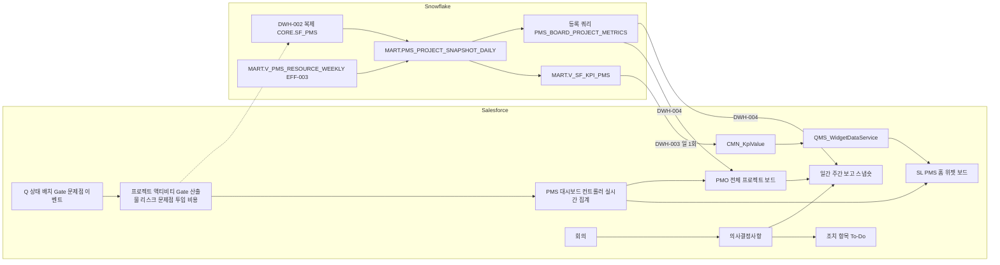
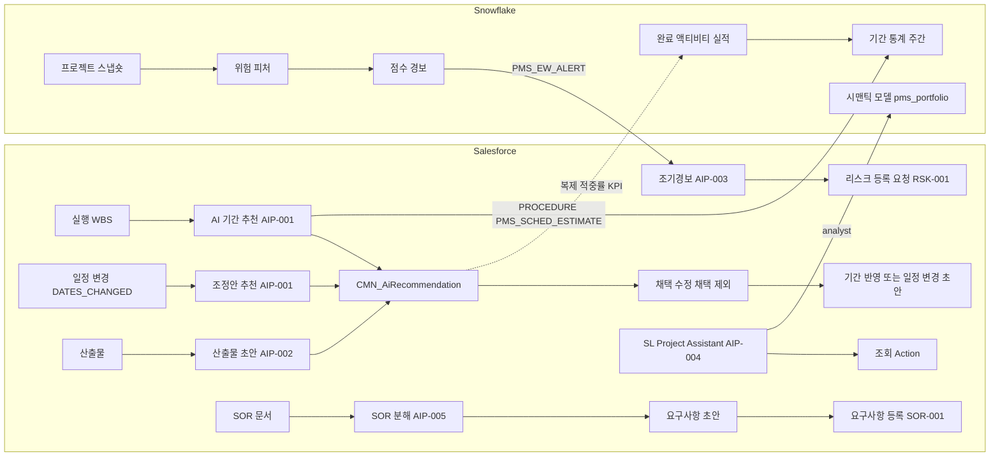
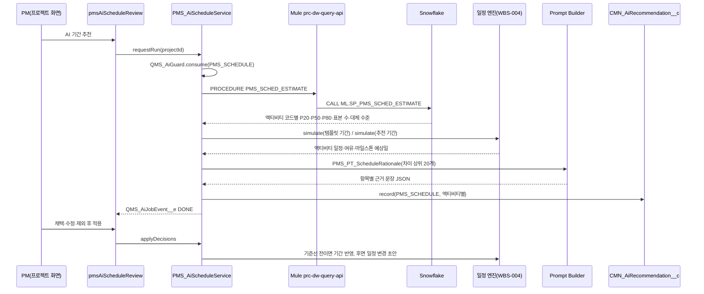

# SL PMS 워크아이템 Vol.P5 — PMS-10 대시보드·보고, PMS-11 AI

Nov 6, 2026 · @배창욱

## 1. 개요

Vol.P5는 PMS RFP 3.10 Dashboard 관리(P-55~57), 모듈 표 9번 "의사결정사항 관리", 3.11 AI 기능(P-58~62)과 SOR 분해 초안(P-6의 AI 부분)을 9개 워크아이템(PMS-10-DSH-001~004, PMS-11-AIP-001~005)으로 내린다. WI 번호·제목·객체 이름·PSG는 `pms-architecture.md`(PMS 계약)를 그대로 쓴다. 계약에 없는 이름은 `(제안)`으로 표시하고 6절 변경 요청에 모았다.

엔진은 이미 있다. 위젯 보드(CMN-00-DSH-001), KPI 적재(DWH-003), 드릴다운 쿼리(DWH-004), 공장 격리(SEC-002), Agentforce·추천 기록·Q&A 엔진(AI-001~005)은 Vol.0에 있다. 품질 쪽이 먼저 정의한 대시보드 공용 기반(Vol.7 DSH-001~004: KPI 레지스트리·위젯 데이터 서비스·공용 차트·설정 폼)과 AI 운영 자산(Vol.8 AIQ-001·006·009·010·013·016: 사용 정책·한도·프롬프트 버전·평가·확정 배치·질의 정의·검색 프리셋)은 같은 Org(D-1, D-P9)에서 이름을 바꾸지 않고 재사용한다(DP5-1, DP5-2). 이 Vol.은 그 위에 "PMS 사용자가 무엇을 보고, AI가 무엇을 추천하며, 추천이 맞았는지 어떻게 재는가"를 만든다.

| RFP | 요구 | 우선순위 | 이 Vol.의 WI | 비고 |
| --- | --- | --- | --- | --- |
| P-55 | 사용자별 Dashboard: CFT의 프로젝트별 QCD 종합·WP별 조회, 위젯 커스터마이징, 경영리더·PM·MDT 등 역할별 추천 템플릿 | 필수 | DSH-001 | 보드 엔진은 CMN-00-DSH-001 |
| P-56 | 전체 프로젝트 현황(PMO): 일정(마일스톤·Gate)·비용·자원·문제점 단일 화면, 공장·차종·연도·SOP 기준 조회 | 필수 | DSH-002 | PoC 시나리오 4 |
| P-57 | 공장-차종별 일간·주간 보고 양식, 공장별 권한, 비용 정보 권한 분리 | 필수 | DSH-003 | PoC 시나리오 4, 공장 격리 SEC-002 |
| 모듈 9 | 의사결정사항 관리 | 필수(모듈 범위) | DSH-004 | PoC 시나리오 4, 회의 MTG-001 |
| P-58 | 문서 내부 통합 검색·요약·리비전·버전 비교 | 권장 | AI-002·003(Vol.0) + AIP-004 | 엔진은 Vol.0, 이 Vol.은 PMS 검색 프리셋·에이전트 토픽만 |
| P-59 | 마일스톤 기준 일정 자동 생성, 운영 중 변경 시 후속 기간 조정 추천, 추천-확정 비교, 채택/제외 이력 | 권장 | AIP-001 | |
| P-60 | Input/Output 산출물 기반 표준 양식 Output 초안 | 권장 | AIP-002, AIP-005 | SOR 분해는 요구사항 초안 |
| P-61 | 일정 지연·리소스 부족 사전 탐지, 조기 경보 | 권장 | AIP-003 | |
| P-62 | 시스템 데이터 기반 자연어 Q&A | 권장 | AIP-004 | 엔진 AI-005 |
| P-6 | SOR 기반 요구사항 입력·DB 관리(AI 분해 부분) | 필수(입력·DB는 SOR-001) | AIP-005 | AI 분해 자체는 권장 |

**원칙**(Vol.0 3절·13절, Vol.7·8 원칙을 PMS에 적용한 규칙)

1. **데이터는 하나, 화면은 역할별.** 실시간 건수·상태는 Salesforce 집계, 추세·통계는 Snowflake에서 계산해 `CMN_KpiValue__c`(P1)나 등록 쿼리(P2)로 받는다(`spec-snowflake-display.md` 1절). 위젯·화면에서 Snowflake를 직접 호출하지 않는다.
2. **숫자와 순위는 결정적 로직이 정하고 LLM은 문장만 쓴다.** 추천 기간, 위험 점수, 조정안 회복 일수, 유효하지 않은 산출물 판정은 SQL·Apex 계산 결과다. LLM 출력에 입력에 없는 숫자·코드·번호가 있으면 버린다(Vol.8 D8-3과 같다).
3. **모든 AI 추천은 `CMN_AiRecommendation__c`(AI-004)에 남기고 확정은 사람이 한다.** "학습"은 모델 재학습이 아니라 확정·실적 사례를 통계와 순위 근거로 다시 쓰는 것이다(Vol.0 D-10).
4. **공장 격리와 비용 분리.** 공장 범위는 Apex가 강제한다(SEC-002, DWH-004 BR-2). 비용은 필드 수준 보안(FLS)과 Custom Permission `PMS_ViewCost`(Vol.P3 CST-003 정의)로만 보이고, `CMN_KpiValue__c`·보고서 PDF·AI 답변·Snowflake 등록 쿼리 결과에 넣지 않는다(DP5-3, Vol.7 D7-4와 같은 원칙).
5. **개인 데이터는 좁게.** 인원별 투입 시간·과부하는 Vol.P1 EFF-003 권한(Custom Permission PMS_RES_ViewOrg — 자기 부서, PMS_RES_ViewAll — 전 부서)을 가진 팀장·PMO만 본다. 이 Vol.의 보고서·대시보드 공용 위젯·조기경보·Q&A는 부서 단위까지만 다룬다.
6. **다른 메뉴 레코드를 직접 바꾸지 않는다.** 일정 반영·리스크 등록·요구사항 등록은 소유 WI 서비스 호출로만 한다. 소유 WI가 배포되기 전에는 기능을 숨기거나 To-Do로 대신한다.

**용어**

| 용어 | 뜻 |
| --- | --- |
| QCD | 프로젝트의 품질(Quality)·비용(Cost)·납기(Delivery) 상태. 이 Vol.에서 Q = `QualityRag__c`(DSH-002 규칙), C = `CostRag__c`(비용 권한자만), D = `ScheduleRag__c`(WBS-007). 종합은 `OverallRag__c` |
| WP(Work Package) | 실행 WBS의 요약 액티비티(하위 액티비티가 있는 액티비티) 중 지정 레벨(기본 2)의 노드. 설계·광학·전장·금형 같은 업무 묶음 |
| All Program Monitor Board | PMO가 전체 프로젝트의 일정·품질·비용·자원·문제점을 한 화면에서 보는 보드(DSH-002) |
| 보고 스냅숏 | 보고서를 만들 때 복사한 프로젝트 데이터. 발행 후 바뀌지 않는다(그때 무엇을 보고했는지 재현) |
| 정정 발행 | 발행된 보고를 고칠 때 새 판(Revision + 1)을 만들고 이전 판을 SUPERSEDED로 두는 것 |
| 의사결정사항 | 회의·검토에서 확정된 결정과 후속 조치. 프로젝트의 하위 레코드 |
| 기간 통계 | 완료된 과거 프로젝트 액티비티의 실제 소요 근무일 분포(P20·P50·P80, 표본 수) |
| 여유 소진 | 주경로 액티비티 최소 여유일(TotalFloat)이 시간에 따라 줄어드는 속도(일/주) |
| 조기경보 대상 | PROJECT(프로젝트 일정 위험), DEPARTMENT(부서 용량 부족). 인원 과부하 알림은 EFF-003(PMS_RES_OVERLOAD)이 맡는다 |
| 유효하지 않은 산출물 | 필수인데 누락, 반려 후 미재제출, 이상 징후 미해소, 다른 프로젝트 파일 복사 의심, 양식 분류 불일치, 승인됐는데 문서가 미발행인 산출물(AIP-004 판정 코드) |

**선행 공통 WI**: ARC-002·003, SEC-001·002·003, I18N-001, UX-003·004·005·006·007, TDO-001·004, NTF-001, DOC-001, DSH-001, MTG-001, DWH-001~004, AI-001~005. QMS 선행: QMS-07-DSH-001~004(대시보드 공용 기반), QMS-08-AIQ-001·006·009·010·013·016(AI 운영 자산). PMS 선행: PRJ-001·003, SOR-001, CFT-001, EFF-002·003, WBS-002~007, ACT-001, DLV-001~003, CST-002·003, RSK-001, ISS-001, GAT-001·003(WI별 메타 라인에 명시).

**다른 메뉴와의 경계**

| 연결 대상 | 이 Vol.이 하는 것 | 상대 메뉴가 하는 것 |
| --- | --- | --- |
| CMN-00-DSH-001 위젯 보드 | PMS 위젯 메타데이터, PMS 전용 위젯 3종, PMS 템플릿·페르소나 해석기 | 보드 그리드·배치 저장·갤러리·템플릿 복사 |
| QMS Vol.7 DSH-001~004 | PMS KPI 레지스트리 레코드, PMS 등록 집계·목록·쿼리 허용 행, 공용 컴포넌트 설정 | 레지스트리·위젯 데이터 서비스·공용 컴포넌트·설정 폼(6절 확장 요청) |
| QMS Vol.8 AI 운영 자산 | PMS 유스케이스 정책·한도·프롬프트·평가·확정 설정 행, PMS 시맨틱 모델·질의 정의·검색 프리셋 | QMS_AiGuard·확정 배치·평가 실행기·analyst 연산·세션 공장 범위(6절 확장 요청) |
| Vol.P1 PRJ·SOR·EFF | 프로젝트 Q 상태 필드(추가), SOR 분해 후보와 확정 호출, 부하 KPI·뷰 소비, Vol.P1 위젯 2종 등록 | 프로젝트·요구사항 객체와 `PMS_RequirementService.createDrafts`, `MART.V_PMS_RESOURCE_WEEKLY`·KPI PMS_RES_*·PMS_EFF_SUBMIT_RATE·인원 과부하 알림(EFF-003), pmsResourceLoadWidget·pmsSorFulfillmentWidget |
| Vol.P2 WBS·ACT | AI 기간 추천·조정안·정확도 비교 | 일정 엔진(시뮬레이션 API 요청)·기준선·일정 변경 요청·진척·RAG |
| Vol.P3 CST·DLV | 보드·보고의 비용 열(권한자만), 산출물 초안 | 비용 객체·`PMS_PS_Cost_Read`(PMS_ViewCost 포함 요청)·비용 대시보드(CST-004), 산출물·입출력 추적 |
| Vol.P4 RSK·ISS·GAT | 보드 집계, Q 상태 판정, 조기경보에서 리스크 등록 요청 | 리스크·문제점·Gate 객체, 리스크 대시보드(RSK-003), 산출물 이상 징후(GAT-005) |
| CMN-00-MTG-001 회의 | 의사결정 ↔ 회의·조치 항목 연결 | 회의·회의록·조치 항목(6절 변경 요청: SourceObject 필드, 상태 훅) |
| Vol.P6 PRF | (제공만) 프로젝트 일별 스냅숏 | 성과 지표 계산 시 스냅숏 사용 가능 |

**앞 Vol. 상태**: Vol.0·2~9는 검토 대기, PMS Vol.P1~P4·P6은 같은 계약으로 병행 작성 중이다. 다른 PMS Vol.이 정할 API 이름은 이 문서에서 `(제안)`으로 쓰고 6절 "PMS Vol.에 대한 요청"에 모았다. 소유 Vol.이 다른 이름을 정하면 이 Vol.의 호출 이름만 바꾼다.

## 2. 업무 흐름

대시보드 숫자는 두 갈래로 온다. "지금 몇 건인가"(내 액티비티, 결재 대기, 미결 문제점)는 Salesforce에서 바로 센다. "추세와 비율"(마일스톤 준수율, Gate 1회 통과율, 투입 실적 제출률)은 Snowflake가 매일 계산해 `CMN_KpiValue__c`로 보낸다. PMO 보드는 두 갈래를 한 행에 합친다. 보고서는 보드와 같은 계산을 써서 스냅숏을 만들기 때문에 보드에서 본 숫자와 보고서 숫자가 같다.

AI 추천은 업무 레코드를 바꾸지 않는다. PM이 채택한 항목만 일정 엔진 서비스가 반영한다. 액티비티가 완료되면 실제 소요일과 추천 기간을 비교해 적중을 기록하고, Snowflake는 다음 주 기간 통계에 그 실적을 더한다.

## 3. 데이터 모델 개요

**Salesforce 객체·메타데이터**

| 이름 | 종류 | 관계 | 역할 | 정의 WI | 계약 |
| --- | --- | --- | --- | --- | --- |
| PMS_WeeklyReport__c | 업무 객체 | Project·ProdPlant·Vehicle(Lookup) | 일간·주간 보고 1건 | DSH-003 | 계약 |
| PMS_WeeklyReportLine__c | 업무 객체 | Report(MD), Project(Lookup) | 보고에 포함된 프로젝트 1행 스냅숏 | DSH-003 | 제안 |
| PMS_ReportTemplate__mdt | Custom Metadata | — | 공장·차종별 보고 양식(섹션·주기·검토·배포) | DSH-003 | 제안 |
| PMS_Decision__c | 업무 객체 | Project(MD), Meeting(Lookup CMN_Meeting__c), ActionItem(Lookup CMN_ActionItem__c) | 의사결정 1건 | DSH-004 | 계약 |
| PMS_DashboardPersonaRule__mdt | Custom Metadata | — | PSG·결재 Role → PMS 템플릿 | DSH-001 | 제안 |
| PMS_Project__c.QualityRag__c·QualityRagReason__c·QualityRagAsOf__c | 필드 추가 | PMS_Project__c(PRJ-001 소유) | 프로젝트 Q 상태 | DSH-001(필드), DSH-002(계산) | 제안 |
| PMS_QualityRagRule__mdt | Custom Metadata | — | Q 상태 판정 규칙·기준 | DSH-002 | 제안 |
| PMS_AiScheduleSetting__mdt | Custom Metadata | — | AI 일정 추천·지연 회복안 설정(최소 부족 일수·간격·안 수·압축 불가 유형) | AIP-001 | 제안 |
| PMS_EarlyWarning__c | 업무 객체 | Project·Department·Plant(Lookup) | 조기경보 1건 | AIP-003 | 제안 |
| PMS_DeliverableDraftSpec__mdt | Custom Metadata | — | 산출물 코드별 초안 구조(섹션·열·지시) | AIP-002 | 제안 |
| PMS_SorCandidate__c | 작업 객체 | Project(MD), SourceRevision(Lookup CMN_DocumentRevision__c) | SOR 분해 후보 1건(검토용) | AIP-005 | 제안 |
| PMS_SorExtractSetting__mdt | Custom Metadata | — | SOR 분해 대상 DocClass·구간 크기·한도 | AIP-005 | 제안 |

**기존 메타데이터에 추가하는 행**(형식은 소유 WI가 정의, 행은 이 Vol.이 배포)

| 메타데이터 | 소유 WI | 이 Vol.이 넣는 행 |
| --- | --- | --- |
| QMS_KpiDefinition__mdt | QMS-07-DSH-001 | PMS_* KPI 키, PMS 유스케이스의 AI_* 키(3절 KPI 카탈로그) |
| QMS_WidgetCount__mdt, QMS_WidgetList__mdt, QMS_WidgetQuery__mdt | QMS-07-DSH-002 | PMS 등록 집계·목록·쿼리 허용 행(DSH-001·003·004, AIP-003) |
| CMN_Widget__mdt | CMN-00-DSH-001 | PMS_W_* 위젯(DSH-001·003·004, AIP-001·003) |
| CMN_DashboardTemplate__mdt·Item | CMN-00-DSH-001 | PMS_TPL_* 7종(DSH-001) |
| CMN_DwQuery__mdt | CMN-00-DWH-004 | PMS_* 등록 쿼리(3절 표) |
| QMS_AiPlantPolicy__mdt, QMS_AiUsageLimit__mdt, QMS_AiPromptConfig__mdt, QMS_AiFinalizeConfig__mdt | QMS-08-AIQ-001·006·016 | PMS 유스케이스 행 |
| QMS_AiQueryDef__mdt, QMS_AiSearchPreset__mdt | QMS-08-AIQ-009·013 | PMS 질의 정의·검색 프리셋(AIP-004) |
| CMN_InboundRoute__mdt | CMN-00-DWH-003 | EVENT_TYPE PMS_EW_ALERT, PMS_EW_FOLLOWUP(AIP-003) |
| CMN_NumberingRule__mdt, CMN_SharingConfig__mdt, CMN_DeleteGuard__mdt, CMN_StatusFlow__mdt | ARC-003, SEC-002·003, UX-003 | 이 Vol. 업무 객체 4종(공통 기반 등록) |
| CMN_FeatureSwitch__mdt, CMN_NotificationRule__mdt, CMN_RailPanel__mdt, CMN_UiRule__mdt, CMN_AppMenuItem__mdt | ARC-002, NTF-001, UX-004·005·007 | 기능 스위치·알림 코드·레일 패널·화면 규칙·메뉴 타일 |

**상태값**

| 대상 | 값(순서) |
| --- | --- |
| PMS_WeeklyReport__c.Status__c | DRAFT → SUBMITTED → PUBLISHED → SUPERSEDED. SUBMITTED → DRAFT(반려). 검토가 없는 양식은 DRAFT → PUBLISHED. DRAFT → CANCELLED |
| PMS_Decision__c.Status__c | DRAFT → DECIDED → IN_PROGRESS → CLOSED. DRAFT → CANCELLED. DECIDED·IN_PROGRESS·CLOSED → SUPERSEDED(새 결정이 대체) |
| PMS_EarlyWarning__c.Status__c | NEW → ACKNOWLEDGED → ACTION_TAKEN. NEW·ACKNOWLEDGED → WATCHING → ACTION_TAKEN. NEW·ACKNOWLEDGED → DISMISSED. NEW·ACKNOWLEDGED → EXPIRED(30일) |
| PMS_SorCandidate__c.Decision__c | PROPOSED → ADOPT 또는 EXCLUDE(검토 중 선택) → CONFIRMED(요구사항 등록 완료) 또는 DISCARDED(제외 확정) |
| PMS_Project__c.QualityRag__c | GREEN, AMBER, RED. 비어 있으면 판정 전 |

**Snowflake 객체**(DB SL_QDW, schemachange로만 생성, 오브젝트 태그 SYSTEM=PMS)

| 객체 | 종류 | 내용 | 정의 WI |
| --- | --- | --- | --- |
| CORE.SF_PMS_* | Table(DWH-002 MERGE) | PMS 업무 객체 복제(15분) | 각 객체 소유 WI 등록, 누락분은 DSH-001 |
| MART.PMS_PROJECT_SNAPSHOT_DAILY | Table(일 Task) | 프로젝트 × 일 상태·지표(DSH-001 BR-3 열) | DSH-001 |
| MART.PMS_MILESTONE_STATUS | View | 고객 마일스톤·Gate의 계획·기준선·예상·실적·지연 | DSH-001 |
| MART.V_SF_KPI_PMS | View | PMS KPI(일·주·월, DWH-003 적재 형식) | DSH-001 |
| MART.V_PMS_RESOURCE_WEEKLY, MART.V_PMS_RESOURCE_PROJECT_WEEKLY | View | 사람 × 주(전 프로젝트 합, 표준·최대 시간, OVER_MAX) / 사람 × 프로젝트 × 주 계획·실적 시간 | PMS-03-EFF-003(이 Vol.은 소비만) |
| MART.PMS_PORTFOLIO_WEEKLY | View | 필터 차원별 주간 RAG 분포·마일스톤 준수·기한 경과율 | DSH-002 |
| ML.PMS_ACTIVITY_DURATION_HIST | Dynamic Table(TARGET_LAG 1일) | 완료 액티비티 실제 근무일·문맥 | AIP-001 |
| ML.PMS_DURATION_STATS, ML.PMS_OVERLAP_STATS | Table(주간 Task) | 코드·문맥별 기간 분포, 선후행 실제 겹침 비율 | AIP-001 |
| ML.SP_PMS_SCHED_ESTIMATE | Stored Procedure | 템플릿 액티비티별 추천 기간·압축 여지·겹침 근거 | AIP-001 |
| ML.PMS_SCHED_ACCURACY | View | 추천·기준선·실적 비교(액티비티 단위) | AIP-001 |
| ML.PMS_RISK_RULE | Table | 조기경보 피처 기준·가중치·임계(버전) | AIP-003 |
| ML.PMS_RISK_FEATURE_DAILY, ML.PMS_RISK_SCORE_DAILY, ML.PMS_RISK_ALERT | Table | 조기경보 피처·점수·경보 | AIP-003 |
| ML.V_PMS_EW_BACKTEST | View | 조기경보 백테스트 | AIP-003 |
| MART.SV_QA_PMS_*(6개) | Secure View + Row Access Policy | Q&A 질의 대상 | AIP-004 |
| @ML.SEMANTIC_MODELS/pms_portfolio.yaml | Stage 파일 | Cortex Analyst 시맨틱 모델 | AIP-004 |

**등록 쿼리**(CMN_DwQuery__mdt, `spec-snowflake-display.md` 2.1 필드 표준. 공장 범위 파라미터는 모두 PlantParam `plantCodes`)

| QueryKey | Mode | 원천 | 주요 파라미터 | 결과 열(이름·순서 고정) | Latency·Cache(초) | RequiredPermission | 소유 |
| --- | --- | --- | --- | --- | --- | --- | --- |
| PMS_PROJECT_PROGRESS_TREND | QUERY | MART.PMS_PROJECT_SNAPSHOT_DAILY | projectId(ID), weeks(INTEGER ≤ 26), plantCodes | weekStart, progressPlannedPct, progressActualPct, critFloatMin, overdueActivities | FAST·1800 | — | DSH-001 |
| PMS_BOARD_PROJECT_METRICS | QUERY | MART.PMS_PROJECT_SNAPSHOT_DAILY 최신일 | plantCodes | projectId, asOfDate, progressPlannedPct, progressActualPct, critFloatMin, nextMsCode, nextMsSlipDays, nextGateCode, nextGateReadinessPct, effortPlannedHours4w, effortActualHours4w, overloadedMembers4w, scheduleChanges8w | FAST·1800 | — | DSH-002 |
| PMS_PORTFOLIO_TREND | QUERY | MART.PMS_PORTFOLIO_WEEKLY | plantCodes, customerIds·vehicleIds(ID_LIST), productGroupCodes·phaseCodes·projectTypes(STRING_LIST), sopYearFrom·sopYearTo(INTEGER), weeks(≤ 52) | weekStart, projects, ragGreen, ragAmber, ragRed, msDue, msOntime, overdueRatePct | FAST·3600 | — | DSH-002 |
| PMS_SCHED_ESTIMATE | PROCEDURE | ML.SP_PMS_SCHED_ESTIMATE | templateId, projectType, customerGroup, productGroupCode, plantCode, mode(ESTIMATE, ADJUST) | result JSON(AIP-001 BR-2) | ASYNC·0 | — | AIP-001 |
| PMS_SCHED_ACCURACY | QUERY | ML.PMS_SCHED_ACCURACY | projectId, plantCodes | activityId, wbsCode, templateDays, recommendedDays, decision, baselineDays, actualDays, aiErrPct, templateErrPct | FAST·600 | — | AIP-001 |
| PMS_EW_PROJECT_SCORES | QUERY | ML.PMS_RISK_SCORE_DAILY 최신일 | plantCodes, minScore(NUMBER), withinDays(INTEGER ≤ 90), top(≤ 200) | projectId, projectNo, plantCode, riskScore, riskLevel, projectedDelayDays, targetMsCode, targetDate, topFactor, openAlertId | FAST·1800 | — | AIP-003 |
| PMS_EW_ENTITY_LIST | QUERY | 같음(PROJECT·DEPARTMENT만) | entityType, plantCodes, levels(STRING_LIST), top | entityType, entityKey, entityName, plantCode, riskScore, riskLevel, prevAvg7, topFactor, openAlertId | FAST·1800 | — | AIP-003 |
| PMS_EW_FACTORS | QUERY | ML.PMS_RISK_FEATURE_DAILY(PROJECT·DEPARTMENT만) | entityType, entityKey, asOfDate(DATE), plantCodes | feature, value, zeroAt, fullAt, risk, weight, contribution, sourceRef | FAST·1800 | — | AIP-003 |
| PMS_EW_SCORE_TREND | QUERY | ML.PMS_RISK_SCORE_DAILY(PROJECT·DEPARTMENT만) | entityType, entityKey, weeks(≤ 26), plantCodes | asOfDate, riskScore, riskLevel | FAST·1800 | — | AIP-003 |

모든 키는 ResultColumns·MockCases(ok, empty, error-timeout)·OwnerWi·FreshnessKey를 채운다. FreshnessKey: 스냅숏 기반 키 `PMS_PROJECT_SNAPSHOT`, 조기경보 키 `PMS_RISK_SCORE`, 기간 통계 `PMS_DURATION_STATS`. 비용 값을 결과 열로 내는 PMS 등록 쿼리는 이 Vol.에 없다(DP5-3).

**KPI 카탈로그**(QMS_KpiDefinition__mdt 레코드. 단위·RAG 방식 코드는 Vol.7 3절과 같다. 기준값은 초기 제안이며 PMO가 확정한다 — DP5-12)

| KpiKey | Area | 단위·소수 | 방향 | 주기 | 차원 | RAG(초록 / 노랑) | 정의 | 소유 WI | 드릴다운 |
| --- | --- | --- | --- | --- | --- | --- | --- | --- | --- |
| PMS_PRJ_ACTIVE | PRJ | CNT·0 | NONE | DAY, MONTH | Plant, Customer | NONE | 진행 중 프로젝트 수(PRJ-001 종료·취소 상태 제외, MONTH는 월말 값) | DSH-001 | page:PMS_Program_Monitor |
| PMS_PRJ_RAG_RED | PRJ | CNT·0 | DOWN | DAY, MONTH | Plant, Customer | ZERO / 2 | 진행 중 프로젝트 중 OverallRag RED 수 | DSH-001 | page:PMS_Program_Monitor(c__rag=RED) |
| PMS_PRJ_RAG_AMBER | PRJ | CNT·0 | DOWN | DAY, MONTH | Plant, Customer | NONE | OverallRag AMBER 수 | DSH-001 | page:PMS_Program_Monitor(c__rag=AMBER) |
| PMS_SCH_MS_ONTIME | SCH | PCT·1 | UP | MONTH | Plant, Customer | TH 95 / 85 | 그 달에 실적일이 생긴 고객 마일스톤 중 실적일 ≤ 고객 계획일 비율 | DSH-001 | page:PMS_Program_Monitor |
| PMS_SCH_MS_SLIP_FCST | SCH | CNT·0 | DOWN | DAY, MONTH | Plant, Customer | ZERO / 2 | 향후 56일 안 고객 마일스톤 중 예상일 > 고객 계획일 건수 | DSH-001 | widget:PMS_W_MS_TIMELINE_PLANT |
| PMS_SCH_OVERDUE_RATE | SCH | PCT·1 | DOWN | DAY, MONTH | Plant | TH 5 / 10 | 착수 예정이 지난 미완료 리프 액티비티 중 계획 종료일이 지난 비율 | DSH-001 | page:PMS_Program_Monitor |
| PMS_SCH_PROGRESS_GAP | SCH | PCT·1 | DOWN | WEEK | Plant | TH 3 / 8 | 진행 프로젝트의 (계획 진척 − 실적 진척) %p 평균(음수는 0) | DSH-001 | page:PMS_Program_Monitor |
| PMS_SCH_CHANGES | SCH | CNT·0 | NONE | MONTH | Plant, Customer | NONE | 그 달 승인된 일정 변경 건수(WBS-006 APPROVED·APPLIED) | DSH-001 | list:PMS_ScheduleChange__c(WBS-006 리스트뷰) |
| PMS_GAT_FIRST_PASS | GAT | PCT·1 | UP | MONTH | Plant, Customer | TH 90 / 75 | 그 달 결과가 확정된 Gate 중 같은 프로젝트·GateCode에 FAILED·CONDITIONAL 이력 없이 PASSED된 비율 | DSH-001 | widget:PMS_W_GAT_UPCOMING |
| PMS_GAT_COND_OPEN | GAT | CNT·0 | DOWN | DAY, MONTH | Plant | ZERO / 2 | Status CONDITIONAL이고 FollowUpDue < 오늘인 Gate 수 | DSH-001 | page:PMS_Program_Monitor |
| PMS_DLV_ONTIME_APPROVAL | DLV | PCT·1 | UP | MONTH | Plant | TH 90 / 80 | 그 달 기한(소속 액티비티 계획 종료일)이 온 필수 산출물 중 기한까지 승인(결재 불요는 제출)된 비율 | DSH-001 | page:PMS_Program_Monitor |
| PMS_DLV_APPROVAL_AGED | DLV | CNT·0 | DOWN | DAY, MONTH | Plant | ZERO / 10 | IN_APPROVAL로 7일 넘은 산출물 수 | DSH-001 | page:PMS_Program_Monitor |
| PMS_RSK_HIGH_OPEN | RSK | CNT·0 | DOWN | DAY, MONTH | Plant, Customer | ZERO / 3 | Level HIGH(RSK-001 등급), Status OPEN·MITIGATING 리스크 수 | DSH-001 | RSK-003 리스크 대시보드 |
| PMS_ISS_OPEN | RSK | CNT·0 | NONE | DAY, MONTH | Plant, Customer | NONE | Status CLOSED·REJECTED 외 문제점 수 | DSH-001 | RSK-003 리스크 대시보드 |
| PMS_ISS_AGED_30D | RSK | CNT·0 | DOWN | DAY, MONTH | Plant | ZERO / 5 | 등록 후 30일 넘은 미결 문제점 수 | DSH-001 | RSK-003 리스크 대시보드 |
| PMS_EFF_SUBMIT_RATE | RES | PCT·1 | UP | WEEK | Plant, Department | EFF-003 등록값 | 투입 실적 기한 내 제출률 | PMS-03-EFF-003(이 Vol.은 소비만) | EFF-003 등록값 |
| PMS_RES_OVERLOAD_PERSONS | RES | CNT·0 | DOWN | WEEK | Plant, Department | EFF-003 등록값 | 향후 8주 중 주 상한 초과 계획이 있는 인원 수 | PMS-03-EFF-003(이 Vol.은 소비만) | EFF-003 자원 부하 화면 |
| PMS_RES_UTIL_PLAN | RES | PCT·1 | NONE | WEEK | Plant, Department | EFF-003 등록값 | 부서 계획 가동률(계획 시간 ÷ 표준 시간) | PMS-03-EFF-003(이 Vol.은 소비만) | EFF-003 자원 부하 화면 |
| PMS_RPT_PUBLISH_ONTIME | RPT | PCT·1 | UP | WEEK | Plant | TH 95 / 80 | 주간 보고 중 마감(PeriodEnd + 양식 DueDays) 안에 발행된 비율 | DSH-003 | list:PMS_WeeklyReport__c.PMS_Rpt_Overdue |
| PMS_DEC_ACTIONS_OVERDUE | DEC | CNT·0 | DOWN | DAY, MONTH | Plant | ZERO / 3 | 의사결정 후속 조치 중 OPEN이고 기한이 지난 건수 | DSH-004 | list:PMS_Decision__c.PMS_Dec_ActionOverdue |
| PMS_EW_ALERTS_OPEN | PEW | CNT·0 | DOWN | DAY | Plant | ZERO / 5 | 미처리(NEW·ACKNOWLEDGED·WATCHING) 조기경보 수 | AIP-003 | page:PMS_Early_Warning_Board |
| PMS_EW_HIGH_PROJECTS | PEW | CNT·0 | DOWN | DAY | Plant, Customer | ZERO / 2 | 위험 등급 HIGH인 프로젝트 수 | AIP-003 | page:PMS_Early_Warning_Board |
| PMS_EW_PRECISION | PEW | PCT·1 | UP | MONTH | Plant | TH 50 / 30 | 판정이 끝난 경보 중 후속 사건(AIP-003 BR-9)이 생긴 비율 | AIP-003 | page:PMS_Early_Warning_Board |
| PMS_AI_CALLS_{UseCase} | PAI | CNT·0 | NONE | DAY | Plant | NONE | 유스케이스별 호출 수(QMS_AiUsageCounter__c 복제) | AIP-004 | page:QMS_Ai_Ops_Console |
| PMS_AI_SCHED_MAPE / PMS_AI_SCHED_MAPE_BASE | PAI | PCT·1 | DOWN | MONTH | Plant | NONE | 완료 액티비티의 실제 기간 대비 평균 절대 오차율(AI 추천 / 표준 WBS 기간) | AIP-001 | widget:PMS_W_AI_SCHED_ACCURACY |
| PMS_AI_SOR_RECALL | PAI | PCT·1 | UP | MONTH | Plant | TH 85 / 70 | SOR 문서에서 등록된 요구사항 중 AI 후보에서 채택된 비율 | AIP-005 | list:PMS_SorCandidate__c.PMS_SorCand_All |
| AI_HIT_TOP1·AI_HIT_TOP3·AI_ADOPT_RATE_{PMS UseCase} | AI | PCT·1 | UP | MONTH | Plant | TOP1 TH 60 / 40, TOP3 TH 80 / 60, ADOPT TH 50 / 30 | AI-004 BR-4 계산(키 규칙 Vol.8 AIQ-006 BR-5) | 각 AIP WI | list:CMN_AiRecommendation__c.PMS_Ai_All |

공통 값: FreshnessHours DAY 30, WEEK 24 × 9, MONTH 24 × 35. SourceView는 MART.V_SF_KPI_PMS(PMS_PRJ·SCH·GAT·DLV·RSK·RPT·DEC), EFF-003 키(PMS_RES_*, PMS_EFF_SUBMIT_RATE)는 EFF-003의 MART.V_SF_KPI_PMS_RESOURCE가 적재·등록한다, MART.V_SF_KPI_PMS_EW(PMS_EW_*), MART.V_SF_KPI_AI(PMS_AI_*·AI_*). IsSensitive false, PortalVisible false. 비용 KPI는 없다(DP5-3). 적재 행 규칙(DSH-001 BR-4): DAY·WEEK 주기는 (Plant)·(Department) 행과 합계 행만, Customer 차원은 MONTH 주기에서만 (Plant, Customer) 행과 합계 행((Plant, 없음), (없음, Customer), (없음, 없음))으로 적재한다. 공장 없는 합계 행의 공개 범위는 DP5-13이다. Area 값 PRJ·SCH·GAT·DLV·RSK·RES·RPT·DEC·PEW·PAI는 Vol.7 레지스트리에 추가를 요청한다(6절).

**위젯 키 규칙**: CMN_Widget__mdt DeveloperName = `PMS_W_{영역}_{이름}`(40자 이내), System__c = PMS, Category__c = 영역 코드(PROJECT, SCHEDULE, GATE, DELIVERABLE, RISK, RESOURCE, REPORT, DECISION, AI), TitleLabel__c·DescLabel__c = `PMS_Widget_{키}_Title`·`_Desc`(ko·en_US·zh_CN). Vol.7 DSH-004 BR-4 등록 체크리스트(키·컴포넌트·DefaultConfig·ConfigSchema·라벨 3개 언어·RequiredPermissionSet·DrillTarget·MobileSupported)를 그대로 지킨다.

**프롬프트 템플릿**(Prompt Builder Flex 템플릿, Apex 그라운딩. 모든 템플릿 앞에 PMS_PT_Common을 넣는다. 버전은 QMS_AiPromptConfig__mdt 행으로 관리)

| API 이름 | WI | 입력 | 출력 |
| --- | --- | --- | --- |
| PMS_PT_Common | AIP-004 | 사용자 언어, 오늘 날짜(공장 시간대) | (공통 지시) JSON만 출력, 입력에 없는 숫자·날짜·코드·사람 이름 금지, 근거는 입력의 번호로만, 모르면 "[확인 필요]", 비용·임율·개인 평가 언급 금지, 사람 탓 대신 역할·업무로 서술 |
| PMS_PT_ScheduleRationale | AIP-001 | 프로젝트 문맥, 마일스톤 가능성 표, 기간 차이 상위 20개(템플릿·추천·P20·P50·P80·표본 수·비교 프로젝트 번호) | `{"items":[{"activityId","reason"}],"summary"}` |
| PMS_PT_ScheduleAdjustRationale | AIP-001 | 지연 마일스톤·부족 일수, 조정안 3개(변경 목록·회복 일수·잔여 지연·위험 표시) | `{"options":[{"rank","rationale","risks":[]}]}` |
| PMS_PT_DeliverableDraft | AIP-002 | 양식 구조(섹션·열·지시), 프로젝트 문맥, 입력 산출물 발췌(번호·리비전), 관련 요구사항, 유사 프로젝트 승인본 발췌 | `{"sections":[{"key","text","refs":[]}],"rows":[{}],"gaps":[]}` |
| PMS_PT_EwExplain | AIP-003 | 대상, 점수, 상위 요인(값·기준·기여도), 예상 지연 | `{"explanation","checks":[]}` |
| PMS_PT_QaAnswer | AIP-004 | 질문, 쿼리 설명, 결과 행(최대 100), 기준 시각, 범위 설명 | AI-005 BR-2 형식 `{"conclusion","columns":[],"rows":[[]],"note"}` |
| PMS_PT_SorExtract | AIP-005 | 문서 문맥(고객·차종·문서명·리비전), 구간(섹션 경로·쪽), 구간 텍스트(8,000자 이하), 분류 코드 목록, 검증 방법 목록 | `{"requirements":[{"reqNo","sectionPath","page","text","category","value","unit","verificationMethod","isSafety","isRegulatory","confidence"}]}` |
| PMS_PT_SorClassify | AIP-005 | 행 50개(행 키·요구사항 문장), 코드 목록 | `{"rows":[{"rowKey","category","verificationMethod","isSafety","isRegulatory","confidence"}]}` |

**Agentforce 토픽·액션**(Agent `SL Project Assistant`, AI-001 BR-1. 토픽 등록은 AIP-004)

| 토픽 | 분류 기준(요지) | 액션(Invocable Apex) | 구현 WI |
| --- | --- | --- | --- |
| 내 프로젝트 업무 | 내 액티비티·산출물·결재·기한 | PMS_AiAction_MyProjectWork | AIP-004 |
| 프로젝트 현황·일정 | 특정 프로젝트 상태, 마일스톤·Gate 일정, 지연 회복 방안 | PMS_AiAction_ProjectStatus, PMS_AiAction_MilestoneGateSchedule, PMS_AiAction_RecommendScheduleAdjust | AIP-004, AIP-001 |
| 위험 프로젝트 | 기간 안 위험 프로젝트, 특정 대상의 위험 요인 | PMS_AiAction_AtRiskProjects, PMS_AiAction_RiskSummary | AIP-004, AIP-003 |
| 산출물 점검 | 유효하지 않은 산출물, 누락·반려·이상 | PMS_AiAction_InvalidDeliverables | AIP-004 |
| 프로젝트 데이터 분석 | 기간·추세·비율·공장·고객·단계 비교, 건수 | PMS_AiAction_AskProjectAnalyst, PMS_AiAction_CountProjectRecords | AIP-004 |
| 프로젝트 문서 | 산출물·SOR·회의록 내용 검색·요약 | CMN_AiAction_DocSearch(PMS 프리셋) | AIP-004(설정) |
| 레슨런 | 과거 문제·체크포인트, 액티비티 추천 | QMS_AiAction_SearchLessons, QMS_AiAction_RecommendLessonsForActivity | Vol.8 AIQ-007(구현), AIP-004(등록) |

모든 액션은 `with sharing` + `WITH USER_MODE`로 실행하고 업무 레코드를 만들거나 바꾸지 않는다. 예외는 추천 기록(`CMN_AiRecommendation__c`)과 사용량 카운터뿐이다.

**유스케이스와 적중 규칙**

| UseCase | 대상 객체(SourceObject) | 문맥(ContextRecordId) | 생성 WI | 적중 규칙 | 확정 시점 |
| --- | --- | --- | --- | --- | --- |
| PMS_SCHEDULE | PMS_Activity__c(기간 추천 1건) | 프로젝트 | AIP-001 | PMS_ScheduleHitRule | 액티비티 COMPLETED(QMS_AiFinalizeBatch 설정 행) |
| PMS_SCHEDULE_ADJUST(제안) | PMS_Activity__c(지연된 대상 마일스톤) | 프로젝트 | AIP-001 | PMS_ScheduleAdjustHitRule | 대상 마일스톤 완료 |
| PMS_DELIVERABLE_DRAFT | PMS_Deliverable__c | 프로젝트 | AIP-002 | PMS_DeliverableDraftHitRule | 산출물 APPROVED·REJECTED |
| PMS_EW | PMS_EarlyWarning__c | 프로젝트·부서 | AIP-003 | PMS_EwHitRule | 경보 후 60일(PROJECT)·28일(DEPARTMENT) |
| PMS_SOR_EXTRACT(제안) | PMS_SorCandidate__c | 프로젝트 | AIP-005 | PMS_SorExtractHitRule | 확정 즉시(AIP-005가 finalize, 배치는 안전망) |
| PMS_QA | (기록 없음, 사용량 카운터만) | — | AIP-004 | — | — |

`ContextRecordId__c`·`RunKey__c`는 AI-004 변경 요청 필드다(6절). 같은 실행에서 만든 추천을 묶고, 프로젝트 단위로 빨리 찾기 위해 쓴다.

**권한 셋·Custom Permission과 페르소나 매핑**

| Permission Set / Custom Permission | 내용 | PSG |
| --- | --- | --- |
| PMS_PS_Dashboard_Read | PMS 대시보드·보드 컨트롤러 Apex, PMS 위젯 컴포넌트 | 모든 PMS PSG, CMN_PSG_Executive(Vol.7 QMS_PS_Dashboard_Base와 함께) |
| PMS_PS_Dashboard_AllPlants(Custom Permission PMS_DashboardAllPlants 포함) | PMS KPI·보드·등록 쿼리에서 전 공장 조회 | PMS_PSG_PMO, CMN_PSG_Executive |
| PMS_PS_Dashboard_Admin | 템플릿 미리보기, Q 상태 재계산, 위젯 등록 점검 | PMS_PSG_PMO, CMN_PSG_SystemAdmin |
| Custom Permission PMS_ViewCost | 보드·보고·위젯의 비용 열·섹션, CostRag | PMS_PS_Cost_Read(CST-003 정의, PMS_PSG_PM·PMO·Finance·CMN_PSG_Executive에 포함) |
| PMS_PS_Report_Read / PMS_PS_Report_Edit | 보고 조회 / 생성·수정·제출·라인 코멘트 | Read: 모든 PMS PSG, Executive. Edit: PMS_PSG_PM, PMS_PSG_PMO |
| PMS_PS_Report_Publish(Custom Permission PMS_RPT_Publish·PMS_RPT_Review) | 발행·검토 반려 | PMS_PSG_PMO(전 범위), PMS_PSG_PM(자기 프로젝트 PROJECT 범위만 — 서버 확인) |
| PMS_PS_Report_Admin | 양식 미리보기, 자동 생성 작업 관리 | PMS_PSG_PMO, CMN_PSG_SystemAdmin |
| PMS_PS_Report_ViewAll | PMS_WeeklyReport__c View All(전 공장 보고 조회) | CMN_PSG_Executive, 본사 PMO(PMS_PS_Dashboard_AllPlants와 함께 개별 부여) |
| PMS_PS_Decision_Read / PMS_PS_Decision_Edit | 의사결정 조회 / 초안 작성·조치 추가 | Read: 모든 PMS PSG, Executive. Edit: PMS_PSG_PM, PMS_PSG_PMO, PMS_PSG_CFT |
| Custom Permission PMS_DEC_Confirm | 결정 확정·대체(SUPERSEDE)·취소 | PMS_PS_Decision_Confirm → PMS_PSG_PM, PMS_PSG_PMO |
| PMS_PS_Ai_User(Custom Permission PMS_AI_DraftUse 포함) | SL Project Assistant, AI 추천 요청·채택·제외, 산출물 초안, SOR 분해, 조기경보 조회 | PMS_PSG_PM, PMS_PSG_CFT, PMS_PSG_TeamLead, PMS_PSG_PMO, CMN_PSG_Executive(조회·Q&A) |
| PMS_PS_Ew_Edit(Custom Permission PMS_EW_Act) | 조기경보 확인·조치·무시 | PMS_PSG_PM, PMS_PSG_TeamLead, PMS_PSG_PMO |
| PMS_PS_Ew_ViewAll | PMS_EarlyWarning__c View All | PMS_PSG_PMO |
| PMS_PS_Ai_Admin | PMS 정책·한도·프롬프트 행 배포 요청 승인, 평가 실행, 루브릭 입력 | CMN_PSG_SystemAdmin, PMS_PSG_PMO(루브릭 입력만) |

이름은 모두 `(제안)`이다(6절 등록 요청). 협력사 포털 사용자에게는 PMS 대시보드·AI를 제공하지 않는다.

**제공 서비스·컴포넌트·이벤트**

| 이름 | 종류 | 제공 WI | 사용처 |
| --- | --- | --- | --- |
| PMS_DashboardController(getProjectsQcd, getWorkPackages, getMilestoneTimeline) | Apex(@AuraEnabled) | DSH-001 | PMS 위젯, PMO 보드 측면 패널, 보고 생성 |
| pmsProjectQcdCard, pmsWorkPackageWidget, pmsMilestoneTimelineWidget | LWC(위젯 계약) | DSH-001 | 보드·템플릿, 프로젝트 레일 CONTEXT 패널 |
| PMS_DashboardPersonaResolver | Apex(CMN_DashboardTemplateResolver 구현) | DSH-001 | DSH-001 템플릿 복사 |
| PMS_ProgramBoardController, pmsProgramMonitorBoard | Apex, LWC(앱 페이지) | DSH-002 | SL PMS "PMO 보드" |
| PMS_BoardDataService.buildRows | Apex | DSH-002 | PMO 보드, 보고 스냅숏(DSH-003) — 같은 숫자를 보장 |
| PMS_QualityRagService.recalculate(Set<Id>) | Apex | DSH-002 | 배치·이벤트 구독·관리자 재계산 |
| PMS_ReportService(generate, refresh, submit, publish, returnToDraft, correct, cancel) | Apex | DSH-003 | 보고 화면, 자동 생성 작업 |
| pmsReportViewer, pmsReportCreateAction | LWC | DSH-003 | 보고 레코드 페이지, 보고 목록 |
| PMS_DecisionService(confirm, addAction, supersede, cancel, refreshStatus) | Apex | DSH-004 | 의사결정 화면, 회의 화면, 조치 항목 훅 |
| pmsDecisionActions, pmsMeetingDecisions | LWC | DSH-004 | 의사결정 레코드 페이지, 회의 레코드 페이지 |
| PMS_AiScheduleService(requestRun, applyDecisions, requestAdjust, adoptAdjustOption) | Apex | AIP-001 | 프로젝트 화면, 에이전트, 조기경보 |
| pmsAiScheduleReview, pmsAiScheduleAccuracy | LWC | AIP-001 | 프로젝트 레코드 페이지 |
| PMS_DeliverableDraftService(requestDraft, decide) | Apex | AIP-002 | 산출물 화면 |
| pmsAiDraftAction, pmsDeliverableDraftPanel | LWC | AIP-002 | 산출물 레코드 페이지 |
| PMS_EarlyWarningService(acknowledge, registerRisk, requestScheduleAdjust, requestResourceReview, watch, act, dismiss, getRiskSummary) | Apex | AIP-003 | 경보 화면, 에이전트 |
| pmsEarlyWarningBoard, pmsEarlyWarningPanel, pmsEwTopWidget | LWC | AIP-003 | SL PMS "프로젝트 조기경보", 경보 레코드 페이지, 위젯·프로젝트 레일 |
| PMS_DeliverableValidityService.check | Apex | AIP-004 | Q&A 액션, 보고서(선택), GAT-003 정합 확인 |
| PMS_QaAnalystService.ask | Apex | AIP-004 | 프로젝트 데이터 분석 토픽(Cortex Analyst) |
| PMS_SorExtractService(startFromDocument, startFromSheet, confirm) | Apex | AIP-005 | SOR 화면 |
| pmsSorExtractLauncher, pmsSorSheetMapper | LWC | AIP-005 | SOR 문서 패널·요구사항 화면 |
| EVENT_TYPE PMS_EW_ALERT, PMS_EW_FOLLOWUP | Snowflake → SF 이벤트(DWH-003) | AIP-003 | 경보 수신·후속 사건 반영 |

**공통 기반 등록**(각 WI에서 수행)

- 채번(ARC-003): PMS_WeeklyReport__c `RPT-{PLANT}-{YYYY}-{SEQ:5}`(ScopeField ProdPlant__c), PMS_Decision__c `DEC-{PLANT}-{YYYY}-{SEQ:5}`(ScopeField ProdPlant__c), PMS_EarlyWarning__c `PEW-{YYYY}-{SEQ:6}`(공장 없는 대상이 있어 공장 토큰 없음). PMS_SorCandidate__c는 번호를 두지 않는다(작업 객체).
- 공유(SEC-002): PMS_WeeklyReport__c PlantField ProdPlant__c. PMS_Decision__c는 Project MD로 프로젝트 공유를 따른다. PMS_EarlyWarning__c는 공장 공유를 하지 않는다(Owner + 프로젝트 PM 공유 + View All, AIP-003 BR-7).
- 삭제 통제(SEC-003): 보고 DRAFT만, 의사결정 DRAFT만, 조기경보 삭제 불가, 요구사항 초안은 확정 전만.
- 진행 단계(UX-003 CMN_StatusFlow): 보고, 의사결정, 조기경보.
- 필드 이력: 보고(Status, PublishedAt), 의사결정(Status, DecisionText__c, DecidedBy__c), 조기경보(Status, OwnerId, ActionType__c), 프로젝트 QualityRag__c.
- DWH 복제(DWH-002): 이 Vol. 객체 4종 15분, PMS 업무 객체 중 소유 WI가 등록하지 않은 것은 DSH-001이 등록(DSH-001 BR-2).
- 기능 스위치(ARC-002): PMS_AI_SCHEDULE, PMS_AI_SCHEDULE_ADJUST, PMS_AI_DLV_DRAFT, PMS_AI_EW, PMS_AI_QA, PMS_AI_SOR.
- 알림 코드(NTF-001): PMS_REPORT_TODO, PMS_REPORT_SUBMITTED, PMS_REPORT_RETURNED, PMS_REPORT_PUBLISHED, PMS_DECISION_DECIDED, PMS_AI_SCHEDULE_READY, PMS_AI_ADJUST_READY, PMS_AI_DRAFT_READY, PMS_EW_ALERT, PMS_SOR_EXTRACT_DONE.
- To-Do SourceType(TDO-001): PMS_REPORT_WRITE, PMS_REPORT_COMMENT, PMS_REPORT_REVIEW, PMS_EW_ALERT, PMS_EW_WATCH, PMS_RES_REVIEW, PMS_SOR_AI_REVIEW.
- 번역: 모든 라벨 ko·en_US·zh_CN.

**데이터량·성능 가정**: 동시 진행 프로젝트 150~300개(가정, SL 확인), 프로젝트당 액티비티 300~2,000개, CFT 구성원 프로젝트당 10~40명. CMN_KpiValue__c PMS 행은 일 키 15개 × (공장 8 + 합계) × 395일 + 월 키(공장 × 고객 15) 13개월로 약 10만 행 이하다. 보고서는 공장 8 × 차종 30 × 주 52 = 연 약 1.2만 건(주간), 일간은 공장 단위 자동 생성 연 약 2,000건(180일 보존). 조기경보 대상은 프로젝트 300 + 부서 약 80이다. LLM 호출은 사용자 요청·자동 설명뿐이라 공장당 하루 20~80회로 가정한다.

## 4. PMS-10 대시보드·보고

### PMS-10-DSH-001 PMS 위젯·역할별 대시보드 템플릿

추적 P-55 · 필수 · W1 · SF, SNOW, MULE · CFG, LWC, APEX, SQL, DM · Customization · 선행 CMN-00-DSH-001, CMN-00-TDO-004, CMN-00-DWH-002, CMN-00-DWH-003, QMS-07-DSH-001, QMS-07-DSH-002, QMS-07-DSH-003, QMS-07-DSH-004, PMS-02-PRJ-001, PMS-02-PRJ-003, PMS-03-CFT-001, PMS-03-EFF-002, PMS-04-WBS-003, PMS-04-WBS-007, PMS-06-DLV-001, PMS-08-RSK-001, PMS-08-ISS-001, PMS-09-GAT-001 · 7 M/D

**목적**: CFT·PM·MDT·팀장·PMO·경영리더가 SL PMS 홈에 처음 들어왔을 때 설정 없이 자기 역할에 맞는 위젯 구성으로 시작하게 한다. CFT는 참여 프로젝트의 QCD와 WP 진척을, PM은 자기 프로젝트의 마일스톤·문제점·결재를, 팀장은 부서 부하를, 경영리더·PMO는 공장·고객별 포트폴리오를 본다(P-55). 위젯 대부분은 Vol.7 공용 컴포넌트에 설정을 붙여 만들고, PMS 고유 화면 3종(프로젝트 QCD 카드, WP 진척, 마일스톤 타임라인)만 새로 코딩한다.

**범위** In: PMS 일별 스냅숏·KPI 뷰(Snowflake), KPI 레지스트리 레코드, PMS 등록 집계·목록·쿼리, 위젯 36종 등록(Vol.P1 컴포넌트 2종 포함), 전용 위젯 3종과 컨트롤러, PMS_Project__c Q 상태 필드 3개(값 계산은 DSH-002), 페르소나 규칙·해석기, 템플릿 7종, SL PMS 홈 보드 설정, 메뉴 허브 타일. Out: 보드 엔진(CMN-00-DSH-001), 공용 컴포넌트·데이터 서비스·설정 폼(QMS-07-DSH-002~004), PMO 보드(DSH-002), 보고·의사결정 위젯(DSH-003·004), AI·조기경보 위젯(AIP-001·003), 비용 위젯(PMS-05-CST-004), 리스크·문제점 대시보드(PMS-08-RSK-003), 일정 Viewer(PMS-04-WBS-008).

**데이터 모델**

| 객체 / 필드 | 타입 | 필수 | 설명 |
| --- | --- | --- | --- |
| PMS_Project__c.QualityRag__c | Picklist (GREEN, AMBER, RED) | N | 프로젝트 Q 상태. 쓰기는 DSH-002 서비스만(FLS Read, `CMN_UiRuleService.runAsService` 안에서 갱신) |
| PMS_Project__c.QualityRagReason__c | Text(255) | N | 판정에 걸린 CheckKey 목록(세미콜론, DSH-002 BR-3) |
| PMS_Project__c.QualityRagAsOf__c | DateTime | N | 마지막 판정 시각 |
| PMS_DashboardPersonaRule__mdt.Priority__c | Number(3,0) | Y | 낮을수록 먼저 평가 |
| PMS_DashboardPersonaRule__mdt.PsgDeveloperName__c | Text(80) | N | 사용자에게 할당된 PSG 이름. 비면 PSG 조건 없음 |
| PMS_DashboardPersonaRule__mdt.ApprovalRoleCode__c | Text(40) | N | CMN_RoleAssignment__c 유효 Role 코드(예: MDT_LEADER). 비면 조건 없음 |
| PMS_DashboardPersonaRule__mdt.TemplateKey__c | Text(40) | Y | CMN_DashboardTemplate__mdt DeveloperName |
| PMS_DashboardPersonaRule__mdt.Persona__c | Text(40) | Y | EXECUTIVE, PMO, MDT, TEAM_LEAD, PM, CFT, VIEWER |
| PMS_DashboardPersonaRule__mdt.IsActive__c | Checkbox | Y | |
| MART.PMS_PROJECT_SNAPSHOT_DAILY | Snowflake Table | — | BR-3 열. 키 (AS_OF_DATE, PROJECT_ID) |
| MART.PMS_MILESTONE_STATUS | Snowflake View | — | 고객 마일스톤·Gate 1행: PROJECT_ID, KIND(CUSTOMER_MS, GATE), CODE, PLANNED_DATE, BASELINE_DATE, FORECAST_DATE, ACTUAL_DATE, SLIP_DAYS, IS_ONTIME, PLANT_CODE, CUSTOMER_ID |
| MART.V_SF_KPI_PMS | Snowflake View | — | BR-4. DWH-003 적재 형식(KPI_KEY, PERIOD_TYPE, PERIOD_START, PLANT_ID, CUSTOMER_ID, DEPARTMENT_ID, VALUE, TARGET, RAG, EXTERNAL_KEY) |

**서비스 API (`PMS_DashboardController`, `with sharing`, 조회는 모두 `WITH USER_MODE`)**

    @AuraEnabled(cacheable=true) PMS_QcdCardDTO getProjectsQcd(String configJson)
    // config: scope(MY_PM, MY_CFT, MY_DEPT, VEHICLE, PLANT), vehicleIds, ragFilter, max(1~20), plantCodes(보드 공통 필터)
    // 행: projectId, recordNo, name, customerName, vehicleCode, phaseLabel, sopDate, daysToSop,
    //     overallRag, scheduleRag, qualityRag, qualityReasons, costRag(권한 없으면 null), costHidden,
    //     progressPlannedPct, progressActualPct, nextMilestone{code,label,plannedDate,forecastDate,slipDays},
    //     nextGate{code,plannedDate,status}, openIssues, highRisks, overdueActivities
    @AuraEnabled(cacheable=true) PMS_WpDTO getWorkPackages(Id projectId, Integer wpLevel)
    @AuraEnabled(cacheable=true) PMS_MilestoneTimelineDTO getMilestoneTimeline(String configJson)
    // config: scope, weeks(1~26), includeGates, onlySlipping, vehicleIds, plantCodes
    // 모든 DTO 공통 필드: asOf, scopeNote, truncated, errorCode(Vol.7 DTO 공통 필드와 같은 이름)

**비즈니스 규칙**

- BR-1: 데이터 원천 — PMS 위젯은 다섯 가지만 쓴다. (a) KPI 값(`QMS_WidgetDataService.getKpiSnapshot·getKpiSeries·getKpiBreakdown`, 추세·비율), (b) 등록 집계(`runCount`, 실시간 건수), (c) 등록 목록(`runList`, 내 담당·임박 건), (d) 등록 쿼리(`runQuery` → DWH-004, 프로젝트 추세·과부하 인원), (e) 전용 위젯 3종의 `PMS_DashboardController`(Salesforce 실시간, 프로젝트 단위 조합). 위젯에서 자유 SOQL·자유 SQL·Snowflake 직접 호출을 하지 않는다.

- BR-2: 복제 등록 — 아래 PMS 객체가 `CMN_DwhSyncConfig__mdt`에 없으면 이 WI가 등록한다(이미 소유 WI가 등록했으면 그대로 둔다). 15MIN: PMS_Project__c, PMS_CustomerMilestone__c, PMS_Activity__c, PMS_ActivityDependency__c, PMS_ActivityProgress__c, PMS_ScheduleBaseline__c, PMS_ScheduleChange__c, PMS_GateReview__c, PMS_Deliverable__c, PMS_Risk__c, PMS_Issue__c, PMS_CftMember__c, PMS_EffortPlan__c, PMS_EffortActual__c. DAILY: PMS_WbsTemplate__c, PMS_WbsTemplateActivity__c, PMS_WbsTemplateDependency__c, PMS_GateDefinition__c. 등록하지 않는 객체: PMS_LaborRate__c, PMS_PeerEvaluation__c(민감), 비용 객체(CST-004 소관). 배포 테스트 `PMS_DwhSyncRegistryTest`가 목록 전부의 등록을 확인한다.

- BR-3: 일별 스냅숏 `MART.PMS_PROJECT_SNAPSHOT_DAILY` — Snowflake Task가 매일 04:30 KST(복제 MERGE 뒤)에 진행 중 프로젝트와 종료 후 30일 안 프로젝트를 1행씩 쓴다. AS_OF_DATE는 KST 전날 날짜다. 열과 계산:
  - 식별·차원: PROJECT_ID, PROJECT_NO, PLANT_CODE(ProdPlant), CUSTOMER_ID, VEHICLE_ID, PRODUCT_GROUP_CODE, PROJECT_TYPE, MODEL_YEAR, SOP_DATE, SOP_YEAR, ORDER_YEAR, CURRENT_PHASE, STATUS, PM_USER_ID.
  - 상태: OVERALL_RAG, SCHEDULE_RAG, QUALITY_RAG(비용 RAG는 넣지 않는다, DP5-3).
  - 진척: PROGRESS_ACTUAL_PCT·PROGRESS_PLANNED_PCT = WBS-007의 PMS_Project__c.ScheduleActualPct__c·SchedulePlannedPct__c(Vol.P2 제안 필드)가 있으면 그 값(우선). 없으면 실적은 리프 액티비티 DurationDays 가중 평균 Progress, 계획은 Σ(리프 DurationDays × 기간 경과율) ÷ ΣDurationDays, 기간 경과율 = (기준일 − 기준선 PlannedStart) ÷ (PlannedEnd − PlannedStart + 1)을 0~1로 자름. 기준선이 없으면 NULL.
  - 일정: ACTIVE_LEAF, OVERDUE_LEAF(미완료이고 PlannedEnd < 기준일), CRIT_FLOAT_MIN(미완료·미취소 리프 액티비티의 최소 TotalFloat), NEXT_MS_CODE·NEXT_MS_PLANNED·NEXT_MS_FORECAST·NEXT_MS_SLIP_DAYS(실적일 없는 가장 이른 고객 마일스톤, 예상일 = 연결 액티비티 ForecastEnd, 지연 = 예상일 − 고객 계획일, 달력일).
  - Gate: NEXT_GATE_CODE·NEXT_GATE_PLANNED(PLANNED·PREPARING·IN_REVIEW·APPROVAL 중 가장 이른 Gate), NEXT_GATE_READINESS_PCT = 계획 종료일이 그 Gate 계획일 이전인 액티비티의 필수 산출물(NOT_APPLICABLE 제외) 중 APPROVED(결재 불요는 SUBMITTED 포함) 비율.
  - 산출물·리스크·문제점: DLV_IN_APPROVAL_AGED(IN_APPROVAL 7일 초과), HIGH_RISKS_OPEN, OPEN_ISSUES, AGED_ISSUES_30D.
  - 자원: CFT_MEMBERS(ACTIVE), EFFORT_PLANNED_HOURS_4W(향후 4주)·EFFORT_ACTUAL_HOURS_4W(최근 4주, SUBMITTED·APPROVED)를 복제된 CORE.SF_PMS_EFFORT_PLAN·SF_PMS_EFFORT_ACTUAL에서 직접 합산, SCHEDULE_CHANGES_8W(최근 56일 APPROVED·APPLIED 일정 변경). OVERLOADED_MEMBERS_4W(ACTIVE CFT 중 `MART.V_PMS_RESOURCE_WEEKLY` 향후 4주에 OVER_MAX인 인원 수)는 EFF-003 뷰가 배포된 뒤 추가 schemachange 스크립트로 계산을 넣고, 그 전에는 NULL이다.
  - 끝나면 `MART.DATA_FRESHNESS` SOURCE_KEY `PMS_PROJECT_SNAPSHOT`을 갱신한다. 보존 3년.

- BR-4: KPI 뷰 `MART.V_SF_KPI_PMS` — 3절 KPI 카탈로그 중 소유가 DSH-001인 키를 스냅숏·`MART.PMS_MILESTONE_STATUS`·복제 테이블에서 계산하고 RAG는 `MART.F_KPI_RAG(kpi_key, value, target)`(Vol.7 DSH-001 BR-4)로 판정한다. 적재 행 규칙: DAY·WEEK는 (Plant)와 합계 행만, MONTH는 (Plant, Customer)와 합계 행 3종을 같이 낸다. MONTH 값은 월말 기준(건수 키) 또는 그 달 발생분(비율 키)이다. 부하·투입 KPI(PMS_RES_*, PMS_EFF_SUBMIT_RATE)는 EFF-003의 `MART.V_SF_KPI_PMS_RESOURCE`가 적재하므로 이 뷰에 넣지 않는다. DWH-003 적재는 매일 06:00 KST.

- BR-5: KPI 레지스트리 등록(Vol.7 DSH-001 DoD) — 소유가 DSH-001인 KPI 키 15개의 QMS_KpiDefinition__mdt 레코드와 Custom Label `QMS_Kpi_{KpiKey}_Label`·`_Desc`(ko·en_US·zh_CN)를 같은 배포에 넣는다. 공통 값: Decimals(PCT 1, CNT 0), PeriodTypes·Dimensions·RagMode·기준은 3절 표, SourceView MART.V_SF_KPI_PMS, OwnerWi PMS-10-DSH-001. Vol.7 레지스트리 이름 규칙 검사가 `PMS_` 접두를 허용하고 Area 값이 추가된 뒤(6절 변경 요청)에 배포할 수 있다.

- BR-6: 등록 집계·목록(Vol.7 QMS_WidgetCount__mdt·QMS_WidgetList__mdt 행, 바인드 토큰은 Vol.7 DSH-002 BR-6). PlantField는 1단계 관계 경로 `Project__r.ProdPlant__c`를 쓴다(6절 Vol.7 변경 요청). 액티비티 담당 필드는 ACT-001 정의 이름을 쓴다(아래는 `OwnerId` 가정).

  | 키 | 종류 | 객체 | 조건(WhereTemplate 요지) | 표시 열·정렬·건수 | 강조(BadgeRule) |
  | --- | --- | --- | --- | --- | --- |
  | PMS_MY_ACT_DUE_14D | 목록 | PMS_Activity__c | `OwnerId = :userId AND Status__c IN ('NOT_STARTED','IN_PROGRESS') AND PlannedEnd__c <= :daysAhead_14` | WbsCode__c, Name, Project__r.RecordNo__c, PlannedEnd__c, ForecastEnd__c, Progress__c / PlannedEnd__c ASC / 20 | `PlannedEnd__c<TODAY:RED;IsCritical__c=true:AMBER` |
  | PMS_MY_ACT_OVERDUE | 집계 | PMS_Activity__c | `OwnerId = :userId AND Status__c IN ('NOT_STARTED','IN_PROGRESS') AND PlannedEnd__c < :today` | — | — |
  | PMS_MY_DLV_TODO | 목록 | PMS_Deliverable__c | `Activity__r.OwnerId = :userId AND IsMandatory__c = true AND Status__c IN ('NOT_SUBMITTED','REJECTED') AND Activity__r.PlannedEnd__c <= :daysAhead_30` | Name, Activity__r.Name, Project__r.RecordNo__c, Status__c, Activity__r.PlannedEnd__c / Activity__r.PlannedEnd__c ASC / 20 | `Status__c=REJECTED:RED` |
  | PMS_MY_APPROVAL_OPEN | 집계 | CMN_Todo__c | `Assignee__c = :userId AND System__c = 'PMS' AND Category__c = 'APPROVAL' AND Status__c = 'OPEN'` | — | — |
  | PMS_PM_ISSUES_OPEN | 목록 | PMS_Issue__c | `Project__r.PM__c = :userId AND Status__c NOT IN ('CLOSED','REJECTED')` | RecordNo__c, Name, Project__r.RecordNo__c, Status__c, CreatedDate / CreatedDate ASC / 20 | `IsAged30__c=true:AMBER`(ISS-001 수식 필드 요청, 없으면 강조 없음) |
  | PMS_PM_RISKS_HIGH | 목록 | PMS_Risk__c | `Project__r.PM__c = :userId AND Level__c = 'HIGH' AND Status__c IN ('OPEN','MITIGATING')` | RecordNo__c, Name, Project__r.RecordNo__c, Score__c, Status__c / Score__c DESC / 20 | — |
  | PMS_PM_EFF_SUBMITTED | 집계 | PMS_EffortActual__c | `Project__r.PM__c = :userId AND Status__c = 'SUBMITTED'` | — | — |
  | PMS_GATE_UPCOMING_30D | 목록 | PMS_GateReview__c | `PlannedDate__c >= :today AND PlannedDate__c <= :daysAhead_30 AND Status__c IN ('PLANNED','PREPARING','IN_REVIEW','APPROVAL')` | GateCode__c, Project__r.RecordNo__c, Project__r.Name, PlannedDate__c, Status__c / PlannedDate__c ASC / 30 | — |

  PMS_PM_ISSUES_OPEN의 PlantField는 `Project__r.ProdPlant__c`, CMN_Todo__c 집계는 `Plant__c`를 쓴다. 등록 쿼리 PMS_PROJECT_PROGRESS_TREND(3절)의 CMN_DwQuery__mdt 행과 QMS_WidgetQuery__mdt 허용 행(CacheSeconds 0 — 캐시는 DWH-004 한 곳, `spec-snowflake-display.md` 3.3)도 이 WI가 넣는다. 부서 범위가 필요한 PMS 조회(MY_DEPT 카드, AIP-003 부서 탭)의 부서 목록은 Apex가 계산한다: PMS_RES_ViewAll(EFF-003) 보유자는 전 부서, 그 외는 사용자가 Manager__c인 부서와 그 하위 부서(CMN_Department__c.Parent__c 재귀, 최대 5단계 — EFF-003 BR-7과 같은 규칙).

- BR-7: 전용 위젯 `pmsProjectQcdCard`(DSH-001 위젯 계약 `@api config`·`@api size`, Vol.7 `qmsWidgetBase` 사용) — `getProjectsQcd`로 프로젝트 행을 받아 카드 목록(L: 표, M: 카드 2열, S: RED·AMBER 건수만)으로 그린다.
  - 범위: MY_PM = PM__c가 본인, MY_CFT = 본인이 ACTIVE CFT 구성원(PMS_CftMember__c), MY_DEPT = 본인이 Manager__c인 부서 소속 사용자가 ACTIVE CFT 구성원인 프로젝트, VEHICLE = Vehicle__c IN vehicleIds, PLANT = 보드 공장 필터(없으면 사용자 공장 범위). 모두 진행 중 프로젝트만, `WITH USER_MODE`.
  - 열: 번호·이름(링크), 고객·차종, 단계, SOP(D-day 텍스트), Overall·D(Schedule)·Q(Quality)·C(Cost) RAG(점·기호·텍스트, Vol.7 DSH-003 BR-4와 같은 접근성 규칙), 진척(계획 대비 실적 막대 2개와 %), 다음 마일스톤(코드·계획일·지연 일수), 다음 Gate(코드·계획일), 미결 문제점·High 리스크·기한 경과 액티비티 수.
  - 정렬: Overall RAG(RED → AMBER → GREEN) → SOP 오름차순. ragFilter가 있으면 그 값만.
  - 서버 조회는 프로젝트 1회, 다음 고객 마일스톤 1회, 다음 Gate 1회, 집계(문제점·리스크·기한 경과 액티비티 GROUP BY Project__c) 3회로 끝낸다(최대 20개 프로젝트, SOQL 6회 이하).
  - Q 상태가 비어 있으면 "판정 전"(회색 대시)으로 보인다.

- BR-8: 비용 표시 — CostRag는 Custom Permission PMS_ViewCost 보유자에게만 값이 간다(서버에서 null로 바꾸고 costHidden = true). 권한이 없으면 C 열 자리에 "권한 없음" 텍스트를 보이고 열을 없애지 않는다(표 정렬 유지). 비용 금액은 이 WI 위젯에 두지 않는다(비용 위젯은 CST-004).

- BR-9: 전용 위젯 `pmsWorkPackageWidget`(P-55 "WP별 조회") — config `{projectId, wpLevel(1~3, 기본 2)}`. projectId가 비면 레코드 페이지 문맥(레일 CONTEXT 패널 bind `{"projectId": "Id"}`, UX-004 BR-7)을 쓰고, 그것도 없으면 "프로젝트 선택" 선택기(사용자가 볼 수 있는 진행 중 프로젝트, record-picker)를 보인다.
  - `getWorkPackages`는 프로젝트 액티비티를 한 번 읽어(최대 2,000행, 필요한 필드만) 메모리에서 WP 노드(Level = wpLevel인 요약 액티비티)와 하위 리프를 묶는다.
  - WP 행: WBS 코드·이름, 주 담당, 계획 기간, 예상 종료(ForecastEnd)와 계획 종료 차이(일), 실적 진척(요약 액티비티 Progress__c — WBS-007 롤업 값을 그대로 쓰고 다시 계산하지 않는다), 기간 경과율(계획 시작~종료 대비 오늘, "계획 진척"과 구분해 라벨 표기), RAG(요약 액티비티 Rag__c), 기한 경과 리프 수, 다음 마감 리프(이름·계획 종료), 필수 산출물 미승인 수.
  - 행을 펼치면 리프 상위 10개(기한 경과 → 주경로 → 계획 종료 순)를 보이고, 항목 클릭은 액티비티 레코드로 이동한다.
  - 하단에 등록 쿼리 PMS_PROJECT_PROGRESS_TREND로 최근 12주 계획·실적 진척선(cmnChartJs, `cmnDwStateFrame`)을 L 크기에서만 보인다.

- BR-10: 전용 위젯 `pmsMilestoneTimelineWidget` — config `{scope, weeks(1~26, 기본 8), includeGates, onlySlipping, vehicleIds}`. 범위 안 프로젝트의 실적일 없는 고객 마일스톤과 진행 중 Gate를 주 단위로 묶어 날짜순 목록으로 보인다. 항목: 날짜(계획), 프로젝트 번호·이름, 구분(고객 마일스톤 / Gate)·코드, 예상일과 지연 일수(지연 > 0이면 경고 아이콘 + "n일 지연 예상"), Gate 상태. onlySlipping = true면 지연 > 0 항목만. 최대 100개, 넘으면 truncated와 "기간을 줄이세요". 모바일(S)은 다음 5개만.

- BR-11: 위젯 카탈로그(CMN_Widget__mdt, System PMS, AvailableSystems PMS. RequiredPermissionSet은 모두 PMS_PS_Dashboard_Read, 예외만 표기)

  | WidgetKey | 컴포넌트 | 원천 | 기본 config | 크기 | 드릴다운 |
  | --- | --- | --- | --- | --- | --- |
  | PMS_W_PRJ_QCD_PM | pmsProjectQcdCard | 컨트롤러 | `{"scope":"MY_PM","max":10}` | L | 프로젝트 레코드 |
  | PMS_W_PRJ_QCD_CFT | pmsProjectQcdCard | 컨트롤러 | `{"scope":"MY_CFT","max":10}` | L | 프로젝트 레코드 |
  | PMS_W_PRJ_QCD_DEPT | pmsProjectQcdCard | 컨트롤러 | `{"scope":"MY_DEPT","max":15}` | L | 프로젝트 레코드 |
  | PMS_W_PRJ_QCD_VEHICLE | pmsProjectQcdCard | 컨트롤러 | `{"scope":"VEHICLE","vehicleIds":["{MY_VEHICLES}"],"max":20}` | L | 프로젝트 레코드 |
  | PMS_W_PRJ_QCD_PLANT | pmsProjectQcdCard | 컨트롤러 | `{"scope":"PLANT","ragFilter":["RED","AMBER"],"max":15}` | L | 프로젝트 레코드 |
  | PMS_W_WP_PROGRESS | pmsWorkPackageWidget | 컨트롤러 + 쿼리 PMS_PROJECT_PROGRESS_TREND | `{"projectId":"{FIRST_PM_PROJECT}","wpLevel":2}` | L | 액티비티 레코드 |
  | PMS_W_MS_TIMELINE | pmsMilestoneTimelineWidget | 컨트롤러 | `{"scope":"MY_PM","weeks":8,"includeGates":true}` | L | 프로젝트 레코드 |
  | PMS_W_MS_TIMELINE_PLANT | pmsMilestoneTimelineWidget | 컨트롤러 | `{"scope":"PLANT","weeks":8,"includeGates":true,"onlySlipping":true}` | L | 프로젝트 레코드 |
  | PMS_W_PRJ_ACTIVE | qmsKpiTile | KPI PMS_PRJ_ACTIVE | `{"kpiKey":"PMS_PRJ_ACTIVE","periodType":"DAY"}` | S | page:PMS_Program_Monitor |
  | PMS_W_PRJ_RED | qmsKpiTile | KPI PMS_PRJ_RAG_RED | `{"kpiKey":"PMS_PRJ_RAG_RED","periodType":"DAY"}` | S | page:PMS_Program_Monitor |
  | PMS_W_SCH_MS_ONTIME | qmsKpiTile | KPI PMS_SCH_MS_ONTIME | `{"kpiKey":"PMS_SCH_MS_ONTIME","periodType":"MONTH"}` | S | page:PMS_Program_Monitor |
  | PMS_W_SCH_TREND | qmsKpiTrend | KPI 2종 | `{"kpiKeys":["PMS_SCH_MS_ONTIME","PMS_GAT_FIRST_PASS"],"periodType":"MONTH","periods":12,"chart":"LINE"}` | M | page:PMS_Program_Monitor |
  | PMS_W_SCH_OVERDUE | qmsKpiTile | KPI PMS_SCH_OVERDUE_RATE | `{"kpiKey":"PMS_SCH_OVERDUE_RATE","periodType":"DAY"}` | S | page:PMS_Program_Monitor |
  | PMS_W_SCH_MS_SLIP | qmsKpiTile | KPI PMS_SCH_MS_SLIP_FCST | `{"kpiKey":"PMS_SCH_MS_SLIP_FCST","periodType":"DAY"}` | S | widget:PMS_W_MS_TIMELINE_PLANT |
  | PMS_W_SCH_PROGRESS_GAP | qmsKpiTrend | KPI PMS_SCH_PROGRESS_GAP | `{"kpiKeys":["PMS_SCH_PROGRESS_GAP"],"periodType":"WEEK","periods":12,"chart":"BAR"}` | M | page:PMS_Program_Monitor |
  | PMS_W_RAG_BY_PLANT | qmsRagMatrix | KPI 6종 | `{"kpiKeys":["PMS_PRJ_RAG_RED","PMS_SCH_MS_ONTIME","PMS_SCH_OVERDUE_RATE","PMS_GAT_FIRST_PASS","PMS_RSK_HIGH_OPEN","PMS_ISS_AGED_30D"],"rowDim":"Plant","periodType":"MONTH","rows":10}` | L | page:PMS_Program_Monitor |
  | PMS_W_RAG_BY_CUSTOMER | qmsRagMatrix | KPI 4종 | `{"kpiKeys":["PMS_PRJ_RAG_RED","PMS_SCH_MS_ONTIME","PMS_GAT_FIRST_PASS","PMS_RSK_HIGH_OPEN"],"rowDim":"Customer","periodType":"MONTH","rows":15}` | L | page:PMS_Program_Monitor |
  | PMS_W_GAT_FIRST_PASS | qmsKpiTile | KPI PMS_GAT_FIRST_PASS | `{"kpiKey":"PMS_GAT_FIRST_PASS","periodType":"MONTH"}` | S | widget:PMS_W_GAT_UPCOMING |
  | PMS_W_GAT_UPCOMING | qmsRecordListWidget | 목록 PMS_GATE_UPCOMING_30D | `{"listKey":"PMS_GATE_UPCOMING_30D","max":10}` | M | Gate 레코드 |
  | PMS_W_GAT_COND_OPEN | qmsKpiTile | KPI PMS_GAT_COND_OPEN | `{"kpiKey":"PMS_GAT_COND_OPEN","periodType":"DAY"}` | S | page:PMS_Program_Monitor |
  | PMS_W_DLV_AGED | qmsKpiTile | KPI PMS_DLV_APPROVAL_AGED | `{"kpiKey":"PMS_DLV_APPROVAL_AGED","periodType":"DAY"}` | S | page:PMS_Program_Monitor |
  | PMS_W_DLV_ONTIME | qmsKpiTrend | KPI PMS_DLV_ONTIME_APPROVAL | `{"kpiKeys":["PMS_DLV_ONTIME_APPROVAL"],"periodType":"MONTH","periods":12,"chart":"LINE","showTarget":true}` | M | page:PMS_Program_Monitor |
  | PMS_W_RSK_HIGH | qmsKpiTile | KPI PMS_RSK_HIGH_OPEN | `{"kpiKey":"PMS_RSK_HIGH_OPEN","periodType":"DAY"}` | S | RSK-003 대시보드 |
  | PMS_W_ISS_AGED | qmsKpiTile | KPI PMS_ISS_AGED_30D | `{"kpiKey":"PMS_ISS_AGED_30D","periodType":"DAY"}` | S | RSK-003 대시보드 |
  | PMS_W_MY_ACT_DUE | qmsRecordListWidget | 목록 PMS_MY_ACT_DUE_14D | `{"listKey":"PMS_MY_ACT_DUE_14D","max":10}` | M | 액티비티 레코드 |
  | PMS_W_MY_ACT_OVERDUE | qmsCountTile | 집계 PMS_MY_ACT_OVERDUE | `{"countKey":"PMS_MY_ACT_OVERDUE"}` | S | 액티비티 리스트뷰(ACT-001) |
  | PMS_W_MY_DLV_TODO | qmsRecordListWidget | 목록 PMS_MY_DLV_TODO | `{"listKey":"PMS_MY_DLV_TODO","max":10}` | M | 산출물 레코드 |
  | PMS_W_MY_APPROVALS | qmsCountTile | 집계 PMS_MY_APPROVAL_OPEN | `{"countKey":"PMS_MY_APPROVAL_OPEN"}` | S | 홈 To-Do 결재 탭 |
  | PMS_W_PM_ISSUES | qmsRecordListWidget | 목록 PMS_PM_ISSUES_OPEN | `{"listKey":"PMS_PM_ISSUES_OPEN","max":10}` | M | 문제점 레코드 |
  | PMS_W_PM_RISKS_HIGH | qmsRecordListWidget | 목록 PMS_PM_RISKS_HIGH | `{"listKey":"PMS_PM_RISKS_HIGH","max":10}` | M | 리스크 레코드 |
  | PMS_W_PM_EFF_PENDING | qmsCountTile | 집계 PMS_PM_EFF_SUBMITTED | `{"countKey":"PMS_PM_EFF_SUBMITTED"}` | S | 투입 실적 승인 화면(EFF-002) |
  | PMS_W_EFF_SUBMIT_RATE | qmsKpiTrend | KPI PMS_EFF_SUBMIT_RATE | `{"kpiKeys":["PMS_EFF_SUBMIT_RATE"],"periodType":"WEEK","periods":12,"chart":"LINE","showTarget":true}` | M | EFF-002 리스트뷰 |
  | PMS_W_RES_OVERLOAD | qmsKpiTile | KPI PMS_RES_OVERLOAD_PERSONS(EFF-003) | `{"kpiKey":"PMS_RES_OVERLOAD_PERSONS","periodType":"WEEK"}` | S | EFF-003 자원 부하 화면 |
  | PMS_W_RES_DEPT_UTIL | qmsCompareBar | KPI PMS_RES_UTIL_PLAN(EFF-003) | `{"kpiKey":"PMS_RES_UTIL_PLAN","periodType":"WEEK","breakdownDim":"Department","top":10,"sort":"WORST"}` | M | EFF-003 자원 부하 화면 |
  | PMS_W_RES_LOAD | pmsResourceLoadWidget(Vol.P1 EFF-003 제공) | KPI(Department 차원, EFF-003) | `{"deptId":null}` | M | EFF-003 자원 부하 화면 |
  | PMS_W_SOR_FULFILLMENT | pmsSorFulfillmentWidget(Vol.P1 SOR-002 제공) | SOR-002 충족률 조회 | `{"projectId":null}` | M | SOR 추적 매트릭스(SOR-002) |

  PMS_W_RES_LOAD의 RequiredPermissionSet은 PMS_PS_Resource_View(EFF-003), PMS_W_SOR_FULFILLMENT는 SOR 조회 PS(SOR-001·002 정의)다. PMS_W_RES_*·PMS_W_EFF_SUBMIT_RATE·PMS_W_SOR_FULFILLMENT는 Vol.P1의 KPI·컴포넌트가 배포되기 전에는 IsActive = false로 둔다. 모든 위젯의 ConfigSchema는 DefaultConfig 키를 모두 포함하고, scope·weeks·max는 picklist·integer(min·max)로, projectId는 lookup(`PMS_Project__c`, 필터 진행 중), vehicleIds는 lookup(`CMN_Vehicle__c`, multi)로 정의한다.

- BR-12: 페르소나 해석 `PMS_DashboardPersonaResolver implements CMN_DashboardTemplateResolver`(Vol.7이 요청한 Vol.0 인터페이스, `CMN_DashboardResolver__mdt` System PMS 행으로 등록)
  - `resolveTemplate(userId, 'PMS')`: IsActive 규칙을 Priority 오름차순으로 평가해 처음 맞는 규칙의 템플릿을 반환한다. PSG 조건은 PermissionSetAssignment(PermissionSetGroup.DeveloperName), Role 조건은 CMN_RoleAssignment__c(오늘이 유효 기간 안)로 확인한다. 두 조건이 다 있으면 둘 다 맞아야 한다. 'PMS'가 아니면 null.
  - `resolvePersona(userId)`: 같은 규칙의 Persona.
  - `resolveConfigTokens(configJson, userId)`: `{PRIMARY_PLANT}` = User.PrimaryPlant__c 공장 코드, `{USER_DEPT}` = User.Department__c Id, `{MY_VEHICLES}` = 본인이 PM 또는 ACTIVE CFT인 진행 중 프로젝트의 차종 Id 목록(최대 10, 비면 배열에서 제거), `{FIRST_PM_PROJECT}` = 본인이 PM인 진행 중 프로젝트 중 SOP가 가장 가까운 것(없으면 null → 위젯이 선택기 표시).
  - 초기 규칙:

  | Priority | 조건 | 템플릿 | Persona |
  | --- | --- | --- | --- |
  | 10 | PSG CMN_PSG_Executive | PMS_TPL_EXECUTIVE | EXECUTIVE |
  | 15 | PSG CMN_PSG_SystemAdmin | PMS_TPL_PMO | PMO |
  | 20 | PSG PMS_PSG_PMO | PMS_TPL_PMO | PMO |
  | 25 | PSG PMS_PSG_Finance | PMS_TPL_PMO | PMO |
  | 30 | Role MDT_LEADER | PMS_TPL_MDT | MDT |
  | 40 | PSG PMS_PSG_TeamLead | PMS_TPL_TEAM_LEAD | TEAM_LEAD |
  | 50 | PSG PMS_PSG_PM | PMS_TPL_PM | PM |
  | 60 | PSG PMS_PSG_CFT | PMS_TPL_CFT | CFT |
  | 90 | (조건 없음) | PMS_TPL_VIEWER | VIEWER |

- BR-13: 템플릿(CMN_DashboardTemplate__mdt System PMS·Item). 순서·위젯·크기. 다른 WI 위젯은 그 WI가 배포되기 전이면 복사에서 건너뛴다(Vol.7 DSH-013 BR-4와 같은 규칙, Vol.0 변경 요청).

  | 템플릿 | 위젯(순서대로, 괄호는 크기) | 보드 기본 필터 |
  | --- | --- | --- |
  | PMS_TPL_EXECUTIVE | PMS_W_PRJ_ACTIVE(S), PMS_W_PRJ_RED(S), PMS_W_SCH_MS_ONTIME(S), PMS_W_GAT_FIRST_PASS(S), PMS_W_RAG_BY_PLANT(L), PMS_W_PRJ_QCD_PLANT(L), PMS_W_MS_TIMELINE_PLANT(L), PMS_W_SCH_TREND(M), PMS_W_EW_PROJECTS(M, AIP-003), PMS_W_RAG_BY_CUSTOMER(L) | 공장 없음(전 공장), 6개월 |
  | PMS_TPL_PMO | PMS_W_PRJ_ACTIVE(S), PMS_W_PRJ_RED(S), PMS_W_SCH_OVERDUE(S), PMS_W_SCH_MS_SLIP(S), PMS_W_RAG_BY_PLANT(L), PMS_W_PRJ_QCD_PLANT(L), PMS_W_GAT_UPCOMING(M), PMS_W_SCH_PROGRESS_GAP(M), PMS_W_GAT_COND_OPEN(S), PMS_W_DLV_AGED(S), PMS_W_RES_OVERLOAD(S), PMS_W_DEC_OVERDUE(S, DSH-004), PMS_W_EFF_SUBMIT_RATE(M), PMS_W_RPT_STATUS(M, DSH-003), PMS_W_EW_ALERTS_OPEN(S, AIP-003), PMS_W_AI_SCHED_ACCURACY(M, AIP-001) | 공장 없음(권한 범위 전체), 3개월 |
  | PMS_TPL_PM | PMS_W_PRJ_QCD_PM(L), PMS_W_MS_TIMELINE(L), PMS_W_WP_PROGRESS(L), PMS_W_MY_APPROVALS(S), PMS_W_PM_EFF_PENDING(S), PMS_W_MY_ACT_OVERDUE(S), PMS_W_PM_ISSUES(M), PMS_W_PM_RISKS_HIGH(M), PMS_W_DEC_MY_ACTIONS(M, DSH-004), PMS_W_RPT_MY_DRAFTS(M, DSH-003), PMS_W_SOR_FULFILLMENT(M, Vol.P1), QMS_W_LELE_MY_REVIEW(S, Vol.7), QMS_W_LELE_RATES(M, Vol.7) | 공장 없음(내 프로젝트 기준), 3개월 |
  | PMS_TPL_MDT | PMS_W_PRJ_QCD_VEHICLE(L), PMS_W_MS_TIMELINE(L, scope VEHICLE·vehicleIds `{MY_VEHICLES}`), PMS_W_GAT_UPCOMING(M), PMS_W_RAG_BY_CUSTOMER(L), QMS_W_PPAP_CUST_OPEN(S, Vol.7), QMS_W_CUST_PPM_BY_CUSTOMER(M, Vol.7), QMS_W_LELE_RECENT(M, Vol.7) | 공장 없음, 6개월 |
  | PMS_TPL_CFT | PMS_W_MY_ACT_DUE(M), PMS_W_MY_ACT_OVERDUE(S), PMS_W_MY_APPROVALS(S), PMS_W_MY_DLV_TODO(M), PMS_W_PRJ_QCD_CFT(L), PMS_W_MS_TIMELINE(L, scope MY_CFT), PMS_W_DEC_MY_ACTIONS(M, DSH-004), QMS_W_LELE_MY_REVIEW(S, Vol.7) | 공장 없음, 1개월 |
  | PMS_TPL_TEAM_LEAD | PMS_W_MY_APPROVALS(S), PMS_W_RES_OVERLOAD(S, dims Department `{USER_DEPT}`), PMS_W_RES_LOAD(M, Vol.P1), PMS_W_RES_DEPT_UTIL(M), PMS_W_EFF_SUBMIT_RATE(M, dims Department `{USER_DEPT}`), PMS_W_PRJ_QCD_DEPT(L), PMS_W_EW_DEPTS(M, AIP-003) | 공장 `{PRIMARY_PLANT}`, 3개월 |
  | PMS_TPL_VIEWER | PMS_W_PRJ_QCD_CFT(L), PMS_W_MS_TIMELINE(L, scope MY_CFT), PMS_W_MY_APPROVALS(S) | 공장 없음, 1개월 |

  Vol.7 위젯(QMS_W_*)은 Vol.7이 AvailableSystems에 PMS를 넣은 뒤에만 복사된다(6절 변경 요청). 사용자가 QMS_PS_Dashboard_Base가 없으면 데이터 서비스 Apex 접근이 없어 KPI 위젯이 오류가 나므로, 모든 PMS PSG에 QMS_PS_Dashboard_Base를 넣는다(Vol.7 3절 표와 같음).

- BR-14: 홈·메뉴 — SL PMS 앱 홈(TDO-004 App Page)의 `cmnWidgetBoard` 속성 system = PMS, `cmnTodoList` 기본 시스템 필터 PMS로 둔다. 메뉴 허브(UX-007)에 그룹 "PMS 대시보드·보고"(CMN_AppMenu__mdt, Apps SL_PMS)와 타일 "PMO 보드"(DSH-002), "보고"(DSH-003), "의사결정"(DSH-004), "프로젝트 조기경보"(AIP-003)를 등록한다. 타일은 해당 WI 배포 전에는 IsActive = false다. SL PMS 내비게이션 항목 배치(8개 이내)는 SL PMS 앱 소유 WI가 정한다(6절 요청).

- BR-15: 공장 범위 — PMS KPI 위젯은 Vol.7 데이터 서비스의 공장 범위 규칙을 따르되, PMS_ 키는 전 공장 권한을 Custom Permission PMS_DashboardAllPlants로 판단한다(6절 Vol.7 변경 요청). 전용 위젯은 `WITH USER_MODE`(프로젝트 공유·공장 공유가 함께 적용)에 보드 공통 필터의 공장을 더해 조회하고, 사용자 공장 범위 밖 공장이 필터에 오면 무시하고 scopeNote에 "권한 없는 공장 제외"를 넣는다.

- BR-16: 성능 — 템플릿 기본 구성(최대 16개)에서 첫 화면 위젯 6개를 3초 안에 그린다(DSH-001 AC-4). 전용 위젯 컨트롤러는 호출당 SOQL 6회 이하, 서버 p95 800ms 이하(프로젝트 300개, 액티비티 60만 행 개발 데이터 기준). `getWorkPackages`는 액티비티 2,000행 프로젝트에서 CPU 2초 이하.

**화면/UX**: 화면 유형 T8(SL PMS 홈 위젯 보드) + T5(위젯), 공통 부품 UX-004 BR-7(프로젝트 레코드 레일 CONTEXT 패널로 pmsWorkPackageWidget 재사용), DSH-001 보드, Vol.7 공용 컴포넌트.
- 레일 패널: CMN_RailPanel__mdt 행(ObjectApiName PMS_Project__c, PanelKey CONTEXT_PMS_WP, ComponentName `c/pmsWorkPackageWidget`, Config `{"widgetKey":"PMS_W_WP_PROGRESS","bind":{"projectId":"Id"}}`, Order 40, DefaultOpen false).
- 모바일: 세 전용 위젯 모두 formFactors Small 지원, S 레이아웃(QCD는 RED·AMBER 건수, WP는 상위 3개, 타임라인은 다음 5개).
- 미리보기: 관리자 앱 페이지 `PMS_Widget_Gallery_Preview`에 전용 위젯 3종을 샘플 config로 배치한다.

**권한**: PMS_PS_Dashboard_Read(PMS_DashboardController, 전용 위젯, PMS_Project__c Q 상태 필드 Read), PMS_PS_Dashboard_AllPlants(전 공장), PMS_PS_Dashboard_Admin(미리보기), 비용은 PMS_ViewCost. 모든 PMS PSG와 CMN_PSG_Executive에 PMS_PS_Dashboard_Read·QMS_PS_Dashboard_Base를 넣는다.

**수용 기준**

- AC-1: Given PMS_PSG_PM만 가진 신규 사용자(진행 중 PM 프로젝트 2개), When SL PMS 홈 첫 진입, Then PMS_TPL_PM 구성, PMS_W_WP_PROGRESS의 projectId가 SOP가 가까운 프로젝트로 채워진다.

- AC-2: Given CMN_PSG_Executive와 PMS_PSG_PM을 모두 가진 사용자, When 해석, Then PMS_TPL_EXECUTIVE(Priority 10).

- AC-3: Given MDT_LEADER Role(유효 기간 안)과 PMS_PSG_CFT를 가진 사용자, When 해석, Then PMS_TPL_MDT.

- AC-4: Given PMS_ViewCost가 없는 PM, When pmsProjectQcdCard 표시, Then C 열은 "권한 없음", 서버 응답 costRag = null·costHidden = true(Apex 테스트로 응답 확인).

- AC-5: Given KR01 공장 권한만 있는 CFT가 CN01 프로젝트의 CFT 구성원, When MY_CFT 카드, Then CN01 프로젝트가 보인다(프로젝트 공유). When 보드 공장 필터 CN01 지정 후 PLANT 카드, Then 결과 없음 + scopeNote "권한 없는 공장 제외".

- AC-6: Given 액티비티 1,800개 프로젝트(WP 레벨 2 노드 9개), When pmsWorkPackageWidget, Then WP 9행, 각 행 실적 진척 = 요약 액티비티 Progress__c 값, SOQL 2회 이하, 서버 2초 이하.

- AC-7: Given 스냅숏 2일치 테스트 데이터(고객 마일스톤 4건: 계획일 내 실적 3건, 지연 실적 1건), When MART.V_SF_KPI_PMS 계산, Then PMS_SCH_MS_ONTIME = 75.0, RAG = RED(TH 95/85).

- AC-8: Given DAY 주기 PMS_PRJ_ACTIVE, When 뷰 결과 확인, Then Customer 차원 행이 없고 (Plant)·(합계) 행만 있다.

- AC-9: Given AIP-003 미배포, When PMS_TPL_EXECUTIVE 복사, Then PMS_W_EW_PROJECTS 없이 나머지 9개 배치.

- AC-10: Given 모든 PMS_W_* 메타데이터, When 위젯 등록 검사(Vol.7 DSH-004 BR-5, 대상 접두어 PMS_W_ 포함), Then ComponentName·DefaultConfig 스키마 검증·라벨 3개 언어·RequiredPermissionSet 존재 모두 통과.

- AC-11: Given PMS_PS_Resource_View(EFF-003) 없는 PM, When 위젯 갤러리, Then PMS_W_RES_LOAD가 보이지 않는다(Vol.P1 위젯 배포 후).

**에이전트 주의**: PMS 위젯용 데이터 서비스·차트 컴포넌트·설정 폼을 새로 만들지 않는다(Vol.7 공용 기반 재사용). RAG를 LWC나 Apex에서 다시 계산하지 않는다(KPI는 Snowflake 판정, 프로젝트 RAG는 필드 값). 요약 액티비티 진척을 위젯에서 다시 롤업하지 않는다(WBS-007 값). 비용 값을 위젯 DTO에 넣지 않는다. PSG 이름을 Apex에 하드코딩하지 않는다(규칙 메타데이터). 인원 단위 부하 위젯을 팀장·PMO 템플릿 외에 넣지 않는다.

**오픈 이슈**: MDT 역할의 정확한 정의와 판단 기준(SL 확인, DP5-11), WP 레벨(고객·제품군별로 다른지), 템플릿 위젯 구성 확정(PMO 워크숍), 프로젝트 진행 상태 값 목록(PRJ-001), 진척 산식(WBS-007)과 스냅숏 계산의 일치 검증 방법.

### PMS-10-DSH-002 PMO 전체 프로젝트 현황 보드

추적 P-56, P-27, PoC 시나리오 4 · 필수 · W1 · SF, SNOW · LWC, APEX, SQL, CFG · Customization · 선행 PMS-10-DSH-001, CMN-00-DWH-004, CMN-00-SEC-002, PMS-02-PRJ-001, PMS-02-PRJ-003, PMS-03-CFT-001, PMS-04-WBS-007, PMS-06-DLV-001, PMS-08-RSK-001, PMS-08-ISS-001, PMS-09-GAT-001, PMS-05-CST-002, PMS-05-CST-003 · 7 M/D

**목적**: PMO가 전체 프로젝트의 일정(고객 마일스톤·Gate)·품질·비용·자원·문제점을 한 화면에서 보고, 공장·고객·차종·연도·SOP 기준으로 좁혀 문제 프로젝트를 찾는다(All Program Monitor Board, P-56). 주간 회의에서 이 화면 하나로 "어느 프로젝트가 왜 빨간가"를 설명할 수 있어야 하고, 같은 숫자가 주간 보고(DSH-003)에 그대로 들어가야 한다. 이 WI는 QCD의 Q(품질 상태) 판정도 함께 만든다.

**범위** In: 앱 페이지 `PMS_Program_Monitor`와 `pmsProgramMonitorBoard`(필터 바, 요약 띠, 프로젝트 표, 마일스톤 타임라인 보기, 추세 탭, 측면 패널, Excel 내보내기), `PMS_ProgramBoardController`, 등록 쿼리 PMS_BOARD_PROJECT_METRICS·PMS_PORTFOLIO_TREND와 `MART.PMS_PORTFOLIO_WEEKLY`, Q 상태 판정 규칙·서비스·배치·이벤트 구독. Out: 프로젝트별 Gantt·CPM 화면(PMS-04-WBS-008), 비용 상세 대시보드(PMS-05-CST-004), 리스크·문제점 상세 대시보드(PMS-08-RSK-003), 조기경보 점수 계산(AIP-003, 이 보드는 배포 후 열만 보인다), 보고서(DSH-003).

**데이터 모델**

| 객체 / 필드 | 타입 | 필수 | 설명 |
| --- | --- | --- | --- |
| PMS_QualityRagRule__mdt.CheckKey__c | Picklist (GATE_RESULT_RED, GATE_COND_OVERDUE, CLAIM_ISSUE_OPEN, SOR_FAILED, GATE_RESULT_AMBER, NCR_ISSUE_OPEN, ISSUE_AGED, DLV_REJECTED, DLV_ANOMALY, LELE_MANDATORY_OPEN) | Y | 구현된 판정 키(BR-3). 새 키는 코드 변경이 필요하다 |
| PMS_QualityRagRule__mdt.Level__c | Picklist (RED, AMBER) | Y | 걸렸을 때의 등급 |
| PMS_QualityRagRule__mdt.Threshold__c | Number(6,0) | Y | 건수 기준(이 값 이상이면 걸림) |
| PMS_QualityRagRule__mdt.WindowDays__c | Number(4,0) | N | 기간 조건(ISSUE_AGED·LELE_MANDATORY_OPEN) |
| PMS_QualityRagRule__mdt.ValueList__c | Text(255) | N | 값 조건(DLV_ANOMALY의 이상 상태 값, 쉼표) |
| PMS_QualityRagRule__mdt.Order__c / IsActive__c | Number(3,0) / Checkbox | Y | 평가 순서, 사용 여부 |
| MART.PMS_PORTFOLIO_WEEKLY | Snowflake View | — | 주 마지막 스냅숏 기준 WEEK_START, PLANT_CODE, CUSTOMER_ID, VEHICLE_ID, PRODUCT_GROUP_CODE, CURRENT_PHASE, PROJECT_TYPE, SOP_YEAR, PROJECTS, RAG_GREEN, RAG_AMBER, RAG_RED, MS_DUE, MS_ONTIME, OVERDUE_RATE_PCT |

보드 사용자 설정(마지막 필터·열 묶음·페이지 크기)은 브라우저 저장소에만 둔다(읽기 실패 시 기본값). 레코드로 저장하지 않는다.

**서비스 API (`PMS_ProgramBoardController`, `with sharing`, 조회는 `WITH USER_MODE`)**

    @AuraEnabled(cacheable=true) PMS_BoardFilterOptionsDTO getFilterOptions()
    @AuraEnabled PMS_BoardDTO getBoard(String filterJson)
    // filter: plantCodes, customerIds, vehicleIds, productGroupCodes, projectTypes, phaseCodes,
    //         yearBasis(SOP, ORDER, MODEL_YEAR), yearFrom, yearTo, sopFrom, sopTo,
    //         statusScope(ACTIVE, INCLUDE_CLOSED_12M), overallRags, pmUserId, keyword,
    //         timelineFrom(월), timelineMonths(6~24)
    // 반환: rows(최대 1,000), summary, asOf(Salesforce 조회 시각), metricsAsOf, metricsStale,
    //       scopeNote, truncated, costVisible, riskVisible, errorCode
    @AuraEnabled PMS_ProjectSnapshotDTO getProjectSnapshot(Id projectId)
    @AuraEnabled CMN_DwQueryResult getTrend(String filterJson, Integer weeks)
    @AuraEnabled void recalcQuality(List<Id> projectIds)   // PMS_PS_Dashboard_Admin, 최대 200
    // PMS_BoardDataService(행 조립을 컨트롤러에서 분리, DSH-003 보고 스냅숏이 같은 로직을 쓴다)
    List<PMS_BoardRowDTO> buildRows(Set<Id> projectIds, PMS_BoardOptions opts)  // opts: includeCost, includeMetrics, includeRisk, timelineWindow
    // PMS_QualityRagService
    void recalculate(Set<Id> projectIds)                     // 배치·이벤트·관리자 공통

**비즈니스 규칙**

- BR-1: 화면 구성 — `pmsProgramMonitorBoard`는 위에서 아래로 필터 바 → 요약 띠 → 보기 탭(프로젝트 표 / 마일스톤 타임라인 / 추세) → 측면 패널(행 선택 시) 순이다.
  - 필터: 공장(다중, 사용자 공장 범위 안 값만), 고객(다중), 차종(다중, 고른 고객의 차종만), 제품군, 프로젝트 유형, 개발 단계(DEV_PHASE), 연도 기준(SOP 연도 / 수주 연도 / 모델 연식)과 범위, SOP 기간, 상태 범위(진행 중 / 종료 12개월 포함), Overall RAG, PM, 키워드(번호·이름 부분 일치).
  - 그룹 보기: 없음 / 공장 / 고객 / 차종 / 개발 단계. 그룹 머리글에 프로젝트 수, RAG 분포, 미결 문제점·High 리스크 합을 보인다.
  - 열 묶음 토글: 기본(항상), 일정, 품질, 비용(PMS_ViewCost 보유자만 보임), 자원, 문제점·리스크, 위험(AIP-003 배포 후).

- BR-2: 행 데이터 조립 — `getBoard`는 다음 순서로 만든다.
  1. 프로젝트: 필터 조건으로 PMS_Project__c를 최대 1,001행 조회(USER_MODE). 1,001행이면 1,000행만 쓰고 truncated = true("조건을 좁히세요").
  2. 고객 마일스톤·Gate: 타임라인 창(기본 이번 달 −2개월 ~ +12개월) 안 또는 실적 없는 PMS_CustomerMilestone__c·PMS_GateReview__c를 Project__c IN :ids로 1회씩 조회.
  3. 집계(GROUP BY Project__c, 각 1회): 미결 문제점, 30일 넘은 미결 문제점, 미결 High 리스크, 기한 경과 리프 액티비티, ACTIVE CFT 구성원.
  4. 비용(BR-5, 권한자만): 예산·실적 합계 2회.
  5. 분석 지표: `CMN_DwQueryService.query('PMS_BOARD_PROJECT_METRICS', {plantCodes})` 1회(캐시 1,800초). 결과를 projectId로 맞춰 진척(계획·실적)·주경로 최소 여유·Gate 준비율·4주 투입·과부하 인원·8주 일정 변경 수를 채운다. 결과에 없는 프로젝트(BR-11)는 "—".
  6. 위험(AIP-003 배포 후): `CMN_DwQueryService.canRun('PMS_EW_PROJECT_SCORES')`가 true면 같은 방식으로 riskScore·riskLevel·projectedDelayDays를 채우고 riskVisible = true.
  - SOQL은 비용 포함 11회 이하, 콜아웃 2회 이하다. 진척은 WBS-007의 SchedulePlannedPct__c·ScheduleActualPct__c(실시간)가 있으면 그 값을 쓰고 스냅숏 값은 쓰지 않는다.

- BR-3: 품질(Q) 상태 판정 `PMS_QualityRagService` — 활성 규칙을 Order 순으로 평가해 Threshold 이상 걸린 CheckKey를 모은다. RED 규칙이 하나라도 걸리면 RED, 아니면 AMBER 규칙이 걸리면 AMBER, 둘 다 아니면 GREEN이다. QualityRagReason__c = 걸린 CheckKey(Order 순, 세미콜론), QualityRagAsOf__c = 판정 시각. 초기 규칙:

  | CheckKey | Level | 판정 | 원천(배포 확인 방식) | Threshold·Window |
  | --- | --- | --- | --- | --- |
  | GATE_RESULT_RED | RED | 결과가 가장 최근에 확정된 Gate(PASSED·CONDITIONAL·FAILED)의 ResultRag RED 또는 Status FAILED | PMS_GateReview__c | 1·— |
  | GATE_COND_OVERDUE | RED | Status CONDITIONAL이고 FollowUpDue < 오늘인 Gate 수 | PMS_GateReview__c | 1·— |
  | CLAIM_ISSUE_OPEN | RED | ClaimRecordId가 있는 미결 문제점 수 | PMS_Issue__c | 1·— |
  | SOR_FAILED | RED | 요구사항 충족 연결 Status FAILED 수 | PMS_RequirementLink__c(SOR-002, 객체 존재 확인 후 동적 SOQL) | 1·— |
  | GATE_RESULT_AMBER | AMBER | 최근 확정 Gate의 ResultRag AMBER 또는 Status CONDITIONAL | PMS_GateReview__c | 1·— |
  | NCR_ISSUE_OPEN | AMBER | NcrRecordId 또는 EightDRecordId가 있는 미결 문제점 수 | PMS_Issue__c | 1·— |
  | ISSUE_AGED | AMBER | 등록 후 WindowDays 넘은 미결 문제점 수 | PMS_Issue__c | 1·30 |
  | DLV_REJECTED | AMBER | 필수 산출물 중 REJECTED 수 | PMS_Deliverable__c | 1·— |
  | DLV_ANOMALY | AMBER | AnomalyStatus__c가 ValueList 값(기본 REVIEW_REQUIRED, CONFIRMED_ISSUE — Vol.P4 값)인 산출물 수 | PMS_Deliverable__c.AnomalyStatus__c(GAT-005, 필드 존재 확인 후 동적 SOQL) | 1·— |
  | LELE_MANDATORY_OPEN | AMBER | 다음 Gate 계획일이 WindowDays 안이고, 그 Gate 계획일 이전에 끝나는 액티비티 중 LELE 필수 체크포인트가 미결인 액티비티 수 | `QMS_LeleApplicationService.getByProject`(Type.forName으로 확인) | 1·30 |

  - 미결 문제점 = Status가 CLOSED·REJECTED가 아닌 것. 원천 객체·필드·서비스가 Org에 없으면 그 규칙은 건너뛰고 근거에 넣지 않는다(WARN 로그 1회/일).
  - 진행 중이 아닌 프로젝트(종료·취소)는 판정하지 않는다(값 유지).
  - Q 상태는 OverallRag를 바꾸지 않는다. OverallRag 산식에 Q를 넣을지는 OverallRag 소유 WI가 정한다(6절 요청).

- BR-4: 판정 시점 — (a) 매일 05:00 KST 배치 `PMS_QualityRagJob`(Schedulable + Batchable, 크기 20, 진행 중 프로젝트 전체), (b) `PMS_GateEvent__e`(PASSED, CONDITIONAL, FAILED)와 `PMS_IssueEvent__e`(CREATED, CLOSED) 구독 → 해당 프로젝트만 Queueable로 재판정(같은 트랜잭션 안 중복 제거), (c) 보드의 "품질 상태 다시 계산"(PMS_PS_Dashboard_Admin, 현재 필터 결과 최대 200개). 배치·Queueable은 공유와 무관하게 전 프로젝트를 판정해야 하므로 `without sharing`(사유 주석)이며, 쓰는 필드는 Q 상태 3개뿐이다. 쓰기는 `CMN_UiRuleService.runAsService` 안에서 하고, 값이 바뀌지 않아도 QualityRagAsOf__c는 갱신한다.

- BR-5: 비용 열 — Custom Permission PMS_ViewCost가 있을 때만 서버가 비용을 조회한다. 열: 예산 합계, 실적 합계, 차이율 = (실적 − 예산) ÷ 예산 × 100, 통화 코드, CostRag. 프로젝트 안에 통화가 둘 이상이면 금액 대신 "통화 혼합" 텍스트와 비용 대시보드(CST-004) 링크를 보인다(환산은 Snowflake 소관, D-P5). 권한이 없으면 열 묶음 자체가 없고 costVisible = false다. 요약 띠의 비용 합계는 통화별로 따로 보인다(최대 3개 통화, 나머지 "외 n").

- BR-6: 자원 열 — ACTIVE CFT 인원, 향후 4주 계획 시간·최근 4주 실적 시간(분석 지표), 과부하 인원 수(분석 지표, 이름 없음). 인원 이름은 이 보드에 보이지 않는다(팀장·PMO의 인원 단위 부하는 EFF-003 자원 부하 화면).

- BR-7: 마일스톤 타임라인 보기 — 행 = 프로젝트, 열 = 월(timelineMonths, 기본 15개월), 오늘 세로선. 셀에 고객 마일스톤(◆ + 코드)과 Gate(▲ + 코드) 표지를 계획일 위치에 둔다. 표지 상태: 완료(기한 내), 완료(지연), 예정, 예상 지연(예상일 > 계획일), 경과 미완료. 상태는 SLDS 아이콘 + 텍스트 약어로 구분하고 색만으로 구분하지 않는다. 표지에 마우스를 올리면 계획일·기준선일·예상일·실적일을, 클릭하면 측면 패널을 연다. 외부 차트 라이브러리를 쓰지 않고 CSS 그리드로 그린다(SLDS 전역 스타일링 훅만).

- BR-8: 추세 탭 — (a) 현재 필터를 넣은 `getTrend`(등록 쿼리 PMS_PORTFOLIO_TREND, 기본 26주)로 주간 RAG 분포 누적 막대와 마일스톤 준수율·기한 경과율 선을 cmnChartJs로 그린다(`cmnDwStateFrame` 상태·기준 시각·데이터 지연 배지), (b) 공장 기준 KPI 위젯 2개(PMS_W_RAG_BY_PLANT, PMS_W_SCH_TREND)를 같은 탭에 위젯 계약 그대로 배치한다(보드 필터의 공장을 config dims.Plant로 전달).

- BR-9: 측면 패널 — 행이나 타임라인 표지를 누르면 `getProjectSnapshot`으로 프로젝트 요약(QCD, Q 근거 목록을 라벨로), 고객 마일스톤·Gate 표(계획·기준선·예상·실적), WP 진척(DSH-001 `pmsWorkPackageWidget`를 config projectId로 재사용), 기한 경과 액티비티 상위 5개, 미결 High 리스크·문제점 상위 5개(링크)를 보인다. "프로젝트 열기"는 레코드 페이지로, "일정 보기"는 WBS-008 Viewer로 이동한다. 패널 데이터는 SOQL 6회 이하.

- BR-10: Excel 내보내기 — 클라이언트가 현재 필터 결과 전체(최대 1,000행)를 SheetJS(QMS-02-DVQ-009가 만든 정적 리소스를 그대로 쓴다. 없으면 `cmnSheetJs`로 만든다 — 외부 JS 승인 목록 안)로 xlsx를 만든다. 시트 1 "조건": 필터 값, Salesforce 조회 시각, 분석 지표 기준 시각, 범위 설명. 시트 2 "프로젝트": 보이는 열 묶음의 열(비용 열은 권한자만). 서버에 파일을 저장하지 않는다. 파일 이름 `PMO_Board_{yyyyMMdd_HHmm}.xlsx`(사용자 시간대).

- BR-11: 범위 — 프로젝트 목록은 `WITH USER_MODE`라 프로젝트 공유(CFT)와 공장 공유(SEC-002)가 함께 적용된다. 분석 지표(Snowflake)는 사용자 공장 범위(PlantParam 강제)의 프로젝트만 돌아오므로, 공장 권한 없이 CFT로만 보이는 프로젝트는 분석 지표 열이 "—"이고 scopeNote에 "공장 권한 밖 프로젝트 n건은 분석 지표 없음"을 넣는다. 분석 지표 행 중 USER_MODE 목록에 없는 프로젝트는 버린다(화면에 보내지 않음). 전 공장 조회는 PMS_DashboardAllPlants 보유자뿐이다.

- BR-12: 드릴다운 연결 — KPI 위젯의 `page:PMS_Program_Monitor` 이동 상태 값(`c__plant`, `c__period`, `c__kpi`, `c__rag`)을 필터로 바꾼다: c__rag → Overall RAG 필터, c__kpi = PMS_SCH_OVERDUE_RATE → 기한 경과 액티비티 내림차순 정렬, PMS_GAT_COND_OPEN → Q 근거에 GATE_COND_OVERDUE가 있는 행만, PMS_SCH_MS_SLIP_FCST → 타임라인 보기 + 예상 지연 표지가 있는 행만. 보드 필터를 바꾸면 URL 상태(`c__plants`, `c__customers`, `c__vehicles`, `c__phases`, `c__rags`, `c__sopFrom`, `c__sopTo`, `c__view`, `c__group`)를 갱신해 링크로 같은 화면을 공유할 수 있다.

- BR-13: 정렬·페이지 — 기본 정렬 Overall RAG(RED 먼저) → SOP 오름차순. 열 머리글 클릭으로 정렬(클라이언트). 50행씩 페이지. 그룹 보기에서는 그룹 안에서 정렬한다.

- BR-14: 갱신 — 화면은 열 때와 "새로 고침" 버튼에서만 서버를 부른다(자동 폴링 없음). 분석 지표는 하루 1회 계산이므로 metricsAsOf를 하단 정보 줄에 보이고, `MART.DATA_FRESHNESS` 기준 30시간 넘으면 "데이터 지연" 배지(`spec-snowflake-display.md` 4.2).

- BR-15: 성능 — 진행 중 프로젝트 300개 기준 `getBoard` 서버 p95 3초 이하(Snowflake 캐시 미스 포함), 첫 페이지 렌더링 1초 이하. 1,000개면 5초 이하이고 1초 뒤부터 진행 표시를 보인다. 타임라인 보기는 100행 × 15개월에서 렌더링 1.5초 이하(보이는 행만 그리는 가상 스크롤).

**화면/UX**: 화면 유형 T5(분석·모니터링), 공통 부품 DSH-001 위젯 계약(추세 탭 위젯 재사용), `cmnDwStateFrame`(DWH-004), DSH-001 `pmsWorkPackageWidget`(측면 패널).
- 위치: SL PMS 앱 페이지 `PMS_Program_Monitor`(라벨 "PMO 보드"). 메뉴 허브 타일과 KPI 드릴다운 대상.
- 모바일: 휴대폰은 요약 띠 + 프로젝트 카드 목록(번호·이름·RAG 4종·다음 마일스톤)만 보이고 타임라인·추세·Excel은 숨긴다.
- 문구: "PMO 보드 새로 고침", "품질 상태 다시 계산", "Excel 내려받기"처럼 동사 + 대상.

**권한**: PMS_PS_Dashboard_Read(컨트롤러·페이지), PMS_PS_Dashboard_AllPlants(전 공장), PMS_PS_Dashboard_Admin(Q 상태 재계산), PMS_ViewCost(비용 열). 페이지 탭 표시는 PMS_PSG_PMO·CMN_PSG_Executive·PMS_PSG_PM·PMS_PSG_TeamLead에 준다(CFT는 메뉴 허브에서만, 자기 공장·CFT 범위만 보임).

**수용 기준**

- AC-1: Given 진행 중 프로젝트 300개(KR01 200, CN01 100)와 KR01 권한만 있는 PMO 아닌 사용자, When 보드 열기, Then KR01 프로젝트와 본인이 CFT인 CN01 프로젝트만 보이고, CN01 행의 분석 지표는 "—", scopeNote에 해당 건수가 표시된다.

- AC-2: Given PMS_DashboardAllPlants 보유 PMO, When 공장 필터 없이 열기, Then 300행, 서버 p95 3초 이하(UAT 측정).

- AC-3: Given 최근 확정 Gate가 CONDITIONAL이고 FollowUpDue가 어제인 프로젝트, When 다음 날 05:00 배치, Then QualityRag = RED, QualityRagReason__c에 GATE_COND_OVERDUE와 GATE_RESULT_AMBER.

- AC-4: Given 미결 문제점이 0인 GREEN 프로젝트, When ClaimRecordId가 있는 문제점 등록(PMS_IssueEvent__e CREATED), Then 5분 안에 QualityRag = RED.

- AC-5: Given SOR-002 미배포 Org, When 판정, Then SOR_FAILED 규칙은 건너뛰고 예외 없이 나머지 규칙으로 판정, WARN 로그 1건.

- AC-6: Given PMS_ViewCost 없는 사용자, When getBoard 호출, Then 응답에 비용 값이 없고(costVisible = false), 비용 집계 SOQL이 실행되지 않는다(Limits 확인). Excel에도 비용 열이 없다.

- AC-7: Given 한 프로젝트의 예산이 KRW·USD 두 통화, When 비용 권한자가 보드 표시, Then 그 행 비용 열은 "통화 혼합"과 CST-004 링크.

- AC-8: Given KPI 타일 PMS_PRJ_RED 클릭(c__rag=RED, c__plant=KR01), When 보드 열림, Then 공장 KR01·Overall RAG RED 필터가 적용된 상태로 표시된다.

- AC-9: Given 필터(고객 2개, SOP 2027~2028) 적용, When Excel 내려받기, Then 시트 2개, 시트 2 행 수 = 화면 결과 행 수, 시트 1에 필터 값과 기준 시각.

- AC-10: Given 타임라인 보기, When 예상일이 계획일보다 5일 늦은 고객 마일스톤, Then "예상 지연" 표지가 아이콘과 텍스트로 보이고 툴팁에 계획·예상일과 5일 지연이 표시된다.

- AC-11: Given AIP-003 미배포, When 보드, Then 위험 열 묶음 토글이 없고 오류 없음. 배포 후에는 위험 점수 열이 나타난다.

- AC-12: Given 분석 지표 등록 쿼리 TIMEOUT, When 보드, Then 프로젝트 표의 Salesforce 열은 정상 표시되고 분석 지표 열만 "—"와 오류 배지(재시도 버튼).

**에이전트 주의**: 프로젝트마다 SOQL을 반복하지 않는다(GROUP BY 집계로 한 번에). 보드에서 Snowflake를 직접 호출하거나 자유 SQL을 만들지 않는다(등록 쿼리만). 비용 권한이 없는 사용자 요청에서 비용 객체를 조회하지 않는다. Q 상태를 화면에서 계산하지 않는다(필드 값 표시). 타임라인에 외부 Gantt 라이브러리를 넣지 않는다(외부 JS 승인 목록 밖, D-P2의 간트 자산은 WBS-008 소관). Q 상태 판정에서 다른 메뉴 객체를 정적으로 참조하지 않는다(SOR-002·GAT-005 필드는 존재 확인 후 동적 조회, QMS 서비스는 Type.forName).

**오픈 이슈**: Q 상태 판정 규칙과 기준 확정(PMO·품질경영팀, DP5-4), OverallRag 산식 소유와 Q 반영 여부(WBS-007 또는 PRJ-001), 보드 기본 열 구성(PMO 현행 보고 양식 확인), 해외 공장 사용자 응답 시간 실측.

### PMS-10-DSH-003 일간/주간 보고(공장-차종 양식, 비용 권한 분리)

추적 P-57, PoC 시나리오 4 · 필수 · W1 · SF · DM, APEX, LWC, CFG · Customization · 선행 PMS-10-DSH-002, CMN-00-ARC-003, CMN-00-SEC-002, CMN-00-SEC-003, CMN-00-UX-003, CMN-00-UX-004, CMN-00-UX-005, CMN-00-UX-006, CMN-00-DOC-001, CMN-00-NTF-001, CMN-00-TDO-001, PMS-05-CST-003 · 6 M/D

**목적**: 공장·차종별로 정해진 양식의 일간·주간 보고를 시스템 데이터로 자동 작성하고, PM·PMO는 코멘트와 주요 사항만 더해 발행하게 한다. 엑셀 보고서를 매주 다시 옮겨 적는 일을 없애고, 해당 공장 사용자만 그 공장 보고를 보며, 비용은 권한자에게만 보이게 한다(P-57, PoC 시나리오 4 "공장별 권한 분리 및 주간 보고 생성"). 발행된 보고는 그 시점 숫자를 그대로 보관해 "그때 무엇을 보고했는가"를 재현한다.

**범위** In: PMS_WeeklyReport__c(계약)·PMS_WeeklyReportLine__c(제안)·PMS_ReportTemplate__mdt(제안), 생성·갱신·제출·검토·발행·정정·취소 서비스, 자동 생성 작업, 보고 레코드 페이지·보고 뷰어·라인 코멘트 그리드·생성 액션, PDF(비용 제외)·비용 포함 즉시 내려받기·Excel, 배포 알림, 보존 정책, KPI PMS_RPT_PUBLISH_ONTIME, 위젯 2종. Out: 프로젝트 행 계산(DSH-002 `PMS_BoardDataService` 재사용), 의사결정 데이터(DSH-004, 배포 후 DECISION 섹션 채움), 조기경보(AIP-003, 배포 후 EARLY_WARNING 섹션), 비용 계산(PMS-05-CST-002), 공식 결재(이 보고는 검토·발행 절차이며 결재 엔진을 쓰지 않는다 — DP5-5).

**데이터 모델**

| 객체 / 필드 | 타입 | 필수 | 설명 |
| --- | --- | --- | --- |
| PMS_WeeklyReport__c.RecordNo__c | Text(40), Unique | Y | RPT-{PLANT}-{YYYY}-{SEQ:5}(ARC-003, ScopeField ProdPlant__c) |
| PMS_WeeklyReport__c.Name | Text(80) | Y | 자동 제목(예: "KR01 G90 주간 보고 2027-W14"). 사용자가 고칠 수 있음 |
| PMS_WeeklyReport__c.ReportType__c | Picklist (DAILY, WEEKLY) | Y | 계약 |
| PMS_WeeklyReport__c.Scope__c | Picklist (PLANT 공장 전체, PLANT_VEHICLE 공장-차종, PROJECT 프로젝트) | Y | |
| PMS_WeeklyReport__c.Project__c | Lookup(PMS_Project__c) | PROJECT면 Y | 계약 |
| PMS_WeeklyReport__c.ProdPlant__c | Lookup(CMN_Plant__c) | Y | 계약. 공유 기준(SEC-002). PROJECT 범위는 프로젝트 ProdPlant 복사 |
| PMS_WeeklyReport__c.Vehicle__c | Lookup(CMN_Vehicle__c) | PLANT_VEHICLE면 Y | |
| PMS_WeeklyReport__c.Customer__c | Lookup(Account, 고객 RT) | N | 차종·프로젝트의 고객 복사(헤더·필터) |
| PMS_WeeklyReport__c.TemplateKey__c / TemplateVersion__c | Text(40) / Number(3,0) | Y | 생성 때 적용한 양식과 판 |
| PMS_WeeklyReport__c.PeriodStart__c / PeriodEnd__c | Date | Y | 계약(PeriodStart). WEEKLY = 공장 시간대 월요일~일요일, DAILY = 대상 일 하루 |
| PMS_WeeklyReport__c.DueDate__c | Date | Y | PeriodEnd + 양식 DueDays |
| PMS_WeeklyReport__c.Revision__c / PreviousRevision__c | Number(2,0) / Lookup(self) | Y / N | 정정 발행 판 |
| PMS_WeeklyReport__c.Status__c | Picklist (DRAFT, SUBMITTED, PUBLISHED, SUPERSEDED, CANCELLED) | Y | 계약. 서비스로만 변경(FLS Read) |
| PMS_WeeklyReport__c.CostVisible__c | Checkbox | Y | 계약. 비용 섹션을 채웠으면 true(BR-4) |
| PMS_WeeklyReport__c.SnapshotAt__c / MetricsAsOf__c | DateTime | Y / N | Salesforce 스냅숏 시각 / 분석 지표 기준 시각 |
| PMS_WeeklyReport__c.MetricsStatus__c | Picklist (PENDING, FILLED, UNAVAILABLE) | Y | 분석 지표 채움 상태(BR-2) |
| PMS_WeeklyReport__c.SnapshotJson__c | Long Text(131072) | Y | 자동 섹션 스냅숏(비용 제외, BR-3 구조) |
| PMS_WeeklyReport__c.CostSnapshotJson__c | Long Text(32768) | N | 비용 섹션. FLS는 PMS_PS_Cost_Read에만 |
| PMS_WeeklyReport__c.HighlightText__c / IssueText__c / NextPlanText__c | Rich Text(32768) | N | 수기 섹션: 주요 진행 사항 / 주요 문제·지원 요청 / 다음 기간 계획 |
| PMS_WeeklyReport__c.SubmittedAt__c / PublishedAt__c / PublishedBy__c | DateTime / DateTime / Lookup(User) | N | |
| PMS_WeeklyReport__c.ReturnComment__c | Long Text(2000) | 반려 시 Y | |
| PMS_WeeklyReport__c.CorrectionReason__c | Text(500) | Revision ≥ 2면 Y | 정정 사유 |
| PMS_WeeklyReport__c.RecipientCount__c | Number(5,0) | N | 발행 알림 수신자 수 |
| PMS_WeeklyReport__c.PdfDocument__c | Lookup(CMN_Document__c) | N | 발행 PDF(DocClass PMS_REPORT) |
| PMS_WeeklyReport__c.ExternalKey__c | Text(150), External ID, Unique | Y | `{ReportType}/{Scope}/{PlantCode}/{VehicleCode 또는 ProjectNo 또는 ALL}/{PeriodStart}/{Revision}` |
| PMS_WeeklyReport__c.IsOverdue__c / DaysToDue__c | Formula(Checkbox) / Formula(Number) | — | DRAFT·SUBMITTED이고 DueDate < TODAY() / DueDate − TODAY()(UX-004 D-day) |
| PMS_WeeklyReportLine__c.Report__c | Master-Detail | Y | |
| PMS_WeeklyReportLine__c.Project__c / Seq__c | Lookup(PMS_Project__c) / Number(4,0) | Y | 보고 안 순서 |
| PMS_WeeklyReportLine__c.ProjectNo__c / ProjectName__c / PhaseLabel__c / PmName__c / SopDate__c | Text(40) / Text(80) / Text(80) / Text(80) / Date | Y / Y / N / N / N | 스냅숏 |
| PMS_WeeklyReportLine__c.OverallRag__c / ScheduleRag__c / QualityRag__c | Picklist (GREEN, AMBER, RED) | N | 스냅숏 |
| PMS_WeeklyReportLine__c.QualityRagReason__c | Text(255) | N | 스냅숏 |
| PMS_WeeklyReportLine__c.CostRag__c | Picklist (GREEN, AMBER, RED) | N | FLS 비용 PS만 |
| PMS_WeeklyReportLine__c.ProgressPlannedPct__c / ProgressActualPct__c | Percent(5,1) | N | |
| PMS_WeeklyReportLine__c.NextMilestone__c / NextMilestoneDate__c / MilestoneSlipDays__c | Text(80) / Date / Number(4,0) | N | |
| PMS_WeeklyReportLine__c.NextGate__c / NextGateDate__c / GateReadinessPct__c | Text(40) / Date / Percent(5,1) | N | |
| PMS_WeeklyReportLine__c.OverdueActivities__c / OpenIssues__c / HighRisks__c | Number(5,0) | N | |
| PMS_WeeklyReportLine__c.EffortPlannedHours__c / EffortActualHours__c | Number(8,1) | N | 보고 기간 합계 |
| PMS_WeeklyReportLine__c.PlannedCost__c / ActualCost__c / CostVariancePct__c / CostCurrency__c | Number(16,2) / Number(16,2) / Percent(6,1) / Text(10) | N | FLS 비용 PS만. 통화 혼합이면 금액 비우고 CostCurrency = MIXED |
| PMS_WeeklyReportLine__c.PmComment__c | Long Text(4000) | N | 해당 프로젝트 PM 코멘트 |
| PMS_ReportTemplate__mdt.ReportType__c / Scope__c | Picklist | Y | |
| PMS_ReportTemplate__mdt.PlantCode__c / CustomerCode__c | Text(10) / Text(20) | N | 비면 전체. 공장-차종별 양식 차이를 이 두 값으로 나눈다 |
| PMS_ReportTemplate__mdt.Language__c | Picklist (ko, en_US, zh_CN) | Y | 섹션 머리·PDF 언어 |
| PMS_ReportTemplate__mdt.Sections__c | Text(255) | Y | 쉼표 순서. 값: SUMMARY, PROJECT_TABLE, MILESTONE, GATE, SCHEDULE_DELAY, DELIVERABLE, ISSUE, RISK, RESOURCE, COST, DECISION, EARLY_WARNING, HIGHLIGHT, ISSUE_TEXT, NEXT_PLAN |
| PMS_ReportTemplate__mdt.ProjectColumns__c | Text(255) | Y | PROJECT_TABLE 열 키 순서(라인 필드 키) |
| PMS_ReportTemplate__mdt.RequiredManualSections__c | Text(100) | N | 발행 전 필수 수기 섹션(예: HIGHLIGHT) |
| PMS_ReportTemplate__mdt.WindowDays__c / MaxRowsPerSection__c / DueDays__c | Number(3,0) | Y | 앞 보기 일수(주간 28, 일간 7) / 섹션 행 상한(기본 10, 최대 30) / 마감 일수 |
| PMS_ReportTemplate__mdt.RequiresReview__c / ReviewerRoleCode__c | Checkbox / Text(40) | Y / 검토면 Y | 검토자 APPROVAL_ROLE(공장 기준, 예: PLANT_PMO) |
| PMS_ReportTemplate__mdt.AuthorRole__c | Picklist (PM, PLANT_PMO) | Y | 자동 생성 때 작성자 |
| PMS_ReportTemplate__mdt.RequestPmComments__c | Checkbox | Y | 자동 생성 때 각 프로젝트 PM에게 코멘트 To-Do |
| PMS_ReportTemplate__mdt.AutoCreate__c / AutoCreateWeekday__c / AutoCreateHour__c / AutoPublish__c | Checkbox / Picklist (MON~SUN) / Number(2,0) / Checkbox | Y / 주간 자동이면 Y / 자동이면 Y / Y | 공장 시간대 기준 |
| PMS_ReportTemplate__mdt.DistributionJson__c | Long Text(4000) | Y | `{"projectRoles":["PM","PMO"],"approvalRoles":["PLANT_MANAGER"],"includeAuthor":true}` |
| PMS_ReportTemplate__mdt.Version__c / IsActive__c | Number(3,0) / Checkbox | Y | |

**서비스 API (`PMS_ReportService`, 화면 액션은 첫 줄에서 `CMN_UiRuleService.assertCanExecute`)**

    Id generate(PMS_ReportRequest req)          // reportType, scope, plantId, vehicleId, projectId, periodStart
    void refresh(Id reportId)                   // DRAFT만
    void fillCost(Id reportId)                  // DRAFT, PMS_ViewCost 보유자
    void submit(Id reportId)
    void publish(Id reportId)
    void returnToDraft(Id reportId, String comment)
    Id correct(Id reportId, String reason, Boolean reloadData)   // PUBLISHED → 새 판 DRAFT
    void cancel(Id reportId, String reason)     // DRAFT만

**비즈니스 규칙**

- BR-1: 생성 — `generate`는 범위 필드를 검사하고(PROJECT = Project, PLANT_VEHICLE = 공장·차종, PLANT = 공장), 양식을 고른 뒤(BR-12) 기간을 공장 시간대로 계산한다. ExternalKey가 같은 DRAFT·SUBMITTED가 있으면 새로 만들지 않고 그 Id를 반환한다(DRAFT면 refresh). 같은 키의 PUBLISHED가 있으면 "이미 발행됨 — 정정 발행을 쓰세요" 오류다.
  - 포함 프로젝트: PROJECT = 그 프로젝트, PLANT_VEHICLE = ProdPlant·Vehicle가 같은 진행 중 프로젝트, PLANT = ProdPlant가 같은 진행 중 프로젝트. 기간 안에 종료된 프로젝트도 포함한다. 작성자 권한(`WITH USER_MODE`)으로 조회하고 화면에 "작성자 권한 범위 기준"을 표시한다. 100개를 넘으면 오류("범위를 공장-차종으로 좁히세요").
  - 라인은 DSH-002 `PMS_BoardDataService.buildRows(projectIds, {includeMetrics:false, includeCost:false})` 결과를 그대로 복사한다(보드와 보고의 숫자가 같아야 한다).

- BR-2: 분석 지표 채우기 — 생성·갱신 트랜잭션에서는 콜아웃을 하지 않는다. 저장 뒤 `PMS_ReportMetricsQueueable`이 PMS_BOARD_PROJECT_METRICS를 조회해 라인 진척·Gate 준비율·투입 시간을 채우고 MetricsAsOf·MetricsStatus = FILLED로 둔다. 조회 오류면 UNAVAILABLE로 두고 뷰어에 "분석 지표 없음(오류)"을 보이며 발행은 막지 않는다. 투입 시간(보고 기간 합계)은 Salesforce PMS_EffortPlan__c·PMS_EffortActual__c(APPROVED·SUBMITTED)에서 직접 합산한다.

- BR-3: 섹션 스냅숏 — SnapshotJson 구조는 `{"version":1,"sections":{"SUMMARY":{...},"MILESTONE":[...],...},"notes":[...]}`이고 각 행에 projectId·recordNo를 넣는다. 섹션 내용:

  | 섹션 | 내용 | 원천 |
  | --- | --- | --- |
  | SUMMARY | 프로젝트 수와 Overall RAG 분포, 기간 중 고객 마일스톤 달성·지연 건수, Gate 결과, 신규·종결 문제점, 신규 High 리스크, 확정된 의사결정 수 | 라인 + 집계 |
  | PROJECT_TABLE | 라인 표(ProjectColumns 순서) | 라인 |
  | MILESTONE | PeriodStart ~ PeriodEnd + WindowDays 안 고객 마일스톤: 계획·기준선·예상·실적·지연 일수 | PMS_CustomerMilestone__c + 연결 액티비티 |
  | GATE | 같은 창의 Gate: GateCode·계획일·상태·결과 RAG·준비율 | PMS_GateReview__c + 분석 지표 |
  | SCHEDULE_DELAY | 기한 경과 리프 액티비티 상위 N(주경로 먼저, 지연 일수 내림차순): 프로젝트·WBS 코드·이름·담당·지연 일수 | PMS_Activity__c |
  | DELIVERABLE | 창 안에 기한이 오는 미승인 필수 산출물, 기간 중 반려된 산출물 | PMS_Deliverable__c |
  | ISSUE | 기간 중 신규·종결 문제점, 30일 넘은 미결 | PMS_Issue__c |
  | RISK | 미결 High 리스크, 기간 중 에스컬레이션(EscalatedAt) | PMS_Risk__c |
  | RESOURCE | 프로젝트별 기간 계획·실적 시간, 실적 제출률, 과부하 인원 수(이름 없음) | 투입 객체 + 분석 지표 |
  | COST | 프로젝트별 예산·실적·차이율·통화 | 비용 객체(BR-4, CostSnapshotJson에만) |
  | DECISION | 기간 중 확정된 의사결정, 기한이 지난 후속 조치 | PMS_Decision__c(DSH-004, 객체 존재 확인 후 동적 조회) |
  | EARLY_WARNING | 미처리 PROJECT 유형 조기경보 | PMS_EarlyWarning__c(AIP-003, 존재 확인 후 동적 조회) |
  | HIGHLIGHT, ISSUE_TEXT, NEXT_PLAN | 수기 입력 | 보고 필드 |

  일간(DAILY) 보고의 "신규"는 PeriodStart 하루 안의 생성·상태 변화이고, SCHEDULE_DELAY는 그날 새로 기한이 지난 액티비티만이다. 원천이 Org에 없는 섹션은 건너뛰고 notes에 "준비 중"을 남긴다.

- BR-4: 비용 분리 — 비용 섹션(CostSnapshotJson, 라인 비용 필드)은 작업 사용자가 Custom Permission PMS_ViewCost를 가질 때만 채우고 CostVisible = true로 둔다. 작성자에게 권한이 없으면 CostVisible = false로 생성되고, 권한자(PMO·재무)가 DRAFT에서 "비용 정보 채우기"(`fillCost`)를 누를 수 있다. 비용 필드는 FLS로 PMS_PS_Cost_Read에만 열려 있어 권한 없는 사용자는 UI·API·리포트 어디서도 값을 읽지 못한다. 뷰어는 CostVisible이고 권한이 없으면 "비용 정보는 권한자에게만 보입니다", CostVisible이 아니면 "비용 정보 없음"을 보인다. 발행 PDF에는 비용을 넣지 않는다(BR-7).

- BR-5: 수기 섹션·PM 코멘트 — 작성자(Owner)는 DRAFT에서 수기 섹션 3개를 고친다. 라인 PmComment는 그 프로젝트의 PM(Project__r.PM__c) 또는 작성자가 DRAFT에서 고친다. 라인 편집은 UX-006 그리드(gridKey `PMS_WeeklyReportLine`, 열: 번호·이름·RAG 4종·다음 마일스톤·지연·PM 코멘트, PM 코멘트만 편집)로 하고 Provider `PMS_ReportLineGridProvider`가 (a) rowMeta: 사용자가 그 줄의 PM이나 작성자가 아니면 읽기 전용, (b) validate: 4,000자 이하를 맡는다. refresh는 수기 섹션과 PM 코멘트(같은 프로젝트 줄)를 지우지 않는다. refresh로 빠지는 프로젝트의 코멘트는 notes에 남긴다.

- BR-6: 제출·검토·발행 — 양식 RequiresReview = true면 작성자가 submit → SUBMITTED, 공장의 ReviewerRoleCode Role 보유자(CMN_RoleAssignment__c, 공장 기준)에게 To-Do PMS_REPORT_REVIEW "보고 검토: {Name}"(기한 DueDate)과 알림 PMS_REPORT_SUBMITTED. 검토자는 publish 또는 returnToDraft(사유 필수, 작성자 알림 PMS_REPORT_RETURNED). RequiresReview = false면 작성자가 바로 publish한다.
  - 발행 권한(Custom Permission PMS_RPT_Publish)은 서버에서 다시 확인한다: PROJECT 범위는 그 프로젝트 PM 또는 PMO, PLANT·PLANT_VEHICLE 범위는 PMO(PMS_PSG_PMO)만.
  - 발행 조건: MetricsStatus가 PENDING이 아님, RequiredManualSections가 모두 비어 있지 않음. 미충족 항목은 목록으로 보인다.
  - 발행 시 Status PUBLISHED, PublishedAt·By 기록, 관련 To-Do 종료, PDF·배포 Queueable 등록. PUBLISHED·SUPERSEDED·CANCELLED 보고는 모든 필드가 잠긴다(UX-005 SECTION 규칙 + `lockedFieldViolations`).

- BR-7: PDF·내려받기 — 발행 Queueable이 Visualforce `PMS_ReportPdf`(renderAs pdf)를 `getContentAsPDF()`로 만들어 CMN_Document(DocClass PMS_REPORT, 부모 = 보고)로 등록하고 즉시 RELEASED, PdfDocument__c에 연결한다. 섹션 머리는 양식 Language, 날짜는 공장 시간대. PDF에는 비용 섹션·비용 열을 넣지 않는다(PDF 파일은 보고를 볼 수 있는 모든 사람이 열 수 있기 때문). PDF 생성이 실패하면 CMN_Logger ERROR와 작성자 To-Do "보고 PDF 다시 만들기"를 남기고 발행은 되돌리지 않는다.
  - "비용 포함 내려받기": Visualforce `PMS_ReportPdfCost`가 PMS_ViewCost와 보고 읽기 권한을 확인한 뒤 화면에서 바로 렌더링한다(파일로 저장하지 않음). 호출마다 CMN_Logger INFO(사번·보고 번호)를 남긴다.
  - "Excel 내려받기": 클라이언트 SheetJS(DSH-002 BR-10과 같은 리소스)로 PROJECT_TABLE과 표 섹션을 시트별로 만든다. 비용 열은 권한자만.

- BR-8: 배포 — 발행 Queueable이 DistributionJson으로 수신자를 정한다: projectRoles = 포함 프로젝트의 ACTIVE CFT 중 그 PROJECT_ROLE, approvalRoles = 보고 공장의 Role 보유자, includeAuthor. 그중 보고 읽기 권한이 없는 사용자(UserRecordAccess.HasReadAccess = false)는 뺀다. 최대 300명, 알림 PMS_REPORT_PUBLISHED(링크). RecipientCount__c에 수를 남긴다. 정정 발행이면 같은 수신자에게 "정정 발행" 문구로 보낸다.

- BR-9: 정정 발행 — `correct`는 PUBLISHED 보고에서 새 DRAFT(Revision + 1, PreviousRevision 연결, CorrectionReason 필수)를 만들고 수기 섹션·PM 코멘트를 복사한다. reloadData = false면 스냅숏·라인을 그대로 복사, true면 refresh로 다시 읽는다. 새 판이 발행되면 이전 판은 SUPERSEDED. 이전 판의 PDF는 남긴다.

- BR-10: 자동 생성 — Schedulable `PMS_ReportAutoCreateJob`(매시 5분)이 AutoCreate 양식마다 공장 현지 시각이 AutoCreateHour(주간은 AutoCreateWeekday)인 공장을 찾아 직전 기간 보고를 만든다(주간 = 지난주 월~일, 일간 = 직전 영업일 — 토·일 제외). PLANT_VEHICLE 양식은 진행 중 프로젝트가 있는 차종마다 1건이다.
  - 작성자: AuthorRole = PM이면 프로젝트 PM(PROJECT 범위), PLANT_PMO면 그 공장 PLANT_PMO Role 보유자. Role 보유자가 없으면 포함 프로젝트 중 SOP가 가장 가까운 프로젝트의 PM이 작성자가 되고 WARN 로그를 남긴다.
  - To-Do: 작성자에게 PMS_REPORT_WRITE "보고 작성: {Name}"(기한 DueDate). RequestPmComments면 포함 프로젝트 PM(작성자 제외)에게 PMS_REPORT_COMMENT "보고 코멘트 입력: {Name}".
  - AutoPublish = true(수기 섹션이 없는 일간 양식)면 분석 지표를 채운 뒤 바로 발행하고 To-Do를 만들지 않는다.
  - 작업은 통합 사용자(PMS 보고 View All)로 실행되므로 포함 프로젝트는 공장의 모든 진행 중 프로젝트다.

- BR-11: 기한·지연 — 매일 09:00(공장 시간대) DRAFT·SUBMITTED이면서 IsOverdue인 보고의 작성자(SUBMITTED면 검토자)에게 알림 PMS_REPORT_TODO를 하루 1번 보낸다. KPI PMS_RPT_PUBLISH_ONTIME(주간 보고 중 DueDate 공장 시간 23:59까지 PUBLISHED 비율, 주, Plant)을 복제 데이터로 Snowflake가 계산하고(MART.V_SF_KPI_PMS에 추가), 레지스트리 레코드와 라벨 3개 언어를 이 WI가 등록한다.

- BR-12: 양식 선택 — ReportType·Scope가 같은 활성 양식 중 PlantCode 일치 +4, CustomerCode 일치 +2(빈 값은 와일드카드)로 점수를 매겨 가장 높은 양식을 쓴다. 같은 점수면 DeveloperName 순. 초기 양식: PMS_RPT_WEEKLY_PLANT_VEHICLE(주간, 공장-차종, 섹션 SUMMARY, PROJECT_TABLE, MILESTONE, GATE, SCHEDULE_DELAY, DELIVERABLE, ISSUE, RISK, RESOURCE, COST, DECISION, HIGHLIGHT, ISSUE_TEXT, NEXT_PLAN, 검토 있음 PLANT_PMO, 자동 월 08시, PM 코멘트 요청), PMS_RPT_WEEKLY_PROJECT(주간, 프로젝트, 검토 없음, 자동 없음), PMS_RPT_DAILY_PLANT(일간, 공장, 섹션 SUMMARY, MILESTONE, GATE, SCHEDULE_DELAY, ISSUE, RISK, DECISION, EARLY_WARNING, 자동 08시, AutoPublish). SL 현행 양식을 받으면 공장·고객별 행을 추가한다(DP5-5).

- BR-13: 공유 — CMN_SharingConfig(PMS_WeeklyReport__c, PlantField ProdPlant__c)로 공장 그룹 R·E에 공유한다(해당 공장 사용자만 조회, P-57). PROJECT 범위 보고는 발행 시 그 프로젝트 ACTIVE CFT 구성원에게 Read 공유를 더한다(Apex Sharing Reason `PMS_ReportCft`). 본사 PMO·경영진은 PMS_PS_Report_ViewAll로 전 공장을 본다. 라인은 MD로 보고 공유를 따른다.

- BR-14: 보존 — 발행 후 180일 넘은 DAILY 보고는 DWH-002 복제 확인 후 `PMS_ReportPurgeBatch`(매주 일요일 03:00 KST)가 PDF 문서와 함께 지운다(SEC-003 삭제 통제는 이 배치 실행 사용자의 bypass Custom Permission으로만 통과, CMN_DeleteLog__c 기록). WEEKLY 보고는 지우지 않는다.

- BR-15: 공통 기반 등록 — 채번, SharingConfig, DeleteGuard(DRAFT만, 퍼지 배치 예외), StatusFlow(DRAFT → SUBMITTED → PUBLISHED), 필드 이력(Status, PublishedAt, Revision), DWH 복제 15분(보고·라인, 비용 필드는 복제 대상에서 뺀다), 번역.

**화면/UX**: 화면 유형 T1(UX-004 업무 레코드 표준) + T2(UX-006 라인 그리드), 공통 부품 UX-003 진행 단계, UX-005 상태별 섹션·버튼, DOC-001 문서 패널(PDF).
- 헤더 7개 필드: 번호, 제목, 상태, 고객(Customer__c), 품번 자리 → 차종(Vehicle__c, 보고는 품번이 없어 대체), 공장(ProdPlant__c), 기한(DaysToDue__c).
- "현재 단계" 탭: `pmsReportViewer`(섹션을 양식 순서로 렌더링, DRAFT에서는 수기 섹션 편집 영역 표시, 분석 지표 채움 상태·기준 시각·"작성자 권한 범위 기준" 안내) + 라인 그리드. 버튼(Dynamic Actions): 다시 읽기, 비용 정보 채우기(권한자), 제출, 발행, 반려, 정정 발행, 취소, PDF 열기, 비용 포함 내려받기(권한자), Excel 내려받기.
- 레일: TODO, COMMENT, DOCUMENT(PDF) 패널. AI 패널은 쓰지 않는다(IsActive false 행).
- 생성: 보고 목록과 프로젝트 레코드의 액션 `pmsReportCreateAction`(유형·범위·공장·차종 또는 프로젝트·기간 선택 → 생성 → 레코드로 이동).
- 리스트뷰: 내 작성 중(PMS_Rpt_MyOpen), 이번 주 공장 보고, 기한 경과(PMS_Rpt_Overdue), 발행됨.
- 위젯: PMS_W_RPT_MY_DRAFTS(qmsRecordListWidget, 등록 목록 PMS_RPT_MY_OPEN: `OwnerId = :userId AND Status__c IN ('DRAFT','SUBMITTED')`, 열 번호·제목·기한·상태, 강조 `IsOverdue__c=true:RED`), PMS_W_RPT_STATUS(qmsKpiTrend, PMS_RPT_PUBLISH_ONTIME WEEK 12주). RequiredPermissionSet PMS_PS_Report_Read.
- 모바일: 뷰어 읽기 전용(섹션 접기), 수기 섹션 편집과 Excel은 데스크톱만.

**권한**: PMS_PS_Report_Read(조회, 공장 공유 범위), PMS_PS_Report_Edit(생성·갱신·수기 섹션·제출·라인 코멘트), PMS_PS_Report_Publish(발행·검토 반려 — 서버에서 범위별 재확인), PMS_PS_Report_Admin(양식 미리보기·자동 작업 관리), PMS_PS_Report_ViewAll(전 공장), 비용 필드 FLS는 PMS_PS_Cost_Read(CST-003)에 이 WI가 필드를 추가한다(6절 요청).

**수용 기준**

- AC-1: Given KR01·G90에 진행 중 프로젝트 3개, When PLANT_VEHICLE 주간 보고 생성, Then DRAFT 1건(RPT-KR01-2027-00001), 라인 3개, 라인 RAG·다음 마일스톤이 같은 시각 PMO 보드 값과 같고, 분석 지표는 Queueable 뒤 FILLED.

- AC-2: Given 같은 조건으로 생성 2회, When 두 번째 호출, Then 같은 Id, PM 코멘트·수기 섹션 유지.

- AC-3: Given CN01 권한만 있는 사용자, When KR01 보고 URL 접근·리스트뷰·글로벌 검색, Then 보이지 않는다.

- AC-4: Given 비용 권한 없는 작성자가 생성, When PMO(비용 권한)가 비용 정보 채우기, Then CostVisible = true. 비용 권한 없는 PM이 같은 보고를 열면 "비용 정보는 권한자에게만 보입니다"가 보이고, 그 사용자의 `WITH USER_MODE` 조회에 CostSnapshotJson__c를 넣으면 권한 오류다.

- AC-5: Given 검토 있는 양식의 DRAFT, When 제출, Then SUBMITTED, KR01 PLANT_PMO Role 보유자에게 To-Do 1건. When 사유 없이 반려, Then 차단.

- AC-6: Given 발행, When 처리, Then PDF CMN_Document(PMS_REPORT, RELEASED) 1건 연결, PDF 렌더링 입력 DTO에 비용 키가 없음(Apex 테스트), 수신자 중 보고 읽기 권한이 없는 2명 제외, RecipientCount 기록.

- AC-7: Given PUBLISHED 보고, When API로 HighlightText__c 수정, Then 행 오류(필드 잠금).

- AC-8: Given PUBLISHED Rev 1, When 정정 발행(reloadData false) 후 발행, Then Rev 2 PUBLISHED, Rev 1 SUPERSEDED, 두 PDF 보존.

- AC-9: Given KR01(Asia/Seoul) 주간 양식 자동 월 08시, When 월요일 08:05 작업, Then 진행 프로젝트가 있는 차종마다 보고 1건, 작성자 To-Do와 PM 코멘트 To-Do 생성. 같은 시간대 재실행 시 추가 생성 없음.

- AC-10: Given AutoPublish 일간 양식, When 작업 실행, Then 보고가 PUBLISHED되고 To-Do 0건. Given 발행 181일 지난 일간 보고(복제 확인됨), When 퍼지 배치, Then 보고·PDF 삭제, CMN_DeleteLog__c 기록. 주간 보고는 남는다.

- AC-11: Given 프로젝트 A의 PM, When 라인 그리드에서 프로젝트 B 줄 코멘트 편집 시도, Then 편집 불가(Provider rowMeta), API 저장도 차단.

- AC-12: Given DSH-004 미배포 Org, When DECISION 섹션이 있는 양식으로 생성, Then 그 섹션은 "준비 중"으로 남고 오류 없음.

**에이전트 주의**: 보고 숫자를 보드와 다른 쿼리로 다시 계산하지 않는다(`PMS_BoardDataService` 재사용). 비용을 SnapshotJson·PDF·알림 본문에 넣지 않는다. Email Template·보고서(Report) 기능으로 대체하지 않는다. 표준 Approval Process를 쓰지 않는다(검토·발행은 서비스 상태 전이, 공식 결재가 필요하면 APV 엔진으로 바꾸는 결정 DP5-5). 발행 후 스냅숏을 다시 계산하지 않는다(정정 발행만).

**오픈 이슈**: 공장·차종별 현행 일간·주간 보고 양식과 배포 대상(SL 확인), 주간 보고 검토 단계 필요 여부(공장 PMO 검토 vs PM 직접 발행), 해외 공장 보고 언어, 일간 보고 필요 공장 범위, 보고에 담당자 이름을 보일지(지연 액티비티 섹션).

### PMS-10-DSH-004 의사결정사항 관리

추적 P-56, PoC 시나리오 4 · 필수 · W1 · SF · DM, APEX, LWC, CFG · Customization · 선행 CMN-00-MTG-001, CMN-00-ARC-003, CMN-00-UX-003, CMN-00-UX-004, CMN-00-UX-005, CMN-00-UX-006, CMN-00-NTF-001, CMN-00-DOC-001, PMS-02-PRJ-001, PMS-03-CFT-001 · 4 M/D

**목적**: 고객 협의·Gate 리뷰·PMO 회의에서 정한 결정을 "무엇을, 누가, 언제 결정했고, 후속 조치가 끝났는가"로 관리한다. 결정이 회의록 문장 속에 묻히면 몇 주 뒤 같은 안건을 다시 논의하거나 고객 약속을 놓친다. 결정은 프로젝트 하위 레코드로 남기고, 후속 조치는 공통 조치 항목(CMN_ActionItem__c)과 To-Do로 흘려보낸다(모듈 9 "의사결정사항 관리", PoC 시나리오 4). 계약의 W2를 PoC 범위에 맞춰 W1으로 당긴다(DP5-6).

**범위** In: PMS_Decision__c(계약), 결정 확정·후속 조치·상태 자동 갱신·대체·취소 서비스, 회의 화면의 결정 그리드, 결정 레코드 페이지, 의사결정 대장 리스트뷰, 위젯 2종과 KPI PMS_DEC_ACTIONS_OVERDUE, 조치 항목 상태 훅 구현. Out: 회의·회의록·참석자·조치 항목 To-Do(CMN-00-MTG-001), 보고서 DECISION 섹션 렌더링(DSH-003), 결정에 따른 일정·비용 변경(WBS-006, PMS-13-CHG-001 — 결정은 근거로 링크만), 결정 결재(필요 시 APV — 이 WI는 결재를 두지 않는다).

**데이터 모델**

| 객체 / 필드 | 타입 | 필수 | 설명 |
| --- | --- | --- | --- |
| PMS_Decision__c.RecordNo__c | Text(40), Unique | Y | DEC-{PLANT}-{YYYY}-{SEQ:5}(ScopeField ProdPlant__c) |
| PMS_Decision__c.Name | Text(80) | Y | 결정 제목(예: "P2 빌드 일정 1주 연기 합의") |
| PMS_Decision__c.Project__c | Master-Detail(PMS_Project__c) | Y | 계약. 공유는 프로젝트를 따른다 |
| PMS_Decision__c.ProdPlant__c | Lookup(CMN_Plant__c) | Y | 프로젝트에서 복사(채번·필터, 사용자 입력 불가) |
| PMS_Decision__c.Meeting__c | Lookup(CMN_Meeting__c) | N | 계약. 결정을 내린 회의 |
| PMS_Decision__c.Category__c | Picklist (SCHEDULE 일정, SCOPE 범위·사양, DESIGN 설계, QUALITY 품질, COST 비용, RESOURCE 자원, CUSTOMER 고객 합의, SUPPLIER 협력사, GATE Gate, OTHER 기타) | Y | |
| PMS_Decision__c.DecisionLevel__c | Picklist (PROJECT 프로젝트, PMO, EXECUTIVE 경영, CUSTOMER 고객 합의) | Y | 대장 필터·경영 보고 |
| PMS_Decision__c.Background__c | Long Text(4000) | N | 안건·배경·대안 |
| PMS_Decision__c.DecisionText__c | Long Text(8000) | DECIDED면 Y | 결정 내용 |
| PMS_Decision__c.Impact__c | Long Text(2000) | N | 일정·품질·자원 영향(비용 금액은 쓰지 않음) |
| PMS_Decision__c.CostDetail__c | Long Text(2000) | N | 비용 금액·조건. FLS는 PMS_PS_Cost_Read에만 |
| PMS_Decision__c.DecidedBy__c | Lookup(User) | DECIDED면 Y | 의사결정권자 |
| PMS_Decision__c.DecidedAt__c | DateTime | DECIDED면 Y | 계약. 회의에서 만들면 기본값 = 회의 StartAt |
| PMS_Decision__c.Status__c | Picklist (DRAFT, DECIDED, IN_PROGRESS, CLOSED, CANCELLED, SUPERSEDED) | Y | 계약. 서비스로만 변경 |
| PMS_Decision__c.ActionItem__c | Lookup(CMN_ActionItem__c) | N | 계약. 대표(첫) 후속 조치. 전체 조치는 CMN_ActionItem__c.SourceRecordId__c = 결정 Id |
| PMS_Decision__c.ActionCount__c / OpenActionCount__c / OverdueActionCount__c | Number(4,0) | N | 서비스가 갱신(BR-4) |
| PMS_Decision__c.NextActionDue__c | Date | N | OPEN 조치 중 가장 이른 기한 |
| PMS_Decision__c.IsCustomerCommitment__c | Checkbox | Y | 고객에게 약속한 결정 |
| PMS_Decision__c.RelatedRecordId__c / RelatedObject__c / RelatedRecordNo__c | Text(18) / Text(80) / Text(40) | N | 관련 리스크·문제점·Gate·일정 변경(텍스트 연결) |
| PMS_Decision__c.Supersedes__c / SupersededBy__c | Lookup(PMS_Decision__c) | N / SUPERSEDED면 Y | 결정 변경 이력 |
| PMS_Decision__c.CancelReason__c / CloseNote__c | Text(255) / Text(255) | CANCELLED면 Y / 조치 없이 종결이면 Y | |
| PMS_Decision__c.DaysToDue__c | Formula(Number) | — | NextActionDue − TODAY()(UX-004 D-day) |
| PMS_Decision__c.CustomerName__c | Formula(Text) | — | Project__r.Customer__r.Name(헤더용) |
| CMN_ActionItem__c.SourceObject__c / SourceRecordNo__c | Text(80) / Text(40) | N | Vol.0 MTG-001 변경 요청 필드. 이 WI는 'PMS_Decision__c'와 결정 번호를 채운다 |

**서비스 API (`PMS_DecisionService`, 화면 액션은 첫 줄에서 `CMN_UiRuleService.assertCanExecute`)**

    void confirm(List<Id> decisionIds, Boolean noFollowUp, String closeNote)  // DRAFT → DECIDED(또는 조치 없음이면 CLOSED)
    Id addAction(Id decisionId, PMS_ActionSpec spec)    // spec: description, ownerId, dueDate
    void refreshStatus(Set<Id> decisionIds)
    Id supersede(Id decisionId)                          // 새 DRAFT(Supersedes 연결) 반환
    void cancel(Id decisionId, String reason)            // DRAFT만
    // PMS_DecisionActionHook implements CMN_ActionItemHook(Vol.0 MTG-001 변경 요청)
    void onStatusChanged(List<CMN_ActionItem__c> items)  // SourceObject = 'PMS_Decision__c' 행만 받는다

**비즈니스 규칙**

- BR-1: 작성 — 프로젝트 레코드의 관련 탭 "의사결정"이나 회의 화면(BR-6)에서 DRAFT로 만든다. 회의에서 만들면 Meeting__c를 채우고, 회의 RelatedObject__c가 'PMS_Project__c'면 Project를 RelatedRecordId에서, DecidedAt 기본값을 회의 StartAt에서 가져온다. ProdPlant는 beforeInsert에서 프로젝트 ProdPlant를 복사한다. 작성 권한은 PMS_PS_Decision_Edit(PM·PMO·CFT)와 프로젝트 편집 접근이다.

- BR-2: 확정 — `confirm`은 Custom Permission PMS_DEC_Confirm(프로젝트 PM 또는 PMO, 서버에서 프로젝트 PM 여부 확인)이 필요하다. 확정 조건: DecisionText·DecidedBy·DecidedAt 존재, DecidedAt ≤ 지금. noFollowUp = true면 CloseNote 필수로 바로 CLOSED, 아니면 DECIDED. 확정 뒤 결정 섹션(Background, DecisionText, Impact, CostDetail, Category, DecisionLevel, DecidedBy, DecidedAt, IsCustomerCommitment)은 잠긴다(UX-005 SECTION 규칙 + `lockedFieldViolations`). 고칠 일이 생기면 코멘트(UX-003) 또는 대체(BR-5)로 한다. 확정 알림 PMS_DECISION_DECIDED를 프로젝트 PM, DecidedBy, 회의 참석자(CMN_MeetingAttendee__c의 User)에게 보낸다(중복 제거).

- BR-3: 후속 조치 — `addAction`은 DECIDED·IN_PROGRESS에서만 된다. CMN_ActionItem__c를 Meeting = 결정의 Meeting, Description, Owner, DueDate, Status OPEN, SourceRecordId = 결정 Id, SourceObject = 'PMS_Decision__c', SourceRecordNo = 결정 번호로 만든다. 담당 To-Do와 기한 알림은 MTG-001 BR-3이 처리한다(이 WI는 To-Do를 직접 만들지 않는다). 첫 조치면 ActionItem__c에 연결한다. Owner는 활성 사용자, DueDate ≥ 오늘.

- BR-4: 상태 자동 갱신 — `refreshStatus`는 결정별 조치(SourceRecordId = 결정 Id)를 한 번에 집계해 ActionCount, OpenActionCount, OverdueActionCount(OPEN이고 DueDate < 오늘), NextActionDue를 갱신하고 상태를 바꾼다: DECIDED이고 OPEN > 0 → IN_PROGRESS, IN_PROGRESS이고 OPEN = 0이며 조치가 1건 이상 → CLOSED(모든 조치 DONE·CANCELLED), CLOSED인데 새 조치 추가 → IN_PROGRESS. 호출 시점: (a) addAction 직후, (b) 조치 항목 상태가 바뀔 때 MTG-001 훅(`CMN_ActionItemHook__mdt`에 SourceObject PMS_Decision__c → PMS_DecisionActionHook 등록, Vol.0 변경 요청), (c) 안전망 일 배치 `PMS_DecisionStatusJob`(01:00 KST, DECIDED·IN_PROGRESS 전체, 크기 200). 훅이 아직 없으면 (a)·(c)만으로 동작한다.

- BR-5: 대체·취소 — `supersede`는 DECIDED·IN_PROGRESS·CLOSED 결정에서 내용을 복사한 새 DRAFT(Supersedes = 이전 결정)를 만든다. 새 결정이 확정되면 이전 결정은 SUPERSEDED, SupersededBy = 새 결정이 된다. 이때 이전 결정의 OPEN 조치를 화면에 보이고 사용자가 조치마다 "새 결정으로 옮기기"(SourceRecordId·No 변경) 또는 "취소"(CANCELLED)를 고른다. 고르지 않은 조치는 옮긴다. `cancel`은 DRAFT만, 사유 필수.

- BR-6: 회의 화면 — `pmsMeetingDecisions`를 CMN_Meeting__c 레코드 페이지 "현재 단계" 탭에 둔다. 회의 RelatedObject__c가 'PMS_Project__c'일 때만 보인다(UX-005 COMPONENT 규칙, ExtraCondition `RelatedObject__c=PMS_Project__c`). 내용은 UX-006 그리드(gridKey `PMS_Decision_Meeting`, 행 = Meeting__c가 이 회의인 결정)다.
  - 열: 제목, 분류, 수준, 결정 내용, 결정권자, 고객 약속, 상태(읽기).
  - Provider `PMS_DecisionGridProvider`: (a) defaults: Project(회의 연관 프로젝트), DecidedAt(회의 StartAt), DecidedBy(회의 CHAIR 참석자), (b) rowMeta: DECIDED 이후 행은 읽기 전용, (c) validate: 제목·분류·수준 필수.
  - 그리드 위 버튼: "선택 결정 확정"(confirm 일괄), "후속 조치 추가"(모달: 결정 선택 + 내용·담당·기한).
  - 회의 레코드 페이지는 MTG-001 소유이므로 페이지 정의 파일에 컴포넌트를 추가하는 것을 변경 요청한다(6절).

- BR-7: 결정 레코드 화면 — DRAFT에서는 "현재 단계" 탭에 결정 섹션 편집, DECIDED 이후에는 `pmsDecisionActions`(조치 목록: 내용·담당·기한·상태·기한 경과 표시, "후속 조치 추가", "상태 새로 고침")를 둔다. CostDetail은 비용 권한자에게만 보이고, 편집 화면에 "비용 금액은 비용 상세에만 쓰세요" 안내를 둔다.

- BR-8: 의사결정 대장 — 리스트뷰: 진행 중(PMS_Dec_Open: DECIDED·IN_PROGRESS), 경영 결정(DecisionLevel EXECUTIVE), 고객 약속(IsCustomerCommitment), 조치 기한 경과(PMS_Dec_ActionOverdue: OverdueActionCount > 0), 이번 주 확정. 프로젝트 관련 목록 "의사결정"(번호, 제목, 분류, 수준, 결정일, 상태, 미완료 조치 수). 리스트뷰는 공장·고객 필터 열(ProdPlant__c, CustomerName__c)을 포함한다.

- BR-9: 위젯·KPI — KPI PMS_DEC_ACTIONS_OVERDUE(결정 후속 조치 중 OPEN이고 기한 경과, 일·월, Plant = 결정 ProdPlant)를 MART.V_SF_KPI_PMS에 추가하고 레지스트리 레코드·라벨을 등록한다. 계산에 필요한 CMN_ActionItem__c 복제(DWH-002 15MIN)가 없으면 이 WI가 등록한다. 위젯: PMS_W_DEC_MY_ACTIONS(qmsRecordListWidget, 등록 목록 PMS_DEC_MY_ACTIONS: CMN_ActionItem__c `Owner__c = :userId AND Status__c = 'OPEN' AND SourceObject__c = 'PMS_Decision__c'`, 열 내용·기한·결정 번호, 강조 `DueDate__c<TODAY:RED`, 크기 M), PMS_W_DEC_OVERDUE(qmsKpiTile, PMS_DEC_ACTIONS_OVERDUE DAY, 크기 S, 드릴다운 list:PMS_Decision__c.PMS_Dec_ActionOverdue). RequiredPermissionSet PMS_PS_Decision_Read.

- BR-10: 공통 기반 등록 — 채번, DeleteGuard(DRAFT만), StatusFlow(DRAFT → DECIDED → IN_PROGRESS → CLOSED), 필드 이력(Status, DecisionText__c, DecidedBy__c, DecidedAt__c, SupersededBy__c), DWH 복제 15분(CostDetail__c 제외), 번역. 보고서 DECISION 섹션(DSH-003)과 Q&A 질의 정의(AIP-004)가 이 객체를 읽는다.

**화면/UX**: 화면 유형 T1(UX-004 업무 레코드 표준) + T2(UX-006 회의 화면 결정 그리드), 공통 부품 UX-003 진행 단계·코멘트, UX-005 상태별 섹션·버튼, DOC-001 문서 패널(DocClass PMS_DECISION — 근거 자료).
- 헤더 7개 필드: 번호, 제목, 상태, 고객(CustomerName__c), 품번 자리 → 프로젝트(Project__c, 결정은 품번이 없어 대체), 공장(ProdPlant__c), 기한(DaysToDue__c — 다음 조치 기한).
- 레일: TODO, COMMENT, DOCUMENT. AI 패널 없음.
- 모바일: 결정 조회와 조치 목록, "후속 조치 추가"까지 지원. 회의 그리드는 읽기 카드(UX-006 BR-7).

**권한**: PMS_PS_Decision_Read(조회 — 프로젝트 공유 범위), PMS_PS_Decision_Edit(DRAFT 작성·조치 추가), PMS_PS_Decision_Confirm(Custom Permission PMS_DEC_Confirm: 확정·대체·취소, 서버에서 프로젝트 PM 또는 PMO 확인), CostDetail__c FLS는 PMS_PS_Cost_Read(6절 CST-003 요청). CMN_ActionItem__c 생성 권한은 MTG-001 PS를 PMS PSG에 넣어 받는다.

**수용 기준**

- AC-1: Given 프로젝트 연관 회의와 결정 그리드 행 3개, When 2행 선택 후 "선택 결정 확정", Then 2건 DECIDED(DecidedAt = 회의 시작), 프로젝트 PM·결정권자·참석자에게 알림(중복 없이), 나머지 1건 DRAFT.

- AC-2: Given DecisionText가 빈 DRAFT, When 확정, Then 차단 + "결정 내용을 입력하세요".

- AC-3: Given DECIDED 결정, When 후속 조치 2건 추가, Then CMN_ActionItem__c 2건(SourceObject PMS_Decision__c, SourceRecordId = 결정 Id), 담당 To-Do 2건(MTG-001), 결정 IN_PROGRESS, ActionItem__c = 첫 조치.

- AC-4: Given 조치 2건이 모두 DONE, When 훅 등록 환경, Then 같은 트랜잭션 안에서 결정 CLOSED. When 훅 미배포 환경, Then 다음 날 01:00 배치 뒤 CLOSED.

- AC-5: Given DECIDED 결정에서 대체 실행 후 새 결정 확정(이전 OPEN 조치 1건 "옮기기"), When 처리, Then 이전 결정 SUPERSEDED·SupersededBy 연결, 조치의 SourceRecordId = 새 결정 Id.

- AC-6: Given PMS_PSG_CFT만 가진 사용자, When confirm Apex 직접 호출, Then CMN_ValidationException(PMS_DEC_Confirm 없음).

- AC-7: Given DECIDED 결정, When API로 DecisionText__c 수정, Then 행 오류(필드 잠금).

- AC-8: Given 비용 권한 없는 사용자, When 결정 레코드·리스트뷰·`WITH USER_MODE` 조회, Then CostDetail__c 값을 읽지 못한다.

- AC-9: Given RelatedObject가 비어 있는 일반 회의, When 회의 레코드 페이지, Then 결정 그리드가 보이지 않는다.

- AC-10: Given 조치 항목 200건이 한 번에 DONE(일괄 갱신), When 훅 실행, Then 관련 결정 상태 갱신 SOQL 2회·DML 1회 이하.

**에이전트 주의**: 결정 후속 조치용 객체를 새로 만들지 않는다(CMN_ActionItem__c 재사용). 조치 To-Do를 이 WI에서 직접 열지 않는다(MTG-001 BR-3). 회의 객체에 PMS 트리거 로직을 넣지 않는다(훅 메타데이터로만). 결정 확정을 표준 Approval Process나 APV로 만들지 않는다(확정은 권한자 버튼, 결재가 필요하다는 결정이 나오면 그때 APV 유형을 추가). 비용 금액을 DecisionText·Impact·알림 본문에 쓰게 유도하지 않는다.

**오픈 이슈**: 현행 의사결정 관리 방식(회의록 양식 안 표인지 별도 대장인지), 고객 합의 결정의 고객 확인 증빙 필요 여부, 경영 결정(EXECUTIVE)에 결재를 둘지, Teams 회의록 연계 시 결정 자동 추출(MTG-001 오픈 이슈와 함께).

## 5. PMS-11 AI

AI WI 5개는 모두 W2다. AIP-004가 `SL Project Assistant`의 토픽·공통 지시(PMS_PT_Common)·권한 셋(PMS_PS_Ai_User·PMS_PS_Ai_Admin)·PMS 유스케이스 정책 행을 만들므로 다른 AIP WI의 선행이다. 정책 검사·사용 한도·비동기 완료 이벤트·프롬프트 버전·JSON 검증·확정 배치·평가 실행은 Vol.8 자산(QMS_AiGuard, QMS_AiUsageLimit__mdt, QMS_AiJobEvent__e, QMS_AiPromptConfig__mdt, QMS_AiJsonValidator, QMS_AiFinalizeConfig__mdt·QMS_AiFinalizeBatch, QMS_AiEvalRun__c·QMS_AiEvalRunner)을 그대로 쓰고 PMS 행만 더한다(DP5-2). LLM 생성은 모두 Prompt Builder(Trust Layer)로 하고 Snowflake Cortex COMPLETE는 쓰지 않는다(Vol.8 D8-2와 같다).

### PMS-11-AIP-001 마일스톤 기반 일정 자동 생성·조정 추천

추적 P-59, P-16, P-22 · 권장 · W2 · SF, SNOW, MULE, AF · APEX, SQL, LWC, AGENT · Customization · 선행 PMS-11-AIP-004, PMS-03-CFT-001, PMS-04-WBS-003, PMS-04-WBS-004, PMS-04-WBS-005, PMS-04-WBS-006, PMS-10-DSH-001, CMN-00-AI-004, CMN-00-DWH-002, CMN-00-DWH-004, QMS-08-AIQ-006, QMS-08-AIQ-016 · 8 M/D

**목적**: PM이 시작일과 고객 마일스톤 일자를 넣으면 실행 WBS는 표준 기간으로 자동 생성된다(WBS-003·004). 그런데 표준 기간은 실제와 다르다. 이 WI는 과거 완료 프로젝트의 실제 소요 기간으로 액티비티별 기간을 추천하고, 그 기간이면 고객 마일스톤을 지킬 수 있는지 보여준다. 운영 중 일정이 밀리면 후속 액티비티의 압축·병행 조정안을 추천한다. 추천마다 채택·제외 이력과 "추천 vs 확정(기준선) vs 실적" 비교를 남겨 정확도를 잰다(P-59).

**범위** In: Snowflake 기간 이력·기간 통계·겹침 통계·추정 프로시저·정확도 뷰, 실행 서비스와 Queueable, 일정 엔진 시뮬레이션 호출, 근거 문장 생성, AI-004 기록·결정·적중 규칙 2종, 검토 화면 `pmsAiScheduleReview`, 비교 화면 `pmsAiScheduleAccuracy`, 지연 회복안 추천(자동·수동·에이전트), 설정 메타데이터, KPI·위젯, 평가셋. Out: CPM 계산·기간 반영·기준선·일정 변경 결재(WBS-004·005·006), Gantt(WBS-008), 자원 재배정 최적화(로드맵 — 이 WI는 조정안의 담당자 과부하 표시만), 고객 마일스톤 변경(사람이 고객과 협의).

**데이터 모델**(새 업무 객체 없음. 추천은 CMN_AiRecommendation__c, 통계는 Snowflake)

| 객체 / 필드 | 타입 | 필수 | 설명 |
| --- | --- | --- | --- |
| PMS_AiScheduleSetting__mdt.AdjustMinSlipDays__c | Number(3,0) | Y | 자동 조정안을 만드는 최소 부족 근무일(기본 1) |
| PMS_AiScheduleSetting__mdt.AdjustCooldownHours__c | Number(3,0) | Y | 같은 프로젝트 자동 조정안 최소 간격(기본 24) |
| PMS_AiScheduleSetting__mdt.MaxOptions__c / MaxChangesPerOption__c | Number(2,0) | Y | 조정안 수(기본 3) / 안별 최대 변경 수(기본 8) |
| PMS_AiScheduleSetting__mdt.NonCompressibleTypes__c | Text(255) | N | 압축하지 않는 DEV_ACTIVITY_TYPE 코드(쉼표, 예: 신뢰성 시험·금형 제작 유형) |
| PMS_AiScheduleSetting__mdt.RationaleTopN__c | Number(2,0) | Y | 근거 문장을 만들 기간 차이 상위 개수(기본 20) |
| ML.PMS_ACTIVITY_DURATION_HIST | Dynamic Table(TARGET_LAG 1일) | — | 완료 리프 액티비티 1행: ACTIVITY_ID, PROJECT_ID, ACTIVITY_CODE, DEV_PHASE, ACTIVITY_TYPE, PROJECT_TYPE, CUSTOMER_GROUP, PRODUCT_GROUP_CODE, PLANT_CODE, TEMPLATE_DAYS, BASELINE_DAYS, ACTUAL_DAYS(근무일), COMPLETED_AT, AI_REC_ID |
| ML.PMS_DURATION_STATS | Table(주간 Task) | — | ACTIVITY_CODE × 수준(L1~L4)별 N, P20, P50, P80, MEAN, STATS_VERSION |
| ML.PMS_OVERLAP_STATS | Table(주간 Task) | — | 선후행 코드 쌍(FS)별 N, SHARE_STARTED_EARLY, MEDIAN_OVERLAP_RATIO |
| ML.PMS_SCHED_PARAM | Table | — | MIN_SAMPLES 5, DEVIATION_PCT 10, DEVIATION_MIN_DAYS 2, RECENCY_YEARS 5, RECENT_WEIGHT_YEARS 3, OLD_WEIGHT 0.5, OVERLAP_MIN_SHARE 0.3, OUTLIER_IQR_K 3 |
| ML.SP_PMS_SCHED_ESTIMATE | Stored Procedure | — | BR-2 결과 JSON |
| ML.PMS_SCHED_ACCURACY | View | — | 추천 1건 1행: 추천·기준선·실적 기간과 오차율(BR-10) |

**서비스 API (`PMS_AiScheduleService`)**

    String requestRun(Id projectId)                          // runKey 반환, Queueable 실행
    PMS_ScheduleRunDTO getRun(Id projectId)                  // 최신 PROPOSED 실행, 마일스톤 가능성(캐시 또는 재계산)
    void applyDecisions(String runKey, List<PMS_ScheduleDecision> decisions)
    // decision: recId, action(ADOPT, MODIFY, EXCLUDE), days(MODIFY), reasonCodeId(EXCLUDE)
    String requestAdjust(Id projectId, Id targetMilestoneActivityIdOrNull, String trigger)  // trigger: AUTO, USER, AGENT, EW
    Id adoptAdjustOption(Id recId)                           // 만든 일정 변경 요청 Id

**비즈니스 규칙**

- BR-1: 실행 조건 — 프로젝트에 실행 WBS가 있고, 요청자가 그 프로젝트 PM 또는 PMO이며, 기능 스위치 PMS_AI_SCHEDULE이 켜져 있고, `QMS_AiGuard.consume('PMS_SCHEDULE', ProdPlant)`가 허용일 때 실행한다. 같은 프로젝트 실행이 진행 중이면(Platform Cache 키 `pmsSchedRun:{projectId}`, 10분) 새로 시작하지 않는다. 채택 결과는 항상 일정 변경 요청(WBS-006)으로 반영한다(BR-7).

- BR-2: 기간 추정(Snowflake) — Queueable이 PROCEDURE PMS_SCHED_ESTIMATE(templateId = 프로젝트 StandardWbs, projectType, customerGroup, productGroupCode, plantCode, mode ESTIMATE)를 호출한다.
  - 이력: ML.PMS_ACTIVITY_DURATION_HIST는 COMPLETED 리프 액티비티만 담는다(FORCE_COMPLETED·CANCELLED·마일스톤 제외). ACTUAL_DAYS는 WBS-004와 같은 공장 근무일 달력(CORE.PMS_WORK_CALENDAR, 6절 요청 — 없으면 토·일 제외)으로 ActualStart~ActualEnd를 센다.
  - 통계: 최근 RECENCY_YEARS 안 완료분, 같은 그룹에서 IQR × OUTLIER_IQR_K 밖 값 제외, 최근 RECENT_WEIGHT_YEARS 안은 가중 1.0·그 이전은 OLD_WEIGHT로 가중 백분위. 수준 L1(코드 + 프로젝트 유형 + 고객 그룹 + 제품군) → L2(코드 + 유형 + 제품군) → L3(코드 + 유형) → L4(코드).
  - 결과 JSON: `{"statsVersion":"PMS_DUR_2027W14","params":{...},"referenceProjects":["PRJ-2025-00031",...최대 10],"items":[{"activityCode","level","n","p20","p50","p80","templateDays"}],"overlaps":[{"predCode","succCode","n","share","medianOverlapRatio"}]}`. overlaps는 mode ADJUST일 때만.

- BR-3: 추천 기간 결정(Apex, 결정적) — 대상은 ActivityCode__c(ACT-001·WBS-003의 표준 코드 사본)가 있는 NOT_STARTED 리프 액티비티다. L1부터 내려가며 n ≥ MIN_SAMPLES인 첫 수준의 P50을 근무일로 반올림한 값(최소 1)을 추천 기간으로 한다. 신뢰도: n ≥ 10이고 (P80 − P20) ÷ P50 ≤ 0.6이면 HIGH, n ≥ MIN_SAMPLES면 MEDIUM, 그 외 추천하지 않음. abs(추천 − 현재 DurationDays) ≥ max(DEVIATION_MIN_DAYS, 현재 × DEVIATION_PCT%)인 액티비티만 추천으로 기록한다(차이가 작으면 현재 기간이 맞다고 본다).

- BR-4: 마일스톤 가능성 — WBS-004 `PMS_ScheduleService.simulate(projectId, List<PMS_ScheduleChangeSpec>)`(DML 0, 결과 PMS_ScheduleImpact)를 추천 기간 전부를 type DURATION 변경으로 넣어 부른다. 결과의 anchoredMilestones(고객 마일스톤 앵커: 제약일·before·after·floatBefore·floatAfter)와 gateMilestones(before·after·slipDays)로 고객 일자, 현재 기준 예상일(before), AI 기준 예상일(after), 여유일 표를 만들어 Platform Cache(`pmsSchedSim:{runKey}`, 24시간)에 둔다. 캐시가 없으면 검토 화면의 "다시 계산"이 Queueable로 재계산하고 `QMS_AiJobEvent__e`로 화면을 갱신한다. 이 표는 레코드로 저장하지 않는다(언제든 다시 계산 가능).

- BR-5: 근거 문장 — 기간 차이 상위 RationaleTopN개(abs(차이) × 주경로 가중 2배 순)를 PMS_PT_ScheduleRationale로 보낸다. 입력: 액티비티 이름·WBS 코드·현재·추천 기간·P20·P50·P80·n·비교 프로젝트 번호. 출력은 `QMS_AiJsonValidator`로 검사(스키마, activityId ⊂ 입력, 숫자 ⊂ 입력, 프로젝트 번호 ⊂ referenceProjects)하고, 통과한 문장만 Rationale__c에 넣는다. 실패하면 근거 문장 없이 통계만 보인다.

- BR-6: 기록 — 추천마다 `CMN_AiRecommendationService.record`로 1건: UseCase PMS_SCHEDULE, SourceObject PMS_Activity__c, SourceRecordId = 액티비티, ContextRecordId = 프로젝트, RunKey = `SCH-{프로젝트 번호}-{yyyyMMddHHmm}`, Rank 1, Score = HIGH 0.9·MEDIUM 0.7, PromptVersion·ModelInfo, ContentJson `{"kind":"DURATION","runKey","wbsCode","activityCode","currentDays","recommendedDays","level","n","p20","p50","p80","confidence","isCritical","statsVersion","referenceProjects":[...최대 5]}`. 같은 액티비티의 이전 PROPOSED 추천은 EXPIRED(AI-004 BR-2). 끝나면 `QMS_AiJobEvent__e`(DONE)와 PM 알림 PMS_AI_SCHEDULE_READY.

- BR-7: 적용 — `applyDecisions`는 결정 목록 전체를 한 트랜잭션으로 처리한다(하나라도 실패하면 전부 취소).
  - 검사: 추천이 그 실행(RunKey)·프로젝트 소속이고 PROPOSED, MODIFY 일수 1~999, EXCLUDE 사유 필수(AI_EXCLUDE_REASON).
  - 반영: ADOPT·MODIFY 항목을 PMS_ScheduleChangeSpec(type DURATION, 액티비티, 새 기간)으로 바꿔 WBS-006 `PMS_ScheduleChangeService.createFromAi(projectId, 대표 추천 Id, specs, reason)`으로 일정 변경 요청 DRAFT 1건을 만든다. 대표 추천 Id = 이 결정 묶음에서 채택한 첫 추천, reason에는 RunKey를 넣는다. 일정 확정 전(ScheduleStatus PLANNING)이면 WBS-006 판정에 따라 결재 없이 "적용"할 수 있고, 확정 후면 결재를 거친다. 화면은 만든 변경 요청으로 이동한다.
  - 변경 요청 결과 추적: 일 배치 `PMS_AiScheduleChangeSyncJob`(02:30 KST)이 AiRecommendationId__c가 있는 PMS_ScheduleChange__c의 상태를 읽어 REJECTED·CANCELLED면 같은 RunKey로 채택된 추천을 decide(EXCLUDED, 사유 "변경 반려")로 바꾼다. APPLIED는 그대로 두고 적중 판정은 액티비티 완료 때 한다(BR-9).
  - AI-004: ADOPT → decide(ADOPTED), MODIFY → decide(MODIFIED), EXCLUDE → decide(EXCLUDED, 사유). 결정하지 않은 추천은 PROPOSED로 남고 다음 실행 때 EXPIRED.

- BR-8: 지연 회복안(PMS_SCHEDULE_ADJUST) — 시작 조건: (a) `PMS_ActivityEvent__e` DATES_CHANGED 구독(이 WI) — 그 프로젝트에 TotalFloat < −AdjustMinSlipDays인 고객 마일스톤·Gate 앵커가 있고 최근 AdjustCooldownHours 안 자동 실행이 없으면, (b) 프로젝트·마일스톤 액티비티의 "지연 회복안 추천" 버튼, (c) 에이전트 액션(BR-15), (d) 조기경보 조치(AIP-003). 자동 실행은 공장 한도만 쓴다. Queueable 절차:
  1. 대상 M = 사용자가 고른 마일스톤, 없으면 TotalFloat가 음수인 가장 이른 앵커. 부족 S = −TotalFloat(근무일).
  2. 후보 = M으로 가는 미완료 주경로 액티비티(IsCritical, NOT_STARTED·IN_PROGRESS, 마일스톤·앵커·NonCompressibleTypes 제외).
  3. PROCEDURE PMS_SCHED_ESTIMATE(mode ADJUST)로 P20과 겹침 통계를 받는다.
  4. 압축 여지: NOT_STARTED = DurationDays − P20, IN_PROGRESS = (DurationDays − P20) × (1 − Progress). n ≥ MIN_SAMPLES이고 여지 ≥ 1일 때만.
  5. 병행 후보: 주경로 FS 선후행 중 겹침 SHARE ≥ OVERLAP_MIN_SHARE인 쌍 → SS + lag = 선행 기간 × (1 − MEDIAN_OVERLAP_RATIO)(반올림).
  6. 안 구성(단계 중에는 근사 회복 일수, 각 안 마지막에 시뮬레이션 1회): A 압축 우선(역사적 여유 (P50 − P20) ÷ P50 큰 순), B 병행 우선(회복 큰 순, 부족하면 압축 추가), C 최소 변경(변경 1건당 회복 큰 순으로 압축·병행 혼합). 안마다 변경 MaxChangesPerOption 이하. 세 안 모두 S를 못 채우면 "고객 마일스톤 협의 필요"와 잔여 지연을 함께 보인다(고객 마일스톤은 바꾸지 않는다).
  7. 위험 표시(결정적): 압축 액티비티 담당자의 향후 4주 중 한 주라도 계획 합이 주 최대 시간을 넘음(Vol.P1 CFT-001 `PMS_ResourceLoadService.weeklyLoad`와 공장 근무 시간 정책 기준) → "담당자 과부하", 필수 액티비티 30% 넘게 압축 → "필수 액티비티 큰 압축", 결재 필요 산출물이 있는 선행과 병행 → "산출물 결재 전 착수".
  8. PMS_PT_ScheduleAdjustRationale로 안별 근거·위험 문장(검증 BR-5와 같음).
  9. 기록: 안마다 1건(Rank 1~3), UseCase PMS_SCHEDULE_ADJUST, SourceObject PMS_Activity__c = M, ContextRecordId = 프로젝트, RunKey `ADJ-…`, ContentJson `{"kind":"ADJUST","targetActivityId","targetCode","shortfallDays","optionType","changes":[{"activityId","wbsCode","change":"COMPRESS 또는 OVERLAP","fromDays","toDays","dependencyId","fromType","toType","lagDays"}],"recoveredDays","residualDays","predictedTargetDate","downstream":[{"code","forecast"}],"risks":[],"statsVersion"}`. 같은 M의 이전 PROPOSED 조정안은 EXPIRED. PM 알림 PMS_AI_ADJUST_READY.
  - `adoptAdjustOption`: 채택한 안의 변경을 PMS_ScheduleChangeSpec(DURATION, DEP_UPDATE)으로 바꿔 WBS-006 `createFromAi(projectId, 그 안의 추천 Id, specs, reason)`로 일정 변경 요청 DRAFT를 만든다. 그 안 ADOPTED, 같은 실행의 다른 안 EXCLUDED(사유 "다른 안 채택", AI_EXCLUDE_REASON 추가 값).

- BR-9: 적중 규칙(QMS_AiFinalizeConfig__mdt 행, 확정은 Vol.8 QMS_AiFinalizeBatch가 한다)
  - `PMS_ScheduleHitRule`(PMS_SCHEDULE): ClosedCondition `Status__c = 'COMPLETED' AND ActualStart__c != null AND ActualEnd__c != null`, OutcomeFields `ActualStart__c,ActualEnd__c,DurationDays__c,PlannedStart__c,PlannedEnd__c`, DelayDays 0. 실제 근무일 A와 추천 R에 대해 abs(A − R) ≤ max(2, 0.2 × R)이면 IsHit = true. 채택 여부와 관계없이 판정한다(제외한 추천이 맞았는지도 본다). FinalOutcomeJson `{"actualDays","baselineDays","currentDaysAtClose","templateDays","decision"}`.
  - `PMS_ScheduleAdjustHitRule`(PMS_SCHEDULE_ADJUST): ClosedCondition `Status__c IN ('COMPLETED','FORCE_COMPLETED') AND ActualEnd__c != null`(대상 마일스톤), DelayDays 0. 채택(ADOPTED·MODIFIED)된 안이고 abs(실제 완료일 − predictedTargetDate) ≤ 3 근무일이면 IsHit = true, 채택되지 않은 안은 false.

- BR-10: 추천·확정·실적 비교 — `pmsAiScheduleAccuracy`(프로젝트 레코드 탭 "AI 일정 비교")는 등록 쿼리 PMS_SCHED_ACCURACY와 진행 중 추천을 합쳐 액티비티별 표준 기간·AI 추천·결정·기준선(확정) 기간·실적 기간·AI 오차·표준 오차를 보이고, 위에 요약(추천 수, 채택률, 추천 대비 기준선 일치율, 완료분의 AI 평균 오차 vs 표준 평균 오차)을 둔다. 기준선 일치 = abs(기준선 − 추천) ≤ max(1, 0.1 × 추천). Snowflake ML.PMS_SCHED_ACCURACY가 KPI PMS_AI_SCHED_MAPE·PMS_AI_SCHED_MAPE_BASE(그 달 완료된 추천 대상 액티비티의 평균 절대 오차율, Plant)를 MART.V_SF_KPI_AI로 낸다.

- BR-11: KPI·위젯 등록 — 레지스트리: PMS_AI_SCHED_MAPE, PMS_AI_SCHED_MAPE_BASE(Area PAI, PCT·1, DOWN, MONTH, Plant, NONE), AI_HIT_TOP1·AI_ADOPT_RATE_PMS_SCHEDULE, AI_HIT_TOP1·AI_HIT_TOP3·AI_ADOPT_RATE_PMS_SCHEDULE_ADJUST(3절 공통 기준), 라벨 3개 언어. 위젯 PMS_W_AI_SCHED_ACCURACY(qmsKpiTrend `{"kpiKeys":["PMS_AI_SCHED_MAPE","PMS_AI_SCHED_MAPE_BASE"],"periodType":"MONTH","periods":12,"chart":"LINE"}`, M, RequiredPermissionSet PMS_PS_Ai_User), PMS_W_AI_ACCURACY(Vol.7 qmsAiAccuracyWidget `{"useCase":"PMS_SCHEDULE","periods":6}`, M).

- BR-12: "학습"(Vol.0 D-10) — 매주 일요일 03:00 KST Task가 새로 완료된 액티비티 실적으로 기간·겹침 통계를 다시 계산하고 STATS_VERSION을 올린다. 모델 재학습은 없다. AI 추천을 채택해 만든 일정의 실적도 같은 가중으로 들어간다(채택분을 더 무겁게 두지 않는다 — 자기 강화 방지). 제외 사유 분포(코드별 "기간 과소·과다·고객 일정 고정·자원 제약")는 Snowflake 뷰 `ML.V_PMS_SCHED_EXCLUDE_TOP`으로 PMO가 표준 WBS 기간을 고칠 근거로 본다.

- BR-13: 정책·한도·평가 — QMS_AiUsageLimit__mdt: PMS_SCHEDULE(공장 50/일, 사용자 5/일, 입력 24,000자, 출력 2,000토큰), PMS_SCHEDULE_ADJUST(공장 100/일, 사용자 10/일). QMS_AiPromptConfig__mdt: 템플릿 2종 v1. 기능 스위치 PMS_AI_SCHEDULE, PMS_AI_SCHEDULE_ADJUST. 출시 기준(Vol.8 AIQ-016 표에 행 추가): 기간 추천 = 시간 분할 홀드아웃에서 AI 평균 오차율 ≤ 표준 기간 평균 오차율 × 0.85이고 HIGH·MEDIUM 추천 비율 ≥ 50%, 지연 회복안 = 사례셋 Top-3 일치 ≥ 70%, 공통 JSON 실패율 ≤ 2%. 평가셋: `docs/ai/eval/pms/schedule_holdout.csv`(최근 12개월 완료 프로젝트 20개 이상·액티비티 2,000개 이상, 가상화), `docs/ai/eval/pms/schedule_adjust_cases.yaml`(PMO가 표시한 지연 상황 20건과 수용 가능한 안).

- BR-14: 우아한 실패 — 통계 조회 실패 → "과거 실적 통계를 가져오지 못했습니다" + 추천 없음, 시뮬레이션 실패 → 추천은 기록하되 마일스톤 표 없음, LLM 실패 → 근거 문장 없음. 표본이 부족하면(추천 0건) "비교할 과거 실적이 부족합니다(코드 n개 중 m개만 표본 있음)"를 보인다. 실패는 QMS_AiGuard.recordFailure와 CMN_Logger.

- BR-15: 에이전트 액션 `PMS_AiAction_RecommendScheduleAdjust(projectNoOrName, milestoneCode)` — 요청자가 그 프로젝트 PM·PMO인지 확인하고 requestAdjust(trigger AGENT)를 호출한 뒤 "회복안을 준비 중입니다. 완료되면 알림이 갑니다"와 검토 화면 링크를 답한다. 업무 레코드는 바꾸지 않는다(추천 기록만).

**화면/UX**: 화면 유형 T5(분석 패널) + AI 패널, 공통 부품 없음(검토 표는 표준 `lightning-datatable`, 공통 그리드 UX-006을 쓰지 않는 이유: 행이 업무 레코드가 아니라 AI 추천이고 편집 값 1개뿐).
- `pmsAiScheduleReview`(LightningModal, 프로젝트 액션 "AI 기간 추천", "지연 회복안 추천"과 알림 링크에서 연다): 탭 2개.
  - "기간 추천": 머리(실행 시각·통계 판·신뢰도별 건수·마일스톤 가능성 표 — 현재 vs AI 예상일), 표(WBS 코드, 액티비티, 주경로, 현재 기간, 추천 기간(숫자 편집 → 수정 채택), 차이, P20~P80·n, 신뢰도, 근거 문장 펼치기, 결정), 필터(주경로만·신뢰도), "선택 채택", "선택 제외(사유)", "적용".
  - "지연 회복안": 대상 마일스톤·부족 일수, 안 카드 3개(유형, 변경 목록, 회복·잔여 일수, 예상 완료일, 위험 표시, 근거 문장), "이 안으로 변경 요청 만들기".
- `pmsAiScheduleAccuracy`(프로젝트 레코드 탭 "AI 일정 비교", BR-10).
- 상태는 `cmnDwStateFrame` 규칙(로딩·빈 결과·오류·기준 시각)을 따른다. 프로젝트 레코드 페이지(PRJ-001 소유)에 액션 2개와 탭 1개를 추가하는 것은 6절 변경 요청이다.

**권한**: PMS_PS_Ai_User(실행·검토·결정, 서버에서 프로젝트 PM·PMO 확인), PMS_PS_Ai_Admin(설정·평가). Apex 클래스는 PMS_PS_Ai_User에 넣는다. 일정 반영 권한은 WBS-004·006 서비스가 다시 확인한다.

**수용 기준**

- AC-1: Given 액티비티 코드 X의 과거 실적 12건(P20 8, P50 10, P80 13), 현재 기간 6, When 실행, Then X 추천 10일·HIGH, ContentJson n = 12, 같은 실행의 RunKey로 묶인다.

- AC-2: Given 현재 기간 9, 추천 10(차이 1 < 최소 2일), When 실행, Then 그 액티비티 추천 기록 없음.

- AC-3: Given 일정 확정 전 프로젝트에서 추천 3건 채택·1건 수정(12일)·1건 제외(사유 "고객 일정 고정"), When 적용, Then createFromAi 1회(DURATION 변경 4건, reason에 RunKey), AI-004 상태 ADOPTED 3·MODIFIED 1·EXCLUDED 1. 사유 없는 제외는 차단.

- AC-4: Given AC-3의 변경 요청이 REJECTED, When 다음 날 동기화 배치, Then 채택·수정 추천 4건이 EXCLUDED(사유 "변경 반려")로 바뀌고 액티비티 기간은 그대로다.

- AC-5: Given 추천 10일, 실적 11 근무일, When 액티비티 COMPLETED 다음 날 확정 배치, Then IsHit = true, FinalOutcomeJson.actualDays = 11. 실적 14일이면 IsHit = false.

- AC-6: Given 고객 마일스톤 앵커 TotalFloat −4(DATES_CHANGED 이벤트), When 처리, Then 24시간 안 첫 이벤트에서만 조정안 실행, 안 3개 이하 기록(Rank 1~3), 각 안 recoveredDays·residualDays 존재, PM 알림 1건.

- AC-7: Given 압축 대상 담당자의 향후 4주 계획 합이 56시간, When 조정안, Then 그 안에 "담당자 과부하" 위험 표시.

- AC-8: Given 안 B 채택, When adoptAdjustOption, Then 일정 변경 초안 1건, 안 B ADOPTED, 안 A·C EXCLUDED(사유 "다른 안 채택").

- AC-9: Given 근거 문장에 입력에 없는 숫자 "15일", When 검증, Then 그 항목 근거 문장 비움, 추천은 기록.

- AC-10: Given 표본이 하나도 없는 신규 제품군·신규 표준 WBS, When 실행, Then 추천 0건과 "비교할 과거 실적이 부족합니다" 안내, 오류 없음.

- AC-11: Given 홀드아웃 평가셋, When 출시 평가(QMS_AiEvalRunner 또는 ML.SP_AI_EVAL), Then AI 평균 오차율 ≤ 표준 오차율 × 0.85일 때만 Passed = true, 그 EvalRunId 없이는 프롬프트·통계 판 활성화 배포 차단.

**에이전트 주의**: 일정을 AI 서비스가 직접 바꾸지 않는다(WBS-004·006 서비스만). CPM을 이 WI에서 다시 구현하지 않는다(시뮬레이션 API 호출). 기간 숫자를 LLM이 정하게 하지 않는다. `cmnAiRecommendationList`에 PMS_SCHEDULE·PMS_SCHEDULE_ADJUST 채택 버튼을 노출하지 않는다(채택은 반드시 이 WI 서비스를 거쳐 일정에 반영되어야 한다). 고객 마일스톤 일자를 바꾸는 안을 만들지 않는다. "학습"을 모델 재학습으로 구현하거나 설명하지 않는다.

**오픈 이슈**: 과거 프로젝트 일정 실적 이관 범위와 품질(연구소 PMS 자산, 몇 년치, 실적일 신뢰도 — SL 확인), 공장별 근무일 달력 원천(WBS-004), 압축 불가 액티비티 유형 목록(PMO), 고객 그룹 값 정의(MDM-003), 조정안을 자동으로 만들지 PM 요청 시에만 만들지(비용·알림 피로).

### PMS-11-AIP-002 산출물 초안 작성

추적 P-60, P-36, P-37 · 권장 · W2 · SF, AF · APEX, LWC, AGENT, CFG · Customization · 선행 PMS-11-AIP-004, PMS-04-WBS-002, PMS-06-DLV-001, PMS-06-DLV-002, PMS-06-DLV-003, PMS-02-SOR-001, CMN-00-DOC-001, CMN-00-AI-002, CMN-00-AI-004, QMS-08-AIQ-016 · 5 M/D

**목적**: 산출물 상당수(설계 검토 결과 보고, 고객 요구 대비 사양 비교표, 시험 계획 요약, 설계 변경점 요약 등)는 앞 단계의 Input 산출물과 고객 요구사항을 정리해 표준 양식에 옮기는 일이다. 이 WI는 표준 양식 구조와 Input 산출물·SOR 요구사항·같은 고객 유사 프로젝트 승인본을 근거로 Output 초안을 만들어 담당자가 고쳐 쓰게 한다(P-60). 초안은 추천일 뿐이고, 담당자가 양식 파일에 옮겨 올리고 결재를 받아야 산출물이 된다.

**범위** In: 초안 구조 메타데이터, 입력 수집기, 프롬프트 PMS_PT_DeliverableDraft, 출력 검증, AI-004 기록·결정·적중 규칙, 실행 액션 `pmsAiDraftAction`과 초안 패널 `pmsDeliverableDraftPanel`, Excel 내려받기, 평가셋. Out: 산출물 등록·리비전·결재(DLV-001·002), 입출력 연결 정의(DLV-003), 표준 양식 파일(WBS-002, DOC-001 CMN_DocTemplate__c), 문서 텍스트 추출(AI-002 `CMN_DocTextService` — Vol.0 변경 요청), 산출물 이상 징후(GAT-005), 문서 버전 비교(AI-003).

**데이터 모델**

| 객체 / 필드 | 타입 | 필수 | 설명 |
| --- | --- | --- | --- |
| PMS_DeliverableDraftSpec__mdt.DeliverableCode__c | Text(40) | Y | PMS_WbsTemplateDeliverable__c.DeliverableCode와 같은 값. 이 코드의 산출물에만 초안 버튼이 보인다 |
| PMS_DeliverableDraftSpec__mdt.Language__c | Picklist (ko, en_US, zh_CN, ANY) | Y | 초안 언어. ANY = 요청자 언어 |
| PMS_DeliverableDraftSpec__mdt.OutputType__c | Picklist (TEXT_SECTIONS, TABLE_ROWS, MIXED) | Y | |
| PMS_DeliverableDraftSpec__mdt.SectionsJson__c | Long Text(32768) | 문장형이면 Y | `[{"key","labelKey","instruction","maxChars","sourceHints":["INPUT","SOR","PROJECT","EXAMPLE"]}]` |
| PMS_DeliverableDraftSpec__mdt.ColumnsJson__c | Long Text(32768) | 표형이면 Y | `[{"key","header","type","required","allowedValues":[]}]`, type 값 TEXT, NUMBER, DATE, CODE |
| PMS_DeliverableDraftSpec__mdt.MaxRows__c | Number(3,0) | 표형이면 Y | 기본 50 |
| PMS_DeliverableDraftSpec__mdt.InputDeliverableCodes__c | Text(255) | N | DLV-003 연결이 없을 때 쓸 같은 프로젝트 입력 산출물 코드(쉼표) |
| PMS_DeliverableDraftSpec__mdt.RequirementCategories__c | Text(255) | N | 넣을 SOR 요구사항 Category(쉼표, 비면 넣지 않음) |
| PMS_DeliverableDraftSpec__mdt.UseExamples__c / MaxExamples__c | Checkbox / Number(1,0) | Y | 같은 고객 유사 프로젝트 승인본 사용 여부 / 최대 2 |
| PMS_DeliverableDraftSpec__mdt.MaxInputChars__c | Number(6,0) | Y | 입력 총량 상한(기본 20,000자) |
| PMS_DeliverableDraftSpec__mdt.PromptTemplate__c | Text(80) | Y | 기본 PMS_PT_DeliverableDraft |
| PMS_DeliverableDraftSpec__mdt.IsActive__c | Checkbox | Y | |

**서비스 API (`PMS_DeliverableDraftService`)**

    String requestDraft(Id deliverableId, String language)     // jobKey, Queueable
    PMS_DraftDTO getLatestDraft(Id deliverableId)               // 최신 PROPOSED·결정된 초안
    void decide(Id recId, String action, Id reasonCodeId)      // ADOPT, MODIFY, EXCLUDE

**비즈니스 규칙**

- BR-1: 대상·조건 — 산출물의 TemplateDeliverable 코드에 활성 초안 구조가 있고, Status가 NOT_SUBMITTED 또는 REJECTED이고, 요청자가 소속 액티비티 담당·보조 담당(PMS_ActivityAssignee__c) 또는 프로젝트 PM이고, 기능 스위치 PMS_AI_DLV_DRAFT가 켜져 있고, `QMS_AiGuard.consume('PMS_DELIVERABLE_DRAFT', 프로젝트 ProdPlant)`가 허용일 때 실행한다. 조건이 아니면 버튼을 숨긴다(UX-005 ACTION 규칙: 상태 NOT_SUBMITTED·REJECTED, Custom Permission PMS_AI_DraftUse — PMS_PS_Ai_User에 포함). 서버도 같은 조건을 다시 확인한다.

- BR-2: 입력 수집(Apex, 결정적, `WITH USER_MODE` + UserRecordAccess 확인)
  - (a) 프로젝트 문맥: 번호, 고객, 차종, 제품군, 유형, 현재 단계, 주요 품번(PMS_ProjectPart__c IsLeadPart 먼저 5개), SOP. 키 `P`.
  - (b) 액티비티 문맥: 이름, WBS 코드, DevPhase, ActivityType, 계획 기간.
  - (c) Input 산출물: DLV-003 PMS_DeliverableTrace__c 중 ToRecordId가 이 산출물(또는 소속 액티비티)이고 RelationType INPUT_OF인 연결의 FromRecordId 산출물. 연결이 없으면 같은 프로젝트에서 InputDeliverableCodes에 해당하는 산출물. 각 산출물의 최신 RELEASED 리비전 텍스트를 `CMN_DocTextService.getChunks(revisionId, maxChars)`로 가져온다. 키 `D1`, `D2`…(산출물 번호·리비전 번호와 함께).
  - (d) 요구사항: 프로젝트 PMS_Requirement__c 중 Category가 RequirementCategories에 있는 활성 요구사항, IsSafety·IsRegulatory 먼저 최대 50개. 키 `R1`…(RequirementNo와 함께).
  - (e) 예시: UseExamples면 같은 DeliverableCode로 APPROVED된 다른 프로젝트 산출물 중 **같은 고객(Account)** 프로젝트이고 요청자가 읽을 수 있는 것, 제품군 일치 우선·최근 승인 순으로 MaxExamples개. 텍스트 앞 4,000자. 키 `E1`…. 다른 고객 프로젝트 자료는 권한이 있어도 넣지 않는다(고객 기밀 보호, TISAX).
  - 총량이 MaxInputChars를 넘으면 예시 → Input 산출물 순으로 뒤를 자른다. 텍스트가 없는 리비전(스캔·CAD)은 입력에서 빼고 gaps에 "텍스트 없음"을 남긴다. 읽을 권한이 없는 Input 산출물은 빼고 "권한 없음 입력 n건 제외"를 남긴다.
  - (c)·(d)가 모두 비면 LLM을 부르지 않고 "근거 자료가 없어 초안을 만들 수 없습니다"를 반환한다.

- BR-3: 생성·검증 — PMS_PT_DeliverableDraft(PMS_PT_Common 포함)에 초안 구조와 입력을 넣는다. 지시: 섹션 instruction대로 쓰고, 문장마다 근거 키를 refs에 달며, 숫자·규격·일자는 P·D·R 입력에 있는 값만 쓰고, 예시(E)는 문장 구성 참고로만 쓰며 예시의 숫자·고객명·품번을 옮기지 않는다. 출력 `{"sections":[{"key","text","refs":[]}],"rows":[{"<열 key>":"값","refs":[]}],"gaps":[{"key","reason"}]}`. `QMS_AiJsonValidator`로 검사한다: 스키마, 섹션·열 key ⊂ 구조, CODE 값 ⊂ allowedValues, refs ⊂ 제공한 키, 문장·셀의 숫자 ⊂ P·D·R 입력 텍스트의 숫자(E에만 있는 숫자는 불허), 행 수 ≤ MaxRows, 섹션 길이 ≤ maxChars. 검사에 걸린 섹션·행은 비우고 gaps에 "검증 실패"를 남긴다. JSON이 두 번 연속 깨지면 FAILED(QMS_AiGuard.recordFailure).

- BR-4: 기록 — `CMN_AiRecommendationService.record`: UseCase PMS_DELIVERABLE_DRAFT, SourceObject PMS_Deliverable__c, ContextRecordId = 프로젝트, RunKey `DRF-{산출물 Id}-{yyyyMMddHHmm}`, Rank 1, ContentJson `{"specKey","language","sections","rows","gaps","inputs":[{"key","type","recordNo","revisionNo"}]}`, SourceRefs = 입력 레코드 Id 목록, PromptVersion·ModelInfo. ContentJson이 30,000자를 넘으면 전체 초안을 JSON 파일(ContentVersion, 제목 "AI 초안 {RunKey}")로 추천 레코드에 붙이고 ContentJson에는 섹션 요약과 파일 Id만 둔다. 같은 산출물의 이전 PROPOSED 초안은 EXPIRED. 완료 시 `QMS_AiJobEvent__e`와 요청자 알림 PMS_AI_DRAFT_READY.

- BR-5: 초안 패널 — `pmsDeliverableDraftPanel`은 산출물 레코드 페이지 레일 패널(CMN_RailPanel__mdt: ObjectApiName PMS_Deliverable__c, PanelKey AI_DRAFT, Order 5, DefaultOpen true)이다. `variant="rail"`이면 상태·요약·"초안 열기"만 보이고, 전체 보기는 모달이다. PROPOSED 초안이 있으면 `railbadge` count 1.
  - 전체 보기: 섹션별 문장(근거 키 칩 → 입력 레코드 링크, 섹션 복사 버튼), 표 행(`lightning-datatable`), gaps("확인 필요" 목록), 사용한 입력 목록, 정책·한도로 막혔으면 이유.
  - 버튼: "초안 다시 만들기", "Excel로 내려받기"(SheetJS: 시트 "섹션"(key, 제목, 문장)과 시트 "표"(구조의 header 순서) — 양식 서식은 유지하지 않으므로 표준 양식 파일에 붙여 넣는다), "채택", "수정해서 채택"(패널에서 고친 문장은 화면과 내려받기에만 반영하고 서버에는 결정만 남긴다), "제외"(사유 필수).
  - 채택해도 산출물 레코드·파일은 바뀌지 않는다. 패널에 "표준 양식에 옮겨 리비전으로 올리세요"와 표준 양식 내려받기 링크(DLV-005·CMN_DocTemplate__c)를 보인다.

- BR-6: 적중 규칙 `PMS_DeliverableDraftHitRule`(QMS_AiFinalizeConfig__mdt 행: SourceObject PMS_Deliverable__c, ClosedCondition `Status__c IN ('APPROVED','REJECTED')`, OutcomeFields `Status__c`, DelayDays 0) — 추천이 ADOPTED·MODIFIED이고 산출물의 첫 결재 결과가 APPROVED면 IsHit = true, 그 외 false. FinalOutcomeJson `{"status","decision"}`. 반려 후 재제출로 승인된 경우는 첫 결과(REJECTED) 기준으로 판정한다.

- BR-7: 정책·한도·초기 구조 — QMS_AiUsageLimit__mdt PMS_DELIVERABLE_DRAFT(공장 300/일, 사용자 30/일, 입력 24,000자, 출력 3,000토큰). QMS_AiPromptConfig__mdt PMS_PT_DeliverableDraft v1. 초기 초안 구조 5종(가정, SL 표준 산출물 목록 확인 후 코드 확정): 설계 검토 결과 보고(문장형), 고객 요구 대비 사양 비교표(표형: 요구사항 번호·요구 내용·설계 사양·충족 여부(CODE: MET, NOT_MET, TBD)·근거), 신뢰성 시험 계획 요약(표형: 시험 항목·조건·판정 기준·시료 수·근거), 설계 변경점 요약(혼합), Gate 준비 현황 보고(문장형).

- BR-8: 평가 — `docs/ai/eval/pms/dlv_rubric.md`(정확성·완결성·근거 표기·양식 적합·문장 5점 척도), `docs/ai/eval/pms/dlv_samples.csv`(가상 입력 20건과 핵심 사실 목록). 출시 기준(Vol.8 AIQ-016 표에 행 추가): 루브릭 평균 ≥ 3.5, 입력에 없는 숫자 0건, refs 유효 100%, JSON 실패율 ≤ 2%. 루브릭 점수는 PMO(PMS_PS_Ai_Admin 루브릭 입력)가 QMS_AiEvalRun__c에 넣는다.

- BR-9: KPI — 레지스트리 AI_HIT_TOP1_PMS_DELIVERABLE_DRAFT, AI_ADOPT_RATE_PMS_DELIVERABLE_DRAFT(3절 공통 기준)와 라벨 3개 언어를 이 WI가 등록한다.

**화면/UX**: 화면 유형 AI 패널(T1 레일 패널, UX-004 BR-6 레일 패널 계약) + Dynamic Action `pmsAiDraftAction`("AI 초안 만들기", 산출물 레코드 페이지 — DLV-001 소유 페이지에 추가, 6절 요청). 모바일은 패널 읽기만(초안 만들기·내려받기는 데스크톱).

**권한**: PMS_PS_Ai_User(Custom Permission PMS_AI_DraftUse 포함: 실행·조회·결정), PMS_PS_Ai_Admin(초안 구조 배포 요청 승인·평가). 입력 레코드 접근은 요청자 권한 그대로다.

**수용 기준**

- AC-1: Given 초안 구조가 있는 산출물, RELEASED Input 산출물 2건(텍스트 있음), 해당 Category 요구사항 5건, When 초안 요청, Then 추천 1건(PROPOSED), 모든 refs ⊂ {P, D1, D2, R1~R5}, 패널 배지 1, 요청자 알림 1건.

- AC-2: Given 초안 구조가 없는 산출물 코드, When 레코드 페이지, Then 버튼이 없고 requestDraft 직접 호출은 오류.

- AC-3: Given LLM 출력 문장에 예시(E1)에만 있는 숫자 "250 cd", When 검증, Then 그 섹션 비움과 gaps "검증 실패", 나머지 섹션 유지.

- AC-4: Given 요청자가 읽을 수 있는 같은 코드 승인본이 다른 고객 프로젝트에 3건·같은 고객에 1건, When 입력 수집, Then 예시는 같은 고객 1건뿐.

- AC-5: Given Input 산출물 1건이 요청자 권한 밖, When 입력 수집, Then 그 산출물 제외, gaps에 "권한 없음 입력 1건 제외".

- AC-6: Given 초안 채택 후 산출물이 첫 결재에서 APPROVED, When 확정 배치, Then IsHit = true.

- AC-7: Given 사유 없이 제외, When 저장, Then 차단.

- AC-8: Given 표형 초안, When Excel로 내려받기, Then 시트 2개, "표" 시트 머리글 = 구조 header 순서.

- AC-9: Given Input이 스캔 PDF 1건뿐이고 요구사항 0건, When 요청, Then LLM 호출 0회와 "근거 자료가 없어 초안을 만들 수 없습니다".

- AC-10: Given 공장 정책이 비허용(Region CN)인 프로젝트, When 요청, Then LLM·텍스트 추출 호출 0회, 비허용 라벨.

**에이전트 주의**: 초안을 산출물 파일이나 CMN_Document 리비전으로 자동 등록하지 않는다(사람이 올린다). 다른 고객 프로젝트 문서를 예시로 넣지 않는다. 예시 문서의 숫자·고객명을 초안에 옮기지 않게 검증을 빼지 않는다. 문서 텍스트를 직접 파싱하는 코드를 만들지 않는다(`CMN_DocTextService`). 서식 있는 Word·Excel 양식을 서버에서 채우는 기능을 만들지 않는다(SheetJS 내려받기까지).

**오픈 이슈**: 초안 대상 산출물 우선순위와 양식별 섹션 구조(PMO·설계 부서), 표준 양식이 Word·Excel 중 무엇이 많은지, 예시를 같은 고객으로 제한하는 규칙의 SL 보안팀 확인, 문서 텍스트 추출 엔진(Vol.0 D-4).

### PMS-11-AIP-003 일정·리소스 조기경보

추적 P-61, P-62 · 권장 · W2 · SNOW, MULE, SF, AF · SQL, APEX, DM, LWC, AGENT · Customization · 선행 PMS-11-AIP-004, PMS-10-DSH-001, PMS-03-EFF-003, PMS-04-WBS-004, PMS-08-RSK-001, CMN-00-DWH-003, CMN-00-DWH-004, CMN-00-AI-004, CMN-00-TDO-001, CMN-00-NTF-001, QMS-08-AIQ-006 · 8 M/D

**목적**: 일정 지연과 리소스 부족을 실제로 터지기 전에 알린다(P-61). 주경로 여유가 줄어드는 속도, 기한 경과, Gate 준비 부족, 담당자 과부하 같은 신호를 매일 점수로 모아 "평소보다 급히 나빠진" 프로젝트·부서만 담당자에게 경보한다. 인원 단위 과부하 알림은 EFF-003(PMS_RES_OVERLOAD)이 보내므로 이 WI는 인원을 경보 대상으로 두지 않고 프로젝트·부서 점수의 입력으로만 쓴다. 같은 점수로 "향후 1개월 안에 위험한 프로젝트"(P-62 예시 질문)에 답한다. 1차 버전은 사람이 읽을 수 있는 규칙 기반 가중 점수이며(DP5-8), 경보는 업무 레코드를 자동으로 만들지 않고 담당자가 리스크 등록·회복안 요청·자원 검토·감시·무시를 고른다.

**범위** In: Snowflake 피처·점수·경보·후속 사건·백테스트·KPI 뷰, P4 이벤트 2종과 Salesforce 수신 핸들러, PMS_EarlyWarning__c(제안)와 처리 서비스, 설명 생성, 담당자 해석·To-Do·알림, 조기경보 보드·경보 패널·위젯 3종·레일 CONTEXT 패널, 에이전트 액션 PMS_AiAction_RiskSummary, 적중 규칙, 평가셋. Out: 리스크 레코드(RSK-001 서비스 호출만), 일정 회복안 계산(AIP-001), 인원 × 주 투입 집계와 인원 과부하 알림(`MART.V_PMS_RESOURCE_WEEKLY`, PMS_RES_OVERLOAD — EFF-003), 자원 재배정 최적화(로드맵), 품질 위험 조기경보(QMS Vol.8).

**대상**

| ENTITY_TYPE | 키 | 경보 담당자 | 비고 |
| --- | --- | --- | --- |
| PROJECT | PROJECT_ID | 프로젝트 PM(비활성이면 PROJECT_ROLE PMO인 CFT, 없으면 프로젝트 Owner) | 진행 중 프로젝트 |
| DEPARTMENT | DEPARTMENT_ID | 부서장 | ACTIVE CFT 구성원이 있는 부서 |

**피처**(일별 ML.PMS_RISK_FEATURE_DAILY: AS_OF_DATE, ENTITY_TYPE, ENTITY_KEY, FEATURE, VALUE, ZERO_AT, FULL_AT, RISK, WEIGHT, SOURCE_REF. 기준·가중치는 ML.PMS_RISK_RULE 버전 행)

| 대상 | FEATURE | 정의 | 원천 | 0점 기준 | 만점 기준 | 가중치 |
| --- | --- | --- | --- | --- | --- | --- |
| PROJECT | CRIT_FLOAT | 미완료 리프 액티비티의 최소 TotalFloat(근무일) | 스냅숏 CRIT_FLOAT_MIN | 10 이상 | −5 이하 | 3 |
| PROJECT | FLOAT_TREND | 최근 28일 CRIT_FLOAT 감소 속도(근무일/주, 선형 기울기) | 스냅숏 이력 | 0 이하 | 3 이상 | 2 |
| PROJECT | MS_SLIP | 다음 고객 마일스톤 예상일 − 고객 계획일(달력일) | 스냅숏 NEXT_MS_SLIP_DAYS | 0 이하 | 10 이상 | 3 |
| PROJECT | OVERDUE_RATE | 착수 예정이 지난 미완료 리프 중 기한 경과 비율(%) | CORE.SF_PMS_ACTIVITY | 3 이하 | 15 이상 | 2 |
| PROJECT | PROGRESS_GAP | 계획 진척 − 실적 진척(%p) | 스냅숏 | 2 이하 | 10 이상 | 2 |
| PROJECT | GATE_READINESS_GAP | 30일 안 Gate의 필수 산출물 미승인 비율(%). Gate가 30일 밖이면 피처 없음 | 스냅숏 | 10 이하 | 50 이상 | 2 |
| PROJECT | DLV_APPROVAL_AGED | 7일 넘게 결재 중인 필수 산출물 수 | 스냅숏 | 0 | 5 이상 | 1 |
| PROJECT | RISK_HIGH | 미결 High 리스크 수 | 스냅숏 | 0 | 3 이상 | 2 |
| PROJECT | ISSUE_AGED | 30일 넘은 미결 문제점 수 | 스냅숏 | 0 | 5 이상 | 1 |
| PROJECT | CRIT_OWNER_OVERLOAD | 향후 4주 주경로 액티비티 담당자 중 주 최대 시간 초과(OVER_MAX) 주가 있는 인원 수 | CORE.SF_PMS_ACTIVITY + MART.V_PMS_RESOURCE_WEEKLY | 0 | 3 이상 | 2 |
| PROJECT | SCHEDULE_CHANGES | 최근 8주 승인된 일정 변경 수 | 스냅숏 | 1 이하 | 4 이상 | 1 |
| DEPARTMENT | DEMAND_RATIO_8W | 향후 8주 부서 계획 시간 ÷ 표준 시간(STD_HOURS 합) | MART.V_PMS_RESOURCE_WEEKLY | 0.9 이하 | 1.2 이상 | 3 |
| DEPARTMENT | OVERLOAD_SHARE_4W | 향후 4주 OVER_MAX 주가 있는 구성원 비율(%) | MART.V_PMS_RESOURCE_WEEKLY | 5 이하 | 30 이상 | 2 |
| DEPARTMENT | ACTUAL_SUBMIT_GAP | 최근 4주 투입 실적 미제출 비율(%) | CORE.SF_PMS_EFFORT_ACTUAL | 5 이하 | 30 이상 | 1 |

원천이 없는 피처(EFF-003 미배포, Gate가 창 밖 등)는 행을 만들지 않는다.

**점수**

| 단계 | 규칙 |
| --- | --- |
| 피처 위험 | RISK = (VALUE − ZERO_AT) ÷ (FULL_AT − ZERO_AT)를 0~1로 자름(낮을수록 위험한 CRIT_FLOAT도 같은 식으로 계산된다) |
| 대상 점수 | SCORE = 100 × Σ(WEIGHT × RISK) ÷ Σ(WEIGHT), 존재하는 피처만 |
| 데이터 부족 | 존재 피처 가중치 합 < 전체 가중치 합의 50%면 LOW_DATA = TRUE(경보 대상 아님) |
| 등급 | HIGH ≥ 70, MEDIUM 50~69, LOW < 50 |
| 예상 지연(PROJECT) | 30일 뒤 예상 여유 = CRIT_FLOAT − max(FLOAT_TREND, 0) × 30 ÷ 7. PROJECTED_DELAY_DAYS = max(0, −30일 뒤 예상 여유, MS_SLIP). TARGET = 다음 고객 마일스톤 또는 Gate 중 이른 것(코드·일자) |
| 상위 요인 | 기여도(WEIGHT × RISK ÷ ΣWEIGHT) 상위 3개를 TOP_FACTORS JSON(feature, value, zeroAt, fullAt, contribution, sourceRef)으로 저장 |
| 결정성 | 같은 날짜·같은 규칙 버전으로 다시 계산하면 같은 결과(ML.PMS_RISK_SCORE_DAILY에 WEIGHT_VERSION 저장) |

**데이터 모델**

| 객체 / 필드 | 타입 | 필수 | 설명 |
| --- | --- | --- | --- |
| PMS_EarlyWarning__c.RecordNo__c | Text(40), Unique | Y | PEW-{YYYY}-{SEQ:6} |
| PMS_EarlyWarning__c.Name | Text(80) | Y | 표시명(예: "PRJ-2027-00012 일정 위험 78점") |
| PMS_EarlyWarning__c.ExternalKey__c | Text(64), External ID, Unique | Y | Snowflake alertId |
| PMS_EarlyWarning__c.EntityType__c | Picklist (PROJECT, DEPARTMENT) | Y | |
| PMS_EarlyWarning__c.Project__c | Lookup(PMS_Project__c) | PROJECT면 Y | |
| PMS_EarlyWarning__c.Department__c | Lookup(CMN_Department__c) | DEPARTMENT면 Y | |
| PMS_EarlyWarning__c.Plant__c | Lookup(CMN_Plant__c) | N | 프로젝트 ProdPlant, 부서 Plant(본사 부서는 공란) |
| PMS_EarlyWarning__c.EntityLabel__c | Text(255) | Y | 화면 표시명 |
| PMS_EarlyWarning__c.RiskScore__c / PrevAvgScore__c | Number(5,1) | Y | 점수 / 직전 7일 평균 |
| PMS_EarlyWarning__c.RiskLevel__c | Picklist (HIGH, MEDIUM) | Y | |
| PMS_EarlyWarning__c.ProjectedDelayDays__c | Number(4,0) | N | PROJECT만 |
| PMS_EarlyWarning__c.TargetCode__c / TargetDate__c | Text(40) / Date | N | 영향받는 다음 고객 마일스톤·Gate |
| PMS_EarlyWarning__c.TopFactorsJson__c | Long Text(32768) | Y | 상위 요인 3개 |
| PMS_EarlyWarning__c.Explanation__c | Long Text(4000) | N | AI 설명(BR-4) |
| PMS_EarlyWarning__c.AsOfDate__c / WeightVersion__c | Date / Text(40) | Y | |
| PMS_EarlyWarning__c.Status__c | Picklist (NEW, ACKNOWLEDGED, WATCHING, ACTION_TAKEN, DISMISSED, EXPIRED) | Y | 서비스로만 변경 |
| PMS_EarlyWarning__c.OwnerId | Lookup(User) | Y | 대상 표의 경보 담당자 |
| PMS_EarlyWarning__c.AckDueDate__c | Date | Y | 경보일 + 3 근무일 |
| PMS_EarlyWarning__c.ActionType__c | Picklist (RISK_REGISTERED, SCHEDULE_ADJUST, RESOURCE_REVIEW, WATCH, OTHER) | ACTION_TAKEN이면 Y | |
| PMS_EarlyWarning__c.ActionRecordId__c / ActionRecordNo__c / ActionNote__c | Text(18) / Text(40) / Long Text(2000) | 조치에 따라 Y | OTHER는 Note 필수 |
| PMS_EarlyWarning__c.WatchUntil__c | Date | WATCHING이면 Y | 기본 14일 뒤, 최대 30일 |
| PMS_EarlyWarning__c.DismissReason__c / DismissComment__c | Lookup(CMN_Code__c, AI_EXCLUDE_REASON) / Text(1000) | DISMISSED면 Y | |
| PMS_EarlyWarning__c.AiRecommendationId__c | Text(18) | Y | AI-004 기록 |
| PMS_EarlyWarning__c.FollowUpEventCount__c / FollowUpEvaluatedAt__c / FollowUpDetail__c | Number(4,0) / DateTime / Text(1000) | N | BR-9 후속 사건 |
| PMS_EarlyWarning__c.DaysToDue__c | Formula(Number) | — | AckDueDate − TODAY() |
| ML.PMS_RISK_RULE | Snowflake Table | — | ENTITY_TYPE, FEATURE, ZERO_AT, FULL_AT, WEIGHT, VERSION, IS_ACTIVE + 파라미터 행(HIGH 70, MEDIUM 50, JUMP 15, DEDUP_DAYS 14, FOLLOWUP_DAYS_PROJECT 60, FOLLOWUP_DAYS_DEPARTMENT 28) |
| ML.PMS_RISK_SCORE_DAILY | Snowflake Table | — | AS_OF_DATE, ENTITY_TYPE, ENTITY_KEY, ENTITY_NAME, PLANT_CODE, DEPARTMENT_ID, SCORE, LEVEL, LOW_DATA, PREV_AVG7, PROJECTED_DELAY_DAYS, TARGET_CODE, TARGET_DATE, TOP_FACTORS, WEIGHT_VERSION |
| ML.PMS_RISK_ALERT | Snowflake Table | — | ALERT_ID, AS_OF_DATE, ENTITY_TYPE, ENTITY_KEY, SCORE, LEVEL, PAYLOAD, FOLLOW_UP_EVENT_COUNT, FOLLOW_UP_EVALUATED_AT |

**서비스 API (`PMS_EarlyWarningService`, 화면 액션은 첫 줄에서 `CMN_UiRuleService.assertCanExecute`)**

    void acknowledge(Id ewId)
    Id registerRisk(Id ewId)                       // PROJECT만, RSK-001 서비스 호출
    String requestScheduleAdjust(Id ewId)          // PROJECT만, AIP-001 requestAdjust(trigger EW)
    void requestResourceReview(Id ewId, String note)  // DEPARTMENT
    void watch(Id ewId, Date watchUntil)
    void act(Id ewId, String note)                 // OTHER
    void dismiss(Id ewId, Id reasonCodeId, String comment)
    PMS_RiskSummaryDTO getRiskSummary(String entityType, String nameOrCode, String plantCode)

**비즈니스 규칙**

- BR-1: 계산 실행 — 매일 05:30 KST Task 체인(스냅숏 04:30 뒤): 피처 → 점수 → 경보 → 후속 사건 → KPI 뷰. 대상 2,000개 기준 15분 이내(WH_ML). 끝나면 `MART.DATA_FRESHNESS` SOURCE_KEY `PMS_RISK_SCORE` 갱신. 점수 계산에 LLM을 쓰지 않는다.

- BR-2: 경보 규칙 — 등급 HIGH이고 (전날 HIGH가 아님 또는 SCORE − PREV_AVG7 ≥ JUMP)이고 LOW_DATA가 아니고 같은 대상의 미처리(NEW·ACKNOWLEDGED·WATCHING) 경보가 최근 DEDUP_DAYS 안에 없으면 ML.PMS_RISK_ALERT에 1행을 쓴다. 새 경보는 SHARE.OUTBOUND_EVENT EVENT_TYPE 'PMS_EW_ALERT'로 보낸다: payload `{batchId, part, partCount, alerts:[{alertId, entityType, entityKey, entityName, plantCode, projectId, departmentId, score, prevAvg7, level, projectedDelayDays, targetCode, targetDate, topFactors, asOfDate, weightVersion}]}`, 200건 단위 분할, EVENT_ID = hash(asOfDate, part)(`spec-snowflake-display.md` 7절).

- BR-3: 수신 — `PMS_EwAlertHandler`(CMN_InboundHandler, CMN_InboundRoute__mdt EVENT_TYPE PMS_EW_ALERT)가 ExternalKey upsert로 경보를 만든다(중복 수신 시 1건). 기능 스위치 PMS_AI_EW가 꺼져 있으면 Receipt를 PROCESSED(무시 메모)로 두고 만들지 않는다. 생성 시 (a) 담당자 해석(대상 표), (b) To-Do PMS_EW_ALERT "조기경보 확인: {EntityLabel} {RiskScore}점"(기한 AckDueDate), 알림 PMS_EW_ALERT, (c) AI-004 record(UseCase PMS_EW, SourceObject PMS_EarlyWarning__c, ContextRecordId = 프로젝트 또는 부서 Id, Rank 1, Score = RiskScore ÷ 100, ContentJson = {entityType, entityLabel, score, level, projectedDelayDays, target, topFactors}) 후 AiRecommendationId 저장. 핸들러 1건당 SOQL 10회·DML 5회 이하, 200건 벌크.

- BR-4: 설명 — 수신 뒤 Queueable이 `QMS_AiGuard.consume('PMS_EW', Plant)`(자동 실행이라 공장 카운터만) 후 PMS_PT_EwExplain(대상, 점수, 상위 요인의 값·기준·기여도, 예상 지연·대상 마일스톤)으로 3~5문장 설명과 확인할 일 목록을 만든다. 숫자 ⊂ 입력 검사를 통과하면 Explanation__c에 넣고, 실패하거나 정책이 비허용이면 비운다(요인 표만 보인다). 부서 설명 입력에는 사람 이름을 넣지 않는다(인원 수만).

- BR-5: 조치 — 담당자(Owner) 또는 PMO(PMS_EW_Act 보유)만 한다. 조치하면 경보 To-Do를 닫는다.
  - 확인: NEW → ACKNOWLEDGED.
  - 리스크 등록(PROJECT): RSK-001 `PMS_RiskService.createFromSource(PMS_RiskRequest)`(6절 요청)를 title "{프로젝트 번호} 일정 지연 위험(조기경보 {RecordNo})", Category = RISK_CATEGORY의 일정 코드(RSK-001 값), Probability = 점수 85 이상 4·70 이상 3·그 외 2, Impact = 예상 지연 10일 이상 또는 대상이 SOP·PPAP 마일스톤이면 5·5일 이상 4·그 외 3(PM이 리스크 화면에서 고친다), SourceRecordId = 경보 Id로 호출 → ACTION_TAKEN(RISK_REGISTERED), ActionRecordId·No 기록. 서비스가 없으면 PM에게 To-Do "리스크 등록" + ACTION_TAKEN(Note "서비스 미배포").
  - 회복안 요청(PROJECT): AIP-001 `requestAdjust(projectId, null, 'EW')`(Type.forName으로 확인) → ACTION_TAKEN(SCHEDULE_ADJUST), ActionNote = runKey.
  - 자원 검토 요청(DEPARTMENT): 부서장과, 과부하 구성원이 향후 4주 계획을 가진 프로젝트 PM(최대 10명)에게 To-Do PMS_RES_REVIEW "투입 조정 검토: {EntityLabel}"과 영향 액티비티 목록(최대 20) → ACTION_TAKEN(RESOURCE_REVIEW).
  - 감시: WATCHING, WatchUntil(기본 14일, 최대 30일), To-Do PMS_EW_WATCH(기한 WatchUntil). WatchUntil 다음 날 그대로 WATCHING이면 ACTION_TAKEN(WATCH)으로 닫는다.
  - 기타 조치: Note 필수 → ACTION_TAKEN(OTHER).
  - 무시: 사유 코드·코멘트 필수 → DISMISSED.
  - AI-004: 조치·감시 → decide(ADOPTED), 무시 → decide(EXCLUDED, 사유), 만료 → decide(EXPIRED).

- BR-6: 만료 — NEW·ACKNOWLEDGED로 30일이 지나면 일 배치 `PMS_EwExpiryJob`(02:00 KST)이 EXPIRED로 바꾼다.

- BR-7: 공유 — OWD Private, Owner가 담당자다. PROJECT 경보는 그 프로젝트 ACTIVE CFT 중 AccessLevel PM에게 Read 공유(Apex Sharing Reason `PMS_EwProject`). 전체 조회는 PMS_PS_Ew_ViewAll(View All, PMS_PSG_PMO). DEPARTMENT 경보는 Owner(부서장)와 PMO만 본다(공장 그룹 공유 없음). 경영진은 경보 레코드가 아니라 KPI·보드·위젯으로 프로젝트 위험을 본다.

- BR-8: 조기경보 보드 — 앱 페이지 `PMS_Early_Warning_Board`("프로젝트 조기경보")의 `pmsEarlyWarningBoard`: 탭 프로젝트 / 부서, 필터 공장·등급·"60일 안 대상 마일스톤만", 표(대상, 공장, 점수 막대와 숫자, 등급(아이콘 + 텍스트), 7일 평균, 상위 요인(라벨 `PMS_EwFactor_{FEATURE}`, ko·en·zh — 이 WI 제공), 예상 지연·대상 마일스톤(프로젝트), 미처리 경보 링크). 원천: PMS_EW_ENTITY_LIST. 행을 누르면 요인 표(PMS_EW_FACTORS: 피처·값·0점·만점 기준·위험·가중치·기여도·근거 링크)와 8주 점수 추이(PMS_EW_SCORE_TREND)를 연다. 부서 탭의 점수는 집계값이라 모든 PMS_PS_Ai_User가 보고, 부서 행의 "인원 보기"는 EFF-003 자원 부하 화면(PMS_RES_ViewOrg·ViewAll 권한)으로 이동한다. 200행 3초 이내.

- BR-9: 후속 사건·적중 — Snowflake가 매일 경보일로부터 FOLLOWUP_DAYS(PROJECT 60, DEPARTMENT 28)가 지난 미평가 경보의 후속 사건 수를 계산한다. PROJECT: 경보일~+60일에 계획일이 있는 고객 마일스톤·Gate 중 (실적 또는 현재 예상) − 계획 ≥ 5일인 건 + 그 기간에 FAILED·CONDITIONAL로 확정된 Gate 수. DEPARTMENT: 기간 중 과부하 구성원 비율 20% 이상인 주 수. 결과를 OUTBOUND_EVENT 'PMS_EW_FOLLOWUP'(alertId, count, detail)로 보내고 `PMS_EwFollowUpHandler`가 FollowUpEventCount·EvaluatedAt·Detail을 채운다. 적중 규칙 `PMS_EwHitRule`: FollowUpEventCount ≥ 1이면 IsHit = true(무시한 경보도 판정 — 무시 판단의 정확도를 보기 위해). QMS_AiFinalizeConfig__mdt 행: SourceObject PMS_EarlyWarning__c, ClosedCondition `FollowUpEvaluatedAt__c != null`, OutcomeFields `FollowUpEventCount__c,Status__c,ActionType__c`, DelayDays 0.

- BR-10: KPI·위젯 — `MART.V_SF_KPI_PMS_EW`가 PMS_EW_ALERTS_OPEN(복제된 경보 기준), PMS_EW_HIGH_PROJECTS(ML.PMS_RISK_SCORE_DAILY), PMS_EW_PRECISION(평가된 경보 중 적중 비율, 월)을 낸다. 레지스트리 레코드(3절 표)와 AI_HIT_TOP1_PMS_EW·AI_ADOPT_RATE_PMS_EW, 라벨 3개 언어를 등록한다. 위젯(전용 컴포넌트 `pmsEwTopWidget`, 위젯 계약 준수, 요인 라벨 변환은 서버에서):
  - PMS_W_EW_PROJECTS: `{"entityType":"PROJECT","minScore":50,"withinDays":60,"top":10}`, M, 원천 PMS_EW_PROJECT_SCORES, 드릴다운 page:PMS_Early_Warning_Board.
  - PMS_W_EW_DEPTS: `{"entityType":"DEPARTMENT","minScore":50,"top":10}`, M, 원천 PMS_EW_ENTITY_LIST, 드릴다운 page:PMS_Early_Warning_Board.
  - PMS_W_EW_ALERTS_OPEN: qmsKpiTile `{"kpiKey":"PMS_EW_ALERTS_OPEN","periodType":"DAY"}`, S.
  - 레일 CONTEXT 패널: CMN_RailPanel__mdt(ObjectApiName PMS_Project__c, PanelKey CONTEXT_PMS_RISK, ComponentName `c/pmsEwTopWidget`, Config `{"widgetKey":"PMS_W_EW_PROJECTS","bind":{"projectId":"Id"}}`). projectId가 있으면 그 프로젝트 1건의 점수·등급·예상 지연·상위 요인 3개·미처리 경보 링크를 보인다.

- BR-11: 에이전트 액션 `PMS_AiAction_RiskSummary(entityType, nameOrCode, plantCode)` — getRiskSummary로 현재 점수·등급·예상 지연·대상 마일스톤·상위 요인 3개(라벨·값)·미처리 경보를 답한다. entityType은 PROJECT·DEPARTMENT만이다. 인원 질문에는 "인원 단위 정보는 자원 부하 화면(EFF-003)에서 확인하세요"로 답한다. 예측성 질문에는 "현재 추세 기준 예상"임을 밝힌다. 이름이 2건 이상 맞으면 후보 5개를 되묻는다.

- BR-12: 정책·평가 — QMS_AiUsageLimit__mdt PMS_EW(공장 200/일, 설명 자동 실행). QMS_AiPromptConfig__mdt PMS_PT_EwExplain v1. 기능 스위치 PMS_AI_EW. 백테스트 뷰 `ML.V_PMS_EW_BACKTEST`가 과거 12개월을 같은 규칙으로 다시 계산한다(규칙 버전별). 평가셋 `docs/ai/eval/pms/ew_backtest.yaml`(기간·사건 정의·공장). 출시 기준(Vol.8 AIQ-016 표에 행 추가): PROJECT 경보 정밀도(60일) ≥ 40%, 공장당 월 PROJECT 경보 ≤ 20건·DEPARTMENT 경보 ≤ 5건, 5일 이상 지연된 고객 마일스톤 중 14일 이상 앞서 HIGH였던 비율 ≥ 50%. ML.PMS_RISK_RULE 활성 버전 변경은 Passed 평가가 있어야 배포된다(AIQ-016 BR-2 확장).

- BR-13: 공통 기반 등록 — 채번, DeleteGuard(삭제 불가), StatusFlow(NEW → ACKNOWLEDGED → ACTION_TAKEN), 필드 이력(Status, OwnerId, ActionType__c), DWH 복제 15분, 번역. CMN_InboundRoute__mdt 2행.

**화면/UX**: 화면 유형 T1(경보 레코드, UX-004·005) + T5(조기경보 보드), 공통 부품 UX-004 레일 CONTEXT 패널, DSH-001 위젯 계약, `cmnDwStateFrame`.
- 경보 레코드 "현재 단계" 탭: `pmsEarlyWarningPanel`(점수·등급·예상 지연·대상 마일스톤, 요인 표, AI 설명과 확인할 일, 대상 유형별 조치 버튼).
- 헤더 7개 필드: 번호, 제목, 상태, 고객(PROJECT면 프로젝트 고객, 그 외 공란 — 대체 사유 기록), 품번 자리 → 대상 유형, 공장, 기한(DaysToDue__c).
- 레일: TODO, COMMENT. AI 패널은 쓰지 않는다(경보 자체가 AI 기록과 1:1).
- 모바일: 경보 조회와 확인·감시·무시 버튼까지.

**권한**: PMS_PS_Ai_User(보드·위젯·레일 조회), PMS_PS_Ew_Edit(Custom Permission PMS_EW_Act: 조치), PMS_PS_Ew_ViewAll(경보 View All, PMS_PSG_PMO), PMS_PS_Ai_Admin(규칙 버전·평가). Snowflake: ROLE_TRANSFORM(Task), ROLE_SF_READER(결과 뷰). 인원 단위 값은 Snowflake 안에서 피처 계산에만 쓰고 결과 뷰·이벤트·경보에 사람 이름·사번을 넣지 않는다(CRIT_OWNER_OVERLOAD는 인원 수만).

**수용 기준**

- AC-1: Given 프로젝트 X의 CRIT_FLOAT −3, FLOAT_TREND 2.5, MS_SLIP 6, 나머지 피처 0점, When 점수 계산, Then SCORE = 100 × (3 × 0.867 + 2 × 0.833 + 3 × 0.6) ÷ 전체 존재 가중치로 계산된 값과 같고(단위 테스트 SQL), 상위 요인 1위 CRIT_FLOAT.

- AC-2: Given 같은 대상이 다음 날도 HIGH(점프 없음), When 경보 규칙, Then 새 경보 없음(14일 중복 방지).

- AC-3: Given MART.V_PMS_RESOURCE_WEEKLY에 행이 없음(투입 계획 미입력), When 계산, Then DEPARTMENT 대상 없음, PROJECT의 CRIT_OWNER_OVERLOAD 피처 없이 정규화, 오류 없음.

- AC-4: Given PMS_EW_ALERT 이벤트(경보 3건), When 처리, Then 경보 3건, 담당자 To-Do 3건, AI 기록 3건. 같은 이벤트 재수신 시 추가 없음.

- AC-5: Given PROJECT 경보에서 "리스크 등록", When RSK-001 서비스 배포 환경, Then 리스크 1건(SourceRecordId = 경보 Id), 경보 ACTION_TAKEN(RISK_REGISTERED), AI 기록 ADOPTED.

- AC-6: Given 사유 없이 무시, When 저장, Then 차단.

- AC-7: Given 부서장도 PMO도 아닌 사용자, When DEPARTMENT 경보 레코드 URL 접근, Then 권한 없음. 같은 사용자도 보드 부서 탭의 부서 점수(집계)는 본다.

- AC-8: Given 경보 후 40일째 대상 고객 마일스톤이 계획보다 7일 늦게 완료, When 60일 뒤 후속 계산과 확정 배치, Then FollowUpEventCount ≥ 1, AI 기록 IsHit = true.

- AC-9: Given 설명에 요인 값에 없는 숫자, When 검증, Then Explanation 비움, 요인 표만 표시.

- AC-10: Given 12개월 백테스트, When 평가, Then BR-12 기준 미달이면 Passed false, 규칙 버전 활성화 배포 차단.

- AC-11: Given 프로젝트 레코드 레일, When CONTEXT_PMS_RISK 패널 펼침, Then 그 프로젝트의 점수·상위 요인 3개(번역 라벨)가 보이고 다른 패널에 영향 없음.

**에이전트 주의**: 경보로 리스크·일정 변경을 자동 생성하지 않는다(사람이 조치 선택). 피처 원본을 Salesforce에 복제하지 않는다(점수·상위 요인만). 가중치·임계값을 코드에 넣지 않는다(ML.PMS_RISK_RULE). 인원 단위 경보를 만들지 않는다(EFF-003 알림과 중복). Vol.8 QMS_EarlyWarning__c를 PMS 경보에 재사용하지 않는다(대상·담당·공유가 다르다).

**오픈 이슈**: 피처 기준값·가중치 현업 합의(PMO), EFF-003 인원 과부하 알림과 부서 경보의 알림 빈도 조정, 부서 가용 시간 원천(휴가·겸직 반영, EFF-003·HR), 해외 공장의 주 최대 시간 정책 값(EFF-003 PMS_WorkHourPolicy__mdt), 경보 담당자에 팀장 외 PMO를 함께 넣을지.

### PMS-11-AIP-004 PMS 자연어 Q&A 범위

추적 P-62, P-58 · 권장 · W2 · AF, SNOW, MULE, SF · AGENT, APEX, SQL, CFG · Customization · 선행 CMN-00-AI-001, CMN-00-AI-002, CMN-00-AI-005, QMS-08-AIQ-001, QMS-08-AIQ-009, QMS-08-AIQ-010, QMS-08-AIQ-013, QMS-08-AIQ-016, PMS-10-DSH-001, PMS-04-WBS-007, PMS-06-DLV-001, PMS-09-GAT-001 · 6 M/D

**목적**: "향후 1개월 안에 위험한 프로젝트는?", "유효하지 않은 산출물이 등록된 Task는?", "프로젝트별 주요 마일스톤과 Gate 일정은?" 같은 질문에 시스템 데이터로 숫자와 목록을 답한다(P-62). 업무 현황은 Salesforce 파라미터형 Action, 추세·비율은 Snowflake Cortex Analyst로 답한다(AI-005 BR-1). 이 WI는 `SL Project Assistant`의 PMS 토픽·공통 지시·권한 셋·정책 행을 함께 만들어 다른 AIP WI의 기반이 되고, 문서 검색(P-58, 엔진 AI-002)의 PMS 검색 범위도 정한다.

**범위** In: 에이전트 토픽 7개(3절 표) 등록과 지시문, PMS_PT_Common·PMS_PT_QaAnswer, PMS_PS_Ai_User·PMS_PS_Ai_Admin, PMS 정책·한도 행과 기능 스위치 PMS_AI_QA, 조회 Action 6개와 `PMS_DeliverableValidityService`, QMS_AiQueryDef__mdt PMS 행, 시맨틱 모델 `pms_portfolio.yaml`과 보안 뷰 6개, analyst Action, 문서 검색 프리셋·SL PMS 검색 탭, 레슨런 토픽 등록, 골든 질문 50개, 사용량 KPI 등록. Out: 에이전트·Trust Layer 기본 설정(AI-001), 문서 색인·검색 엔진·통합 검색 화면(AI-002 — P-69도 AI-002가 충족), Q&A 엔진 규칙(AI-005), 회복안 Action(AIP-001), 위험 요약 Action(AIP-003), 데이터 변경(금지).

**데이터 모델**(새 Salesforce 객체 없음)

| 객체 / 필드 | 타입 | 필수 | 설명 |
| --- | --- | --- | --- |
| QMS_AiQueryDef__mdt PMS 행 | Custom Metadata(Vol.8) | — | ObjectKey PMS_ACTIVITY, PMS_DELIVERABLE, PMS_ISSUE, PMS_RISK, PMS_GATE, PMS_DECISION, PMS_REPORT, PMS_EW. System__c = PMS(6절 Vol.8 변경 요청). PlantField는 `Project__r.ProdPlant__c`(1단계 관계 경로) |
| QMS_AiSearchPreset__mdt PMS 행 | Custom Metadata(Vol.8) | — | BR-9 프리셋 5개, System__c = PMS |
| MART.SV_QA_PMS_PROJECT | Secure View + RAP | — | 원천 MART.PMS_PROJECT_SNAPSHOT_DAILY(주말·월말 행). 차원: 주, 월, 공장, 고객, 차종, 제품군, 유형, 단계, SOP 연도, 모델 연식, 상태, Overall·Schedule·Quality RAG. 측정값: 프로젝트 수, 평균 진척 차, 기한 경과 리프 수, 미결 문제점, High 리스크 |
| MART.SV_QA_PMS_MILESTONE | Secure View + RAP | — | 원천 MART.PMS_MILESTONE_STATUS. 차원: 계획 월, 실적 월, 공장, 고객, 차종, 구분(고객 마일스톤·Gate), 코드. 측정값: 건수, 준수 건수, 준수율, 평균 지연 일수 |
| MART.SV_QA_PMS_ACTIVITY | Secure View + RAP | — | 원천 ML.PMS_ACTIVITY_DURATION_HIST. 차원: 완료 월, 공장, 고객 그룹, 제품군, 단계, 액티비티 유형. 측정값: 완료 수, 평균 실제 기간, 평균 지연(실적 − 기준선), 지연 비율 |
| MART.SV_QA_PMS_GATE | Secure View + RAP | — | 원천 CORE.SF_PMS_GATE_REVIEW. 차원: 결과 월, 공장, 고객, GateCode, 결과, RAG. 측정값: Gate 수, 1회 통과율, 평균 점수 |
| MART.SV_QA_PMS_ISSUE_RISK | Secure View + RAP | — | 원천 복제 문제점·리스크. 차원: 월, 공장, 고객, 구분, 분류, 등급, 상태. 측정값: 등록·종결·미결 수, 평균 처리 일수 |
| MART.SV_QA_PMS_DEPT_LOAD | Secure View + RAP | — | 원천 MART.V_PMS_RESOURCE_WEEKLY 부서 집계. 차원: 주, 부서, 공장. 측정값: 계획·실적·가용 시간, 투입률. 사람 단위 열 없음 |
| @ML.SEMANTIC_MODELS/pms_portfolio.yaml | Stage 파일 | — | 저장소 `snowflake/semantic/pms_portfolio.yaml`, schemachange 배포 |

보안 뷰에는 비용·임율·수평평가·사람 이름·사번 열을 넣지 않는다.

**액션**(Invocable Apex, `with sharing` + `WITH USER_MODE`, DML 0)

| 액션 | 입력 | 출력 |
| --- | --- | --- |
| PMS_AiAction_MyProjectWork | category(ACTIVITY, DELIVERABLE, APPROVAL, ALL), dueWithinDays(기본 14, 최대 60) | 내 미완료 액티비티(기한 내·경과), 미제출·반려 필수 산출물, PMS 결재 To-Do 건수와 기한 순 10건(이름·번호·기한·링크) |
| PMS_AiAction_ProjectStatus | projectNoOrName | 단계, SOP(D-day), Overall·D·Q 등급(C 등급은 PMS_ViewCost 보유자만, 금액 없음), 진척(계획·실적), 다음 고객 마일스톤·Gate, 미결 문제점·High 리스크·기한 경과 수, 최근 확정 의사결정 3건, 레코드 링크 |
| PMS_AiAction_MilestoneGateSchedule | projectNoOrName 또는 plantCode·customerName·vehicleCode, fromDate, toDate(최대 365일), includeGates(기본 true) | 프로젝트별 고객 마일스톤·Gate의 계획·기준선·예상·실적·지연 일수·상태 표(최대 50행, 넘으면 "외 n건"과 PMO 보드 링크) |
| PMS_AiAction_AtRiskProjects | withinDays(기본 30, 최대 90), plantCode, customerName | 기간 안 위험 프로젝트 표: 번호·이름·이유(BR-5 라벨)·대상 마일스톤·일자·예상 지연·위험 점수(최대 20행) |
| PMS_AiAction_InvalidDeliverables | projectNoOrName(선택), plantCode, reasonCodes(선택) | 유효하지 않은 산출물이 있는 액티비티 표: 프로젝트·WBS·액티비티·산출물·이유(BR-6 라벨)·담당(최대 50행) |
| PMS_AiAction_CountProjectRecords | objectKey, plantCode, statusGroup(OPEN, CLOSED, ALL), periodFrom·periodTo, projectNo, overdueOnly, mineOnly | 건수, 상위 10건, 리스트뷰 링크, 적용 조건 설명(Vol.8 `QMS_AiQueryService` 재사용, System PMS 정의만) |
| PMS_AiAction_AskProjectAnalyst | question | Cortex Analyst(pms_portfolio) 결과를 PMS_PT_QaAnswer로 서술(BR-7) |

**비즈니스 규칙**

- BR-1: 토픽·지시 — 3절 토픽 표의 7개를 `SL Project Assistant`에 등록한다. 토픽마다 분류 설명(ko·en 2문장), 예시 발화 10개, 범위(하지 않는 일), 지시문(액션 호출 순서, 결과가 없을 때의 답)을 둔다. 레슨런 토픽은 Vol.8 AIQ-007 액션 2개를 그대로 등록한다(6절 Vol.8 요청). 판정 규칙은 지시문이 아니라 액션 Apex에 둔다.

- BR-2: 에이전트 공통 지시(AI-001 BR-4 + PMS 규칙) — 사용자 언어로 답한다. 숫자·번호·날짜는 액션 결과에 있는 것만 쓴다. 결과가 비면 "데이터 없음"과 조회 범위를 말한다. 레코드를 만들거나 바꾸는 요청("일정 늘려줘", "리스크 등록해줘")은 해당 화면 링크를 안내하고 실행하지 않는다. 비용·임율·인사 평가 질문은 비용 권한 보유자에게도 답하지 않고 화면(CST-004)을 안내한다(DP5-15). 개인별 투입 시간은 답하지 않고 부서 단위만 답한다(인원 단위는 자원 부하 화면(EFF-003) 링크 안내). PMS_PT_Common(3절)을 모든 PMS 프롬프트 맨 앞에 넣는다.

- BR-3: 프로젝트 찾기 — projectNoOrName은 RecordNo 정확 일치 → Name 부분 일치 순으로 USER_MODE 조회한다. 2건 이상이면 후보 5개(번호·이름·고객·차종)를 되묻고, 0건이면 "찾을 수 없음 또는 권한 없음"을 같은 문구로 답한다(존재 여부를 구분하지 않는다).

- BR-4: 일정 표 — MilestoneGateSchedule은 PMS_CustomerMilestone__c(연결 액티비티 ForecastEnd)와 PMS_GateReview__c를 프로젝트별로 날짜순 정리한다. 기준선은 PMS_ScheduleBaseline__c 최신 판의 같은 액티비티 일자(WBS-005 스냅숏 JSON에서 읽는 메서드는 WBS-005 서비스를 쓴다 — 6절 요청, 없으면 기준선 열 생략). 지연 = 예상(또는 실적) − 계획, 달력일.

- BR-5: 위험 프로젝트 판정(결정적) — 사용자가 볼 수 있는 진행 중 프로젝트 중 아래 이유가 하나 이상인 것을 이유 수 → 위험 점수 → 대상 일자 순으로 정렬해 최대 20개를 답한다.

  | 이유 코드 | 판정 | 원천 |
  | --- | --- | --- |
  | EW_HIGH | 최신 위험 등급 HIGH | 등록 쿼리 PMS_EW_PROJECT_SCORES(AIP-003 배포 후) |
  | EW_PROJECTED_DELAY | 예상 지연 > 0이고 대상 마일스톤 일자 ≤ 오늘 + withinDays | 같음 |
  | MS_FORECAST_LATE | 계획일이 창 안인 고객 마일스톤·Gate의 예상일 > 계획일 | PMS_CustomerMilestone__c, 연결 액티비티 |
  | NEGATIVE_FLOAT | 계획일이 창 안인 앵커 액티비티의 TotalFloat < 0 | PMS_Activity__c |
  | GATE_NOT_READY | 창 안 Gate의 필수 산출물 준비율 < 70% | 등록 쿼리 PMS_BOARD_PROJECT_METRICS |
  | HIGH_RISK_OPEN | 미결 High 리스크 ≥ 1(단독으로는 넣지 않고 다른 이유가 있을 때 덧붙임) | PMS_Risk__c |

  AIP-003이 없으면 EW_* 이유 없이 답하고 "조기경보 점수는 아직 적용되지 않음"을 덧붙인다. 등록 쿼리가 실패하면 그 이유만 빼고 범위 설명에 밝힌다.

- BR-6: 유효하지 않은 산출물 `PMS_DeliverableValidityService.check(Set<Id> projectIds, Set<String> reasonCodes)` — 결정적 판정, 프로젝트 50개 이하·결과 액티비티 50개 이하.

  | 이유 코드 | 판정 |
  | --- | --- |
  | MISSING_MANDATORY | 필수 산출물이 NOT_SUBMITTED인데 소속 액티비티가 COMPLETION_REQUESTED·COMPLETED·FORCE_COMPLETED이거나 계획 종료일이 지남 |
  | REJECTED_OPEN | REJECTED 상태로 7일 넘게 재제출 없음 |
  | ANOMALY_FLAGGED | AnomalyStatus__c(GAT-005)가 이상 값(PMS_QualityRagRule__mdt DLV_ANOMALY의 ValueList)이고 미해소. 필드가 없으면 판정하지 않음 |
  | DUPLICATE_FILE | 연결 문서 현재 리비전에 DOC-001 BR-5 해시 중복 경고(다른 부모 레코드의 같은 파일) |
  | DOCCLASS_MISMATCH | 연결 문서 DocClass가 표준 산출물 정의(PMS_WbsTemplateDeliverable__c.DocClass)와 다름 |
  | NOT_RELEASED | 산출물은 APPROVED인데 연결 문서의 현재 리비전이 RELEASED가 아니거나 없음 |
  | LINK_MISSING | 유형 LINK·SYSTEM_LINK인데 ExternalUrl·SystemRecordId가 비어 있음 |

  같은 판정이 GAT-003 자동 점검 규칙에 있으면 GAT-003 서비스를 호출해 결과를 맞춘다(6절 Vol.P4 확인 요청). 보고서(DSH-003)와 PMO 보드는 이 서비스를 선택적으로 쓸 수 있다.

- BR-7: 추세·비율(Cortex Analyst) — `PMS_QaAnalystService.ask(question, language)`는 Vol.8 AIQ-010과 같은 경로(Apex → Mule prc-ai-snowflake-api analyst, semanticModel `@ML.SEMANTIC_MODELS/pms_portfolio.yaml`, plantCodes = 사용자 공장 범위 또는 '*', maxRows 1,000)를 쓴다. 공장 강제는 ML.SESSION_PLANT_SCOPE + RAP_QMS_PLANT(6개 보안 뷰의 PLANT_CODE에 부착, 정책 재사용)이고, Mule SQL 검증은 이 모델의 허용 뷰(MART.SV_QA_PMS_* 6개)만 통과시킨다(6절 Vol.8 요청). 결과 0행이면 LLM 없이 "조건에 맞는 데이터 없음 + 적용 범위", 그 외 PMS_PT_QaAnswer로 서술하고 숫자 검사(답변 숫자 ⊂ rows) 실패 시 표만 보인다. 시간 규칙은 Vol.8 AIQ-010과 같다("최근 6개월" = 이번 달 제외 직전 6개 완료 월). 비용·개인·예측("다음 달 몇 건 지연될까") 질문은 refused이고, 예측성 질문은 위험 프로젝트 토픽으로 안내한다.

- BR-8: 시맨틱 모델 — 논리 테이블 6개(보안 뷰 1:1), 차원·측정값마다 ko·en·zh 동의어(예: 고객 마일스톤 = customer milestone = 客户里程碑, Gate = 게이트 = 阶段评审), 검증 질의 20개 이상(RFP 예시 3유형과 공장·기간·언어 변형). YAML 변경은 골든 평가 통과 후에만 배포한다(Vol.8 AIQ-016 BR-2).

- BR-9: 문서 검색 범위(P-58) — QMS_AiSearchPreset__mdt에 PMS 프리셋 5개를 둔다: 프로젝트 산출물(DLV 산출물 DocClass, 현재 RELEASED만), SOR·고객 요구(SOR DocClass), 회의록·의사결정(회의록 DocClass, PMS_DECISION), PMS 보고서(PMS_REPORT, 최근 1년), Gate 증빙(GAT DocClass). 비용 증빙 DocClass(CST-002)는 INDEX_SCOPE NONE으로 색인에서 뺀다. `cmnUnifiedSearch` SL PMS 앱 인스턴스에 프리셋 칩과 프로젝트 번호 필터를 둔다. "프로젝트 문서" 토픽은 질문의 단어(DR, 회의록, SOR, 보고)로 프리셋을 먼저 고르도록 지시문에 매핑한다. 검색 결과 권한 확인은 AI-002 BR-2 그대로다.

- BR-10: 정책·한도·권한 — QMS_AiUsageLimit__mdt PMS_QA(공장 300/일, 사용자 30/일). 공장 정책은 Vol.8 QMS_AiPlantPolicy__mdt의 UseCase ALL 행을 따르고 PMS만 다르게 할 때 PMS 행을 더한다. 기능 스위치 PMS_AI_QA(토픽 액션이 "현재 비활성" 반환). PMS_PS_Ai_User는 SL Project Assistant 접근, 이 Vol.의 모든 PMS AI Apex 클래스, QMS_AiJobEvent__e 읽기, CMN_AiRecommendation__c 읽기(결정은 서비스 경유), Custom Permission PMS_AI_DraftUse, Vol.8 레슨런 액션 2개 클래스 접근을 담는다. 질문·답변 원문은 커스텀 객체에 저장하지 않는다(Vol.8 AIQ-010 BR-11).

- BR-11: 사용량 KPI — Vol.8 MART.V_SF_KPI_AI가 QMS_AiUsageCounter__c 복제에서 PMS 유스케이스 6개(PMS_SCHEDULE, PMS_SCHEDULE_ADJUST, PMS_DELIVERABLE_DRAFT, PMS_EW, PMS_QA, PMS_SOR_EXTRACT)의 PMS_AI_CALLS_{UseCase}를 내도록 하고(6절 요청), 레지스트리 레코드 6개(Area PAI, CNT·0, NONE, DAY, Plant, RAG NONE, DrillTarget page:QMS_Ai_Ops_Console)와 라벨을 이 WI가 등록한다. AI 정확도 KPI의 드릴다운 리스트뷰 `PMS_Ai_All`(CMN_AiRecommendation__c, UseCase가 PMS_로 시작, 열 UseCase·Status·SourceObject·ContextRecordId·CreatedDate)도 이 WI가 만든다.

- BR-12: 평가 — `docs/ai/eval/pms/qa_golden.yaml` 50개: 업무 현황 25(ko 17, en 5, zh 3), 추세·비율 25(ko 17, en 5, zh 3). 필수 포함: "향후 1개월 내 리스크 프로젝트는?", "유효하지 않은 산출물이 등록된 Task는?", "{프로젝트} 주요 마일스톤과 Gate 일정은?", "최근 6개월 공장별 고객 마일스톤 준수율은?", "{고객} 프로젝트 Gate 1회 통과율 추세는?", "다음 4주 {부서} 투입률은?" 각 변형. 권한 테스트 10개(다른 공장, 비용, 개인 시간, 데이터 변경 요청). 토픽 분류 예시 발화 70개(토픽당 10). 출시 기준: 전체 정답률 ≥ 85%(AI-005 AC-1), 업무 현황 ≥ 90%, 권한 테스트 100%, 토픽 분류 ≥ 90%.

**화면/UX**: 화면 유형 AI 패널(Agentforce 표준 패널, SL PMS 앱 헤더 진입 — AI-001) + `cmnUnifiedSearch` SL PMS 인스턴스(AI-002). 이 WI는 새 LWC를 만들지 않는다. 답변 형식은 AI-005 BR-2(결론 1문장 + 표 최대 10행 + 기준 시각 + 상세 링크: PMO 보드·리스트뷰·레코드).

**권한**: PMS_PS_Ai_User(에이전트·액션), PMS_PS_Ai_Admin(토픽·정책·프리셋 배포 요청 승인, 평가 실행). Snowflake ROLE_AI_SERVICE: 6개 보안 뷰 SELECT, SESSION_PLANT_SCOPE INSERT·DELETE(Vol.8과 같은 역할).

**수용 기준**

- AC-1: Given KR01 권한만 있는 PM(CFT 구성원이 아닌 CN01 프로젝트 1개는 권한 없음), 창 안에 예상 지연이 있는 프로젝트 KR01 2개·CN01 1개, When "향후 1개월 내 리스크 프로젝트는?", Then KR01 2개만 이유 라벨과 함께 답하고 조회 범위를 밝힌다. 같은 사용자가 CN01 프로젝트의 CFT 구성원이면 그 프로젝트도 포함된다.

- AC-2: Given AIP-003 미배포, When 같은 질문, Then MS_FORECAST_LATE·NEGATIVE_FLOAT·GATE_NOT_READY로만 답하고 "조기경보 점수는 아직 적용되지 않음"을 덧붙인다.

- AC-3: Given 필수 산출물 누락 2건·반려 10일 1건·APPROVED인데 문서 DRAFT 1건, When "유효하지 않은 산출물이 등록된 Task 보여줘", Then 4행(MISSING_MANDATORY 2, REJECTED_OPEN 1, NOT_RELEASED 1), 모든 액션 테스트 Limits.getDmlStatements() = 0.

- AC-4: Given "PRJ-2027-00012 주요 마일스톤과 Gate 일정", When 질의, Then 고객 마일스톤·Gate 표(계획·예상·실적·지연)와 프로젝트 링크.

- AC-5: Given PMS_ViewCost 보유 PMO, When "비용 초과 프로젝트 알려줘", Then 답하지 않고 비용 대시보드 안내.

- AC-6: Given KR01 권한 사용자, When "최근 6개월 공장별 고객 마일스톤 준수율", Then KR01 행만, 범위 표시. Analyst가 CORE 테이블을 참조한 SQL을 만들면 실행 없이 refused.

- AC-7: Given "G90 프로젝트" 이름이 3건과 맞음, When 질의, Then 후보 3개를 되묻는다.

- AC-8: Given 골든 질문 50개·권한 테스트 10개·토픽 발화 70개, When 배포 전 평가, Then BR-12 기준을 모두 넘어야 Passed.

- AC-9: Given "G90 DR 회의 결정 사항 찾아줘", When 질의, Then 회의록·의사결정 프리셋으로 검색, 사용자가 접근할 수 있는 문서만 근거로 요약.

- AC-10: Given "PRJ-2027-00012 일정 1주 늘려줘", When 질의, Then 레코드 변경 없음(DML 0)과 일정 화면 링크 안내.

**에이전트 주의**: LLM이 만든 SOQL·필드명을 실행하지 않는다(액션·질의 정의만). 보안 뷰 대신 CORE·MART 원본을 시맨틱 모델에 넣지 않는다. 비용·사람 단위 열을 보안 뷰에 넣지 않는다. 액션이 준 숫자를 답변에서 다시 계산하게 하지 않는다. Vol.8 QMS_AiGuard·QMS_AiQueryService·analyst 연산을 PMS용으로 복제하지 않는다(재사용, DP5-2).

**오픈 이슈**: 같은 에이전트(SL Quality Assistant)에서 PMS 질문도 받을지 두 에이전트를 나눌지(Vol.8 AIQ-009 오픈 이슈와 같은 질문 — 이 Vol.은 분리 가정), SL 리전 Cortex Analyst 지원, 중국 공장 PMS 사용자 AI 허용(법무), 부서 단위 투입률을 Q&A로 공개할 범위.

### PMS-11-AIP-005 SOR 문서 분해 초안

추적 P-6, P-60 · 권장 · W2 · SF, AF · APEX, LWC, AGENT, DM, CFG · Customization · 선행 PMS-11-AIP-004, PMS-02-SOR-001, CMN-00-AI-002, CMN-00-AI-004, CMN-00-UX-006, CMN-00-DOC-001, QMS-08-AIQ-016 · 5 M/D

**목적**: 고객 SOR(Statement of Requirements)은 밝기·방수 등급·무게 같은 요구가 수백 개 들어 있는 PDF·Word·Excel 문서다. 요구사항을 한 줄씩 DB에 옮기는 일이 SOR 추적(디지털 스레드의 출발점)의 첫 장벽이다. 이 WI는 SOR 문서를 요구사항 후보(문장·분류·값·단위·검증 방법·안전·법규 표시·원문 위치)로 나누고, 기존 요구사항과 비교해 새것·바뀐 것·같은 것을 표시한 뒤, 검토자가 그리드에서 고르면 SOR-001 서비스로 등록하게 한다(P-6의 입력 부담 해소, P-60의 초안 원칙).

**범위** In: PMS_SorCandidate__c(제안, 검토용 작업 객체), PMS_SorExtractSetting__mdt(제안), 엑셀 열 매핑 화면 `pmsSorSheetMapper`(결정적 가져오기 + AI 분류), 문서 분해(텍스트 구간 → AI 추출 → 검증 → 중복 제거), 기존 요구사항 비교, 검증 액티비티 추천, AI-004 기록·결정·적중 규칙, 검토 그리드(UX-006) Provider, 확정 호출, 실행 시작 액션 `pmsSorExtractLauncher`, 평가셋. Out: 요구사항 객체·버전·등록 규칙(SOR-001), 요구사항 충족 연결(SOR-002 — 배포되어 있으면 추천 액티비티 연결만 요청), 문서 텍스트 추출(AI-002 `CMN_DocTextService` — Vol.0 변경 요청), 스캔 문서 OCR(Vol.0 AI-002 오픈 이슈), ALM(Codebeamer) 소프트웨어 요구사항(PMS-12-INT-004).

**데이터 모델**

| 객체 / 필드 | 타입 | 필수 | 설명 |
| --- | --- | --- | --- |
| PMS_SorCandidate__c.Project__c | Master-Detail(PMS_Project__c) | Y | 공유는 프로젝트를 따른다(SOR 내용은 고객 기밀) |
| PMS_SorCandidate__c.SourceRevision__c | Lookup(CMN_DocumentRevision__c) | Y | 분해한 문서 리비전 |
| PMS_SorCandidate__c.SourceDocumentName__c | Text(255) | Y | 문서명·리비전 번호 사본 |
| PMS_SorCandidate__c.RunKey__c | Text(40) | Y | `SOR-{프로젝트 번호}-{yyyyMMddHHmm}` |
| PMS_SorCandidate__c.Origin__c | Picklist (DOCUMENT 문서 분해, SHEET 엑셀 열 매핑) | Y | |
| PMS_SorCandidate__c.Seq__c | Number(5,0) | Y | 문서 순서 |
| PMS_SorCandidate__c.ReqNo__c / SectionPath__c / SourcePage__c | Text(40) / Text(255) / Text(20) | N | 문서의 요구사항 번호 / 장·절 경로 / 쪽(엑셀은 시트명!행) |
| PMS_SorCandidate__c.RequirementText__c | Long Text(4000) | Y | 요구사항 문장 |
| PMS_SorCandidate__c.Category__c | Picklist(SOR-001 PMS_Requirement__c.Category와 같은 값 집합 — Global Value Set 공유 요청) | 채택 시 Y | |
| PMS_SorCandidate__c.Value__c / Unit__c | Text(80) / Text(20) | N | 수치 요구(예: "1,500" / "cd") |
| PMS_SorCandidate__c.VerificationMethod__c | Picklist(SOR-001과 같은 값 집합) | 채택 시 Y | |
| PMS_SorCandidate__c.IsSafety__c / IsRegulatory__c | Checkbox | Y | |
| PMS_SorCandidate__c.Confidence__c | Picklist (HIGH, MEDIUM, LOW) | Y | AI 값이 없거나 검증 일부 실패면 LOW |
| PMS_SorCandidate__c.ChangeType__c | Picklist (NEW, CHANGED, UNCHANGED) | Y | 기존 요구사항 대비(BR-5) |
| PMS_SorCandidate__c.MatchedRequirement__c | Lookup(PMS_Requirement__c) | N | CHANGED·UNCHANGED의 기존 요구사항 |
| PMS_SorCandidate__c.SuggestedActivityId__c / SuggestedActivityName__c | Text(18) / Text(120) | N | 검증 액티비티 추천(BR-6) |
| PMS_SorCandidate__c.Decision__c | Picklist (PROPOSED, ADOPT, EXCLUDE, CONFIRMED, DISCARDED) | Y | CONFIRMED·DISCARDED는 서비스만 |
| PMS_SorCandidate__c.ExcludeReason__c | Lookup(CMN_Code__c, AI_EXCLUDE_REASON) | EXCLUDE면 Y | |
| PMS_SorCandidate__c.OriginalJson__c | Long Text(8000) | Y | 처음 값(AI 추출·분류 또는 매핑 결과). 수정 판정 기준 |
| PMS_SorCandidate__c.IsModified__c | Checkbox | Y | 저장 때 Provider가 현재 값과 OriginalJson을 비교해 채움 |
| PMS_SorCandidate__c.CreatedRequirement__c | Lookup(PMS_Requirement__c) | CONFIRMED면 Y | |
| PMS_SorCandidate__c.AiRecommendationId__c | Text(18) | AI를 쓴 행이면 Y | |
| PMS_SorExtractSetting__mdt.DocClassCodes__c | Text(255) | Y | SOR 문서 DocClass(SOR-001 값, 예: SOR) |
| PMS_SorExtractSetting__mdt.ChunkChars__c / MaxChunksPerRun__c | Number(5,0) / Number(3,0) | Y | 구간 크기 8,000자 / 실행당 최대 구간 80 |
| PMS_SorExtractSetting__mdt.MaxRowsPerSheet__c / MaxSheetFileMb__c | Number(5,0) / Number(2,0) | Y | 3,000행 / 5MB |
| PMS_SorExtractSetting__mdt.SimilarityUnchanged__c / SimilarityChanged__c | Number(3,2) | Y | 0.90 / 0.60 |
| PMS_SorExtractSetting__mdt.ClassifyBatchSize__c | Number(3,0) | Y | 50 |
| PMS_SorExtractSetting__mdt.VerificationActivityMapJson__c | Long Text(4000) | N | 검증 방법 → DEV_ACTIVITY_TYPE 코드 목록(예: 시험 → DV·PV 시험 유형) |

**서비스 API (`PMS_SorExtractService`)**

    String startFromDocument(Id projectId, Id documentRevisionId)     // runKey, Queueable 체인
    String continueRun(String runKey)                                  // 남은 구간 이어서
    String startFromSheet(Id projectId, Id documentRevisionId, List<PMS_SorSheetRow> rows, Map<String, String> columnMap)
    PMS_SorConfirmResult confirm(String runKey, Set<Id> draftIds)    // ADOPT·EXCLUDE 행 처리, 최대 500
    void discardRun(String runKey)

**비즈니스 규칙**

- BR-1: 시작 조건 — 대상은 프로젝트에 연결된 CMN_Document 중 DocClass가 DocClassCodes에 있는 리비전이다. 요청자는 그 프로젝트 PM 또는 SOR-001 편집 권한 보유자이면서 PMS_PS_Ai_User를 가져야 하고, 기능 스위치 PMS_AI_SOR이 켜져 있어야 한다. 같은 리비전에 PROPOSED 행이 남은 실행이 있으면 "이어서 검토" 또는 "새로 분해"(이전 PROPOSED 행 DISCARDED, AI 기록 EXPIRED)를 고르게 한다.

- BR-2: 엑셀·CSV(SHEET) — `pmsSorSheetMapper`가 리비전 파일(MaxSheetFileMb 이하, Apex가 base64로 전달)을 SheetJS로 읽어 시트·머리글 행을 고르고 열을 매핑한다(요구사항 문장 필수, 번호·절·분류·값·단위·검증 방법·안전·법규 선택). 미리보기 20행을 보인 뒤 최대 MaxRowsPerSheet행을 서버로 보낸다. 서버는 매핑 값으로 초안을 만든다(문장이 빈 행은 건너뜀, 결정적이라 매핑 열은 Confidence HIGH). 분류·검증 방법·안전·법규 중 매핑되지 않은 값만 ClassifyBatchSize행씩 PMS_PT_SorClassify로 분류하고, picklist 값에 없는 결과는 비우고 Confidence LOW로 둔다. AI 분류를 쓴 행만 AI-004 기록을 남긴다.

- BR-3: 문서(DOCUMENT, PDF·DOCX) — Queueable 체인이 `CMN_DocTextService.getChunks(revisionId, maxChars)`(쪽·제목 경로가 붙은 텍스트 청크)로 텍스트를 받아 제목 경계에서 ChunkChars 이하 구간으로 묶는다. 구간마다 `QMS_AiGuard.consume('PMS_SOR_EXTRACT', 프로젝트 ProdPlant)` 후 PMS_PT_SorExtract를 호출한다. MaxChunksPerRun을 넘으면 앞 구간만 처리하고 "문서가 커서 앞 {n}구간만 처리했습니다 — 이어서 처리"를 보인다(`continueRun`이 다음 구간부터). 텍스트를 추출할 수 없는 문서(스캔·이미지)는 LLM을 부르지 않고 "텍스트를 추출할 수 없는 문서입니다"를 보인다.
  - 출력 검증(`QMS_AiJsonValidator` + 이 WI 규칙): (a) 문장의 정규화 토큰 80% 이상이 그 구간 텍스트에 있어야 한다(지어낸 요구 방지), (b) 문장·값의 숫자 ⊂ 구간 텍스트의 숫자, (c) 분류·검증 방법 ⊂ 허용 값(아니면 비우고 LOW), (d) 쪽 ⊂ 구간의 쪽 범위. (a)·(b)를 어긴 항목은 버리고 버린 수를 실행 요약에 남긴다.

- BR-4: 중복 제거·순서 — 정규화(소문자, 공백 축약, 전각·반각 숫자 통일) 문장이 같은 항목은 첫 항목만 남기고 쪽을 합친다. Seq는 문서 순서다.

- BR-5: 기존 요구사항 비교 — 프로젝트의 현재 판 PMS_Requirement__c와 비교한다. ReqNo가 양쪽에 있으면 번호로 맞추고, 없으면 정규화 문장의 토큰 Jaccard 유사도로 가장 가까운 요구사항을 찾는다. 같은 번호이고 유사도 ≥ SimilarityUnchanged 또는 번호 없이 유사도 ≥ SimilarityUnchanged면 UNCHANGED, 유사도 ≥ SimilarityChanged면 CHANGED, 그 외 NEW. UNCHANGED는 기본 결정을 EXCLUDE(사유 "이미 등록됨", AI_EXCLUDE_REASON 추가 값)로 둔다. CHANGED는 MatchedRequirement를 채우고 확정 때 SOR-001 서비스에 넘겨 SOR-001 판 관리 규칙(새 판 또는 새 요구사항)을 따른다.

- BR-6: 검증 액티비티 추천 — VerificationMethod가 있으면 VerificationActivityMapJson의 액티비티 유형 중 프로젝트에서 가장 이른 NOT_STARTED·IN_PROGRESS 액티비티를 추천한다. 확정 때 SOR-002 서비스가 배포되어 있으면(Type.forName 확인) 요구사항 충족 연결(TargetType ACTIVITY, Status PLANNED) 생성을 요청하고, 없으면 추천 이름만 요구사항 메모로 넘긴다.

- BR-7: 기록 — AI 추출(DOCUMENT) 행과 AI 분류(SHEET) 행마다 AI-004 record 1건: UseCase PMS_SOR_EXTRACT, SourceObject PMS_SorCandidate__c, ContextRecordId = 프로젝트, RunKey, Rank 1, Score = HIGH 0.9·MEDIUM 0.7·LOW 0.4, ContentJson = 추출·분류 원본 항목과 구간 번호, PromptVersion·ModelInfo. 행의 AiRecommendationId·OriginalJson을 채운다. 추출이 끝나면 요청자에게 To-Do PMS_SOR_AI_REVIEW "SOR 분해 검토: {문서명}"(기한 7일)과 알림 PMS_SOR_EXTRACT_DONE(행 수·버린 수·UNCHANGED 수).

- BR-8: 검토 그리드 — 프로젝트 레코드 탭 "SOR 분해"에 UX-006 그리드(gridKey `PMS_SorCandidate`, 부모 = 프로젝트, 행 = Decision PROPOSED·ADOPT·EXCLUDE)를 둔다. 여러 문서 실행이 열려 있으면 SourceDocumentName 필터 칩으로 나눈다.
  - 열: 순서·문서·쪽(읽기, 클릭 시 문서 열기), 번호, 절, 요구사항 문장, 분류, 값, 단위, 검증 방법, 안전, 법규, 신뢰도(읽기), 변경 구분(읽기), 기존 요구사항(읽기 링크), 추천 액티비티(읽기), 결정, 제외 사유.
  - Provider `PMS_SorCandidateGridProvider`: (a) rowMeta: CONFIRMED·DISCARDED 읽기 전용, LOW 강조, UNCHANGED 회색, (b) validate: ADOPT면 문장 4,000자 이하·분류·검증 방법 필수(SOR-001 필수 필드), EXCLUDE면 사유 필수, (c) afterSave: IsModified 계산.
  - 그리드 위 버튼: "선택 채택", "신뢰도 HIGH 모두 채택", "UNCHANGED 모두 제외", "채택 항목 등록"(confirm).

- BR-9: 확정 — `confirm`은 ADOPT 행을 SOR-001 `PMS_RequirementService.createDrafts(projectId, List<PMS_RequirementDraft>, 'AI_DRAFT')`(Vol.P1 SOR-001 BR-9: 문장·분류·값·단위·검증 방법·안전·법규·번호·절·쪽·원문 문서, 같은 목록 재호출은 멱등)로 넘겨 DRAFT 요구사항을 만들고(CHANGED 행은 MatchedRequirement와 함께 SOR-001 revise 경로, 이후 기준선 결재는 SOR-001 절차), 행을 CONFIRMED·CreatedRequirement로 바꾼다. AI 기록은 IsModified false면 decide(ADOPTED), true면 decide(MODIFIED) 후 바로 finalize(`PMS_SorExtractHitRule`: 문장·분류·검증 방법·값·단위가 처음 값과 같으면 IsHit = true). EXCLUDE 행은 DISCARDED, decide(EXCLUDED, 사유) 후 finalize(IsHit false). 한 번에 500행까지(화면이 나눠 호출), 서비스 오류면 전체 롤백. PROPOSED가 하나도 남지 않으면 To-Do를 닫고 요약 알림을 보낸다. QMS_AiFinalizeConfig__mdt 안전망 행(OwnerFinalizes true, ClosedCondition `Decision__c IN ('CONFIRMED','DISCARDED')`)을 둔다.

- BR-10: KPI — 레지스트리 AI_HIT_TOP1_PMS_SOR_EXTRACT(수정 없이 채택된 비율), AI_ADOPT_RATE_PMS_SOR_EXTRACT, PMS_AI_SOR_RECALL(AI로 분해한 SOR 문서에서 등록된 요구사항 중 AI 행에서 온 비율, 월, Plant — 복제된 초안·요구사항으로 Snowflake 계산)과 라벨을 등록한다.

- BR-11: 정책·평가 — QMS_AiUsageLimit__mdt PMS_SOR_EXTRACT(공장 1,000/일, 사용자 300/일 — 구간·분류 호출 단위, 입력 12,000자, 출력 4,000토큰). QMS_AiPromptConfig__mdt PMS_PT_SorExtract·PMS_PT_SorClassify v1. 평가셋 `docs/ai/eval/pms/sor_samples/`(가상 SOR 문서 5건: PDF 3·DOCX 1·XLSX 1)과 `sor_labels.csv`(정답 요구사항·분류·검증 방법). 실제 고객 SOR은 평가셋에 넣지 않는다. 출시 기준(Vol.8 AIQ-016 표에 행 추가): 추출 정밀도 ≥ 80%, 재현율 ≥ 85%, 입력에 없는 숫자 0건, 분류 정확도 ≥ 80%, 검증 방법 정확도 ≥ 75%.

- BR-12: 보존·삭제 — CONFIRMED 행은 지우지 않는다(요구사항의 원문 위치 근거). DISCARDED 행은 180일 뒤 배치가 지운다(AI 기록은 남는다). 실행 소유자는 확정 전 PROPOSED 행을 지울 수 있다(DeleteGuard: CONFIRMED 삭제 불가). DWH 복제 일 1회(KPI 계산용, RequirementText 제외).

**화면/UX**: 화면 유형 T2(UX-006 공통 편집 그리드) + AI 패널, 공통 부품 UX-006, DOC-001 문서 패널.
- 시작: SOR 문서 패널(cmnDocumentPanel, SOR-001 화면)의 리비전 행 옆 `pmsSorExtractLauncher` 버튼 "요구사항으로 분해"(PDF·DOCX → 문서 분해, XLSX·CSV → `pmsSorSheetMapper` 모달). 진행 상황은 `QMS_AiJobEvent__e` 구독으로 "구간 n/m 처리 중"을 보인다.
- 검토: 프로젝트 레코드 탭 "SOR 분해"(그리드). 프로젝트 레코드 페이지(PRJ-001)와 SOR 문서 패널 위치(SOR-001)에 컴포넌트를 추가하는 것은 6절 변경 요청이다.
- 리스트뷰: `PMS_SorCand_All`(PMS_SorCandidate__c, 실행·문서·결정·신뢰도 열 — KPI PMS_AI_SOR_RECALL 드릴다운).
- 모바일: 지원하지 않는다(대량 검토 작업, 데스크톱 전용).

**권한**: PMS_PS_Ai_User(실행·검토 그리드·확정 요청), PMS_SorCandidate__c 객체 권한(Read·Create·Edit, Delete는 PROPOSED만 — 서비스 확인)은 PMS_PS_Ai_User에 넣는다. 요구사항 생성 권한은 SOR-001 서비스가 다시 확인한다.

**수용 기준**

- AC-1: Given 텍스트가 있는 30쪽 가상 SOR PDF, When 분해, Then 초안 행마다 쪽·절 경로가 있고, AI 기록 수 = DOCUMENT 행 수, 요청자 To-Do 1건.

- AC-2: Given LLM이 값 "1,800 cd"를 냈는데 구간 텍스트에는 1,800이 없음, When 검증, Then 그 항목은 버려지고 실행 요약의 버린 수 1.

- AC-3: Given 문장·번호 열만 매핑한 엑셀 120행, When 가져오기, Then 초안 120행, 분류 호출 3회(50·50·20), 허용 값이 아닌 분류 결과는 빈 값·LOW.

- AC-4: Given 기존 요구사항과 번호·문장이 같은 행, When 비교, Then UNCHANGED, 기본 결정 EXCLUDE("이미 등록됨").

- AC-5: Given 채택 40행(그중 5행 문장 수정), When "채택 항목 등록", Then SOR-001 서비스에 40건 전달, 요구사항 40건, AI 기록 ADOPTED 35·MODIFIED 5, IsHit true 35건.

- AC-6: Given 사유 없는 EXCLUDE, When 그리드 저장, Then 행 오류.

- AC-7: Given 스캔 PDF, When 분해, Then LLM 호출 0회와 "텍스트를 추출할 수 없는 문서입니다".

- AC-8: Given 200쪽 문서(구간 120개), When 분해, Then 80구간만 처리하고 안내. "이어서 처리" 후 81번째 구간부터 처리.

- AC-9: Given 같은 리비전을 다시 "새로 분해", When 실행, Then 이전 PROPOSED 행 DISCARDED, 연결 AI 기록 EXPIRED.

- AC-10: Given 프로젝트 접근 권한이 없는 사용자, When 초안 그리드·URL 접근, Then 보이지 않는다.

**에이전트 주의**: AI 결과로 PMS_Requirement__c를 직접 만들지 않는다(검토 객체 → SOR-001 서비스). 요구사항 후보를 AI-004 ContentJson만으로 편집하게 만들지 않는다(그리드는 작업 객체). 엑셀 SOR을 LLM으로 다시 읽지 않는다(열 매핑이 결정적이다). 문서 텍스트 추출기를 이 WI에서 만들지 않는다. 고객 SOR 원문을 평가셋·로그·알림 본문에 넣지 않는다.

**오픈 이슈**: 고객별 SOR 형식 비율(엑셀 vs PDF), 요구사항 분류·검증 방법 값 목록(SOR-001과 공유할 Global Value Set), 판 관리(CHANGED 행을 새 판으로 할지 새 요구사항으로 할지 — SOR-001), 스캔 문서 OCR 필요 여부, 소프트웨어 요구사항(ALM)과의 역할 분담.

## 6. 검토 요청

Vol.P5는 **9개 워크아이템, 약 56 M/D**다. W1 4개(DSH-001~004, 24 M/D)가 PMS 홈 위젯·역할 템플릿, PMO 보드, 일간·주간 보고, 의사결정사항으로 PoC 시나리오 4("PMO Dashboard 및 보고")를 그대로 덮는다. W2 5개(AIP-001~005, 32 M/D)는 RFP 우선순위가 권장인 AI 기능이다. 계약 초안(45 M/D)보다 11 M/D 늘었다(DP5-14): 대시보드 계산 원천(Snowflake 스냅숏·KPI 뷰)과 Q 상태 판정을 이 Vol.이 맡았고, 보고 스냅숏·정정 발행·비용 분리, 조기경보의 인원·부서 대상과 후속 사건 판정, 일정 조정안 시뮬레이션, Q&A의 에이전트 기반(토픽·정책·권한)이 계약 초안 공수에 반영되지 않았기 때문이다. 위젯 45종 중 이 Vol.이 새로 코딩하는 전용 컴포넌트는 4종(프로젝트 QCD 카드, WP 진척, 마일스톤 타임라인, 조기경보 상위 목록)이고, 2종은 Vol.P1 컴포넌트 등록, 나머지는 Vol.7 공용 컴포넌트 설정이다.

| WI | 제목 | 우선순위 | Wave | 공수(M/D) | 계약 초안 대비 |
| --- | --- | --- | --- | --- | --- |
| PMS-10-DSH-001 | PMS 위젯·역할별 대시보드 템플릿 | 필수 | W1 | 7 | +2(스냅숏·KPI 뷰·전용 위젯 3종) |
| PMS-10-DSH-002 | PMO 전체 프로젝트 현황 보드 | 필수 | W1 | 7 | +1(Q 상태 판정) |
| PMS-10-DSH-003 | 일간/주간 보고(공장-차종 양식, 비용 권한 분리) | 필수 | W1 | 6 | +1(정정 발행·자동 생성·PDF) |
| PMS-10-DSH-004 | 의사결정사항 관리 | 필수 | W1 | 4 | +1, W2 → W1(PoC 4) |
| PMS-11-AIP-001 | 마일스톤 기반 일정 자동 생성·조정 추천 | 권장 | W2 | 8 | +1(지연 회복안 시뮬레이션) |
| PMS-11-AIP-002 | 산출물 초안 작성 | 권장 | W2 | 5 | 0 |
| PMS-11-AIP-003 | 일정·리소스 조기경보 | 권장 | W2 | 8 | +2(부서 대상, 후속 사건 판정, 보드·레일) |
| PMS-11-AIP-004 | PMS 자연어 Q&A 범위 | 권장 | W2 | 6 | +2(에이전트 기반·시맨틱 모델·유효성 판정) |
| PMS-11-AIP-005 | SOR 문서 분해 초안 | 권장 | W2 | 5 | +1(엑셀 열 매핑·기존 요구사항 비교) |

**결정이 필요한 항목**

- [ ] DP5-1 대시보드 공용 기반 재사용 — PMS 위젯은 Vol.7 KPI 레지스트리(QMS_KpiDefinition__mdt)·위젯 데이터 서비스(QMS_WidgetDataService)·공용 컴포넌트(qmsKpiTile 등)·설정 폼(cmnWidgetConfigForm)·cmnChartJs·RAG UDF를 이름 그대로 쓰고 PMS 키·영역·전 공장 권한·관계 경로 공장 필드만 확장한다. 함께, Vol.7 DSH-001~004의 형식·서비스는 QMS 업무 메뉴 선행 없이 먼저 배포할 수 있게 초기 데이터와 분리한다. 대안(PMS 전용 복제, CMN 이름으로 승격)은 중복 개발 또는 Vol.7 전면 수정이 필요하다. 권고: 채택

- [ ] DP5-2 AI 운영 자산 재사용 — QMS_AiGuard·정책·한도·사용량 카운터·작업 이벤트(AIQ-001), 확정 배치·설정(AIQ-006), 질의 정의·서비스(AIQ-009), analyst 연산·세션 공장 범위·RAP(AIQ-010), 검색 프리셋(AIQ-013), 프롬프트 버전·평가·JSON 검증(AIQ-016)을 같은 Org에서 PMS가 함께 쓴다. QMS 접두어 이름은 바꾸지 않는다. 권고: 채택

- [ ] DP5-3 비용 정보 분리 — 비용 값은 CMN_KpiValue__c·보고 PDF·알림 본문·AI 답변·Snowflake 등록 쿼리 결과에 넣지 않고, Salesforce 비용 객체·비용 필드의 FLS(PMS_PS_Cost_Read)와 Custom Permission PMS_ViewCost로만 보인다. 프로젝트 CostRag도 비용 정보로 보고 FLS로 감춘다. 권고: 채택(비용 PS를 받는 PSG는 CST-003에서 확정)

- [ ] DP5-4 프로젝트 품질(Q) 상태 — Gate 결과·조건부 후속 기한·고객 클레임/NCR 연결 문제점·SOR 검증 실패·산출물 반려·이상 징후·LELE 필수 미결로 RED·AMBER·GREEN을 매일과 이벤트 때 판정하고 PMS_Project__c에 필드 3개를 추가한다. OverallRag에 Q를 넣을지는 OverallRag 소유 WI가 정한다. 권고: 채택, 기준은 PMO·품질경영팀 확정

- [ ] DP5-5 보고 방식 — 공장·고객별 양식 메타데이터 + 자동 스냅숏 + 수기 섹션, 발행 후 불변·정정 발행, 결재 엔진 대신 검토·발행 절차, PDF는 비용 제외(비용 포함본은 권한자 즉시 내려받기), 일간 보고는 자동 생성·자동 발행·180일 보존. 권고: 채택, SL 현행 양식 수령 후 양식 행 추가

- [ ] DP5-6 의사결정사항을 W2 → W1로 당김(PoC 시나리오 4), 후속 조치는 CMN_ActionItem__c 재사용 + MTG-001 변경(SourceObject 필드, 상태 훅). 권고: 채택

- [ ] DP5-7 AI 일정 추천 방식 — 과거 완료 액티비티 실제 기간의 단계적 그룹 P50(표본 5 이상)을 추천하고 고객 마일스톤 가능성은 일정 엔진 시뮬레이션으로 보인다. 기준선 전 채택은 기간 직접 반영, 기준선 후는 일정 변경 요청 초안. 지연 회복안은 P20 압축·과거 겹침 기반 병행 3안. 정확도 = 추천 대비 실적(IsHit), 추천 대비 확정은 비교 화면·채택률. "학습"은 주간 실적 재집계(D-10). 권고: 채택

- [ ] DP5-8 조기경보 방식 — 1차는 절대 기준 선형 변환의 규칙 가중 점수 + 28일 여유 소진 추세로 30일 뒤 지연 투영. 대상은 프로젝트·부서이고, 인원 과부하는 EFF-003의 주간 알림(PMS_RES_OVERLOAD)에 맡겨 중복 경보를 만들지 않는다. 경보는 업무 레코드를 자동 생성하지 않는다. 권고: 채택

- [ ] DP5-9 SOR 분해 방식 — 엑셀은 열 매핑(결정적) + 미매핑 값만 AI 분류, PDF·Word는 텍스트 구간 AI 추출 + 원문 대조 검증, 후보는 검토용 작업 객체(PMS_SorCandidate__c)에 두고 확정 시 SOR-001 서비스로 등록. 권고: 채택

- [ ] DP5-10 계약 추가 — 신규 객체 3개(PMS_WeeklyReportLine__c, PMS_EarlyWarning__c, PMS_SorCandidate__c), Custom Metadata 6개, PMS_Project__c 필드 3개, UseCase 2개(PMS_SCHEDULE_ADJUST, PMS_SOR_EXTRACT)를 `pms-architecture.md` 5·7절과 `interfaces.md` 6절에 반영. 권고: 채택

- [ ] DP5-11 MDT 역할 가정 — MDT를 "차종 단위로 여러 프로젝트를 총괄하는 개발 책임자"로 가정하고 결재 Role MDT_LEADER로 판단해 차종 단위 템플릿을 준다. SL 정의를 받으면 규칙 메타데이터만 고친다. 권고: 가정으로 진행

- [ ] DP5-12 PMS KPI RAG 초기 기준값(3절 표) — PMO 확정. 권고: 초기 제안값으로 개발

- [ ] DP5-13 공장 없는 합계 KPI 행(전사·고객 합계)을 PMS 대시보드 사용자 전원에게 보임 — 프로젝트 단위 정보가 아니므로 공개해도 공장 권한 원칙(P-57)에 어긋나지 않는다고 본다. 권고: 공개

- [ ] DP5-14 공수 조정 45 → 56 M/D, DSH-004 Wave 조정(위 표). 권고: 승인

- [ ] DP5-15 에이전트·Q&A 답변 범위 — 비용·임율·수평평가는 비용 권한 보유자에게도 답하지 않고 화면 안내, 개인별 투입은 답하지 않고 자원 부하 화면(EFF-003)을 안내, 부서 단위 투입률은 공개. 권고: 채택

- [ ] DP5-16 산출물 초안 예시는 같은 고객(Account) 프로젝트 승인본만 — 다른 OEM 정보가 초안에 섞이는 것을 막는다(TISAX). 권고: 채택

**Vol.0에 반영이 필요한 변경**

| 대상 WI | 변경 내용 | 근거 |
| --- | --- | --- |
| CMN-00-DSH-001 | CMN_DashboardTemplate__mdt.Persona__c 값 PMO, CFT, TEAM_LEAD 추가(EXECUTIVE·PM·MDT는 있음). Vol.7이 요청한 해석기 인터페이스 CMN_DashboardTemplateResolver·등록 메타 CMN_DashboardResolver__mdt에 System PMS 행 허용. 보드 공통 필터를 System별로(PMS: 공장·기간·고객·차종). 템플릿 복사 때 미배포·비활성·권한 없는 위젯 건너뛰기(Vol.7 요청과 같음) | DSH-001 BR-12·13 |
| CMN-00-DWH-001 | MART.DATA_FRESHNESS SOURCE_KEY PMS_PROJECT_SNAPSHOT, PMS_RISK_SCORE, PMS_DURATION_STATS | DSH-001, AIP-001, AIP-003 |
| CMN-00-DWH-002 | PMS 업무 객체 복제 대상(DSH-001 BR-2 목록), CMN_ActionItem__c 복제(15MIN), 민감 객체(PMS_LaborRate__c, PMS_PeerEvaluation__c)·비용 필드 복제 제외 원칙 | DSH-001 BR-2, DSH-004 BR-9 |
| CMN-00-DWH-003 | CMN_KpiValue__c 차원 Department__c·Vehicle__c·ProductGroup__c(Vol.5·7·8 요청과 같음). PMS KPI 뷰 MART.V_SF_KPI_PMS·MART.V_SF_KPI_PMS_EW 적재 등록. 비용 KPI 금지 원칙을 PMS에도 명시 | DSH-001 BR-4, DP5-3 |
| CMN-00-AI-001 | SL Project Assistant 토픽 목록은 AIP-004가 정의. 기능 스위치 키 PMS_AI_SCHEDULE, PMS_AI_SCHEDULE_ADJUST, PMS_AI_DLV_DRAFT, PMS_AI_EW, PMS_AI_QA, PMS_AI_SOR | AIP-004 |
| CMN-00-AI-002 | `CMN_DocTextService.getChunks(Id revisionId, Integer maxChars)` — 색인 단계에서 추출한 텍스트를 쪽·제목 경로가 붙은 청크로 Apex에 제공(USER_MODE 접근 확인 포함). AI-003 비교도 같은 서비스 사용. PMS DocClass의 INDEX_SCOPE 값(비용 증빙 NONE) | AIP-002, AIP-005, AIP-004 BR-9 |
| CMN-00-AI-004 | UseCase 값 PMS_SCHEDULE_ADJUST·PMS_SOR_EXTRACT 추가(PMS_DOC_ANOMALY는 Vol.P4 요청). CMN_AiRecommendation__c.ContextRecordId__c(Text 18, 인덱스)·RunKey__c(Text 40) 추가 — 실행 묶음과 프로젝트 단위 조회. Vol.8이 요청한 FinalizedAt__c 사용 | 3절, AIP-001·003·005 |
| CMN-00-AI-005 | PMS 골든 평가셋 위치 `docs/ai/eval/pms/` | AIP-004 BR-12 |
| CMN-00-MTG-001 | CMN_ActionItem__c.SourceObject__c(Text 80)·SourceRecordNo__c(Text 40) 추가. 조치 항목 상태 변경 훅 `CMN_ActionItemHook__mdt`(SourceObject → 핸들러 클래스, 인터페이스 CMN_ActionItemHook.onStatusChanged). 회의 레코드 페이지에 PMS 결정 그리드 조건부 배치 | DSH-004 BR-3·4·6 |
| CMN-00-MDM-007 | DOC_CLASS 값 PMS_REPORT, PMS_DECISION. AI_EXCLUDE_REASON 값 "고객 일정 고정", "자원 제약", "기간 과소", "기간 과다", "다른 안 채택", "이미 등록됨", "추출 오류". APPROVAL_ROLE 값 PLANT_PMO(공장 PMO — 보고 작성·검토), MDT_LEADER(차종 개발 총괄, DP5-11) | DSH-003, DSH-001, AIP-001·005 |
| CMN-00-SEC-001 | PMS PSG에 이 Vol. PS 추가(3절 표), 모든 PMS PSG에 QMS_PS_Dashboard_Base 포함 | 3절 |
| CMN-00-UX-007 | SL PMS 메뉴 허브 그룹 "PMS 대시보드·보고"와 타일, 내비게이션 후보(홈, 메뉴 허브, 프로젝트, PMO 보드, 보고, 의사결정, 조기경보) — SL PMS 앱 소유 WI가 8개 이내로 확정 | DSH-001 BR-14 |
| CMN-00-TDO-004 | SL PMS 홈의 보드 system = PMS, To-Do 기본 필터 PMS 설정은 PMS-10-DSH-001이 한다고 명시 | DSH-001 BR-14 |
| 3.3 DoD | PMS KPI를 만드는 WI도 QMS_KpiDefinition__mdt 레코드와 라벨 3개 언어를 같은 WI에서 추가 | DSH-001 BR-5 |

**QMS Vol.에 반영이 필요한 변경**

| 대상 | 변경 내용 | 근거 |
| --- | --- | --- |
| Vol.7 DSH-001 | KpiKey 이름 규칙에 `PMS_` 허용, Area 값 PRJ·SCH·GAT·DLV·RSK·RES·RPT·DEC·PEW·PAI 추가, 레지스트리 형식·서비스와 QMS 초기 데이터를 분리해 QMS 업무 WI(IQC-007 등) 없이 먼저 배포 가능하게 | DP5-1 |
| Vol.7 DSH-002 | 전 공장 권한을 키 접두어별로(PMS_ 키 → Custom Permission PMS_DashboardAllPlants), 등록 집계·목록 PlantField에 1단계 관계 경로(`Project__r.ProdPlant__c`) 허용, getKpiBreakdown·qmsCompareBar의 breakdownDim에 Department 허용 | DSH-001 BR-6·11·15 |
| Vol.7 DSH-003·004 | 위젯 등록 검사(QMS_WidgetRegistryTest, `scripts/ci/check-widgets.js`) 대상에 `PMS_W_` 포함, ConfigSchema lookup 대상에 PMS_Project__c·CMN_Vehicle__c 허용 | DSH-001 AC-10 |
| Vol.7 DSH-012·013 | PMS 템플릿 권고 위젯(QMS_W_LELE_MY_REVIEW, QMS_W_LELE_RATES, QMS_W_PPAP_CUST_OPEN, QMS_W_CUST_PPM_BY_CUSTOMER, QMS_W_LELE_RECENT)의 AvailableSystems에 PMS 추가. qmsAiAccuracyWidget useCase 선택지를 QMS_ 접두 제한 없이 레지스트리에서 채움 | DSH-001 BR-13, AIP-001 BR-11 |
| Vol.8 AIQ-001 | QMS_AiGuard·QMS_AiPlantPolicy__mdt·QMS_AiUsageLimit__mdt·QMS_AiUsageCounter__c·QMS_AiJobEvent__e를 PMS 유스케이스가 함께 씀을 명시(UseCase 값 목록에 PMS_* 추가), QMS_AiJobEvent__e 읽기를 PMS_PS_Ai_User에 | DP5-2 |
| Vol.8 AIQ-006 | QMS_AiFinalizeBatch가 PMS 설정 행(SourceObject PMS_*)을 처리. PMS 적중 규칙 5종(PMS_ScheduleHitRule, PMS_ScheduleAdjustHitRule, PMS_DeliverableDraftHitRule, PMS_EwHitRule, PMS_SorExtractHitRule)은 PMS 소유 | AIP-001·002·003·005 |
| Vol.8 AIQ-007 | QMS_AiAction_SearchLessons·QMS_AiAction_RecommendLessonsForActivity를 SL Project Assistant 레슨런 토픽에도 등록, Apex 접근을 PMS_PS_Ai_User에 | AIP-004 BR-1 |
| Vol.8 AIQ-009 | QMS_AiQueryDef__mdt에 System__c(QMS, PMS) 추가(에이전트별 질의 정의 분리), PlantField 1단계 관계 경로 허용 | AIP-004 |
| Vol.8 AIQ-010 | Mule analyst SQL 검증의 허용 뷰를 시맨틱 모델별 목록으로(pms_portfolio → MART.SV_QA_PMS_* 6개), RAP_QMS_PLANT를 PMS 보안 뷰에 부착, ROLE_AI_SERVICE에 PMS 보안 뷰 SELECT | AIP-004 BR-7 |
| Vol.8 AIQ-013 | QMS_AiSearchPreset__mdt에 System__c 추가, cmnUnifiedSearch SL PMS 인스턴스의 프리셋 칩 | AIP-004 BR-9 |
| Vol.8 AIQ-016 | 출시 기준표에 PMS 유스케이스 행(AIP 각 WI BR), 평가 실행기 PMS 지원, MART.V_SF_KPI_AI에 PMS_AI_CALLS_{UseCase}, ML.PMS_RISK_RULE 활성 버전도 배포 검사 대상 | AIP-001~005 |
| Vol.8 AIQ-011 | (참고) 품질 위험 PRODUCT_GROUP 피처에 PMS 프로젝트 위험을 넣을 때 ML.PMS_RISK_SCORE_DAILY를 원천으로 쓸 수 있다(AIQ-011 오픈 이슈 해소 경로) | AIP-003 |
| Vol.2 DVQ-009 | SheetJS 정적 리소스 이름 확정(PMS도 같은 리소스 사용, 없으면 cmnSheetJs) | DSH-002 BR-10 |
| Vol.4 LEL-005 | QMS_LeleApplicationService.getByProject 반환 형식(액티비티별 필수 체크포인트 미결 여부) 확정 | DSH-002 BR-3 |

**PMS Vol.에 대한 요청**(병행 작성 중인 Vol.P1~P4·P6. 이름은 이 문서의 제안이며 소유 Vol.이 정하면 그 이름으로 바꾼다)

| 대상 | 요청 | 근거 |
| --- | --- | --- |
| Vol.P1 PRJ-001 | PMS_Project__c에 QualityRag__c·QualityRagReason__c·QualityRagAsOf__c 추가 허용(필드는 DSH-001, 값은 DSH-002). OverallRag 산식 소유와 Q 반영 여부. 진행 중 상태 값 목록, PM__c 필드 이름. 프로젝트 레코드 페이지에 액션(AI 기간 추천, 지연 회복안 추천, 보고 만들기)·탭(AI 일정 비교, SOR 분해)·레일 패널(CONTEXT_PMS_WP, CONTEXT_PMS_RISK) 추가. SL PMS 앱 내비게이션 소유 | DSH-001·002·003, AIP-001·003·005 |
| Vol.P1 SOR-001 | 확인: AIP-005는 채택 후보를 `PMS_RequirementService.createDrafts(projectId, List<PMS_RequirementDraft>, 'AI_DRAFT')`로 넘기고(CHANGED 행은 revise 경로) 기준선 결재는 SOR-001 절차를 따른다. 요청: SOR 문서 DocClass 값, Category·VerificationMethod 값 집합(Global Value Set으로 AIP-005 후보와 공유), SOR 문서 패널에 분해 버튼 배치. SOR-001 To-Do PMS_SOR_REVIEW와 구분해 AIP-005 To-Do는 PMS_SOR_AI_REVIEW를 쓴다 | AIP-005 |
| Vol.P1 SOR-002 | 요구사항 충족 연결 생성 서비스(TargetType ACTIVITY, Status PLANNED) | AIP-005 BR-6, DSH-002 BR-3 |
| Vol.P1 EFF-003 | 확인: 이 Vol.은 MART.V_PMS_RESOURCE_WEEKLY·MART.V_PMS_RESOURCE_PROJECT_WEEKLY(열 이름 그대로)와 KPI PMS_RES_UTIL_PLAN·PMS_RES_OVERLOAD_PERSONS·PMS_EFF_SUBMIT_RATE를 소비만 한다(레지스트리 등록·RAG 기준은 EFF-003). pmsResourceLoadWidget·pmsSorFulfillmentWidget(SOR-002)의 CMN_Widget__mdt 등록(PMS_W_RES_LOAD, PMS_W_SOR_FULFILLMENT)은 DSH-001이 한다. 인원 과부하 알림(PMS_RES_OVERLOAD)은 EFF-003, 프로젝트·부서 조기경보는 AIP-003으로 나눈다 | DSH-001, AIP-003, AIP-004 |
| Vol.P2 WBS-003·ACT-001 | 확인: PMS_Activity__c.ActivityCode__c(Vol.P2 제안 필드)를 AIP-001 기간 통계의 키로 쓴다. 액티비티 담당 필드 이름(OwnerId 또는 Owner__c) 확정 | AIP-001 BR-3, DSH-001 BR-6 |
| Vol.P2 WBS-004 | 확인: `PMS_ScheduleService.simulate(projectId, List<PMS_ScheduleChangeSpec>)`(DML 0, anchoredMilestones·gateMilestones)를 AIP-001이 기간 추천 가능성·회복안 검증에 쓴다(2,000 액티비티 응답 시간 확인 — Vol.P2 기준 600 액티비티 5초). 요청: 공장 근무일 달력의 Snowflake 복제 `CORE.PMS_WORK_CALENDAR`, DATES_CHANGED 이벤트는 CPM 재계산 뒤 발행 | AIP-001 |
| Vol.P2 WBS-005 | 기준선 판의 액티비티 일자 조회 메서드(스냅숏 JSON 해석) | AIP-001 BR-10, AIP-004 BR-4 |
| Vol.P2 WBS-006 | 확인: `createFromAi(projectId, aiRecommendationId, specs, reason)`에 대표 추천 Id 1개와 reason의 RunKey로 여러 추천을 묶는다. REJECTED·CANCELLED 결과는 AIP-001 동기화 배치가 읽는다 | AIP-001 BR-7·8 |
| Vol.P2 WBS-007 | 확인: PMS_Project__c.SchedulePlannedPct__c·ScheduleActualPct__c(Vol.P2 제안) 이름 확정, 요약 액티비티 Progress·Rag 롤업 보장 | DSH-001 BR-3·9 |
| Vol.P3 CST-003 | 확인: PMS_ViewCost는 PMS_PS_Cost_Read(PM·PMO·Finance·Executive)에 이미 포함. 요청: PMS_Project__c.CostRag__c와 이 Vol. 비용 필드(보고 라인 비용 4개·CostRag, CostSnapshotJson__c, PMS_Decision__c.CostDetail__c) FLS를 PMS_PS_Cost_Read에만, 비용 PS를 받는 PSG 확정 | DP5-3 |
| Vol.P3 CST-004 | 비용 위젯을 PMS_W_CST_* 키로 등록(PMO·경영 템플릿 추가용), 비용 증빙 DocClass INDEX_SCOPE NONE | DSH-001 BR-13, AIP-004 BR-9 |
| Vol.P3 DLV-001·003·005 | 산출물 레코드 페이지에 AI 초안 액션·레일 패널 배치, PMS_DeliverableTrace__c INPUT_OF 방향(To = 산출물 또는 액티비티) 확정, 표준 양식 내려받기 링크 | AIP-002 |
| Vol.P4 RSK-001·ISS-001 | 확인: `PMS_RiskService.createFromSource(PMS_RiskRequest)`(Vol.P4 정의, ExternalKey 멱등)를 AIP-003이 쓴다. 요청: PMS_RiskRequest에 probability·impact 제안값을 넣을 수 있는지, RISK_CATEGORY 일정 코드 값. ISS-001 IsAged30__c 수식 필드 | AIP-003 BR-5, DSH-001 BR-6 |
| Vol.P4 GAT-003·005 | 산출물 자동 점검 규칙과 AIP-004 BR-6 판정 코드 정합(같은 판정은 GAT-003 서비스 호출), AnomalyStatus__c 이상 값은 REVIEW_REQUIRED·CONFIRMED_ISSUE로 쓴다(Vol.P4 정의 값) | AIP-004, DSH-002 |
| Vol.P6 PRF-001 | (선택) 성과 지표 계산에 MART.PMS_PROJECT_SNAPSHOT_DAILY·MART.PMS_MILESTONE_STATUS 사용 가능 | — |

**`pms-architecture.md`·`interfaces.md` 등록 요청**: 객체 PMS_WeeklyReportLine__c, PMS_EarlyWarning__c, PMS_SorCandidate__c. Custom Metadata PMS_ReportTemplate__mdt, PMS_DashboardPersonaRule__mdt, PMS_QualityRagRule__mdt, PMS_AiScheduleSetting__mdt, PMS_DeliverableDraftSpec__mdt, PMS_SorExtractSetting__mdt. 필드 PMS_Project__c.QualityRag__c·QualityRagReason__c·QualityRagAsOf__c. 서비스 PMS_BoardDataService, PMS_QualityRagService, PMS_ReportService, PMS_DecisionService, PMS_AiScheduleService, PMS_DeliverableDraftService, PMS_EarlyWarningService, PMS_DeliverableValidityService, PMS_QaAnalystService, PMS_SorExtractService. EVENT_TYPE PMS_EW_ALERT, PMS_EW_FOLLOWUP. UseCase PMS_SCHEDULE_ADJUST, PMS_SOR_EXTRACT. PS·Custom Permission(3절 표). 등록 쿼리 PMS_* 12개, KPI 키 PMS_*, 프롬프트 템플릿 PMS_PT_* 8개, Snowflake 객체(3절 표).

**SL 확인이 필요한 사실 정보**: MDT 역할의 정의, 공장·차종별 현행 일간·주간 보고 양식과 배포 대상·검토 단계, PMO 보드에 꼭 있어야 할 열(현행 PMO 보고 자료), 품질(Q) 상태 판단 기준, 비용 공개 범위(PM이 자기 프로젝트 비용을 보는지, CostRag 공개 여부), 동시 진행 프로젝트 수, 과거 프로젝트 일정 실적 이관 범위·기간·품질, 공장 근무일 달력, 해외 공장 법정 근로 시간 기준, 부서 가용 시간 원천(휴가·겸직), 고객별 SOR 문서 형식 비율, 초안 대상 표준 산출물 목록, 현행 의사결정 관리 방식, 중국 공장 사용자 AI 허용(법무), SL Snowflake 리전의 Cortex Analyst 지원.

**다음 순서**: 검토 의견을 반영해 Vol.P5 승인분을 마스터 워크아이템에 넣는다. 개발 순서는 Vol.7 DSH-001~004 공용 기반(QMS 초기 데이터 분리 후) → DSH-001 → DSH-002 → DSH-003·DSH-004(PoC 시나리오 4 시연 가능) → AIP-004(에이전트 기반) → AIP-001·AIP-003 → AIP-002·AIP-005다. PoC 데모 데이터는 가상 기준정보와 합성 프로젝트(진행 중 20개, 완료 30개 — 기간 통계 표본용)로 만든다.
