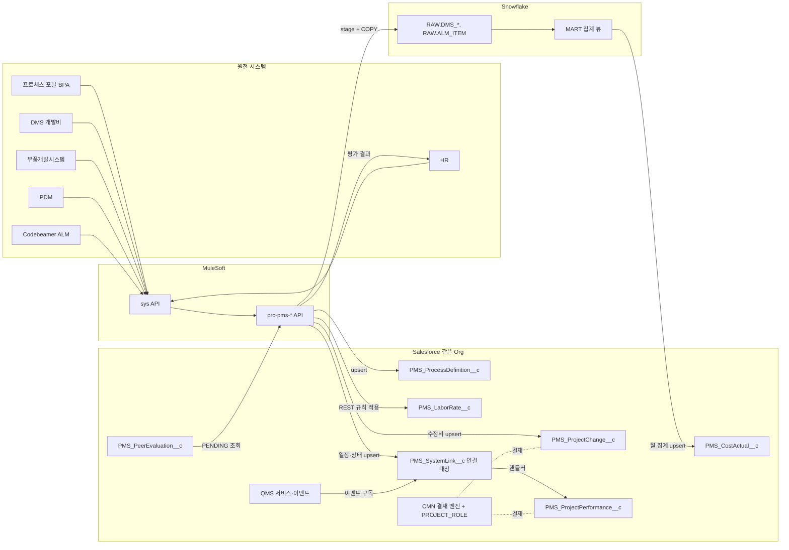

# SL PMS 워크아이템 Vol.P6 — PMS-12 연계·결재, PMS-13 성과·변경

Nov 6, 2026 · @배창욱

## 1. 개요

Vol.P6는 PMS RFP **3.12 시스템 연계 및 결재(P-63~69)**와 **3.13 성과 관리 및 변경 관리(P-70~71)**를 10개 워크아이템으로 내린다. WI 번호·제목·객체 이름은 `pms-architecture.md`(PMS 공통 설계, 2026-11-06)가 최종이며, 이 문서에서 새로 만드는 이름에는 **(제안)**을 붙이고 10절 변경 요청에 모았다.

| 메뉴 | 기능코드 | WI | 내용 |
| --- | --- | --- | --- |
| PMS-12 연계·결재 | INT | INT-001~005 | 프로세스 포탈(BPA), HR 임율·평가, DMS 개발비·수정비, 부품개발시스템·PDM·ALM, QMS 디지털 스레드(같은 Org) |
| PMS-12 연계·결재 | APV | APV-001 | 결재선 PROJECT_ROLE 해석(CFT 역할 → 결재자), 산출물별 결재선, 액티비티별 결재 현황 |
| PMS-13 성과·변경 | PRF | PRF-001~002 | SOP + 2개월 성과 입력·자동 지표, PM·CFT 수평평가·HR 전송 |
| PMS-13 성과·변경 | CHG | CHG-001~002 | 프로젝트 변경 대장(일정·자원·산출물·비용·범위), DMS 수정비·부품개발 비용 단계 적용 |

**번호 표기**: 이 Vol. 안에서도 `INT-nnn`은 Vol.0(CMN-00-INT)·Vol.9(QMS-09-INT)와 겹치므로 본문과 메타 라인 모두 전체 번호(`PMS-12-INT-005`, `CMN-00-INT-001`)로 쓴다.

**RFP 추적과 Vol.0 재사용**: P-63·P-65~69는 대부분 Vol.0 공통 WI가 이미 덮는다(`pms-architecture.md` 1절). 이 Vol.은 같은 기능을 다시 만들지 않고 PMS 고유 부분만 만든다.

| RFP | 요구 요지 | Vol.0이 덮는 부분 | 이 Vol.이 만드는 부분 |
| --- | --- | --- | --- |
| P-63 | 포탈 SSO·업무 건수·To-Do(업무/결재 탭)·메인 위젯 | CMN-00-TDO-002(SSO), TDO-003(포탈 To-Do API), TDO-004(SL PMS 홈), UX-007(앱) | 이 Vol. WI가 여는 To-Do SourceType 등록(3절). PMS 앱 홈 구성은 Vol.P5 |
| P-64 | HR·SAP·PDM·MES·QMS·신뢰성·원가·DMS·부품개발·ALM 연계 | CMN-00-INT-001(표준·카탈로그·로그·재시도), INT-002(조직·임직원), INT-003(SAP 기준정보), DWH-001~004 | PMS-12-INT-001~005(4절 카탈로그) |
| P-65 | 산출물별 결재선 지정, CFT 조직 Role 매핑 | CMN-00-APV-001·002(엔진·템플릿, ResolverType PROJECT_ROLE 예약) | PMS-12-APV-001(PROJECT_ROLE 해석기, 산출물별 결재선 키) |
| P-66 | 결재선 템플릿·사용자 임의 지정 | CMN-00-APV-002·003 | 없음(설정만, APV-001 BR-9) |
| P-67 | 대리결재·To-Do 대결 | CMN-00-APV-004 | 없음 |
| P-68 | Activity별 결재 진행 현황·검토 의견 | CMN-00-APV-003(cmnApprovalMonitor, 레코드별 이력) | PMS-12-APV-001(프로젝트·액티비티 단위 결재 현황 패널) |
| P-69 | 프로젝트 정보·산출물 내용 통합 검색 | CMN-00-AI-002 | 없음(PMS 색인 범위는 Vol.P3·P5) |
| P-70 | SOP+2M 성과 입력 알림, PM/CFT 수평평가, HR 인터페이스 | CMN-00-NTF-001, TDO-001, APV-001 | PMS-13-PRF-001·002, PMS-12-INT-002(HR 전송) |
| P-71 | DMS 수정비 연계, 부품개발 일정·비용 집행 관리(단계별 적용) | — | PMS-13-CHG-001·002, PMS-12-INT-003·004 |

**P-64 대상 시스템별 담당**(RFP 부록 A 기준)

| 시스템 | PMS에서 쓰는 데이터 | 담당 | 비고 |
| --- | --- | --- | --- |
| 사내 포탈 | SSO, To-Do 건수·목록 | CMN-00-TDO-002·003 | |
| HR | 조직·임직원 | CMN-00-INT-002 | |
| HR | 직급 평균 임율(수신), 수평평가 결과(송신) | PMS-12-INT-002 | 민감 정보(로그 금지) |
| SAP S/4HANA | 회사·공장·자재·고객·공급업체 | CMN-00-INT-003 | 비용 실적 직접 연계는 하지 않음(DP6-12) |
| 프로세스 포탈(BPA) | 회사표준 프로세스·액티비티 정의 | PMS-12-INT-001 | |
| DMS(개발비 관리) | 금형·지그·검사구·제비용, 금형 수정비 | PMS-12-INT-003 | |
| 부품개발시스템 | 협력사 부품개발 일정, (선택) 부품개발 비용 계획 | PMS-12-INT-004, PMS-13-CHG-002 | QMS용 PPAP 연계(IF-PDS-001~003)는 Vol.9 INT-019 |
| PDM | 도면·리비전 | PMS-12-INT-004 | 산출물 SYSTEM_LINK |
| ALM(PTC Codebeamer) | SW 마일스톤·요구사항 상태 | PMS-12-INT-004 | 원본은 Codebeamer, PMS는 읽기만 |
| 신규 QMS | 레슨런·인정시험·초기유동·클레임·NCR·4M·수평전개 | PMS-12-INT-005 | 같은 Org(D-P9). 다른 Org면 Vol.9 INT-021 |
| 신뢰성 시스템 | 시험 진행·결과 | QMS-09-INT-018 경유 | PMS는 QMS 인정시험 판정(INT-005)으로 받는다 |
| MES | 생산 일정·실적 | QMS-09-INT-011(Snowflake) 경유 | PMS 직접 연계 없음(DP6-12) |
| 원가시스템(CIS) | 원가·견적 | 없음 | SL 확인 후 결정(DP6-12) |

**선행 공통 WI**: CMN-00-ARC-002·003, CMN-00-MDM-001·004·005·007, CMN-00-SEC-001·002·003·004, CMN-00-INT-001·002, CMN-00-DWH-001~004, CMN-00-APV-001~003, CMN-00-TDO-001, CMN-00-NTF-001, CMN-00-UX-003~006, CMN-00-AI-004.

**다른 메뉴와의 경계**

| 연결 대상 | 이 Vol.이 하는 것 | 상대가 하는 것 |
| --- | --- | --- |
| PMS-04-WBS-001(표준 WBS) | BPA 정의 수신, 템플릿 액티비티 속성 동기화·변경 알림, BPA에서 초안 만들기 | 템플릿 편집·버전·활성화 |
| PMS-04-WBS-010(협력사 부품 일정) | 부품개발시스템 일정 수신(PMS_SupplierPartSchedule__c upsert) | 일정 표시·지연 경고·WBS 연결 |
| PMS-05-CST-002·003(비용) | DMS 월 집계 → PMS_CostActual__c, HR 임율 → PMS_LaborRate__c | ED&D 계산, 비용 화면·권한 |
| PMS-06-DLV-001·004(산출물) | PDM 도면 검색·연결 대장·리비전 변경 감지 | 산출물 SYSTEM_LINK 필드, 영향도 분석 |
| PMS-07-ACT-004(완료 조건) | QMS·ALM·PDS 상태를 연결 대장에 반영, 조회 메서드·완료 점검기(ALM·PDS) 제공 | 완료 조건 검증·자동 종료(QMS_LELE_NO_OPEN_MANDATORY·QMS_QUAL_PASS 규칙 키 소유) |
| PMS-08-ISS-002(문제점) | QMS 클레임·NCR 이벤트 구독 → 연결 대장, 레슨런 요청 메서드 | 문제점 생성·연결 화면, 레슨런 후보 종결 |
| PMS-09-GAT-006(SOP Gate) | 초기유동 생성 요청 메서드 | SOP Gate 통과 시 호출 |
| PMS-04-WBS-006, PMS-03-CFT-002, PMS-07-ACT-005, PMS-06-DLV-004 | 프로젝트 변경 대장 기록 API(`PMS_ProjectChangeService.record`) | 각 변경의 요청·결재·적용(승인 시 기록 API 호출) |
| QMS-04-LEL·QMS-08-AIQ | 호출 시점 구현(WBS 확정·액티비티 착수), 반영 이벤트 구독, 프로젝트 검색·액티비티 문맥 제공 | 매칭·추천·반영 검토 레코드 |
| QMS-02-DVQ | DV·PV 액티비티 착수 시 인정시험 요청, 판정 이벤트 구독 | 계획·시험·판정 |
| QMS-04-EFC | SOP 시 초기유동 생성 요청(게이트웨이) | 초기유동 계획·해제 |
| QMS-04-HZD | 수평전개 대상 프로젝트 검색 구현체 | 대상 선정 화면 |
| QMS-09-INT-019·021 | PMS 측 부품개발 일정 인터페이스(IF-PDS-004·005), 다른 Org일 때 수신 계약(연결 대장 upsert) | QMS PPAP용 부품개발 연계, 다른 Org 중계 |

**앞 Vol. 상태**: Vol.P1~P5는 같은 시점에 작성 중이다. 다른 PMS WI의 객체·필드는 `pms-architecture.md` 5절 이름만 전제로 쓰고, 이 Vol.이 필요로 하는 필드·메서드는 10절 "다른 PMS Vol. 변경 요청"에 적었다. QMS Vol.(0·2~9)은 모두 검토 대기다.

## 2. 업무 흐름

수명주기 관점 흐름은 다음과 같다.

    WBS 확정(기준선 1) → 레슨런 추천·반영 검토 요청(INT-005)
      → 액티비티 착수 → 레슨런 재추천(24시간 재사용), DV·PV면 인정시험 요청(INT-005)
      → 진행 중: 부품개발 일정·SW 마일스톤·도면 리비전 동기화(INT-004), DMS 비용 월 집계(INT-003)
      → 변경 발생: 일정·자원·산출물 변경은 각 기능에서 결재 후 변경 대장 기록, 비용·범위 변경은 CHG-001 결재
      → 금형 수정비(DMS) 수신 → 변경 대장 기록·분류(CHG-002), 부품개발 비용 단계 도래·집행(CHG-002)
      → 액티비티 완료: 필수 레슨런 미결·인정시험 판정·ALM 마일스톤 상태 점검(ACT-004가 INT-005·004 결과 사용)
      → SOP Gate 통과 → 초기유동 생성 요청(GAT-006이 INT-005 메서드 호출) → SOP_CONFIRMED → 성과 레코드 예약(PRF-001)
      → SOP + 2개월: PM 성과 입력 알림·To-Do, 자동 지표 계산(일정·비용·Gate·양산 초기 NCR·클레임) → 결재
      → 같은 시점 수평평가 회차 개시(PRF-002) → 마감·PMO 확정 → HR 전송(INT-002)

## 3. 데이터 모델 개요

**객체**(소유 = 이 Vol. WI, 적재 = 다른 Vol. 소유 객체에 이 Vol.이 데이터를 넣음)

| 객체 | 구분 | 관계 | 역할 | 정의 WI |
| --- | --- | --- | --- | --- |
| PMS_SystemLink__c (제안) | 소유 | Project(MD), Activity·ProjectPart·Item·Plant(Lookup) | 기간 시스템·QMS 연결 대장(디지털 스레드) | PMS-12-INT-005(INT-004가 필드 추가) |
| PMS_ProcessDefinition__c (제안) | 소유 | Parent(Lookup self), OwnerDept(Lookup) | BPA 프로세스·액티비티 정의 사본 | PMS-12-INT-001 |
| PMS_ProjectPerformance__c | 소유 | Project(MD) | SOP + 2개월 성과(자동 지표·PM 입력·결재) | PMS-13-PRF-001(PRF-002가 필드 추가) |
| PMS_PeerEvaluation__c | 소유 | Performance(Lookup, 계약은 MD — DP6-3) | 수평평가 1건(평가자 → 피평가자) | PMS-13-PRF-002 |
| PMS_ProjectChange__c | 소유 | Project(MD), Activity(Lookup) | 프로젝트 변경 대장·비용/범위 변경 결재 | PMS-13-CHG-001(CHG-002가 필드 추가) |
| PMS_ProjectChangeLine__c (제안) | 소유 | ProjectChange(MD) | 비용 변경 항목별 증감 | PMS-13-CHG-001 |
| PMS_SupplierCostStage__c (제안) | 소유 | Project(MD), SupplierPartSchedule(Lookup) | 부품개발 비용 단계별 계획·도래·집행 | PMS-13-CHG-002 |
| PMS_LaborRate__c | 적재 | — | 직급 평균 임율 | 소유 PMS-05-CST-003, 적재 PMS-12-INT-002 |
| PMS_CostActual__c | 적재 | Project(MD) | DMS 월 집계(Source DMS) | 소유 PMS-05-CST-002, 적재 PMS-12-INT-003 |
| PMS_SupplierPartSchedule__c | 적재 | Project(Lookup) | 협력사 부품개발 마일스톤 | 소유 PMS-04-WBS-010, 적재 PMS-12-INT-004 |

**상태값**

| 대상 | 값(순서) |
| --- | --- |
| PMS_SystemLink__c.NormalizedStatus__c | OPEN → IN_PROGRESS → DONE / CANCELLED |
| PMS_ProcessDefinition__c.Status__c | ACTIVE / OBSOLETE |
| PMS_ProjectPerformance__c.Status__c | SCHEDULED → INPUT_OPEN → IN_APPROVAL → APPROVED / CANCELLED (반려 시 INPUT_OPEN) |
| PMS_ProjectPerformance__c.PeerEvalStatus__c | NOT_STARTED → OPEN → CLOSED → CONFIRMED → HR_SENT (PRF-002) |
| PMS_PeerEvaluation__c.Status__c | OPEN → SUBMITTED / EXPIRED / EXCLUDED |
| PMS_PeerEvaluation__c.HrSyncStatus__c | NOT_REQUIRED, PENDING → SENT / FAILED |
| PMS_ProjectChange__c.Status__c | REQUEST 모드: DRAFT → IN_APPROVAL → APPROVED → APPLIED / REJECTED / CANCELLED. RECORD 모드: RECORDED(취소 시 CANCELLED) |
| PMS_SupplierCostStage__c.Status__c | PLANNED → DUE → EXECUTED / CANCELLED |

**메타데이터·설정**

| 이름 | 종류 | 정의 WI | 내용 |
| --- | --- | --- | --- |
| PMS_SystemLinkHandler__mdt (제안) | Custom Metadata | INT-005 | 연결 대장 변경 시 실행할 핸들러(LinkTypes, HandlerClass, Sequence, RunAsync) |
| PMS_ExternalCodeMap__mdt (제안) | Custom Metadata | INT-005 | 원천 코드 → PMS 값 변환(InterfaceId, CodeSet, SourceValue, TargetValue) |
| PMS_QmsTriggerRule__mdt (제안) | Custom Metadata | INT-005 | 액티비티 유형별 QMS 요청 규칙(인정시험 범위·단계) |
| PMS_ApprovalTargetMap__mdt (제안) | Custom Metadata | APV-001 | 결재 대상 객체 → 프로젝트·액티비티·공장 필드 경로 |
| PMS_PeerEvalCriterion__mdt (제안) | Custom Metadata | PRF-002 | 수평평가 항목·가중치·방향 |
| PMS_CostStageRule__mdt (제안) | Custom Metadata | CHG-002 | 부품개발 비용 단계 규칙(마일스톤·비율) |

**CMN 설정(CMN_Setting__mdt) 키**

| 키 | 기본값 | 쓰는 WI |
| --- | --- | --- |
| PMS_QMS_THREAD_MONTHS_AFTER_SOP | 12 | INT-005 BR-9(SOP 후 몇 개월까지 클레임·NCR을 프로젝트에 연결) |
| PMS_QMS_PROJECT_STATUS_EXCLUDED | CANCELLED | INT-005 BR-9 |
| PMS_LELE_RECOMMEND_ON_START | true | INT-005 BR-5 |
| PMS_BPA_MANUAL_SYNC_INTERVAL_MIN | 10 | INT-001 BR-8 |
| PMS_RATE_MIN_SAMPLE | 3 | INT-002 BR-2 |
| PMS_COST_CLOSED_MONTH | (Finance 입력, yyyy-MM) | INT-002 BR-4 |
| PMS_ALM_DATE_TOLERANCE_DAYS | 3 | INT-004 BR-9 |
| PMS_PRF_EARLY_MONTHS | 2 | PRF-001(양산 초기 범위 = SOP ~ SOP + n개월) |
| PMS_PRF_INPUT_DAYS | 14 | PRF-001 BR-3 |
| PMS_PRF_MILESTONE_TOLERANCE_DAYS | 0 | PRF-001 BR-5 |
| PMS_PRF_GATE_CONDITIONAL_AS_PASS | false | PRF-001 BR-5 |
| PMS_PEER_EVAL_MODE | PM_AND_CFT | PRF-002 BR-1 |
| PMS_PEER_MIN_EFFORT_HOURS | 40 | PRF-002 BR-1 |
| PMS_PEER_EVAL_DAYS | 14 | PRF-002 BR-2 |
| PMS_PEER_MIN_EVALUATORS | 3 | PRF-002 BR-6 |
| PMS_CHG_COST_ESCALATION_RATE | 5 | CHG-001 BR-6(예산 대비 %) |
| PMS_SUPPLIER_COST_SOURCE | DMS | CHG-002 BR-6 |

**이 Vol.이 제공하는 서비스·계약**

| 이름 | 종류 | 정의 WI | 사용처 |
| --- | --- | --- | --- |
| PMS_SystemLinkService (제안) | Apex | INT-005 | INT-001~004, ACT-004, ISS-002, PRF-001, DLV-003·004, SOR-002 |
| PMS_SystemLinkHandler (제안) | Apex 인터페이스 | INT-005 | ACT-004, ISS-002, DLV-004 구현 |
| PMS_QmsThreadService (제안) | Apex | INT-005 | ACT-004, GAT-006, ISS-002, PRF-001 |
| PMS_ProjectSearchGatewayImpl (제안) | QMS 게이트웨이 구현체(바인딩 PMS_PROJECT) | INT-005 | QMS-04-HZD-002, QMS-08-AIQ-007 |
| PMS_ProjectRoleApprovalResolver (제안) | CMN 결재 해석 플러그인 구현 | APV-001 | CMN-00-APV-002 |
| PMS_ProjectChangeService.record (제안) | Apex | CHG-001 | WBS-006, CFT-002, ACT-005, DLV-004, INT-003 |
| Apex REST `/pms/v1/labor-rates`, `/pms/v1/hr/peer-evaluations` | REST(통합 사용자 전용) | INT-002 | Mule prc-pms-hr-* |

**To-Do SourceType·알림 EventCode·결재 유형**(TDO-001, NTF-001, APV-001에 등록)

| 구분 | 값 | WI |
| --- | --- | --- |
| To-Do SourceType | PMS_BPA_CHANGE, PMS_RATE_CHANGE_REVIEW, PMS_DMS_UNMAPPED, PMS_PDM_REVISION, PMS_PRF_INPUT, PMS_PEER_EVAL, PMS_PEER_CONFIRM, PMS_CHG_FOLLOWUP, PMS_DMS_MOD_CLASSIFY, PMS_SUPPLIER_COST_DUE, PMS_QMS_QUAL_REQUEST | INT-001~005, PRF, CHG |
| 알림 EventCode | PMS_INT_SYNC_FAILED, PMS_QMS_QUAL_JUDGED, PMS_QMS_CLAIM_LINKED, PMS_ALM_DATE_GAP, PMS_PRF_INPUT_DUE, PMS_PRF_INPUT_OVERDUE, PMS_PEER_EVAL_OPEN, PMS_PEER_EVAL_REMIND, PMS_HR_SYNC_FAILED, PMS_CHG_APPROVED, PMS_DMS_MOD_RECEIVED, PMS_SUPPLIER_COST_DUE | 각 WI |
| 결재 유형 | PMS_PERFORMANCE(PRF-001), PMS_PROJECT_CHANGE(CHG-001) | |

**권한 셋**(기능 PS → PSG 매핑은 각 WI 권한 절. PSG 이름은 `pms-architecture.md` 10절)

| PS | 내용 | PSG |
| --- | --- | --- |
| PMS_PS_SystemLink_Read / _Edit | 연결 대장 조회 / 수동 연결·해제 | Read: PM·CFT·PMO·TeamLead·Executive / Edit: PM·PMO |
| PMS_PS_ProcessDef_Read / _Sync | BPA 정의 조회 / 수동 동기화·차이 유지 결정 | Read: 전 PMS PSG / Sync: PMO |
| PMS_PS_Performance_Read / _Edit / _Admin | 성과 조회 / PM 입력 / PMO 재계산·취소 | Read: PM·CFT·PMO·TeamLead·Executive / Edit: PM / Admin: PMO |
| PMS_PS_PeerEval_Submit / _Admin | 본인 평가 입력 / 전체 조회·확정·HR 전송 | Submit: PM·CFT / Admin: PMS_PSG_HrEval(제안) |
| PMS_PS_ProjectChange_Read / _Edit | 변경 대장 조회 / 요청·분류 | Read: 전 PMS PSG / Edit: PM·PMO |
| PMS_PS_SupplierCost_Edit | 부품개발 비용 단계 확인 | PM·PMS_PSG_Finance |
| PMS_PS_Integration_Ext (제안) | BPA·PDS·PDM·ALM 적재(연결 대장, 정의, 부품 일정) | 통합 사용자 pms-int-ext |
| PMS_PS_Integration_Fin (제안) | DMS 비용·수정비, HR 임율·평가 송신 | 통합 사용자 pms-int-fin |

비용 필드(금액·차이율)는 모두 `PMS_PS_Cost_Read` 보유자에게만 FLS Read를 준다(P-57). 위 PS 중 금액 필드를 포함하는 것은 없고, 금액 필드 FLS는 각 WI가 `PMS_PS_Cost_Read`에 추가한다.

**공통 기반 등록**(각 WI에서 수행)

| 항목 | 내용 |
| --- | --- |
| 채번(ARC-003) | PMS_ProjectPerformance__c `PRF-{YYYY}-{SEQ:5}`, PMS_ProjectChange__c `CHG-{YYYY}-{SEQ:5}`, PMS_SupplierCostStage__c `SCS-{YYYY}-{SEQ:6}` |
| 공유 | MD 하위 객체는 프로젝트 공유를 따른다(CFT-001). PMS_PeerEvaluation__c·PMS_ProcessDefinition__c는 예외(각 WI) |
| 삭제 통제(SEC-003) | PMS_ProjectChange__c DRAFT만, PMS_ProjectPerformance__c 삭제 불가(CANCELLED로), PMS_PeerEvaluation__c 삭제 불가, PMS_SystemLink__c 삭제 불가(IsActive false) |
| 진행 단계(UX-003) | PMS_ProjectPerformance__c, PMS_ProjectChange__c(REQUEST 모드) |
| 필드 이력 | Performance(Status, 자동 지표 4종, SubmittedAt), Change(Status, CostImpactAmount, ScheduleImpactDays), PeerEvaluation(Status, HrSyncStatus) |
| DWH 복제(DWH-002) | PMS_SystemLink__c·PMS_ProjectChange__c·PMS_ProjectPerformance__c 15분, PMS_ProcessDefinition__c 일 1회. PMS_PeerEvaluation__c·PMS_LaborRate__c는 복제하지 않는다(HR 민감) |
| 번역 | ko·en_US·zh_CN |

**KPI**(DWH-003 `CMN_KpiValue__c`, 계산 Snowflake. 비용 KPI는 CMN_KpiValue__c가 사내 공개 읽기라 만들지 않는다)

| 키 | 정의 | 주기 | 차원 | 계산 위치 |
| --- | --- | --- | --- | --- |
| PMS_PRF_SCHEDULE_ADHERENCE | 해당 월 승인된 성과의 일정 준수율 평균 | 월 | ProductGroup, Customer, Plant(ProdPlant) | Snowflake(CORE.SF_PMS_PROJECTPERFORMANCE__C) |
| PMS_PRF_GATE_FIRST_PASS | 해당 월 승인된 성과의 Gate 1회 통과율 평균 | 월 | ProductGroup, Customer | Snowflake |
| PMS_PRF_EARLY_NCR | 양산 초기 NCR 건수 합 | 월 | ProductGroup, Plant | Snowflake |
| PMS_CHG_COUNT | 승인·기록된 변경 건수(유형별 행) | 월 | Plant, ChangeType(Unit에 유형 코드) | Snowflake(CORE.SF_PMS_PROJECTCHANGE__C) |
| PMS_INT_FAILED | PMS 인터페이스별 FAILED 실행 수 | 일 | — | Snowflake(CMN_InterfaceLog 복제) |

## 4. 인터페이스 카탈로그

**인터페이스 목록**(CMN_Interface__mdt 등록, CMN-00-INT-001 카탈로그 변경 요청). Vol.9가 IF-PDS-001~003을 쓰므로 PMS는 IF-PDS-004부터 쓴다.

| ID | 원천 → 대상 | 데이터 | 방식·주기 | 멱등 키 | 구현 WI |
| --- | --- | --- | --- | --- | --- |
| IF-BPA-001 | BPA → SF | 프로세스·하위 프로세스·액티비티 정의(번호·명칭·설명·주관부서·상태) | 배치 매일 03:00 KST + 수동 | BpaId__c | PMS-12-INT-001 |
| IF-HR-002 | HR → SF | 법인·직급별 평균 시간당 임율(연·월 개정) | 배치 매월 1일 05:00 KST + 수동 | `{CompanyCode}-{JobGradeCode}-{yyyyMM}` | PMS-12-INT-002 |
| IF-HR-003 | SF → HR | 수평평가 결과(피평가자 집계) | 배치 매일 06:00 KST + PMO 수동 | evaluationKey + version | PMS-12-INT-002 |
| IF-DMS-001 | DMS → Snowflake → SF | 금형·지그·검사구·제비용 상세(RAW) → 프로젝트·월·세부 유형 집계(PMS_CostActual__c) | 배치 매일 04:00 KST | 상세 `{dmsDocNo}-{lineNo}`, 집계 `DMS-{projectKey}-{yyyyMM}-{subCat}-{currency}` | PMS-12-INT-003 |
| IF-DMS-002 | DMS → SF | 금형 수정 건(수정 번호·금형·사유·금액·상태) | 1시간 증분 | `DMS-MOD-{modNo}` | PMS-12-INT-003 |
| IF-PDS-004 | 부품개발시스템 → SF | 협력사 부품개발 마일스톤 일정·실적 | 1시간 증분 | `{pdsPartId}-{MilestoneCode}` | PMS-12-INT-004 |
| IF-PDS-005 | 부품개발시스템 → SF | (선택) 부품개발 비용 계획(부품별 금액·지급 조건) | 배치 매일 04:30 KST | `{pdsPartId}-{costType}` | PMS-13-CHG-002 |
| IF-PDM-001 | SF → PDM | 도면 검색·메타 조회 | 요청 시, 10초 이내 | — (조회) | PMS-12-INT-004 |
| IF-PDM-002 | PDM → SF | 연결된 도면의 리비전·상태 변경 | 1시간 증분 | 연결 대장 ExternalKey | PMS-12-INT-004 |
| IF-ALM-001 | Codebeamer → SF | 연결된 SW 릴리스(마일스톤) 일정·상태 | 1시간 증분 | 연결 대장 ExternalKey | PMS-12-INT-004 |
| IF-ALM-002 | Codebeamer → SF | SOR에 연결된 SW 요구사항 상태 | 1시간 증분 | 연결 대장 ExternalKey | PMS-12-INT-004 |
| IF-ALM-003 | SF → Codebeamer | 프로젝트·릴리스·요구사항 항목 검색 | 요청 시, 10초 이내 | — (조회) | PMS-12-INT-004 |
| IF-ALM-004 | Codebeamer → Snowflake | (권장) 연결 프로젝트의 요구사항·시험 항목 전체 스냅숏(DW 디지털 스레드) | 배치 매일 02:30 KST | `{cbItemId}-{version}` | PMS-12-INT-004 |

QMS와의 연계(PMS-12-INT-005)는 같은 Org 안의 서비스 호출·이벤트 구독이라 CMN_Interface__mdt에 등록하지 않는다(Vol.0 12절 머리말: 같은 Org면 인터페이스가 아니라 데이터 모델 참조). 다른 Org로 결정되면 Vol.9 INT-021의 IF-AI-003·004, IF-PMS-002가 대신한다.

**Mule API 목록**(Vol.0 3.2절 `{계층}-{대상}-api`)

| API | 계층 | 역할 | 사용 IF |
| --- | --- | --- | --- |
| sys-salesforce-pms-api | sys | PMS 통합 사용자로 Salesforce REST·Composite·Bulk 2.0·Apex REST 호출 | 전체 |
| sys-bpa-api | sys | 프로세스 포탈 정의 조회 | IF-BPA-001 |
| sys-hr-api | sys | HR 조회·전송(CMN-00-INT-002가 만든 HR sys API가 있으면 확장, 임율·평가 엔드포인트 추가) | IF-HR-002·003 |
| sys-dms-api | sys | DMS 개발비 상세·금형 수정 건 조회 | IF-DMS-001·002 |
| sys-pds-api | sys | 부품개발시스템(Vol.9 INT-019와 공용, 일정·비용 엔드포인트 추가) | IF-PDS-004·005 |
| sys-pdm-api | sys | PDM 도면 검색·메타·변경 조회 | IF-PDM-001·002 |
| sys-codebeamer-api | sys | Codebeamer REST(v3) 항목·트래커·프로젝트 조회 | IF-ALM-001~004 |
| prc-pms-bpa-sync-api | prc | BPA 정의 변환·upsert, 수동 실행 엔드포인트 | IF-BPA-001 |
| prc-pms-hr-rate-api | prc | 임율 변환·표본 검사 → Apex REST | IF-HR-002 |
| prc-pms-hr-eval-api | prc | 평가 결과 조회(Apex REST) → HR 전송 → 회신 | IF-HR-003 |
| prc-pms-dms-cost-api | prc | DMS 상세 → Snowflake RAW, 집계 뷰 → PMS_CostActual__c, 수정 건 → PMS_ProjectChange__c | IF-DMS-001·002 |
| prc-pms-pds-sync-api | prc | 부품개발 일정·비용 → Salesforce | IF-PDS-004·005 |
| prc-pms-pdm-api | prc | 도면 검색(동기), 리비전 변경 동기화(배치) | IF-PDM-001·002 |
| prc-pms-alm-api | prc | Codebeamer 검색(동기), 릴리스·요구사항 동기화, DW 스냅숏 | IF-ALM-001~004 |

**Salesforce → Mule 호출용 Named Credential**(External Credential, OAuth 2.0 Client Credentials. sf-dev.md 3절)

| Named Credential | 대상 | 쓰는 WI |
| --- | --- | --- |
| PMS_Mule_Bpa | prc-pms-bpa-sync-api(수동 실행) | INT-001 |
| PMS_Mule_Hr | prc-pms-hr-rate-api·prc-pms-hr-eval-api(수동 실행) | INT-002 |
| PMS_Mule_Pdm | prc-pms-pdm-api(검색) | INT-004 |
| PMS_Mule_Alm | prc-pms-alm-api(검색) | INT-004 |

**통합 사용자**(CMN-00-INT-001 BR-2 Integration User 라이선스, Vol.9 BR-8과 같은 도메인 분리 원칙)

| 사용자 | PS | 인터페이스 |
| --- | --- | --- |
| pms-int-ext (제안) | CMN_PS_Integration, PMS_PS_Integration_Ext | IF-BPA-001, IF-PDS-004, IF-PDM-002, IF-ALM-001·002 |
| pms-int-fin (제안) | CMN_PS_Integration, PMS_PS_Integration_Fin | IF-HR-002·003, IF-DMS-001·002, IF-PDS-005 |

**이 Vol.이 정의하는 Snowflake 객체**

| 객체 | 정의 WI | 내용 |
| --- | --- | --- |
| RAW.DMS_DEV_COST, RAW.DMS_TOOL_MODIFICATION | INT-003 | DMS 원본(PAYLOAD VARIANT + 표준 열) |
| CORE.DMS_DEV_COST | INT-003 | 개발비 상세(프로젝트 키·비용 유형·단계·금액·통화·일자) |
| MART.V_SF_PMS_DMS_COST | INT-003 | Salesforce로 보낼 월 집계 |
| MART.V_PMS_DMS_UNMAPPED, MART.V_PMS_DMS_RECON | INT-003 | 매핑 안 된 DMS 프로젝트, Salesforce 집계와 원천 합계 대사 |
| RAW.ALM_ITEM, CORE.ALM_ITEM | INT-004 | Codebeamer 항목 스냅숏(DW 디지털 스레드, 권장) |
| CMN_DwQuery__mdt 키 PMS_DMS_COST_DETAIL, PMS_PRF_EARLY_QUALITY | INT-003, PRF-001 | 드릴다운·대체 계산 등록 쿼리 |

**데이터량 가정**(SL 확인 전): BPA 정의 3,000~5,000건, 직급 임율 연 100행 이하, DMS 상세 연 2만~5만 행·수정 건 연 1,000건, 부품개발 마일스톤 프로젝트당 200~800행, 연결 대장 프로젝트당 500~3,000행(QMS 반영 검토 포함), Codebeamer 연결 프로젝트 50개·요구사항 수만 건(Snowflake만).

## 5. 기간 시스템 연계 (INT-001~004)

### PMS-12-INT-001 프로세스 포탈(BPA) 프로세스·액티비티 속성 연계

추적 P-15, P-41, P-64 · 필수 · W2 · MULE, SF · INT, DM, APEX, LWC · Tailoring · 선행 CMN-00-INT-001, CMN-00-MDM-001, PMS-04-WBS-001, PMS-12-INT-005 · 5 M/D

**목적**: 신제품개발 회사표준(26.11~27.04 개정, 27년 PMS·회사표준 시스템 연계 예정)의 프로세스·액티비티 정의는 프로세스 포탈(BPA)이 원본이다. 표준 WBS 액티비티의 명칭·번호·설명·주관부서를 BPA에서 받아 맞추면, 회사표준이 개정될 때 PMO가 표준 WBS를 다시 타이핑하지 않고 "무엇이 바뀌었는지"만 검토하면 된다.

**범위** In: IF-BPA-001(Mule sys·prc), 정의 사본 객체 `PMS_ProcessDefinition__c`(제안), 변경 감지·요약, DRAFT 템플릿 자동 반영과 ACTIVE 템플릿 변경 알림, BPA 정의 선택 대화상자, BPA 프로세스로 표준 WBS 초안 만들기, 수동 동기화, 템플릿 검증 메서드. Out: 표준 WBS 편집·버전·활성화(PMS-04-WBS-001), 실행 액티비티 생성과 속성 복사(PMS-04-WBS-003, PMS-07-ACT-001), BPA 쪽 개발(SL 범위).

**데이터 모델**

| 객체 / 필드 | 타입 | 필수 | 설명 |
| --- | --- | --- | --- |
| PMS_ProcessDefinition__c (제안).BpaId__c | Text(40), External ID, Unique | Y | BPA 원천 키 |
| PMS_ProcessDefinition__c.ProcessNo__c | Text(40) | Y | BPA 번호(예: NPD-05-03) |
| PMS_ProcessDefinition__c.Name | Text(80) | Y | 한국어 표시명(80자 초과분은 FullName__c) |
| PMS_ProcessDefinition__c.FullName__c / NameEn__c | Text(255) | Y / N | 전체 명칭, 영문 명칭(I18N-001 패턴, DisplayName__c 포함) |
| PMS_ProcessDefinition__c.DefinitionType__c | Picklist (PROCESS 프로세스, SUB_PROCESS 하위 프로세스, ACTIVITY 액티비티) | Y | |
| PMS_ProcessDefinition__c.Parent__c | Lookup(PMS_ProcessDefinition__c) | N | 상위 정의 |
| PMS_ProcessDefinition__c.Level__c | Number(2,0) | Y | 1부터, 최대 6 |
| PMS_ProcessDefinition__c.Sequence__c | Number(5,0) | N | 같은 상위 안 순서 |
| PMS_ProcessDefinition__c.Description__c | Long Text(32768) | N | 설명(BPA 원문, 서식 제거 텍스트) |
| PMS_ProcessDefinition__c.OwnerDeptCode__c | Text(20) | N | BPA 주관부서 코드(원천값 보존) |
| PMS_ProcessDefinition__c.OwnerDept__c | Lookup(CMN_Department__c) | N | DeptCode__c로 찾은 부서. 못 찾으면 공란 |
| PMS_ProcessDefinition__c.DevPhaseCode__c | Text(40) | N | BPA가 단계 속성을 주면 DEV_PHASE 코드로 매핑(PMS_ExternalCodeMap__mdt CodeSet BPA_PHASE) |
| PMS_ProcessDefinition__c.BpaRevision__c | Text(20) | N | BPA 개정 번호 |
| PMS_ProcessDefinition__c.EffectiveFrom__c | Date | N | BPA 발효일 |
| PMS_ProcessDefinition__c.Status__c | Picklist (ACTIVE, OBSOLETE) | Y | |
| PMS_ProcessDefinition__c.BpaUrl__c | URL | N | BPA 화면 바로가기(포탈 SSO 경유) |
| PMS_ProcessDefinition__c.ContentHash__c | Text(64) | Y | 동기화 속성(번호·명칭·설명·주관부서 코드·상태)의 SHA-256 |
| PMS_ProcessDefinition__c.ChangeSummary__c | Text(255) | N | 직전 대비 바뀐 속성 이름 목록(예: "Name, OwnerDept") |
| PMS_ProcessDefinition__c.SourceChangedAt__c / LastSyncedAt__c | DateTime | N / Y | 원천 변경 시각, 마지막 적재 시각 |
| PMS_WbsTemplateActivity__c.ProcessPortalActivityId__c | Text(소유 WBS-001) | N | 연결 키 = BpaId__c(계약 필드) |
| PMS_WbsTemplateActivity__c.BpaSyncStatus__c (제안, 이 WI가 추가) | Picklist (IN_SYNC, CHANGED, OBSOLETE, NOT_FOUND, WAIVED) | N | ProcessPortalActivityId가 있을 때만 값 |
| PMS_WbsTemplateActivity__c.BpaCheckedAt__c (제안, 이 WI가 추가) | DateTime | N | 마지막 대조 시각 |
| PMS_WbsTemplateActivity__c.BpaWaiveReason__c (제안, 이 WI가 추가) | Text(255) | WAIVED면 Y | 차이를 유지하기로 한 사유 |

동기화 대상 속성(RFP "명칭/No./설명/주관부서")은 표준 WBS 액티비티의 Name, ProcessNo__c, Description__c, OwnerDept__c이다. 이 네 필드가 WBS-001 객체에 없으면 WBS-001 변경 요청(10절)으로 만든다.

**비즈니스 규칙**

- BR-1: IF-BPA-001 흐름(CMN-00-INT-001 패턴 E2) — 매일 03:00 KST에 `prc-pms-bpa-sync-api`가 `sys-bpa-api`로 정의를 읽는다. BPA가 변경 시각을 주면 워터마크 증분(5분 겹침), 주지 못하면 전체 추출 후 Mule이 ContentHash로 바뀐 행만 고른다. 적재 순서는 Level 오름차순(상위 먼저 upsert, Parent__r.BpaId__c로 연결). 200건 이하 Composite, 초과 Bulk API 2.0. 실행 1회에 CMN_InterfaceLog__c 1건.

- BR-2: 삭제 — BPA에서 사라진 정의(전체 추출에 없음 또는 폐기 표시)는 지우지 않고 Status OBSOLETE로 바꾼다. 같은 BpaId가 다시 나타나면 ACTIVE로 되돌린다.

- BR-3: 부서 매핑 — OwnerDeptCode를 CMN_Department__c.DeptCode__c로 찾는다(HR 부서 코드와 같다고 가정, SL 확인). 못 찾으면 OwnerDept 공란으로 적재하고 로그 ErrorSummary에 `BpaId / 부서 코드`를 남기며 실행 상태를 PARTIAL로 한다.

- BR-4: 변경 감지 — `PMS_ProcessDefinition__c` before update에서 동기화 속성의 이전·새 값을 비교해 ChangeSummary를 채운다. 동기화 속성이나 Status가 바뀐 정의가 있으면 after update에서 `PMS_BpaSyncService.reconcile(Set<Id> definitionIds)`를 Queueable로 실행한다(한 실행에 정의 2,000건 단위).

- BR-5: 반영 규칙(reconcile) — ProcessPortalActivityId = BpaId인 표준 WBS 액티비티를 찾아 템플릿 상태별로 처리한다.
  - (a) 템플릿 DRAFT: 네 속성을 BPA 값으로 덮어쓰고 BpaSyncStatus = IN_SYNC. 필드 이력으로 이전 값이 남는다.
  - (b) 템플릿 ACTIVE: 값을 바꾸지 않는다. BpaSyncStatus = CHANGED(BPA OBSOLETE면 OBSOLETE). 템플릿마다 PMO To-Do 1건(SourceType PMS_BPA_CHANGE, Assignee = 템플릿 Owner, 제목 "표준 WBS {코드} v{버전}: 프로세스 포탈 변경 {n}건 검토", 기한 14일)을 열거나 건수만 갱신한다.
  - (c) 템플릿 OBSOLETE: 처리하지 않는다.
  - (d) 실행 중 프로젝트의 PMS_Activity__c는 바꾸지 않는다(생성 시점 스냅숏, WBS-003).

- BR-6: 차이 해소 — ACTIVE 템플릿의 CHANGED 액티비티는 (a) PMO가 WBS-001에서 새 버전을 만들면 DRAFT 복사본에 BR-5(a)가 적용되고, 새 버전 활성화 시 To-Do를 닫는다. (b) 반영하지 않기로 하면 PMO가 "차이 유지"(사유 필수)로 WAIVED로 바꾼다. 템플릿의 CHANGED·OBSOLETE 액티비티가 0건이 되면 To-Do를 닫는다.

- BR-7: 템플릿 검증 메서드 — `PMS_BpaSyncService.validateTemplate(Id templateId)`는 연결 키가 있는 액티비티 중 NOT_FOUND(BpaId가 사본에 없음)·OBSOLETE·CHANGED 목록을 돌려준다. WBS-001 활성화 화면이 호출해 경고를 보이도록 변경 요청한다(차단 여부는 DP6-13).

- BR-8: 수동 동기화 — PMS_PS_ProcessDef_Sync 보유자가 정의 리스트뷰의 "지금 동기화" 버튼으로 Named Credential `PMS_Mule_Bpa`를 통해 `POST /prc-pms-bpa-sync-api/v1/runs`를 비동기 호출한다(Queueable 콜아웃). 직전 실행 후 CMN 설정 PMS_BPA_MANUAL_SYNC_INTERVAL_MIN(기본 10분) 안이면 "{n}분 후 다시 실행하세요"로 막는다. 결과는 CMN_InterfaceLog__c로 확인한다.

- BR-9: BPA 정의 선택 — `pmsProcessDefinitionPicker`(모달)는 번호·명칭 검색(SOSL 1회 + DefinitionType ACTIVITY·Status ACTIVE 필터), 트리 탐색(프로세스 → 하위 → 액티비티), 선택 시 네 속성 미리보기를 보여주고 선택 결과 `{bpaId, processNo, name, description, ownerDeptId}`를 이벤트로 돌려준다. 표준 WBS 템플릿 레코드 페이지에 "프로세스 포탈에서 가져오기" 버튼(Dynamic Action, UX-005 규칙 행 `PMS_WbsTemplateActivity_BpaPick`, 템플릿 DRAFT일 때만)을 이 WI가 추가하고, 선택하면 서버가 선택 액티비티에 네 속성과 ProcessPortalActivityId를 저장한 뒤 그리드를 새로 고친다(UX-006 BR-10).

- BR-10: BPA에서 초안 만들기 — `PMS_BpaSyncService.draftFromProcess(Id processDefinitionId, Id templateId)`는 DRAFT 템플릿에 선택 프로세스 아래 ACTIVITY 정의를 BPA 계층대로 표준 액티비티로 만든다(네 속성 + ProcessPortalActivityId, Level = BPA 상대 깊이, 순서 = Sequence). DevPhase·ActivityType·DurationDays·ResponsibleRole은 비워 두고 PMO가 채운다. 같은 템플릿에 같은 ProcessPortalActivityId가 이미 있으면 만들지 않는다(재실행 멱등). 한 번에 600개 초과면 거부한다.

- BR-11: 장애 — BPA·Mule 장애 중에도 표준 WBS는 기존 값으로 계속 쓴다. 실행 FAILED(CMN-00-INT-001 BR-3 재시도 후)면 CMN_PSG_SystemAdmin과 PMS_PSG_PMO에 알림 PMS_INT_SYNC_FAILED(하루 1회).

- BR-12: 공유·권한 — PMS_ProcessDefinition__c는 사내 OWD Public Read Only(공장 격리 대상 아님, 회사표준 공개 정보). 편집은 통합 사용자(pms-int-ext)만, 사용자 화면의 필드는 모두 읽기.

**화면/UX**: T6 마스터 관리. 공통 부품 UX-005(버튼 규칙), UX-006(WBS-001 그리드 새로 고침). 새 LWC는 `pmsProcessDefinitionPicker` 1개. 정의 목록은 SL PMS 앱 "프로세스 정의" 탭 리스트뷰(분할 보기, 트리 보기는 피커 재사용), 정의 레코드 페이지는 표준 레이아웃(상태 흐름이 없어 UX-004 대상 아님)에 BpaUrl 링크와 "이 정의를 쓰는 표준 액티비티" 관련 목록(Apex 조회 LWC 대신 ProcessPortalActivityId 기준 리포트 링크). WBS-001 그리드에 "BPA 동기화" 열 추가는 WBS-001 변경 요청.

**권한**: PMS_PS_ProcessDef_Read(조회, 전 PMS PSG), PMS_PS_ProcessDef_Sync(수동 동기화·차이 유지·초안 만들기, PMS_PSG_PMO), PMS_PS_Integration_Ext(적재). 표준 WBS 편집 권한은 WBS-001 PS를 그대로 요구한다(서버에서 템플릿 편집 권한 확인).

**수용 기준**

- AC-1: Given 같은 BPA 추출을 2회 적재, When 실행, Then 정의 레코드 수·LastModifiedDate 변화 없음(ContentHash 같음), 로그 2건 SUCCESS.
- AC-2: Given BPA 액티비티 명칭 변경, 이를 쓰는 DRAFT 템플릿 1개, When 동기화, Then 그 템플릿 액티비티 Name이 새 값, BpaSyncStatus IN_SYNC, 필드 이력에 이전 값.
- AC-3: Given ACTIVE 템플릿 1개에 연결된 BPA 액티비티 3건 변경, When 동기화, Then 템플릿 값 변화 없음, 해당 액티비티 3건 CHANGED, PMO To-Do 1건(제목에 3건).
- AC-4: Given BPA에서 액티비티 삭제, When 전체 추출 동기화, Then 정의 OBSOLETE, 연결된 ACTIVE 템플릿 액티비티 OBSOLETE 표시, 실행 중 프로젝트 액티비티 변화 없음.
- AC-5: Given 미등록 부서 코드, When 적재, Then 정의 upsert 성공·OwnerDept 공란, 로그 PARTIAL에 BpaId와 부서 코드.
- AC-6: Given 3단계 45개 액티비티를 가진 BPA 프로세스, When DRAFT 템플릿에 초안 만들기 2회, Then 표준 액티비티 45개(계층 유지), 두 번째 실행에서 추가 0개.
- AC-7: Given 수동 동기화 5분 전 실행, When 다시 실행, Then 차단 메시지, 콜아웃 0회.
- AC-8: Given PMS_PS_ProcessDef_Sync 없는 PM, When "차이 유지" Apex 호출, Then 권한 오류.
- AC-9: Given CHANGED 액티비티 2건이 있는 템플릿, When PMO가 1건 WAIVED·1건 새 버전 반영 후 활성화, Then To-Do DONE.

**에이전트 주의**: BPA에 값을 쓰지 않는다(BPA가 원본). ACTIVE 템플릿·실행 액티비티를 자동으로 고치지 않는다. Apex에서 BPA를 직접 호출하지 않는다(Mule 경유, 수동 실행도 Mule 엔드포인트만 호출). 프로세스 다이어그램 파일을 Salesforce에 저장하지 않는다(BpaUrl 링크).

**오픈 이슈**: BPA 연계 방식(API·DB 뷰·파일)과 변경 시각 제공 여부, BPA 부서 코드 체계가 HR 부서 코드와 같은지, BPA에 개발 단계·액티비티 유형 속성이 있는지, 영문 명칭 보유 여부, 회사표준 개정(26.11~27.04) 결과의 BPA 등록 시점.

### PMS-12-INT-002 HR 임율·평가 연계

추적 P-29, P-30, P-70, P-64 · 필수 · W2 · MULE, SF · INT, APEX · Customization · 선행 CMN-00-INT-001, CMN-00-INT-002, CMN-00-SEC-004, PMS-05-CST-003, PMS-13-PRF-002 · 4 M/D

**목적**: ED&D 비용은 투입 시간 × HR 직급 평균 임율로 계산한다(P-29·30). 임율은 인사 민감 정보라 HR은 직급 평균만 주고, PMS는 원가 권한자만 보게 한다. 프로젝트 종료 후 수평평가 결과는 HR 인사 평가 참고 자료로 보낸다(P-70).

**범위** In: IF-HR-002(임율 수신, Apex REST 규칙 적용), IF-HR-003(평가 결과 송신·회신), 민감 정보 보호 규칙(로그·Mule·DLQ), 수동 실행. Out: 임율 객체 정의·화면·ED&D 계산(PMS-05-CST-003·002), 평가 화면·집계 규칙(PMS-13-PRF-002), 조직·임직원 동기화(CMN-00-INT-002).

**데이터 모델**(PMS_LaborRate__c 소유는 CST-003. 이 WI가 쓰는 필드 중 계약에 없는 것은 10절 변경 요청)

| 객체 / 필드 | 타입 | 필수 | 설명 |
| --- | --- | --- | --- |
| PMS_LaborRate__c.JobGradeCode__c | Text(10) | Y | 계약 필드. User·CMN_Employee__c.JobGradeCode__c와 같은 코드 |
| PMS_LaborRate__c.Year__c | Number(4,0) | Y | 계약 필드. EffectiveFrom의 연도 |
| PMS_LaborRate__c.HourlyRate__c | Number(12,2) | Y | 계약 필드. 시간당 평균 임율(통화는 CurrencyCode) |
| PMS_LaborRate__c.CompanyCode__c (제안) | Text(10) | Y | 법인 코드(본사·해외 법인) |
| PMS_LaborRate__c.CurrencyCode__c (제안) | Text(3) | Y | ISO 통화 코드(D-P5) |
| PMS_LaborRate__c.EffectiveFrom__c / EffectiveTo__c (제안) | Date | Y / N | 적용 기간(월 1일 단위) |
| PMS_LaborRate__c.Source__c (제안) | Picklist (HR, MANUAL) | Y | |
| PMS_LaborRate__c.ExternalKey__c (제안) | Text(40), External ID, Unique | Y | `{CompanyCode}-{JobGradeCode}-{yyyyMM}` |
| PMS_LaborRate__c.PendingChange__c (제안) | Checkbox | N | 마감 기간 변경 수신으로 보류 중(BR-4) |

**인터페이스 명세**

| 구분 | IF-HR-002 임율 | IF-HR-003 평가 결과 |
| --- | --- | --- |
| 방향·주기 | HR → SF, 매월 1일 05:00 KST + Finance 수동 | SF → HR, 매일 06:00 KST + PMO 수동 |
| Mule | prc-pms-hr-rate-api → sys-salesforce-pms-api | prc-pms-hr-eval-api(Salesforce 조회 → HR 전송 → 회신) |
| Salesforce 진입점 | Apex REST `POST /services/apexrest/pms/v1/labor-rates`(`PMS_LaborRateRestResource`) | `GET /services/apexrest/pms/v1/hr/peer-evaluations?limit=500`, `POST .../peer-evaluations/ack`(`PMS_PeerEvalHrRestResource`) |
| 본문 | `{batchId, rows:[{companyCode, jobGradeCode, jobGradeName, effectiveFrom(yyyy-MM-01), hourlyRate, currency, sampleSize}]}` | 응답 `{batchId, items:[{evaluationKey, version, employeeNo, projectNo, projectName, customerName, vehicleName, projectRole, periodFrom, periodTo, effortHours, evaluatorCount, avgScore, grade, lowSample, criteria:[{code, avgScore}]}]}`, 회신 `{batchId, results:[{evaluationKey, version, status(SENT, FAILED), message}]}` |
| 응답 | `{accepted, unchanged, held, rejected:[{key, code}]}`(금액 없음) | 회신 처리 건수 |
| 인증 | 통합 사용자 pms-int-fin(OAuth 2.0 JWT Bearer), PMS_PS_Integration_Fin | 같음 |

**비즈니스 규칙**

- BR-1: 임율 원천 — HR은 법인 × 직급별 평균 시간당 임율(급여·법정 복리 등 SL HR 정의 항목 ÷ 기준 근로시간)을 준다. PMS는 개인 급여·인원 명단을 받지 않는다.

- BR-2: 표본 검사 — 행의 sampleSize가 CMN 설정 PMS_RATE_MIN_SAMPLE(기본 3) 미만이면 그 행을 거부한다(1~2명 평균은 개인 급여를 드러냄). sampleSize는 저장하지 않는다. HR은 인원이 적은 직급을 상위 직급과 묶은 밴드 임율로 보내야 한다(SL 확인).

- BR-3: 적용 규칙(`PMS_LaborRateRestResource`, with sharing 예외 없음, 통합 사용자 권한으로 실행) —
  - (a) 새 ExternalKey: 생성(Source HR). 같은 법인·직급의 직전 행 EffectiveTo = 새 EffectiveFrom − 1일.
  - (b) 같은 키·같은 값: 변경 없음(unchanged).
  - (c) 같은 키·다른 값이고 EffectiveFrom > CMN 설정 PMS_COST_CLOSED_MONTH의 말일: 갱신.
  - (d) 같은 키·다른 값이고 마감된 달 이내: 갱신하지 않고 PendingChange = true(held), BR-4.
  - 한 요청 최대 500행, 한 트랜잭션에서 SOQL 2회·DML 2회 이하.

- BR-4: 마감 기간 변경 보류 — held가 1건 이상이면 PMS_PSG_Finance 대상자(CMN_RoleAssignment Role PMS_COST_ADMIN(제안))에게 To-Do "HR 임율 소급 변경 확인 {n}건"(SourceType PMS_RATE_CHANGE_REVIEW)을 연다. Finance가 CST-003 화면에서 수동으로 반영하거나 유지한다(소급 재계산 여부는 CST-002 규칙). 변경 값은 HR에 다시 조회해 확인하며 Salesforce에 보류 값을 저장하지 않는다.

- BR-5: 민감 정보 보호 —
  - CMN_InterfaceLog__c.ErrorSummary와 CMN_Logger에는 키(법인·직급·적용월)와 오류 코드만 남긴다. 금액·sampleSize를 남기지 않는다(sf-dev.md 3절 로그 금지 값).
  - Mule 흐름은 페이로드 로깅을 끄고, 공통 로거 마스킹 목록에 hourlyRate·avgScore·criteria를 넣는다. Anypoint MQ DLQ는 메시지 암호화를 켜고 보존 7일로 둔다.
  - PMS_LaborRate__c는 OWD Private, 공유 행을 만들지 않는다. 읽기는 CST-003이 정한 원가 PS 보유자만. DWH 복제 대상에서 뺀다(Snowflake 비용 분석이 필요하면 CST-004가 마스킹 정책 ROLE_FINANCE_READ와 함께 별도 요청).

- BR-6: 직급 코드 정합 — 수신 직급 코드가 활성 임직원(CMN_Employee__c HrStatus ACTIVE)에 한 명도 없으면 저장은 하고 응답 rejected가 아닌 경고 코드 GRADE_UNUSED를 준다(로그 PARTIAL).

- BR-7: 평가 결과 송신 — Mule이 매일 06:00 KST에 GET으로 HrSyncStatus = PENDING인 평가를 피평가자 집계 단위로 받는다(집계·익명화 규칙은 PRF-002 BR-6·7). 응답 생성 시 평가 행을 잠그지 않고 batchId·version을 기록한다. HR 전송 후 회신으로 결과를 돌려주면 그 집계에 포함된 PMS_PeerEvaluation__c 행의 HrSyncStatus를 SENT(HrSyncedAt 기록) 또는 FAILED(HrSyncMessage 255자)로 바꾼다.

- BR-8: 멱등 — HR은 evaluationKey `{성과 RecordNo}-{피평가자 사번}`로 upsert한다. PMO가 확정을 취소하고 다시 확정하면 version + 1로 다시 PENDING이 된다. 같은 batchId 회신을 두 번 받으면 두 번째는 무시한다.

- BR-9: 실패 처리 — HR 업무 오류(사번 없음 등)는 재시도하지 않고 FAILED + 메시지. 기술 오류는 CMN-00-INT-001 BR-3(지수 백오프 3회 → DLQ), 행은 PENDING 유지. PENDING이 3일을 넘으면 PMS_PS_PeerEval_Admin 보유자에게 알림 PMS_HR_SYNC_FAILED(하루 1회).

- BR-10: 수동 실행 — Finance의 "임율 지금 가져오기"(PMS_LaborRate__c 리스트뷰)와 PMO·HR 담당의 "HR 지금 전송"(성과 레코드, PRF-002)은 Named Credential `PMS_Mule_Hr`로 각각 `POST /prc-pms-hr-rate-api/v1/runs`, `POST /prc-pms-hr-eval-api/v1/runs?performanceNo=`를 Queueable 콜아웃으로 부른다. 같은 대상 10분 안 재실행은 막는다.

**화면/UX**: T6 마스터 관리. 새 화면 없음. CST-003 임율 리스트뷰에 "임율 지금 가져오기" 리스트 버튼(LWC 빠른 작업 `pmsHrSyncAction`, 결과 토스트: 수신·변경 없음·보류·거부 건수), 보류 행 리스트뷰 "소급 변경 보류". 평가 송신 상태는 PRF-002 화면에 표시한다.

**권한**: PMS_PS_Integration_Fin(통합 사용자: PMS_LaborRate__c 생성·편집, PMS_PeerEvaluation__c HrSync 필드 편집, 두 Apex REST 클래스 접근). 수동 실행 버튼은 Custom Permission PMS_HrRateSync(PMS_PSG_Finance), PMS_HrEvalSync(PMS_PS_PeerEval_Admin).

**수용 기준**

- AC-1: Given 2028년 1월 적용 12행, When 수신, Then 12행 생성, 같은 법인·직급의 2027년 행 EffectiveTo = 2027-12-31.
- AC-2: Given 같은 요청 재수신, When 처리, Then unchanged 12, 레코드 변화 없음.
- AC-3: Given sampleSize 2인 행, When 수신, Then 그 행 rejected(코드 SAMPLE_TOO_SMALL), 로그 ErrorSummary에 법인·직급·적용월만 있고 숫자 금액 없음(테스트에서 문자열 검사).
- AC-4: Given 마감월 2027-06, 2027-03 적용 행 금액 변경 수신, When 처리, Then 값 유지·PendingChange true, Finance To-Do 1건.
- AC-5: Given PMS_PSG_PM만 가진 사용자, When PMS_LaborRate__c 조회(SOQL USER_MODE), Then 0건 또는 권한 오류.
- AC-6: Given 피평가자 3명 PENDING, When GET, Then items 3건, 평가자 사번·평가자 수 1~2명인 경우의 개별 점수 없음.
- AC-7: Given 회신 2건 SENT·1건 FAILED(사번 없음), When ack, Then 해당 평가 행 SENT·FAILED 반영, FAILED 메시지 저장.
- AC-8: Given 같은 batchId ack 2회, When 처리, Then 두 번째 무시.
- AC-9: Given 200행 요청, When 처리, Then SOQL 2회·DML 2회 이하.

**에이전트 주의**: 임율·평가 점수를 디버그 로그·예외 메시지·CMN_Log__c에 넣지 않는다(테스트에서 로그 내용 검사). Mule이 PMS_LaborRate__c를 직접 upsert하게 만들지 않는다(BR-3 규칙을 우회함). HR에 Salesforce Id를 보내지 않는다(사번·업무 번호만). 임율로 개인 비용을 화면에 보이는 기능을 만들지 않는다(CST 범위, 권한 분리).

**오픈 이슈**: HR 연계 방식(API·DB 뷰·파일)과 임율 산정 항목·기준 시간, 해외 법인 임율 제공 여부와 통화, 직급 밴드 묶음 기준, HR 평가 수신 형식·주기(연 1회 인사 평가 반영 시점), 평가 의견(서술) 전송 허용 여부.

### PMS-12-INT-003 DMS 금형·검사구 비용·수정비 연계

추적 P-30, P-32, P-71, P-64 · 필수 · W2 · MULE, SNOW, SF · INT, SQL, APEX, LWC · Customization · 선행 CMN-00-INT-001, CMN-00-DWH-001, CMN-00-DWH-003, CMN-00-DWH-004, PMS-05-CST-002, PMS-12-INT-005, PMS-13-CHG-001 · 5 M/D

**목적**: 금형·지그·검사구·제비용은 개발비 관리 시스템(DMS)이 원본이다. PM이 프로젝트 비용 실적을 볼 때 DMS를 따로 열지 않도록 프로젝트·월·세부 유형별 금액을 PMS 비용 실적에 넣고(P-30·32), 금형 수정 건(수정비)은 변경 관리로 넘긴다(P-71).

**범위** In: IF-DMS-001(상세 → Snowflake RAW·CORE, 월 집계 → PMS_CostActual__c), IF-DMS-002(금형 수정 건 → PMS_ProjectChange__c 기록), DMS 프로젝트 매핑(연결 대장), 유형 코드 매핑, 미매핑 감시, 대사, 상세 드릴다운 위젯. Out: 비용 화면·대시보드·권한(PMS-05-CST-002·004), 수정비 분류·알림·후속(PMS-13-CHG-002), 변경 대장 객체(PMS-13-CHG-001).

**데이터 모델**

| 객체 / 필드 | 타입 | 필수 | 설명 |
| --- | --- | --- | --- |
| PMS_SystemLink__c(LinkType DMS_PROJECT) | 연결 대장 행 | — | DMS 프로젝트 코드 ↔ PMS 프로젝트. ExternalObject 'DMS_PROJECT', ExternalRecordId = DMS 프로젝트 코드. DMS 코드 1개는 PMS 프로젝트 1개에만 연결(BR-2) |
| PMS_CostActual__c.Category__c / Amount__c / PeriodMonth__c / Source__c / SourceRef__c | 계약 필드(CST-002) | Y | Category TOOLING, Source DMS, SourceRef = 집계 키 |
| PMS_CostActual__c.SubCategory__c (제안) | Picklist (MOLD 금형, JIG 지그, GAUGE 검사구, MISC 제비용, MOLD_MODIFICATION 금형 수정) | DMS면 Y | 세부 유형 |
| PMS_CostActual__c.ExternalKey__c (제안) | Text(120), External ID, Unique | DMS면 Y | `DMS-{dmsProjectCode}-{yyyyMM}-{subCat}-{currency}` |
| PMS_ProjectChange__c(Origin DMS) | CHG-001 객체 | — | IF-DMS-002 적재 대상(필드는 CHG-001·002) |
| PMS_ExternalCodeMap__mdt(CodeSet DMS_COST_TYPE, DMS_MOD_STATUS) | Custom Metadata 행 | — | DMS 비용 유형 → SubCategory, DMS 수정 상태 → DmsStatus |
| RAW.DMS_DEV_COST | Snowflake | — | PAYLOAD VARIANT, `_SOURCE`, `_SOURCE_KEY`(`{dmsDocNo}-{lineNo}`), `_BATCH_ID`, `_LOADED_AT` |
| CORE.DMS_DEV_COST | Snowflake | — | DMS_PROJECT_CODE, DOC_NO, LINE_NO, COST_TYPE, SUB_CATEGORY, STAGE(ESTIMATE, ORDERED, ACCEPTED, PAID, CANCELLED), ITEM_NO, TOOL_NO, VENDOR_NO, AMOUNT, CURRENCY, ORDERED_DATE, PAID_DATE, CHANGED_AT, IS_DELETED |
| MART.V_SF_PMS_DMS_COST | Snowflake 뷰 | — | 매핑된 프로젝트만, STAGE ORDERED·ACCEPTED·PAID(=발주 확정 이후, DP6-7) 금액을 ORDERED_DATE 월 × SUB_CATEGORY × CURRENCY로 합산 |
| MART.V_PMS_DMS_UNMAPPED | Snowflake 뷰 | — | 연결 대장에 없는 DMS 프로젝트 코드·DMS 프로젝트명·합계·최근 변경일 |
| MART.V_PMS_DMS_RECON | Snowflake 뷰 | — | 프로젝트별 원천 합계 vs Salesforce 복제(CORE.SF_PMS_COSTACTUAL__C, Source DMS) 합계 차이 |
| CMN_DwQuery__mdt 키 PMS_DMS_COST_DETAIL | 등록 쿼리 | — | 파라미터 dmsProjectCodes, subCategory, fromMonth, toMonth. 상세 행(문서·금형·품번·협력사·단계·금액·통화·일자) 최대 2,000행 |

**비즈니스 규칙**

- BR-1: IF-DMS-001 흐름 — 매일 04:00 KST `prc-pms-dms-cost-api`가 DMS 상세의 변경분(워터마크, 5분 겹침)을 패턴 E3로 RAW.DMS_DEV_COST에 적재한다. Snowflake Task가 STG 정제 → CORE.DMS_DEV_COST MERGE(키 DOC_NO·LINE_NO) 후, Mule이 MART.V_SF_PMS_DMS_COST의 변경 행을 PMS_CostActual__c에 ExternalKey upsert(Bulk API 2.0)한다. 실행 1회에 로그 1건.

- BR-2: 프로젝트 매핑 — PM 또는 PMO가 프로젝트 레코드의 "기간 시스템 연결" 관련 목록에서 빠른 작업 `PMS_SystemLink_NewDmsProject`(System DMS, LinkType DMS_PROJECT 기본값)로 DMS 프로젝트 코드를 등록한다. 한 PMS 프로젝트에 여러 DMS 코드는 허용, 한 DMS 코드가 다른 활성 PMS 프로젝트에 이미 연결돼 있으면 저장을 막는다(연결 대장 검증, INT-005 BR-3). 매핑 목록은 Mule이 SOQL로 1시간 캐시한다.

- BR-3: 집계 행 — PMS_CostActual__c 1행 = DMS 프로젝트 코드 × 발주 월 × 세부 유형 × 통화. 매핑 프로젝트가 같아도 DMS 코드별로 행을 나눠 원천 대사를 쉽게 한다. Category = TOOLING, Source = DMS, SourceRef = ExternalKey, PeriodMonth = 발주 월 1일.

- BR-4: 정정·취소 — DMS에서 금액 정정·취소가 생기면 같은 키 행을 새 합계로 덮어쓴다. 합계가 0이 되어도 행을 지우지 않고 0으로 둔다(이력·대사 유지). 매핑을 해제(IsActive false)하면 그 코드의 행은 Mule이 Amount 0으로 갱신한다.

- BR-5: 유형 매핑 — DMS 비용 유형은 PMS_ExternalCodeMap__mdt(InterfaceId IF-DMS-001, CodeSet DMS_COST_TYPE)로만 SubCategory에 바꾼다. 매핑 없는 유형은 MART 뷰에서 빠지고 MART.V_PMS_DMS_UNMAPPED에 유형 미매핑으로 나온다(재시도 대상 아님).

- BR-6: 통화 — 원 통화 금액과 통화 코드를 그대로 넣는다(D-P5). 원화 환산은 Snowflake가 CORE.SAP_FX_RATE(Vol.9 INT-008)로 CST-004 대시보드 뷰에서 한다.

- BR-7: 미매핑 감시 — 매주 월요일 07:00 KST Snowflake Alert가 MART.V_PMS_DMS_UNMAPPED에 최근 30일 변경 행이 있으면 `SHARE.OUTBOUND_EVENT` EVENT_TYPE `PMS_DMS_UNMAPPED`(payload: DMS 코드·이름·합계 없음·건수)를 기록하고, DWH-003 경로로 핸들러 `PMS_DmsUnmappedHandler`(CMN_InboundRoute__mdt 등록)가 Role PMS_COST_ADMIN(제안) 사용자에게 To-Do "DMS 미매핑 프로젝트 {n}건"(SourceType PMS_DMS_UNMAPPED, 주 1건 upsert)을 연다. 금액은 payload에 넣지 않는다.

- BR-8: 대사 — 매일 05:00 KST MART.V_PMS_DMS_RECON에서 차이율이 0.5%를 넘는 프로젝트가 있으면 같은 경로로 EVENT_TYPE `PMS_DMS_RECON_GAP` → CMN_PSG_SystemAdmin 알림 PMS_INT_SYNC_FAILED(프로젝트 번호만).

- BR-9: IF-DMS-002 금형 수정 건 — 1시간마다 DMS 수정 건 변경분을 읽어 매핑된 프로젝트의 건만 PMS_ProjectChange__c에 ExternalKey `DMS-MOD-{modNo}`로 upsert한다. 값: ChangeType COST, Mode RECORD, Origin DMS, Status RECORDED(DMS 취소면 CANCELLED), DmsRef = 수정 번호, DmsStatus(코드 매핑 DMS_MOD_STATUS: REQUESTED, APPROVED, COMPLETED, CANCELLED), ToolNo, ItemNo, VendorNo, DmsReasonText(255자), CostImpactAmount = 수정 금액(확정 전 견적), CurrencyCode, DmsApprovedDate. Name = "금형 수정 {modNo} {ToolNo}". PM 분류 필드(책임·청구 가능 등)는 덮어쓰지 않는다(Mule upsert 필드 목록에서 제외). 이후 업무는 CHG-002.

- BR-10: 이중 계상 금지 — 금형 수정 금액은 IF-DMS-001 집계(SubCategory MOLD_MODIFICATION)로 비용 실적에 들어가고, IF-DMS-002 변경 대장 행은 변경 관리용 기록이다. 변경 대장의 금액으로 PMS_CostActual__c를 만들지 않는다.

- BR-11: 드릴다운 — 위젯 `pmsDmsCostDetail`(CMN_Widget__mdt `PMS_DMS_COST_DETAIL`, DSH-001 위젯 계약, 크기 M·L)은 프로젝트 문맥(레일 CONTEXT 패널 또는 CST-004 대시보드)에서 DMS 상세를 보여준다. Apex `PMS_DmsCostController.detail(projectId, subCategory, fromMonth, toMonth)`는 (a) 실행 사용자가 PMS_PS_Cost_Read를 가졌는지, (b) 프로젝트 Read 권한이 있는지 확인한 뒤 연결 대장의 DMS 코드만 파라미터로 넣어 `CMN_DwQueryService.query('PMS_DMS_COST_DETAIL', params)`를 부른다. 응답 상태(로딩·빈 결과·오류·잘림)는 spec-snowflake-display.md 표준을 따른다.

- BR-12: 보안 — 통합 사용자 pms-int-fin만 PMS_CostActual__c(Source DMS)와 PMS_ProjectChange__c 금액 필드를 쓴다. 로그·알림·To-Do 제목에 금액을 넣지 않는다. Snowflake AMOUNT 열은 마스킹 정책(ROLE_FINANCE_READ만 원문, CMN-00-SEC-004)을 적용하고 PMS_DMS_COST_DETAIL 쿼리는 원가 역할 연결로 실행한다(DWH-004 변경 요청: 쿼리별 실행 역할).

**화면/UX**: T5 분석·모니터링(DSH-001 위젯 + DWH-004 드릴다운). 새 LWC는 위젯 `pmsDmsCostDetail` 1개(표 + 세부 유형별 합계 막대, 차트는 cmnChartJs). 프로젝트 레코드의 레일 CONTEXT 패널 행(`CMN_RailPanel__mdt` ObjectApiName PMS_Project__c, PanelKey CONTEXT_DMS_COST, RequiredPermission PMS_CostView(Custom Permission, PMS_PS_Cost_Read에 포함))을 이 WI가 등록한다. 매핑은 표준 관련 목록과 빠른 작업.

**권한**: PMS_PS_Integration_Fin(적재), PMS_PS_SystemLink_Edit(DMS 매핑 등록, PM·PMO), 드릴다운은 PMS_PS_Cost_Read 필수.

**수용 기준**

- AC-1: Given 같은 DMS 상세 배치를 2회 적재, When 실행, Then RAW 행 수 변화 없음(COPY 이력), PMS_CostActual__c 행 수·금액 변화 없음.
- AC-2: Given DMS 코드 D1(프로젝트 P1 매핑), 3월 금형 발주 2건·검사구 1건, When 동기화, Then P1에 MOLD·GAUGE 2행(3월), Source DMS.
- AC-3: Given 3월 금형 발주 1건 취소, When 동기화, Then 같은 키 행 금액 감소(0이면 0으로 유지).
- AC-4: Given 코드 매핑 없는 DMS 유형 'Z9', When 동기화, Then 집계 제외, 미매핑 뷰에 표시, 실행 실패 아님.
- AC-5: Given D1이 이미 P1에 연결, When P2에 D1 등록, Then 저장 차단(원인과 해결 방법 한 문장).
- AC-6: Given 매핑 안 된 DMS 코드 2건이 최근 변경, When 월요일 Alert, Then Role PMS_COST_ADMIN 사용자 To-Do 1건(제목에 2건), payload·제목에 금액 없음.
- AC-7: Given PMS_PS_Cost_Read 없는 CFT, When 드릴다운 Apex 호출, Then 권한 오류, Snowflake 호출 0회.
- AC-8: Given DMS 수정 건 M1(APPROVED), When IF-DMS-002, Then PMS_ProjectChange__c 1건(COST·RECORD·DMS, DmsRef M1), PM이 입력한 책임 구분은 다음 동기화에도 유지.
- AC-9: Given 로그 FAILED·PARTIAL, When ErrorSummary 확인, Then 키만 있고 금액 없음.

**에이전트 주의**: DMS 상세 행을 Salesforce 레코드로 만들지 않는다(Snowflake + 드릴다운). Apex에서 DMS를 호출하지 않는다. 변경 대장 금액으로 비용 실적을 만들지 않는다(BR-10). 비용 KPI를 CMN_KpiValue__c에 넣지 않는다(사내 공개 읽기 객체).

**오픈 이슈**: DMS API·DB 뷰 제공 여부와 데이터 항목, DMS 비용 단계 정의(견적·발주·검수·지급)와 PMS 실적 인식 기준(DP6-7), DMS 프로젝트 코드 체계(차종·품번 단위인지), 협력사 금형 투자비·부품개발비가 DMS에 포함되는지(CHG-002 DP6-8), 금형 수정 건의 원인(고객 ECO 번호·설계 변경 번호) 제공 여부.

### PMS-12-INT-004 부품개발시스템·PDM·ALM 연계

추적 P-28, P-37, P-41, P-64 · 필수 · W2 · MULE, SF, SNOW · INT, APEX, LWC, DM · Customization · 선행 CMN-00-INT-001, PMS-12-INT-005, PMS-04-WBS-002, PMS-04-WBS-010, PMS-02-SOR-001, PMS-06-DLV-001 · 7 M/D

**목적**: 협력사 부품개발 일정(부품개발시스템), 도면(PDM), 소프트웨어 마일스톤·요구사항(ALM, PTC Codebeamer)은 각자 원본 시스템이 있다. PMS는 원본을 복제·편집하지 않고, 프로젝트 WBS·SOR·산출물과 연결해 상태를 맞춰 보며 지연·개정을 알린다(P-28, P-37 시스템 링크, P-41 레거시 연계 액티비티 자동 종료).

**범위** In: IF-PDS-004(부품개발 일정 → PMS_SupplierPartSchedule__c), IF-PDM-001·002(도면 검색·리비전 변경), IF-ALM-001~003(SW 릴리스·요구사항 동기화·검색), IF-ALM-004(권장, DW 스냅숏), 공용 연결 선택 대화상자 `pmsSystemLinkPicker`, 연결 대장 필드 추가, 완료 점검기 2종(ALM·PDS), 지연·개정 알림. Out: 부품 일정 화면·지연 규칙(PMS-04-WBS-010), 산출물 SYSTEM_LINK 저장·영향도(PMS-06-DLV-001·004), SOR 충족률(PMS-02-SOR-002), 완료 검증·자동 종료 실행(PMS-07-ACT-004), QMS PPAP용 부품개발 연계(QMS-09-INT-019).

**데이터 모델**(연결 대장 PMS_SystemLink__c 기본 필드는 INT-005. 아래는 이 WI가 추가하는 필드와 적재 대상)

| 객체 / 필드 | 타입 | 필수 | 설명 |
| --- | --- | --- | --- |
| PMS_SystemLink__c.Requirement__c (이 WI 추가) | Lookup(PMS_Requirement__c) | ALM_REQUIREMENT면 Y | SOR 요구사항 |
| PMS_SystemLink__c.Deliverable__c (이 WI 추가) | Lookup(PMS_Deliverable__c) | N | PDM 도면을 산출물로 연결한 경우 |
| PMS_SystemLink__c.ExternalRevision__c / LatestRevision__c (이 WI 추가) | Text(20) | PDM이면 Y / N | 연결 당시 리비전 / 원천 최신 리비전 |
| PMS_SystemLink__c.RevisionPolicy__c (이 WI 추가) | Picklist (LATEST 최신 추종, PINNED 리비전 고정) | PDM이면 Y | |
| PMS_SystemLink__c.IsOutdated__c (이 WI 추가) | Formula(Checkbox) | — | RevisionPolicy = PINNED이고 LatestRevision ≠ ExternalRevision |
| PMS_SupplierPartSchedule__c.Project__c / SupplierItem__c / MilestoneCode__c / PlannedDate__c / ActualDate__c / ExternalKey__c | 계약 필드(WBS-010) | Y | IF-PDS-004 적재 대상. ExternalKey `{pdsPartId}-{MilestoneCode}` |
| PMS_SupplierPartSchedule__c.PdsPartId__c / VendorNo__c / ItemNo__c / PdsStatus__c (제안) | Text(40) / Text(20) / Text(40) / Text(40) | Y / Y / Y / N | 원천 키와 협력사 품번 미등록 대비 텍스트(WBS-010 변경 요청) |
| PMS_CompletionRule__mdt 행 ALM_MILESTONE_DONE, PDS_MILESTONE_DONE (제안) | 메타데이터 행(형식 WBS-002) | — | CheckerClass `PMS_AlmMilestoneDoneChecker`, `PMS_PdsMilestoneDoneChecker` |
| PMS_ExternalCodeMap__mdt 행 | CodeSet PDS_MILESTONE, ALM_STATUS, ALM_ITEM_TYPE, PDM_STATUS | — | 원천 코드 변환 |
| RAW.ALM_ITEM / CORE.ALM_ITEM (권장) | Snowflake | — | 연결된 Codebeamer 프로젝트의 요구사항·시험·릴리스 항목 일 스냅숏(CB_ITEM_ID, TRACKER, TYPE, STATUS, VERSION, MODIFIED_AT, UPSTREAM_REF) |

**인터페이스 명세**

| IF | 흐름 | 주요 필드 |
| --- | --- | --- |
| IF-PDS-004 | 1시간 증분(원천 변경 시각 워터마크) → 매핑된 PDS 프로젝트만 Composite upsert | pdsProjectNo, pdsPartId, vendorNo, itemNo, plantCode, milestones[{code, plannedDate, actualDate, status}] |
| IF-PDM-001 | Apex `PMS_PdmService.search(keyword, itemNo, limitN)` → Named Credential PMS_Mule_Pdm → `GET /prc-pms-pdm-api/v1/drawings?q=&itemNo=&limit=` | 응답 [{pdmDocId, drawingNo, revision, title, itemNo, status, releasedAt, viewerUrl}] |
| IF-PDM-002 | 1시간: Mule이 연결 대장의 PDM 문서 Id 목록(SOQL, 1시간 캐시)을 받아 변경분만 PDM에서 읽어 연결 대장 upsert | pdmDocId, latestRevision, status, releasedAt |
| IF-ALM-001 | 1시간: 연결 대장 ALM_MILESTONE 대상 릴리스 항목 조회 → upsert | cbItemId, name, plannedStart, plannedEnd, releaseDate, status |
| IF-ALM-002 | 1시간: SOR AlmRef가 있는 요구사항 항목 조회 → upsert(ALM_REQUIREMENT) | cbItemId, summary, status, verificationStatus, modifiedAt |
| IF-ALM-003 | Apex `PMS_AlmService.search(cbProjectId, itemType, keyword, limitN)` → PMS_Mule_Alm → `GET /prc-pms-alm-api/v1/items` | 응답 [{cbItemId, cbProjectId, tracker, itemType, name, status, plannedEnd, url}] |
| IF-ALM-004 | (권장) 매일 02:30 KST 연결 프로젝트 항목 전체 → RAW.ALM_ITEM(E3) | Codebeamer 항목 JSON 그대로 |

**비즈니스 규칙**

- BR-1: 프로젝트 매핑 — PDS 프로젝트(LinkType PDS_PROJECT)와 Codebeamer 프로젝트(ALM_PROJECT)는 PM이 `pmsSystemLinkPicker`로 프로젝트 레코드에 연결한다. 연결이 없는 원천 데이터는 적재하지 않는다(미매핑은 로그 PARTIAL 아님, 단순 제외).

- BR-2: 부품개발 일정 적재 — PDS 마일스톤 코드는 PMS_ExternalCodeMap__mdt(CodeSet PDS_MILESTONE)로 WBS-010 MilestoneCode에 바꾼다(예: PO 발주, DESIGN_FREEZE, T0, T1, T2, ISIR, PPAP_APPROVED, SOP_READY — 값 집합은 WBS-010 소유). SupplierItem은 `{vendorNo}-{itemNo}-{plantCode}`로 CMN_SupplierItem__c를 찾고, 없으면 공란 + VendorNo·ItemNo 텍스트만 넣는다. 부품마다 연결 대장 행(LinkType PDS_PART, ExternalRecordId pdsPartId, NormalizedStatus = 마지막 마일스톤 실적이 있으면 DONE, 첫 실적이 있으면 IN_PROGRESS, 아니면 OPEN)을 같이 upsert한다. 원천 필드는 통합 사용자만 편집한다(사용자 FLS Read).

- BR-3: 도면 검색·연결 — `pmsSystemLinkPicker`의 PDM 탭은 IF-PDM-001로 검색한다(품번 기본값 = 프로젝트 대표 품번). 응답 10초 초과면 Continuation으로 기다리고, 실패하면 "PDM 응답 없음, 잠시 후 다시" 상태를 보인다. 선택하면 `PMS_SystemLinkService.link`로 연결 대장 행(System PDM, LinkType PDM_DRAWING, ExternalRecordNo = 도면 번호, ExternalRevision = 선택 리비전, RevisionPolicy 기본 PINNED, Url = viewerUrl, Activity·Deliverable = 호출 문맥)을 만들고, 호출한 화면에 `{pdmDocId, drawingNo, revision, url}`을 돌려준다. 산출물의 SystemLinkType·SystemRecordId 저장은 DLV-001이 한다.

- BR-4: 도면 리비전 변경 — IF-PDM-002가 LatestRevision을 갱신한다. LATEST 정책이면 ExternalRevision도 같이 바꾼다. PINNED이고 새 리비전이 릴리즈되면 핸들러 `PMS_PdmRevisionHandler`가 (a) 연결 산출물이 APPROVED면 산출물 담당(Owner)에게 To-Do "도면 개정 확인: {도면 번호} {이전}→{최신}"(SourceType PMS_PDM_REVISION, 기한 7일), (b) 아니면 알림만 보낸다. 영향도 분석 생성은 DLV-004가 같은 LinkType에 핸들러를 등록해 한다(변경 요청).

- BR-5: SW 릴리스 연결 — ALM 탭에서 Codebeamer 릴리스를 골라 액티비티에 연결하면 LinkType ALM_MILESTONE 행이 생긴다(액티비티 1개에 릴리스 여러 개 가능). IF-ALM-001이 PlannedDate(= plannedEnd), ActualDate(= releaseDate), ExternalStatus, NormalizedStatus(CodeSet ALM_STATUS)를 갱신한다.

- BR-6: SW 요구사항 상태 — SOR 요구사항(PMS_Requirement__c)의 AlmRef에 Codebeamer 항목 Id가 있으면 IF-ALM-002가 ALM_REQUIREMENT 행(Requirement 연결)을 만들거나 갱신한다. AlmRef를 지우면 행을 IsActive false로 둔다. Codebeamer에만 있는 SW 요구사항은 Salesforce에 가져오지 않는다(원본은 Codebeamer, 전체 현황은 IF-ALM-004 Snowflake).

- BR-7: 완료 점검기 — `PMS_AlmMilestoneDoneChecker`는 액티비티의 활성 ALM_MILESTONE 행이 1개 이상이고 모두 DONE이면 MET, 아니면 NOT_MET(미완 릴리스 목록 반환). `PMS_PdsMilestoneDoneChecker`는 규칙 매개변수(MilestoneCode, 예: PPAP_APPROVED)를 받아 액티비티에 연결된 PDS_PART의 해당 마일스톤 실적일이 모두 있으면 MET. 두 클래스는 WBS-002가 정의한 PMS_CompletionChecker 계약을 구현하고, 메타데이터 행을 이 WI가 배포한다. 표준 WBS 산출물·완료 조건에서 규칙 키를 지정하는 것은 PMO 설정이다.

- BR-8: 자동 종료 신호 — ALM_MILESTONE·PDS_PART 행이 DONE으로 바뀌면 연결 대장 핸들러 등록부(INT-005 BR-4)를 통해 ACT-004가 등록한 핸들러가 해당 액티비티의 자동 종료를 재평가한다(P-41 레거시 연계 자동 종료). 이 WI는 액티비티 상태를 직접 바꾸지 않는다.

- BR-9: 일정 차이 알림 — ALM 릴리스 PlannedDate가 연결 액티비티 ForecastEnd보다 CMN 설정 PMS_ALM_DATE_TOLERANCE_DAYS(기본 3일)를 넘게 늦으면 액티비티 Owner와 PM에게 알림 PMS_ALM_DATE_GAP(같은 릴리스·같은 차이 값은 1회). PDS 마일스톤 지연 경고는 WBS-010 소관이다. PMS 일정은 자동으로 바꾸지 않는다(변경은 WBS-006).

- BR-10: 쓰기 금지 — PMS는 부품개발시스템·PDM·Codebeamer에 아무것도 쓰지 않는다(조회·동기화만). Codebeamer 항목 Id·URL만 저장하고 본문(설명·첨부)은 저장하지 않는다.

- BR-11: 성능 — 검색 API p95 3초(원천 응답 포함 목표, 10초 타임아웃). 동기화 1회당 연결 행 5,000건까지 Bulk upsert. Mule은 원천별 동시 호출 4개 이하로 원천 부하를 제한한다.

- BR-12: 연결 선택 대화상자 — `pmsSystemLinkPicker`(모달, @api contextRecordId, @api systems, @api linkTypes)는 탭(PDM 도면, ALM 릴리스, ALM 요구사항, PDS 부품, DMS 프로젝트 직접 입력)별 검색·선택·중복 표시(이미 연결된 항목 회색)를 제공한다. 서버 `PMS_SystemLinkController`는 contextRecordId로 프로젝트를 찾고 사용자 편집 권한(PMS_PS_SystemLink_Edit + 레코드 Edit 접근)을 확인한다. 프로젝트·액티비티·SOR 요구사항·산출물 레코드 페이지에서 연다.

**화면/UX**: T1 레코드 안의 부품(공통 부품 UX-004 레일 패널). `pmsSystemLinkPicker`(모달 1개)와 레일 패널 `pmsSystemLinkPanel`(INT-005, 이 WI가 시스템별 표시 형식 추가: PDM 리비전·고정 여부·IsOutdated 경고 아이콘과 텍스트, ALM 계획일·상태, PDS 마일스톤 진행). 새 그리드·목록 화면은 만들지 않는다(부품 일정 그리드는 WBS-010).

**권한**: PMS_PS_SystemLink_Edit(연결·해제: PM·PMO, 액티비티 Owner는 자기 액티비티 연결만 — 서버 확인), PMS_PS_SystemLink_Read, PMS_PS_Integration_Ext(적재).

**수용 기준**

- AC-1: Given PDS 프로젝트 매핑, 부품 3개 × 마일스톤 6개, When 동기화 2회, Then PMS_SupplierPartSchedule__c 18행, 두 번째 실행 변화 없음, 연결 대장 PDS_PART 3행.
- AC-2: Given 미등록 협력사 품번, When 적재, Then SupplierItem 공란·VendorNo·ItemNo 텍스트 저장, 실패 아님.
- AC-3: Given 도면 연결(PINNED, Rev B)·APPROVED 산출물, When PDM에 Rev C 릴리즈, Then LatestRevision C, IsOutdated true, 산출물 Owner To-Do 1건, ExternalRevision B 유지.
- AC-4: Given LATEST 정책 연결, When Rev C 릴리즈, Then ExternalRevision C, To-Do 없음.
- AC-5: Given 액티비티에 릴리스 2개 연결(1개 DONE), When ALM_MILESTONE_DONE 점검, Then NOT_MET + 미완 릴리스 1건. 두 번째도 DONE이면 MET, ACT-004 핸들러 호출 1회.
- AC-6: Given 릴리스 계획일이 액티비티 예상 종료 + 5일, When 동기화, Then Owner·PM 알림 1회, 다음 동기화(같은 값) 추가 알림 없음, 액티비티 일정 변화 없음.
- AC-7: Given SOR 요구사항 AlmRef = 1234, When IF-ALM-002, Then ALM_REQUIREMENT 행 1건(Requirement 연결, Status 정규화). AlmRef 삭제 후 IsActive false.
- AC-8: Given PDM 타임아웃, When 검색, Then 화면 오류 상태와 재시도 버튼, 서버 메시지 원문 노출 없음.
- AC-9: Given 같은 도면을 같은 액티비티에 다시 연결, When 저장, Then 중복 차단(기존 행 표시).

**에이전트 주의**: 원천 시스템을 Apex에서 직접 부르지 않는다(Named Credential → Mule). Codebeamer 요구사항·시험 항목을 Salesforce 레코드로 대량 복제하지 않는다. 액티비티 상태·일정을 이 WI에서 바꾸지 않는다(ACT-004·WBS-006). PDS 원천 일정 필드를 사용자 화면에서 편집 가능하게 열지 않는다.

**오픈 이슈**: 부품개발시스템 API·마일스톤 코드 체계, PDM 제품·검색 API·뷰어 URL의 SSO, Codebeamer 버전(REST v3 여부)·인증 방식(서비스 계정 토큰)·릴리스와 요구사항 트래커 구성, SW 마일스톤과 PMS 액티비티 연결 단위(프로젝트별 릴리스 체계), Codebeamer 데이터 Snowflake 적재 허용 범위(IF-ALM-004).

## 6. QMS 디지털 스레드 (INT-005)

### PMS-12-INT-005 QMS 디지털 스레드(같은 Org: 레슨런·인정시험·초기유동·클레임)

추적 P-21, P-49, P-50, P-64, P-37 · 필수 · W1 · SF · DM, APEX, LWC, CFG · Customization · 선행 CMN-00-ARC-002, CMN-00-TDO-001, CMN-00-NTF-001, CMN-00-UX-004, PMS-02-PRJ-002, PMS-03-CFT-001, PMS-04-WBS-003, QMS-02-DVQ-005, QMS-02-DVQ-007, QMS-04-LEL-005, QMS-05-CLM-007, QMS-06-NCR-001 · 7 M/D

**목적**: PMS와 QMS가 같은 Org(D-P9)이므로 연계는 인터페이스가 아니라 서비스 호출·이벤트 구독이다. 이 WI는 PMS 쪽의 QMS 접점을 한곳에 모은다: 언제 레슨런 추천·인정시험·초기유동을 QMS에 요청하는지, QMS에서 일어난 일(반영 결정·시험 판정·클레임·NCR)을 프로젝트·액티비티에 어떻게 남기는지. 결과는 **연결 대장**(`PMS_SystemLink__c`)에 쌓여 완료 조건(ACT-004), 문제점 연결(ISS-002), 성과 지표(PRF-001), 디지털 스레드 화면(DLV-003)이 같은 데이터를 쓴다. INT-001~004도 같은 대장·코드 매핑·핸들러 등록부를 재사용하므로 PMS 연계 공통 기반을 이 WI에서 만든다(W1에 필요한 유일한 PMS-12 WI, DP6-1).

**범위** In:
- 공통 기반: 연결 대장 객체·서비스, 핸들러 등록부(`PMS_SystemLinkHandler__mdt`·인터페이스), 코드 매핑 메타데이터(`PMS_ExternalCodeMap__mdt`).
- QMS 호출 창구 `PMS_QmsThreadService`(제안): 레슨런 추천·반영 검토 요청, 필수 레슨런 미결 조회, 인정시험 요청·상태, 초기유동 요청(GAT-006용), 레슨런 등록 요청(ISS-002·PRF-001용), 양산 초기 품질 건수(PRF-001용).
- 구독: QMS 이벤트 6종(레슨런 반영, 인정시험, 초기유동, 클레임, NCR, 4M) → 연결 대장. PMS 이벤트 2종(액티비티 착수, 일정 확정) → QMS 요청.
- QMS가 PMS를 찾는 게이트웨이 구현체(바인딩 PMS_PROJECT(제안): 프로젝트 검색·액티비티 문맥).
- 화면: 연결 대장 레일 패널·프로젝트 "연계" 탭, 액티비티 레일에 QMS 레슨런 추천 패널 배치.

Out: 완료 조건 규칙 키 QMS_LELE_NO_OPEN_MANDATORY·QMS_QUAL_PASS의 점검기와 완료 차단(PMS-07-ACT-004), 문제점 생성·연결 화면(PMS-08-ISS-002), SOP Gate 화면·호출 시점(PMS-09-GAT-006), QMS 측 서비스·이벤트·추천 로직(QMS-02·04·05·06·08), 다른 Org 중계(QMS-09-INT-021).

**데이터 모델**

| 객체 / 필드 | 타입 | 필수 | 설명 |
| --- | --- | --- | --- |
| PMS_SystemLink__c (제안).Project__c | Master-Detail(PMS_Project__c) | Y | 공유 = 프로젝트(CFT) |
| PMS_SystemLink__c.System__c | Picklist (QMS, ALM, PDM, PDS, DMS) | Y | |
| PMS_SystemLink__c.LinkType__c | Picklist (LELE_APPLICATION, QUALIFICATION, STABILIZATION, CLAIM, NCR, FOURM, LESSON_LEARNED, ALM_PROJECT, ALM_MILESTONE, ALM_REQUIREMENT, PDM_DRAWING, PDS_PROJECT, PDS_PART, DMS_PROJECT) | Y | |
| PMS_SystemLink__c.Activity__c | Lookup(PMS_Activity__c) | N | 액티비티 단위 연결 |
| PMS_SystemLink__c.ProjectPart__c / Item__c / Plant__c | Lookup(PMS_ProjectPart__c) / Lookup(CMN_Item__c) / Lookup(CMN_Plant__c) | N | 품번 기준 연결(클레임·NCR·4M) |
| PMS_SystemLink__c.ExternalObject__c | Text(80) | Y | 예: QMS_LeleApplication__c, QMS_QualPlan__c, QMS_Claim__c, DMS_PROJECT, codebeamer:release |
| PMS_SystemLink__c.ExternalRecordId__c / ExternalRecordNo__c | Text(40) / Text(80) | Y / N | 원천 Id(QMS는 18자리 Id), 사람이 읽는 번호 |
| PMS_SystemLink__c.Title__c | Text(255) | N | LELE·인정시험·초기유동·외부 시스템만. 클레임·NCR·4M은 비움(BR-10) |
| PMS_SystemLink__c.ExternalStatus__c | Text(40) | N | 원천 상태 값 그대로 |
| PMS_SystemLink__c.NormalizedStatus__c | Picklist (OPEN, IN_PROGRESS, DONE, CANCELLED) | Y | 매핑 표 |
| PMS_SystemLink__c.Result__c | Text(40) | N | 인정시험 PASS·CONDITIONAL·FAIL, 레슨런 APPLIED·NOT_APPLICABLE·VERIFIED 등 |
| PMS_SystemLink__c.IsMandatory__c | Checkbox | N | 레슨런 필수 체크포인트 |
| PMS_SystemLink__c.Severity__c / CodeValue__c | Text(20) / Text(40) | N | 클레임·NCR 심각도, 불량 유형 코드 |
| PMS_SystemLink__c.PlannedDate__c / ActualDate__c | Date | N | 원천 계획·실적일 |
| PMS_SystemLink__c.OccurredAt__c | DateTime | Y | 원천에서 처음 발생(연결)한 시각. 성과 지표의 기간 판정 기준 |
| PMS_SystemLink__c.LastEventType__c / LastEventAt__c | Text(40) / DateTime | N | 마지막 이벤트 |
| PMS_SystemLink__c.Url__c | URL | N | 원천 레코드·화면 링크 |
| PMS_SystemLink__c.Source__c | Picklist (EVENT, SYNC, MANUAL, REQUEST) | Y | 생성 경로 |
| PMS_SystemLink__c.IsActive__c | Checkbox | Y | 연결 해제는 false(삭제 금지) |
| PMS_SystemLink__c.ExternalKey__c | Text(255), External ID, Unique | Y | `{System}:{ExternalObject}:{ExternalRecordId}:{ProjectId}:{ActivityId 또는 0}` |
| PMS_SystemLink__c.PayloadSummary__c | Text(1000) | N | 화면 보조 정보(JSON, 금액·개인정보 금지) |
| PMS_SystemLinkHandler__mdt (제안) | Custom Metadata | — | LinkTypes__c(쉼표), HandlerClass__c(`PMS_SystemLinkHandler` 구현), Sequence__c, RunAsync__c, IsActive__c |
| PMS_ExternalCodeMap__mdt (제안) | Custom Metadata | — | InterfaceId__c, CodeSet__c, SourceValue__c, TargetValue__c, IsActive__c(Vol.9 QMS_ExternalCodeMap__mdt와 같은 구조, PMS 전용) |
| PMS_QmsTriggerRule__mdt (제안) | Custom Metadata | — | ActivityTypeCode__c, Action__c(QUALIFICATION), Scope__c(PRODUCT, PART), Phase__c(DV, PV), PartScope__c(LEAD_PART, ALL_PARTS), TargetDateBasis__c(ACTIVITY_END, NEXT_GATE), IsActive__c |
| PMS_WbsTemplate__c.LeleReviewMode__c (제안, WBS-001 변경 요청) | Picklist (PER_ACTIVITY, PAST_ISSUE_ACTIVITY, BOTH) | N | 레슨런 반영 방식(Vol.8 AIQ-008 방식 A·B). 공란 = PER_ACTIVITY |

**서비스 API**

    public with sharing class PMS_SystemLinkService {
      // 원천 키로 upsert(ExternalKey). 바뀐 행만 핸들러 실행 대상
      static List<PMS_SystemLink__c> upsertLinks(List<PMS_SystemLinkSpec> specs)
      static Id link(PMS_SystemLinkSpec spec)                  // 화면 수동 연결(권한 확인)
      static void unlink(Id linkId, String reason)              // IsActive = false
      static List<PMS_SystemLinkDTO> byProject(Id projectId, Set<String> linkTypes)
      static List<PMS_SystemLinkDTO> byActivity(Id activityId, Set<String> linkTypes)
    }
    public interface PMS_SystemLinkHandler {
      void onLinksChanged(List<PMS_SystemLink__c> changed, Map<Id, PMS_SystemLink__c> oldMap);
    }
    public with sharing class PMS_QmsThreadService {
      static void proposeLessons(Id projectId, Set<Id> activityIdsOrNull, String trigger)   // trigger: SCHEDULE_CONFIRMED, ACTIVITY_STARTED, MANUAL
      static Boolean hasOpenMandatoryLessons(Id activityId)                                 // QMS hasOpenMandatory 위임
      static List<Id> requestQualification(Id activityId)                                    // 규칙에 맞는 품번 수만큼
      static PMS_QmsStatusDTO qualificationStatus(Id activityId)                             // {planNos, finalResult, allJudged, allPass}
      static Id requestEarlyProductionContainment(Id projectId, Id gateReviewId, Date sopDate) // GAT-006이 호출
      static Id requestLessonLearned(String sourceObject, Id sourceId, Id projectId, String title, String payloadJson) // ISS-002·PRF-001
      static PMS_EarlyQualityDTO earlyQualityCounts(Id projectId, Date fromDate, Date toDate) // {ncrCount, claimCount, source(LEDGER, DWH, NONE)}
    }

**QMS 호출 경로**(게이트웨이, interfaces.md 5절 방식. 소유 메뉴가 배포되기 전에도 PMS가 컴파일·동작하도록 직접 클래스 참조를 하지 않는다 — DP6-2)

| 호출 | 바인딩 키 | 인터페이스(위치: QMS 공통 패키지) | 구현 소유 | 기본 구현(바인딩 없음) |
| --- | --- | --- | --- | --- |
| 레슨런 추천·반영 검토 생성, 필수 미결 조회, 프로젝트 반영 목록 | LELE_PROJECT (제안) | QMS_LeleProjectGateway(제안): `String recommend(QMS_PmsActivityContextDTO ctx, Boolean async)`, `Boolean hasOpenMandatory(String activityId)`, `List<QMS_FollowUpStatusDTO> getByProject(String projectId)` | QMS-04-LEL-005(규칙)·QMS-08-AIQ-007(AI 추천이 배포되면 교체) | recommend = 아무것도 안 함 + WARN, hasOpenMandatory = false + WARN |
| 인정시험 계획 생성·상태 | QUALIFICATION (제안) | QMS_QualPlanGateway(제안): `Id request(QMS_FollowUpRequest req)`, `QMS_FollowUpStatusDTO getStatus(Id sourceId)` | QMS-02-DVQ-005 | 액티비티 Owner To-Do "인정시험 계획 수립 요청"(SourceType PMS_QMS_QUAL_REQUEST) |
| 초기유동 생성 | STABILIZATION (제안) | QMS_StabilizationGateway(제안): request, getStatus | QMS-04-EFC-001 | 프로젝트 공장 QUALITY_MANAGER Role To-Do |
| 레슨런 등록 요청 | LESSON_LEARNED(기존) | QMS_LessonLearnedGateway | QMS-04-LEL-002 | To-Do(QMS 기본) |

`QMS_FollowUpRequest.payloadJson` 키: QUALIFICATION = `{scope, triggerType: "NEW_DEV", phase, ownerId, sourceNo}`, STABILIZATION = `{recordType: "PRODUCT", trigger: "NEW_PRODUCT", sopDate, lineId}`. sourceObject는 각각 'PMS_Activity__c', 'PMS_GateReview__c'.

**이벤트 → 연결 대장 매핑**

| QMS 이벤트 | 처리 조건 | 프로젝트·액티비티 결정 | LinkType | NormalizedStatus·Result |
| --- | --- | --- | --- | --- |
| QMS_LeleApplicationEvent__e | ProjectRecordId__c가 PMS_Project__c Id 접두어 | ProjectRecordId, ActivityRecordId | LELE_APPLICATION | PROPOSED·UNDER_REVIEW·DEFERRED → OPEN(UNDER_REVIEW는 IN_PROGRESS), APPLIED·NOT_APPLICABLE·VERIFIED → DONE, CANCELLED → CANCELLED. Result = Status__c, IsMandatory = IsMandatory__c |
| QMS_QualPlanEvent__e | SourceObject__c = 'PMS_Activity__c' | SourceRecordId → 액티비티 → 프로젝트 | QUALIFICATION | CREATED → OPEN, PLAN_APPROVED → IN_PROGRESS, JUDGED → DONE(Result = FinalResult), CANCELLED → CANCELLED |
| QMS_StabilizationEvent__e | SourceRecordId__c가 PMS_GateReview__c 또는 PMS_Project__c Id | 게이트 → 프로젝트 | STABILIZATION | ACTIVATED → IN_PROGRESS, EXTENDED → IN_PROGRESS, RELEASED → DONE, CANCELLED → CANCELLED |
| QMS_ClaimEvent__e | EventType RECEIVED·RESPONSIBILITY_DECIDED·CLOSED·CANCELLED(CREATED 무시) | ItemId → 프로젝트 품번(BR-9) | CLAIM | RECEIVED → OPEN, RESPONSIBILITY_DECIDED → IN_PROGRESS, CLOSED → DONE, CANCELLED → CANCELLED. Severity = Severity__c |
| QMS_NcrEvent__e | EventType OPENED·RESPONSIBILITY_CONFIRMED·CLOSED·CANCELLED·REOPENED | ItemId → 프로젝트 품번(BR-9) | NCR | OPENED·REOPENED → OPEN, RESPONSIBILITY_CONFIRMED → IN_PROGRESS, CLOSED → DONE, CANCELLED → CANCELLED. CodeValue = DefectTypeCode__c |
| QMS_FourMEvent__e | EventType APPLY_APPROVED·APPLIED·UNAUTHORIZED_REGISTERED·CLOSED·CANCELLED | ItemIds__c(쉼표) 각각 → 프로젝트 품번(BR-9) | FOURM | APPLY_APPROVED → IN_PROGRESS, APPLIED → IN_PROGRESS, CLOSED → DONE, CANCELLED → CANCELLED |

**비즈니스 규칙**

- BR-1: 연결 대장 원칙 — 연결 대장은 원천의 "사실"만 기록한다(원천 상태·결과·날짜). 원천 레코드를 복제하지 않고, 원천 객체를 Lookup하지 않는다(텍스트 Id). 같은 원천이 여러 프로젝트에 해당하면 프로젝트마다 1행이다(ExternalKey에 프로젝트 Id).

- BR-2: upsert 규칙 — `upsertLinks`는 ExternalKey로 upsert하고 OccurredAt은 처음 만들 때만 채운다. 원천 이벤트가 순서 없이 와도 상태가 뒤로 가지 않게 LastEventAt보다 이른 이벤트는 무시한다(단 REOPENED처럼 원천이 되돌린 경우는 이벤트 시각이 더 늦으므로 반영). 200건 일괄에서 SOQL 3회·DML 2회 이하.

- BR-3: 검증 — DMS_PROJECT·PDS_PROJECT·ALM_PROJECT는 같은 ExternalRecordId가 다른 프로젝트에 활성으로 있으면 저장을 막는다. MANUAL 연결은 PMS_PS_SystemLink_Edit + 프로젝트 Edit 접근이 있어야 한다.

- BR-4: 핸들러 등록부 — 연결 대장 after insert·after update에서 NormalizedStatus·Result·ExternalRevision·LastEventType·IsActive 중 하나가 바뀐 행을 LinkType별로 묶어 `PMS_SystemLinkHandler__mdt`(Sequence 순)에 등록된 핸들러에 넘긴다. RunAsync = true면 Queueable 1건으로 묶어 실행한다. 핸들러마다 Savepoint를 두어 한 핸들러의 예외가 다른 핸들러·대장 저장을 막지 않게 하고, 예외는 CMN_Logger.error로 남긴다. 이 WI가 등록하는 핸들러는 `PMS_QmsNotifyHandler`(BR-11) 하나다. ACT-004·ISS-002·DLV-004·PRF-001이 각자 핸들러를 등록한다.

- BR-5: 레슨런 추천 호출 시점(Vol.8 AIQ-008 호출 시점 계약 구현) —
  - (a) 일정 확정: PMS_ProjectEvent__e EventType SCHEDULE_CONFIRMED(제안, WBS-005 발행) 구독 → 기준선 번호 1이면 ActivityType이 있는 모든 액티비티에 대해 `proposeLessons(projectId, null, 'SCHEDULE_CONFIRMED')` → 게이트웨이 recommend(async = true)를 액티비티 50개 단위로 Queueable 체인 호출. 기준선 2 이상이면 연결 대장에 LELE_APPLICATION이 하나도 없는 액티비티만 호출.
  - (b) 액티비티 착수: PMS_ActivityEvent__e STARTED 구독 → CMN 설정 PMS_LELE_RECOMMEND_ON_START가 true면 그 액티비티로 recommend(async = false, QMS 쪽 24시간 재사용 규칙 AIQ-007 BR-9 적용).
  - (c) 반영 방식: 프로젝트 표준 WBS의 LeleReviewMode가 PAST_ISSUE_ACTIVITY면 (a)·(b) 대신 ActivityType = PAST_ISSUE_REVIEW 액티비티 착수 시 그 액티비티 하나로, ctx.activityTypeCodes = 프로젝트 전체 액티비티 유형 목록을 보낸다(AIQ-008 방식 B). BOTH면 둘 다.
  - (d) 문맥 생성: `QMS_PmsActivityContextDTO`(제안, QMS 공통) = projectId, projectNo, projectName, customerId, customerGroup(Account 필드), vehicleId, productGroupId, partCategories(프로젝트 품번의 CMN_Item__c.PartCategory 중복 제거), plantId(ProdPlant), activityId, activityName, devPhaseCode(Activity.DevPhase), activityTypeCodes, activityDescription(1,000자), reviewerId(액티비티 Owner), qualityOwnerId(BR-6), activityStartDate(ForecastStart, 없으면 PlannedStart).

- BR-6: 프로젝트 품질 담당 — qualityOwnerId는 그 프로젝트 CFT에서 ProjectRole = QE이고 Status = ACTIVE인 구성원 중 가장 먼저 승인된 사람. 없으면 공란(QMS 확인 단계 생략, LEL-005 BR-4).

- BR-7: 인정시험 요청 — PMS_ActivityEvent__e STARTED에서 액티비티 유형이 PMS_QmsTriggerRule__mdt(Action QUALIFICATION, IsActive)에 있으면 `requestQualification`이 대상 품번마다 QUALIFICATION 게이트웨이 request를 호출한다. PartScope LEAD_PART = IsLeadPart 품번 1개, ALL_PARTS = 프로젝트 품번 전부(최대 20개, 초과 시 PM To-Do로 선택 요청). 요청 값: itemId, plantId = ProdPlant, customerId = 프로젝트 고객, dueDate = TargetDateBasis(ACTIVITY_END = 액티비티 ForecastEnd, NEXT_GATE = 같은 단계 다음 Gate 계획일), payload(scope, phase, ownerId = 액티비티 Owner, sourceNo = `{프로젝트 RecordNo}/{WbsCode}`). QMS 멱등(DVQ-005 BR-2: 같은 원천 + 품번 + 단계)에 기대고 PMS는 반환 Id로 연결 대장(Source REQUEST, OPEN)을 만든다.

- BR-8: 판정 조회 — `qualificationStatus(activityId)`는 연결 대장 QUALIFICATION 활성 행으로 계산한다: allJudged = 모든 행 DONE, allPass = 모든 행 Result PASS(CONDITIONAL 허용은 ACT-004가 D2-4 결정에 따라 판단하도록 finalResult 목록을 그대로 준다). 대장 행이 없으면 게이트웨이 getStatus로 보완한다(이벤트 유실 대비). `hasOpenMandatoryLessons`는 항상 게이트웨이 hasOpenMandatory를 호출한다(QMS가 원본, 대장은 표시용).

- BR-9: 품번 기준 프로젝트 결정(클레임·NCR·4M) — 이벤트의 ItemId(4M은 ItemIds 각각)와 같은 CMN_Item__c를 가진 PMS_ProjectPart__c의 프로젝트 중, Status가 CMN 설정 PMS_QMS_PROJECT_STATUS_EXCLUDED(기본 CANCELLED)가 아니고 (SOP 전이거나 오늘 ≤ SopDate + PMS_QMS_THREAD_MONTHS_AFTER_SOP개월)인 프로젝트만 연결한다. 프로젝트 품번의 ProdPlant가 있고 이벤트 PlantId와 다르면 연결하지 않는다(다른 공장 생산분). 같은 품번이 여러 활성 프로젝트(연식 변경 등)에 있으면 모두 연결한다. 하위 부품(BOM) 전개는 하지 않는다(DP6-11).

- BR-10: 공장 격리 — QMS 클레임·NCR·4M은 공장 격리 업무 원장(Vol.0 D-9)이다. 연결 대장은 CFT 전원에게 보이므로 번호·상태·심각도·불량 유형 코드·발생 시각만 저장하고 제목·내용·금액·고객 담당자 같은 서술 정보는 저장하지 않는다. 링크를 열면 QMS 레코드 공유 규칙이 그대로 적용된다(권한 없으면 열리지 않음).

- BR-11: 알림(`PMS_QmsNotifyHandler`) — (a) QUALIFICATION DONE: 액티비티 Owner·PM에게 PMS_QMS_QUAL_JUDGED(결과 포함, FAIL·CONDITIONAL은 강조 문구). (b) CLAIM OPEN(새 연결): PM과 프로젝트 QE에게 PMS_QMS_CLAIM_LINKED(번호·심각도). (c) NCR은 알림하지 않는다(건수가 많아 ISS-002 화면·대시보드로 본다). 알림 규칙 비활성으로 끌 수 있다(NTF-001 BR-3).

- BR-12: 초기유동 요청 — `requestEarlyProductionContainment`는 프로젝트 품번(IsLeadPart 우선, 생산처 ProdPlant별)마다 STABILIZATION 게이트웨이 request를 호출하고 연결 대장(STABILIZATION, Source REQUEST)을 만든다. 호출 시점과 조건(SOP Gate 통과)은 GAT-006이 정한다. QMS 멱등(EFC-001 BR-2)으로 같은 품번·공장 진행 중 계획이 있으면 기존 Id가 돌아온다.

- BR-13: 레슨런 등록 요청 — `requestLessonLearned`는 LESSON_LEARNED 게이트웨이에 QMS_FollowUpRequest(sourceObject = 'PMS_ISSUE' 또는 'PMS_PERFORMANCE', sourceNo = 원천 RecordNo, payloadJson = 현상·원인·대책 요약)를 보내고 반환 Id로 연결 대장(LESSON_LEARNED, OPEN)을 만든다. 상태는 매일 06:30 배치 `PMS_LessonLinkStatusJob`이 getStatus로 갱신한다(QMS_LessonLearnedEvent__e에는 원천 Id가 없음).

- BR-14: 양산 초기 품질 건수 — `earlyQualityCounts(projectId, from, to)`는 (a) 연결 대장 NCR·CLAIM 활성 행 중 OccurredAt이 기간 안이고 NormalizedStatus ≠ CANCELLED인 건수(source LEDGER), (b) 이 WI 배포일이 from보다 늦어 대장이 기간 전체를 덮지 못하면 DWH-004 등록 쿼리 PMS_PRF_EARLY_QUALITY(파라미터: 품번 번호 목록, 공장 코드 목록, 기간 — Snowflake CORE.NCR_DEFECT·CORE.SF_QMS_CLAIM__C)로 센다(source DWH), (c) 둘 다 불가하면 source NONE(PRF-001이 수동 입력)으로 돌려준다.

- BR-15: QMS → PMS 조회 게이트웨이 구현 — `PMS_ProjectSearchGatewayImpl`(QMS_PmsProjectGateway(제안) 구현, QMS_GatewayBinding__mdt 행 PMS_PROJECT를 이 WI가 배포)은
  - `searchProjects(criteria)`: itemIds, productGroupIds, customerIds, vehicleIds, plantIds, partCategories, statusIn(기본 진행 중), sopFrom·sopTo, keyword로 프로젝트를 찾아 `{projectId, projectNo, name, customerName, vehicleName, productGroupName, prodPlantCode, sopDate, currentPhase, status, matchedItemNos, matchReason}`를 최대 200건 반환한다(QMS-04-HZD-002 대상 선정). 실행 사용자 권한(USER_MODE)으로 조회한다 — 사용자가 볼 수 없는 프로젝트는 나오지 않는다.
  - `getActivityContext(activityId)`: BR-5(d)와 같은 문맥 DTO를 돌려준다(QMS-08-AIQ-007 에이전트 액션, 액티비티 페이지의 qmsLeleAiRecommend).

- BR-16: 이벤트 구독 구현 — QMS 이벤트 6종과 PMS 이벤트 2종마다 PMS 패키지(force-app-pms)에 구독 트리거 1개를 두고(트리거 본문 한 줄, 핸들러는 CMN_TriggerHandler 상속), PlatformEventSubscriberConfig로 배치 크기 200·실행 사용자 = 자동화 프로세스가 아닌 PMS 시스템 사용자(통합 사용자 pms-int-ext)로 지정한다. QMS 패키지의 구독 트리거와 같은 이벤트에 공존한다(Vol.0 ARC-002 변경 요청: 플랫폼 이벤트는 구독 패키지당 트리거 1개). 해당 QMS 이벤트가 아직 배포되지 않은 환경에는 그 트리거만 빼고 배포한다(트리거별 메타데이터 분리, 배포 매니페스트 주석).

- BR-17: 재동기화 — 이벤트 유실(72시간 보존 초과, 구독 오류)에 대비해 매일 05:00 배치 `PMS_QmsThreadReconcileJob`이 진행 중 프로젝트의 QUALIFICATION·LELE_APPLICATION 활성 행 중 DONE이 아닌 것을 게이트웨이 getStatus·getByProject로 다시 맞춘다(한 실행 프로젝트 200개, 초과분은 다음 실행).

**화면/UX**: T1 레코드 안의 레일 패널(공통 부품 UX-004). 
- `pmsSystemLinkPanel`(레일 패널 계약: @api recordId·objectApiName·config·variant, 건수 `railbadge`): 액티비티·프로젝트 레코드의 레일 패널 `PMS_LINKS`. 시스템·유형별 묶음(인정시험 판정, 레슨런 반영(필수 미결 수 강조), 클레임·NCR 건수, ALM·PDM·PDS), 상태는 아이콘 + 텍스트, 원천 링크. config로 LinkType 필터.
- 같은 컴포넌트 variant="full"을 프로젝트 레코드 "연계" 탭에 둔다(필터·기간·내보내기 CSV).
- 액티비티 레일에 패널 `LELE`(ComponentName `c/qmsLeleAiRecommend`, Vol.8 AIQ-007 컴포넌트, 레일 계약 지원은 Vol.8 변경 요청)를 `CMN_RailPanel__mdt` 행으로 등록한다. 
- 모바일: 레일 패널은 본문 아래(UX-004 BR-8).

**권한**: PMS_PS_SystemLink_Read(PM·CFT·PMO·TeamLead·Executive), PMS_PS_SystemLink_Edit(PM·PMO 수동 연결·해제), PMS_PS_Integration_Ext(구독 실행 사용자: PMS_SystemLink__c 생성·편집, PMS_Project__c·PMS_ProjectPart__c·PMS_Activity__c·PMS_CftMember__c 읽기). QMS 레슨런 화면 권한(QMS_PS_Lele_Read·Edit)은 Vol.4 변경 요청대로 PMS PSG에 포함한다.

**수용 기준**

- AC-1: Given 액티비티 40개(유형 지정 35개)인 프로젝트, When SCHEDULE_CONFIRMED(기준선 1), Then 게이트웨이 recommend 35회(Queueable 1개 체인), 같은 이벤트 재수신 시 QMS 반영 검토 레코드 수 변화 없음(QMS 멱등).
- AC-2: Given LELE_PROJECT 바인딩 없음(QMS 미배포), When 액티비티 착수, Then 오류 없이 WARN 로그 1건, hasOpenMandatoryLessons = false.
- AC-3: Given 규칙(DV_TEST, PRODUCT, DV, LEAD_PART) 액티비티 착수, When 처리, Then QUALIFICATION request 1회, 연결 대장 QUALIFICATION 1행(OPEN, Source REQUEST).
- AC-4: Given 인정시험 JUDGED(CONDITIONAL) 이벤트, When 처리, Then 대장 DONE·Result CONDITIONAL, Owner·PM 알림 1건, qualificationStatus.allPass = false·finalResults = [CONDITIONAL].
- AC-5: Given 품번 X가 두 진행 중 프로젝트 P1(ProdPlant KR01)·P2(ProdPlant CN01)에, When KR01 클레임 RECEIVED, Then P1에만 CLAIM 행 1건(제목 공란, 번호·심각도만), PM·QE 알림.
- AC-6: Given SOP 후 13개월 지난 프로젝트(설정 12), When 해당 품번 NCR OPENED, Then 연결하지 않음.
- AC-7: Given 같은 NCR의 CLOSED 이벤트가 OPENED보다 먼저 도착, When 둘 다 처리, Then 최종 DONE(이른 이벤트 무시).
- AC-8: Given 핸들러 2개 중 1개가 예외, When 대장 갱신, Then 다른 핸들러 실행·대장 저장 성공, CMN_Log ERROR 1건.
- AC-9: Given 대장 이벤트 200건 일괄, When 구독 처리, Then SOQL 10회·DML 5회 이하, 거버너 오류 없음.
- AC-10: Given QMS 사용자가 HZD 대상 선정에서 품번 X로 검색, When PMS_PROJECT 게이트웨이, Then 그 사용자가 볼 수 있는 프로젝트만, matchReason 포함. PMS 미배포 Org의 기본 구현은 빈 목록.
- AC-11: Given 인정시험 이벤트 유실(대장 OPEN, QMS는 JUDGED PASS), When 재동기화 배치, Then 대장 DONE·PASS.
- AC-12: Given SOP 전 대장 배포, 양산 초기 NCR 3건(1건 CANCELLED), When earlyQualityCounts, Then ncrCount 2, source LEDGER.

**에이전트 주의**: QMS 클래스·객체를 직접 참조하지 않는다(게이트웨이와 텍스트 Id만, 이벤트 트리거는 예외로 이벤트 필드만 읽음). 완료 차단 로직을 이 WI에 넣지 않는다(ACT-004). 클레임·NCR 내용을 대장에 복사하지 않는다(BR-10). 이벤트를 "요청 플래그"로 쓰지 않는다 — PMS가 QMS에 일을 시킬 때는 게이트웨이다(interfaces.md 1절). 다른 Org 경로(Mule 중계)를 이 WI에서 만들지 않는다(Vol.9 INT-021, 그 경우 수신 계약은 이 대장의 ExternalKey upsert).

**오픈 이슈**: 표준 WBS에 과거차 반영 검토 액티비티 포함 여부(반영 방식 기본값), DV·PV 인정시험을 요청하는 액티비티 유형 목록(PMS_QmsTriggerRule 초기 데이터), 프로젝트 품질 담당(QE) 지정 규칙, SOP 후 클레임·NCR 연결 기간(기본 12개월), 하위 부품 NCR을 프로젝트에 연결할지(DP6-11).

## 7. 결재 (APV-001)

### PMS-12-APV-001 프로젝트 역할(PROJECT_ROLE) 결재선 해석

추적 P-65, P-66, P-68, P-38 · 필수 · W1 · SF · APEX, CFG, LWC · Customization · 선행 CMN-00-APV-001, CMN-00-APV-002, CMN-00-APV-003, CMN-00-MDM-001, PMS-03-CFT-001 · 4 M/D

**목적**: PMS 결재는 "이 프로젝트의 품질 담당 검토 → 설계 담당 팀장 합의 → PM 승인"처럼 사람이 아니라 프로젝트 CFT 역할로 정해진다(P-65 "CFT 조직 Role 매핑"). 공통 결재 엔진(APV-002)이 예약해 둔 ResolverType PROJECT_ROLE을 PMS가 구현하고, 산출물 종류별로 다른 결재선을 고를 수 있게 하며(P-65 "Activity 산출물별 결재선"), 액티비티·프로젝트 단위 결재 현황을 보여준다(P-68).

**범위** In: PROJECT_ROLE 해석기(CMN 결재 해석 플러그인 구현), 역할 코드 문법, 결재 대상 객체 → 프로젝트·액티비티·공장 경로 메타데이터, 산출물별 결재선 키(VariantKey) 사용 규칙, 결재선 미리보기·역할 공백 점검, 프로젝트·액티비티 결재 현황 패널. Out: 결재 엔진·템플릿·상신 UI·대리결재(CMN-00-APV-001~004), 각 결재 유형 등록과 콜백(소유 WI: DLV-002 산출물, WBS-005·006 일정, GAT-004 Gate, CFT-002 CFT, EFF-002 투입 실적, WBS-009 과제 종료, PRF-001 성과, CHG-001 변경), CFT 구성(CFT-001).

**데이터 모델**

| 객체 / 필드 | 타입 | 필수 | 설명 |
| --- | --- | --- | --- |
| CMN_ApprovalTemplateStep__c.ResolverType__c = PROJECT_ROLE | 기존 값(APV-002) | — | 이 WI가 해석 구현 |
| CMN_ApprovalTemplateStep__c.RoleCode__c | Text(40)(기존) | PROJECT_ROLE면 Y | 문법 BR-2 |
| CMN_ApprovalResolverPlugin__mdt (제안, Vol.0 변경) | Custom Metadata | — | ResolverType__c, ClassName__c(`CMN_ApprovalStepResolver` 구현), IsActive__c. 행 PROJECT_ROLE → PMS_ProjectRoleApprovalResolver |
| CMN_ApprovalTemplate__c.VariantKey__c (제안, Vol.0 변경) | Text(80) | N | 같은 결재 유형 안 결재선 구분 키(산출물 종류 등) |
| CMN_ApprovalType__mdt.VariantFieldPath__c / PlantFieldPath__c (제안, Vol.0 변경) | Text(255) | N | 대상 레코드에서 VariantKey·공장을 읽을 경로 |
| PMS_ApprovalTargetMap__mdt (제안) | Custom Metadata | — | ObjectApiName__c, ProjectFieldPath__c, ActivityFieldPath__c(선택), DrafterRoleHint__c(선택), IsActive__c |
| PMS_WbsTemplateDeliverable__c.ApprovalVariantKey__c (제안, WBS-002 변경) | Text(80) | ApprovalRequired면 N | 이 산출물의 결재선 키. 예: DFMEA, DVP, DRAWING, SPEC |

**PMS_ApprovalTargetMap__mdt 초기 행**(대상 객체가 없는 환경에서는 행만 있고 해석 시점에만 경로를 읽는다)

| ObjectApiName | ProjectFieldPath | ActivityFieldPath |
| --- | --- | --- |
| PMS_Project__c | Id | — |
| PMS_Activity__c | Project__c | Id |
| PMS_Deliverable__c | Activity__r.Project__c | Activity__c |
| PMS_ScheduleBaseline__c, PMS_ScheduleChange__c, PMS_GateReview__c, PMS_CftMember__c, PMS_EffortActual__c, PMS_Issue__c, PMS_Risk__c, PMS_ProjectChange__c, PMS_ProjectPerformance__c | Project__c | — (PMS_ProjectChange__c는 Activity__c) |

PMS 결재 유형의 PlantFieldPath는 대상 객체에서 프로젝트 ProdPlant로 가는 경로(예: PMS_Deliverable__c = `Activity__r.Project__r.ProdPlant__c`)로 등록한다. 현재 CMN 해석기는 `Plant__c` 필드만 읽어 PMS 객체에서는 항상 전사 기본 템플릿이 선택된다(Vol.0 변경 요청).

**비즈니스 규칙**

- BR-1: 해석기 — `PMS_ProjectRoleApprovalResolver implements CMN_ApprovalStepResolver`(제안 인터페이스: `List<Id> resolve(Id targetId, String typeCode, CMN_ApprovalTemplateStep__c step, Id drafterId)`, `Boolean isValidRoleCode(String roleCode)`). CMN_ApprovalLineResolver가 ResolverType PROJECT_ROLE 단계를 만나면 플러그인 메타데이터로 이 클래스를 찾아 호출하고, 결과가 여러 명이면 같은 StepNo·StepType의 병렬 단계로 펼친다(APV-001 BR-2, 모두 승인 필요).

- BR-2: 역할 코드 문법 — `{역할}` 또는 `{역할}.MANAGER`. 역할 = PROJECT_ROLE 코드(PM, PE, ELE, OPT, ME, QE, SQE, PUR, CST, PMO) 또는 ACTIVITY_OWNER(대상 액티비티 주담당). `.MANAGER`는 해석된 사람의 소속 부서장(PMS_CftMember__c.Department__c → CMN_Department__c.Manager__c, 구성원 부서가 비면 User.Department__c). 예: `QE`, `PE.MANAGER`, `ACTIVITY_OWNER.MANAGER`(R담당 팀장). VIEWER는 결재 역할로 쓸 수 없다. 템플릿 단계 저장 시 CMN 템플릿 단계 트리거가 플러그인 `isValidRoleCode`로 검증한다.

- BR-3: 사람 찾기 —
  - (a) 대상 → 프로젝트·액티비티: PMS_ApprovalTargetMap__mdt 경로로 읽는다(시스템 모드 조회, 결과는 Id만).
  - (b) 역할 구성원: 그 프로젝트의 PMS_CftMember__c 중 ProjectRole = 역할, Status = ACTIVE, User 활성.
  - (c) 액티비티가 있고 (b) 중 그 액티비티의 주담당 또는 보조 담당(PMS_ActivityAssignee__c)이 있으면 그 사람들로 좁힌다.
  - (d) PM 역할은 PMS_Project__c.PM__c를 우선한다(CFT 구성원 행과 다르면 프로젝트 필드).
  - (e) ACTIVITY_OWNER = PMS_Activity__c.Owner__c(계약 필드 Owner).
  - (f) `.MANAGER`는 (b)~(e) 결과 각각의 부서장, 중복 제거.

- BR-4: 기안자 본인 — 해석 결과에 기안자가 있으면 빼고, 그 단계 결과가 0명이 되면 기안자의 부서장(DRAFTER_MANAGER)으로 대신한다. 부서장도 기안자 본인이거나 없으면 상신을 막는다(라벨: "{역할} 결재자가 기안자 본인입니다. 결재선을 수정하세요"). 동일인 결재를 막으면서 결재 단계 수를 유지하기 위해서다(APV-001 BR-1).

- BR-5: 공백 — (b)~(e) 결과가 0명이면 IsMandatory 단계는 상신을 막는다(라벨: "프로젝트 {번호}에 {역할 표시명} 활성 구성원이 없습니다. CFT에 지정하거나 결재선을 바꾸세요"). 비필수 단계는 빼고 결재선 화면에 "생략됨: {역할}" 안내를 보인다. 병렬 인원은 최대 5명, 넘으면 상신을 막는다(설정 오류로 간주).

- BR-6: 산출물별 결재선 — PMS_DELIVERABLE 결재 유형의 VariantFieldPath = `TemplateDeliverable__r.ApprovalVariantKey__c`. 템플릿 선택 순서(Vol.0 변경): (유형, VariantKey, 공장) → (유형, VariantKey, 공장 공란) → (유형, 키 공란, 공장) → (유형, 키 공란, 공장 공란). PMO는 SL Admin 앱 결재 템플릿 화면(APV-002)에서 VariantKey별 템플릿을 만든다. 팀장 필수(P-38)는 결재 유형의 RequireDrafterManager = true로 엔진이 강제한다(APV-001 BR-1).

- BR-7: 결재선 미리보기 — `pmsApprovalLinePreview`(PMO·PM용, SL PMS 앱 "결재선 점검" 페이지와 프로젝트 레코드 빠른 작업)는 프로젝트·결재 유형·VariantKey를 고르면 선택될 템플릿과 단계별 해석 결과(이름, 역할, 생략·공백 표시)를 보여준다. 대상 레코드 없이 프로젝트만으로 해석하도록 해석기에 미리보기 모드(`previewFor(projectId, activityIdOrNull, typeCode, variantKey)`)를 둔다.

- BR-8: 역할 공백 점검 — `PMS_ApprovalRoleCoverageService.check(projectId)`는 활성 PMS 결재 유형 템플릿(SYSTEM, 활성)의 PROJECT_ROLE 필수 단계 역할 중 그 프로젝트에 활성 구성원이 없는 역할 목록을 돌려준다. CFT 화면(CFT-001)과 일정 확정 전 점검(WBS-005)이 호출해 경고하도록 변경 요청한다. 매주 월요일 08:00 배치가 진행 중 프로젝트의 공백을 PM에게 알림(공백이 생긴 주에만).

- BR-9: 사용자 임의 결재선(P-66) — 템플릿 AllowUserEdit·PERSONAL 템플릿은 APV-002·003 그대로 쓴다. PMS 결재 유형 템플릿은 기본 AllowUserEdit = true, IsMandatory = 팀장(DRAFTER_MANAGER)과 PM 단계로 설정 데이터를 배포한다(초기 데이터 표는 각 유형 소유 WI).

- BR-10: 결재 현황(P-68) — 레일 패널 `pmsApprovalStatusPanel`(레일 계약 준수, PanelKey PMS_APPROVALS)은 액티비티 레코드에서는 그 액티비티와 하위 산출물·변경 요청, 프로젝트 레코드에서는 프로젝트 하위 모든 PMS 결재 대상의 CMN_ApprovalRequest__c를 최신 Version 기준으로 보여준다: 대상 이름·번호, 결재 유형, 상태, 현재 단계 결재자, 체류일수, 마지막 의견 요약(100자). 진행 중 우선 정렬, 50건씩 더 보기. 항목 클릭은 결재 요청 레코드(cmnApprovalAction). Apex는 대상 Id 집합을 PMS_ApprovalTargetMap__mdt 역방향(프로젝트 Id로 대상 객체별 Id 조회)으로 만든 뒤 `TargetRecordId__c IN :ids`로 조회한다(USER_MODE, 객체별 최대 2,000 Id).

- BR-11: 성능 — 결재선 해석은 단계 10개·병렬 5명 기준 SOQL 6회 이하. 결재 현황 패널은 프로젝트 액티비티 600개·산출물 3,000개에서 3초 이내.

**화면/UX**: T1 레일 패널(공통 부품 UX-004, APV-003 `cmnApprovalLine`·`cmnApprovalAction`·`cmnApprovalHistory` 그대로 사용). 새 LWC는 `pmsApprovalStatusPanel`(레일 패널), `pmsApprovalLinePreview`(앱 페이지·모달) 2개. 결재선 편집 화면을 PMS 전용으로 만들지 않는다.

**권한**: 해석은 상신 사용자 맥락에서 실행하되 CFT·부서 조회는 시스템 모드(결과는 결재자 Id만, 화면에 노출하는 정보는 이름·역할). 미리보기·공백 점검은 PMS_PSG_PM·PMS_PSG_PMO(Custom Permission PMS_ApprovalPreview). 결재 현황 패널은 대상 레코드 Read 권한이 있는 사용자.

**수용 기준**

- AC-1: Given 템플릿 [QE 검토(1) → PE.MANAGER 합의(2) → PM 승인(3)], 프로젝트 QE 1명·PE 2명(다른 팀), When 산출물 결재선 해석, Then 1단계 QE, 2단계 두 팀장 병렬, 3단계 PM.
- AC-2: Given 액티비티 주담당이 PE 2명 중 1명, When 해석, Then 2단계는 그 PE의 팀장 1명만(BR-3(c)).
- AC-3: Given PM이 기안자이고 3단계 PM, When 해석, Then 3단계 = PM의 부서장.
- AC-4: Given 필수 단계 SQE, 프로젝트에 SQE 없음, When 상신, Then 차단 + 프로젝트 번호·역할명 메시지.
- AC-5: Given ApprovalVariantKey DFMEA 산출물, DFMEA 전용 템플릿과 기본 템플릿, When 해석, Then DFMEA 템플릿 선택. 키 없는 산출물은 기본 템플릿.
- AC-6: Given RoleCode `VIEWER` 또는 `XYZ.MANAGER`, When 템플릿 단계 저장, Then 차단.
- AC-7: Given 액티비티 산출물 3건(결재 진행 1·승인 2), When 액티비티 결재 현황 패널, Then 3건, 진행 중 1건이 맨 위, 체류일수 표시, railbadge = 1.
- AC-8: Given 프로젝트 CFT에서 QE 해제, When 공백 점검, Then QE를 필수로 쓰는 템플릿 목록 반환, 주간 배치 PM 알림 1건.

**에이전트 주의**: 표준 Approval Process·ProcessInstance를 만들지 않는다. CMN_ApprovalLineResolver를 PMS 패키지에서 복사하거나 PMS 전용 결재 엔진을 만들지 않는다(플러그인으로만 확장). PROJECT_ROLE 값을 APPROVAL_ROLE 코드 그룹에 넣지 않는다(CFT 역할은 PROJECT_ROLE, 조직 역할은 APPROVAL_ROLE). 결재 상태를 PMS 객체에 직접 쓰지 않는다(각 유형 콜백 소유 WI).

**오픈 이슈**: SL 산출물 결재 규정(산출물 종류별 결재선, 팀장 외 필수 결재자), 같은 역할 복수 구성원일 때 전원 결재가 맞는지(대표 1명 지정 필요 여부), PMO 승인이 필요한 결재 유형.

## 8. 성과 관리 (PRF-001~002)

### PMS-13-PRF-001 SOP + 2개월 성과 입력·자동 지표

추적 P-70 · 필수 · W2 · SF, SNOW · DM, APEX, LWC, CFG · Customization · 선행 PMS-02-PRJ-001, PMS-04-WBS-005, PMS-05-CST-002, PMS-09-GAT-004, PMS-12-INT-005, PMS-12-APV-001, CMN-00-APV-001, CMN-00-TDO-001, CMN-00-NTF-001, CMN-00-UX-004, CMN-00-UX-005 · 4 M/D

**목적**: 양산 2개월 뒤에 프로젝트가 일정·비용·Gate·초기 품질에서 어땠는지를 같은 기준으로 남긴다. 지표는 시스템 데이터로 자동 채우고 PM은 해석·교훈·고객 평가만 쓴다. QMS가 같은 Org라 양산 초기 NCR·클레임 수를 그대로 반영하는 것이 차별점이다.

**범위** In: 성과 객체·상태, SOP 확정 시 예약, SOP + 2개월 입력 알림·To-Do·독촉, 자동 지표 계산·재계산, PM 입력 화면, 결재(PMS_PERFORMANCE), 교훈의 레슨런 등록 요청, KPI 복제. Out: 수평평가(PRF-002), HR 전송(INT-002), 대시보드 위젯(Vol.P5 DSH), 과제 종료 승인(WBS-009).

**데이터 모델**

| 객체 / 필드 | 타입 | 필수 | 설명 |
| --- | --- | --- | --- |
| PMS_ProjectPerformance__c.Project__c | Master-Detail(PMS_Project__c) | Y | 프로젝트당 CANCELLED 아닌 1건(Unique 검증) |
| PMS_ProjectPerformance__c.RecordNo__c | Text(40), Unique | Y | PRF-{YYYY}-{SEQ:5} |
| PMS_ProjectPerformance__c.Name | Text(80) | Y | "{프로젝트 번호} 성과" |
| PMS_ProjectPerformance__c.SopDate__c | Date | Y | 기준 SOP일(SOP_CONFIRMED 시점 값) |
| PMS_ProjectPerformance__c.DueDate__c | Date | Y | 계약 필드. SopDate + PMS_PRF_EARLY_MONTHS개월(기본 2) |
| PMS_ProjectPerformance__c.InputDeadline__c | Date | Y | DueDate + PMS_PRF_INPUT_DAYS(기본 14) |
| PMS_ProjectPerformance__c.DaysToDue__c | Formula(Number, 0) | — | InputDeadline − TODAY()(UX-004 D-day 규칙) |
| PMS_ProjectPerformance__c.Status__c | Picklist (SCHEDULED, INPUT_OPEN, IN_APPROVAL, APPROVED, CANCELLED) | Y | 서비스로만 변경 |
| PMS_ProjectPerformance__c.ScheduleAdherencePct__c | Percent(5,1) | — | 일정 준수율(BR-5 a) |
| PMS_ProjectPerformance__c.MilestoneTotal__c / MilestoneOnTime__c | Number(4,0) | — | 근거 건수 |
| PMS_ProjectPerformance__c.SopDelayDays__c | Number(4,0) | — | 실제 SOP − 기준선 1 SOP(양수 = 지연) |
| PMS_ProjectPerformance__c.CostVariancePct__c | Percent(6,1) | — | 비용 차이율(BR-5 b). FLS: PMS_PS_Cost_Read만 |
| PMS_ProjectPerformance__c.BudgetTotal__c / ActualTotal__c / CostCurrency__c | Number(16,2) / Number(16,2) / Text(3) | — | 기준 통화 환산 합계(FLS: PMS_PS_Cost_Read만) |
| PMS_ProjectPerformance__c.GateFirstPassPct__c | Percent(5,1) | — | Gate 1회 통과율(BR-5 c) |
| PMS_ProjectPerformance__c.GateTotal__c / GateFirstPass__c | Number(3,0) | — | 근거 건수 |
| PMS_ProjectPerformance__c.EarlyNcrCount__c / EarlyClaimCount__c | Number(5,0) | — | 양산 초기 NCR·클레임 수(BR-5 d) |
| PMS_ProjectPerformance__c.EarlyQualitySource__c | Picklist (LEDGER, DWH, MANUAL) | — | 품질 건수 출처 |
| PMS_ProjectPerformance__c.MetricsCalculatedAt__c | DateTime | — | 마지막 계산 시각 |
| PMS_ProjectPerformance__c.MetricsDetailJson__c | Long Text(32768) | — | 지표 근거(마일스톤별 계획·실적, Gate별 결과, 품질 건 번호). 금액 제외 |
| PMS_ProjectPerformance__c.AchievementSummary__c | Long Text(4000) | 상신 시 Y | 성과 요약(PM) |
| PMS_ProjectPerformance__c.CustomerEvaluation__c | Long Text(2000) | N | 고객 평가·지적 |
| PMS_ProjectPerformance__c.DeviationAnalysis__c | Long Text(4000) | 지표가 목표 미달이면 Y | 미달 원인·대책 |
| PMS_ProjectPerformance__c.LessonsSummary__c | Long Text(4000) | N | 교훈(레슨런 후보) |
| PMS_ProjectPerformance__c.LessonRequested__c | Checkbox | — | 레슨런 등록 요청 여부(BR-9) |
| PMS_ProjectPerformance__c.ManualQualityReason__c | Text(255) | MANUAL이면 Y | 수동 입력 사유 |
| PMS_ProjectPerformance__c.SubmittedAt__c / ApprovedAt__c | DateTime | — | |
| PMS_ProjectPerformance__c.CancelReason__c | Text(255) | CANCELLED면 Y | |

목표값(미달 판정)은 CMN 설정 PMS_PRF_TARGET_SCHEDULE(기본 90%), PMS_PRF_TARGET_COST_VARIANCE(기본 5%), PMS_PRF_TARGET_GATE_FIRST_PASS(기본 80%), PMS_PRF_TARGET_EARLY_NCR(기본 0)로 둔다.

**비즈니스 규칙**

- BR-1: 예약 — PMS_ProjectEvent__e SOP_CONFIRMED를 구독해 성과 레코드를 SCHEDULED로 만든다(이미 있으면 SopDate·DueDate·InputDeadline만 다시 계산). SopDate = 이벤트의 SOP일(없으면 PMS_Project__c.SopDate__c). 프로젝트가 SOP 없이 종료(CLOSED, 개발 중단)되면 만들지 않는다.

- BR-2: 입력 개시 — 매일 07:00 KST 배치 `PMS_PerformanceOpenJob`이 DueDate ≤ 오늘인 SCHEDULED 건을 INPUT_OPEN으로 바꾸고, 자동 지표를 계산하며(BR-5), PM에게 To-Do "프로젝트 성과 입력: {프로젝트 번호}"(SourceType PMS_PRF_INPUT, 기한 InputDeadline)와 메일·벨 알림 PMS_PRF_INPUT_DUE를 보낸다(P-70 SOP+2M Alert). PM이 없거나 비활성이면 PMO(Role PMS_PMO_LEAD(제안))에게 보낸다.

- BR-3: 독촉 — INPUT_OPEN 중 InputDeadline 경과 시 매주 월요일 PM에게 PMS_PRF_INPUT_OVERDUE, 경과 14일부터 PM 부서장과 PMO 리더에게도 보낸다(같은 주 1회).

- BR-4: 재계산 — INPUT_OPEN 상태에서 PM·PMO가 "지표 다시 계산"을 누르면 BR-5를 다시 실행한다. IN_APPROVAL 이후에는 계산하지 않는다(결재 근거 고정). 계산은 시스템 모드로 원천을 읽지만 결과 비용 필드는 FLS로 가린다.

- BR-5: 자동 지표 — 기간 끝 = DueDate.
  - (a) 일정 준수율 = 기준선 1의 마일스톤 액티비티(IsMilestone = true, CANCELLED 제외) 중 ActualEnd ≤ 기준선 1 PlannedEnd + PMS_PRF_MILESTONE_TOLERANCE_DAYS인 건수 ÷ 전체. 고객 마일스톤(PMS_CustomerMilestone__c)은 Activity가 연결된 것만 액티비티로 센다(중복 방지). 기준선 1 값은 PMS_ScheduleBaseline__c(BaselineNo 1) SnapshotJson에서 읽는다.
  - (b) 비용 차이율 = (실적 합계 − 예산 합계) ÷ 예산 합계 × 100. 예산 = PMS_CostBudget__c 합계(변경 반영 후 승인 예산, CHG-001 BR-7 이후 값), 실적 = PMS_CostActual__c 중 PeriodMonth ≤ DueDate 월. 통화가 여러 개면 Snowflake 환산 값(DWH-004 쿼리 PMS_PRF_COST_TOTAL, 원가 역할)으로 계산하고, 쿼리를 쓸 수 없으면 계산하지 않고 비워 둔다(사유를 MetricsDetailJson에 기록).
  - (c) Gate 1회 통과율 = GateCode마다 CANCELLED 아닌 첫 PMS_GateReview__c의 결과가 PASSED인 GateCode 수 ÷ 평가된 GateCode 수. CONDITIONAL은 PMS_PRF_GATE_CONDITIONAL_AS_PASS가 true일 때만 통과로 센다.
  - (d) 양산 초기 NCR·클레임 수 = `PMS_QmsThreadService.earlyQualityCounts(projectId, SopDate, DueDate)`. source가 NONE이면 PM이 직접 입력하고 EarlyQualitySource = MANUAL, ManualQualityReason 필수.
  - 근거(마일스톤별 계획·실적·지연일, Gate별 첫 결과, 품질 건 번호 목록)를 MetricsDetailJson에 남긴다.

- BR-6: 상신 — PM이 상신(결재 유형 PMS_PERFORMANCE, LockOnSubmit = true, RequireDrafterManager = true). 상신 조건: AchievementSummary 입력, 목표 미달 지표가 있으면 DeviationAnalysis 입력, EarlyQualitySource가 MANUAL이면 두 건수 입력. 기본 결재선: PM 기안 → PM 부서장(필수) → PROJECT_ROLE `PMO` 승인(APV-001). 콜백 onSubmitted → IN_APPROVAL, onApproved → APPROVED·ApprovedAt·To-Do 종료, onRejected·onRecalled → INPUT_OPEN.

- BR-7: 취소 — PMO(PMS_PS_Performance_Admin)만 SCHEDULED·INPUT_OPEN 건을 CANCELLED(사유 필수)로 바꾼다. 열린 To-Do는 취소한다.

- BR-8: 수정 금지 — APPROVED 건은 어떤 필드도 수정할 수 없다(UX-005 잠금 + 서버 검증). 정정은 PMO가 새 결재 없이 하지 않고 코멘트로 남긴다.

- BR-9: 레슨런 연결 — APPROVED 후 LessonsSummary가 있고 PM이 "레슨런 등록 요청"을 누르면 `PMS_QmsThreadService.requestLessonLearned('PMS_PERFORMANCE', 성과 Id, 프로젝트 Id, 제목, payload)`를 호출하고 LessonRequested = true. 한 번만 가능.

- BR-10: 공통 기반 — 채번, 삭제 불가(SEC-003), 상태 흐름(UX-003), 필드 이력(Status, 지표 4종, SubmittedAt), DWH 복제 15분(비용 필드 BudgetTotal·ActualTotal·CostVariancePct는 복제 제외 열로 등록 — DWH-002 열 제외 기능, 없으면 Snowflake 마스킹 정책), 번역.

**화면/UX**: T1 단계형 업무 레코드(공통 부품 UX-004 레코드 표준, UX-005 상태·권한 규칙, UX-003 진행 단계, APV-003 결재 레일). 헤더 7개: RecordNo, Name, Status, 고객(프로젝트), 대표 품번, ProdPlant, D-day(DaysToDue). "현재 단계" 탭: INPUT_OPEN이면 지표 카드 4개(값·목표·미달 아이콘과 텍스트, 비용 카드는 PMS_PS_Cost_Read 없으면 숨김)와 근거 펼치기(MetricsDetailJson 표), PM 입력 섹션(Dynamic Forms), 버튼 "지표 다시 계산"·"상신". APPROVED면 읽기 섹션과 "레슨런 등록 요청". 근거 표는 `pmsPerformanceMetrics` LWC 1개(지표 카드 + 근거 표, 모바일 카드). 프로젝트 레코드 관련 탭에 성과 1건 링크.

**권한**: PMS_PS_Performance_Read(조회), PMS_PS_Performance_Edit(PM 입력·상신·재계산, 서버에서 프로젝트 PM 본인 확인), PMS_PS_Performance_Admin(PMO: 재계산·취소), 비용 필드는 PMS_PS_Cost_Read.

**수용 기준**

- AC-1: Given SOP_CONFIRMED(SOP 2028-03-15), When 처리, Then SCHEDULED 1건, DueDate 2028-05-15, InputDeadline 2028-05-29. 같은 이벤트 재수신 시 1건 유지.
- AC-2: Given DueDate 도래, When 07:00 배치, Then INPUT_OPEN, 지표 계산, PM To-Do 1건·알림 1건.
- AC-3: Given 기준선 1 마일스톤 10개 중 8개가 계획일 이내 완료, When 계산(허용 0일), Then 일정 준수율 80.0%, MilestoneOnTime 8.
- AC-4: Given G3 첫 평가 FAILED·재평가 PASSED, G4 첫 평가 PASSED, When 계산, Then Gate 1회 통과율 50.0%.
- AC-5: Given 대장 기준 SOP~DueDate NCR 3건(1건 CANCELLED)·클레임 1건, When 계산, Then EarlyNcrCount 2, EarlyClaimCount 1, Source LEDGER.
- AC-6: Given 일정 준수율 80%(목표 90%)이고 DeviationAnalysis 공란, When 상신, Then 차단 + 미입력 항목 표시.
- AC-7: Given PMS_PS_Cost_Read 없는 CFT, When 성과 레코드 조회, Then 비용 차이율·합계 필드와 비용 카드가 보이지 않음.
- AC-8: Given 결재 승인, When 처리, Then APPROVED, PM To-Do DONE, 이후 필드 수정 차단.
- AC-9: Given InputDeadline 경과 15일, When 월요일 독촉, Then PM·PM 부서장·PMO 리더 알림 각 1건.

**에이전트 주의**: 지표를 Formula·Roll-up으로 실시간 계산하지 않는다(계산 시점 고정, 결재 근거). QMS 객체를 SOQL로 직접 세지 않는다(INT-005 메서드). 비용 KPI를 CMN_KpiValue__c에 넣지 않는다. 성과 레코드를 SOP 전에 만들지 않는다.

**오픈 이슈**: SL 성과 평가 항목(지표 외 정성 항목)과 목표값, 승인자(PMO 또는 연구소장), 비용 차이 기준(최초 예산 대비인지 변경 승인 예산 대비인지), 양산 초기 기간(SOP + 2개월 고정인지 고객별 다른지).

### PMS-13-PRF-002 PM·CFT 수평평가·HR 전송

추적 P-70 · 필수 · W2 · SF · DM, APEX, LWC, CFG · Customization · 선행 PMS-13-PRF-001, PMS-03-CFT-001, PMS-03-EFF-002, CMN-00-UX-006, CMN-00-TDO-001, CMN-00-NTF-001 · 5 M/D

**목적**: 프로젝트를 함께 한 PM과 CFT가 서로의 기여를 같은 항목으로 평가하고, 결과를 HR 인사 평가 참고 자료로 보낸다(P-70). 평가 내용은 평가자·HR 담당만 보고 피평가자·다른 구성원에게 보이지 않아야 한다.

**범위** In: 평가 항목 설정, 평가 회차 개시(평가자·피평가자 쌍 생성), 평가 입력 그리드, 마감·집계·익명 기준, HR 담당 확정, HR 전송 상태 관리(송신은 INT-002), 비공개 공유 모델. Out: 성과 입력·지표(PRF-001), HR 인터페이스 Mule·REST(INT-002), 인사 평가 반영(HR 시스템).

**데이터 모델**

| 객체 / 필드 | 타입 | 필수 | 설명 |
| --- | --- | --- | --- |
| PMS_PeerEvaluation__c.Performance__c | Lookup(PMS_ProjectPerformance__c) (계약 MD를 변경, DP6-3) | Y | MD면 프로젝트 공유가 그대로 내려와 CFT 전원이 평가를 보게 된다 |
| PMS_PeerEvaluation__c.Project__c | Lookup(PMS_Project__c) | Y | 조회·리포트용(성과에서 복사) |
| PMS_PeerEvaluation__c.Evaluator__c / EvaluatorEmployeeNo__c | Lookup(User) / Text(20) | Y | 평가자. 레코드 Owner = 평가자 |
| PMS_PeerEvaluation__c.Evaluatee__c / EvaluateeEmployeeNo__c | Lookup(User) / Text(20) | Y | 피평가자 |
| PMS_PeerEvaluation__c.EvaluateeRole__c | Text(20) | Y | 피평가자의 PROJECT_ROLE |
| PMS_PeerEvaluation__c.Direction__c | Picklist (PM_TO_CFT, CFT_TO_PM, CFT_TO_CFT) | Y | |
| PMS_PeerEvaluation__c.EffortHours__c | Number(7,1) | Y | 피평가자의 프로젝트 승인 투입 시간(EFF-002 APPROVED 합, 생성 시 스냅숏) |
| PMS_PeerEvaluation__c.CriteriaVersion__c | Text(20) | Y | 평가 항목 버전 |
| PMS_PeerEvaluation__c.Scores__c | Long Text(4000) | 제출 시 Y | 계약 필드. JSON `[{code, weight, score}]` |
| PMS_PeerEvaluation__c.TotalScore__c | Number(5,1) | — | 가중 평균을 100점 환산(서버 계산) |
| PMS_PeerEvaluation__c.Comment__c | Long Text(2000) | N | 평가 의견(비공개, HR 전송 여부 DP6-4) |
| PMS_PeerEvaluation__c.Status__c | Picklist (OPEN, SUBMITTED, EXPIRED, EXCLUDED) | Y | |
| PMS_PeerEvaluation__c.ExcludeReason__c | Text(255) | EXCLUDED면 Y | 평가 제외 사유(평가자 판단: 협업 없음 등) |
| PMS_PeerEvaluation__c.DueDate__c / SubmittedAt__c | Date / DateTime | Y / N | |
| PMS_PeerEvaluation__c.HrSyncStatus__c | Picklist (NOT_REQUIRED, PENDING, SENT, FAILED) | Y | 계약 필드 |
| PMS_PeerEvaluation__c.HrBatchId__c / HrVersion__c / HrSyncedAt__c / HrSyncMessage__c | Text(40) / Number(3,0) / DateTime / Text(255) | N | INT-002가 기록 |
| PMS_PeerEvaluation__c.ExternalKey__c | Text(120), External ID, Unique | Y | `{PerformanceId}-{EvaluatorEmployeeNo}-{EvaluateeEmployeeNo}` |
| PMS_ProjectPerformance__c.PeerEvalStatus__c (이 WI 추가) | Picklist (NOT_STARTED, OPEN, CLOSED, CONFIRMED, HR_SENT) | Y | 회차 상태 |
| PMS_ProjectPerformance__c.PeerEvalDueDate__c / PeerEvalConfirmedBy__c / PeerEvalConfirmedAt__c (이 WI 추가) | Date / Lookup(User) / DateTime | N | |
| PMS_ProjectPerformance__c.PeerEvalSubmitted__c / PeerEvalTotal__c (이 WI 추가) | Number(4,0) | — | 제출·전체 건수(평가 내용 없음, 진행률 표시용) |
| PMS_PeerEvalCriterion__mdt (제안) | Custom Metadata | — | Code__c, LabelKey__c(Custom Label), Direction__c(쉼표), Weight__c, ScaleMax__c(기본 5), Sequence__c, Version__c, IsActive__c |

**초기 평가 항목(예시, SL HR 기준으로 교체)**: 업무 기여도, 일정 준수, 협업·의사소통, 문제 해결, 품질 의식(각 1~5점, 가중치 1). CFT_TO_PM은 리더십·의사결정을 추가한다.

**비즈니스 규칙**

- BR-1: 평가 쌍 생성 — 성과가 INPUT_OPEN이 될 때(PRF-001 BR-2 배치와 같은 날 07:30 KST 배치 `PMS_PeerEvalOpenJob`이 PeerEvalStatus NOT_STARTED·성과 INPUT_OPEN·IN_APPROVAL·APPROVED 건을 찾음) 대상 구성원 = 프로젝트 CFT 중 Status ACTIVE·RELEASED, 승인 투입 시간 ≥ PMS_PEER_MIN_EFFORT_HOURS(기본 40), User 활성, ProjectRole ≠ VIEWER. PMS_PEER_EVAL_MODE에 따라
  - PM_AND_CFT(기본): PM → 각 CFT(PM_TO_CFT), 각 CFT → PM(CFT_TO_PM).
  - FULL: 위 + 같은 액티비티 담당(주·보조)을 1개 이상 공유한 CFT끼리(CFT_TO_CFT).
  - 본인 평가는 만들지 않는다. 쌍마다 OPEN 레코드 1건(ExternalKey upsert), DueDate = 오늘 + PMS_PEER_EVAL_DAYS(기본 14), 성과 PeerEvalStatus = OPEN.

- BR-2: 알림 — 평가자마다 To-Do 1건 "수평평가 {n}명: {프로젝트 번호}"(SourceType PMS_PEER_EVAL, 기한 DueDate)와 알림 PMS_PEER_EVAL_OPEN. 기한 3일 전·당일 미제출자에게 PMS_PEER_EVAL_REMIND.

- BR-3: 입력 — 평가자는 `cmnEditableGrid`(gridKey PMS_PeerEvaluation, Provider `PMS_PeerEvalGridProvider`)에서 자기 평가 행만 본다: 행 = 피평가자(이름·역할·투입 시간), 열 = 평가 항목 점수(1~ScaleMax 선택), 의견, 제외 체크·사유. 저장은 임시 저장(OPEN 유지), "제출"은 전 행을 검증한다(모든 항목 점수 또는 제외 사유). 제출 후 기한 전까지는 평가자가 다시 열어 고칠 수 있다(Status OPEN으로 되돌림, 제출 시각 갱신).

- BR-4: 점수 계산 — TotalScore = Σ(score × weight) ÷ Σ(ScaleMax × weight) × 100, 소수 1자리. Scores JSON에는 항목 코드·가중치·점수만 남기고 라벨은 남기지 않는다(번역 변경 영향 없음). 항목 설정이 바뀌어도 이미 만든 평가는 CriteriaVersion으로 고정한다.

- BR-5: 마감 — DueDate 다음 날 01:00 배치가 OPEN 행을 EXPIRED로, 회차의 모든 행이 SUBMITTED·EXCLUDED·EXPIRED면 PeerEvalStatus = CLOSED. 평가자 To-Do는 제출·마감 시 닫는다. 마감 후 HR 담당(PMS_PS_PeerEval_Admin)에게 To-Do "수평평가 확정: {프로젝트 번호}"(SourceType PMS_PEER_CONFIRM).

- BR-6: 집계(피평가자 단위) — 피평가자마다 SUBMITTED 행의 TotalScore 평균(avgScore), 항목별 평균, 평가자 수(evaluatorCount), 등급(CMN 설정 PMS_PEER_GRADE_BANDS, 기본 S ≥ 90, A ≥ 80, B ≥ 70, C ≥ 60, D 미만)을 계산한다. 평가자 수가 PMS_PEER_MIN_EVALUATORS(기본 3) 미만이면 lowSample = true로 표시한다(PM 1명이 CFT를 평가하는 PM_TO_CFT는 평가자 수 1이 정상이므로 Direction별로 따로 집계하고 lowSample은 CFT_TO_PM·CFT_TO_CFT에만 적용).

- BR-7: 확정·전송 — HR 담당이 `pmsPeerEvalReview`(집계 표: 피평가자·방향·평가자 수·평균·등급·lowSample, 개별 평가는 열지 않음)를 보고 "확정"하면 PeerEvalStatus = CONFIRMED, 회차의 SUBMITTED 행 HrSyncStatus = PENDING(EXCLUDED·EXPIRED는 NOT_REQUIRED). INT-002가 집계 단위로 HR에 보내고 결과를 행에 돌려준다. 모든 PENDING이 SENT면 HR_SENT. 확정 취소(HR 전송 전만)는 HR 담당이 사유와 함께 할 수 있고 다시 확정하면 HrVersion + 1.

- BR-8: 비공개 공유 — PMS_PeerEvaluation__c OWD Private, 외부 접근 없음. Owner = 평가자(본인 행 Read·Edit). 피평가자·PM·PMO·TeamLead·Executive에게 공유하지 않는다. PMS_PS_PeerEval_Admin(PSG PMS_PSG_HrEval(제안), HR 담당 소수)만 View All. CMN_PSG_Executive의 객체 View All 대상에서 제외한다(Vol.0 변경 요청). 리포트 유형은 HR 담당 전용 폴더에만 둔다. PMS_ProjectPerformance__c의 PeerEval* 필드는 진행 상태·건수만 담는다.

- BR-9: 결과 열람 — 피평가자 본인 결과 공개 여부는 SL HR 정책(DP6-4). 기본은 비공개이며, 공개로 결정되면 HR_SENT 후 피평가자가 자기 집계(평균·등급·항목별 평균, 개별 평가자 미표시, lowSample이면 미표시)를 보는 화면을 추가 WI로 만든다.

- BR-10: 인원 변동 — 평가 회차 중 피평가자·평가자가 퇴사(HrStatus RETIRED)하면 해당 행을 EXCLUDED(사유 "퇴사")로 바꾸고 To-Do를 닫는다(CMN-00-INT-002 퇴사 처리 후 매일 배치에서 확인).

**화면/UX**: T2 계획-실행 그리드(공통 부품 UX-006 `cmnEditableGrid`, Provider 구현). 평가자 진입은 To-Do → 앱 페이지 `pmsPeerEvalEntry`(그리드 호스트, URL 파라미터 performanceId, 휴대폰은 UX-006 카드 모드). HR 담당 화면 `pmsPeerEvalReview`(집계 표 + 확정·확정 취소·HR 지금 전송 버튼, 전송 상태). 성과 레코드에는 진행률(제출/전체)만 표시한다. 그리드 Provider 책임: `rowMeta`(본인 행만, 제출 후 기한 지나면 읽기 전용), `validate`(BR-3), `defaults`(항목 열 = 방향별 활성 항목), `afterSave`(TotalScore 계산·제출 상태 반영).

**권한**: PMS_PS_PeerEval_Submit(PM·CFT: 본인 평가 행 편집 — 서버에서 Evaluator = 현재 사용자 확인), PMS_PS_PeerEval_Admin(HR 담당: 전체 조회·집계·확정·전송), 통합 사용자 pms-int-fin(HrSync 필드만 편집).

**수용 기준**

- AC-1: Given PM 1명·CFT 6명(1명은 투입 20시간), PM_AND_CFT, When 회차 개시, Then 평가 행 10건(PM → CFT 5, CFT → PM 5), PM To-Do 1건(5명), CFT To-Do 5건.
- AC-2: Given 같은 배치 재실행, When 처리, Then 행 수 변화 없음.
- AC-3: Given CFT 사용자 A, When PM이 A를 평가한 행을 SOQL·리포트·URL로 조회, Then 접근 불가. PMO·Executive도 접근 불가.
- AC-4: Given 항목 5개 모두 4점(만점 5, 가중치 1), When 제출, Then TotalScore 80.0.
- AC-5: Given 점수 1개 공란·제외 아님, When 제출, Then 차단 + 해당 셀 강조.
- AC-6: Given 기한 경과 OPEN 2건, When 마감 배치, Then EXPIRED 2건, 회차 CLOSED, HR 담당 To-Do 1건.
- AC-7: Given PM을 평가한 CFT 2명만 제출, When 집계, Then CFT_TO_PM 평가자 수 2·lowSample true. PM_TO_CFT 집계는 lowSample 없음.
- AC-8: Given HR 담당 확정, When 처리, Then SUBMITTED 행 PENDING, EXPIRED 행 NOT_REQUIRED, PeerEvalStatus CONFIRMED.
- AC-9: Given 회차 중 피평가자 퇴사, When 매일 배치, Then 관련 행 EXCLUDED(퇴사), 평가자 To-Do 건수 갱신.

**에이전트 주의**: PMS_PeerEvaluation__c를 Master-Detail로 만들지 않는다(DP6-3, 공유가 새어 나감). 평가 점수·의견을 알림·To-Do 제목·로그·Chatter·코멘트에 넣지 않는다. 피평가자에게 결과를 보이는 화면을 이 WI에서 만들지 않는다(BR-9). 메뉴 전용 그리드 LWC를 새로 만들지 않는다(UX-006).

**오픈 이슈**: SL HR의 평가 항목·척도·등급 기준, 평가 범위(PM↔CFT만인지 CFT 상호 포함인지), 익명 기준(최소 평가자 수), 평가 의견의 HR 전송 여부, 해외 법인 구성원 평가 처리, HR 평가 주기와 전송 시점.

## 9. 변경 관리 (CHG-001~002)

### PMS-13-CHG-001 프로젝트 변경 요청·이력(일정·자원·산출물·비용)

추적 P-71, P-22, P-23 · 권장 · W2 · SF · DM, APEX, LWC, CFG · Customization · 선행 PMS-02-PRJ-001, PMS-05-CST-001, PMS-12-APV-001, CMN-00-APV-001, CMN-00-ARC-003, CMN-00-UX-003, CMN-00-UX-004, CMN-00-UX-005, CMN-00-UX-006 · 6 M/D

**목적**: 프로젝트의 일정·자원·산출물·비용·범위 변경을 한 곳(변경 대장)에서 이력으로 본다(RFP 모듈 13 "변경 이력 관리"). 일정·담당·산출물 변경은 이미 각 기능에 요청·결재 절차가 있으므로 그 결과를 대장에 기록하고, 어느 기능에도 없는 **비용 변경(예산 조정)**과 **범위 변경(고객 요구·사양 추가)**은 이 WI에서 요청·영향 평가·결재·적용까지 한다.

**범위** In: 변경 대장 객체(REQUEST·RECORD 두 모드), 비용 변경 항목, 비용·범위 변경 요청·영향 평가·결재(PMS_PROJECT_CHANGE)·적용, 다른 변경 기능의 결과 기록 API, 변경 시작 안내(유형별 해당 기능으로 이동), 변경 대장 화면·내보내기, KPI 복제. Out: 일정 변경 요청·CPM 재계산(PMS-04-WBS-006), CFT 구성 변경(PMS-03-CFT-002), 담당자 변경(PMS-07-ACT-005), 산출물 개정·영향도(PMS-06-DLV-004), 예산 객체·화면(PMS-05-CST-001), 금형 수정비 분류(PMS-13-CHG-002).

**데이터 모델**

| 객체 / 필드 | 타입 | 필수 | 설명 |
| --- | --- | --- | --- |
| PMS_ProjectChange__c.Project__c | Master-Detail(PMS_Project__c) | Y | |
| PMS_ProjectChange__c.RecordNo__c | Text(40), Unique | Y | CHG-{YYYY}-{SEQ:5} |
| PMS_ProjectChange__c.Name | Text(80) | Y | 변경 제목 |
| PMS_ProjectChange__c.ChangeType__c | Picklist (SCHEDULE, RESOURCE, DELIVERABLE, COST, SCOPE) | Y | 계약 값 |
| PMS_ProjectChange__c.Mode__c | Picklist (REQUEST 이 객체에서 요청·결재, RECORD 다른 기능 결과 기록) | Y | SCHEDULE·RESOURCE·DELIVERABLE은 RECORD만, COST·SCOPE는 REQUEST(DMS 수정 건은 COST·RECORD) |
| PMS_ProjectChange__c.Origin__c | Picklist (CUSTOMER 고객, INTERNAL 사내, SUPPLIER 협력사, DMS 금형 수정, PDS 부품개발) | Y | 변경 발생 주체 |
| PMS_ProjectChange__c.ReasonCode__c | Lookup(CMN_Code__c, 그룹 PMS_CHANGE_REASON(제안)) | Y | 예: CUSTOMER_ECO, CUSTOMER_SCHEDULE, DESIGN_CHANGE, QUALITY_ISSUE, SUPPLIER_DELAY, RESOURCE_SHORTAGE, COST_ADJUST, REGULATION, OTHER |
| PMS_ProjectChange__c.Description__c | Long Text(4000) | REQUEST면 Y | 변경 내용 |
| PMS_ProjectChange__c.CustomerChangeNo__c | Text(80) | Origin CUSTOMER면 N | 고객 변경 번호(ECO·ECR·사양 변경 공문) |
| PMS_ProjectChange__c.ImpactSummary__c | Long Text(4000) | REQUEST 상신 시 Y | 계약 필드. 영향 요약(일정·비용·품질·고객) |
| PMS_ProjectChange__c.ImpactJson__c | Long Text(32768) | N | 구조화 영향: affectedActivities[{activityId, wbsCode, deltaDays}], affectedMilestones[{code, oldDate, newDate}], affectedDeliverables[], qualityItems[] |
| PMS_ProjectChange__c.ScheduleImpactDays__c | Number(4,0) | N | 최대 마일스톤 지연 일수(양수 지연) |
| PMS_ProjectChange__c.SopImpact__c | Checkbox | Y | SOP 변경 여부 |
| PMS_ProjectChange__c.CostImpactAmount__c / CurrencyCode__c | Number(16,2) / Text(3) | COST면 Y | 증감 합계(FLS: PMS_PS_Cost_Read). DMS 행은 수정 금액 |
| PMS_ProjectChange__c.Activity__c | Lookup(PMS_Activity__c) | N | 주 관련 액티비티 |
| PMS_ProjectChange__c.SourceObject__c / SourceRecordId__c / SourceRecordNo__c | Text(80) / Text(18) / Text(40) | RECORD면 Y | 원 변경 레코드(예: PMS_ScheduleChange__c) |
| PMS_ProjectChange__c.ParentChange__c | Lookup(PMS_ProjectChange__c) | N | 범위 변경이 낳은 하위 변경 묶음 |
| PMS_ProjectChange__c.Status__c | Picklist (DRAFT, IN_APPROVAL, APPROVED, APPLIED, REJECTED, CANCELLED, RECORDED) | Y | 서비스로만 변경 |
| PMS_ProjectChange__c.RequestedBy__c / ApprovedAt__c / AppliedAt__c / RecordedAt__c | Lookup(User) / DateTime | 조건부 | |
| PMS_ProjectChange__c.DmsRef__c | Text(40) | DMS면 Y | 계약 필드 |
| PMS_ProjectChange__c.ExternalKey__c | Text(120), External ID, Unique | RECORD면 Y | `{SourceObject}-{SourceRecordId}` 또는 `DMS-MOD-{modNo}` |
| PMS_ProjectChange__c.DaysToDue__c | Formula(Number, 0) | — | REQUEST이고 DRAFT·IN_APPROVAL이면 TargetDecisionDate − TODAY() |
| PMS_ProjectChange__c.TargetDecisionDate__c | Date | REQUEST면 Y | 결정 필요일(고객 회신 기한 등) |
| PMS_ProjectChangeLine__c (제안).ProjectChange__c | Master-Detail | Y | |
| PMS_ProjectChangeLine__c.Category__c | Picklist(PMS_CostBudget__c.Category와 같은 값) | Y | TOOLING, EDD, PIECE_PRICE, TRAVEL, CONTINGENCY |
| PMS_ProjectChangeLine__c.CurrentBudget__c / DeltaAmount__c / NewBudget__c | Number(16,2) / Number(16,2) / Formula | Y | 현 예산(생성 시 스냅숏) / 증감 / 변경 후. 모두 FLS PMS_PS_Cost_Read |
| PMS_ProjectChangeLine__c.CurrencyCode__c / Note__c | Text(3) / Text(255) | Y / N | |

**비즈니스 규칙**

- BR-1: 기록 API — `PMS_ProjectChangeService.record(PMS_ChangeRecordRequest req)`(req: projectId, changeType, origin, reasonCode, title, sourceObject, sourceRecordId, sourceRecordNo, activityId, scheduleImpactDays, sopImpact, impactSummary, impactJson, approvedAt)는 Mode RECORD·Status RECORDED 행을 ExternalKey로 upsert한다(같은 원천을 두 번 기록해도 1행). 일정 변경 승인(WBS-006), CFT 변경 승인(CFT-002), 담당자 변경 승인(ACT-005), 산출물 개정 결재 완료(DLV-004)가 자기 콜백에서 호출하도록 변경 요청한다. 원천이 취소되면 `cancelRecord(sourceObject, sourceRecordId, reason)`로 CANCELLED.

- BR-2: 변경 시작 안내 — 프로젝트 레코드 "변경 요청" 버튼은 `pmsChangeStart`(모달)를 연다. 유형 선택에 따라 SCHEDULE → WBS-006 일정 변경 생성 화면, RESOURCE → CFT-002·ACT-005 화면, DELIVERABLE → 해당 산출물 개정(DLV-004) 안내로 이동하고, COST·SCOPE → 이 객체 DRAFT를 만든다. 이동 대상 화면이 아직 없으면(기능 스위치 PMS_WBS_CHANGE 등 OFF) 안내 문구만 보인다.

- BR-3: 비용 변경(COST·REQUEST) — 생성 시 항목 그리드(`cmnEditableGrid`, gridKey PMS_ProjectChangeLine, Provider `PMS_ChangeLineGridProvider`)에 프로젝트 예산 카테고리별 현 예산을 스냅숏으로 채운다. 사용자는 DeltaAmount와 메모를 입력한다. CostImpactAmount = Σ DeltaAmount(같은 통화만, 통화가 다르면 통화별 합계를 ImpactSummary에 쓰고 CostImpactAmount는 기준 통화 환산값을 사용자 입력). Delta가 모두 0이면 상신 불가.

- BR-4: 범위 변경(SCOPE·REQUEST) — 고객 사양 추가·품번 추가·요구사항 변경 같은 범위 변경은 영향 평가 항목을 채운다: 영향 액티비티(WBS 선택 대화상자, 예상 지연일), 영향 마일스톤(현재 일정 표시, 예상 일자 입력), 영향 산출물, 품질 영향(신규 인정시험 필요 여부 체크). 승인되면 후속 조치 To-Do를 만든다(BR-8).

- BR-5: 상신 조건 — ReasonCode, Description, ImpactSummary, TargetDecisionDate 필수. Origin CUSTOMER면 CustomerChangeNo 또는 근거 문서(cmnDocumentPanel, DocClass CUSTOMER_CHANGE_REQUEST(제안)) 중 하나 필수.

- BR-6: 결재 — 결재 유형 PMS_PROJECT_CHANGE(LockOnSubmit = true, RequireDrafterManager = true). 기본 템플릿: 기안(PM 또는 CFT) → 기안자 부서장(필수) → PROJECT_ROLE CST 합의(COST만) → PROJECT_ROLE PM 승인. 결재선 기여 `PMS_ProjectChangeApprovalContributor`(CMN_ApprovalLineContributor 구현): (a) CostImpactAmount 절댓값 ÷ 프로젝트 예산 합계 × 100 ≥ PMS_CHG_COST_ESCALATION_RATE(기본 5)면 마지막에 PMS_PSG_Finance 대상 Role PMS_COST_ADMIN(제안) 합의 추가, (b) SopImpact = true면 마지막 APPROVE로 APPROVAL_ROLE PMS_DIRECTOR(제안, 연구소장·개발본부장) 추가. 콜백 onSubmitted → IN_APPROVAL, onApproved → APPROVED·ApprovedAt, onRejected·onRecalled → DRAFT(반려는 REJECTED 기록 후 DRAFT로 복귀, 재상신 Version + 1).

- BR-7: 적용(COST) — APPROVED 후 PM이 "적용"을 누르면 `PMS_CostBudgetService.applyChange(changeId, lines)`(CST-001 변경 요청)로 예산에 반영하고 Status APPLIED·AppliedAt. 적용 시점 현 예산이 스냅숏과 다르면(다른 변경이 먼저 적용됨) 차이를 보여주고 Delta 기준으로 적용할지 확인받는다. CST-001 서비스가 없으면 적용 버튼을 숨기고 Finance To-Do "예산 반영"(SourceType PMS_CHG_FOLLOWUP)을 연다.

- BR-8: 적용(SCOPE) — APPROVED 시 ImpactJson의 항목별 후속 To-Do를 PM에게 만든다: 일정 영향 → "일정 변경 요청 작성(WBS-006)", 품번 추가 → "프로젝트 품번 추가(PRJ-002)", 요구사항 → "SOR 새 버전 등록(SOR-001)", 품질 영향 → "인정시험 계획 요청". 후속 기능에서 만든 변경이 BR-1로 기록될 때 ParentChange에 이 건을 넣을 수 있게 `record` 요청에 parentChangeId를 받는다. 후속 To-Do가 모두 닫히면 APPLIED.

- BR-9: 알림 — 승인 시 CFT 전원(ACTIVE)에게 PMS_CHG_APPROVED(번호·유형·제목·SOP 영향, 금액 제외). RECORD 행은 알림하지 않는다(원 기능이 알림).

- BR-10: 변경 대장 화면 — `pmsProjectChangeLog`(프로젝트 레코드 "변경 이력" 탭, variant full)는 유형·모드·상태·기간·Origin 필터, 시간순 목록(번호·유형 아이콘과 텍스트·제목·원천 링크·일정 영향일·SOP 영향·비용 영향(권한자만)·상태·결정일), 유형별 건수 막대(cmnChartJs), Excel 내려받기(SheetJS, 비용 열은 권한자만)를 보여준다. 레일 패널 `PMS_CHANGES`(variant rail)는 최근 5건과 진행 중 요청 수(railbadge).

- BR-11: 공통 기반 — 채번 CHG, 삭제는 REQUEST DRAFT만(SEC-003), 상태 흐름 REQUEST 모드(UX-003 `CMN_StatusFlow__mdt` 행, RECORD 모드는 진행 단계 숨김), 필드 이력(Status, CostImpactAmount, ScheduleImpactDays, SopImpact), DWH 복제 15분(CostImpactAmount·라인 금액 열 제외 또는 마스킹), 번역, KPI PMS_CHG_COUNT.

**화면/UX**: T1 단계형 업무 레코드(REQUEST 모드, 공통 부품 UX-004·005·003, APV-003 결재 레일) + T2(비용 항목 그리드, UX-006). 헤더 7개: RecordNo, Name, Status, 고객(프로젝트), 대표 품번, ProdPlant, D-day(TargetDecisionDate). "현재 단계" 탭 DRAFT: 기본 정보·영향 평가 섹션, COST면 항목 그리드, SCOPE면 영향 액티비티 선택(`pmsChangeImpactPicker`: WBS 트리에서 액티비티·마일스톤 선택, 예상 일자 입력). RECORD 모드 행은 읽기 전용 레이아웃(원천 링크 강조). 새 LWC: `pmsChangeStart`, `pmsChangeImpactPicker`, `pmsProjectChangeLog` 3개.

**권한**: PMS_PS_ProjectChange_Read(전 PMS PSG), PMS_PS_ProjectChange_Edit(요청·적용: PM, CFT는 요청만 — 적용은 서버에서 PM 확인), 비용 필드·라인 금액은 PMS_PS_Cost_Read, 기록 API는 호출 WI의 실행 맥락(시스템 모드 서비스, 입력 검증).

**수용 기준**

- AC-1: Given 일정 변경(WBS-006) 승인 콜백이 record 호출, When 같은 원천으로 2회 호출, Then RECORD 1행(SCHEDULE, RECORDED, 원천 링크).
- AC-2: Given COST 요청 DRAFT, 예산 3개 카테고리, When 생성, Then 라인 3개에 현 예산 스냅숏, Delta 모두 0이면 상신 차단.
- AC-3: Given 예산 합계 대비 8% 증액, When 결재선 해석, Then 부서장 → CST 합의 → Finance 합의 → PM 승인.
- AC-4: Given SopImpact true, When 결재선 해석, Then 마지막 승인 PMS_DIRECTOR.
- AC-5: Given COST 승인, When 적용, Then 예산 반영 서비스 1회, APPLIED. 다른 변경이 먼저 적용돼 현 예산이 달라졌으면 차이 확인 대화상자.
- AC-6: Given SCOPE 승인(일정 영향·품번 추가), When 처리, Then PM To-Do 2건, 둘 다 닫히면 APPLIED.
- AC-7: Given PMS_PS_Cost_Read 없는 CFT, When 변경 대장 조회·Excel 내려받기, Then 비용 열 없음.
- AC-8: Given 변경 120건(유형 5종), When 변경 이력 탭, Then 3초 이내 표시, 유형 필터 동작.
- AC-9: Given RECORD 행, When 사용자가 Status 편집 시도(API 포함), Then 차단.

**에이전트 주의**: 일정·CFT·담당·산출물 변경 절차를 이 객체에 다시 만들지 않는다(RECORD로만 기록). 예산 객체를 직접 update하지 않는다(CST-001 서비스). 원천 변경 레코드를 Lookup으로 연결하지 않는다(원천 객체가 여러 종이고 다른 WI 소유 — 텍스트 Id). 비용 금액을 알림·To-Do 제목에 넣지 않는다.

**오픈 이슈**: SL 프로젝트 변경 결재 권한 기준(비용 증액 비율·금액, SOP 변경 승인자), 고객 변경 요청 문서 양식과 번호 체계, 범위 변경과 SOR 개정의 관계(SOR 새 버전 = 범위 변경 필수인지).

### PMS-13-CHG-002 DMS 수정비·부품개발 비용 단계 적용

추적 P-71, P-28, P-32 · 권장 · W3 · SF, MULE · DM, APEX, LWC, INT · Customization · 선행 PMS-13-CHG-001, PMS-12-INT-003, PMS-12-INT-004, PMS-04-WBS-010, PMS-05-CST-002 · 4 M/D

**목적**: 금형 수정은 고객 설계 변경·품질 문제·협력사 귀책 등 원인에 따라 비용 부담과 고객 청구 가능성이 달라진다. DMS가 보낸 수정 건을 프로젝트 변경 대장에서 원인·책임·청구 여부로 분류해 PM이 관리하게 한다. 협력사 부품개발 비용(금형 투자비·개발비)은 부품개발 마일스톤 단계에 맞춰 집행되므로, 단계별 계획 금액·도래 시점·집행 결과를 부품개발 일정과 함께 본다(P-71 "부품개발 일정 및 비용집행 관리(단계별 적용)").

**범위** In: DMS 수정 건 분류 필드·화면·알림, 부품개발 비용 단계 객체·규칙, 단계 도래 판정(부품 마일스톤 실적 연동), 집행 확인·집행 원천 연결, IF-PDS-005(선택) 수신, 월별 집행 예정 표. Out: DMS 수정 건 수신(PMS-12-INT-003 IF-DMS-002), 비용 실적 적재·대시보드(PMS-12-INT-003, PMS-05-CST-002·004), 부품개발 일정 수신·표시(PMS-12-INT-004, PMS-04-WBS-010).

**데이터 모델**

| 객체 / 필드 | 타입 | 필수 | 설명 |
| --- | --- | --- | --- |
| PMS_ProjectChange__c.DmsStatus__c (이 WI 추가) | Picklist (REQUESTED, APPROVED, COMPLETED, CANCELLED) | DMS면 Y | INT-003이 채움 |
| PMS_ProjectChange__c.ToolNo__c / ItemNo__c / VendorNo__c / DmsReasonText__c / DmsApprovedDate__c (이 WI 추가) | Text(40) / Text(40) / Text(20) / Text(255) / Date | DMS면 Y(사유·승인일 N) | INT-003이 채움 |
| PMS_ProjectChange__c.ResponsibilityCode__c (이 WI 추가) | Lookup(CMN_Code__c, 그룹 PMS_CHANGE_RESPONSIBILITY(제안): CUSTOMER 고객, SL_DESIGN SL 설계, SL_PROCESS SL 공정, SUPPLIER 협력사, QUALITY_ISSUE 품질 문제, OTHER) | 분류 완료 시 Y | 비용 책임 |
| PMS_ProjectChange__c.Rechargeable__c / RechargeStatus__c (이 WI 추가) | Checkbox / Picklist (NOT_APPLICABLE, TO_CLAIM, CLAIMED, AGREED, REJECTED) | N | 고객·협력사 청구 대상과 진행 |
| PMS_ProjectChange__c.RelatedQmsRecordNo__c (이 WI 추가) | Text(40) | N | 원인이 QMS 건이면 번호(NCR·클레임·4M, 텍스트) |
| PMS_ProjectChange__c.ClassifiedBy__c / ClassifiedAt__c (이 WI 추가) | Lookup(User) / DateTime | N | |
| PMS_SupplierCostStage__c (제안).Project__c | Master-Detail(PMS_Project__c) | Y | |
| PMS_SupplierCostStage__c.RecordNo__c | Text(40), Unique | Y | SCS-{YYYY}-{SEQ:6} |
| PMS_SupplierCostStage__c.SupplierPartSchedule__c | Lookup(PMS_SupplierPartSchedule__c) | N | 단계를 결정하는 마일스톤 행(연결되면 날짜 자동) |
| PMS_SupplierCostStage__c.PdsPartId__c / VendorNo__c / ItemNo__c | Text(40) / Text(20) / Text(40) | Y | 부품 식별(일정 행이 없어도 관리) |
| PMS_SupplierCostStage__c.SupplierItem__c | Lookup(CMN_SupplierItem__c) | N | |
| PMS_SupplierCostStage__c.CostType__c | Picklist (TOOLING_INVEST 금형 투자비, DEV_FEE 개발비, TEST_FEE 시험비, OTHER) | Y | |
| PMS_SupplierCostStage__c.StageSeq__c / MilestoneCode__c | Number(2,0) / Text(40) | Y | 규칙 단계 순서·기준 마일스톤(WBS-010 코드) |
| PMS_SupplierCostStage__c.StagePercent__c | Percent(5,2) | Y | 총액 대비 비율 |
| PMS_SupplierCostStage__c.TotalAmount__c / PlannedAmount__c / ExecutedAmount__c / CurrencyCode__c | Number(16,2) ×3 / Text(3) | Y / Y / N / Y | 부품 비용 총액, 단계 계획액 = 총액 × 비율, 집행액. 금액 FLS: PMS_PS_Cost_Read |
| PMS_SupplierCostStage__c.PlannedDate__c / DueDate__c / ExecutedDate__c | Date | Y / N / N | 마일스톤 계획일 / 실적일(도래일) / 집행일 |
| PMS_SupplierCostStage__c.Status__c | Picklist (PLANNED, DUE, EXECUTED, CANCELLED) | Y | |
| PMS_SupplierCostStage__c.ExecutionSource__c / ExecutionRef__c | Picklist (DMS, MANUAL) / Text(40) | EXECUTED면 Y | 집행 근거(DMS 문서 번호 또는 수기 근거) |
| PMS_SupplierCostStage__c.PlanSource__c | Picklist (PDS, MANUAL) | Y | 계획 원천(IF-PDS-005 또는 PM·Finance 입력) |
| PMS_SupplierCostStage__c.ExternalKey__c | Text(120), External ID, Unique | Y | `{pdsPartId}-{CostType}-{StageSeq}` |
| PMS_CostStageRule__mdt (제안) | Custom Metadata | — | RuleKey__c, CostType__c, StageSeq__c, MilestoneCode__c, Percent__c, CustomerGroup__c(선택), IsActive__c. 예: TOOLING_INVEST = PO 30%, T1 40%, PPAP_APPROVED 30% |

**비즈니스 규칙**

- BR-1: 수정 건 알림 — INT-003이 DMS 수정 건(Origin DMS)을 새로 만들면 PM에게 알림 PMS_DMS_MOD_RECEIVED(번호·금형 번호·품번, 금액 제외)와 To-Do "금형 수정 분류: {DmsRef}"(SourceType PMS_DMS_MOD_CLASSIFY, 기한 7일)를 연다. DmsStatus가 CANCELLED가 되면 To-Do를 취소한다.

- BR-2: 분류 — PM(또는 PMO)이 ResponsibilityCode, ReasonCode(CHG-001 코드 그룹), Rechargeable, RelatedQmsRecordNo를 입력하고 "분류 완료"를 누르면 ClassifiedBy·At을 기록하고 To-Do를 닫는다. ResponsibilityCode가 CUSTOMER 또는 SUPPLIER면 Rechargeable 기본 true·RechargeStatus TO_CLAIM. 분류는 결재 없이 기록이며(수정 승인은 DMS가 원본), 이후 변경은 필드 이력으로 남는다.

- BR-3: 고객 변경과 묶기 — 수정 건의 원인이 이미 등록된 범위 변경(CHG-001 SCOPE)이면 PM이 ParentChange로 연결한다. 변경 대장 화면(CHG-001 BR-10)은 부모 아래 하위 건으로 묶어 보여 준다(고객 ECO 1건 → 금형 수정 n건의 총 영향 파악).

- BR-4: 청구 추적 — RechargeStatus 변경은 PM·Finance(PMS_PS_SupplierCost_Edit)만. TO_CLAIM이 60일 넘게 진행 없으면 매주 PM에게 알림. 실제 청구·회계 처리는 SAP·DMS 업무다(PMS는 상태만 기록).

- BR-5: 단계 계획 생성 — (a) IF-PDS-005(선택)가 부품별 비용 계획(pdsPartId, costType, totalAmount, currency, paymentTerms[{milestoneCode, percent}])을 보내면 지급 조건대로 단계를 만든다(PlanSource PDS). (b) 원천이 없으면 PM·Finance가 프로젝트 레코드 "부품개발 비용 단계" 그리드에서 부품·비용 유형·총액을 입력하고 "규칙 적용"을 누르면 PMS_CostStageRule__mdt(CostType, 고객 그룹 일치 우선)로 단계를 만든다(PlanSource MANUAL). 단계 비율 합은 100%여야 한다(그리드 검증). 같은 ExternalKey는 다시 만들지 않는다.

- BR-6: 날짜 연동 — 단계의 SupplierPartSchedule은 같은 프로젝트·PdsPartId·MilestoneCode의 PMS_SupplierPartSchedule__c로 자동 연결한다. 그 행의 PlannedDate가 바뀌면 단계 PlannedDate를 갱신하고(INT-004 적재 후 연결 대장 핸들러 PDS_PART 또는 일정 객체 변경 감지 배치 매일 06:00), ActualDate가 생기면 단계 DueDate = ActualDate, Status PLANNED → DUE, 담당(프로젝트 CFT의 PUR, 없으면 PM)에게 To-Do "부품개발비 집행 확인: {품번} {단계}"(SourceType PMS_SUPPLIER_COST_DUE)와 알림 PMS_SUPPLIER_COST_DUE.

- BR-7: 집행 확인 — CMN 설정 PMS_SUPPLIER_COST_SOURCE가
  - DMS(기본): Snowflake CORE.DMS_DEV_COST에 같은 부품(VENDOR_NO·ITEM_NO)·비용 유형 PAID 행이 생기면 매일 06:00 Mule(prc-pms-dms-cost-api 확장)이 단계별로 ExecutedAmount·ExecutedDate·ExecutionRef(DMS 문서 번호)를 upsert하고 EXECUTED로 바꾼다(가장 이른 DUE 단계부터 금액 배분). 비용 실적은 INT-003 집계로 이미 들어가므로 별도 PMS_CostActual__c를 만들지 않는다.
  - PMS: 담당이 To-Do에서 집행액·집행일·근거를 입력해 EXECUTED로 바꾸고, 서비스가 PMS_CostActual__c(Category TOOLING, Source MANUAL, SourceRef = 단계 RecordNo)를 만든다.
  - 두 방식 모두 To-Do를 닫는다. 집행액이 계획액과 10% 넘게 다르면 PM 알림.

- BR-8: 지연·예측 — 단계 화면은 월별 집행 예정(PlannedDate 기준, DUE 미집행 포함)과 실적을 표로 보인다. DUE 후 30일 넘게 미집행이면 PUR·PM 주간 알림. 부품 마일스톤 지연(PlannedDate 이동)으로 집행 예정 월이 바뀐 단계는 "예정 월 변경" 표시를 한다.

- BR-9: 취소 — 부품 개발 중단(PDS 상태 CANCELLED 또는 PM 입력)이면 PLANNED·DUE 단계를 CANCELLED(사유)로 바꾸고 To-Do를 취소한다. EXECUTED 단계는 그대로 둔다.

- BR-10: 공통 기반 — 채번 SCS, 삭제는 PLANNED·PlanSource MANUAL만(SEC-003), 필드 이력(Status, PlannedAmount, ExecutedAmount, DueDate), DWH 복제 15분(금액 열 마스킹), 번역.

**화면/UX**: T2 계획-실행 그리드(공통 부품 UX-006 `cmnEditableGrid`, gridKey PMS_SupplierCostStage, Provider `PMS_SupplierCostStageGridProvider`: rowMeta(EXECUTED 읽기 전용, PDS 원천 행 계획 필드 잠금), validate(비율 합 100%), defaults(규칙 적용), 일정 막대 = PlannedDate~DueDate) — 프로젝트 레코드 "부품개발 비용" 탭(PMS_PS_Cost_Read 보유자에게만, UX-005 규칙). 월별 표는 같은 탭의 `pmsSupplierCostTimeline`(월 × 상태 합계 표, 금액 권한자만). 금형 수정 분류는 CHG-001 레코드 페이지에 "분류" 섹션(Dynamic Forms, Origin DMS일 때만)과 "분류 완료" 버튼(UX-005 규칙)을 추가한다.

**권한**: PMS_PS_ProjectChange_Edit(PM·PMO 분류), PMS_PS_SupplierCost_Edit(PM·Finance 단계 계획·집행 확인, PUR는 집행 확인만 — 서버에서 CFT 역할 확인), PMS_PS_Cost_Read(금액), PMS_PS_Integration_Fin(DMS 집행·PDS 계획 적재).

**수용 기준**

- AC-1: Given INT-003이 DMS 수정 건 생성, When 처리, Then PM 알림 1건(금액 없음)·분류 To-Do 1건. 분류 완료 시 To-Do DONE.
- AC-2: Given 책임 CUSTOMER로 분류, When 저장, Then Rechargeable true·TO_CLAIM.
- AC-3: Given 금형 투자비 총액 1억(TOOLING_INVEST 규칙 PO 30 / T1 40 / PPAP_APPROVED 30), When 규칙 적용, Then 단계 3건, 계획액 3천만·4천만·3천만, 비율 합 100%.
- AC-4: Given T1 마일스톤 실적일 입력(INT-004), When 연동, Then T1 단계 DUE·DueDate = 실적일, PUR To-Do 1건.
- AC-5: Given 소스 DMS, DMS에 해당 부품 PAID 4천만, When 06:00 동기화, Then T1 단계 EXECUTED·ExecutionRef 기록, PMS_CostActual__c 신규 0건.
- AC-6: Given 소스 PMS, When 담당이 집행 확인, Then 단계 EXECUTED, PMS_CostActual__c(Source MANUAL) 1건.
- AC-7: Given 비율 합 90%, When 그리드 저장, Then 차단 + 합계 표시.
- AC-8: Given PMS_PS_Cost_Read 없는 CFT, When 프로젝트 레코드, Then "부품개발 비용" 탭 없음, Apex 조회도 권한 오류.

**에이전트 주의**: DMS 수정 금액으로 비용 실적을 만들지 않는다(INT-003 BR-10). DMS 소스 방식에서 집행액을 사용자가 입력하게 열지 않는다. 부품개발 일정 필드를 이 WI에서 고치지 않는다(WBS-010·INT-004). 청구 금액·회계 처리를 PMS에서 하지 않는다.

**오픈 이슈**: RFP "단계별 적용"의 뜻 — 비용을 개발 단계별로 집행하는 관리인지, 이 기능을 프로젝트 후반에 단계적으로 도입하라는 뜻인지(이 설계는 앞의 해석, W3로 두어 뒤의 해석과도 맞음), 협력사 금형 투자비·개발비의 원본(DMS·부품개발시스템·SAP), 지급 조건(단계 비율) 표준, 금형 수정비 고객 청구 절차.

## 10. 검토 요청

Vol.P6는 **10개 워크아이템, 51 M/D**다. W1 2개(11 M/D)는 PMS가 처음부터 써야 하는 QMS 디지털 스레드·연계 공통 기반(INT-005)과 결재선 PROJECT_ROLE 해석(APV-001)이다. W2 7개(36 M/D)는 기간 시스템 연계 4종, 성과·수평평가, 변경 대장이고, W3 1개(4 M/D)는 권장 요구인 DMS 수정비 분류·부품개발 비용 단계다. 원천 시스템 측 개발(BPA·HR·DMS·부품개발시스템·PDM·Codebeamer API 제공)은 SL 범위로 공수에 넣지 않았다.

| WI | 제목 | Wave | 공수(M/D) | 계약 대비 |
| --- | --- | --- | --- | --- |
| PMS-12-INT-001 | 프로세스 포탈(BPA) 프로세스·액티비티 속성 연계 | W2 | 5 | 같음 |
| PMS-12-INT-002 | HR 임율·평가 연계 | W2 | 4 | 같음 |
| PMS-12-INT-003 | DMS 금형·검사구 비용·수정비 연계 | W2 | 5 | 같음 |
| PMS-12-INT-004 | 부품개발시스템·PDM·ALM 연계 | W2 | 7 | +1(원천 3종 + 공용 연결 선택 대화상자·완료 점검기 2종) |
| PMS-12-INT-005 | QMS 디지털 스레드(같은 Org) | W1 | 7 | +2(연결 대장·핸들러 등록부·코드 매핑 공통 기반, QMS 이벤트 6종 구독, QMS용 프로젝트 검색 게이트웨이) |
| PMS-12-APV-001 | 프로젝트 역할(PROJECT_ROLE) 결재선 해석 | W1 | 4 | +1(산출물별 결재선 키, 액티비티·프로젝트 결재 현황 패널 — P-68) |
| PMS-13-PRF-001 | SOP + 2개월 성과 입력·자동 지표 | W2 | 4 | 같음 |
| PMS-13-PRF-002 | PM·CFT 수평평가·HR 전송 | W2 | 5 | +1(비공개 공유 모델·집계 익명 기준·확정 화면) |
| PMS-13-CHG-001 | 프로젝트 변경 요청·이력(일정·자원·산출물·비용) | W2 | 6 | +1(비용 항목 그리드·범위 변경 후속 조치·기록 API) |
| PMS-13-CHG-002 | DMS 수정비·부품개발 비용 단계 적용 | W3 | 4 | 같음 |

**결정이 필요한 항목**

- [ ] DP6-1 PMS 연계 공통 기반(연결 대장 PMS_SystemLink__c, 핸들러 등록부, 코드 매핑 PMS_ExternalCodeMap__mdt)을 W1인 INT-005에 두고 INT-001~004·ACT-004·ISS-002·PRF-001·DLV-003·004가 재사용한다. 권고: 승인(외부 시스템·QMS 연결을 한 대장에서 보는 것이 디지털 스레드 화면·감사·DW 적재에 유리)

- [ ] DP6-2 PMS → QMS 호출은 게이트웨이(신규 바인딩 LELE_PROJECT·QUALIFICATION·STABILIZATION)로만 하고 QMS 클래스를 직접 참조하지 않는다. 대안은 직접 호출 + 배포 순서 고정(QMS LEL·DVQ·EFC가 PMS보다 먼저). 권고: 게이트웨이(interfaces.md 1절 규칙과 같고, 메뉴별 배포 순서가 바뀌어도 PMS가 컴파일됨). 이 경우 QMS 공통 패키지에 인터페이스·DTO 추가가 필요하다(QMS 변경 요청 표)

- [ ] DP6-3 PMS_PeerEvaluation__c의 관계를 계약의 Master-Detail(Performance)에서 Lookup + OWD Private로 바꾼다. MD는 부모(프로젝트 → 성과) 공유를 따르므로 CFT 전원이 평가 내용을 보게 된다. 권고: 승인(계약 변경)

- [ ] DP6-4 HR 전송 단위와 공개 범위 — (권고) 피평가자 × 방향 집계(평균·등급·평가자 수, 평가자 익명, 의견 미전송, 피평가자 비공개). 대안: 개별 평가 행 전송(평가자 사번 포함), 의견 전송, 피평가자 본인 결과 공개

- [ ] DP6-5 수평평가 범위 — (권고) PM ↔ CFT(PM_AND_CFT), 투입 40시간 이상 구성원. 대안: CFT 상호(같은 액티비티 담당 공유자) 포함(FULL)

- [ ] DP6-6 HR 임율 수신 규칙 — 표본 3명 미만 직급 거부(HR이 밴드로 묶어 보냄), 마감된 비용 기간의 임율 변경은 자동 반영하지 않고 Finance 확인. 권고: 승인

- [ ] DP6-7 DMS 비용 실적 인식 기준 — (권고) 발주 확정(ORDERED) 이후 금액을 발주 월에 인식. 대안: 지급(PAID) 기준, 또는 두 기준 모두 적재(PMS_CostActual__c에 기준 필드 추가)

- [ ] DP6-8 부품개발 비용 집행 금액의 원본 — (권고) DMS(PAID 행으로 단계 자동 집행, PMS 실적 중복 생성 없음). 대안: PMS에서 구매 담당 확인 입력(DMS에 협력사 개발비가 없을 때)

- [ ] DP6-9 프로젝트 변경 대장 방식 — 일정·자원·산출물 변경은 각 기능(WBS-006·CFT-002·ACT-005·DLV-004)에서 결재하고 결과만 대장에 RECORD로 기록, 비용·범위 변경만 CHG-001에서 요청·결재. 권고: 승인(같은 변경을 두 곳에서 결재하지 않음)

- [ ] DP6-10 PROJECT_ROLE 결재선 해석 규칙 — 같은 역할 복수 구성원은 병렬(액티비티 담당이 있으면 그 사람으로 좁힘), 기안자 본인으로 해석되면 기안자 부서장으로 대체, 산출물별 결재선은 템플릿 VariantKey(표준 산출물의 ApprovalVariantKey). 권고: 승인

- [ ] DP6-11 양산 초기 NCR·클레임 수 산정 — (권고) 프로젝트 품번과 같은 품번·같은 생산 공장의 NCR·클레임만(연결 대장 기준, 대장이 기간을 덮지 못하면 Snowflake 등록 쿼리). 대안: SAP BOM 하위 부품의 협력사 NCR까지 포함(Snowflake CORE.SAP_BOM 전개, 공수 +2)

- [ ] DP6-12 SAP 비용 실적·원가시스템(CIS)·MES·신뢰성 시스템과 PMS 직접 연계 — (권고) 만들지 않는다. SAP·MES 데이터는 Vol.9가 Snowflake에 적재한 것을 PMS 대시보드가 쓰고, 신뢰성 시험 결과는 QMS 인정시험 판정으로 받는다. 원가시스템은 SL 확인 후 별도 WI

- [ ] DP6-13 BPA 변경 반영 — ACTIVE 표준 WBS는 자동으로 바꾸지 않고 PMO To-Do로 새 버전·차이 유지를 결정. 표준 WBS 활성화 시 BPA 폐기(OBSOLETE)·미존재(NOT_FOUND) 액티비티는 경고만(권고) 또는 차단

- [ ] DP6-14 ALM(Codebeamer) 연계 범위 — PMS는 읽기만(릴리스 일정·상태, SOR 연결 요구사항 상태), PMS 일정 자동 변경 없음, Codebeamer 전체 항목은 Snowflake에만 적재(IF-ALM-004 권장). 권고: 승인

- [ ] DP6-15 PMS 통합 사용자 2개(pms-int-ext: BPA·부품개발·PDM·ALM, pms-int-fin: HR·DMS 비용) — Vol.9 QMS 통합 사용자 3개와 합쳐 Integration User 라이선스 5개. 권고: 승인

**Vol.0에 반영이 필요한 변경**

| 대상 WI | 변경 내용 | 근거 |
| --- | --- | --- |
| CMN-00-APV-002 | ResolverType PROJECT_ROLE 플러그인: 인터페이스 `CMN_ApprovalStepResolver`(resolve, isValidRoleCode)와 등록 메타데이터 `CMN_ApprovalResolverPlugin__mdt`(제안). 현재 `CMN_ApprovalLineResolver`는 PROJECT_ROLE에서 ResolverNotSupported 예외를 던지므로 플러그인 호출로 바꾸고, 결과 여러 명이면 같은 StepNo 병렬 단계로 펼친다. 템플릿 단계 저장 시 플러그인 isValidRoleCode 검증 | PMS-12-APV-001 BR-1·2 |
| CMN-00-APV-002 | 템플릿 VariantKey: `CMN_ApprovalTemplate__c.VariantKey__c`, `CMN_ApprovalType__mdt.VariantFieldPath__c`, 선택 순서 (유형, 키, 공장) → (유형, 키, 공란) → (유형, 공란, 공장) → (유형, 공란, 공란) | APV-001 BR-6 |
| CMN-00-APV-002 | 공장 경로: `CMN_ApprovalType__mdt.PlantFieldPath__c`(기본 Plant__c). 현재 해석기는 대상의 Plant__c만 읽어 PMS 객체(ProdPlant 경로)에서 공장별 템플릿이 선택되지 않음 | APV-001 데이터 모델 |
| CMN-00-APV-002 | APPROVAL_ROLE 값 추가: PMS_COST_ADMIN(원가·예산 관리), PMS_PMO_LEAD(PMO 리더), PMS_DIRECTOR(연구소장·개발본부장, SOP 영향 변경 승인) | INT-002 BR-4, INT-003 BR-7, PRF-001 BR-2, CHG-001 BR-6 |
| CMN-00-ARC-002 | "객체당 트리거 1개"를 플랫폼 이벤트에는 "구독 패키지당 트리거 1개"로 명시(QMS 이벤트를 QMS·PMS가 각자 구독) | INT-005 BR-16 |
| CMN-00-INT-001 | 카탈로그에 IF-BPA-001, IF-HR-002·003, IF-DMS-001·002, IF-PDS-004·005, IF-PDM-001·002, IF-ALM-001~004 등록. PMS 통합 사용자 2개(pms-int-ext, pms-int-fin)와 PS. Named Credential PMS_Mule_Bpa·Hr·Pdm·Alm | 4절 |
| CMN-00-INT-002 | 오픈 이슈 "PMS 임율 데이터 제공 범위"를 PMS-12-INT-002로 해소(법인 × 직급 평균, 표본 3명 이상, 개인 급여 미수신). sys-hr-api에 임율·평가 엔드포인트 추가 | INT-002 BR-1·2 |
| CMN-00-SEC-001 | PSG 추가 PMS_PSG_HrEval(제안, HR 담당 수평평가 확정·전송). CMN_PSG_Executive의 View All에서 PMS_PeerEvaluation__c·PMS_LaborRate__c 제외 | PRF-002 BR-8 |
| CMN-00-SEC-004 | Snowflake 마스킹 대상에 DMS 금액(CORE.DMS_DEV_COST.AMOUNT)·PMS 복제 객체 금액 열 추가. Mule 로그 마스킹 목록(hourlyRate, avgScore, criteria, amount) | INT-002 BR-5, INT-003 BR-12 |
| CMN-00-DWH-001·002 | RAW.DMS_DEV_COST·DMS_TOOL_MODIFICATION·ALM_ITEM, CORE.DMS_DEV_COST·ALM_ITEM 등록. CMN_DwhSyncConfig__mdt에 PMS_SystemLink__c·PMS_ProjectChange__c·PMS_ProjectPerformance__c·PMS_SupplierCostStage__c(15분), PMS_ProcessDefinition__c(일), 금액 열 제외 기능(ExcludedFields__c, 제안) | 3절 공통 기반, PRF-001 BR-10 |
| CMN-00-DWH-003 | EVENT_TYPE PMS_DMS_UNMAPPED, PMS_DMS_RECON_GAP 라우팅(핸들러 PMS 소유), KPI 키 PMS_PRF_*·PMS_CHG_COUNT·PMS_INT_FAILED | INT-003 BR-7·8, 3절 KPI |
| CMN-00-DWH-004 | 쿼리 키 PMS_DMS_COST_DETAIL, PMS_PRF_EARLY_QUALITY, PMS_PRF_COST_TOTAL과 쿼리별 실행 역할(원가 쿼리는 ROLE_FINANCE_READ) | INT-003 BR-11, PRF-001 BR-5 |
| CMN-00-MDM-007 | 코드 그룹 PMS_CHANGE_REASON, PMS_CHANGE_RESPONSIBILITY. DOC_CLASS 값 CUSTOMER_CHANGE_REQUEST | CHG-001, CHG-002 |
| CMN-00-TDO-001, NTF-001 | 3절 SourceType 11개·EventCode 12개 등록(문구는 Custom Label) | 3절 |

**계약(`pms-architecture.md`·`interfaces.md`)에 반영이 필요한 변경**

| 대상 | 변경 내용 | 근거 |
| --- | --- | --- |
| pms-architecture.md 5절 | 객체 추가(제안): PMS_SystemLink__c(INT-005), PMS_ProcessDefinition__c(INT-001), PMS_ProjectChangeLine__c(CHG-001), PMS_SupplierCostStage__c(CHG-002). 메타데이터: PMS_SystemLinkHandler__mdt, PMS_ExternalCodeMap__mdt, PMS_QmsTriggerRule__mdt, PMS_ApprovalTargetMap__mdt, PMS_PeerEvalCriterion__mdt, PMS_CostStageRule__mdt | 3절 |
| pms-architecture.md 5절 | PMS_PeerEvaluation__c "MD Performance" → "Lookup Performance, OWD Private" | DP6-3 |
| pms-architecture.md 5절 | PMS_ProjectChange__c 요약에 Mode(REQUEST, RECORD), Origin, 원천 텍스트 Id, ExternalKey 추가 | CHG-001 |
| pms-architecture.md 8절 | "성과 지표" 행: QMS 쪽 계약을 CMN_KpiValue__c(공장·라인 차원이라 프로젝트 품번을 가를 수 없음)에서 연결 대장(NCR·CLAIM) + Snowflake 등록 쿼리 대체로 정정. "인정시험 의뢰" 행의 게이트웨이 QUALIFICATION을 5절 등록부에 올림 | INT-005 BR-7·14 |
| pms-architecture.md 9절 | PMS_ProjectEvent__e EventType에 SCHEDULE_CONFIRMED(제안, 기준선 승인, BaselineNo 포함) 추가 — WBS-005 발행 | INT-005 BR-5 |
| pms-architecture.md 4절 | 공수: INT-004 6→7, INT-005 5→7, APV-001 3→4, PRF-002 4→5, CHG-001 5→6 | 10절 표 |
| interfaces.md 5절 | 바인딩 키 추가(제안): QUALIFICATION(QMS_QualPlanGateway, 구현 Vol.2 DVQ-005, 기본 To-Do), LELE_PROJECT(QMS_LeleProjectGateway, 구현 Vol.4 LEL-005 → Vol.8 AIQ-007, 기본 no-op), STABILIZATION(QMS_StabilizationGateway, 구현 Vol.4 EFC-001, 기본 To-Do), PMS_PROJECT(QMS_PmsProjectGateway: searchProjects, getActivityContext, 구현 PMS-12-INT-005, 기본 빈 결과). DTO QMS_PmsActivityContextDTO·QMS_PmsProjectDTO를 공통 패키지에 | INT-005 호출 경로, BR-15 |
| interfaces.md 6절 | PMS-12-INT-005 행에 연결 대장·게이트웨이 4종·구독 이벤트 6종(LeleApplication, QualPlan, Stabilization, Claim, Ncr, FourM) 반영 | INT-005 |

**QMS Vol.에 반영이 필요한 변경**

| 대상 WI | 변경 내용 | 근거 |
| --- | --- | --- |
| QMS-02-DVQ-005 | QUALIFICATION 바인딩 구현체 `QMS_QualPlanGatewayImpl`(request → createFromSource, payloadJson 키 scope·triggerType·phase·ownerId·sourceNo, getStatus → getStatusBySource) | INT-005 BR-7 |
| QMS-02-DVQ-007 | 게이트웨이 프레임워크(공통 패키지)에 위 4개 인터페이스와 DTO 배치 | DP6-2 |
| QMS-04-LEL-005 | LELE_PROJECT 바인딩 구현체(recommend → QMS_LeleMatchService + propose(RULE_MATCH), hasOpenMandatory, getByProject). QMS_PmsActivityContextDTO → QMS_LeleContext·QMS_LeleProjectRef 변환 | INT-005 BR-5·8 |
| QMS-04-HZD-002 | 대상 선정 화면의 PMS 프로젝트 후보 탐색을 PMS_PROJECT 게이트웨이 searchProjects로 구현(PMS 미배포면 수동 입력만) | INT-005 BR-15 |
| QMS-04-EFC-001 | STABILIZATION 바인딩 구현체(request → createFromSource PRODUCT·NEW_PRODUCT, sourceObject PMS_GateReview__c). QMS_StabilizationEvent__e에 SourceObject__c 추가 권장(현재 SourceRecordId만) | INT-005 BR-12 |
| QMS-08-AIQ-007 | LELE_PROJECT 바인딩을 AI 추천 구현으로 교체(recommend → QMS_LeleRecommendService). `qmsLeleAiRecommend`가 레일 패널 계약(@api recordId·objectApiName·config·variant, railbadge)을 지원하고 PMS_Activity__c 문맥은 PMS_PROJECT getActivityContext로 얻음. 에이전트 액션 QMS_AiAction_RecommendLessonsForActivity의 "PMS 조회 Action"도 같은 게이트웨이 | INT-005 화면, BR-15 |
| QMS-08-AIQ-008 | 같은 Org 호출 경로를 "PMS Apex가 직접 호출" → "PMS-12-INT-005가 LELE_PROJECT 게이트웨이로 호출"로 정정, 일정 확정 시점 = PMS_ProjectEvent__e SCHEDULE_CONFIRMED | DP6-2 |
| QMS-09-INT-019 | sys-pds-api를 PMS(IF-PDS-004·005)와 공용으로 쓰고 IF-PDS 번호 004부터 PMS가 사용함을 카탈로그에 기재 | 4절 |
| QMS-09-INT-021 | 다른 Org일 때 PMS 수신 계약 = PMS_SystemLink__c ExternalKey upsert(Mule이 같은 매핑 표로 변환). BR-5의 예시 PMS_QmsThreadEvent__e는 만들지 않음 | INT-005 에이전트 주의 |
| QMS-04 LEL(SEC 변경 요청 재확인) | PMS PSG(PM·CFT·PMO)에 QMS_PS_Lele_Read·Edit 포함 — 액티비티 레일 레슨런 패널 사용 | INT-005 화면 |

**다른 PMS Vol.에 반영이 필요한 변경**

| 대상 WI | 변경 내용 | 근거 |
| --- | --- | --- |
| PMS-04-WBS-001 | PMS_WbsTemplateActivity__c에 ProcessNo__c·Description__c·OwnerDept__c(없으면), INT-001이 추가하는 BpaSyncStatus__c·BpaCheckedAt__c·BpaWaiveReason__c 수용, 그리드에 "BPA 동기화" 열, 활성화 시 `PMS_BpaSyncService.validateTemplate` 경고. PMS_WbsTemplate__c.LeleReviewMode__c(제안) | INT-001 BR-5~7, INT-005 BR-5 |
| PMS-04-WBS-002 | PMS_WbsTemplateDeliverable__c.ApprovalVariantKey__c(제안). PMS_CompletionRule__mdt에 INT-004의 ALM_MILESTONE_DONE·PDS_MILESTONE_DONE 행 수용(PMS_CompletionChecker 계약 공개) | APV-001 BR-6, INT-004 BR-7 |
| PMS-04-WBS-005 | 기준선 승인 시 PMS_ProjectEvent__e SCHEDULE_CONFIRMED 발행, 일정 확정 전 `PMS_ApprovalRoleCoverageService.check` 경고 | INT-005 BR-5, APV-001 BR-8 |
| PMS-04-WBS-006, PMS-03-CFT-002, PMS-07-ACT-005, PMS-06-DLV-004 | 승인(결재 완료) 콜백에서 `PMS_ProjectChangeService.record` 호출, 취소 시 cancelRecord | CHG-001 BR-1 |
| PMS-04-WBS-010 | PMS_SupplierPartSchedule__c에 PdsPartId__c·VendorNo__c·ItemNo__c·PdsStatus__c(제안), 원천 필드는 통합 사용자만 편집 | INT-004 BR-2 |
| PMS-05-CST-001 | `PMS_CostBudgetService.applyChange(changeId, lines)` 제공(예산 개정 이력) | CHG-001 BR-7 |
| PMS-05-CST-002 | PMS_CostActual__c.SubCategory__c·ExternalKey__c(제안), Source DMS 행은 통합 사용자만 편집 | INT-003 |
| PMS-05-CST-003 | PMS_LaborRate__c에 CompanyCode__c·CurrencyCode__c·EffectiveFrom__c·EffectiveTo__c·Source__c·ExternalKey__c·PendingChange__c(제안). ED&D 적용 임율은 법인·직급·적용 기간으로 찾음 | INT-002 |
| PMS-06-DLV-001 | SYSTEM_LINK 산출물 등록에서 `pmsSystemLinkPicker` 사용(PDM 도면) | INT-004 BR-3 |
| PMS-06-DLV-004 | 연결 대장 핸들러(LinkType PDM_DRAWING) 등록으로 도면 개정 시 영향도 분석 생성 | INT-004 BR-4 |
| PMS-02-SOR-002 | ALM_REQUIREMENT 연결 대장 행의 DONE을 SW 요구사항 검증 근거로 사용 | INT-004 BR-6 |
| PMS-07-ACT-004 | QMS_LELE_NO_OPEN_MANDATORY는 `PMS_QmsThreadService.hasOpenMandatoryLessons`, QMS_QUAL_PASS는 `qualificationStatus` 사용. 연결 대장 핸들러(QUALIFICATION, LELE_APPLICATION, ALM_MILESTONE, PDS_PART) 등록으로 자동 종료 재평가 | INT-005 BR-8, INT-004 BR-8 |
| PMS-08-ISS-002 | 연결 대장 핸들러(CLAIM, NCR) 등록으로 문제점 후보·연결, 레슨런 후보 종결 시 `requestLessonLearned` 사용 | INT-005 BR-4·13 |
| PMS-09-GAT-006 | SOP Gate 통과 시 `requestEarlyProductionContainment` 호출 | INT-005 BR-12 |
| PMS-02-PRJ-001 | PMS_ProjectEvent__e SOP_CONFIRMED에 SOP일 필드 포함 | PRF-001 BR-1 |
| PMS-03-CFT-001 | CFT 화면에 결재 역할 공백 경고(`PMS_ApprovalRoleCoverageService`) | APV-001 BR-8 |
| PMS-10-DSH(Vol.P5) | KPI PMS_PRF_*·PMS_CHG_COUNT 위젯, DMS 상세 위젯 `pmsDmsCostDetail`을 비용 대시보드에 배치 | 3절, INT-003 BR-11 |

**SL 확인이 필요한 사실 정보**: 프로세스 포탈(BPA) 연계 방식·데이터 항목·부서 코드 체계와 회사표준 개정 결과 등록 시점, HR 임율 산정 기준(항목·기준 시간·법인·직급 밴드)과 제공 방식, HR 수평평가 수신 형식·주기·공개 정책, DMS API·비용 단계 정의·프로젝트 코드 체계·협력사 개발비 포함 여부·금형 수정 건 원인 정보, 부품개발시스템 API·마일스톤 코드·부품개발 비용 계획 보유 여부, PDM 제품·검색 API·뷰어 SSO, Codebeamer 버전·인증·릴리스/요구사항 트래커 구성과 Snowflake 적재 허용 범위, 원가시스템(CIS) 연계 필요 여부, 산출물별 결재 규정과 PMO 승인 대상, 프로젝트 변경 결재 권한(비용 증액 비율·SOP 변경 승인자), 성과 평가 항목·목표값·승인자, RFP P-71 "단계별 적용"의 의미.

**다음 순서**: 검토 의견(특히 DP6-2 게이트웨이, DP6-3 수평평가 관계, DP6-4 HR 공개 범위)을 반영해 `pms-architecture.md`·`interfaces.md` 계약을 먼저 고친 뒤 Vol.P1~P6 승인분을 마스터 워크아이템 xlsx로 정리한다. 개발은 W1에 INT-005(연결 대장·게이트웨이 사용 — QMS 쪽 바인딩 구현 전에는 기본 구현으로 동작)와 APV-001(Vol.0 APV-002 플러그인 변경과 함께)을 먼저 하고, W2 연계는 원천 API 확인 순서(HR·DMS → BPA → 부품개발·PDM·ALM)로 착수한다. 원천 연결이 늦으면 QMS-09-INT-003 목(mock) 방식으로 PMS 원천 목을 추가해 업무 시험을 먼저 한다.
