# 객체 카탈로그 — 배포된 객체와 앞으로 만들 객체, 메뉴별 ER 다이어그램

`python3 scripts/dev/object-catalog.py`가 WI 명세의 데이터 모델 표, 배포 소스, `screen-map.csv`로 만든다. 손으로 고치지 않는다. 아직 없는 객체의 이름은 `object-names.csv`에서 고친다.

- 상태: **배포됨** = 개발 Org에 있음, **예정 A{n}** = 화면 우선 플랜 1차 화면 묶음에서 데이터 모델과 함께 만듦, **예정 B단계** = 화면 없이 상세 기능 단계에서 만듦.
- 필드 수는 명세 표 기준(배포 객체는 구현 때 더한 필드가 있어 데이터 사전 수가 더 많다).
- ER 다이어그램: `||--o{` Master-Detail(상위 삭제·공유를 따름), `|o--o{` Lookup. 사용자(User)·공통 코드(CMN_Code__c) 참조는 거의 모든 객체에 있어 그림에서 뺐다. 메뉴 간 업무 연결(원천 텍스트 Id·이벤트·게이트웨이)은 Lookup이 아니라 그림 1(개요)에 점선으로 그렸다.

## 요약

| 메뉴 | 객체 | 표준 확장 | 메타데이터 | 이벤트 | 배포됨 | 예정 |
| --- | --- | --- | --- | --- | --- | --- |
| 공통 — 기준정보 | 16 | 2 | 3 | 0 | 21 | 0 |
| 공통 — 업무 엔진·운영 | 25 | 0 | 22 | 4 | 38 | 13 |
| QMS-02 개발 품질 | 7 | 0 | 1 | 0 | 0 | 8 |
| QMS-03 부품/협력사 품질 | 19 | 1 | 3 | 1 | 0 | 24 |
| QMS-04 제품/공정 품질 | 18 | 0 | 3 | 1 | 0 | 22 |
| QMS-05 고객 품질 | 17 | 0 | 3 | 1 | 0 | 21 |
| QMS-06 품질 운영 지원 — 4M 변경·부적합 | 14 | 0 | 2 | 2 | 0 | 18 |
| QMS-06 품질 운영 지원 — 한도견본·교육·측정기·MSA·분석실 | 22 | 0 | 3 | 0 | 0 | 25 |
| QMS-06 품질 운영 지원 — 심사·인증·협력사 실적·개선 과제 | 23 | 0 | 14 | 0 | 0 | 37 |
| QMS-07 대시보드 | 2 | 0 | 7 | 1 | 0 | 10 |
| QMS-08 AI | 3 | 0 | 6 | 1 | 0 | 10 |
| QMS-09 연계 | 1 | 0 | 3 | 0 | 0 | 4 |
| 합계 | 167 | 3 | 70 | 11 | 59 | 192 |

## 그림 1. 전체 구조와 메뉴 간 연결

굵은 화살표: 모든 메뉴가 기준정보를 Lookup하고 결재·To-Do·문서 등 공통 엔진을 쓴다. 실선: Lookup. 점선: 원천 텍스트 Id + Platform Event·게이트웨이로 잇는 느슨한 연결(상대 메뉴 배포 순서와 무관).

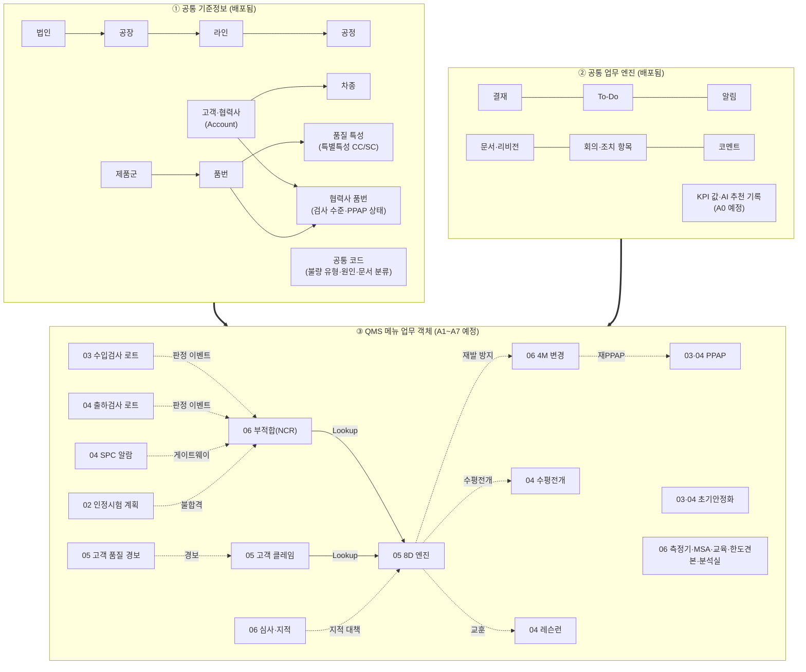

## 전체 목록

### 공통 — 기준정보

| 객체 API | 이름 | 종류 | 소유 WI | 필드 | 상태 | 상위(Master-Detail) | 비고 |
| --- | --- | --- | --- | --- | --- | --- | --- |
| User | 사용자 | 표준 확장 | CMN-00-MDM-001 | 7 | 배포됨 |  |  |
| Account | 거래처(고객·협력사) | 표준 확장 | CMN-00-MDM-003 | 11 | 배포됨 |  |  |
| CMN_Department__c | 부서 | 객체 | CMN-00-MDM-001 | 6 | 배포됨 |  |  |
| CMN_Company__c | 법인 | 객체 | CMN-00-MDM-002 | 2 | 배포됨 |  |  |
| CMN_Line__c | 라인 | 객체 | CMN-00-MDM-002 | 5 | 배포됨 | CMN_Plant__c |  |
| CMN_Operation__c | 공정 | 객체 | CMN-00-MDM-002 | 4 | 배포됨 | CMN_Line__c |  |
| CMN_Plant__c | 공장 | 객체 | CMN-00-MDM-002 | 6 | 배포됨 | CMN_Company__c |  |
| CMN_Vehicle__c | 차종 | 객체 | CMN-00-MDM-003 | 5 | 배포됨 |  |  |
| CMN_ItemPlant__c | 공장별 품번 | 객체 | CMN-00-MDM-004 | 0 | 배포됨 | CMN_Item__c, CMN_Plant__c |  |
| CMN_ItemVehicle__c | 적용 차종 | 객체 | CMN-00-MDM-004 | 0 | 배포됨 | CMN_Item__c, CMN_Vehicle__c |  |
| CMN_Item__c | 품번 | 객체 | CMN-00-MDM-004 | 9 | 배포됨 |  |  |
| CMN_ProductGroup__c | 제품군 | 객체 | CMN-00-MDM-004 | 2 | 배포됨 |  |  |
| CMN_SupplierItem__c | 협력사 품번 | 객체 | CMN-00-MDM-005 | 6 | 배포됨 | Account |  |
| CMN_Characteristic__c | 품질 특성 | 객체 | CMN-00-MDM-006 | 15 | 배포됨 | CMN_Item__c |  |
| CMN_CodeGroup__c | 코드 그룹 | 객체 | CMN-00-MDM-007 | 2 | 배포됨 |  |  |
| CMN_Code__c | 공통 코드 | 객체 | CMN-00-MDM-007 | 11 | 배포됨 | CMN_CodeGroup__c |  |
| CMN_UserPlantAccess__c | 공장 접근 | 객체 | CMN-00-SEC-002 | 4 | 배포됨 |  |  |
| CMN_DeleteLog__c | 삭제 기록 | 객체 | CMN-00-SEC-003 | 7 | 배포됨 |  |  |
| CMN_Setting__mdt | CMN 설정 | 메타데이터 | CMN-00-MDM-003 | 0 | 배포됨 |  | 구현 중 추가(명세 표 밖) |
| CMN_SharingConfig__mdt | 공유 설정 | 메타데이터 | CMN-00-SEC-002 | 0 | 배포됨 |  |  |
| CMN_DeleteGuard__mdt | 삭제 통제 | 메타데이터 | CMN-00-SEC-003 | 0 | 배포됨 |  |  |

### 공통 — 업무 엔진·운영

| 객체 API | 이름 | 종류 | 소유 WI | 필드 | 상태 | 상위(Master-Detail) | 비고 |
| --- | --- | --- | --- | --- | --- | --- | --- |
| CMN_AiRecommendation__c | AI 추천 기록 | 객체 | CMN-00-AI-004 | 17 | 예정 A0 |  |  |
| CMN_ApprovalRequest__c | 결재 요청 | 객체 | CMN-00-APV-001 | 13 | 배포됨 |  |  |
| CMN_ApprovalStep__c | 결재 단계 | 객체 | CMN-00-APV-001 | 10 | 배포됨 | CMN_ApprovalRequest__c |  |
| CMN_ApprovalTemplateStep__c | 템플릿 단계 | 객체 | CMN-00-APV-002 | 8 | 배포됨 | CMN_ApprovalTemplate__c |  |
| CMN_ApprovalTemplate__c | 결재선 템플릿 | 객체 | CMN-00-APV-002 | 6 | 배포됨 |  |  |
| CMN_RoleAssignment__c | 결재 Role 배정 | 객체 | CMN-00-APV-002 | 6 | 배포됨 |  |  |
| CMN_Delegation__c | 결재 위임 | 객체 | CMN-00-APV-004 | 7 | 배포됨 |  |  |
| CMN_LogSetting__c | 로그 설정 | 객체 | CMN-00-ARC-002 | 0 | 배포됨 |  |  |
| CMN_Log__c | 로그 | 객체 | CMN-00-ARC-002 | 6 | 배포됨 |  |  |
| CMN_NumberCounter__c | 채번 카운터 | 객체 | CMN-00-ARC-003 | 2 | 배포됨 |  |  |
| CMN_TestRecord__c | 테스트 레코드 | 객체 | CMN-00-ARC-003 | 0 | 배포됨 |  | 구현 중 추가(명세 표 밖) |
| CMN_DocTemplate__c | 문서 양식 | 객체 | CMN-00-DOC-001 | 0 | 배포됨 |  |  |
| CMN_DocumentRevision__c | 문서 리비전 | 객체 | CMN-00-DOC-001 | 13 | 배포됨 | CMN_Document__c |  |
| CMN_Document__c | 문서 | 객체 | CMN-00-DOC-001 | 6 | 배포됨 |  |  |
| CMN_UserDashboard__c | 사용자 대시보드 | 객체 | CMN-00-DSH-001 | 4 | 배포됨 |  |  |
| CMN_InboundReceipt__c | 수신 영수 | 객체 | CMN-00-DWH-003 | 0 | 예정 A0 |  |  |
| CMN_KpiValue__c | KPI 값 | 객체 | CMN-00-DWH-003 | 14 | 예정 A0 |  | 오브젝트 리뷰 O-2: 집계 단위·보존 기간 조정 권고 |
| CMN_InterfaceLog__c | 연계 로그 | 객체 | CMN-00-INT-001 | 8 | 배포됨 |  |  |
| CMN_Employee__c | 임직원 | 객체 | CMN-00-INT-002 | 8 | 배포됨 |  |  |
| CMN_ActionItem__c | 조치 항목 | 객체 | CMN-00-MTG-001 | 0 | 배포됨 |  |  |
| CMN_MeetingAttendee__c | 참석자 | 객체 | CMN-00-MTG-001 | 0 | 배포됨 | CMN_Meeting__c |  |
| CMN_Meeting__c | 회의 | 객체 | CMN-00-MTG-001 | 11 | 배포됨 |  |  |
| CMN_Todo__c | To-Do | 객체 | CMN-00-TDO-001 | 19 | 배포됨 |  |  |
| CMN_ScreenGuide__c | 화면 가이드 | 객체 | CMN-00-UX-002 | 7 | 예정 A0 |  |  |
| CMN_Comment__c | 코멘트 | 객체 | CMN-00-UX-003 | 5 | 배포됨 |  |  |
| CMN_ApprovalType__mdt | 결재 유형 | 메타데이터 | CMN-00-APV-001 | 0 | 배포됨 |  |  |
| CMN_FeatureSwitch__mdt | 기능 스위치 | 메타데이터 | CMN-00-ARC-002 | 0 | 배포됨 |  |  |
| CMN_TriggerSetting__mdt | 트리거 설정 | 메타데이터 | CMN-00-ARC-002 | 0 | 배포됨 |  |  |
| CMN_NumberingRule__mdt | 채번 규칙 | 메타데이터 | CMN-00-ARC-003 | 4 | 배포됨 |  |  |
| CMN_DashboardResolver__mdt | 대시보드 확장 | 메타데이터 | CMN-00-DSH-001 | 0 | 배포됨 |  | 구현 중 추가(명세 표 밖) |
| CMN_DashboardTemplateItem__mdt | 대시보드 템플릿 항목 | 메타데이터 | CMN-00-DSH-001 | 0 | 배포됨 |  |  |
| CMN_DashboardTemplate__mdt | 대시보드 템플릿 | 메타데이터 | CMN-00-DSH-001 | 0 | 배포됨 |  |  |
| CMN_Widget__mdt | 대시보드 위젯 | 메타데이터 | CMN-00-DSH-001 | 3 | 배포됨 |  |  |
| CMN_InboundRoute__mdt | 수신 경로 | 메타데이터 | CMN-00-DWH-003 | 0 | 예정 A0 |  |  |
| CMN_Interface__mdt | 인터페이스 | 메타데이터 | CMN-00-INT-001 | 0 | 배포됨 |  |  |
| CMN_NotificationRule__mdt | 알림 규칙 | 메타데이터 | CMN-00-NTF-001 | 4 | 배포됨 |  |  |
| CMN_StatusFlow__mdt | 상태 흐름 | 메타데이터 | CMN-00-UX-003 | 0 | 배포됨 |  |  |
| CMN_StatusStep__mdt | 상태 단계 | 메타데이터 | CMN-00-UX-003 | 0 | 배포됨 |  |  |
| CMN_RailPanel__mdt | 결정 지원 레일 패널 | 메타데이터 | CMN-00-UX-004 | 10 | 예정 A0 |  |  |
| CMN_UiRule__mdt | 화면 제어 규칙 | 메타데이터 | CMN-00-UX-005 | 11 | 예정 A0 |  |  |
| CMN_UiSection__mdt | 화면 섹션 필드 | 메타데이터 | CMN-00-UX-005 | 4 | 예정 A0 |  |  |
| CMN_GridColumn__mdt | 편집 그리드 열 | 메타데이터 | CMN-00-UX-006 | 12 | 예정 A0 |  |  |
| CMN_GridDefinition__mdt | 편집 그리드 정의 | 메타데이터 | CMN-00-UX-006 | 12 | 예정 A0 |  |  |
| CMN_AppMenuItem__mdt | 앱 메뉴 항목 | 메타데이터 | CMN-00-UX-007 | 4 | 배포됨 |  |  |
| CMN_AppMenu__mdt | 앱 메뉴 | 메타데이터 | CMN-00-UX-007 | 2 | 배포됨 |  |  |
| CMN_FieldEntryProvider__mdt | 현장 입력 제공자 등록 | 메타데이터 | CMN-00-UX-008 | 3 | 예정 A0 |  |  |
| CMN_ChecklistProvider__mdt | 체크리스트 제공자 등록 | 메타데이터 | CMN-00-UX-009 | 3 | 예정 A0 |  |  |
| CMN_ApprovalEvent__e | 결재 이벤트 | 이벤트 | CMN-00-APV-001 | 0 | 배포됨 |  |  |
| CMN_LogEvent__e | 로그 이벤트 | 이벤트 | CMN-00-ARC-002 | 0 | 배포됨 |  |  |
| CMN_ResultInbound__e | 결과 수신 이벤트 | 이벤트 | CMN-00-DWH-003 | 0 | 예정 A0 |  |  |
| CMN_TodoChanged__e | To-Do 변경 이벤트 | 이벤트 | CMN-00-TDO-001 | 0 | 배포됨 |  | 구현 중 추가(명세 표 밖) |

### QMS-02 개발 품질

| 객체 API | 이름 | 종류 | 소유 WI | 필드 | 상태 | 상위(Master-Detail) | 비고 |
| --- | --- | --- | --- | --- | --- | --- | --- |
| QMS_TestItem__c | 시험 항목 | 객체 | QMS-02-DVQ-001 | 18 | 예정 A1 |  |  |
| QMS_TestStandardLine__c | 시험 기준서 라인 | 객체 | QMS-02-DVQ-002 | 6 | 예정 A1 | QMS_TestStandard__c |  |
| QMS_TestStandard__c | 시험 기준서 | 객체 | QMS-02-DVQ-002 | 10 | 예정 A1 |  |  |
| QMS_QualPlanLine__c | 인정시험 계획 라인 | 객체 | QMS-02-DVQ-003 | 20 | 예정 A1 | QMS_QualPlan__c |  |
| QMS_QualPlan__c | 인정시험 계획 | 객체 | QMS-02-DVQ-003 | 26 | 예정 A1 |  |  |
| QMS_QualSampleResult__c | 시료별 시험 결과 | 객체 | QMS-02-DVQ-003 | 6 | 예정 A1 | QMS_QualPlanLine__c |  |
| QMS_SupplierTestSubmission__c | 협력사 시험 성적 제출 | 객체 | QMS-02-DVQ-010 | 10 | 예정 A1 |  |  |
| QMS_ReportFormat__mdt | 성적서 양식 | 메타데이터 | QMS-02-DVQ-009 | 1 | 예정 A1 |  |  |

### QMS-03 부품/협력사 품질

| 객체 API | 이름 | 종류 | 소유 WI | 필드 | 상태 | 상위(Master-Detail) | 비고 |
| --- | --- | --- | --- | --- | --- | --- | --- |
| Contact | 연락처(포털 사용자) | 표준 확장 | QMS-03-SPP-001 | 3 | 예정 A1 |  |  |
| QMS_IqcStandardLine__c | 수입검사 기준서 라인 | 객체 | QMS-03-IQC-001 | 11 | 예정 A1 | QMS_IqcStandard__c |  |
| QMS_IqcStandard__c | 수입검사 기준서 | 객체 | QMS-03-IQC-001 | 10 | 예정 A1 |  |  |
| QMS_SamplingPlanRow__c | 샘플링 표 행 | 객체 | QMS-03-IQC-001 | 7 | 예정 A1 | QMS_SamplingPlan__c |  |
| QMS_SamplingPlan__c | 샘플링 계획 | 객체 | QMS-03-IQC-001 | 4 | 예정 A1 |  |  |
| QMS_IqcLot__c | 수입검사 로트 | 객체 | QMS-03-IQC-002 | 39 | 예정 A1 |  |  |
| QMS_IqcResult__c | 수입검사 항목 결과 | 객체 | QMS-03-IQC-002 | 16 | 예정 A1 | QMS_IqcLot__c |  |
| QMS_IqcLevelChange__c | 검사 수준 전환 이력 | 객체 | QMS-03-IQC-005 | 7 | 예정 A1 |  |  |
| QMS_IqcLevelHold__c | 검사 수준 보류 | 객체 | QMS-03-IQC-005 | 8 | 예정 A1 |  |  |
| QMS_SupplierCoa__c | 협력사 출하 성적서(COA) | 객체 | QMS-03-IQC-006 | 18 | 예정 A1 |  |  |
| QMS_StabilizationPlan__c | 초기안정화 계획 | 객체 | QMS-03-PIS-001 | 47 | 예정 A1 |  |  |
| QMS_StabilizationReport__c | 초기안정화 실적 보고 | 객체 | QMS-03-PIS-002 | 13 | 예정 A1 |  |  |
| QMS_PpapElement__c | PPAP 요소 | 객체 | QMS-03-PPA-001 | 10 | 예정 A1 |  |  |
| QMS_PpapLevelRule__c | PPAP 제출 레벨 규칙 | 객체 | QMS-03-PPA-001 | 10 | 예정 A1 |  |  |
| QMS_PpapElementLine__c | PPAP 요소 라인 | 객체 | QMS-03-PPA-002 | 14 | 예정 A1 | QMS_Ppap__c |  |
| QMS_Ppap__c | PPAP | 객체 | QMS-03-PPA-002 | 36 | 예정 A1 |  |  |
| QMS_PpapSubmission__c | 협력사 PPAP 제출 | 객체 | QMS-03-PPA-003 | 12 | 예정 A1 |  |  |
| QMS_PeriodicTestSchedule__c | 부품 보증시험 일정 | 객체 | QMS-03-PWT-001 | 17 | 예정 A1 |  |  |
| QMS_PortalNotice__c | 포털 공지 | 객체 | QMS-03-SPP-002 | 7 | 예정 A1 |  |  |
| QMS_SupplierCertificate__c | 협력사 인증서 | 객체 | QMS-03-SPP-003 | 9 | 예정 A1 |  |  |
| QMS_IqcSwitchRule__mdt | 검사 수준 전환 규칙 | 메타데이터 | QMS-03-IQC-005 | 0 | 예정 A1 |  |  |
| QMS_StabilizationDefault__mdt | 초기안정화 기본값 | 메타데이터 | QMS-03-PIS-001 | 8 | 예정 A1 |  |  |
| QMS_PortalRoute__mdt | 포털 경로 | 메타데이터 | QMS-03-SPP-001 | 0 | 예정 A1 |  |  |
| QMS_IqcDecision__e | 수입검사 판정 이벤트 | 이벤트 | QMS-03-IQC-004 | 0 | 예정 A1 |  |  |

### QMS-04 제품/공정 품질

| 객체 API | 이름 | 종류 | 소유 WI | 필드 | 상태 | 상위(Master-Detail) | 비고 |
| --- | --- | --- | --- | --- | --- | --- | --- |
| QMS_MesDefectMap__c | MES 불량 코드 매핑 | 객체 | QMS-04-EFC-002 | 6 | 예정 A2 |  |  |
| QMS_FinalInspStandardLine__c | 출하검사 기준서 라인 | 객체 | QMS-04-FQC-001 | 12 | 예정 A2 | QMS_FinalInspStandard__c |  |
| QMS_FinalInspStandard__c | 출하검사 기준서 | 객체 | QMS-04-FQC-001 | 17 | 예정 A2 |  |  |
| QMS_FinalInspLot__c | 출하검사 로트 | 객체 | QMS-04-FQC-002 | 46 | 예정 A2 |  |  |
| QMS_FinalInspResult__c | 출하검사 항목 결과 | 객체 | QMS-04-FQC-002 | 16 | 예정 A2 | QMS_FinalInspLot__c |  |
| QMS_FinalInspHold__c | 출하 보류 | 객체 | QMS-04-FQC-003 | 11 | 예정 A2 |  |  |
| QMS_HorizontalDeployTarget__c | 수평전개 대상 | 객체 | QMS-04-HZD-001 | 23 | 예정 A2 |  | 오브젝트 리뷰 O-7: 수평전개와 Master-Detail로 변경 권고 |
| QMS_HorizontalDeploy__c | 수평전개 | 객체 | QMS-04-HZD-001 | 34 | 예정 A2 |  |  |
| QMS_LessonLearned__c | 레슨런 | 객체 | QMS-04-LEL-001 | 42 | 예정 A2 |  |  |
| QMS_LeleCheckpoint__c | 레슨런 체크포인트 | 객체 | QMS-04-LEL-003 | 10 | 예정 A2 | QMS_LessonLearned__c |  |
| QMS_LeleApplication__c | 레슨런 적용 검토 | 객체 | QMS-04-LEL-005 | 36 | 예정 A2 |  |  |
| QMS_PpapEvidence__c | PPAP 증빙 | 객체 | QMS-04-RPP-002 | 15 | 예정 A2 | QMS_PpapElementLine__c |  |
| QMS_PpapCustomerSubmission__c | 고객 PPAP 제출 | 객체 | QMS-04-RPP-004 | 16 | 예정 A2 | QMS_Ppap__c |  |
| QMS_SpcLimit__c | SPC 관리 한계 | 객체 | QMS-04-SPC-001 | 21 | 예정 A2 | QMS_SpcPlan__c |  |
| QMS_SpcPlan__c | SPC 계획 | 객체 | QMS-04-SPC-001 | 22 | 예정 A2 |  |  |
| QMS_OcapStep__c | OCAP 단계 | 객체 | QMS-04-SPC-005 | 8 | 예정 A2 | QMS_OcapTemplate__c |  |
| QMS_OcapTemplate__c | OCAP 템플릿 | 객체 | QMS-04-SPC-005 | 10 | 예정 A2 |  |  |
| QMS_SpcAlarm__c | SPC 알람 | 객체 | QMS-04-SPC-005 | 36 | 예정 A2 |  |  |
| QMS_PpapElementOwnerRule__mdt | PPAP 요소 담당 규칙 | 메타데이터 | QMS-04-RPP-001 | 0 | 예정 A2 |  |  |
| QMS_PpapCollector__mdt | PPAP 증빙 수집기 | 메타데이터 | QMS-04-RPP-002 | 0 | 예정 A2 |  |  |
| QMS_SpcRule__mdt | SPC 판정 규칙 | 메타데이터 | QMS-04-SPC-001 | 0 | 예정 A2 |  |  |
| QMS_FinalInspDecision__e | 출하 판정 이벤트 | 이벤트 | QMS-04-FQC-003 | 0 | 예정 A2 |  |  |

### QMS-05 고객 품질

| 객체 API | 이름 | 종류 | 소유 WI | 필드 | 상태 | 상위(Master-Detail) | 비고 |
| --- | --- | --- | --- | --- | --- | --- | --- |
| QMS_CustomerDefectMap__c | 고객 결함 코드 매핑 | 객체 | QMS-05-B2B-001 | 8 | 예정 A3 |  |  |
| QMS_CustomerPartMap__c | 고객 품번 매핑 | 객체 | QMS-05-B2B-001 | 7 | 예정 A3 |  |  |
| QMS_CustomerQualityOwner__c | 고객 품질 담당 | 객체 | QMS-05-B2B-001 | 5 | 예정 A3 |  |  |
| QMS_B2bUpload__c | 고객 데이터 업로드 | 객체 | QMS-05-B2B-002 | 14 | 예정 A3 |  |  |
| QMS_CustomerQualityTarget__c | 고객 품질 목표 | 객체 | QMS-05-B2B-003 | 8 | 예정 A3 |  |  |
| QMS_B2bTrendRule__c | 고객 품질 추세 규칙 | 객체 | QMS-05-B2B-004 | 21 | 예정 A3 |  |  |
| QMS_CustomerQualityAlert__c | 고객 품질 경보 | 객체 | QMS-05-B2B-005 | 37 | 예정 A3 |  |  |
| QMS_CustomerScorecard__c | 고객 평가(스코어카드) | 객체 | QMS-05-B2B-007 | 21 | 예정 A3 |  |  |
| QMS_EightDAction__c | 8D 조치 | 객체 | QMS-05-CLM-001 | 27 | 예정 A3 | QMS_EightD__c |  |
| QMS_EightDStep__c | 8D 단계(D1~D8) | 객체 | QMS-05-CLM-001 | 12 | 예정 A3 | QMS_EightD__c |  |
| QMS_EightDTeamMember__c | 8D 팀원 | 객체 | QMS-05-CLM-001 | 7 | 예정 A3 | QMS_EightD__c |  |
| QMS_EightD__c | 8D | 객체 | QMS-05-CLM-001 | 70 | 예정 A3 |  |  |
| QMS_EightDSubmission__c | 협력사 8D 제출 | 객체 | QMS-05-CLM-005 | 16 | 예정 A3 |  |  |
| QMS_Claim__c | 고객 클레임 | 객체 | QMS-05-CLM-007 | 45 | 예정 A3 |  |  |
| QMS_ClaimCost__c | 클레임 비용 | 객체 | QMS-05-CLM-010 | 9 | 예정 A3 | QMS_Claim__c |  |
| QMS_SupplierChargeback__c | 협력사 구상 | 객체 | QMS-05-CLM-010 | 19 | 예정 A3 |  |  |
| QMS_ClaimResponse__c | 클레임 고객 회신 | 객체 | QMS-05-CLM-011 | 13 | 예정 A3 | QMS_Claim__c |  |
| QMS_B2bFormat__mdt | 고객 데이터 양식 | 메타데이터 | QMS-05-B2B-002 | 11 | 예정 A3 |  |  |
| QMS_EightDStageField__mdt | 8D 단계별 필드 | 메타데이터 | QMS-05-CLM-005 | 0 | 예정 A3 |  |  |
| QMS_EightDFormat__mdt | 8D 보고서 양식 | 메타데이터 | QMS-05-CLM-006 | 9 | 예정 A3 |  |  |
| QMS_B2bUploadRequested__e | 고객 데이터 업로드 이벤트 | 이벤트 | QMS-05-B2B-002 | 0 | 예정 A3 |  |  |

### QMS-06 품질 운영 지원 — 4M 변경·부적합

| 객체 API | 이름 | 종류 | 소유 WI | 필드 | 상태 | 상위(Master-Detail) | 비고 |
| --- | --- | --- | --- | --- | --- | --- | --- |
| QMS_ChangeTypeRule__c | 4M 변경 유형 기준 | 객체 | QMS-06-4MC-001 | 23 | 예정 A4 |  |  |
| QMS_FourMChecklistItem__c | 4M 체크리스트 항목 | 객체 | QMS-06-4MC-001 | 9 | 예정 A4 | QMS_FourMChecklistTemplate__c |  |
| QMS_FourMChecklistTemplate__c | 4M 체크리스트 템플릿 | 객체 | QMS-06-4MC-001 | 3 | 예정 A4 |  |  |
| QMS_FourMChange__c | 4M 변경 | 객체 | QMS-06-4MC-002 | 53 | 예정 A4 |  |  |
| QMS_FourMItem__c | 4M 영향 품번 | 객체 | QMS-06-4MC-002 | 12 | 예정 A4 | QMS_FourMChange__c |  |
| QMS_FourMVerification__c | 4M 검증 | 객체 | QMS-06-4MC-002 | 26 | 예정 A4 | QMS_FourMChange__c |  |
| QMS_SupplierFourMRequestItem__c | 협력사 4M 신청 품번 | 객체 | QMS-06-4MC-004 | 2 | 예정 A4 | QMS_SupplierFourMRequest__c |  |
| QMS_SupplierFourMRequest__c | 협력사 4M 신청 | 객체 | QMS-06-4MC-004 | 16 | 예정 A4 |  |  |
| QMS_NCR__c | 부적합(NCR) | 객체 | QMS-06-NCR-001 | 69 | 예정 A4 |  |  |
| QMS_NcrContainment__c | 부적합 봉쇄 | 객체 | QMS-06-NCR-003 | 10 | 예정 A4 | QMS_NCR__c |  |
| QMS_NcrDisposition__c | 부적합 처분 | 객체 | QMS-06-NCR-003 | 24 | 예정 A4 | QMS_NCR__c |  |
| QMS_NcrSupplierResponse__c | 부적합 협력사 회신 | 객체 | QMS-06-NCR-004 | 12 | 예정 A4 |  |  |
| QMS_NcrChargeback__c | 부적합 구상 | 객체 | QMS-06-NCR-007 | 16 | 예정 A4 |  |  |
| QMS_NcrCost__c | 부적합 비용 | 객체 | QMS-06-NCR-007 | 10 | 예정 A4 | QMS_NCR__c |  |
| QMS_FourMApprovalRule__mdt | 4M 결재 규칙 | 메타데이터 | QMS-06-4MC-005 | 0 | 예정 A4 |  |  |
| QMS_NcrSourceConfig__mdt | 부적합 원천 설정 | 메타데이터 | QMS-06-NCR-002 | 0 | 예정 A4 |  |  |
| QMS_FourMEvent__e | 4M 이벤트 | 이벤트 | QMS-06-4MC-002 | 0 | 예정 A4 |  |  |
| QMS_NcrEvent__e | 부적합 이벤트 | 이벤트 | QMS-06-NCR-001 | 0 | 예정 A4 |  |  |

### QMS-06 품질 운영 지원 — 한도견본·교육·측정기·MSA·분석실

| 객체 API | 이름 | 종류 | 소유 WI | 필드 | 상태 | 상위(Master-Detail) | 비고 |
| --- | --- | --- | --- | --- | --- | --- | --- |
| QMS_Gauge__c | 측정기 | 객체 | QMS-06-GAU-001 | 34 | 예정 A5 |  |  |
| QMS_Calibration__c | 교정 | 객체 | QMS-06-GAU-002 | 29 | 예정 A5 | QMS_Gauge__c |  |
| QMS_GaugeStatusChange__c | 측정기 상태 변경 | 객체 | QMS-06-GAU-003 | 11 | 예정 A5 | QMS_Gauge__c |  |
| QMS_GaugeImpactAnalysis__c | 교정 불합격 영향 분석 | 객체 | QMS-06-GAU-004 | 19 | 예정 A5 |  |  |
| QMS_LabAnalysisItem__c | 분석 항목 | 객체 | QMS-06-LAB-001 | 17 | 예정 A5 |  |  |
| QMS_LabRequestItem__c | 분석 의뢰 항목 | 객체 | QMS-06-LAB-001 | 16 | 예정 A5 | QMS_LabRequest__c |  |
| QMS_LabRequest__c | 분석 의뢰 | 객체 | QMS-06-LAB-001 | 33 | 예정 A5 |  |  |
| QMS_LabSchedule__c | 정기 분석 일정 | 객체 | QMS-06-LAB-004 | 17 | 예정 A5 |  |  |
| QMS_LimitSampleView__c | 한도견본 열람 기록 | 객체 | QMS-06-LMS-001 | 6 | 예정 A5 | QMS_LimitSample__c |  |
| QMS_LimitSample__c | 한도견본 | 객체 | QMS-06-LMS-001 | 31 | 예정 A5 |  |  |
| QMS_LimitSampleCheck__c | 한도견본 점검 | 객체 | QMS-06-LMS-002 | 6 | 예정 A5 | QMS_LimitSampleCopy__c |  |
| QMS_LimitSampleCopy__c | 한도견본 사본 | 객체 | QMS-06-LMS-002 | 16 | 예정 A5 | QMS_LimitSample__c |  |
| QMS_MsaSchedule__c | MSA 일정 | 객체 | QMS-06-MSA-001 | 13 | 예정 A5 |  |  |
| QMS_MsaAppraiser__c | MSA 평가자 | 객체 | QMS-06-MSA-002 | 4 | 예정 A5 | QMS_MsaStudy__c |  |
| QMS_MsaStudy__c | MSA 연구 | 객체 | QMS-06-MSA-002 | 22 | 예정 A5 |  |  |
| QMS_TrainingCourse__c | 교육 과정 | 객체 | QMS-06-TRN-001 | 17 | 예정 A5 |  |  |
| QMS_TrainingPlan__c | 교육 계획 | 객체 | QMS-06-TRN-001 | 10 | 예정 A5 |  |  |
| QMS_TrainingSession__c | 교육 차수 | 객체 | QMS-06-TRN-001 | 18 | 예정 A5 |  |  |
| QMS_TrainingAttendance__c | 교육 이수 | 객체 | QMS-06-TRN-002 | 17 | 예정 A5 |  |  |
| QMS_QualificationRequirement__c | 자격 요건 | 객체 | QMS-06-TRN-003 | 4 | 예정 A5 | QMS_QualificationType__c |  |
| QMS_QualificationType__c | 자격 유형 | 객체 | QMS-06-TRN-003 | 18 | 예정 A5 |  |  |
| QMS_Qualification__c | 개인 자격 | 객체 | QMS-06-TRN-003 | 28 | 예정 A5 |  |  |
| QMS_GaugeSourceSetting__mdt | 측정기 원천 설정 | 메타데이터 | QMS-06-GAU-005 | 0 | 예정 A5 |  |  |
| QMS_GaugeStatusMap__mdt | 측정기 상태 매핑 | 메타데이터 | QMS-06-GAU-005 | 0 | 예정 A5 |  |  |
| QMS_QualMinStaff__mdt | 자격 최소 인원 | 메타데이터 | QMS-06-TRN-003 | 0 | 예정 A5 |  |  |

### QMS-06 품질 운영 지원 — 심사·인증·협력사 실적·개선 과제

| 객체 API | 이름 | 종류 | 소유 WI | 필드 | 상태 | 상위(Master-Detail) | 비고 |
| --- | --- | --- | --- | --- | --- | --- | --- |
| QMS_CustomerAuditPrepTask__c | 고객 심사 준비 과제 | 객체 | QMS-06-CAU-001 | 13 | 예정 A6 | QMS_Audit__c | 오브젝트 리뷰 O-5: 공통 조치 항목(CMN_ActionItem__c)으로 대체 권고 |
| QMS_Certification__c | 인증 | 객체 | QMS-06-CER-001 | 22 | 예정 A6 |  |  |
| QMS_AuditChecklist__c | 심사 체크리스트 | 객체 | QMS-06-IAU-001 | 23 | 예정 A6 |  |  |
| QMS_AuditGradeRule__c | 심사 등급 규칙 | 객체 | QMS-06-IAU-001 | 11 | 예정 A6 |  |  |
| QMS_AuditQuestion__c | 심사 질문 | 객체 | QMS-06-IAU-001 | 17 | 예정 A6 | QMS_AuditChecklist__c |  |
| QMS_AuditResultItem__c | 심사 결과 항목 | 객체 | QMS-06-IAU-002 | 16 | 예정 A6 | QMS_Audit__c |  |
| QMS_AuditTeamMember__c | 심사팀 | 객체 | QMS-06-IAU-002 | 9 | 예정 A6 | QMS_Audit__c |  |
| QMS_Audit__c | 심사 | 객체 | QMS-06-IAU-002 | 60 | 예정 A6 |  |  |
| QMS_AuditFindingAction__c | 심사 지적 조치 | 객체 | QMS-06-IAU-004 | 8 | 예정 A6 | QMS_AuditFinding__c | 오브젝트 리뷰 O-5: 공통 조치 항목(CMN_ActionItem__c)으로 대체 권고 |
| QMS_AuditFinding__c | 심사 지적 | 객체 | QMS-06-IAU-004 | 43 | 예정 A6 | QMS_Audit__c |  |
| QMS_AuditEvidenceRule__c | 심사 증빙 규칙 | 객체 | QMS-06-IAU-005 | 14 | 예정 A6 |  |  |
| QMS_AuditEvidenceSnapshot__c | 심사 증빙 스냅숏 | 객체 | QMS-06-IAU-005 | 9 | 예정 A6 | QMS_Audit__c |  |
| QMS_AuditProgramItem__c | 심사 프로그램 항목 | 객체 | QMS-06-IAU-006 | 15 | 예정 A6 | QMS_AuditProgram__c |  |
| QMS_AuditProgram__c | 연간 심사 프로그램 | 객체 | QMS-06-IAU-006 | 9 | 예정 A6 |  |  |
| QMS_ImprovementMember__c | 개선 과제 팀원 | 객체 | QMS-06-IMP-001 | 4 | 예정 A6 | QMS_ImprovementProject__c |  |
| QMS_ImprovementPhase__c | 개선 과제 단계 | 객체 | QMS-06-IMP-001 | 12 | 예정 A6 | QMS_ImprovementProject__c |  |
| QMS_ImprovementProject__c | 개선 과제 | 객체 | QMS-06-IMP-001 | 43 | 예정 A6 |  |  |
| QMS_ImprovementKpiValue__c | 개선 과제 KPI 값 | 객체 | QMS-06-IMP-002 | 6 | 예정 A6 | QMS_ImprovementProject__c |  |
| QMS_AuditFindingResponse__c | 협력사 지적 회신 | 객체 | QMS-06-SAU-002 | 18 | 예정 A6 |  |  |
| QMS_SupplierTargetSet__c | 협력사 목표 세트 | 객체 | QMS-06-SQM-001 | 5 | 예정 A6 |  |  |
| QMS_SupplierTarget__c | 협력사 목표 | 객체 | QMS-06-SQM-001 | 9 | 예정 A6 | QMS_SupplierTargetSet__c |  |
| QMS_SupplierScorecard__c | 협력사 스코어카드 | 객체 | QMS-06-SQM-002 | 22 | 예정 A6 |  |  |
| QMS_SupplierImprovementPlan__c | 협력사 개선 계획 | 객체 | QMS-06-SQM-003 | 14 | 예정 A6 |  |  |
| QMS_CustomerAuditPrepTemplate__mdt | 고객 심사 준비 템플릿 | 메타데이터 | QMS-06-CAU-001 | 0 | 예정 A6 |  |  |
| QMS_CertReadinessCheck__mdt | 인증 준비도 점검 | 메타데이터 | QMS-06-CER-001 | 0 | 예정 A6 |  |  |
| QMS_MgmtReviewInput__mdt | 경영검토 입력 | 메타데이터 | QMS-06-CER-002 | 0 | 예정 A6 |  |  |
| QMS_AuditScorer__mdt | 심사 점수 계산기 | 메타데이터 | QMS-06-IAU-001 | 0 | 예정 A6 |  |  |
| QMS_AuditQualificationMap__mdt | 심사원 자격 매핑 | 메타데이터 | QMS-06-IAU-002 | 0 | 예정 A6 |  |  |
| QMS_FindingDueRule__mdt | 지적 기한 규칙 | 메타데이터 | QMS-06-IAU-004 | 0 | 예정 A6 |  |  |
| QMS_AuditEvidenceQuery__mdt | 심사 증빙 쿼리 | 메타데이터 | QMS-06-IAU-005 | 0 | 예정 A6 |  |  |
| QMS_AuditFrequencyRule__mdt | 심사 주기 규칙 | 메타데이터 | QMS-06-IAU-006 | 0 | 예정 A6 |  |  |
| QMS_AuditRiskFactor__mdt | 심사 위험 요소 | 메타데이터 | QMS-06-IAU-006 | 0 | 예정 A6 |  |  |
| QMS_ImprovementTemplate__mdt | 개선 과제 템플릿 | 메타데이터 | QMS-06-IMP-001 | 0 | 예정 A6 |  |  |
| QMS_SupplierAuditRule__mdt | 협력사 심사 규칙 | 메타데이터 | QMS-06-SAU-001 | 0 | 예정 A6 |  |  |
| QMS_ScorecardMetric__mdt | 스코어카드 지표 | 메타데이터 | QMS-06-SQM-002 | 0 | 예정 A6 |  |  |
| QMS_SupplierGradeBand__mdt | 협력사 등급 구간 | 메타데이터 | QMS-06-SQM-002 | 0 | 예정 A6 |  |  |
| QMS_SupplierKnockOut__mdt | 협력사 즉시 탈락 조건 | 메타데이터 | QMS-06-SQM-002 | 0 | 예정 A6 |  |  |

### QMS-07 대시보드

| 객체 API | 이름 | 종류 | 소유 WI | 필드 | 상태 | 상위(Master-Detail) | 비고 |
| --- | --- | --- | --- | --- | --- | --- | --- |
| QMS_KpiFreshness__c | KPI 신선도 | 객체 | QMS-07-DSH-016 | 5 | 예정 A7 |  |  |
| QMS_WidgetUsageDaily__c | 위젯 일별 사용 | 객체 | QMS-07-DSH-016 | 10 | 예정 A7 |  |  |
| QMS_KpiDefinition__mdt | KPI 정의 | 메타데이터 | QMS-07-DSH-001 | 22 | 예정 A7 |  |  |
| QMS_WidgetCount__mdt | 위젯 건수 쿼리 | 메타데이터 | QMS-07-DSH-002 | 7 | 예정 A7 |  |  |
| QMS_WidgetList__mdt | 위젯 목록 쿼리 | 메타데이터 | QMS-07-DSH-002 | 8 | 예정 A7 |  |  |
| QMS_WidgetQuery__mdt | 위젯 등록 쿼리 | 메타데이터 | QMS-07-DSH-002 | 6 | 예정 A7 |  |  |
| QMS_SuggestedQuestion__mdt | 추천 질문 | 메타데이터 | QMS-07-DSH-012 | 6 | 예정 A7 |  |  |
| QMS_DashboardPersonaRule__mdt | 대시보드 페르소나 규칙 | 메타데이터 | QMS-07-DSH-013 | 6 | 예정 B단계(P11) |  |  |
| QMS_OverviewSection__mdt | 종합 대시보드 구역 | 메타데이터 | QMS-07-DSH-014 | 0 | 예정 A7 |  |  |
| QMS_WidgetTelemetry__e | 위젯 사용 이벤트 | 이벤트 | QMS-07-DSH-016 | 0 | 예정 A7 |  |  |

### QMS-08 AI

| 객체 API | 이름 | 종류 | 소유 WI | 필드 | 상태 | 상위(Master-Detail) | 비고 |
| --- | --- | --- | --- | --- | --- | --- | --- |
| QMS_AiUsageCounter__c | AI 사용량 | 객체 | QMS-08-AIQ-001 | 8 | 예정 B단계(P12) |  |  |
| QMS_EarlyWarning__c | 조기경보 | 객체 | QMS-08-AIQ-012 | 28 | 예정 A7 |  |  |
| QMS_AiEvalRun__c | AI 정확도 평가 | 객체 | QMS-08-AIQ-016 | 10 | 예정 B단계(P12) |  |  |
| QMS_AiPlantPolicy__mdt | AI 공장 정책 | 메타데이터 | QMS-08-AIQ-001 | 5 | 예정 B단계(P12) |  |  |
| QMS_AiUsageLimit__mdt | AI 사용 한도 | 메타데이터 | QMS-08-AIQ-001 | 5 | 예정 B단계(P12) |  |  |
| QMS_AiSourceAdapter__mdt | AI 원천 어댑터 | 메타데이터 | QMS-08-AIQ-004 | 5 | 예정 A7 |  |  |
| QMS_AiFinalizeConfig__mdt | AI 확정 설정 | 메타데이터 | QMS-08-AIQ-006 | 7 | 예정 B단계(P12) |  |  |
| QMS_AiQueryDef__mdt | AI 질의 정의 | 메타데이터 | QMS-08-AIQ-009 | 15 | 예정 B단계(P12) |  |  |
| QMS_AiPromptConfig__mdt | AI 프롬프트 설정 | 메타데이터 | QMS-08-AIQ-016 | 7 | 예정 B단계(P12) |  |  |
| QMS_AiJobEvent__e | AI 작업 이벤트 | 이벤트 | QMS-08-AIQ-001 | 0 | 예정 B단계(P12) |  |  |

### QMS-09 연계

| 객체 API | 이름 | 종류 | 소유 WI | 필드 | 상태 | 상위(Master-Detail) | 비고 |
| --- | --- | --- | --- | --- | --- | --- | --- |
| QMS_SyncResendLog__c | 재전송 기록 | 객체 | QMS-09-INT-002 | 7 | 예정 A7 |  |  |
| QMS_ExternalCodeMap__mdt | 외부 코드 매핑 | 메타데이터 | QMS-09-INT-001 | 6 | 예정 A7 |  |  |
| QMS_SyncMonitorConfig__mdt | 동기화 모니터 설정 | 메타데이터 | QMS-09-INT-002 | 11 | 예정 A7 |  |  |
| QMS_SapPostingRule__mdt | SAP 전기 규칙 | 메타데이터 | QMS-09-INT-005 | 10 | 예정 A7 |  |  |

## 메뉴별 ER 다이어그램

### 공통 — 기준정보

```mermaid
erDiagram
    Account {
        string api "Account"
        string name "거래처(고객·협력사)"
    }
    CMN_Characteristic_c {
        string api "CMN_Characteristic__c"
        string name "품질 특성"
    }
    CMN_CodeGroup_c {
        string api "CMN_CodeGroup__c"
        string name "코드 그룹"
    }
    CMN_Code_c {
        string api "CMN_Code__c"
        string name "공통 코드"
    }
    CMN_Company_c {
        string api "CMN_Company__c"
        string name "법인"
    }
    CMN_DeleteLog_c {
        string api "CMN_DeleteLog__c"
        string name "삭제 기록"
    }
    CMN_Department_c {
        string api "CMN_Department__c"
        string name "부서"
    }
    CMN_ItemPlant_c {
        string api "CMN_ItemPlant__c"
        string name "공장별 품번"
    }
    CMN_ItemVehicle_c {
        string api "CMN_ItemVehicle__c"
        string name "적용 차종"
    }
    CMN_Item_c {
        string api "CMN_Item__c"
        string name "품번"
    }
    CMN_Line_c {
        string api "CMN_Line__c"
        string name "라인"
    }
    CMN_Operation_c {
        string api "CMN_Operation__c"
        string name "공정"
    }
    CMN_Plant_c {
        string api "CMN_Plant__c"
        string name "공장"
    }
    CMN_ProductGroup_c {
        string api "CMN_ProductGroup__c"
        string name "제품군"
    }
    CMN_SupplierItem_c {
        string api "CMN_SupplierItem__c"
        string name "협력사 품번"
    }
    CMN_UserPlantAccess_c {
        string api "CMN_UserPlantAccess__c"
        string name "공장 접근"
    }
    CMN_Vehicle_c {
        string api "CMN_Vehicle__c"
        string name "차종"
    }
    User {
        string api "User"
        string name "사용자"
    }
    CMN_Plant_c |o--o{ CMN_Department_c : "Plant__c"
    CMN_Company_c ||--o{ CMN_Plant_c : "Company__c"
    CMN_ProductGroup_c |o--o{ CMN_Line_c : "ProductGroup__c"
    CMN_Plant_c ||--o{ CMN_Line_c : "Plant__c"
    CMN_Line_c ||--o{ CMN_Operation_c : "Line__c"
    Account |o--o{ CMN_Vehicle_c : "Customer__c"
    Account |o--o{ CMN_Item_c : "Customer__c"
    CMN_ProductGroup_c |o--o{ CMN_Item_c : "ProductGroup__c"
    CMN_Item_c ||--o{ CMN_ItemPlant_c : "Item__c"
    CMN_Plant_c ||--o{ CMN_ItemPlant_c : "Plant__c"
    CMN_Item_c ||--o{ CMN_ItemVehicle_c : "Item__c"
    CMN_Vehicle_c ||--o{ CMN_ItemVehicle_c : "Vehicle__c"
    CMN_Item_c |o--o{ CMN_SupplierItem_c : "Item__c"
    Account ||--o{ CMN_SupplierItem_c : "Supplier__c"
    CMN_Plant_c |o--o{ CMN_SupplierItem_c : "Plant__c"
    CMN_Item_c ||--o{ CMN_Characteristic_c : "Item__c"
    CMN_CodeGroup_c ||--o{ CMN_Code_c : "CodeGroup__c"
    CMN_Plant_c |o--o{ CMN_UserPlantAccess_c : "Plant__c"
```

### 공통 — 업무 엔진·운영

```mermaid
erDiagram
    Account {
        string api "Account"
        string name "거래처(고객·협력사) (다른 메뉴)"
    }
    CMN_ActionItem_c {
        string api "CMN_ActionItem__c"
        string name "조치 항목"
    }
    CMN_AiRecommendation_c {
        string api "CMN_AiRecommendation__c"
        string name "AI 추천 기록"
    }
    CMN_ApprovalRequest_c {
        string api "CMN_ApprovalRequest__c"
        string name "결재 요청"
    }
    CMN_ApprovalStep_c {
        string api "CMN_ApprovalStep__c"
        string name "결재 단계"
    }
    CMN_ApprovalTemplateStep_c {
        string api "CMN_ApprovalTemplateStep__c"
        string name "템플릿 단계"
    }
    CMN_ApprovalTemplate_c {
        string api "CMN_ApprovalTemplate__c"
        string name "결재선 템플릿"
    }
    CMN_Characteristic_c {
        string api "CMN_Characteristic__c"
        string name "품질 특성 (다른 메뉴)"
    }
    CMN_Comment_c {
        string api "CMN_Comment__c"
        string name "코멘트"
    }
    CMN_Delegation_c {
        string api "CMN_Delegation__c"
        string name "결재 위임"
    }
    CMN_Department_c {
        string api "CMN_Department__c"
        string name "부서 (다른 메뉴)"
    }
    CMN_DocTemplate_c {
        string api "CMN_DocTemplate__c"
        string name "문서 양식"
    }
    CMN_DocumentRevision_c {
        string api "CMN_DocumentRevision__c"
        string name "문서 리비전"
    }
    CMN_Document_c {
        string api "CMN_Document__c"
        string name "문서"
    }
    CMN_Employee_c {
        string api "CMN_Employee__c"
        string name "임직원"
    }
    CMN_InboundReceipt_c {
        string api "CMN_InboundReceipt__c"
        string name "수신 영수"
    }
    CMN_InterfaceLog_c {
        string api "CMN_InterfaceLog__c"
        string name "연계 로그"
    }
    CMN_Item_c {
        string api "CMN_Item__c"
        string name "품번 (다른 메뉴)"
    }
    CMN_KpiValue_c {
        string api "CMN_KpiValue__c"
        string name "KPI 값"
    }
    CMN_Line_c {
        string api "CMN_Line__c"
        string name "라인 (다른 메뉴)"
    }
    CMN_LogSetting_c {
        string api "CMN_LogSetting__c"
        string name "로그 설정"
    }
    CMN_Log_c {
        string api "CMN_Log__c"
        string name "로그"
    }
    CMN_MeetingAttendee_c {
        string api "CMN_MeetingAttendee__c"
        string name "참석자"
    }
    CMN_Meeting_c {
        string api "CMN_Meeting__c"
        string name "회의"
    }
    CMN_NumberCounter_c {
        string api "CMN_NumberCounter__c"
        string name "채번 카운터"
    }
    CMN_Plant_c {
        string api "CMN_Plant__c"
        string name "공장 (다른 메뉴)"
    }
    CMN_RoleAssignment_c {
        string api "CMN_RoleAssignment__c"
        string name "결재 Role 배정"
    }
    CMN_ScreenGuide_c {
        string api "CMN_ScreenGuide__c"
        string name "화면 가이드"
    }
    CMN_TestRecord_c {
        string api "CMN_TestRecord__c"
        string name "테스트 레코드"
    }
    CMN_Todo_c {
        string api "CMN_Todo__c"
        string name "To-Do"
    }
    CMN_UserDashboard_c {
        string api "CMN_UserDashboard__c"
        string name "사용자 대시보드"
    }
    CMN_Plant_c |o--o{ CMN_ApprovalRequest_c : "Plant__c"
    CMN_ApprovalRequest_c ||--o{ CMN_ApprovalStep_c : "Request__c"
    CMN_Plant_c |o--o{ CMN_RoleAssignment_c : "Plant__c"
    CMN_Department_c |o--o{ CMN_RoleAssignment_c : "Department__c"
    CMN_Plant_c |o--o{ CMN_ApprovalTemplate_c : "Plant__c"
    CMN_ApprovalTemplate_c ||--o{ CMN_ApprovalTemplateStep_c : "Template__c"
    CMN_Plant_c |o--o{ CMN_Todo_c : "Plant__c"
    Account |o--o{ CMN_Document_c : "Supplier__c"
    CMN_DocumentRevision_c |o--o{ CMN_Document_c : "CurrentRevision__c"
    CMN_Plant_c |o--o{ CMN_Document_c : "Plant__c"
    CMN_Document_c ||--o{ CMN_DocumentRevision_c : "Document__c"
    CMN_Plant_c |o--o{ CMN_Meeting_c : "Plant__c"
    CMN_Meeting_c ||--o{ CMN_MeetingAttendee_c : "Meeting__c"
    CMN_Meeting_c |o--o{ CMN_ActionItem_c : "Meeting__c"
    CMN_Plant_c |o--o{ CMN_ActionItem_c : "Plant__c"
    CMN_Plant_c |o--o{ CMN_InterfaceLog_c : "Plant__c"
    CMN_Department_c |o--o{ CMN_Employee_c : "Department__c"
    CMN_Plant_c |o--o{ CMN_KpiValue_c : "Plant__c"
    CMN_Line_c |o--o{ CMN_KpiValue_c : "Line__c"
    CMN_Item_c |o--o{ CMN_KpiValue_c : "Item__c"
    Account |o--o{ CMN_KpiValue_c : "Customer__c, Supplier__c"
    CMN_Characteristic_c |o--o{ CMN_KpiValue_c : "Characteristic__c"
    Account |o--o{ CMN_TestRecord_c : "Supplier__c"
    CMN_Plant_c |o--o{ CMN_TestRecord_c : "Plant__c"
```

### QMS-02 개발 품질

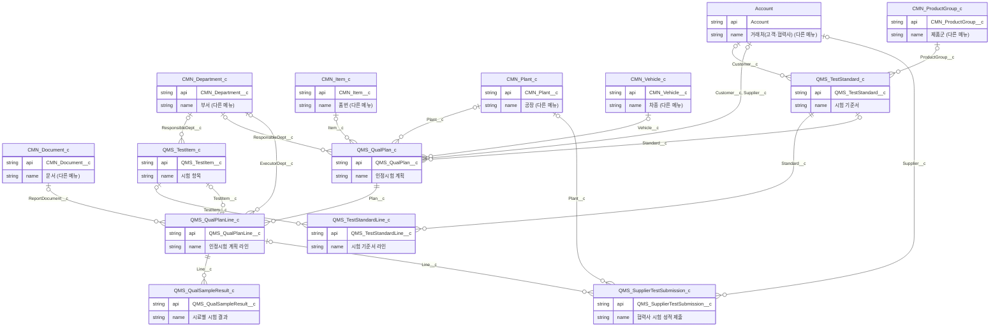

### QMS-03 부품/협력사 품질

```mermaid
erDiagram
    Account {
        string api "Account"
        string name "거래처(고객·협력사) (다른 메뉴)"
    }
    CMN_Characteristic_c {
        string api "CMN_Characteristic__c"
        string name "품질 특성 (다른 메뉴)"
    }
    CMN_Item_c {
        string api "CMN_Item__c"
        string name "품번 (다른 메뉴)"
    }
    CMN_Line_c {
        string api "CMN_Line__c"
        string name "라인 (다른 메뉴)"
    }
    CMN_Operation_c {
        string api "CMN_Operation__c"
        string name "공정 (다른 메뉴)"
    }
    CMN_Plant_c {
        string api "CMN_Plant__c"
        string name "공장 (다른 메뉴)"
    }
    CMN_SupplierItem_c {
        string api "CMN_SupplierItem__c"
        string name "협력사 품번 (다른 메뉴)"
    }
    CMN_Vehicle_c {
        string api "CMN_Vehicle__c"
        string name "차종 (다른 메뉴)"
    }
    Contact {
        string api "Contact"
        string name "연락처(포털 사용자)"
    }
    QMS_IqcLevelChange_c {
        string api "QMS_IqcLevelChange__c"
        string name "검사 수준 전환 이력"
    }
    QMS_IqcLevelHold_c {
        string api "QMS_IqcLevelHold__c"
        string name "검사 수준 보류"
    }
    QMS_IqcLot_c {
        string api "QMS_IqcLot__c"
        string name "수입검사 로트"
    }
    QMS_IqcResult_c {
        string api "QMS_IqcResult__c"
        string name "수입검사 항목 결과"
    }
    QMS_IqcStandardLine_c {
        string api "QMS_IqcStandardLine__c"
        string name "수입검사 기준서 라인"
    }
    QMS_IqcStandard_c {
        string api "QMS_IqcStandard__c"
        string name "수입검사 기준서"
    }
    QMS_PeriodicTestSchedule_c {
        string api "QMS_PeriodicTestSchedule__c"
        string name "부품 보증시험 일정"
    }
    QMS_PortalNotice_c {
        string api "QMS_PortalNotice__c"
        string name "포털 공지"
    }
    QMS_PpapElementLine_c {
        string api "QMS_PpapElementLine__c"
        string name "PPAP 요소 라인"
    }
    QMS_PpapElement_c {
        string api "QMS_PpapElement__c"
        string name "PPAP 요소"
    }
    QMS_PpapLevelRule_c {
        string api "QMS_PpapLevelRule__c"
        string name "PPAP 제출 레벨 규칙"
    }
    QMS_PpapSubmission_c {
        string api "QMS_PpapSubmission__c"
        string name "협력사 PPAP 제출"
    }
    QMS_Ppap_c {
        string api "QMS_Ppap__c"
        string name "PPAP"
    }
    QMS_SamplingPlanRow_c {
        string api "QMS_SamplingPlanRow__c"
        string name "샘플링 표 행"
    }
    QMS_SamplingPlan_c {
        string api "QMS_SamplingPlan__c"
        string name "샘플링 계획"
    }
    QMS_StabilizationPlan_c {
        string api "QMS_StabilizationPlan__c"
        string name "초기안정화 계획"
    }
    QMS_StabilizationReport_c {
        string api "QMS_StabilizationReport__c"
        string name "초기안정화 실적 보고"
    }
    QMS_SupplierCertificate_c {
        string api "QMS_SupplierCertificate__c"
        string name "협력사 인증서"
    }
    QMS_SupplierCoa_c {
        string api "QMS_SupplierCoa__c"
        string name "협력사 출하 성적서(COA)"
    }
    QMS_TestStandard_c {
        string api "QMS_TestStandard__c"
        string name "시험 기준서 (다른 메뉴)"
    }
    CMN_Plant_c |o--o{ QMS_PortalNotice_c : "Plant__c"
    Account |o--o{ QMS_SupplierCertificate_c : "Supplier__c"
    QMS_SamplingPlan_c ||--o{ QMS_SamplingPlanRow_c : "Plan__c"
    CMN_Item_c |o--o{ QMS_IqcStandard_c : "Item__c"
    CMN_Plant_c |o--o{ QMS_IqcStandard_c : "Plant__c"
    Account |o--o{ QMS_IqcStandard_c : "Supplier__c"
    QMS_SamplingPlan_c |o--o{ QMS_IqcStandard_c : "DefaultSamplingPlan__c"
    QMS_IqcStandard_c ||--o{ QMS_IqcStandardLine_c : "Standard__c"
    CMN_Characteristic_c |o--o{ QMS_IqcStandardLine_c : "Characteristic__c"
    QMS_SamplingPlan_c |o--o{ QMS_IqcStandardLine_c : "SamplingPlanOverride__c"
    CMN_Plant_c |o--o{ QMS_IqcLot_c : "Plant__c"
    CMN_Item_c |o--o{ QMS_IqcLot_c : "Item__c"
    Account |o--o{ QMS_IqcLot_c : "Supplier__c"
    CMN_SupplierItem_c |o--o{ QMS_IqcLot_c : "SupplierItem__c"
    QMS_IqcStandard_c |o--o{ QMS_IqcLot_c : "Standard__c"
    QMS_IqcLot_c ||--o{ QMS_IqcResult_c : "Lot__c"
    QMS_IqcStandardLine_c |o--o{ QMS_IqcResult_c : "StandardLine__c"
    CMN_Characteristic_c |o--o{ QMS_IqcResult_c : "Characteristic__c"
    CMN_SupplierItem_c |o--o{ QMS_IqcLevelChange_c : "SupplierItem__c"
    CMN_SupplierItem_c |o--o{ QMS_IqcLevelHold_c : "SupplierItem__c"
    CMN_SupplierItem_c |o--o{ QMS_SupplierCoa_c : "SupplierItem__c"
    Account |o--o{ QMS_SupplierCoa_c : "Supplier__c"
    CMN_Item_c |o--o{ QMS_SupplierCoa_c : "Item__c"
    CMN_Plant_c |o--o{ QMS_SupplierCoa_c : "Plant__c"
    QMS_IqcStandard_c |o--o{ QMS_SupplierCoa_c : "Standard__c"
    QMS_IqcLot_c |o--o{ QMS_SupplierCoa_c : "MatchedLot__c"
    CMN_SupplierItem_c |o--o{ QMS_PeriodicTestSchedule_c : "SupplierItem__c"
    Account |o--o{ QMS_PeriodicTestSchedule_c : "Supplier__c"
    CMN_Item_c |o--o{ QMS_PeriodicTestSchedule_c : "Item__c"
    CMN_Plant_c |o--o{ QMS_PeriodicTestSchedule_c : "Plant__c"
    QMS_TestStandard_c |o--o{ QMS_PeriodicTestSchedule_c : "Standard__c"
    CMN_SupplierItem_c |o--o{ QMS_Ppap_c : "SupplierItem__c"
    Account |o--o{ QMS_Ppap_c : "Customer__c, Supplier__c"
    CMN_Item_c |o--o{ QMS_Ppap_c : "Item__c"
    CMN_Plant_c |o--o{ QMS_Ppap_c : "Plant__c"
    CMN_Vehicle_c |o--o{ QMS_Ppap_c : "Vehicle__c"
    QMS_Ppap_c ||--o{ QMS_PpapElementLine_c : "Ppap__c"
    QMS_PpapElement_c |o--o{ QMS_PpapElementLine_c : "Element__c"
    QMS_Ppap_c |o--o{ QMS_PpapSubmission_c : "Ppap__c"
    Account |o--o{ QMS_PpapSubmission_c : "Supplier__c"
    CMN_Plant_c |o--o{ QMS_PpapSubmission_c : "Plant__c"
    CMN_SupplierItem_c |o--o{ QMS_StabilizationPlan_c : "SupplierItem__c"
    Account |o--o{ QMS_StabilizationPlan_c : "Customer__c, Supplier__c"
    CMN_Item_c |o--o{ QMS_StabilizationPlan_c : "Item__c"
    CMN_Plant_c |o--o{ QMS_StabilizationPlan_c : "Plant__c"
    CMN_Line_c |o--o{ QMS_StabilizationPlan_c : "Line__c"
    CMN_Vehicle_c |o--o{ QMS_StabilizationPlan_c : "Vehicle__c"
    CMN_Operation_c |o--o{ QMS_StabilizationPlan_c : "ContainmentOperation__c"
    QMS_StabilizationPlan_c |o--o{ QMS_StabilizationReport_c : "Plan__c"
    Account |o--o{ QMS_StabilizationReport_c : "Supplier__c"
    CMN_Plant_c |o--o{ QMS_StabilizationReport_c : "Plant__c"
```

### QMS-04 제품/공정 품질

```mermaid
erDiagram
    Account {
        string api "Account"
        string name "거래처(고객·협력사) (다른 메뉴)"
    }
    CMN_Characteristic_c {
        string api "CMN_Characteristic__c"
        string name "품질 특성 (다른 메뉴)"
    }
    CMN_Item_c {
        string api "CMN_Item__c"
        string name "품번 (다른 메뉴)"
    }
    CMN_Line_c {
        string api "CMN_Line__c"
        string name "라인 (다른 메뉴)"
    }
    CMN_Operation_c {
        string api "CMN_Operation__c"
        string name "공정 (다른 메뉴)"
    }
    CMN_Plant_c {
        string api "CMN_Plant__c"
        string name "공장 (다른 메뉴)"
    }
    CMN_ProductGroup_c {
        string api "CMN_ProductGroup__c"
        string name "제품군 (다른 메뉴)"
    }
    CMN_Vehicle_c {
        string api "CMN_Vehicle__c"
        string name "차종 (다른 메뉴)"
    }
    QMS_FinalInspHold_c {
        string api "QMS_FinalInspHold__c"
        string name "출하 보류"
    }
    QMS_FinalInspLot_c {
        string api "QMS_FinalInspLot__c"
        string name "출하검사 로트"
    }
    QMS_FinalInspResult_c {
        string api "QMS_FinalInspResult__c"
        string name "출하검사 항목 결과"
    }
    QMS_FinalInspStandardLine_c {
        string api "QMS_FinalInspStandardLine__c"
        string name "출하검사 기준서 라인"
    }
    QMS_FinalInspStandard_c {
        string api "QMS_FinalInspStandard__c"
        string name "출하검사 기준서"
    }
    QMS_HorizontalDeployTarget_c {
        string api "QMS_HorizontalDeployTarget__c"
        string name "수평전개 대상"
    }
    QMS_HorizontalDeploy_c {
        string api "QMS_HorizontalDeploy__c"
        string name "수평전개"
    }
    QMS_IqcStandardLine_c {
        string api "QMS_IqcStandardLine__c"
        string name "수입검사 기준서 라인 (다른 메뉴)"
    }
    QMS_LeleApplication_c {
        string api "QMS_LeleApplication__c"
        string name "레슨런 적용 검토"
    }
    QMS_LeleCheckpoint_c {
        string api "QMS_LeleCheckpoint__c"
        string name "레슨런 체크포인트"
    }
    QMS_LessonLearned_c {
        string api "QMS_LessonLearned__c"
        string name "레슨런"
    }
    QMS_MesDefectMap_c {
        string api "QMS_MesDefectMap__c"
        string name "MES 불량 코드 매핑"
    }
    QMS_OcapStep_c {
        string api "QMS_OcapStep__c"
        string name "OCAP 단계"
    }
    QMS_OcapTemplate_c {
        string api "QMS_OcapTemplate__c"
        string name "OCAP 템플릿"
    }
    QMS_PpapCustomerSubmission_c {
        string api "QMS_PpapCustomerSubmission__c"
        string name "고객 PPAP 제출"
    }
    QMS_PpapElementLine_c {
        string api "QMS_PpapElementLine__c"
        string name "PPAP 요소 라인 (다른 메뉴)"
    }
    QMS_PpapEvidence_c {
        string api "QMS_PpapEvidence__c"
        string name "PPAP 증빙"
    }
    QMS_Ppap_c {
        string api "QMS_Ppap__c"
        string name "PPAP (다른 메뉴)"
    }
    QMS_SamplingPlan_c {
        string api "QMS_SamplingPlan__c"
        string name "샘플링 계획 (다른 메뉴)"
    }
    QMS_SpcAlarm_c {
        string api "QMS_SpcAlarm__c"
        string name "SPC 알람"
    }
    QMS_SpcLimit_c {
        string api "QMS_SpcLimit__c"
        string name "SPC 관리 한계"
    }
    QMS_SpcPlan_c {
        string api "QMS_SpcPlan__c"
        string name "SPC 계획"
    }
    CMN_Plant_c |o--o{ QMS_MesDefectMap_c : "Plant__c"
    CMN_Characteristic_c |o--o{ QMS_SpcPlan_c : "Characteristic__c"
    CMN_Item_c |o--o{ QMS_SpcPlan_c : "Item__c"
    CMN_Plant_c |o--o{ QMS_SpcPlan_c : "Plant__c"
    QMS_SpcLimit_c |o--o{ QMS_SpcPlan_c : "CurrentLimit__c"
    QMS_SpcPlan_c ||--o{ QMS_SpcLimit_c : "SpcPlan__c"
    CMN_Characteristic_c |o--o{ QMS_OcapTemplate_c : "Characteristic__c"
    QMS_OcapTemplate_c ||--o{ QMS_OcapStep_c : "Template__c"
    QMS_SpcPlan_c |o--o{ QMS_SpcAlarm_c : "SpcPlan__c"
    CMN_Plant_c |o--o{ QMS_SpcAlarm_c : "Plant__c"
    CMN_Line_c |o--o{ QMS_SpcAlarm_c : "Line__c"
    CMN_Operation_c |o--o{ QMS_SpcAlarm_c : "Operation__c"
    CMN_Item_c |o--o{ QMS_SpcAlarm_c : "Item__c"
    CMN_Characteristic_c |o--o{ QMS_SpcAlarm_c : "Characteristic__c"
    QMS_OcapTemplate_c |o--o{ QMS_SpcAlarm_c : "OcapTemplate__c"
    CMN_Item_c |o--o{ QMS_FinalInspStandard_c : "Item__c"
    CMN_Plant_c |o--o{ QMS_FinalInspStandard_c : "Plant__c"
    Account |o--o{ QMS_FinalInspStandard_c : "Customer__c"
    QMS_SamplingPlan_c |o--o{ QMS_FinalInspStandard_c : "DefaultSamplingPlan__c"
    QMS_FinalInspStandard_c ||--o{ QMS_FinalInspStandardLine_c : "Standard__c"
    CMN_Characteristic_c |o--o{ QMS_FinalInspStandardLine_c : "Characteristic__c"
    QMS_SamplingPlan_c |o--o{ QMS_FinalInspStandardLine_c : "SamplingPlanOverride__c"
    CMN_Plant_c |o--o{ QMS_FinalInspLot_c : "Plant__c"
    CMN_Line_c |o--o{ QMS_FinalInspLot_c : "Line__c"
    CMN_Item_c |o--o{ QMS_FinalInspLot_c : "Item__c"
    Account |o--o{ QMS_FinalInspLot_c : "Customer__c"
    QMS_FinalInspStandard_c |o--o{ QMS_FinalInspLot_c : "Standard__c"
    QMS_FinalInspLot_c ||--o{ QMS_FinalInspResult_c : "Lot__c"
    QMS_IqcStandardLine_c |o--o{ QMS_FinalInspResult_c : "StandardLine__c"
    CMN_Characteristic_c |o--o{ QMS_FinalInspResult_c : "Characteristic__c"
    CMN_Item_c |o--o{ QMS_FinalInspHold_c : "Item__c"
    CMN_Plant_c |o--o{ QMS_FinalInspHold_c : "Plant__c"
    Account |o--o{ QMS_FinalInspHold_c : "Customer__c"
    CMN_Plant_c |o--o{ QMS_HorizontalDeploy_c : "Plant__c"
    CMN_Item_c |o--o{ QMS_HorizontalDeploy_c : "Item__c"
    CMN_ProductGroup_c |o--o{ QMS_HorizontalDeploy_c : "ProductGroup__c"
    Account |o--o{ QMS_HorizontalDeploy_c : "Customer__c, Supplier__c"
    QMS_HorizontalDeploy_c |o--o{ QMS_HorizontalDeployTarget_c : "Deploy__c"
    CMN_Plant_c |o--o{ QMS_HorizontalDeployTarget_c : "TargetPlant__c"
    CMN_Item_c |o--o{ QMS_HorizontalDeployTarget_c : "TargetItem__c"
    CMN_Line_c |o--o{ QMS_HorizontalDeployTarget_c : "TargetLine__c"
    Account |o--o{ QMS_HorizontalDeployTarget_c : "TargetSupplier__c"
    CMN_Plant_c |o--o{ QMS_LessonLearned_c : "Plant__c"
    Account |o--o{ QMS_LessonLearned_c : "Customer__c"
    CMN_Vehicle_c |o--o{ QMS_LessonLearned_c : "Vehicle__c"
    CMN_Item_c |o--o{ QMS_LessonLearned_c : "Item__c"
    CMN_ProductGroup_c |o--o{ QMS_LessonLearned_c : "ProductGroup__c"
    QMS_LessonLearned_c ||--o{ QMS_LeleCheckpoint_c : "LessonLearned__c"
    QMS_LessonLearned_c |o--o{ QMS_LeleApplication_c : "LessonLearned__c"
    QMS_LeleCheckpoint_c |o--o{ QMS_LeleApplication_c : "Checkpoint__c"
    Account |o--o{ QMS_LeleApplication_c : "Customer__c"
    CMN_Vehicle_c |o--o{ QMS_LeleApplication_c : "Vehicle__c"
    CMN_ProductGroup_c |o--o{ QMS_LeleApplication_c : "ProductGroup__c"
    QMS_PpapElementLine_c ||--o{ QMS_PpapEvidence_c : "ElementLine__c"
    QMS_Ppap_c ||--o{ QMS_PpapCustomerSubmission_c : "Ppap__c"
```

### QMS-05 고객 품질

```mermaid
erDiagram
    Account {
        string api "Account"
        string name "거래처(고객·협력사) (다른 메뉴)"
    }
    CMN_Characteristic_c {
        string api "CMN_Characteristic__c"
        string name "품질 특성 (다른 메뉴)"
    }
    CMN_Department_c {
        string api "CMN_Department__c"
        string name "부서 (다른 메뉴)"
    }
    CMN_Document_c {
        string api "CMN_Document__c"
        string name "문서 (다른 메뉴)"
    }
    CMN_Item_c {
        string api "CMN_Item__c"
        string name "품번 (다른 메뉴)"
    }
    CMN_Line_c {
        string api "CMN_Line__c"
        string name "라인 (다른 메뉴)"
    }
    CMN_Plant_c {
        string api "CMN_Plant__c"
        string name "공장 (다른 메뉴)"
    }
    CMN_ProductGroup_c {
        string api "CMN_ProductGroup__c"
        string name "제품군 (다른 메뉴)"
    }
    CMN_Vehicle_c {
        string api "CMN_Vehicle__c"
        string name "차종 (다른 메뉴)"
    }
    QMS_B2bTrendRule_c {
        string api "QMS_B2bTrendRule__c"
        string name "고객 품질 추세 규칙"
    }
    QMS_B2bUpload_c {
        string api "QMS_B2bUpload__c"
        string name "고객 데이터 업로드"
    }
    QMS_ClaimCost_c {
        string api "QMS_ClaimCost__c"
        string name "클레임 비용"
    }
    QMS_ClaimResponse_c {
        string api "QMS_ClaimResponse__c"
        string name "클레임 고객 회신"
    }
    QMS_Claim_c {
        string api "QMS_Claim__c"
        string name "고객 클레임"
    }
    QMS_CustomerDefectMap_c {
        string api "QMS_CustomerDefectMap__c"
        string name "고객 결함 코드 매핑"
    }
    QMS_CustomerPartMap_c {
        string api "QMS_CustomerPartMap__c"
        string name "고객 품번 매핑"
    }
    QMS_CustomerQualityAlert_c {
        string api "QMS_CustomerQualityAlert__c"
        string name "고객 품질 경보"
    }
    QMS_CustomerQualityOwner_c {
        string api "QMS_CustomerQualityOwner__c"
        string name "고객 품질 담당"
    }
    QMS_CustomerQualityTarget_c {
        string api "QMS_CustomerQualityTarget__c"
        string name "고객 품질 목표"
    }
    QMS_CustomerScorecard_c {
        string api "QMS_CustomerScorecard__c"
        string name "고객 평가(스코어카드)"
    }
    QMS_EightDAction_c {
        string api "QMS_EightDAction__c"
        string name "8D 조치"
    }
    QMS_EightDStep_c {
        string api "QMS_EightDStep__c"
        string name "8D 단계(D1~D8)"
    }
    QMS_EightDSubmission_c {
        string api "QMS_EightDSubmission__c"
        string name "협력사 8D 제출"
    }
    QMS_EightDTeamMember_c {
        string api "QMS_EightDTeamMember__c"
        string name "8D 팀원"
    }
    QMS_EightD_c {
        string api "QMS_EightD__c"
        string name "8D"
    }
    QMS_SupplierChargeback_c {
        string api "QMS_SupplierChargeback__c"
        string name "협력사 구상"
    }
    Account |o--o{ QMS_CustomerDefectMap_c : "Customer__c"
    Account |o--o{ QMS_CustomerPartMap_c : "Customer__c"
    CMN_Item_c |o--o{ QMS_CustomerPartMap_c : "Item__c"
    CMN_Plant_c |o--o{ QMS_CustomerPartMap_c : "Plant__c"
    Account |o--o{ QMS_CustomerQualityOwner_c : "Customer__c"
    CMN_Plant_c |o--o{ QMS_CustomerQualityOwner_c : "Plant__c"
    Account |o--o{ QMS_B2bUpload_c : "Customer__c"
    CMN_Document_c |o--o{ QMS_B2bUpload_c : "Document__c"
    Account |o--o{ QMS_CustomerQualityTarget_c : "Customer__c"
    CMN_Plant_c |o--o{ QMS_CustomerQualityTarget_c : "Plant__c"
    Account |o--o{ QMS_B2bTrendRule_c : "Customer__c"
    CMN_ProductGroup_c |o--o{ QMS_B2bTrendRule_c : "ProductGroup__c"
    Account |o--o{ QMS_CustomerQualityAlert_c : "Customer__c"
    CMN_Vehicle_c |o--o{ QMS_CustomerQualityAlert_c : "Vehicle__c"
    CMN_Item_c |o--o{ QMS_CustomerQualityAlert_c : "Item__c"
    CMN_Plant_c |o--o{ QMS_CustomerQualityAlert_c : "Plant__c"
    Account |o--o{ QMS_CustomerScorecard_c : "Customer__c"
    CMN_Plant_c |o--o{ QMS_CustomerScorecard_c : "Plant__c"
    CMN_Plant_c |o--o{ QMS_EightD_c : "Plant__c"
    CMN_Item_c |o--o{ QMS_EightD_c : "Item__c"
    Account |o--o{ QMS_EightD_c : "Customer__c, Supplier__c"
    CMN_Department_c |o--o{ QMS_EightD_c : "ResponsibleDept__c"
    CMN_Characteristic_c |o--o{ QMS_EightD_c : "Characteristic__c"
    QMS_EightD_c ||--o{ QMS_EightDStep_c : "EightD__c"
    QMS_EightD_c ||--o{ QMS_EightDTeamMember_c : "EightD__c"
    CMN_Department_c |o--o{ QMS_EightDTeamMember_c : "Department__c"
    QMS_EightD_c ||--o{ QMS_EightDAction_c : "EightD__c"
    CMN_Department_c |o--o{ QMS_EightDAction_c : "ResponsibleDept__c"
    QMS_EightD_c |o--o{ QMS_EightDSubmission_c : "EightD__c"
    Account |o--o{ QMS_EightDSubmission_c : "Supplier__c"
    CMN_Plant_c |o--o{ QMS_EightDSubmission_c : "Plant__c"
    Account |o--o{ QMS_Claim_c : "Customer__c"
    CMN_Vehicle_c |o--o{ QMS_Claim_c : "Vehicle__c"
    CMN_Item_c |o--o{ QMS_Claim_c : "Item__c"
    CMN_Plant_c |o--o{ QMS_Claim_c : "Plant__c"
    CMN_Line_c |o--o{ QMS_Claim_c : "Line__c"
    QMS_EightD_c |o--o{ QMS_Claim_c : "EightD__c"
    QMS_Claim_c ||--o{ QMS_ClaimCost_c : "Claim__c"
    QMS_Claim_c |o--o{ QMS_SupplierChargeback_c : "Claim__c"
    Account |o--o{ QMS_SupplierChargeback_c : "Supplier__c"
    CMN_Plant_c |o--o{ QMS_SupplierChargeback_c : "Plant__c"
    QMS_Claim_c ||--o{ QMS_ClaimResponse_c : "Claim__c"
```

### QMS-06 품질 운영 지원 — 4M 변경·부적합

```mermaid
erDiagram
    Account {
        string api "Account"
        string name "거래처(고객·협력사) (다른 메뉴)"
    }
    CMN_Characteristic_c {
        string api "CMN_Characteristic__c"
        string name "품질 특성 (다른 메뉴)"
    }
    CMN_Department_c {
        string api "CMN_Department__c"
        string name "부서 (다른 메뉴)"
    }
    CMN_Item_c {
        string api "CMN_Item__c"
        string name "품번 (다른 메뉴)"
    }
    CMN_Line_c {
        string api "CMN_Line__c"
        string name "라인 (다른 메뉴)"
    }
    CMN_Operation_c {
        string api "CMN_Operation__c"
        string name "공정 (다른 메뉴)"
    }
    CMN_Plant_c {
        string api "CMN_Plant__c"
        string name "공장 (다른 메뉴)"
    }
    CMN_SupplierItem_c {
        string api "CMN_SupplierItem__c"
        string name "협력사 품번 (다른 메뉴)"
    }
    CMN_Vehicle_c {
        string api "CMN_Vehicle__c"
        string name "차종 (다른 메뉴)"
    }
    QMS_ChangeTypeRule_c {
        string api "QMS_ChangeTypeRule__c"
        string name "4M 변경 유형 기준"
    }
    QMS_EightD_c {
        string api "QMS_EightD__c"
        string name "8D (다른 메뉴)"
    }
    QMS_FourMChange_c {
        string api "QMS_FourMChange__c"
        string name "4M 변경"
    }
    QMS_FourMChecklistItem_c {
        string api "QMS_FourMChecklistItem__c"
        string name "4M 체크리스트 항목"
    }
    QMS_FourMChecklistTemplate_c {
        string api "QMS_FourMChecklistTemplate__c"
        string name "4M 체크리스트 템플릿"
    }
    QMS_FourMItem_c {
        string api "QMS_FourMItem__c"
        string name "4M 영향 품번"
    }
    QMS_FourMVerification_c {
        string api "QMS_FourMVerification__c"
        string name "4M 검증"
    }
    QMS_NCR_c {
        string api "QMS_NCR__c"
        string name "부적합(NCR)"
    }
    QMS_NcrChargeback_c {
        string api "QMS_NcrChargeback__c"
        string name "부적합 구상"
    }
    QMS_NcrContainment_c {
        string api "QMS_NcrContainment__c"
        string name "부적합 봉쇄"
    }
    QMS_NcrCost_c {
        string api "QMS_NcrCost__c"
        string name "부적합 비용"
    }
    QMS_NcrDisposition_c {
        string api "QMS_NcrDisposition__c"
        string name "부적합 처분"
    }
    QMS_NcrSupplierResponse_c {
        string api "QMS_NcrSupplierResponse__c"
        string name "부적합 협력사 회신"
    }
    QMS_SupplierFourMRequestItem_c {
        string api "QMS_SupplierFourMRequestItem__c"
        string name "협력사 4M 신청 품번"
    }
    QMS_SupplierFourMRequest_c {
        string api "QMS_SupplierFourMRequest__c"
        string name "협력사 4M 신청"
    }
    QMS_FourMChecklistTemplate_c |o--o{ QMS_ChangeTypeRule_c : "ChecklistTemplate__c"
    QMS_FourMChecklistTemplate_c ||--o{ QMS_FourMChecklistItem_c : "Template__c"
    CMN_Plant_c |o--o{ QMS_FourMChange_c : "Plant__c"
    Account |o--o{ QMS_FourMChange_c : "Supplier__c"
    QMS_FourMChange_c ||--o{ QMS_FourMItem_c : "FourM__c"
    CMN_Item_c |o--o{ QMS_FourMItem_c : "Item__c"
    CMN_SupplierItem_c |o--o{ QMS_FourMItem_c : "SupplierItem__c"
    CMN_Line_c |o--o{ QMS_FourMItem_c : "Line__c"
    CMN_Operation_c |o--o{ QMS_FourMItem_c : "Operation__c"
    Account |o--o{ QMS_FourMItem_c : "Customer__c"
    QMS_FourMChange_c ||--o{ QMS_FourMVerification_c : "FourM__c"
    CMN_Item_c |o--o{ QMS_FourMVerification_c : "Item__c"
    Account |o--o{ QMS_FourMVerification_c : "Customer__c"
    Account |o--o{ QMS_SupplierFourMRequest_c : "Supplier__c"
    CMN_Plant_c |o--o{ QMS_SupplierFourMRequest_c : "Plant__c"
    QMS_SupplierFourMRequest_c ||--o{ QMS_SupplierFourMRequestItem_c : "Request__c"
    CMN_SupplierItem_c |o--o{ QMS_SupplierFourMRequestItem_c : "SupplierItem__c"
    CMN_Plant_c |o--o{ QMS_NCR_c : "Plant__c"
    CMN_Line_c |o--o{ QMS_NCR_c : "Line__c"
    CMN_Operation_c |o--o{ QMS_NCR_c : "Operation__c"
    CMN_Item_c |o--o{ QMS_NCR_c : "Item__c"
    Account |o--o{ QMS_NCR_c : "Customer__c, SupplierShareTo__c, Supplie"
    CMN_SupplierItem_c |o--o{ QMS_NCR_c : "SupplierItem__c"
    CMN_Vehicle_c |o--o{ QMS_NCR_c : "Vehicle__c"
    CMN_Characteristic_c |o--o{ QMS_NCR_c : "Characteristic__c"
    CMN_Department_c |o--o{ QMS_NCR_c : "ResponsibleDept__c"
    QMS_EightD_c |o--o{ QMS_NCR_c : "EightD__c"
    QMS_NCR_c ||--o{ QMS_NcrContainment_c : "Ncr__c"
    QMS_NCR_c ||--o{ QMS_NcrDisposition_c : "Ncr__c"
    QMS_NCR_c |o--o{ QMS_NcrSupplierResponse_c : "Ncr__c"
    Account |o--o{ QMS_NcrSupplierResponse_c : "Supplier__c"
    CMN_Department_c |o--o{ QMS_NcrSupplierResponse_c : "ResponsibleDept__c"
    CMN_Plant_c |o--o{ QMS_NcrSupplierResponse_c : "Plant__c"
    QMS_NCR_c ||--o{ QMS_NcrCost_c : "Ncr__c"
    QMS_NCR_c |o--o{ QMS_NcrChargeback_c : "Ncr__c"
    Account |o--o{ QMS_NcrChargeback_c : "Supplier__c"
    CMN_Plant_c |o--o{ QMS_NcrChargeback_c : "Plant__c"
```

### QMS-06 품질 운영 지원 — 한도견본·교육·측정기·MSA·분석실

```mermaid
erDiagram
    Account {
        string api "Account"
        string name "거래처(고객·협력사) (다른 메뉴)"
    }
    CMN_Characteristic_c {
        string api "CMN_Characteristic__c"
        string name "품질 특성 (다른 메뉴)"
    }
    CMN_Department_c {
        string api "CMN_Department__c"
        string name "부서 (다른 메뉴)"
    }
    CMN_Employee_c {
        string api "CMN_Employee__c"
        string name "임직원 (다른 메뉴)"
    }
    CMN_Item_c {
        string api "CMN_Item__c"
        string name "품번 (다른 메뉴)"
    }
    CMN_Line_c {
        string api "CMN_Line__c"
        string name "라인 (다른 메뉴)"
    }
    CMN_Plant_c {
        string api "CMN_Plant__c"
        string name "공장 (다른 메뉴)"
    }
    QMS_Calibration_c {
        string api "QMS_Calibration__c"
        string name "교정"
    }
    QMS_GaugeImpactAnalysis_c {
        string api "QMS_GaugeImpactAnalysis__c"
        string name "교정 불합격 영향 분석"
    }
    QMS_GaugeStatusChange_c {
        string api "QMS_GaugeStatusChange__c"
        string name "측정기 상태 변경"
    }
    QMS_Gauge_c {
        string api "QMS_Gauge__c"
        string name "측정기"
    }
    QMS_LabAnalysisItem_c {
        string api "QMS_LabAnalysisItem__c"
        string name "분석 항목"
    }
    QMS_LabRequestItem_c {
        string api "QMS_LabRequestItem__c"
        string name "분석 의뢰 항목"
    }
    QMS_LabRequest_c {
        string api "QMS_LabRequest__c"
        string name "분석 의뢰"
    }
    QMS_LabSchedule_c {
        string api "QMS_LabSchedule__c"
        string name "정기 분석 일정"
    }
    QMS_LimitSampleCheck_c {
        string api "QMS_LimitSampleCheck__c"
        string name "한도견본 점검"
    }
    QMS_LimitSampleCopy_c {
        string api "QMS_LimitSampleCopy__c"
        string name "한도견본 사본"
    }
    QMS_LimitSampleView_c {
        string api "QMS_LimitSampleView__c"
        string name "한도견본 열람 기록"
    }
    QMS_LimitSample_c {
        string api "QMS_LimitSample__c"
        string name "한도견본"
    }
    QMS_MsaAppraiser_c {
        string api "QMS_MsaAppraiser__c"
        string name "MSA 평가자"
    }
    QMS_MsaSchedule_c {
        string api "QMS_MsaSchedule__c"
        string name "MSA 일정"
    }
    QMS_MsaStudy_c {
        string api "QMS_MsaStudy__c"
        string name "MSA 연구"
    }
    QMS_QualificationRequirement_c {
        string api "QMS_QualificationRequirement__c"
        string name "자격 요건"
    }
    QMS_QualificationType_c {
        string api "QMS_QualificationType__c"
        string name "자격 유형"
    }
    QMS_Qualification_c {
        string api "QMS_Qualification__c"
        string name "개인 자격"
    }
    QMS_TrainingAttendance_c {
        string api "QMS_TrainingAttendance__c"
        string name "교육 이수"
    }
    QMS_TrainingCourse_c {
        string api "QMS_TrainingCourse__c"
        string name "교육 과정"
    }
    QMS_TrainingPlan_c {
        string api "QMS_TrainingPlan__c"
        string name "교육 계획"
    }
    QMS_TrainingSession_c {
        string api "QMS_TrainingSession__c"
        string name "교육 차수"
    }
    CMN_Item_c |o--o{ QMS_LimitSample_c : "Item__c"
    CMN_Characteristic_c |o--o{ QMS_LimitSample_c : "Characteristic__c"
    CMN_Plant_c |o--o{ QMS_LimitSample_c : "Plant__c"
    Account |o--o{ QMS_LimitSample_c : "Customer__c, Supplier__c"
    QMS_LimitSample_c ||--o{ QMS_LimitSampleView_c : "LimitSample__c"
    QMS_LimitSample_c ||--o{ QMS_LimitSampleCopy_c : "LimitSample__c"
    CMN_Plant_c |o--o{ QMS_LimitSampleCopy_c : "Plant__c"
    CMN_Line_c |o--o{ QMS_LimitSampleCopy_c : "Line__c"
    Account |o--o{ QMS_LimitSampleCopy_c : "Supplier__c"
    CMN_Employee_c |o--o{ QMS_LimitSampleCopy_c : "Custodian__c"
    QMS_LimitSampleCopy_c ||--o{ QMS_LimitSampleCheck_c : "Copy__c"
    CMN_Employee_c |o--o{ QMS_LimitSampleCheck_c : "CheckedByEmployee__c"
    CMN_Department_c |o--o{ QMS_TrainingCourse_c : "OwnerDept__c"
    CMN_Plant_c |o--o{ QMS_TrainingPlan_c : "Plant__c"
    CMN_Department_c |o--o{ QMS_TrainingPlan_c : "Department__c"
    QMS_TrainingCourse_c |o--o{ QMS_TrainingSession_c : "Course__c"
    QMS_TrainingPlan_c |o--o{ QMS_TrainingSession_c : "Plan__c"
    CMN_Plant_c |o--o{ QMS_TrainingSession_c : "Plant__c"
    CMN_Employee_c |o--o{ QMS_TrainingSession_c : "Instructor__c"
    QMS_TrainingCourse_c |o--o{ QMS_TrainingAttendance_c : "Course__c"
    QMS_TrainingSession_c |o--o{ QMS_TrainingAttendance_c : "Session__c"
    CMN_Employee_c |o--o{ QMS_TrainingAttendance_c : "Employee__c"
    CMN_Plant_c |o--o{ QMS_TrainingAttendance_c : "Plant__c"
    QMS_QualificationType_c ||--o{ QMS_QualificationRequirement_c : "QualificationType__c"
    QMS_TrainingCourse_c |o--o{ QMS_QualificationRequirement_c : "Course__c"
    CMN_Employee_c |o--o{ QMS_Qualification_c : "Employee__c"
    QMS_QualificationType_c |o--o{ QMS_Qualification_c : "QualificationType__c"
    CMN_Plant_c |o--o{ QMS_Qualification_c : "Plant__c"
    CMN_Plant_c |o--o{ QMS_Gauge_c : "Plant__c"
    CMN_Department_c |o--o{ QMS_Gauge_c : "Department__c"
    CMN_Line_c |o--o{ QMS_Gauge_c : "Line__c"
    CMN_Employee_c |o--o{ QMS_Gauge_c : "Custodian__c"
    Account |o--o{ QMS_Gauge_c : "OwnerAccount__c"
    CMN_Item_c |o--o{ QMS_Gauge_c : "Item__c"
    QMS_Gauge_c ||--o{ QMS_Calibration_c : "Gauge__c"
    CMN_Employee_c |o--o{ QMS_Calibration_c : "PerformedBy__c"
    QMS_Gauge_c ||--o{ QMS_GaugeStatusChange_c : "Gauge__c"
    QMS_Gauge_c |o--o{ QMS_GaugeImpactAnalysis_c : "Gauge__c"
    QMS_Calibration_c |o--o{ QMS_GaugeImpactAnalysis_c : "Calibration__c"
    CMN_Plant_c |o--o{ QMS_GaugeImpactAnalysis_c : "Plant__c"
    CMN_Plant_c |o--o{ QMS_MsaSchedule_c : "Plant__c"
    CMN_Characteristic_c |o--o{ QMS_MsaSchedule_c : "Characteristic__c"
    QMS_Gauge_c |o--o{ QMS_MsaSchedule_c : "Gauge__c"
    QMS_MsaSchedule_c |o--o{ QMS_MsaStudy_c : "Schedule__c"
    CMN_Plant_c |o--o{ QMS_MsaStudy_c : "Plant__c"
    QMS_Gauge_c |o--o{ QMS_MsaStudy_c : "Gauge__c"
    CMN_Characteristic_c |o--o{ QMS_MsaStudy_c : "Characteristic__c"
    QMS_MsaStudy_c ||--o{ QMS_MsaAppraiser_c : "Study__c"
    CMN_Employee_c |o--o{ QMS_MsaAppraiser_c : "Employee__c"
    CMN_Plant_c |o--o{ QMS_LabAnalysisItem_c : "Plant__c"
    CMN_Plant_c |o--o{ QMS_LabRequest_c : "Plant__c, RequesterPlant__c"
    CMN_Department_c |o--o{ QMS_LabRequest_c : "RequesterDept__c"
    CMN_Item_c |o--o{ QMS_LabRequest_c : "Item__c"
    Account |o--o{ QMS_LabRequest_c : "Supplier__c"
    QMS_LabRequest_c ||--o{ QMS_LabRequestItem_c : "Request__c"
    QMS_LabAnalysisItem_c |o--o{ QMS_LabRequestItem_c : "AnalysisItem__c"
    QMS_Gauge_c |o--o{ QMS_LabRequestItem_c : "Equipment__c"
    CMN_Plant_c |o--o{ QMS_LabSchedule_c : "Plant__c"
    CMN_Item_c |o--o{ QMS_LabSchedule_c : "Item__c"
    Account |o--o{ QMS_LabSchedule_c : "Supplier__c"
    CMN_Department_c |o--o{ QMS_LabSchedule_c : "RequesterDept__c"
```

### QMS-06 품질 운영 지원 — 심사·인증·협력사 실적·개선 과제

```mermaid
erDiagram
    Account {
        string api "Account"
        string name "거래처(고객·협력사) (다른 메뉴)"
    }
    CMN_Department_c {
        string api "CMN_Department__c"
        string name "부서 (다른 메뉴)"
    }
    CMN_Employee_c {
        string api "CMN_Employee__c"
        string name "임직원 (다른 메뉴)"
    }
    CMN_Item_c {
        string api "CMN_Item__c"
        string name "품번 (다른 메뉴)"
    }
    CMN_Line_c {
        string api "CMN_Line__c"
        string name "라인 (다른 메뉴)"
    }
    CMN_Plant_c {
        string api "CMN_Plant__c"
        string name "공장 (다른 메뉴)"
    }
    CMN_ProductGroup_c {
        string api "CMN_ProductGroup__c"
        string name "제품군 (다른 메뉴)"
    }
    QMS_AuditChecklist_c {
        string api "QMS_AuditChecklist__c"
        string name "심사 체크리스트"
    }
    QMS_AuditEvidenceRule_c {
        string api "QMS_AuditEvidenceRule__c"
        string name "심사 증빙 규칙"
    }
    QMS_AuditEvidenceSnapshot_c {
        string api "QMS_AuditEvidenceSnapshot__c"
        string name "심사 증빙 스냅숏"
    }
    QMS_AuditFindingAction_c {
        string api "QMS_AuditFindingAction__c"
        string name "심사 지적 조치"
    }
    QMS_AuditFindingResponse_c {
        string api "QMS_AuditFindingResponse__c"
        string name "협력사 지적 회신"
    }
    QMS_AuditFinding_c {
        string api "QMS_AuditFinding__c"
        string name "심사 지적"
    }
    QMS_AuditGradeRule_c {
        string api "QMS_AuditGradeRule__c"
        string name "심사 등급 규칙"
    }
    QMS_AuditProgramItem_c {
        string api "QMS_AuditProgramItem__c"
        string name "심사 프로그램 항목"
    }
    QMS_AuditProgram_c {
        string api "QMS_AuditProgram__c"
        string name "연간 심사 프로그램"
    }
    QMS_AuditQuestion_c {
        string api "QMS_AuditQuestion__c"
        string name "심사 질문"
    }
    QMS_AuditResultItem_c {
        string api "QMS_AuditResultItem__c"
        string name "심사 결과 항목"
    }
    QMS_AuditTeamMember_c {
        string api "QMS_AuditTeamMember__c"
        string name "심사팀"
    }
    QMS_Audit_c {
        string api "QMS_Audit__c"
        string name "심사"
    }
    QMS_Certification_c {
        string api "QMS_Certification__c"
        string name "인증"
    }
    QMS_CustomerAuditPrepTask_c {
        string api "QMS_CustomerAuditPrepTask__c"
        string name "고객 심사 준비 과제"
    }
    QMS_ImprovementKpiValue_c {
        string api "QMS_ImprovementKpiValue__c"
        string name "개선 과제 KPI 값"
    }
    QMS_ImprovementMember_c {
        string api "QMS_ImprovementMember__c"
        string name "개선 과제 팀원"
    }
    QMS_ImprovementPhase_c {
        string api "QMS_ImprovementPhase__c"
        string name "개선 과제 단계"
    }
    QMS_ImprovementProject_c {
        string api "QMS_ImprovementProject__c"
        string name "개선 과제"
    }
    QMS_SupplierImprovementPlan_c {
        string api "QMS_SupplierImprovementPlan__c"
        string name "협력사 개선 계획"
    }
    QMS_SupplierScorecard_c {
        string api "QMS_SupplierScorecard__c"
        string name "협력사 스코어카드"
    }
    QMS_SupplierTargetSet_c {
        string api "QMS_SupplierTargetSet__c"
        string name "협력사 목표 세트"
    }
    QMS_SupplierTarget_c {
        string api "QMS_SupplierTarget__c"
        string name "협력사 목표"
    }
    QMS_AuditChecklist_c ||--o{ QMS_AuditQuestion_c : "Checklist__c"
    QMS_AuditChecklist_c |o--o{ QMS_AuditGradeRule_c : "Checklist__c"
    CMN_Plant_c |o--o{ QMS_Audit_c : "Plant__c"
    Account |o--o{ QMS_Audit_c : "Customer__c, Supplier__c"
    QMS_AuditChecklist_c |o--o{ QMS_Audit_c : "Checklist__c"
    CMN_ProductGroup_c |o--o{ QMS_Audit_c : "ProductGroup__c"
    CMN_Item_c |o--o{ QMS_Audit_c : "Item__c"
    CMN_Department_c |o--o{ QMS_Audit_c : "AuditeeDept__c"
    QMS_AuditProgramItem_c |o--o{ QMS_Audit_c : "ProgramItem__c"
    QMS_Audit_c ||--o{ QMS_AuditTeamMember_c : "Audit__c"
    QMS_Audit_c ||--o{ QMS_AuditResultItem_c : "Audit__c"
    QMS_AuditQuestion_c |o--o{ QMS_AuditResultItem_c : "Question__c"
    QMS_Audit_c ||--o{ QMS_AuditFinding_c : "Audit__c"
    QMS_AuditResultItem_c |o--o{ QMS_AuditFinding_c : "ResultItem__c"
    CMN_Plant_c |o--o{ QMS_AuditFinding_c : "Plant__c"
    Account |o--o{ QMS_AuditFinding_c : "Customer__c, Supplier__c"
    CMN_Department_c |o--o{ QMS_AuditFinding_c : "ResponsibleDept__c"
    QMS_AuditFinding_c ||--o{ QMS_AuditFindingAction_c : "Finding__c"
    QMS_Audit_c ||--o{ QMS_AuditEvidenceSnapshot_c : "Audit__c"
    QMS_AuditResultItem_c |o--o{ QMS_AuditEvidenceSnapshot_c : "ResultItem__c"
    CMN_Plant_c |o--o{ QMS_AuditProgram_c : "Plant__c"
    QMS_AuditProgram_c ||--o{ QMS_AuditProgramItem_c : "Program__c"
    CMN_Line_c |o--o{ QMS_AuditProgramItem_c : "Line__c"
    CMN_ProductGroup_c |o--o{ QMS_AuditProgramItem_c : "ProductGroup__c"
    CMN_Item_c |o--o{ QMS_AuditProgramItem_c : "Item__c"
    QMS_Audit_c |o--o{ QMS_AuditProgramItem_c : "Audit__c"
    QMS_AuditFinding_c |o--o{ QMS_AuditFindingResponse_c : "Finding__c"
    QMS_Audit_c |o--o{ QMS_AuditFindingResponse_c : "Audit__c"
    Account |o--o{ QMS_AuditFindingResponse_c : "Supplier__c"
    CMN_Plant_c |o--o{ QMS_AuditFindingResponse_c : "Plant__c"
    QMS_Audit_c ||--o{ QMS_CustomerAuditPrepTask_c : "Audit__c"
    CMN_Plant_c |o--o{ QMS_Certification_c : "Plant__c"
    CMN_Plant_c |o--o{ QMS_SupplierTargetSet_c : "Plant__c"
    QMS_SupplierTargetSet_c ||--o{ QMS_SupplierTarget_c : "TargetSet__c"
    Account |o--o{ QMS_SupplierTarget_c : "Supplier__c"
    Account |o--o{ QMS_SupplierScorecard_c : "Supplier__c"
    CMN_Plant_c |o--o{ QMS_SupplierScorecard_c : "Plant__c"
    Account |o--o{ QMS_SupplierImprovementPlan_c : "Supplier__c"
    CMN_Plant_c |o--o{ QMS_SupplierImprovementPlan_c : "Plant__c"
    QMS_SupplierScorecard_c |o--o{ QMS_SupplierImprovementPlan_c : "Scorecard__c"
    CMN_Plant_c |o--o{ QMS_ImprovementProject_c : "Plant__c"
    CMN_Department_c |o--o{ QMS_ImprovementProject_c : "Department__c"
    Account |o--o{ QMS_ImprovementProject_c : "Customer__c, Supplier__c"
    CMN_Item_c |o--o{ QMS_ImprovementProject_c : "Item__c"
    CMN_Line_c |o--o{ QMS_ImprovementProject_c : "Line__c"
    QMS_ImprovementProject_c ||--o{ QMS_ImprovementPhase_c : "Project__c"
    QMS_ImprovementProject_c ||--o{ QMS_ImprovementMember_c : "Project__c"
    CMN_Employee_c |o--o{ QMS_ImprovementMember_c : "Employee__c"
    QMS_ImprovementProject_c ||--o{ QMS_ImprovementKpiValue_c : "Project__c"
```

### QMS-07 대시보드

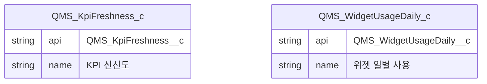

### QMS-08 AI

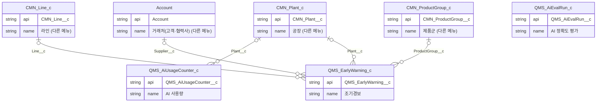

### QMS-09 연계

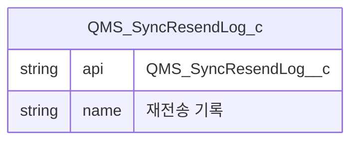

